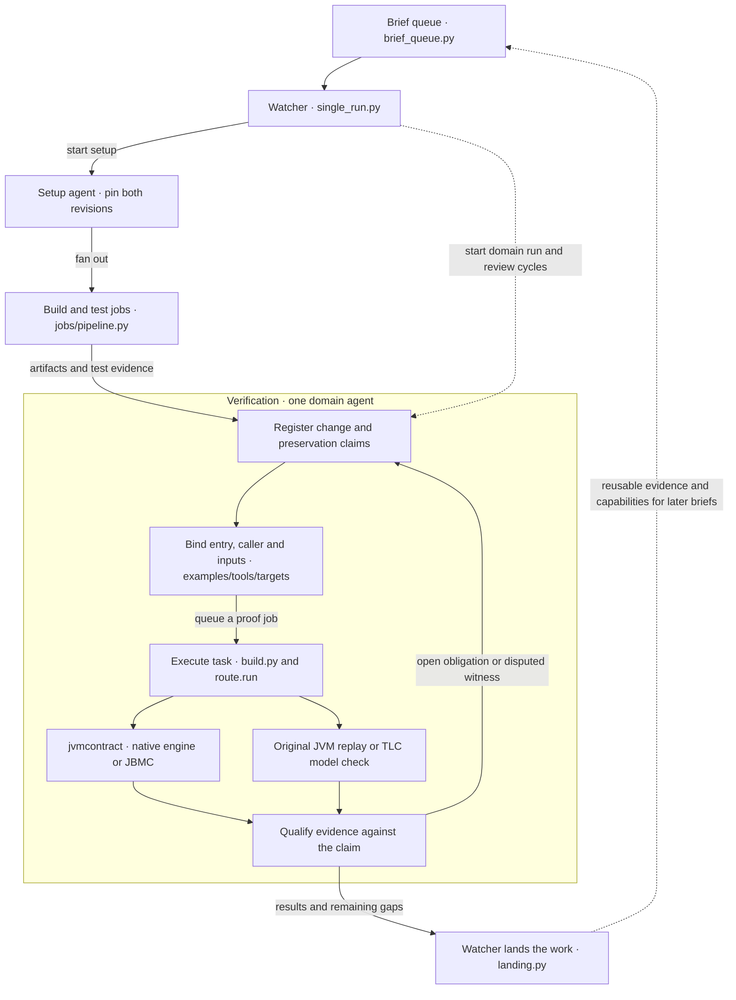

# Architecture of in-the-loop

Given a Java change, what should a caller see on the new revision, and what must it still see on both? A domain agent turns those questions into claims. The repository binds each claim to executable bytecode, runs the appropriate checks, and records what the evidence establishes, what it refutes, and where it stops. A watcher carries the work from a brief to a landed change. The next run can use the resulting evidence, caller, adapter or verifier improvement. [Reproduce a first example](README.md#explore-it-or-reproduce-a-result).

## The path the project is built around

The diagram follows a queued brief that needs setup. A list of PRs first goes through brief generation. A prepared brief can skip setup. Both kinds of job in the diagram use the same runner. A single task may use a checker **and** an original-JVM control. The arrow back into verification is the agent’s decision about what to try next. The watcher can also land a useful result that leaves a claim open. The final arrow means the next brief starts from a tree with more evidence and better tools. A recurring gap can give a brief author a new question.

## How a change is proven

### 1. Register an observable claim

Start from the diff, upstream tests, documentation and the public behavior that motivated the change. The brief author may supply predictions. The domain agent identifies the public operation, how to construct the inputs, which call or sequence to make, and what to read afterward. For an intended difference, say where the revisions should disagree. For preservation, say which other inputs, outputs or side effects should agree. A later read from the same object can expose a difference that the method’s return value hides.

Record the prediction, independent control, domain, assumptions and bounds before scoring the result. A generated caller implements that registration. A competing interpretation of intent is a question for review. For a numbered target, the task lives in `target.json` and refers to a typed claim. `workflow.plan_task` freezes the question so a retry can be compared with it. [Claim format](examples/schema/target-claim.schema.json) · [Target plan](examples/tools/targets/workflow.py) · [Caller generation](examples/tools/targets/observer_generation.py)

### 2. Bind the question to the code that actually runs

Setup pins the source revisions, obtains or builds their artifacts, and records the JDK, dependency order and relevant tests. For an application or library upgrade, `change_plan.compare` inventories the two deployments. Entry discovery ranks public callers of changed bodies. The JVM’s observed class selection and the checker’s selection must agree for a result that depends on that binding. Dispatch through a public entry may require evidence from an original test. An unresolved binding stays visible. [Change plan](examples/tools/targets/change_plan.py) · [Entry discovery](examples/tools/targets/entry_discovery.py) · [Class binding](examples/tools/targets/class_binding.py) · [Original-test traces](examples/tools/targets/approved_test_trace.py)

A domain run can reach a task that the initial setup never built. Its consumer declares the operation it needs. The watcher can admit a resolution job and the runner checks that operation offline with its declared inputs. The readiness receipt specifies what ran. For a promise that tests ran, the runner requires evidence of executed tests. Other eligible jobs can proceed during the wait. [Task-level setup](jobs/README.md#setup-a-running-case-asks-for) · [Setup handoff](llm-dlc/loops/setup-agent-template.md)

### 3. Run the controls and the checker

For a numbered target, `build.py --plan N --task T` explains the task without executing it. A committed job for `build.py N --task T` reaches `route.run`. It opens a new execution record, prepares the named revisions, runs the independent controls, and checks that an adapter corresponds to the original behavior when one is used. A property or equivalence task then invokes the verifier. A replay task uses the observations directly. Constructed examples and public-comparison cases have their own paths through the same build entry. [Build dispatcher](examples/tools/build.py) · [Target execution](examples/tools/targets/route.py) · [Preparation and controls](examples/tools/targets/runtime.py)

| Question | Route and meaning of its answer |
|---|---|
| Does a method satisfy a property? | `jvmcontract prove` builds a bytecode harness for the inputs, precondition and assertion. The native engine symbolically executes it and uses CaDiCaL to search for a violation. JBMC is another backend. Read the checked statement, bounds and modeled operations with the outcome. [Property proofs](lib/README.md#how-a-property-proof-works) · [Native engine](lib/src/bmc/mod.rs) |
| Are the old and new methods equivalent where behavior should be preserved? | `jvmcontract equivalence` compares the two implementations on related inputs. The relation defines what may differ and which returns, exceptions or post-state are observed. [Regression proofs](lib/README.md#how-a-regression-proof-works) · [Implementation](lib/src/equivalence.rs) |
| What does an original caller experience? | Execute the registered histories on the pinned JVM deployments. A finite observation supports the inputs, history and environment recorded. Exhaustive execution of a declared finite domain can establish that domain. [Public observations](examples/tools/observe.py) · [Finite evidence and reuse](examples/tools/targets/change_evidence.py) · [Behavioral contracts](lib/README.md#how-a-behavioural-contract-is-proved) |
| Does a protocol admit a bad sequence of events? | For a protocol example, TLC explores the specified TLA+ model and reports a property violation or the result of its exploration. Relating the model’s actions to an implementation is a separate obligation. [Protocol models](lib/src/tla.rs) · [Example approaches](examples/approaches.md#level-d-distributed-systems) |

### 4. Qualify, refine and report

A checker can answer the harness it received while the original question remains open. The target route preserves the raw candidate, replays supported witnesses independently, and calls `workflow.ingest` to bind the claim, artifacts, controls and execution records into a receipt. Qualification can refuse an incorrect binding, an adapter mismatch or evidence that covers a weaker statement. The Rust proof wire reports the engine outcome. Its Python reader decodes that outcome for consumers. [Proof wire](lib/src/proof_wire.rs) · [Wire reader](lib/python/jvmcontract_io.py) · [Qualification](examples/tools/targets/qualification.py) · [Receipt ingestion](examples/tools/targets/workflow_ingest.py)

When a task stops, the agent follows the first unsupported operation or missing observation. It can repair preparation, supply a caller, extend an adapter or improve the proof library, then rerun the frozen claim. A change to the claim, bounds or startup assumptions gets its own scope. Keep the original outcome beside the new one. A reader should be able to tell whether the process ran, the promised work was delivered, the prediction matched, and the evidence answers the source claim. Passing the selected claims leaves other behavior unexamined. [Startup qualifications](examples/tools/targets/startup_facts.py) · [Execution history](examples/tools/targets/executions.py) · [Job result fields](jobs/README.md#what-its-result-says)

**Follow one claim.** Apache Commons IO’s byte-order-mark stream can read ahead of its delegate. After a reset, which bytes remain? Example 338 specifies 36 histories over payload, byte-order mark, inclusion policy and reset mode. The parent receipt records the native checker finding `code=13` and a JVM run confirming the violation. The fixed revision establishes the projected claim over all 36 selectors. Both receipts match their expectations. [Frozen claim](examples/338-commons-io-bom-reset/claims/bytes.json) · [Independent expectations](examples/338-commons-io-bom-reset/controls/table.json) · [Parent receipt](examples/338-commons-io-bom-reset/receipts/bytes-parent/20261120T195050Z-e78d3bc3/result.json) · [Fix receipt](examples/338-commons-io-bom-reset/receipts/bytes-fix/20261120T195057Z-abe53116/result.json)

## How execution changes the next plan

Landing puts the example, its evidence and any implementation changes on the line from which later work starts. There are two forms of reuse. A later run can reuse a receipt when the proof inputs and bindings still match. It can also apply a landed recipe, adapter or checker feature to a *different* change, which needs evidence of its own. A reproducible gap can become a finding and supply the next brief with a failing fixture and an independent control. That brief can then test whether the next real consumer succeeds. [Proof identities and reuse](lib/README.md#who-owns-which-decision) · [Findings and closure evidence](verification/findings.md)

**A transfer that happened.** The team froze the shared plan and helper-proof code after ThreeTenBP #77, then used it on Apache POI #1420. On a retained formatter, the US-English currency output changed from `0.001` to `0.001000000тг.`. Ordinary number and date formatting stayed stable across the registered locale histories. Three of the four claim-and-revision combinations reused evidence when the plan ran again. The stronger strict public attempt still stopped at `Locale.equals`. The next project gained a working capability with a recorded limit. [Frozen implementation](lib/benchmark/organic-composition/freeze.json) · [POI registration](lib/benchmark/organic-composition/poi/registration.json) · [Landed results](llm-dlc/loops/organic-java-pr-capability-composition-fast-follow-results.md#apache-poi-1420)

## Who owns what

| If you are changing or investigating… | Start here |
|---|---|
| **Proof libraries and semantics** | Rust owns class selection, bytecode interpretation, property and equivalence checking, and the output wire. Shared proof methods can also live in Python. The library map names the owner and a regression test for each decision. [Library map](lib/README.md#who-owns-which-decision) · [Checker internals](lib/README.md#the-tools-own-checker) |
| **Claims, callers and example tools** | `preflight.py` classifies what is ready, missing or already decided. `scaffold_example.py` materializes claims and tasks from a designed plan. `build.py` dispatches a runnable example and renders the records that its format supports. Use the catalog to find a real consumer before adding a shared adapter. [Preflight](examples/tools/preflight.py) · [Scaffolding](examples/tools/scaffold_example.py) · [Example catalog](examples/README.md#find-an-example) |
| **Scheduling and evidence transport** | `jobs/pipeline.py` owns admission, resource limits, attempts and collection for builds, tests, resolution and proof work. A manifest can fan out into ordinary, separately retryable jobs. The verification workload supplies checker-specific preparation and interpretation. Historical specs and job results remain under `verification/`. [Generic runner](jobs/pipeline.py) · [Batch contract](jobs/README.md#a-batch-from-a-manifest) · [Verification workload](jobs/workloads/verification.py) · [Record layout](verification/README.md#layout) |
| **Briefs, agent cycles and landing** | `brief_queue.py next` advances the phase and records its handoff. The watcher starts setup or the domain run through `single_run.py`, reviews cycle reports, gives another cycle or ends the run, and keeps jobs moving. Landing brings the workspace’s commits onto the development line. [Brief queue](llm-dlc/tools/brief_queue.py) · [Run controller](llm-dlc/tools/single_run.py) · [Queue keeper](llm-dlc/tools/queue_keeping.py) · [Landing](llm-dlc/tools/landing.py) |

### Where the judgment is

The domain agent chooses the question, controls and next investigation. Tools do the repeatable work. Checkers and original executions supply evidence, and the receipt records where it applies. The watcher judges progress and whether to land. A person steers the work and resolves questions of intent or authority. [Run cycle](llm-dlc/README.md#a-single-agents-run)

### Who may do what

A person authorizes a run. Its agent commits work and submits jobs. The watcher collects results and can checkpoint landed work to `develop`. A checkpoint conveys publication without a test guarantee. Promotion to `main` requires the user’s direction, a passing default run, published logs and verified originals. Archived raw outputs can have access restrictions. [Operating procedure](CLAUDE.md) · [Checkpoints](llm-dlc/specification.md#checkpoints) · [Promotions](llm-dlc/specification.md#promotions) · [Original outputs](llm-dlc/specification.md#original-outputs)

## Which record answers which question

| Question | First record to read |
|---|---|
| What did the agent agree to investigate? | The admitted brief, setup notes and run decisions. The queue log records scheduling history. [Queue log](llm-dlc/loops/queue.jsonl) · [Decision records](llm-dlc/decisions/) |
| What exactly was checked? | The source claim, prepared binding, execution ID and qualified receipt. For a supported example, the page leads back to its underlying evidence. [Reading an example](examples/README.md#how-to-read-an-example) · [Proof output](lib/README.md#proof-output) |
| Did work run, fail, wait, or never start? | Use the lifecycle `view` for the job and its attempts. Inspect `execution`, `fulfillment` and `conclusion` in the result. The receipt-based `report` omits jobs without receipts. [Job states](jobs/README.md#the-state-of-every-job-and-its-reason) · [Reconciliation](jobs/README.md#reconciling-the-records) |
| What landed, and what can others reproduce? | Check the landed revision, the checkpoint or promotion, and the evidence referenced from that tree. An `LLM-Trace` links a session log. A commit with multiple trace lines leaves authorship ambiguous. [Publication records](llm-dlc/specification.md#workflow) · [Open findings](verification/findings.md) |

## What is not built yet

| Open question | Where to check progress |
|---|---|
| Can a user supply only a new PR and get an independently qualified answer? | The supported workflow here is repository-operated. A registered case can succeed even where blind selection of intent and caller fails. The frozen producer qualified 0 of 20 cold primary cases. [Blind caller results](llm-dlc/loops/in-the-loop-blind-caller-and-pr-verification-brief-results.md#recovery-of-customer-intent) |
| Will a natural batch use the generic runner throughout? | Manifest fan-out and delayed setup have executable evidence. The jobs campaign distinguishes those gates from adoption by a real batch, complete historical reporting, and independently verified inputs. Fetch-slot tuning and remote capacity also need operational evidence. [Jobs campaign results](llm-dlc/loops/in-the-loop-generic-jobs-pipeline-brief-results.md#where-the-work-stands) |
| Which controls still need to be generalized across runs? | Campaign-specific sealed producers, bounded requests for a model worker, resuming after a client refusal, machine-wide run visibility, complete run cost and trace attribution have separate open decisions. Consult the finding’s closure condition and the current implementation before planning another fix. [Findings register](verification/findings.md) · [DLC specification](llm-dlc/specification.md) |

## How this page is kept

Update the owner, its test and this route together when a responsibility, public command, authority boundary or record meaning changes. Link to the child contract for options and defaults. Keep historical results tied to the revision that produced them. The front-page test checks file and heading links. [Architecture checks](llm-dlc/tools/test_architecture.py) · [Agent instructions](CLAUDE.md#architecture)

### Retiring something

Record the replacement and last working revision, move live callers, and preserve the historical evidence. Scripts can be invoked by committed job text or loaded by path. Consult their inventory before removing one. [Retirement register and procedure](llm-dlc/retired.md) · [Script inventory](verification/scripts.md)
