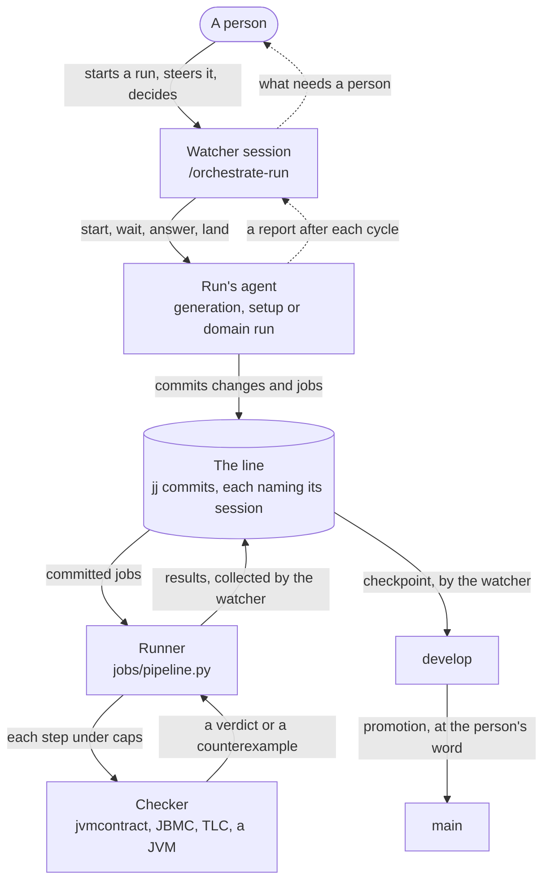

# Architecture of in-the-loop

Who does what in this repository, which file owns each decision, who may do what, which record answers which
question, and what is not built yet. [`README.md`](README.md) says what the project is, and
[`CLAUDE.md`](CLAUDE.md) is the procedure an agent follows. This page is the map both rest on.

It describes the repository at the commit it is read in. Where the code and this page disagree, the page has a
bug: fix it in the change that shows it ([How this page is kept](#how-this-page-is-kept)). What is intended and
not built is in one section, [What is not built yet](#what-is-not-built-yet), and nowhere else on the page.

## The path the project is built around

A person gives a watcher the authority to carry one piece of work to its end. The watcher starts a **run**: one
agent working toward one outcome. The agent changes code and examples and describes every proof it needs as a
job. A runner executes the jobs under memory and CPU caps, a checker answers each claim, and the results come
back to the run. Every commit names the session that made it. The line is published in two steps: a checkpoint
to `develop`, which says nothing of tests, and a promotion to `main`, which does.

There is one such path. Until 2026-11-27 there were four, and a published product with a mode of its own;
[`llm-dlc/retired.md`](llm-dlc/retired.md) says what each was and what replaced it. One skill starts a run,
`/orchestrate-run`, and a run comes in four kinds that share one controller
([`llm-dlc/README.md`](llm-dlc/README.md#a-single-agents-run) describes how a run goes):

| Kind of run | What it does | Its command |
|---|---|---|
| A domain run | Works toward an outcome, from a prompt or a brief | `single_run.py start` |
| A setup phase | Fetches, pins, verifies and builds what a brief needs, and nothing else | `single_run.py setup` |
| A generation phase | Writes one brief from a list of pull requests | `single_run.py generate` |
| A queue of briefs | Runs briefs one after the other: generation for a list, setup, the domain run, the landing | `brief_queue.py next` |

A cycle of a run is one context window: the agent's turn, the watcher's verdict, a compact. The first cycle
takes the starting prompt and every later one the run's continue message, which only a person changes.

## Where the judgment is

The work is of three kinds, and the architecture keeps them apart.

- **Judgment, by a model.** What a change must keep and what it is meant to alter, stated as claims; which
  public history would falsify a claim; a receiver and inputs for it. The domain agent owns this. For a list of
  pull requests, the brief author owns the intent and the registration of each case.
- **Mechanics, by tools and jobs.** Pinning revisions, preparing deployments, binding methods, generating a
  caller for a stated registration, replaying it, evaluating the evidence. These are deterministic tools or
  verification jobs, and by rule they do not run in a model's session. A batch of cases is one manifest
  (`submit --manifest`); whether a real campaign's setup then builds nothing inline is the fan-out row of
  [What is not built yet](#what-is-not-built-yet).
- **The answer, by a checker.** Established, refuted or left open, from `jvmcontract`, JBMC or TLC, and where
  the route allows it from an independent observation on a real JVM. It is never the model's opinion.

Four things about a result stay distinct: whether the job ran, what was expected, what was concluded and at
what scope, and how much assurance that carries. A job may succeed while its claim is refuted, and a fresh
receipt can show a public behaviour while a stronger proof stays open.

A model session spends a person's tokens. Only a person starts one, or a watcher at a person's word, and each
has a run record of its own.

## Who owns what

Each row names the place that decides. A second place that starts deciding the same thing is a defect, whatever
its language or folder.

| Concern | Owner | Contract, and who reads it |
|---|---|---|
| **Agent entry** | [`CLAUDE.md`](CLAUDE.md), given whole to Claude Code and to Codex ([`.codex/config.toml`](.codex/config.toml)); the skills in `.claude/skills/`, which `.agents/skills/` aliases for Codex | Every checkout is a development checkout: one mode, one publication procedure. [`agent_client.py`](llm-dlc/tools/agent_client.py) checks that both clients are given the same instructions, and that a skill only a person starts is not offered to a work turn |
| **Brief intake and phase handoff** | [`brief_queue.py`](llm-dlc/tools/brief_queue.py) sequences generation, setup, landing and the domain run. The texts are the templates' ([generation](llm-dlc/loops/brief-generation-template.md), [setup](llm-dlc/loops/setup-agent-template.md), the `domain-prompt-*.md` pages beside them) | The queue is data, with every change in the committed log [`llm-dlc/loops/queue.jsonl`](llm-dlc/loops/queue.jsonl). A queued brief's copy in `llm-dlc/loops/` is a record of what was admitted and is not edited. Setup notes go into the brief for the domain agent |
| **Run authority and lifetime** | [`single_run.py`](llm-dlc/tools/single_run.py), the one controller. Under it: [`feature-loop.sh`](llm-dlc/tools/feature-loop.sh) and [`agent_client.py`](llm-dlc/tools/agent_client.py) drive the client's turns, [`conductor.py`](llm-dlc/tools/conductor.py) carries questions and verdicts, [`run_common.py`](llm-dlc/tools/run_common.py) holds the guard against a run started inside a run, and [`landing.py`](llm-dlc/tools/landing.py) brings a workspace's commits to the line | A run's state is all in files (`llm-dlc/loop-summaries/single-NAME/`), so another session can take a run over. Each verdict is a decision in `llm-dlc/decisions/single-NAME.jsonl`, which [`decisions.py`](llm-dlc/tools/decisions.py) renders for review |
| **Jobs: admission, scheduling, execution, collection, reporting** | [`jobs/pipeline.py`](jobs/pipeline.py), the one implementation ([`jobs/README.md`](jobs/README.md)); [`verification/pipeline.py`](verification/pipeline.py) is its entry point of before 2026-11-27 and implements nothing. The records stay under `verification/`: the [job](verification/schema/job.schema.json) and [result](verification/schema/result.schema.json) schemas, [`pipeline.toml`](verification/pipeline.toml), and [`layout.py`](verification/layout.py), the one resolver of a record's path | A committed job names the work and the revision. The runner exports that revision clean and caps each step. Every execution is an attempt with a record and folders of its own ([`attempts.py`](jobs/attempts.py)). A result records the outcome, what it used and what it produced. The submitter never runs its own job. A run's watcher keeps the queue ([`queue_keeping.py`](llm-dlc/tools/queue_keeping.py)); with no run under way, `/run-verification` does. [`audit.py`](jobs/audit.py) reconciles specifications, receipts, indexes and the runner's state, and changes nothing |
| **Setup a running case asks for** | [`jobs/readiness.py`](jobs/readiness.py): an operation (what "ready" means for one task), its resolution by running that task offline in rounds, the bundle and the receipt in the runner's store. The scheduler holds the job that asks until a receipt is there; the watcher admits the resolution job by committing it ([`queue_keeping.py`](llm-dlc/tools/queue_keeping.py) `admit`); only a resolution job's steps are given the sources the runner may fetch from | [`jobs/README.md`](jobs/README.md#setup-a-running-case-asks-for) |
| **What a kind of work means** | The workloads under [`jobs/workloads/`](jobs/workloads): [`verification.py`](jobs/workloads/verification.py) for proofs, model checks and numbered examples ([`verification/README.md`](verification/README.md)), [`generic.py`](jobs/workloads/generic.py) for a job that is only commands and outputs | The pipeline asks a job's workload which tools the work needs, what to prepare, what a log says and what that means for the question asked. A workload decides nothing about identity, scheduling, budget or the record |
| **Preparing a change and its evidence** | [`scaffold_example.py`](examples/tools/scaffold_example.py), [`build.py`](examples/tools/build.py), [`preflight.py`](examples/tools/preflight.py), [`observe.py`](examples/tools/observe.py) and the shared modules under `examples/tools/targets/`. They are the product's entry points, despite the folder's name | A plan and a prepared deployment name the claims, the selected JARs and JDK, the caller and the observation ([`change_plan.py`](examples/tools/targets/change_plan.py)). A numbered example holds its `example.json` and `result.json`, and its page is generated from them ([`examples/README.md`](examples/README.md#layout)) |
| **Checking and qualification** | Rust in `lib/src/` owns proof semantics and the proof wire ([`proof_wire.rs`](lib/src/proof_wire.rs)); [`jvmcontract_io.py`](lib/python/jvmcontract_io.py) reads it | [`lib/README.md`](lib/README.md#who-owns-which-decision) is the finer map: proof serialization, class selection, proof methods, receipt qualification and benchmark scoring, each with a test that fails when a second place decides |
| **Tests and their cost** | [`test_costs.py`](lib/tools/test_costs.py) with the inventory `lib/tests/costs.json`, and [`default_run.py`](lib/tools/default_run.py) | Three tiers: unit, tool, proof. The tests of what changed run before a commit. The whole default run is owed at a promotion and is recorded by the tree it tested. The proof tier runs as jobs |
| **Traces and publication** | [`sync.py`](llm-dlc/tools/sync.py) (commit, check, scan), [`redaction_rules.py`](llm-dlc/tools/redaction_rules.py), [`checkpoint.py`](llm-dlc/tools/checkpoint.py), [`promote.py`](llm-dlc/tools/promote.py) ([`llm-dlc/specification.md`](llm-dlc/specification.md)) | Every commit ends with an `LLM-Trace` line: a session and the SHA-256 of its redacted log. A [checkpoint](llm-dlc/specification.md#checkpoints) puts a commit on `develop` and confers no test status. A [promotion](llm-dlc/specification.md#promotions) moves `main` and says three things: the default run passed, the logs are published, the originals are verified |
| **Original outputs** | [`artifacts.py`](llm-dlc/tools/artifacts.py) ([Original outputs](llm-dlc/specification.md#original-outputs)) | What a job, a run or a session produced is kept whole in a private archive, in an ordinary and a restricted class. A producer hands its bytes over before it shortens or deletes them |
| **Findings, decisions and what was retired** | [`verification/findings.md`](verification/findings.md) for what needs a person; the decision records under `llm-dlc/decisions/`; [`llm-dlc/retired.md`](llm-dlc/retired.md) with [`retired.py`](llm-dlc/tools/retired.py); [`llm-dlc/operating-notes.md`](llm-dlc/operating-notes.md) for rules of practice | A claim about the implementation cites a revision and a checked artifact. A results page keeps a run as it was. A finding closes only by the check it names |
| **The machine's budget** | [`doctor.py`](llm-dlc/tools/doctor.py), the runner's settings in [`pipeline.toml`](verification/pipeline.toml), and the kill order in the [operating notes](llm-dlc/operating-notes.md#the-kill-order-when-memory-runs-out) | A run keeps the memory budget it started with. When memory runs out, jobs are stopped before tests, and tests before agents |

## Who may do what

Authority comes from the person who runs the repository. A skill's suggestion, a remembered incident or an
approval given for another purpose grants nothing: apply the person's latest decision for that workflow and
phase, and when a mechanism or a limit is missing, say so and stop short of it.

| Action | Whose it is | What holds it |
|---|---|---|
| Start a run | A person, or a watcher at a person's word. Never a step of an agent's work | The skill is the user's alone to start in Codex. `single_run.py` and `feature-loop.sh` refuse a start from inside a running loop, on any checkout |
| Give a run another cycle, or end it | The run's watcher | `single_run.py answer`, with a reason, recorded as a decision the person can review |
| Change what a run is told | A person, from their own terminal | `single_run.py message` is refused from an agent's session. A watcher that disagrees with the message ends the run and says why |
| Run a queued proof | The runner, started by the run's watcher or by `/run-verification`. Not the submitter | A job is run from a clean export of its commit, under caps of its own |
| Put a commit on `develop` | The watcher of a run, without asking. A session with no watcher, when the user asks. A run's agent never pushes | `sync.py checkpoint` reads no working copy and refuses a conflict, a raw payload, a credential or an undecided redaction decision |
| Move `main` | Only at the user's word | `sync.py promote` requires a passed default run, published logs and verified originals, and moves `main` only if it is where the promotion found it |
| Approve an allow-list proposal, accept a finding | A person. A run's watcher for the routine ones, while the person has delegation switched on | Approval is refused from an agent's session, and `check` reports as an error a decision no person is recorded as having taken |
| Read restricted originals | Nobody's session reads the bytes. The watcher's `artifacts.py analyze` returns counts and digests | The restricted class has credentials of its own |
| Delete from the archive, read its tokens | No agent | [`CLAUDE.md`](CLAUDE.md) |

## Which record answers which question

| Question | Read this first | When records disagree |
|---|---|---|
| What may I do? | The person's latest explicit decision, then [`CLAUDE.md`](CLAUDE.md) and the table above, then the delegation's state (`sync.py delegate status`) | The latest applicable direction wins. Name the mechanism or limit that is missing |
| What can this checkout do? | The command's own usage text and its code at the checked-out revision, and a test that exercises it | Report three things apart: what is implemented, what is committed in a workspace and not landed, and what is proposed. A command in an old brief describes its time, and a page with a "Retired" line at its top says so |
| What is this run to do? | The brief's copy as the queue admitted it, its setup notes, the starting prompt, and the continue message as it stands (`single_run.py message NAME`) | There is one authoritative copy for each phase. A file changed outside the checkout reaches a run only by an explicit refresh |
| What happened in a run? | The run's folder and record under `llm-dlc/loop-summaries/`, its decisions (`llm-dlc/decisions/single-NAME.md`), its jobs and results, and its session's summary | Keep an unknown value unknown. A missing verdict, a job in which no test executed and a queue that did not answer are three different states. Totals are added up from the per-case records |
| What does a result show? | The result in `verification/results/`, which names the commit it ran on, with the job it answers and the example's `result.json` | The measured result wins over a summary of it. The queue's log is scheduling history and a claim key says which question was asked; neither stands in for a result |
| What became of every job, the ones that never ran included? | The lifecycle view, `python3 jobs/pipeline.py view` (`itl-job-lifecycle/v1`, [`jobs/README.md`](jobs/README.md#the-state-of-every-job-and-its-reason)): one state and its reason for each job, with its prerequisites, claim, attempts and result | `status` is the view as lines and the keepers read it as data. A queue that could not be read is unknown, never empty: `idle` is null and nothing is started or stopped on it. A repository has one runner, and from a workspace it is not in, the view names it and the jobs it has claimed (`runner.elsewhere`), read from the lock the workspaces share. A runner's log is history, not state |
| Did the job run, did it deliver, and did the claim hold? | Three blocks of the result, kept apart ([`jobs/lifecycle.py`](jobs/lifecycle.py), [`jobs/README.md`](jobs/README.md#what-its-result-says)): `execution` (what the processes did), `fulfillment` (promised tests shown, required outputs there), `conclusion` (the workload's reading of the checkers) | `status` is one word for the indexes. A passed job may have refuted its claim, and a job whose processes all exited as expected is `failed` when it did not deliver what it declared. For a result written before the blocks were kept (every one collected until 2026-11-27) they are computed by the reader and marked `derived` |
| Who made this commit? | Its `LLM-Trace` line, then `python3 llm-dlc/tools/sync.py trace REV` and the session's `summary.md` under `llm-dlc/traces/` | A commit with several lines does not say which session made it (VF-079, below) |
| Is this published? | `develop` and `main` on `origin`, and the receipts of the checkpoint and the promotion | A commit in a workspace is available once it has landed on the line, readable by others after a checkpoint, and tested with public logs after a promotion. These are three different claims |
| Was this command retired? | [`llm-dlc/retired.md`](llm-dlc/retired.md) | The register wins over a page, a note or a memory that still names the command |
| Where does new work go? | The owners above, the owner's own contract, and the most recent bottleneck that was reproduced independently ([findings](verification/findings.md)) | Keep the current path during a migration, add a narrow adapter, check parity with a real consumer, then retire the old direction through the register |

**Identities across a run.** Keep these apart, and never equate two of them because both are digests or both
are numbers: the case (a pull request and a pair of revisions), the queue's entry, the run with its legs and
cycles, the job and its attempts, and the result. For a live operation, record the checkout or workspace root.
For a reader elsewhere, record a source revision and a digest. A job that replaces another names it
(`supersedes`). A work directory may be pruned once its originals are accounted for in the archive.
[`lib/README.md`](lib/README.md#who-owns-which-decision) lists the five identifiers of a proof.

## What is not built yet

Each row is a gap between what the project intends and what runs today. A row leaves this table when its check
passes, and its capability then gets a place in the sections above.

| Capability | Today | Direction, and what settles it |
|---|---|---|
| **A product entry** | None. The path above is run by this repository's own watcher, and the plugin that offered it to others is retired ([register](llm-dlc/retired.md#plugin-and-runtime-mode)) | An entry built on the same path: a Java change in, evidence at a stated scope out. The main gap is investigation and claim scaffolding, not solving (VF-063). The benchmark of external upgrades measured the retired product and needs the new entry before it measures a later revision |
| **The job pipeline** | Jobs are committed files, one local runner serves a checkout, and the queue has two keepers: a run's watcher and `/run-verification` | The user's direction (2026-11-27): `/run-verification` and the idea of a verification job grow into a more robust job pipeline. It is to be designed. Until then, add no second way to queue work |
| **Fan-out from a manifest** | Built, and not yet used by a campaign: `python3 jobs/pipeline.py submit --manifest FILE` writes one ordinary, separately retryable job for each row of a validated manifest, with a published map from rows to jobs (`verification/batches/`), and `wait --batch NAME` and `batch NAME` watch and report it ([`jobs/README.md`](jobs/README.md#a-batch-from-a-manifest)). Tested on a made-up batch of 49 rows | Settled when a real 49-case setup submits its builds with one command and builds nothing inline (VF-072) |
| **A sealed producer** | Specific to two campaigns, each with a restricted view of its own ([`campaign.py`](verification/generated-observers/campaign.py), [`producer_policy.py`](verification/blind-caller/producer_policy.py)) | The smallest restriction that was shown to work, as a job profile: the files and dependencies allowed, the commit and digests, the outputs expected, the evaluator's identity. Settled when a read of an evaluator-only marker fails inside the job, in a subprocess and after a resume. A host that cannot give the guarantee reports its measurement as unqualified (VF-072) |
| **A request for a model-driven worker** | A run's agent cannot start a session, and can only say in its report that it needs one | Decided in outline (the user, 2026-11-27): the agent records a request (purpose, client, model, budget, inputs) and starts nothing. The watcher handles it, unattended within an allow list of kinds and limits, and warns at once about a request outside it. The list is still to be written (VF-072) |
| **A client's filter stop** | The policy is settled: no fallback to another model or client, the case is recorded and left unfinished with no retry of the same material, and the rest goes on (the user, 2026-11-27). The watcher's steps for a refused session start the run again in a new session and do not yet say to leave the stopped material out | The steps say it, a resumed run leaves the case out of model and tool execution, and a stop, a miss, an abstention and a verifier failure stay four different dispositions (VF-061) |
| **Seeing every run on the machine** | `single_run.py list` knows the runs of its own checkout. A run started from another checkout's root was missed while it ran (VF-045) | A read-only listing of every live loop of the user, joined to checkout roots and to the durable records, that sets apart a loop with no record and a record with no loop (VF-072) |
| **A run's record and its cost** | A run's reported spend leaves out its last turns, and a run that worked in a workspace of its own is in no published record or loop statistic | VF-078: the spend equals the client's total for the session, and a landed run is a row of the loop statistics |
| **What a trace line means** | A session's line lands on commits made while it ran, whoever made them | VF-079: the user's decision between two readings of the line |
| **Network and remote capacity** | The runner's budget counts concurrency, CPU and memory, and admits fetch-bound jobs apart from them: a job with a `fetch` step runs only where the runner names sources it may fetch from (`fetch_allow`), and at most `fetch_slots` (10) downloads' worth of such jobs run at once. A resolution's receipt records what was fetched, its bytes and its seconds, and a result's `timing.byPhase` its resolve time. No campaign has run on it yet, so the ceiling is the first guess, unmeasured | Changed only by measurement, from the receipts of a real batch: queue wait, fetch throughput, cache reuse and local work. Image pulls are not counted. Remote workers go through the same job and result contract ([Backends](verification/README.md#backends-other-machines-and-the-cloud)) |

## How execution changes the next plan

1. **Capture.** The agent or the watcher records the first operation that failed: the actor and phase, the
   checkout and revision, the case or batch, what the agent was told, what was expected and what was observed.
   Tell one anomalous attempt from a bottleneck that repeats, and use a finding that exists when one fits.
2. **Reconcile.** A person, or a watcher with delegation, says which it is: a stale instruction, a missing
   capability, a defect, capacity, or a choice of the user's. Check the owner above, the direction already
   given and the queue before proposing work, and record what has landed and what is open.
3. **Plan.** The brief's author links the finding and picks one owner, one small cut, one fixture that fails
   and one clean control. A change that crosses a row of [Who owns what](#who-owns-what) updates this page and
   says so.
4. **Land.** The change updates the real owner, the views generated from it and its test together. The
   capability is called shipped for the mode and version that were tested, and what is left stays visibly open.
5. **Observe.** Look at the next comparable run that comes up by itself. Did it take the right entry, do the
   work through the intended jobs, and keep every case's outcome? Attach the answer to the finding, and close,
   narrow or reopen it.

**An example.** VF-045 was that an agent could start a run. It has a guard, and since 2026-11-27 one run skill
that is the user's alone to start. VF-072 asks a different question of the same incidents: does an agent with
49 builds still have to improvise? That one is settled by the next batch, by comparing the jobs submitted with
the cases expected, the builds made inline, the jobs that passed with no test executed and the waits that
never ended. A finding has both tests: one of the implementation and one of what happens in use.

## Retiring something

1. Give it an entry in [`llm-dlc/retired.md`](llm-dlc/retired.md): what it was, what replaced it, its names
   and its files. The entry is `planned` while the files are here.
2. Move what survives behind the surviving owner first, with its tests, so that nothing stops working when
   the old caller goes.
3. Remove the files, rewrite the live pages and code that named them, and mark the entry `retired` with the
   change that did it.
4. `python3 llm-dlc/tools/retired.py banners --write` gives each historical page and finding that names it
   one dated line. Records are never edited: traces, decisions, jobs, results, the queue's copies of briefs.
5. `python3 llm-dlc/tools/retired.py check` must find nothing, in the checkout the change lands in as well as
   the one it was made in.

A script under `verification/` is a special case, because a committed job runs it by a command line and a test
may load it by a path it builds: no import shows either. Read its row in
[`verification/scripts.md`](verification/scripts.md) first (`python3 jobs/script_inventory.py --write`
regenerates the page, and a test fails when a script was added or removed without it). A script that
committed jobs ran stays where their commands find it; only an orphan candidate that someone who has read
its campaign confirms is removed, in a change of its own.

## How this page is kept

- **When.** In the change that moves a responsibility, changes who may do something, adds or removes a public
  command, changes what a record means, or confirms an operating constraint. Update the owner first, then
  this page.
- **What stays out.** A command's options, a model's name, a default and a measurement live with their owners:
  link to them. A historical claim cites a finding or a change id.
- **What holds it.** [`test_architecture.py`](llm-dlc/tools/test_architecture.py) fails when a link here leads
  to a file or a heading that is not in the repository, and `retired.py check` fails when a paragraph names
  something retired without pointing at the register. Both are in the default test run.
- **Larger moves.** Show two users of the shared capability before extracting it, keep old callers and old
  receipts readable, and have the migration and the way back checked by someone other than its author.
