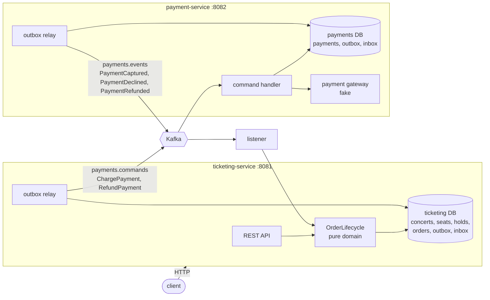

# Box Office

A small concert-ticketing system, built as two services that talk over Kafka and keep their state in MongoDB.
It is the subject system for the distributed-systems verification scenarios in this repo (level D in [`docs/approaches.md`](../../docs/approaches.md)).
It is small enough to read in an hour, but it has the failure modes that make distributed systems hard: leases that expire mid-flight, duplicated and reordered messages, concurrent writers, and money that must not be lost.

## The domain

A venue sells seats for concerts. A customer:

1. **Looks at a concert** and sees which seats are free.
2. **Holds seats** for a few minutes. Either all requested seats are held or none are, and two customers can never hold the same seat.
3. **Places an order** for the hold. The order is accepted at once, and the payment happens in the background.
4. **Polls the order** until it is `CONFIRMED` (seats sold) or `DECLINED` (seats released).
5. **Cancels** a confirmed order. The seats go back on sale and the money is refunded in the background.

The interesting case is the race between a hold's expiry and a slow payment.
If the hold expires and someone else takes the seats before the payment comes back, the order cannot be fulfilled, so the money is refunded automatically.

## Capabilities

| Capability | Endpoint | Style | What makes it distributed |
|---|---|---|---|
| Create a concert | `POST /concerts` | sync | Seats are created in one transaction |
| See availability | `GET /concerts/{id}` | sync | Expired holds show as free before the sweeper releases them |
| Hold seats | `POST /concerts/{id}/holds` | sync | All-or-nothing across documents, safe under concurrent requests, a lease with a TTL, and `Idempotency-Key` |
| Place an order | `POST /orders` → 202 | async | A saga across two services: outbox → Kafka → payment → Kafka → order |
| Track an order | `GET /orders/{id}` | sync read | Eventually consistent with the payment service |
| Cancel an order | `POST /orders/{id}/cancellation` → 202 | async | A compensating saga: release seats now, refund later |
| Inspect payments | `GET /payments`, `GET /payments/{orderId}` | sync | The payment service's own ledger |

## Architecture



Placing an order, step by step:

1. `POST /orders`: in one MongoDB transaction, check that the hold is unexpired, insert the order as `PENDING_PAYMENT`, and insert a `ChargePayment` command into the outbox. Respond `202 Accepted`.
2. The ticketing outbox relay publishes the command to `payments.commands`, keyed by order ID.
3. The payment service consumes it. In one transaction it records the message ID in its inbox, charges the gateway (idempotency key = order ID), inserts the payment, and queues `PaymentCaptured` or `PaymentDeclined` in its outbox.
4. The payment outbox relay publishes the outcome to `payments.events`.
5. Ticketing consumes it. In one transaction it records the message ID in its inbox, asks `OrderLifecycle` what to do, applies the effects (sell or release the seats, or request a refund), and moves the order on.

### Modules

| Module | Contents |
|---|---|
| `contracts` | The Kafka messages, as sealed interfaces of records, and their JSON codec. The type is in the payload, not in a Java class header |
| `ticketing-domain` | The order state machine (`OrderLifecycle`), seat and hold rules. Pure Java with no dependencies: the first target for verification tools |
| `messaging` | Transactional outbox and relay, idempotent inbox, transaction retry, and Kafka retry with dead-letter topics |
| `ticketing-service` | Spring Boot: REST API, MongoDB store, payment-event listener, hold sweeper |
| `payment-service` | Spring Boot: command listener, payment ledger, fake gateway |
| `system-tests` | Both services in one JVM against real Kafka and MongoDB containers |

### Practices it demonstrates

- **Database per service.** Each service owns its database and reaches the other only through Kafka.
- **Transactional outbox.** State changes and outgoing messages commit together, so a message is published if and only if its change committed.
- **Idempotent consumers.** Kafka delivers at least once. Each consumer records message IDs in the same transaction as their effects, so a redelivery is skipped. The outbox and inbox together give exactly-once effects.
- **Natural idempotency keys.** One order per hold (unique index). One payment per order (the payment's ID is the order ID). The gateway is called with the order ID as its idempotency key. `Idempotency-Key` header on holds.
- **Conditional updates as compare-and-set.** Every status change is "set X where the status is still Y", so concurrent writers cannot both win. Multi-seat holds run in a transaction and roll back unless every seat was taken.
- **Leases.** A hold expires on its own. Expired seats are free for new holds at once, and a sweeper tidies the stored status.
- **Sagas with compensation.** A late capture and a cancellation are both undone by a refund, not by a distributed transaction.
- **Per-key ordering.** All messages about an order use its ID as the Kafka key, so they arrive in order.
- **Failure handling.** Transient transaction errors are retried. A failing Kafka record is retried with backoff, then moved to `<topic>.DLT`. A malformed record goes there at once.
- **Pure domain core.** All decisions are made by a total function from (status, input) to (next status, effects), which the adapters apply atomically.

## Invariants: what verification should establish

These are the properties the verification scenarios target. `system-tests` checks the safety properties at quiescence after every test, and `OrderLifecycleTest` model-checks the state machine for every input sequence up to six inputs long.

**Safety**

1. **No double sale.** A seat is sold to at most one order, and held by at most one unexpired hold.
2. **Charge at most once.** Each order has at most one captured payment, however often the charge is requested or redelivered.
3. **No money without seats.** Every captured payment leads to a confirmed order or a refund.
4. **No seats without money.** A seat is `SOLD` to an order exactly when that order is `CONFIRMED`, and then the payment is `CAPTURED` for the order's amount.
5. **Agreement at quiescence.** When no message is in flight: order `CONFIRMED` ⇔ payment `CAPTURED`, `DECLINED` ⇔ `DECLINED`, and `REFUNDED` ⇔ `REFUNDED`.

**Liveness**, assuming Kafka, MongoDB and both services are eventually up:

6. Every order leaves `PENDING_PAYMENT` and `REFUND_PENDING`.
7. Every expired hold is eventually released.

## Known gaps

These are deliberate. Each one is a scenario where a tool should find the bug, or prove that a fix works.

- **One relay per service.** Two instances of a service would run two outbox relays, which could publish an entry twice and reorder messages about one order. Scaling out needs a lease, so that only one relay runs.
- **Clock skew.** Hold expiry compares timestamps written by whichever instance wrote them. Skewed clocks across instances weaken the lease.
- **Gateway call inside a transaction.** The payment service calls the gateway inside its MongoDB transaction and relies on the gateway's idempotency key when the transaction is retried. A gateway without idempotency keys would break invariant 2.
- **Inbox retention.** Message IDs are remembered for 30 days. A redelivery after that would be applied again.
- **A late capture is refunded, not honoured.** Holding seats until the payment answers would be friendlier to the customer, but it needs a payment timeout to stay live. This is a good candidate for a TLA+ comparison of the two designs.

## Run it

You need Java 25 and Docker. Everything else is downloaded by the Gradle wrapper.

```bash
cd apps/boxoffice
./gradlew build                  # unit, component and end-to-end tests (Testcontainers starts Kafka and MongoDB)

docker compose up -d --wait      # Kafka on :9092, a single-node MongoDB replica set on :27017
./gradlew :ticketing-service:bootRun     # :8081, in one terminal
./gradlew :payment-service:bootRun       # :8082, in another
```

Then try it:

```bash
concert=$(curl -s localhost:8081/concerts -H 'Content-Type: application/json' \
  -d '{"name":"The Formal Methods","venue":"Bytecode Hall","startsAt":"2027-06-01T19:30:00Z",
       "priceCents":4500,"rows":["A","B"],"seatsPerRow":4}' | jq -r .id)

hold=$(curl -s localhost:8081/concerts/$concert/holds -H 'Content-Type: application/json' \
  -d '{"customerId":"alice","seats":["A1","A2"]}' | jq -r .id)

curl -s localhost:8081/concerts/$concert/holds -H 'Content-Type: application/json' \
  -d '{"customerId":"bob","seats":["A2"]}'                      # 409: A2 is held by alice

order=$(curl -s localhost:8081/orders -H 'Content-Type: application/json' \
  -d "{\"holdId\":\"$hold\",\"paymentToken\":\"tok_visa\"}" | jq -r .id)   # 202, PENDING_PAYMENT

curl -s localhost:8081/orders/$order | jq .status               # CONFIRMED, after a moment
curl -s localhost:8082/payments/$order | jq .status             # CAPTURED
curl -s -X POST localhost:8081/orders/$order/cancellation | jq .status   # REFUND_PENDING, then REFUNDED
```

The fake gateway picks the outcome from the payment token: `tok_declined` is declined, and `tok_slow` succeeds after 5 seconds.
To watch a late capture get refunded, run ticketing with `--boxoffice.hold.ttl=3s` and pay with `tok_slow`.
The first order after startup can take about 3 seconds while the Kafka consumer groups form.

| Setting | Default | Meaning |
|---|---|---|
| `boxoffice.hold.ttl` | `2m` | How long a hold lasts |
| `boxoffice.hold.max-seats` | `8` | The most seats one hold may take |
| `boxoffice.hold.sweep-interval` | `1s` | How often expired holds are released |
| `boxoffice.gateway.slow-delay` | `5s` | How long `tok_slow` takes |
| `boxoffice.outbox.poll-interval` | `100ms` | How often each relay publishes its outbox |
