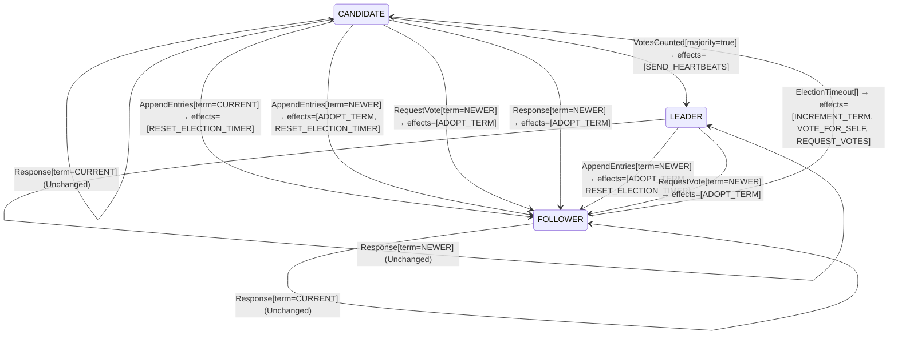

<!-- Generated by examples/tools/build.py from example.json and the verifier's output. Edit example.json. -->
# 014 · A leader that ignores newer terms in replies keeps serving a term the cluster has left

[← All examples](../README.md)

| Verdict | Categories | Severity if shipped | Change | Verified unit | Approach |
|---|---|---|---|---|---|
| **✗ Violation: 1 of 52 cases changed** | functional | high | refactor, behaviour change not intended | [`RoleMachine#decide`](../../examples/apps/quorum/src/main/java/net/terminalvalue/quorum/raft/RoleMachine.java) | [B8: Behavioural contracts](../../lib/README.md) |

> Raft's rule for every server is one line: a message from a newer term makes you a follower. A developer narrows it for leaders, reasoning that a leader learns of a new term from the new leader's heartbeats, not from replies to its own RPCs. The behavioural contract of the role machine, 52 cases derived from the bytecode, changes in exactly one of them, and that one is the deposed-leader case.

Tags: [consensus](../README.md#tag-consensus), [leader-election](../README.md#tag-leader-election), [stale-messages](../README.md#tag-stale-messages)

## The change

Handle replies per role: a leader's replies only say whether its entries were accepted, so a leader no longer steps down on a reply from a newer term. Followers and candidates keep the old behaviour. The reasoning in the review was that the new leader's AppendEntries will depose the old one anyway.

**Before** ([`RoleMachine.java`](../../examples/apps/quorum/src/main/java/net/terminalvalue/quorum/raft/RoleMachine.java), line 55):

```java
    case RequestVote vote -> vote.term() == NEWER
            ? transition(FOLLOWER, ADOPT_TERM)
            : unchanged("the vote itself is decided by the vote rule");
    case Response response -> response.term() == NEWER
            ? transition(FOLLOWER, ADOPT_TERM)
            : unchanged("a reply from the current or an older term changes no role");
};
```

**After:**

```java
    case RequestVote vote -> vote.term() == NEWER
            ? transition(FOLLOWER, ADOPT_TERM)
            : unchanged("the vote itself is decided by the vote rule");
    // A leader hears about newer terms from the new leader's AppendEntries; the replies to its own RPCs
    // only tell it whether its entries were accepted.
    case Response response -> response.term() == NEWER && role != LEADER
            ? transition(FOLLOWER, ADOPT_TERM)
            : unchanged("a reply from the current or an older term changes no role");
};
```

<details><summary>Patch</summary>

```diff
--- a/examples/apps/quorum/src/main/java/net/terminalvalue/quorum/raft/RoleMachine.java
+++ b/examples/apps/quorum/src/main/java/net/terminalvalue/quorum/raft/RoleMachine.java
@@ -55,7 +55,9 @@ public final class RoleMachine {
             case RequestVote vote -> vote.term() == NEWER
                     ? transition(FOLLOWER, ADOPT_TERM)
                     : unchanged("the vote itself is decided by the vote rule");
-            case Response response -> response.term() == NEWER
+            // A leader hears about newer terms from the new leader's AppendEntries; the replies to its own RPCs
+            // only tell it whether its entries were accepted.
+            case Response response -> response.term() == NEWER && role != LEADER
                     ? transition(FOLLOWER, ADOPT_TERM)
                     : unchanged("a reply from the current or an older term changes no role");
         };
```

</details>

## What the verifier found

The behaviour changed for 1 of the 52 possible inputs. Each row is a concrete input that shows the difference:

| Input | The contract says | The code now does |
|---|---|---|
| `decide(LEADER, Response[term=NEWER])` | `Transition[next=FOLLOWER, effects=[ADOPT_TERM]]` | `Unchanged[reason="a reply from the current or an older term changes no role"]` |

The state machine the patched code implements, drawn from its derived contract (`jvmcontract statemachine`); a state with no way in or no way out is marked:



## Would the existing tests have caught it?

No: every existing unit test passes (`java -ea net.terminalvalue.quorum.Tests`, run against the patched code).

## Why it matters

A leader cut off from a majority keeps sending AppendEntries. When the partition heals, the first thing it hears is the replies: followers that have moved to a newer term answer with that term, which is how Raft tells the old leader it is finished. With this change the old leader discards those replies and keeps acting as leader until a heartbeat from the new leader happens to reach it. In that window it answers reads with stale data and accepts writes it will never be able to commit, and a client that is routed to it sees a cluster with two leaders. The symptom in production is occasional stale reads after a network blip, which is close to impossible to reproduce from a bug report.

## Why the verdict is right

The role machine is a pure function of (role, event), and both types are finite: three roles and thirteen events (five kinds, three of them carrying a term comparison). The tool proves purity from the bytecode, executes all 52 inputs in its interpreter, and compares the outcomes with the committed contract. One case differs: `decide(LEADER, Response[term=NEWER])` used to be a transition to FOLLOWER adopting the term and is now unchanged. Nothing had to be anticipated: the contract was generated from the previous version, and the diff is the review. The state-machine view below is drawn from the patched code and shows that LEADER now has one fewer way out.

## What to do

Revert. The all-servers rule is deliberately unconditional in the paper, and the role machine's contract is the right place to keep it that way: a change to any of its 52 cases is a one-line diff that a reviewer sees.

## Evidence

The proof trusted these JDK APIs to be pure: `java.lang.Enum.ordinal`, `java.lang.MatchException.<init>`, `java.lang.Record.<init>`, `java.util.List.copyOf`, `java.util.List.of`.

This result was recorded before runs fingerprinted their inputs, so whether it still matches the current patch and sources is not known.

<details><summary>Verifier output</summary>

```text
✓ module quorum matches its capability contract (70 classes, 272 methods, 0 capability uses, 0 libraries)
✓ module quorum matches its API contract (63 public types, 247 members)
✓ net.terminalvalue.quorum.raft.AppendRule#decide matches its contract (36 cases, 9 methods proven pure, trusting java.lang.Enum.ordinal, java.lang.MatchException.<init>, java.lang.Record.<init>, java.util.List.copyOf, java.util.List.of)
✓ net.terminalvalue.quorum.raft.CommitRule#decide matches its contract (21 cases, 7 methods proven pure, trusting java.lang.Enum.ordinal, java.lang.IllegalStateException.<init>, java.lang.MatchException.<init>, java.lang.Record.<init>, java.util.List.copyOf, java.util.List.of)
✓ net.terminalvalue.quorum.raft.ReplyRule#decide matches its contract (9 cases, 6 methods proven pure, trusting java.lang.Enum.ordinal, java.lang.MatchException.<init>, java.lang.Record.<init>, java.util.List.copyOf, java.util.List.of)
✗ Behaviour of net.terminalvalue.quorum.raft.RoleMachine#decide differs from its contract in 1 of 52 cases:
  decide(LEADER, Response[term=NEWER])
    contract: Transition[next=FOLLOWER, effects=[ADOPT_TERM]]
    actual:   Unchanged[reason="a reply from the current or an older term changes no role"]
  (52 cases, 11 methods proven pure, trusting java.lang.Enum.ordinal, java.lang.IllegalStateException.<init>, java.lang.MatchException.<init>, java.lang.Record.<init>, java.lang.runtime.SwitchBootstraps.typeSwitch, java.util.List.copyOf, java.util.List.of, java.util.Objects.requireNonNull)
✓ net.terminalvalue.quorum.raft.VoteRule#decide matches its contract (40 cases, 7 methods proven pure, trusting java.lang.Record.<init>, java.util.List.copyOf, java.util.List.of)
✓ net.terminalvalue.quorum.twopc.Coordinator#decide matches its contract (28 cases, 7 methods proven pure, trusting java.lang.Enum.ordinal, java.lang.MatchException.<init>, java.lang.Record.<init>, java.lang.runtime.SwitchBootstraps.typeSwitch, java.util.List.copyOf, java.util.List.of, java.util.Objects.requireNonNull)
✓ net.terminalvalue.quorum.twopc.Participant#decide matches its contract (40 cases, 9 methods proven pure, trusting java.lang.Enum.ordinal, java.lang.MatchException.<init>, java.lang.Record.<init>, java.lang.runtime.SwitchBootstraps.typeSwitch, java.util.List.copyOf, java.util.List.of, java.util.Objects.requireNonNull)
✓ net.terminalvalue.quorum.twopc.Recovery#decide matches its contract (8 cases, 3 methods proven pure, trusting java.lang.Enum.ordinal, java.lang.MatchException.<init>, java.lang.Record.<init>, java.lang.runtime.SwitchBootstraps.typeSwitch, java.util.List.copyOf, java.util.List.of, java.util.Objects.requireNonNull)

If a change is intended, run `jvmcontract update` and commit the contract with the code. The contract diff then shows reviewers exactly which behaviour changed.
```

</details>

<details><summary>SARIF report (as uploaded to GitHub code scanning or SonarQube)</summary>

```json
{
  "version": "2.1.0",
  "$schema": "https://json.schemastore.org/sarif-2.1.0.json",
  "runs": [
    {
      "tool": {
        "driver": {
          "name": "jvmcontract",
          "version": "0.1.0",
          "rules": [
            {
              "id": "behaviour-changed",
              "shortDescription": {
                "text": "The code no longer matches its behavioural contract."
              }
            },
            {
              "id": "unverifiable",
              "shortDescription": {
                "text": "The method cannot be verified: it is not pure, or its inputs are not finite."
              }
            },
            {
              "id": "capability-changed",
              "shortDescription": {
                "text": "The module's bytecode reaches a capability, or a library, that its contract does not list."
              }
            },
            {
              "id": "api-changed",
              "shortDescription": {
                "text": "The module's public API differs from its contract."
              }
            },
            {
              "id": "boundaries-changed",
              "shortDescription": {
                "text": "The module's boundaries (routes, listeners, schedules, bean definitions, the advice on them, or a problem with that advice) differ from their contract."
              }
            },
            {
              "id": "property-violated",
              "shortDescription": {
                "text": "An input exists on which the method violates its stated property."
              }
            },
            {
              "id": "invariant-violated",
              "shortDescription": {
                "text": "The model checker found a behaviour of the model that violates an invariant."
              }
            }
          ]
        }
      },
      "results": [
        {
          "ruleId": "behaviour-changed",
          "level": "error",
          "message": {
            "text": "Behaviour of net.terminalvalue.quorum.raft.RoleMachine#decide differs from its contract in 1 of 52 cases:\n  decide(LEADER, Response[term=NEWER])\n    contract: Transition[next=FOLLOWER, effects=[ADOPT_TERM]]\n    actual:   Unchanged[reason=\"a reply from the current or an older term changes no role\"]"
          },
          "locations": [
            {
              "physicalLocation": {
                "artifactLocation": {
                  "uri": "examples/apps/quorum/src/main/java/net/terminalvalue/quorum/raft/RoleMachine.java"
                },
                "region": {
                  "startLine": 37
                }
              }
            }
          ]
        }
      ]
    }
  ]
}
```

</details>

**Provenance:** Constructed from the "Rules for Servers, All Servers" rule of the Raft paper's figure 2, by exempting leaders from it for one message kind.

- [Ongaro and Ousterhout, In Search of an Understandable Consensus Algorithm (figure 2, Rules for Servers)](https://raft.github.io/raft.pdf)
## Reproduce

```bash
python3 examples/tools/build.py 014
```

This applies `change.patch` to a temporary copy of the repo, runs the verifier on it, and rewrites this page.
