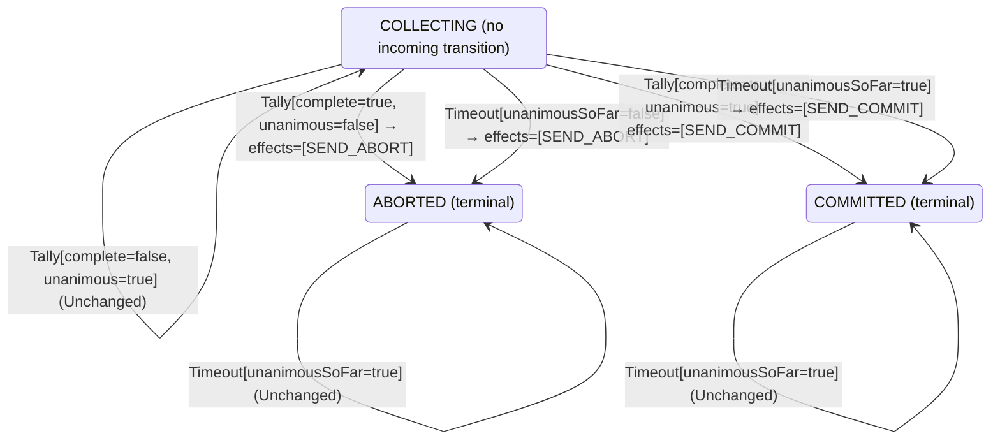

<!-- Generated by examples/tools/build.py from example.json and the verifier's output. Edit example.json. -->
# 020 · A 2PC coordinator that presumes commit on timeout splits the participants

[← All examples](../README.md)

| Verdict | Categories | Severity if shipped | Change | Verified unit | Approach |
|---|---|---|---|---|---|
| **✗ Violation: Atomicity, 3-step trace** | functional | critical | feature, behaviour change intended | [`Coordinator#decide`](../../examples/apps/quorum/src/main/java/net/terminalvalue/quorum/twopc/Coordinator.java) | [D1: Protocol model checking](../../examples/apps/quorum/spec/README.md) |

> When the vote collection times out, the coordinator aborts: a participant that has not answered may have given up. A developer softens this: if every vote that did arrive was yes, the missing ones are slow, not opposed, so commit. The one-line contract diff is reviewed and approved. The model checker finds a three-step run in which a participant votes no, its vote is still in flight when the timer fires, "everyone who answered said yes" is true of nobody, and the coordinator commits a transaction that participant has already aborted.

Tags: [distributed-transactions](../README.md#tag-distributed-transactions), [agreement](../README.md#tag-agreement), [generated-operator](../README.md#tag-generated-operator)

## The change

On timeout, commit if the votes counted so far are unanimous, else abort. The behavioural contract of the coordinator is regenerated and its diff is one line, the case `decide(COLLECTING, Timeout[unanimousSoFar=true])`, which is exactly what the developer meant to change. The reviewer approves the diff.

**Before** ([`Coordinator.java`](../../examples/apps/quorum/src/main/java/net/terminalvalue/quorum/twopc/Coordinator.java), line 28):

```java
                : tally.unanimous() ? transition(COMMITTED, SEND_COMMIT) : transition(ABORTED, SEND_ABORT);
        case COMMITTED, ABORTED -> unchanged("already decided");
    };
    case Timeout _ -> switch (phase) {
        case COLLECTING -> transition(ABORTED, SEND_ABORT); // presumed abort
        case COMMITTED, ABORTED -> unchanged("already decided");
    };
};
```

**After:**

```java
                : tally.unanimous() ? transition(COMMITTED, SEND_COMMIT) : transition(ABORTED, SEND_ABORT);
        case COMMITTED, ABORTED -> unchanged("already decided");
    };
    case Timeout timeout -> switch (phase) {
        // The votes that did arrive were all yes: the missing participants are slow, not opposed, and
        // aborting would throw away work that every voter was ready to commit.
        case COLLECTING -> timeout.unanimousSoFar()
                ? transition(COMMITTED, SEND_COMMIT)
                : transition(ABORTED, SEND_ABORT);
        case COMMITTED, ABORTED -> unchanged("already decided");
    };
};
```

<details><summary>Patch</summary>

```diff
--- a/examples/apps/quorum/src/main/java/net/terminalvalue/quorum/twopc/Coordinator.java
+++ b/examples/apps/quorum/src/main/java/net/terminalvalue/quorum/twopc/Coordinator.java
@@ -28,8 +28,12 @@ public final class Coordinator {
                         : tally.unanimous() ? transition(COMMITTED, SEND_COMMIT) : transition(ABORTED, SEND_ABORT);
                 case COMMITTED, ABORTED -> unchanged("already decided");
             };
-            case Timeout _ -> switch (phase) {
-                case COLLECTING -> transition(ABORTED, SEND_ABORT); // presumed abort
+            case Timeout timeout -> switch (phase) {
+                // The votes that did arrive were all yes: the missing participants are slow, not opposed, and
+                // aborting would throw away work that every voter was ready to commit.
+                case COLLECTING -> timeout.unanimousSoFar()
+                        ? transition(COMMITTED, SEND_COMMIT)
+                        : transition(ABORTED, SEND_ABORT);
                 case COMMITTED, ABORTED -> unchanged("already decided");
             };
         };
```

</details>

## What the verifier found

The model is checked under 7 configurations, and the verdict is the first that fails:

| Configuration | What it checks | Model | Result |
|---|---|---|---|
| three participants (`spec/TwoPhaseCommit.cfg`) | every run from the initial state, every interleaving within the configuration's bounds | Participants = {p1, p2, p3}, MaxCrashes = 0, MaxParticipantCrashes = 0 | ✗ Violation: Atomicity, 3-step trace |
| the inductive step (`spec/TwoPhaseCommitInductive.cfg`) | that the invariant `Inductive` is inductive: TLC starts from every state the invariant admits, reachable or not, rather than from the initial state, takes one step, and checks the invariant again, conjunct by conjunct. No counterexample is a proof of atomicity by induction, for any run of the protocol however long; a counterexample is one step from a state that need not be reachable | Participants = {p1, p2, p3}, MaxCrashes = 0, MaxParticipantCrashes = 0 | ✗ Violation: Atomicity, 2-step trace |
| crashes (`spec/TwoPhaseCommitCrash.cfg`) | every run from the initial state in which the coordinator may crash, twice at most: between steps, or after logging a phase change and before the broadcast goes out, and restart on the recovery rule, generated from `Recovery#decide`; the same invariants and temporal properties, under the added fairness condition that a crashed coordinator restarts | Participants = {p1, p2, p3}, MaxCrashes = 2, MaxParticipantCrashes = 0 | ✗ Violation: Atomicity, 3-step trace |
| the inductive step with crashes (`spec/TwoPhaseCommitCrashInductive.cfg`) | that the invariant `Inductive` is closed under a crash and a restart as well: TLC starts from every state the invariant admits, the coordinator up or down, takes one step, and checks the invariant again | Participants = {p1, p2, p3}, MaxCrashes = 1, MaxParticipantCrashes = 0 | ✗ Violation: Atomicity, 2-step trace |
| participant crashes (`spec/TwoPhaseCommitParticipantCrash.cfg`) | every run from the initial state in which a participant may crash, once, between steps or after logging a vote and before sending it, and restart on the participant's rule, generated from `Participant#decide`, while the coordinator may crash once as well; the same invariants and temporal properties, under the added fairness condition that a crashed participant restarts | Participants = {p1, p2, p3}, MaxCrashes = 1, MaxParticipantCrashes = 1 | ✗ Violation: Atomicity, 3-step trace |
| the inductive step with participant crashes (`spec/TwoPhaseCommitParticipantCrashInductive.cfg`) | that the invariant `Inductive` is closed under a participant's crash and restart as well: TLC starts from every state the invariant admits, each process up or down, takes one step, and checks the invariant again | Participants = {p1, p2, p3}, MaxCrashes = 1, MaxParticipantCrashes = 1 | ✗ Violation: Atomicity, 2-step trace |
| the recorded runs (`spec/TwoPhaseCommitTrace.cfg`) | the Java nodes against the model: the coordinator node, its log and its broadcast, and the participant nodes, their logs and their votes, run through eleven scripted scenarios with crashes of either process injected after a given I/O operation, the state after each step recorded in the model's variables (`TwoPhaseCommitTraces.tla`, regenerated from the patched classes); TLC walks each recorded run and checks that it starts in the model's initial state and that every step is a step of the model's next-state relation. A step the model has no action for is one the glue took that the model's verdicts do not cover | Participants = {"p1", "p2", "p3"}, MaxCrashes = 2, MaxParticipantCrashes = 2 | ✓ Verified: all invariants and properties hold in 103 states |

TLC found a run of the system under three participants, 3 steps long, that violates the invariant **Atomicity** (once the coordinator or any participant has committed, no participant has aborted). Each step is one action of one part of the system:

1. **Initial state**: every participant working, no vote counted, no decision, every process up.
2. **Vote**, `Participant.prepare`: a participant votes yes (and holds its locks) or no (and aborts), as its rule decides; it logs the state before it sends the vote, and a crash can fall between the two. `inbox = {[from |-> p1, vote |-> "NO"]}`, `pstate = (p1 :> "ABORTED" @@ p2 :> "WORKING" @@ p3 :> "WORKING")`
3. **CoordinatorTimeout**, `Coordinator.onTimeout`: the collection timer fires with votes missing. `decision = "COMMIT"`, `phase = "COMMITTED"`

The model is small (Participants = {p1, p2, p3}, MaxCrashes = 0, MaxParticipantCrashes = 0), which is what keeps the trace readable. TLC explored every interleaving of the participants, the coordinator and the votes in flight within those bounds.

<details><summary>The counterexample under the inductive step: invariant <b>Atomicity</b>, 2 steps</summary>

Invariant **Atomicity**: once the coordinator or any participant has committed, no participant has aborted.

1. **Starting state**, a state the invariant `Inductive` admits, which need not be reachable: `crashes = 0`, `decision = "NONE"`, `inbox = {}`, `pcrashes = 0`, `phase = "COLLECTING"`, `pstate = (p1 :> "ABORTED" @@ p2 :> "ABORTED" @@ p3 :> "ABORTED")`, `pup = (p1 :> TRUE @@ p2 :> TRUE @@ p3 :> TRUE)`, `up = TRUE`, `votes = (p1 :> "NONE" @@ p2 :> "NONE" @@ p3 :> "NONE")`
2. **CoordinatorTimeout**, `Coordinator.onTimeout`: the collection timer fires with votes missing. `decision = "COMMIT"`, `phase = "COMMITTED"`

</details>

Under crashes TLC found the same run, and reported it the same way.

<details><summary>The counterexample under the inductive step with crashes: invariant <b>Atomicity</b>, 2 steps</summary>

Invariant **Atomicity**: once the coordinator or any participant has committed, no participant has aborted.

1. **Starting state**, a state the invariant `Inductive` admits, the coordinator up or down, which need not be reachable: `crashes = 0`, `decision = "NONE"`, `inbox = {}`, `pcrashes = 0`, `phase = "COLLECTING"`, `pstate = (p1 :> "ABORTED" @@ p2 :> "ABORTED" @@ p3 :> "ABORTED")`, `pup = (p1 :> TRUE @@ p2 :> TRUE @@ p3 :> TRUE)`, `up = TRUE`, `votes = (p1 :> "NONE" @@ p2 :> "NONE" @@ p3 :> "NONE")`
2. **CoordinatorTimeout**, `Coordinator.onTimeout`: the collection timer fires with votes missing. `decision = "COMMIT"`, `phase = "COMMITTED"`

</details>

Under participant crashes TLC found the same run, and reported it the same way.

<details><summary>The counterexample under the inductive step with participant crashes: invariant <b>Atomicity</b>, 2 steps</summary>

Invariant **Atomicity**: once the coordinator or any participant has committed, no participant has aborted.

1. **Starting state**, a state the invariant `Inductive` admits, each process up or down, which need not be reachable: `crashes = 0`, `decision = "NONE"`, `inbox = {}`, `pcrashes = 0`, `phase = "COLLECTING"`, `pstate = (p1 :> "ABORTED" @@ p2 :> "ABORTED" @@ p3 :> "ABORTED")`, `pup = (p1 :> TRUE @@ p2 :> TRUE @@ p3 :> TRUE)`, `up = TRUE`, `votes = (p1 :> "NONE" @@ p2 :> "NONE" @@ p3 :> "NONE")`
2. **CoordinatorTimeout**, `Coordinator.onTimeout`: the collection timer fires with votes missing. `decision = "COMMIT"`, `phase = "COMMITTED"`

</details>

The state machine the patched code implements, drawn from its derived contract (`jvmcontract statemachine`); a state with no way in or no way out is marked:



## Would the existing tests have caught it?

Yes, in this repo: `NodesTest.abortsOnTheTimerWithAVoteMissing` fails (`java -ea net.terminalvalue.quorum.Tests`). That test was written for this property. The contract needed no one to anticipate it.

## Why it matters

Two-phase commit's only promise is atomicity: every participant that decides, decides the same way. A coordinator that commits without a yes from every participant breaks it the first time a participant is slow to vote no, or aborts on its own after a timeout of its own. One participant commits and releases its locks, another has rolled back, and the transaction is half applied across two databases with nothing left to reconcile it. The contract diff did not help here, and could not: it shows that the coordinator's rule changed in one case, which is precisely what was intended. Whether the new rule is safe is a question about every interleaving of the participants, the network and two timers, and only the model answers it.

## Why the verdict is right

The TLA+ model has one action per operation of each part: a participant votes, a participant that has not voted gives up, a participant applies the decision, the coordinator counts a vote, the coordinator's timer fires. The coordinator's decision rule inside the model is not hand-written: it is generated from the behavioural contract of `Coordinator#decide`, which the tool proves the bytecode satisfies on all 28 inputs, so the model decides exactly as the Java does. TLC explores every interleaving for three participants and reports the shortest run that violates atomicity. It is three steps long, and the step that matters is the timer firing with the one vote cast still in flight: "all votes counted so far are yes" is vacuously true of an empty tally. A case the developer, the reviewer and the test suite all read as "the slow participant was going to say yes" is, for the model, also the case where nobody has said anything.

## What to do

Revert to presumed abort. The timeout exists because an unanswered prepare means the participant may have aborted unilaterally; no amount of optimism about the votes that did arrive changes that. Any change to the coordinator's rule reaches the model through its contract, so the next idea of this kind is checked the same way before it is merged.

## Notes

- The two-phase-commit model (`apps/quorum/spec/TwoPhaseCommit.tla`) is built like Box Office's: the coordinator's state machine is generated from its B8 contract. An example of this model is checked under every configuration the model lists, and its verdict is the first that fails.
- Commits over a participant's no vote that is still in flight.

## Evidence

How the verdict was reached: three participants: TLC 2.19 explored 27 distinct states to depth 3 in 0 s, for the model Participants = {p1, p2, p3}, MaxCrashes = 0, MaxParticipantCrashes = 0; the inductive step: TLC 2.19 explored 737 distinct states to depth 2 in 0 s, for the model Participants = {p1, p2, p3}, MaxCrashes = 0, MaxParticipantCrashes = 0; crashes: TLC 2.19 explored 33 distinct states to depth 3 in 0 s, for the model Participants = {p1, p2, p3}, MaxCrashes = 2, MaxParticipantCrashes = 0; the inductive step with crashes: TLC 2.19 explored 2,729 distinct states to depth 2 in 0 s, for the model Participants = {p1, p2, p3}, MaxCrashes = 1, MaxParticipantCrashes = 0; participant crashes: TLC 2.19 explored 88 distinct states to depth 3 in 0 s, for the model Participants = {p1, p2, p3}, MaxCrashes = 1, MaxParticipantCrashes = 1; the inductive step with participant crashes: TLC 2.19 explored 18,637 distinct states to depth 2 in 1 s, for the model Participants = {p1, p2, p3}, MaxCrashes = 1, MaxParticipantCrashes = 1; the recorded runs: TLC 2.19 explored 103 distinct states to depth 12 in 0 s, for the model Participants = {"p1", "p2", "p3"}, MaxCrashes = 2, MaxParticipantCrashes = 2.

<details><summary>Verifier output</summary>

```text
== three participants: spec/TwoPhaseCommit.cfg ==
TLC2 Version 2.19 of 08 August 2024 (rev: 5a47802)
Running breadth-first search Model-Checking with fp 1 and seed 1 with 1 worker on 2 cores with 2185MB heap and 64MB offheap memory [pid: 926194] (Linux 6.6.87.2-microsoft-standard-WSL2 aarch64, Eclipse Adoptium 25.0.4.1 x86_64, MSBDiskFPSet, DiskStateQueue).
Parsing file examples/apps/quorum/spec/TwoPhaseCommit.tla
Parsing file examples/tools/tla/standard-modules/Naturals.tla
Parsing file examples/tools/tla/standard-modules/Sequences.tla
Parsing file examples/tools/tla/standard-modules/FiniteSets.tla
Parsing file examples/apps/quorum/spec/CoordinatorContract.tla
Parsing file examples/apps/quorum/spec/RecoveryContract.tla
Parsing file examples/apps/quorum/spec/ParticipantContract.tla
Parsing file examples/apps/quorum/spec/TCommit.tla
Semantic processing of module Naturals
Semantic processing of module Sequences
Semantic processing of module FiniteSets
Semantic processing of module CoordinatorContract
Semantic processing of module RecoveryContract
Semantic processing of module ParticipantContract
Semantic processing of module TCommit
Semantic processing of module TwoPhaseCommit
Starting... (2026-11-02 21:32:16)
Implied-temporal checking--satisfiability problem has 3 branches.
Computing initial states...
Finished computing initial states: 1 distinct state generated at 2026-11-02 21:32:17.
Error: Invariant Atomicity is violated.
Error: The behavior up to this point is:
State 1: <Initial predicate>
/\ phase = "COLLECTING"
/\ pcrashes = 0
/\ decision = "NONE"
/\ pstate = (p1 :> "WORKING" @@ p2 :> "WORKING" @@ p3 :> "WORKING")
/\ crashes = 0
/\ votes = (p1 :> "NONE" @@ p2 :> "NONE" @@ p3 :> "NONE")
/\ up = TRUE
/\ pup = (p1 :> TRUE @@ p2 :> TRUE @@ p3 :> TRUE)
/\ inbox = {}

State 2: <Vote line 98, col 5 to line 99, col 111 of module TwoPhaseCommit>
/\ phase = "COLLECTING"
/\ pcrashes = 0
/\ decision = "NONE"
/\ pstate = (p1 :> "ABORTED" @@ p2 :> "WORKING" @@ p3 :> "WORKING")
/\ crashes = 0
/\ votes = (p1 :> "NONE" @@ p2 :> "NONE" @@ p3 :> "NONE")
/\ up = TRUE
/\ pup = (p1 :> TRUE @@ p2 :> TRUE @@ p3 :> TRUE)
/\ inbox = {[from |-> p1, vote |-> "NO"]}

State 3: <CoordinatorTimeout line 171, col 5 to line 174, col 56 of module TwoPhaseCommit>
/\ phase = "COMMITTED"
/\ pcrashes = 0
/\ decision = "COMMIT"
/\ pstate = (p1 :> "ABORTED" @@ p2 :> "WORKING" @@ p3 :> "WORKING")
/\ crashes = 0
/\ votes = (p1 :> "NONE" @@ p2 :> "NONE" @@ p3 :> "NONE")
/\ up = TRUE
/\ pup = (p1 :> TRUE @@ p2 :> TRUE @@ p3 :> TRUE)
/\ inbox = {[from |-> p1, vote |-> "NO"]}

Rows of net.terminalvalue.quorum.twopc.Coordinator#decide a step of the model takes: 3 of 18; never taken (15):
  decide(COLLECTING, Tally[complete=true, unanimous=false]) => Transition[next=ABORTED, effects=[SEND_ABORT]]
  decide(COLLECTING, Tally[complete=true, unanimous=true]) => Transition[next=COMMITTED, effects=[SEND_COMMIT]]
  decide(COLLECTING, Timeout[unanimousSoFar=false]) => Transition[next=ABORTED, effects=[SEND_ABORT]]
  decide(COMMITTED, Tally[complete=false, unanimous=false]) => Unchanged
  decide(COMMITTED, Tally[complete=false, unanimous=true]) => Unchanged
  decide(COMMITTED, Tally[complete=true, unanimous=false]) => Unchanged
  decide(COMMITTED, Tally[complete=true, unanimous=true]) => Unchanged
  decide(COMMITTED, Timeout[unanimousSoFar=false]) => Unchanged
  decide(COMMITTED, Timeout[unanimousSoFar=true]) => Unchanged
  decide(ABORTED, Tally[complete=false, unanimous=false]) => Unchanged
  decide(ABORTED, Tally[complete=false, unanimous=true]) => Unchanged
  decide(ABORTED, Tally[complete=true, unanimous=false]) => Unchanged
  decide(ABORTED, Tally[complete=true, unanimous=true]) => Unchanged
  decide(ABORTED, Timeout[unanimousSoFar=false]) => Unchanged
  decide(ABORTED, Timeout[unanimousSoFar=true]) => Unchanged
Rows of net.terminalvalue.quorum.twopc.Recovery#decide a step of the model takes: 0 of 3; never taken (3):
  decide(COLLECTING, Restarted[]) => Transition[next=ABORTED, effects=[SEND_ABORT]]
  decide(COMMITTED, Restarted[]) => Transition[next=COMMITTED, effects=[SEND_COMMIT]]
  decide(ABORTED, Restarted[]) => Transition[next=ABORTED, effects=[SEND_ABORT]]
Rows of net.terminalvalue.quorum.twopc.Participant#decide a step of the model takes: 3 of 28; never taken (25):
  decide(WORKING, Learned[outcome=NONE]) => Unchanged
  decide(WORKING, Learned[outcome=COMMIT]) => Transition[next=COMMITTED, effects=[]]
  decide(WORKING, Learned[outcome=ABORT]) => Transition[next=ABORTED, effects=[]]
  decide(WORKING, Restarted[]) => Transition[next=ABORTED, effects=[]]
  decide(PREPARED, Prepare[able=false]) => Rejected
  decide(PREPARED, Prepare[able=true]) => Rejected
  decide(PREPARED, GiveUp[]) => Rejected
  decide(PREPARED, Learned[outcome=NONE]) => Unchanged
  decide(PREPARED, Learned[outcome=COMMIT]) => Transition[next=COMMITTED, effects=[]]
  decide(PREPARED, Learned[outcome=ABORT]) => Transition[next=ABORTED, effects=[]]
  decide(PREPARED, Restarted[]) => Unchanged
  decide(COMMITTED, Prepare[able=false]) => Rejected
  decide(COMMITTED, Prepare[able=true]) => Rejected
  decide(COMMITTED, GiveUp[]) => Rejected
  decide(COMMITTED, Learned[outcome=NONE]) => Unchanged
  decide(COMMITTED, Learned[outcome=COMMIT]) => Unchanged
  decide(COMMITTED, Learned[outcome=ABORT]) => Unchanged
  decide(COMMITTED, Restarted[]) => Unchanged
  decide(ABORTED, Prepare[able=false]) => Rejected
  decide(ABORTED, Prepare[able=true]) => Rejected
  decide(ABORTED, GiveUp[]) => Rejected
  decide(ABORTED, Learned[outcome=NONE]) => Unchanged
  decide(ABORTED, Learned[outcome=COMMIT]) => Unchanged
  decide(ABORTED, Learned[outcome=ABORT]) => Unchanged
  decide(ABORTED, Restarted[]) => Unchanged
27 states generated, 27 distinct states found, 23 states left on queue.
The depth of the complete state graph search is 3.
The average outdegree of the complete state graph is 9 (minimum is 8, the maximum 10 and the 95th percentile is 10).
Finished in 00s at (2026-11-02 21:32:17)

== the inductive step: spec/TwoPhaseCommitInductive.cfg ==
TLC2 Version 2.19 of 08 August 2024 (rev: 5a47802)
Running breadth-first search Model-Checking with fp 1 and seed 1 with 1 worker on 2 cores with 2185MB heap and 64MB offheap memory [pid: 926251] (Linux 6.6.87.2-microsoft-standard-WSL2 aarch64, Eclipse Adoptium 25.0.4.1 x86_64, MSBDiskFPSet, DiskStateQueue).
Parsing file examples/apps/quorum/spec/TwoPhaseCommit.tla
Parsing file examples/tools/tla/standard-modules/Naturals.tla
Parsing file examples/tools/tla/standard-modules/Sequences.tla
Parsing file examples/tools/tla/standard-modules/FiniteSets.tla
Parsing file examples/apps/quorum/spec/CoordinatorContract.tla
Parsing file examples/apps/quorum/spec/RecoveryContract.tla
Parsing file examples/apps/quorum/spec/ParticipantContract.tla
Parsing file examples/apps/quorum/spec/TCommit.tla
Semantic processing of module Naturals
Semantic processing of module Sequences
Semantic processing of module FiniteSets
Semantic processing of module CoordinatorContract
Semantic processing of module RecoveryContract
Semantic processing of module ParticipantContract
Semantic processing of module TCommit
Semantic processing of module TwoPhaseCommit
Starting... (2026-11-02 21:32:17)
Computing initial states...
Computed 2 initial states...
Computed 4 initial states...
Computed 8 initial states...
Computed 16 initial states...
Computed 32 initial states...
Computed 64 initial states...
Computed 128 initial states...
Computed 256 initial states...
Computed 512 initial states...
Finished computing initial states: 736 distinct states generated at 2026-11-02 21:32:18.
Error: Invariant Atomicity is violated.
Error: The behavior up to this point is:
State 1: <Initial predicate>
/\ phase = "COLLECTING"
/\ pcrashes = 0
/\ decision = "NONE"
/\ pstate = (p1 :> "ABORTED" @@ p2 :> "ABORTED" @@ p3 :> "ABORTED")
/\ crashes = 0
/\ votes = (p1 :> "NONE" @@ p2 :> "NONE" @@ p3 :> "NONE")
/\ up = TRUE
/\ pup = (p1 :> TRUE @@ p2 :> TRUE @@ p3 :> TRUE)
/\ inbox = {}

State 2: <CoordinatorTimeout line 171, col 5 to line 174, col 56 of module TwoPhaseCommit>
/\ phase = "COMMITTED"
/\ pcrashes = 0
/\ decision = "COMMIT"
/\ pstate = (p1 :> "ABORTED" @@ p2 :> "ABORTED" @@ p3 :> "ABORTED")
/\ crashes = 0
/\ votes = (p1 :> "NONE" @@ p2 :> "NONE" @@ p3 :> "NONE")
/\ up = TRUE
/\ pup = (p1 :> TRUE @@ p2 :> TRUE @@ p3 :> TRUE)
/\ inbox = {}

Rows of net.terminalvalue.quorum.twopc.Coordinator#decide a step of the model takes: 1 of 18; never taken (17):
  decide(COLLECTING, Tally[complete=false, unanimous=false]) => Unchanged
  decide(COLLECTING, Tally[complete=false, unanimous=true]) => Unchanged
  decide(COLLECTING, Tally[complete=true, unanimous=false]) => Transition[next=ABORTED, effects=[SEND_ABORT]]
  decide(COLLECTING, Tally[complete=true, unanimous=true]) => Transition[next=COMMITTED, effects=[SEND_COMMIT]]
  decide(COLLECTING, Timeout[unanimousSoFar=false]) => Transition[next=ABORTED, effects=[SEND_ABORT]]
  decide(COMMITTED, Tally[complete=false, unanimous=false]) => Unchanged
  decide(COMMITTED, Tally[complete=false, unanimous=true]) => Unchanged
  decide(COMMITTED, Tally[complete=true, unanimous=false]) => Unchanged
  decide(COMMITTED, Tally[complete=true, unanimous=true]) => Unchanged
  decide(COMMITTED, Timeout[unanimousSoFar=false]) => Unchanged
  decide(COMMITTED, Timeout[unanimousSoFar=true]) => Unchanged
  decide(ABORTED, Tally[complete=false, unanimous=false]) => Unchanged
  decide(ABORTED, Tally[complete=false, unanimous=true]) => Unchanged
  decide(ABORTED, Tally[complete=true, unanimous=false]) => Unchanged
  decide(ABORTED, Tally[complete=true, unanimous=true]) => Unchanged
  decide(ABORTED, Timeout[unanimousSoFar=false]) => Unchanged
  decide(ABORTED, Timeout[unanimousSoFar=true]) => Unchanged
Rows of net.terminalvalue.quorum.twopc.Recovery#decide a step of the model takes: 0 of 3; never taken (3):
  decide(COLLECTING, Restarted[]) => Transition[next=ABORTED, effects=[SEND_ABORT]]
  decide(COMMITTED, Restarted[]) => Transition[next=COMMITTED, effects=[SEND_COMMIT]]
  decide(ABORTED, Restarted[]) => Transition[next=ABORTED, effects=[SEND_ABORT]]
Rows of net.terminalvalue.quorum.twopc.Participant#decide a step of the model takes: 0 of 28; never taken (28):
  decide(WORKING, Prepare[able=false]) => Transition[next=ABORTED, effects=[VOTE_NO]]
  decide(WORKING, Prepare[able=true]) => Transition[next=PREPARED, effects=[VOTE_YES]]
  decide(WORKING, GiveUp[]) => Transition[next=ABORTED, effects=[]]
  decide(WORKING, Learned[outcome=NONE]) => Unchanged
  decide(WORKING, Learned[outcome=COMMIT]) => Transition[next=COMMITTED, effects=[]]
  decide(WORKING, Learned[outcome=ABORT]) => Transition[next=ABORTED, effects=[]]
  decide(WORKING, Restarted[]) => Transition[next=ABORTED, effects=[]]
  decide(PREPARED, Prepare[able=false]) => Rejected
  decide(PREPARED, Prepare[able=true]) => Rejected
  decide(PREPARED, GiveUp[]) => Rejected
  decide(PREPARED, Learned[outcome=NONE]) => Unchanged
  decide(PREPARED, Learned[outcome=COMMIT]) => Transition[next=COMMITTED, effects=[]]
  decide(PREPARED, Learned[outcome=ABORT]) => Transition[next=ABORTED, effects=[]]
  decide(PREPARED, Restarted[]) => Unchanged
  decide(COMMITTED, Prepare[able=false]) => Rejected
  decide(COMMITTED, Prepare[able=true]) => Rejected
  decide(COMMITTED, GiveUp[]) => Rejected
  decide(COMMITTED, Learned[outcome=NONE]) => Unchanged
  decide(COMMITTED, Learned[outcome=COMMIT]) => Unchanged
  decide(COMMITTED, Learned[outcome=ABORT]) => Unchanged
  decide(COMMITTED, Restarted[]) => Unchanged
  decide(ABORTED, Prepare[able=false]) => Rejected
  decide(ABORTED, Prepare[able=true]) => Rejected
  decide(ABORTED, GiveUp[]) => Rejected
  decide(ABORTED, Learned[outcome=NONE]) => Unchanged
  decide(ABORTED, Learned[outcome=COMMIT]) => Unchanged
  decide(ABORTED, Learned[outcome=ABORT]) => Unchanged
  decide(ABORTED, Restarted[]) => Unchanged
737 states generated, 737 distinct states found, 735 states left on queue.
The depth of the complete state graph search is 2.
Finished in 00s at (2026-11-02 21:32:18)

== crashes: spec/TwoPhaseCommitCrash.cfg ==
TLC2 Version 2.19 of 08 August 2024 (rev: 5a47802)
Running breadth-first search Model-Checking with fp 1 and seed 1 with 1 worker on 2 cores with 2185MB heap and 64MB offheap memory [pid: 926365] (Linux 6.6.87.2-microsoft-standard-WSL2 aarch64, Eclipse Adoptium 25.0.4.1 x86_64, MSBDiskFPSet, DiskStateQueue).
Parsing file examples/apps/quorum/spec/TwoPhaseCommit.tla
Parsing file examples/tools/tla/standard-modules/Naturals.tla
Parsing file examples/tools/tla/standard-modules/Sequences.tla
Parsing file examples/tools/tla/standard-modules/FiniteSets.tla
Parsing file examples/apps/quorum/spec/CoordinatorContract.tla
Parsing file examples/apps/quorum/spec/RecoveryContract.tla
Parsing file examples/apps/quorum/spec/ParticipantContract.tla
Parsing file examples/apps/quorum/spec/TCommit.tla
Semantic processing of module Naturals
Semantic processing of module Sequences
Semantic processing of module FiniteSets
Semantic processing of module CoordinatorContract
Semantic processing of module RecoveryContract
Semantic processing of module ParticipantContract
Semantic processing of module TCommit
Semantic processing of module TwoPhaseCommit
Starting... (2026-11-02 21:32:19)
Implied-temporal checking--satisfiability problem has 3 branches.
Computing initial states...
Finished computing initial states: 1 distinct state generated at 2026-11-02 21:32:19.
Error: Invariant Atomicity is violated.
Error: The behavior up to this point is:
State 1: <Initial predicate>
/\ phase = "COLLECTING"
/\ pcrashes = 0
/\ decision = "NONE"
/\ pstate = (p1 :> "WORKING" @@ p2 :> "WORKING" @@ p3 :> "WORKING")
/\ crashes = 0
/\ votes = (p1 :> "NONE" @@ p2 :> "NONE" @@ p3 :> "NONE")
/\ up = TRUE
/\ pup = (p1 :> TRUE @@ p2 :> TRUE @@ p3 :> TRUE)
/\ inbox = {}

State 2: <Vote line 98, col 5 to line 99, col 111 of module TwoPhaseCommit>
/\ phase = "COLLECTING"
/\ pcrashes = 0
/\ decision = "NONE"
/\ pstate = (p1 :> "ABORTED" @@ p2 :> "WORKING" @@ p3 :> "WORKING")
/\ crashes = 0
/\ votes = (p1 :> "NONE" @@ p2 :> "NONE" @@ p3 :> "NONE")
/\ up = TRUE
/\ pup = (p1 :> TRUE @@ p2 :> TRUE @@ p3 :> TRUE)
/\ inbox = {[from |-> p1, vote |-> "NO"]}

State 3: <CoordinatorTimeout line 171, col 5 to line 174, col 56 of module TwoPhaseCommit>
/\ phase = "COMMITTED"
/\ pcrashes = 0
/\ decision = "COMMIT"
/\ pstate = (p1 :> "ABORTED" @@ p2 :> "WORKING" @@ p3 :> "WORKING")
/\ crashes = 0
/\ votes = (p1 :> "NONE" @@ p2 :> "NONE" @@ p3 :> "NONE")
/\ up = TRUE
/\ pup = (p1 :> TRUE @@ p2 :> TRUE @@ p3 :> TRUE)
/\ inbox = {[from |-> p1, vote |-> "NO"]}

Rows of net.terminalvalue.quorum.twopc.Coordinator#decide a step of the model takes: 3 of 18; never taken (15):
  decide(COLLECTING, Tally[complete=true, unanimous=false]) => Transition[next=ABORTED, effects=[SEND_ABORT]]
  decide(COLLECTING, Tally[complete=true, unanimous=true]) => Transition[next=COMMITTED, effects=[SEND_COMMIT]]
  decide(COLLECTING, Timeout[unanimousSoFar=false]) => Transition[next=ABORTED, effects=[SEND_ABORT]]
  decide(COMMITTED, Tally[complete=false, unanimous=false]) => Unchanged
  decide(COMMITTED, Tally[complete=false, unanimous=true]) => Unchanged
  decide(COMMITTED, Tally[complete=true, unanimous=false]) => Unchanged
  decide(COMMITTED, Tally[complete=true, unanimous=true]) => Unchanged
  decide(COMMITTED, Timeout[unanimousSoFar=false]) => Unchanged
  decide(COMMITTED, Timeout[unanimousSoFar=true]) => Unchanged
  decide(ABORTED, Tally[complete=false, unanimous=false]) => Unchanged
  decide(ABORTED, Tally[complete=false, unanimous=true]) => Unchanged
  decide(ABORTED, Tally[complete=true, unanimous=false]) => Unchanged
  decide(ABORTED, Tally[complete=true, unanimous=true]) => Unchanged
  decide(ABORTED, Timeout[unanimousSoFar=false]) => Unchanged
  decide(ABORTED, Timeout[unanimousSoFar=true]) => Unchanged
Rows of net.terminalvalue.quorum.twopc.Recovery#decide a step of the model takes: 0 of 3; never taken (3):
  decide(COLLECTING, Restarted[]) => Transition[next=ABORTED, effects=[SEND_ABORT]]
  decide(COMMITTED, Restarted[]) => Transition[next=COMMITTED, effects=[SEND_COMMIT]]
  decide(ABORTED, Restarted[]) => Transition[next=ABORTED, effects=[SEND_ABORT]]
Rows of net.terminalvalue.quorum.twopc.Participant#decide a step of the model takes: 3 of 28; never taken (25):
  decide(WORKING, Learned[outcome=NONE]) => Unchanged
  decide(WORKING, Learned[outcome=COMMIT]) => Transition[next=COMMITTED, effects=[]]
  decide(WORKING, Learned[outcome=ABORT]) => Transition[next=ABORTED, effects=[]]
  decide(WORKING, Restarted[]) => Transition[next=ABORTED, effects=[]]
  decide(PREPARED, Prepare[able=false]) => Rejected
  decide(PREPARED, Prepare[able=true]) => Rejected
  decide(PREPARED, GiveUp[]) => Rejected
  decide(PREPARED, Learned[outcome=NONE]) => Unchanged
  decide(PREPARED, Learned[outcome=COMMIT]) => Transition[next=COMMITTED, effects=[]]
  decide(PREPARED, Learned[outcome=ABORT]) => Transition[next=ABORTED, effects=[]]
  decide(PREPARED, Restarted[]) => Unchanged
  decide(COMMITTED, Prepare[able=false]) => Rejected
  decide(COMMITTED, Prepare[able=true]) => Rejected
  decide(COMMITTED, GiveUp[]) => Rejected
  decide(COMMITTED, Learned[outcome=NONE]) => Unchanged
  decide(COMMITTED, Learned[outcome=COMMIT]) => Unchanged
  decide(COMMITTED, Learned[outcome=ABORT]) => Unchanged
  decide(COMMITTED, Restarted[]) => Unchanged
  decide(ABORTED, Prepare[able=false]) => Rejected
  decide(ABORTED, Prepare[able=true]) => Rejected
  decide(ABORTED, GiveUp[]) => Rejected
  decide(ABORTED, Learned[outcome=NONE]) => Unchanged
  decide(ABORTED, Learned[outcome=COMMIT]) => Unchanged
  decide(ABORTED, Learned[outcome=ABORT]) => Unchanged
  decide(ABORTED, Restarted[]) => Unchanged
33 states generated, 33 distinct states found, 29 states left on queue.
The depth of the complete state graph search is 3.
The average outdegree of the complete state graph is 12 (minimum is 11, the maximum 12 and the 95th percentile is 12).
Finished in 00s at (2026-11-02 21:32:19)

== the inductive step with crashes: spec/TwoPhaseCommitCrashInductive.cfg ==
TLC2 Version 2.19 of 08 August 2024 (rev: 5a47802)
Running breadth-first search Model-Checking with fp 1 and seed 1 with 1 worker on 2 cores with 2185MB heap and 64MB offheap memory [pid: 926455] (Linux 6.6.87.2-microsoft-standard-WSL2 aarch64, Eclipse Adoptium 25.0.4.1 x86_64, MSBDiskFPSet, DiskStateQueue).
Parsing file examples/apps/quorum/spec/TwoPhaseCommit.tla
Parsing file examples/tools/tla/standard-modules/Naturals.tla
Parsing file examples/tools/tla/standard-modules/Sequences.tla
Parsing file examples/tools/tla/standard-modules/FiniteSets.tla
Parsing file examples/apps/quorum/spec/CoordinatorContract.tla
Parsing file examples/apps/quorum/spec/RecoveryContract.tla
Parsing file examples/apps/quorum/spec/ParticipantContract.tla
Parsing file examples/apps/quorum/spec/TCommit.tla
Semantic processing of module Naturals
Semantic processing of module Sequences
Semantic processing of module FiniteSets
Semantic processing of module CoordinatorContract
Semantic processing of module RecoveryContract
Semantic processing of module ParticipantContract
Semantic processing of module TCommit
Semantic processing of module TwoPhaseCommit
Starting... (2026-11-02 21:32:20)
Computing initial states...
Computed 2 initial states...
Computed 4 initial states...
Computed 8 initial states...
Computed 16 initial states...
Computed 32 initial states...
Computed 64 initial states...
Computed 128 initial states...
Computed 256 initial states...
Computed 512 initial states...
Computed 1024 initial states...
Computed 2048 initial states...
Finished computing initial states: 2728 distinct states generated at 2026-11-02 21:32:20.
Error: Invariant Atomicity is violated.
Error: The behavior up to this point is:
State 1: <Initial predicate>
/\ phase = "COLLECTING"
/\ pcrashes = 0
/\ decision = "NONE"
/\ pstate = (p1 :> "ABORTED" @@ p2 :> "ABORTED" @@ p3 :> "ABORTED")
/\ crashes = 0
/\ votes = (p1 :> "NONE" @@ p2 :> "NONE" @@ p3 :> "NONE")
/\ up = TRUE
/\ pup = (p1 :> TRUE @@ p2 :> TRUE @@ p3 :> TRUE)
/\ inbox = {}

State 2: <CoordinatorTimeout line 171, col 5 to line 174, col 56 of module TwoPhaseCommit>
/\ phase = "COMMITTED"
/\ pcrashes = 0
/\ decision = "COMMIT"
/\ pstate = (p1 :> "ABORTED" @@ p2 :> "ABORTED" @@ p3 :> "ABORTED")
/\ crashes = 0
/\ votes = (p1 :> "NONE" @@ p2 :> "NONE" @@ p3 :> "NONE")
/\ up = TRUE
/\ pup = (p1 :> TRUE @@ p2 :> TRUE @@ p3 :> TRUE)
/\ inbox = {}

Rows of net.terminalvalue.quorum.twopc.Coordinator#decide a step of the model takes: 1 of 18; never taken (17):
  decide(COLLECTING, Tally[complete=false, unanimous=false]) => Unchanged
  decide(COLLECTING, Tally[complete=false, unanimous=true]) => Unchanged
  decide(COLLECTING, Tally[complete=true, unanimous=false]) => Transition[next=ABORTED, effects=[SEND_ABORT]]
  decide(COLLECTING, Tally[complete=true, unanimous=true]) => Transition[next=COMMITTED, effects=[SEND_COMMIT]]
  decide(COLLECTING, Timeout[unanimousSoFar=false]) => Transition[next=ABORTED, effects=[SEND_ABORT]]
  decide(COMMITTED, Tally[complete=false, unanimous=false]) => Unchanged
  decide(COMMITTED, Tally[complete=false, unanimous=true]) => Unchanged
  decide(COMMITTED, Tally[complete=true, unanimous=false]) => Unchanged
  decide(COMMITTED, Tally[complete=true, unanimous=true]) => Unchanged
  decide(COMMITTED, Timeout[unanimousSoFar=false]) => Unchanged
  decide(COMMITTED, Timeout[unanimousSoFar=true]) => Unchanged
  decide(ABORTED, Tally[complete=false, unanimous=false]) => Unchanged
  decide(ABORTED, Tally[complete=false, unanimous=true]) => Unchanged
  decide(ABORTED, Tally[complete=true, unanimous=false]) => Unchanged
  decide(ABORTED, Tally[complete=true, unanimous=true]) => Unchanged
  decide(ABORTED, Timeout[unanimousSoFar=false]) => Unchanged
  decide(ABORTED, Timeout[unanimousSoFar=true]) => Unchanged
Rows of net.terminalvalue.quorum.twopc.Recovery#decide a step of the model takes: 0 of 3; never taken (3):
  decide(COLLECTING, Restarted[]) => Transition[next=ABORTED, effects=[SEND_ABORT]]
  decide(COMMITTED, Restarted[]) => Transition[next=COMMITTED, effects=[SEND_COMMIT]]
  decide(ABORTED, Restarted[]) => Transition[next=ABORTED, effects=[SEND_ABORT]]
Rows of net.terminalvalue.quorum.twopc.Participant#decide a step of the model takes: 0 of 28; never taken (28):
  decide(WORKING, Prepare[able=false]) => Transition[next=ABORTED, effects=[VOTE_NO]]
  decide(WORKING, Prepare[able=true]) => Transition[next=PREPARED, effects=[VOTE_YES]]
  decide(WORKING, GiveUp[]) => Transition[next=ABORTED, effects=[]]
  decide(WORKING, Learned[outcome=NONE]) => Unchanged
  decide(WORKING, Learned[outcome=COMMIT]) => Transition[next=COMMITTED, effects=[]]
  decide(WORKING, Learned[outcome=ABORT]) => Transition[next=ABORTED, effects=[]]
  decide(WORKING, Restarted[]) => Transition[next=ABORTED, effects=[]]
  decide(PREPARED, Prepare[able=false]) => Rejected
  decide(PREPARED, Prepare[able=true]) => Rejected
  decide(PREPARED, GiveUp[]) => Rejected
  decide(PREPARED, Learned[outcome=NONE]) => Unchanged
  decide(PREPARED, Learned[outcome=COMMIT]) => Transition[next=COMMITTED, effects=[]]
  decide(PREPARED, Learned[outcome=ABORT]) => Transition[next=ABORTED, effects=[]]
  decide(PREPARED, Restarted[]) => Unchanged
  decide(COMMITTED, Prepare[able=false]) => Rejected
  decide(COMMITTED, Prepare[able=true]) => Rejected
  decide(COMMITTED, GiveUp[]) => Rejected
  decide(COMMITTED, Learned[outcome=NONE]) => Unchanged
  decide(COMMITTED, Learned[outcome=COMMIT]) => Unchanged
  decide(COMMITTED, Learned[outcome=ABORT]) => Unchanged
  decide(COMMITTED, Restarted[]) => Unchanged
  decide(ABORTED, Prepare[able=false]) => Rejected
  decide(ABORTED, Prepare[able=true]) => Rejected
  decide(ABORTED, GiveUp[]) => Rejected
  decide(ABORTED, Learned[outcome=NONE]) => Unchanged
  decide(ABORTED, Learned[outcome=COMMIT]) => Unchanged
  decide(ABORTED, Learned[outcome=ABORT]) => Unchanged
  decide(ABORTED, Restarted[]) => Unchanged
2729 states generated, 2729 distinct states found, 2727 states left on queue.
The depth of the complete state graph search is 2.
Finished in 00s at (2026-11-02 21:32:20)

== participant crashes: spec/TwoPhaseCommitParticipantCrash.cfg ==
TLC2 Version 2.19 of 08 August 2024 (rev: 5a47802)
Running breadth-first search Model-Checking with fp 1 and seed 1 with 1 worker on 2 cores with 2185MB heap and 64MB offheap memory [pid: 926552] (Linux 6.6.87.2-microsoft-standard-WSL2 aarch64, Eclipse Adoptium 25.0.4.1 x86_64, MSBDiskFPSet, DiskStateQueue).
Parsing file examples/apps/quorum/spec/TwoPhaseCommit.tla
Parsing file examples/tools/tla/standard-modules/Naturals.tla
Parsing file examples/tools/tla/standard-modules/Sequences.tla
Parsing file examples/tools/tla/standard-modules/FiniteSets.tla
Parsing file examples/apps/quorum/spec/CoordinatorContract.tla
Parsing file examples/apps/quorum/spec/RecoveryContract.tla
Parsing file examples/apps/quorum/spec/ParticipantContract.tla
Parsing file examples/apps/quorum/spec/TCommit.tla
Semantic processing of module Naturals
Semantic processing of module Sequences
Semantic processing of module FiniteSets
Semantic processing of module CoordinatorContract
Semantic processing of module RecoveryContract
Semantic processing of module ParticipantContract
Semantic processing of module TCommit
Semantic processing of module TwoPhaseCommit
Starting... (2026-11-02 21:32:21)
Implied-temporal checking--satisfiability problem has 3 branches.
Computing initial states...
Finished computing initial states: 1 distinct state generated at 2026-11-02 21:32:21.
Error: Invariant Atomicity is violated.
Error: The behavior up to this point is:
State 1: <Initial predicate>
/\ phase = "COLLECTING"
/\ pcrashes = 0
/\ decision = "NONE"
/\ pstate = (p1 :> "WORKING" @@ p2 :> "WORKING" @@ p3 :> "WORKING")
/\ crashes = 0
/\ votes = (p1 :> "NONE" @@ p2 :> "NONE" @@ p3 :> "NONE")
/\ up = TRUE
/\ pup = (p1 :> TRUE @@ p2 :> TRUE @@ p3 :> TRUE)
/\ inbox = {}

State 2: <Vote line 98, col 5 to line 99, col 111 of module TwoPhaseCommit>
/\ phase = "COLLECTING"
/\ pcrashes = 0
/\ decision = "NONE"
/\ pstate = (p1 :> "ABORTED" @@ p2 :> "WORKING" @@ p3 :> "WORKING")
/\ crashes = 0
/\ votes = (p1 :> "NONE" @@ p2 :> "NONE" @@ p3 :> "NONE")
/\ up = TRUE
/\ pup = (p1 :> TRUE @@ p2 :> TRUE @@ p3 :> TRUE)
/\ inbox = {[from |-> p1, vote |-> "NO"]}

State 3: <CoordinatorTimeout line 171, col 5 to line 174, col 56 of module TwoPhaseCommit>
/\ phase = "COMMITTED"
/\ pcrashes = 0
/\ decision = "COMMIT"
/\ pstate = (p1 :> "ABORTED" @@ p2 :> "WORKING" @@ p3 :> "WORKING")
/\ crashes = 0
/\ votes = (p1 :> "NONE" @@ p2 :> "NONE" @@ p3 :> "NONE")
/\ up = TRUE
/\ pup = (p1 :> TRUE @@ p2 :> TRUE @@ p3 :> TRUE)
/\ inbox = {[from |-> p1, vote |-> "NO"]}

Rows of net.terminalvalue.quorum.twopc.Coordinator#decide a step of the model takes: 3 of 18; never taken (15):
  decide(COLLECTING, Tally[complete=true, unanimous=false]) => Transition[next=ABORTED, effects=[SEND_ABORT]]
  decide(COLLECTING, Tally[complete=true, unanimous=true]) => Transition[next=COMMITTED, effects=[SEND_COMMIT]]
  decide(COLLECTING, Timeout[unanimousSoFar=false]) => Transition[next=ABORTED, effects=[SEND_ABORT]]
  decide(COMMITTED, Tally[complete=false, unanimous=false]) => Unchanged
  decide(COMMITTED, Tally[complete=false, unanimous=true]) => Unchanged
  decide(COMMITTED, Tally[complete=true, unanimous=false]) => Unchanged
  decide(COMMITTED, Tally[complete=true, unanimous=true]) => Unchanged
  decide(COMMITTED, Timeout[unanimousSoFar=false]) => Unchanged
  decide(COMMITTED, Timeout[unanimousSoFar=true]) => Unchanged
  decide(ABORTED, Tally[complete=false, unanimous=false]) => Unchanged
  decide(ABORTED, Tally[complete=false, unanimous=true]) => Unchanged
  decide(ABORTED, Tally[complete=true, unanimous=false]) => Unchanged
  decide(ABORTED, Tally[complete=true, unanimous=true]) => Unchanged
  decide(ABORTED, Timeout[unanimousSoFar=false]) => Unchanged
  decide(ABORTED, Timeout[unanimousSoFar=true]) => Unchanged
Rows of net.terminalvalue.quorum.twopc.Recovery#decide a step of the model takes: 0 of 3; never taken (3):
  decide(COLLECTING, Restarted[]) => Transition[next=ABORTED, effects=[SEND_ABORT]]
  decide(COMMITTED, Restarted[]) => Transition[next=COMMITTED, effects=[SEND_COMMIT]]
  decide(ABORTED, Restarted[]) => Transition[next=ABORTED, effects=[SEND_ABORT]]
Rows of net.terminalvalue.quorum.twopc.Participant#decide a step of the model takes: 4 of 28; never taken (24):
  decide(WORKING, Learned[outcome=NONE]) => Unchanged
  decide(WORKING, Learned[outcome=COMMIT]) => Transition[next=COMMITTED, effects=[]]
  decide(WORKING, Learned[outcome=ABORT]) => Transition[next=ABORTED, effects=[]]
  decide(WORKING, Restarted[]) => Transition[next=ABORTED, effects=[]]
  decide(PREPARED, Prepare[able=false]) => Rejected
  decide(PREPARED, Prepare[able=true]) => Rejected
  decide(PREPARED, GiveUp[]) => Rejected
  decide(PREPARED, Learned[outcome=NONE]) => Unchanged
  decide(PREPARED, Learned[outcome=COMMIT]) => Transition[next=COMMITTED, effects=[]]
  decide(PREPARED, Learned[outcome=ABORT]) => Transition[next=ABORTED, effects=[]]
  decide(COMMITTED, Prepare[able=false]) => Rejected
  decide(COMMITTED, Prepare[able=true]) => Rejected
  decide(COMMITTED, GiveUp[]) => Rejected
  decide(COMMITTED, Learned[outcome=NONE]) => Unchanged
  decide(COMMITTED, Learned[outcome=COMMIT]) => Unchanged
  decide(COMMITTED, Learned[outcome=ABORT]) => Unchanged
  decide(COMMITTED, Restarted[]) => Unchanged
  decide(ABORTED, Prepare[able=false]) => Rejected
  decide(ABORTED, Prepare[able=true]) => Rejected
  decide(ABORTED, GiveUp[]) => Rejected
  decide(ABORTED, Learned[outcome=NONE]) => Unchanged
  decide(ABORTED, Learned[outcome=COMMIT]) => Unchanged
  decide(ABORTED, Learned[outcome=ABORT]) => Unchanged
  decide(ABORTED, Restarted[]) => Unchanged
96 states generated, 88 distinct states found, 82 states left on queue.
The depth of the complete state graph search is 3.
The average outdegree of the complete state graph is 18 (minimum is 10, the maximum 27 and the 95th percentile is 27).
Finished in 00s at (2026-11-02 21:32:21)

== the inductive step with participant crashes: spec/TwoPhaseCommitParticipantCrashInductive.cfg ==
TLC2 Version 2.19 of 08 August 2024 (rev: 5a47802)
Running breadth-first search Model-Checking with fp 1 and seed 1 with 1 worker on 2 cores with 2185MB heap and 64MB offheap memory [pid: 926612] (Linux 6.6.87.2-microsoft-standard-WSL2 aarch64, Eclipse Adoptium 25.0.4.1 x86_64, MSBDiskFPSet, DiskStateQueue).
Parsing file examples/apps/quorum/spec/TwoPhaseCommit.tla
Parsing file examples/tools/tla/standard-modules/Naturals.tla
Parsing file examples/tools/tla/standard-modules/Sequences.tla
Parsing file examples/tools/tla/standard-modules/FiniteSets.tla
Parsing file examples/apps/quorum/spec/CoordinatorContract.tla
Parsing file examples/apps/quorum/spec/RecoveryContract.tla
Parsing file examples/apps/quorum/spec/ParticipantContract.tla
Parsing file examples/apps/quorum/spec/TCommit.tla
Semantic processing of module Naturals
Semantic processing of module Sequences
Semantic processing of module FiniteSets
Semantic processing of module CoordinatorContract
Semantic processing of module RecoveryContract
Semantic processing of module ParticipantContract
Semantic processing of module TCommit
Semantic processing of module TwoPhaseCommit
Starting... (2026-11-02 21:32:22)
Computing initial states...
Computed 2 initial states...
Computed 4 initial states...
Computed 8 initial states...
Computed 16 initial states...
Computed 32 initial states...
Computed 64 initial states...
Computed 128 initial states...
Computed 256 initial states...
Computed 512 initial states...
Computed 1024 initial states...
Computed 2048 initial states...
Computed 4096 initial states...
Computed 8192 initial states...
Computed 16384 initial states...
Computed 32768 initial states...
Finished computing initial states: 33204 states generated, with 18636 of them distinct at 2026-11-02 21:32:23.
Error: Invariant Atomicity is violated.
Error: The behavior up to this point is:
State 1: <Initial predicate>
/\ phase = "COLLECTING"
/\ pcrashes = 0
/\ decision = "NONE"
/\ pstate = (p1 :> "ABORTED" @@ p2 :> "ABORTED" @@ p3 :> "ABORTED")
/\ crashes = 0
/\ votes = (p1 :> "NONE" @@ p2 :> "NONE" @@ p3 :> "NONE")
/\ up = TRUE
/\ pup = (p1 :> TRUE @@ p2 :> TRUE @@ p3 :> TRUE)
/\ inbox = {}

State 2: <CoordinatorTimeout line 171, col 5 to line 174, col 56 of module TwoPhaseCommit>
/\ phase = "COMMITTED"
/\ pcrashes = 0
/\ decision = "COMMIT"
/\ pstate = (p1 :> "ABORTED" @@ p2 :> "ABORTED" @@ p3 :> "ABORTED")
/\ crashes = 0
/\ votes = (p1 :> "NONE" @@ p2 :> "NONE" @@ p3 :> "NONE")
/\ up = TRUE
/\ pup = (p1 :> TRUE @@ p2 :> TRUE @@ p3 :> TRUE)
/\ inbox = {}

Rows of net.terminalvalue.quorum.twopc.Coordinator#decide a step of the model takes: 1 of 18; never taken (17):
  decide(COLLECTING, Tally[complete=false, unanimous=false]) => Unchanged
  decide(COLLECTING, Tally[complete=false, unanimous=true]) => Unchanged
  decide(COLLECTING, Tally[complete=true, unanimous=false]) => Transition[next=ABORTED, effects=[SEND_ABORT]]
  decide(COLLECTING, Tally[complete=true, unanimous=true]) => Transition[next=COMMITTED, effects=[SEND_COMMIT]]
  decide(COLLECTING, Timeout[unanimousSoFar=false]) => Transition[next=ABORTED, effects=[SEND_ABORT]]
  decide(COMMITTED, Tally[complete=false, unanimous=false]) => Unchanged
  decide(COMMITTED, Tally[complete=false, unanimous=true]) => Unchanged
  decide(COMMITTED, Tally[complete=true, unanimous=false]) => Unchanged
  decide(COMMITTED, Tally[complete=true, unanimous=true]) => Unchanged
  decide(COMMITTED, Timeout[unanimousSoFar=false]) => Unchanged
  decide(COMMITTED, Timeout[unanimousSoFar=true]) => Unchanged
  decide(ABORTED, Tally[complete=false, unanimous=false]) => Unchanged
  decide(ABORTED, Tally[complete=false, unanimous=true]) => Unchanged
  decide(ABORTED, Tally[complete=true, unanimous=false]) => Unchanged
  decide(ABORTED, Tally[complete=true, unanimous=true]) => Unchanged
  decide(ABORTED, Timeout[unanimousSoFar=false]) => Unchanged
  decide(ABORTED, Timeout[unanimousSoFar=true]) => Unchanged
Rows of net.terminalvalue.quorum.twopc.Recovery#decide a step of the model takes: 0 of 3; never taken (3):
  decide(COLLECTING, Restarted[]) => Transition[next=ABORTED, effects=[SEND_ABORT]]
  decide(COMMITTED, Restarted[]) => Transition[next=COMMITTED, effects=[SEND_COMMIT]]
  decide(ABORTED, Restarted[]) => Transition[next=ABORTED, effects=[SEND_ABORT]]
Rows of net.terminalvalue.quorum.twopc.Participant#decide a step of the model takes: 0 of 28; never taken (28):
  decide(WORKING, Prepare[able=false]) => Transition[next=ABORTED, effects=[VOTE_NO]]
  decide(WORKING, Prepare[able=true]) => Transition[next=PREPARED, effects=[VOTE_YES]]
  decide(WORKING, GiveUp[]) => Transition[next=ABORTED, effects=[]]
  decide(WORKING, Learned[outcome=NONE]) => Unchanged
  decide(WORKING, Learned[outcome=COMMIT]) => Transition[next=COMMITTED, effects=[]]
  decide(WORKING, Learned[outcome=ABORT]) => Transition[next=ABORTED, effects=[]]
  decide(WORKING, Restarted[]) => Transition[next=ABORTED, effects=[]]
  decide(PREPARED, Prepare[able=false]) => Rejected
  decide(PREPARED, Prepare[able=true]) => Rejected
  decide(PREPARED, GiveUp[]) => Rejected
  decide(PREPARED, Learned[outcome=NONE]) => Unchanged
  decide(PREPARED, Learned[outcome=COMMIT]) => Transition[next=COMMITTED, effects=[]]
  decide(PREPARED, Learned[outcome=ABORT]) => Transition[next=ABORTED, effects=[]]
  decide(PREPARED, Restarted[]) => Unchanged
  decide(COMMITTED, Prepare[able=false]) => Rejected
  decide(COMMITTED, Prepare[able=true]) => Rejected
  decide(COMMITTED, GiveUp[]) => Rejected
  decide(COMMITTED, Learned[outcome=NONE]) => Unchanged
  decide(COMMITTED, Learned[outcome=COMMIT]) => Unchanged
  decide(COMMITTED, Learned[outcome=ABORT]) => Unchanged
  decide(COMMITTED, Restarted[]) => Unchanged
  decide(ABORTED, Prepare[able=false]) => Rejected
  decide(ABORTED, Prepare[able=true]) => Rejected
  decide(ABORTED, GiveUp[]) => Rejected
  decide(ABORTED, Learned[outcome=NONE]) => Unchanged
  decide(ABORTED, Learned[outcome=COMMIT]) => Unchanged
  decide(ABORTED, Learned[outcome=ABORT]) => Unchanged
  decide(ABORTED, Restarted[]) => Unchanged
33205 states generated, 18637 distinct states found, 18635 states left on queue.
The depth of the complete state graph search is 2.
Finished in 01s at (2026-11-02 21:32:23)

== the recorded runs: spec/TwoPhaseCommitTrace.cfg ==
TLC2 Version 2.19 of 08 August 2024 (rev: 5a47802)
Running breadth-first search Model-Checking with fp 1 and seed 1 with 1 worker on 2 cores with 2185MB heap and 64MB offheap memory [pid: 926728] (Linux 6.6.87.2-microsoft-standard-WSL2 aarch64, Eclipse Adoptium 25.0.4.1 x86_64, MSBDiskFPSet, DiskStateQueue).
Parsing file examples/apps/quorum/spec/TwoPhaseCommitTrace.tla
Parsing file examples/apps/quorum/spec/TwoPhaseCommit.tla
Parsing file examples/apps/quorum/spec/TwoPhaseCommitTraces.tla
Parsing file examples/tools/tla/standard-modules/Naturals.tla
Parsing file examples/tools/tla/standard-modules/Sequences.tla
Parsing file examples/tools/tla/standard-modules/FiniteSets.tla
Parsing file examples/apps/quorum/spec/CoordinatorContract.tla
Parsing file examples/apps/quorum/spec/RecoveryContract.tla
Parsing file examples/apps/quorum/spec/ParticipantContract.tla
Parsing file examples/apps/quorum/spec/TCommit.tla
Semantic processing of module Naturals
Semantic processing of module Sequences
Semantic processing of module FiniteSets
Semantic processing of module CoordinatorContract
Semantic processing of module RecoveryContract
Semantic processing of module ParticipantContract
Semantic processing of module TCommit
Semantic processing of module TwoPhaseCommit
Semantic processing of module TwoPhaseCommitTraces
Semantic processing of module TwoPhaseCommitTrace
Starting... (2026-11-02 21:32:23)
Computing initial states...
Computed 2 initial states...
Computed 4 initial states...
Computed 8 initial states...
Finished computing initial states: 11 distinct states generated at 2026-11-02 21:32:24.
Model checking completed. No error has been found.
  Estimates of the probability that TLC did not check all reachable states
  because two distinct states had the same fingerprint:
  calculated (optimistic):  val = 0.0
103 states generated, 103 distinct states found, 0 states left on queue.
The depth of the complete state graph search is 12.
The average outdegree of the complete state graph is 1 (minimum is 0, the maximum 1 and the 95th percentile is 1).
Finished in 00s at (2026-11-02 21:32:24)
```

</details>

<details><summary>SARIF report (as uploaded to GitHub code scanning or SonarQube)</summary>

```json
{
  "version": "2.1.0",
  "$schema": "https://json.schemastore.org/sarif-2.1.0.json",
  "runs": [
    {
      "tool": {
        "driver": {
          "name": "jvmcontract tlc",
          "rules": [
            {
              "id": "invariant-violated",
              "shortDescription": {
                "text": "TLC found a behaviour of the model that violates an invariant or a temporal property, or ends in a deadlock."
              }
            },
            {
              "id": "unverifiable",
              "shortDescription": {
                "text": "TLC could not check the model."
              }
            }
          ]
        }
      },
      "results": [
        {
          "ruleId": "invariant-violated",
          "level": "error",
          "message": {
            "text": "Invariant Atomicity of spec/TwoPhaseCommit.tla (three participants) is violated after 3 steps"
          },
          "locations": [
            {
              "physicalLocation": {
                "artifactLocation": {
                  "uri": "examples/apps/quorum/src/main/java/net/terminalvalue/quorum/twopc/Coordinator.java"
                },
                "region": {
                  "startLine": 28
                }
              }
            }
          ]
        },
        {
          "ruleId": "invariant-violated",
          "level": "error",
          "message": {
            "text": "Invariant Atomicity of spec/TwoPhaseCommit.tla (the inductive step) is violated after 2 steps"
          },
          "locations": [
            {
              "physicalLocation": {
                "artifactLocation": {
                  "uri": "examples/apps/quorum/src/main/java/net/terminalvalue/quorum/twopc/Coordinator.java"
                },
                "region": {
                  "startLine": 28
                }
              }
            }
          ]
        },
        {
          "ruleId": "invariant-violated",
          "level": "error",
          "message": {
            "text": "Invariant Atomicity of spec/TwoPhaseCommit.tla (crashes) is violated after 3 steps"
          },
          "locations": [
            {
              "physicalLocation": {
                "artifactLocation": {
                  "uri": "examples/apps/quorum/src/main/java/net/terminalvalue/quorum/twopc/Coordinator.java"
                },
                "region": {
                  "startLine": 28
                }
              }
            }
          ]
        },
        {
          "ruleId": "invariant-violated",
          "level": "error",
          "message": {
            "text": "Invariant Atomicity of spec/TwoPhaseCommit.tla (the inductive step with crashes) is violated after 2 steps"
          },
          "locations": [
            {
              "physicalLocation": {
                "artifactLocation": {
                  "uri": "examples/apps/quorum/src/main/java/net/terminalvalue/quorum/twopc/Coordinator.java"
                },
                "region": {
                  "startLine": 28
                }
              }
            }
          ]
        },
        {
          "ruleId": "invariant-violated",
          "level": "error",
          "message": {
            "text": "Invariant Atomicity of spec/TwoPhaseCommit.tla (participant crashes) is violated after 3 steps"
          },
          "locations": [
            {
              "physicalLocation": {
                "artifactLocation": {
                  "uri": "examples/apps/quorum/src/main/java/net/terminalvalue/quorum/twopc/Coordinator.java"
                },
                "region": {
                  "startLine": 28
                }
              }
            }
          ]
        },
        {
          "ruleId": "invariant-violated",
          "level": "error",
          "message": {
            "text": "Invariant Atomicity of spec/TwoPhaseCommit.tla (the inductive step with participant crashes) is violated after 2 steps"
          },
          "locations": [
            {
              "physicalLocation": {
                "artifactLocation": {
                  "uri": "examples/apps/quorum/src/main/java/net/terminalvalue/quorum/twopc/Coordinator.java"
                },
                "region": {
                  "startLine": 28
                }
              }
            }
          ]
        }
      ]
    }
  ]
}
```

</details>

**Provenance:** Constructed from the presumed-abort rule of two-phase commit, by replacing it with the optimistic variant that a reviewer would plausibly accept.

- [Gray, Notes on Data Base Operating Systems (the two-phase commit protocol)](https://jimgray.azurewebsites.net/papers/dbos.pdf)
- [Lamport and Gray, Consensus on Transaction Commit (the TLA+ specification of 2PC this model follows)](https://lamport.azurewebsites.net/video/consensus-on-transaction-commit.pdf)
## Reproduce

```bash
python3 examples/tools/build.py 020
```

This applies `change.patch` to a temporary copy of the repo, runs the verifier on it, and rewrites this page.
