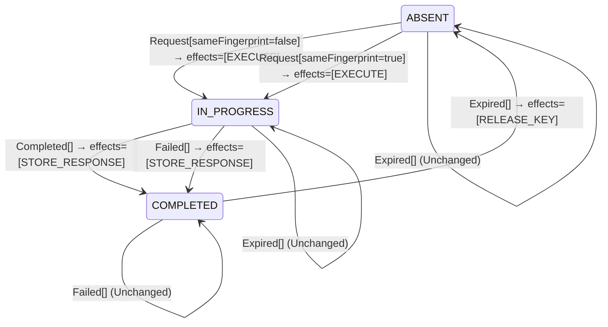

<!-- Generated by examples/tools/build.py from example.json and the verifier's output. Edit example.json. -->
# 030 · Storing a failed attempt's response under its key, proved at-most-once for every retry

[← All examples](../README.md)

| Verdict | Categories | Severity if shipped | Change | Verified unit | Approach |
|---|---|---|---|---|---|
| **✓ Verified: all invariants hold in 131 states, and under 1 more configuration** | functional, no-false-positive | none | feature, behaviour change intended | [`IdempotentReceiver#decide`](../../examples/apps/crosscut/src/main/java/net/terminalvalue/crosscut/idempotency/IdempotentReceiver.java) | [D1: Protocol model checking](../../examples/apps/crosscut/spec/README.md) |

> The receiver used to release an idempotency key when the attempt under it died, so that the client's retry could run the request again. The developer makes it store the failure as the key's response instead, which is Stripe's semantics: a retry gets the first attempt's outcome, whatever it was. The regenerated contract changes in one case, the model checker runs every interleaving of three attempts against the new rule, and every invariant holds in every state. The change is merged on a proof, not on a reviewer's mental model of retries.

Tags: [idempotency](../README.md#tag-idempotency), [duplicate-delivery](../README.md#tag-duplicate-delivery), [generated-operator](../README.md#tag-generated-operator), [multiple-configurations](../README.md#tag-multiple-configurations)

## The change

When the attempt in progress fails, move the key to COMPLETED and store the failure, instead of releasing the key. A retry then replays the failure rather than running the request again, so that a request that failed for a reason that will not go away (a declined card, an invalid address) is not re-run on every retry. The contract diff is the case `decide(IN_PROGRESS, Failed[])`, from a release to a stored response, and the test for that case is updated with it.

**Before** ([`IdempotentReceiver.java`](../../examples/apps/crosscut/src/main/java/net/terminalvalue/crosscut/idempotency/IdempotentReceiver.java), line 47):

```java
    case ABSENT, COMPLETED -> unchanged("no attempt is in progress");
};
case Failed _ -> switch (state) {
    case IN_PROGRESS -> transition(ABSENT, RELEASE_KEY);
    case ABSENT, COMPLETED -> unchanged("no attempt is in progress");
};
case Expired _ -> switch (state) {
```

**After:**

```java
    case ABSENT, COMPLETED -> unchanged("no attempt is in progress");
};
case Failed _ -> switch (state) {
    // The failure is the response: a retry gets it back, instead of running the request again.
    case IN_PROGRESS -> transition(COMPLETED, STORE_RESPONSE);
    case ABSENT, COMPLETED -> unchanged("no attempt is in progress");
};
case Expired _ -> switch (state) {
```

<details><summary>Patch</summary>

```diff
--- a/examples/apps/crosscut/src/main/java/net/terminalvalue/crosscut/idempotency/IdempotentReceiver.java
+++ b/examples/apps/crosscut/src/main/java/net/terminalvalue/crosscut/idempotency/IdempotentReceiver.java
@@ -47,7 +47,8 @@ public final class IdempotentReceiver {
                 case ABSENT, COMPLETED -> unchanged("no attempt is in progress");
             };
             case Failed _ -> switch (state) {
-                case IN_PROGRESS -> transition(ABSENT, RELEASE_KEY);
+                // The failure is the response: a retry gets it back, instead of running the request again.
+                case IN_PROGRESS -> transition(COMPLETED, STORE_RESPONSE);
                 case ABSENT, COMPLETED -> unchanged("no attempt is in progress");
             };
             case Expired _ -> switch (state) {
--- a/examples/apps/crosscut/src/test/java/net/terminalvalue/crosscut/idempotency/IdempotentReceiverTest.java
+++ b/examples/apps/crosscut/src/test/java/net/terminalvalue/crosscut/idempotency/IdempotentReceiverTest.java
@@ -31,8 +31,8 @@ public final class IdempotentReceiverTest {
         check(IdempotentReceiver.decide(COMPLETED, new Request(false)) instanceof Decision.Rejected, "422");
     }
 
-    public static void aFailedAttemptReleasesTheKey() {
-        equal(new Transition<>(ABSENT, List.of(ReceiverEffect.RELEASE_KEY)), IdempotentReceiver.decide(IN_PROGRESS, new Failed()));
+    public static void aFailedAttemptStoresTheFailure() {
+        equal(new Transition<>(COMPLETED, List.of(ReceiverEffect.STORE_RESPONSE)), IdempotentReceiver.decide(IN_PROGRESS, new Failed()));
     }
 
     public static void anExpiredKeyIsReleased() {
```

</details>

## What the verifier found

The model is checked under 2 configurations, and the verdict is the first that fails:

| Configuration | What it checks | Model | Result |
|---|---|---|---|
| the record never expires (`spec/IdempotentReceiver.cfg`) | every run from the initial state, every interleaving within the configuration's bounds | Attempts = {a1, a2, a3}, Expires = FALSE | ✓ Verified: all invariants hold in 131 states |
| expiring record (`spec/IdempotentReceiverExpiring.cfg`) | the same invariants, with the record's time to live allowed to pass at any point: the sweeper asks the receiver what to do with the record and applies the decision, and a release ends the record's lifetime, so `AtMostOnce` counts the results since the last release. The model has no clock, so the sweeper's clock has measured the record's age and nothing else, in particular not whether an execution is still running | Attempts = {a1, a2, a3}, Expires = TRUE | ✓ Verified: all invariants hold in 429 states |

Every invariant holds in every reachable state of the model under the record never expires: 131 distinct states, which is every interleaving of the client's attempts, the receiver, and the attempts in flight and executing within the model's bounds (Attempts = {a1, a2, a3}, Expires = FALSE).

The receiver's decision rule inside the model is generated from the behavioural contract of the patched code, so the model checks the decisions the receiver really makes.

The other configurations hold too, as the table says: expiring record, 429 states.

**What the verdict rests on.** TLC counted how often a step of the model took each row of the generated operators. A row no step takes is one the model says nothing about, whatever the verdict.

| Configuration | Rows of `IdempotentReceiver#decide` taken |
|---|---|
| the record never expires | 5 of 15 |
| expiring record | 7 of 15 |

The change alters 1 row of the contract:

- `decide(IN_PROGRESS, Failed[])`: `Transition[next=ABSENT, effects=[RELEASE_KEY]]` → `Transition[next=COMPLETED, effects=[STORE_RESPONSE]]`, taken under the record never expires, expiring record

Runs of the model take every row the change alters: the verdict rests on the change.

<details><summary>Rows no step takes under the record never expires</summary>

`net.terminalvalue.crosscut.idempotency.IdempotentReceiver#decide`:

```
decide(ABSENT, Request[sameFingerprint=false]) => Transition[next=IN_PROGRESS, effects=[EXECUTE]]
decide(ABSENT, Completed[]) => Unchanged
decide(ABSENT, Failed[]) => Unchanged
decide(ABSENT, Expired[]) => Unchanged
decide(IN_PROGRESS, Request[sameFingerprint=false]) => Rejected
decide(IN_PROGRESS, Expired[]) => Unchanged
decide(COMPLETED, Request[sameFingerprint=false]) => Rejected
decide(COMPLETED, Completed[]) => Unchanged
decide(COMPLETED, Failed[]) => Unchanged
decide(COMPLETED, Expired[]) => Transition[next=ABSENT, effects=[RELEASE_KEY]]
```

</details>

The state machine the patched code implements, drawn from its derived contract (`jvmcontract statemachine`); a state with no way in or no way out is marked:



## Would the existing tests have caught it?

Every existing unit test passes, as it should (`java -ea net.terminalvalue.crosscut.Tests`, run against the patched code).

## Why it matters

None, and that is the point. The question a reviewer has to answer is not about the line; it is whether, with failures now stored, a retry can still run alongside an execution, run after a result, or be answered with a stored response that does not exist, under every order in which a client's attempts and the receiver's executions can interleave. Example 029 shows a one-line change of the same shape that fails it. Answering by inspection is how idempotency layers get their bugs; answering by model checking takes under a second.

## Why the verdict is right

The receiver's rule in the model is generated from the regenerated contract, so the model runs the new rule. TLC explores every reachable state for three attempts: every order of sends, retries before and after a result, executions that finish and executions that die at every point. In every state, no two attempts execute at once, once an execution has produced a result no attempt is executing and none ever will, and every replayed response is a response that was stored. The stored failure can only ever turn a retry that would have run the request again into one that is answered from the record, which is the change the developer described.

## What to do

Merge. The contract diff is committed with the change, and the model is checked on every build, so the next change to the receiver is held to the same invariants.

## Notes

- The idempotency model (`apps/crosscut/spec`) has a client retrying against an `Idempotency-Key` receiver whose state machine is generated from its contract.

## Evidence

How the verdict was reached: the record never expires: TLC 2.19 explored 131 distinct states to depth 8 in 0 s, for the model Attempts = {a1, a2, a3}, Expires = FALSE; expiring record: TLC 2.19 explored 429 distinct states to depth 13 in 0 s, for the model Attempts = {a1, a2, a3}, Expires = TRUE.

<details><summary>Verifier output</summary>

```text
== the record never expires: spec/IdempotentReceiver.cfg ==
TLC2 Version 2.19 of 08 August 2024 (rev: 5a47802)
Running breadth-first search Model-Checking with fp 1 and seed 1 with 1 worker on 8 cores with 910MB heap and 64MB offheap memory [pid: 2441187] (Linux 6.6.87.2-microsoft-standard-WSL2 aarch64, Eclipse Adoptium 25.0.4.1 x86_64, MSBDiskFPSet, DiskStateQueue).
Parsing file examples/apps/crosscut/spec/IdempotentReceiver.tla
Parsing file examples/tools/tla/standard-modules/Naturals.tla
Parsing file examples/tools/tla/standard-modules/Sequences.tla
Parsing file examples/tools/tla/standard-modules/FiniteSets.tla
Parsing file examples/apps/crosscut/spec/IdempotentReceiverContract.tla
Semantic processing of module Naturals
Semantic processing of module Sequences
Semantic processing of module FiniteSets
Semantic processing of module IdempotentReceiverContract
Semantic processing of module IdempotentReceiver
Starting... (2026-11-02 02:33:54)
Computing initial states...
Finished computing initial states: 1 distinct state generated at 2026-11-02 02:33:54.
Model checking completed. No error has been found.
  Estimates of the probability that TLC did not check all reachable states
  because two distinct states had the same fingerprint:
  calculated (optimistic):  val = 5.7E-16
Rows of net.terminalvalue.crosscut.idempotency.IdempotentReceiver#decide a step of the model takes: 5 of 15; never taken (10):
  decide(ABSENT, Request[sameFingerprint=false]) => Transition[next=IN_PROGRESS, effects=[EXECUTE]]
  decide(ABSENT, Completed[]) => Unchanged
  decide(ABSENT, Failed[]) => Unchanged
  decide(ABSENT, Expired[]) => Unchanged
  decide(IN_PROGRESS, Request[sameFingerprint=false]) => Rejected
  decide(IN_PROGRESS, Expired[]) => Unchanged
  decide(COMPLETED, Request[sameFingerprint=false]) => Rejected
  decide(COMPLETED, Completed[]) => Unchanged
  decide(COMPLETED, Failed[]) => Unchanged
  decide(COMPLETED, Expired[]) => Transition[next=ABSENT, effects=[RELEASE_KEY]]
211 states generated, 131 distinct states found, 0 states left on queue.
The depth of the complete state graph search is 8.
The average outdegree of the complete state graph is 1 (minimum is 0, the maximum 4 and the 95th percentile is 3).
Finished in 00s at (2026-11-02 02:33:55)

== expiring record: spec/IdempotentReceiverExpiring.cfg ==
TLC2 Version 2.19 of 08 August 2024 (rev: 5a47802)
Running breadth-first search Model-Checking with fp 1 and seed 1 with 1 worker on 8 cores with 910MB heap and 64MB offheap memory [pid: 2441223] (Linux 6.6.87.2-microsoft-standard-WSL2 aarch64, Eclipse Adoptium 25.0.4.1 x86_64, MSBDiskFPSet, DiskStateQueue).
Parsing file examples/apps/crosscut/spec/IdempotentReceiver.tla
Parsing file examples/tools/tla/standard-modules/Naturals.tla
Parsing file examples/tools/tla/standard-modules/Sequences.tla
Parsing file examples/tools/tla/standard-modules/FiniteSets.tla
Parsing file examples/apps/crosscut/spec/IdempotentReceiverContract.tla
Semantic processing of module Naturals
Semantic processing of module Sequences
Semantic processing of module FiniteSets
Semantic processing of module IdempotentReceiverContract
Semantic processing of module IdempotentReceiver
Starting... (2026-11-02 02:33:55)
Computing initial states...
Finished computing initial states: 1 distinct state generated at 2026-11-02 02:33:55.
Model checking completed. No error has been found.
  Estimates of the probability that TLC did not check all reachable states
  because two distinct states had the same fingerprint:
  calculated (optimistic):  val = 8.2E-15
Rows of net.terminalvalue.crosscut.idempotency.IdempotentReceiver#decide a step of the model takes: 7 of 15; never taken (8):
  decide(ABSENT, Request[sameFingerprint=false]) => Transition[next=IN_PROGRESS, effects=[EXECUTE]]
  decide(ABSENT, Completed[]) => Unchanged
  decide(ABSENT, Failed[]) => Unchanged
  decide(ABSENT, Expired[]) => Unchanged
  decide(IN_PROGRESS, Request[sameFingerprint=false]) => Rejected
  decide(COMPLETED, Request[sameFingerprint=false]) => Rejected
  decide(COMPLETED, Completed[]) => Unchanged
  decide(COMPLETED, Failed[]) => Unchanged
780 states generated, 429 distinct states found, 0 states left on queue.
The depth of the complete state graph search is 13.
The average outdegree of the complete state graph is 1 (minimum is 0, the maximum 4 and the 95th percentile is 3).
Finished in 00s at (2026-11-02 02:33:55)
```

</details>

<details><summary>SARIF report (as uploaded to GitHub code scanning or SonarQube)</summary>

```json
{
  "version": "2.1.0",
  "$schema": "https://json.schemastore.org/sarif-2.1.0.json",
  "runs": [
    {
      "tool": {
        "driver": {
          "name": "jvmcontract tlc",
          "rules": [
            {
              "id": "invariant-violated",
              "shortDescription": {
                "text": "TLC found a behaviour of the model that violates an invariant or a temporal property, or ends in a deadlock."
              }
            },
            {
              "id": "unverifiable",
              "shortDescription": {
                "text": "TLC could not check the model."
              }
            }
          ]
        }
      },
      "results": []
    }
  ]
}
```

</details>

**Provenance:** Constructed to show an intended change to a protocol's decision rule accepted on the strength of the model, to pair with example 029; the semantics are Stripe's.

- [Stripe, Idempotent requests ("saves the resulting status code and body of the first request made for any given idempotency key, regardless of whether it succeeds or fails")](https://docs.stripe.com/api/idempotent_requests)
## Reproduce

```bash
python3 examples/tools/build.py 030
```

This applies `change.patch` to a temporary copy of the repo, runs the verifier on it, and rewrites this page.
