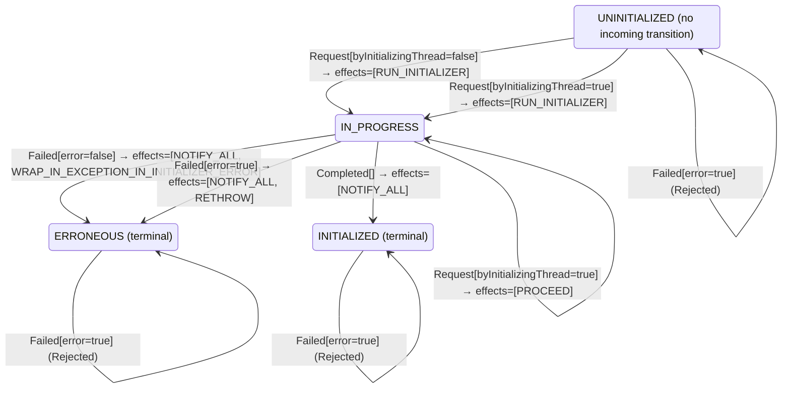

<!-- Generated by examples/tools/build.py from example.json and the verifier's output. Edit example.json. -->
# 042 · Letting other threads proceed while <clinit> runs hands out a half-built class

[← All examples](../README.md)

| Verdict | Categories | Severity if shipped | Change | Verified unit | Approach |
|---|---|---|---|---|---|
| **✗ Violation: UsedOnlyWhenInitialized, 3-step trace** | functional | critical | bug-fix, behaviour change intended | [`ClassInitialization#decide`](../../examples/apps/mica/src/main/java/net/terminalvalue/mica/init/ClassInitialization.java) | [D1: Protocol model checking](../../examples/apps/mica/spec/README.md) |

> A thread that needs a class another thread is initializing waits on the initialization lock, as step 2 of JVMS §5.5 says. Class-initialization deadlocks between classes whose initializers refer to each other are a known production problem, and a developer removes the wait: a request during initialization completes normally for every thread, as step 3 already allows for the initializing one. The contract diff is one line and is approved. The model checker finds a three-step run in which the second thread uses the class before its initializer has returned.

Tags: [jvm-internals](../README.md#tag-jvm-internals), [class-initialization](../README.md#tag-class-initialization), [race-condition](../README.md#tag-race-condition), [generated-operator](../README.md#tag-generated-operator)

## The change

In state `IN_PROGRESS`, answer `PROCEED` to every request, not only to the initializing thread's. The reasoning: the initializer is running, so the class is as good as ready, and a thread that never waits on another thread's class initialization cannot take part in an initialization deadlock. The behavioural contract is regenerated and its diff is one line, the case `decide(IN_PROGRESS, Request[byInitializingThread=false])`, `WAIT` to `PROCEED`; the test for that case is updated. The reviewer approves the diff.

**Before** ([`ClassInitialization.java`](../../examples/apps/mica/src/main/java/net/terminalvalue/mica/init/ClassInitialization.java), line 33):

```java
case Request request -> switch (state) {
    // Step 6: record the current thread as the initializer and run the initialization (steps 7 to 9).
    case UNINITIALIZED -> transition(IN_PROGRESS, RUN_INITIALIZER);
    case IN_PROGRESS -> request.byInitializingThread()
            // Step 3: a recursive request by the initializing thread completes normally.
            ? transition(IN_PROGRESS, PROCEED)
            // Step 2: another thread is initializing; wait on LC, then repeat the procedure.
            : transition(IN_PROGRESS, WAIT);
    // Step 4: already initialized.
    case INITIALIZED -> transition(INITIALIZED, PROCEED);
    // Step 5: initialization failed once; it is not retried.
```

**After:**

```java
case Request request -> switch (state) {
    // Step 6: record the current thread as the initializer and run the initialization (steps 7 to 9).
    case UNINITIALIZED -> transition(IN_PROGRESS, RUN_INITIALIZER);
    // A request while the class is being initialized completes normally, whichever thread asks: the
    // initializer is running, the class is as good as ready, and no thread waits on another one's
    // class initialization (the cause of the initialization deadlocks between classes that refer to
    // each other). Step 3 already allows this for the initializing thread.
    case IN_PROGRESS -> transition(IN_PROGRESS, PROCEED);
    // Step 4: already initialized.
    case INITIALIZED -> transition(INITIALIZED, PROCEED);
    // Step 5: initialization failed once; it is not retried.
```

<details><summary>Patch</summary>

```diff
--- a/examples/apps/mica/src/main/java/net/terminalvalue/mica/init/ClassInitialization.java
+++ b/examples/apps/mica/src/main/java/net/terminalvalue/mica/init/ClassInitialization.java
@@ -33,11 +33,11 @@ public final class ClassInitialization {
             case Request request -> switch (state) {
                 // Step 6: record the current thread as the initializer and run the initialization (steps 7 to 9).
                 case UNINITIALIZED -> transition(IN_PROGRESS, RUN_INITIALIZER);
-                case IN_PROGRESS -> request.byInitializingThread()
-                        // Step 3: a recursive request by the initializing thread completes normally.
-                        ? transition(IN_PROGRESS, PROCEED)
-                        // Step 2: another thread is initializing; wait on LC, then repeat the procedure.
-                        : transition(IN_PROGRESS, WAIT);
+                // A request while the class is being initialized completes normally, whichever thread asks: the
+                // initializer is running, the class is as good as ready, and no thread waits on another one's
+                // class initialization (the cause of the initialization deadlocks between classes that refer to
+                // each other). Step 3 already allows this for the initializing thread.
+                case IN_PROGRESS -> transition(IN_PROGRESS, PROCEED);
                 // Step 4: already initialized.
                 case INITIALIZED -> transition(INITIALIZED, PROCEED);
                 // Step 5: initialization failed once; it is not retried.
--- a/examples/apps/mica/src/test/java/net/terminalvalue/mica/init/ClassInitializationTest.java
+++ b/examples/apps/mica/src/test/java/net/terminalvalue/mica/init/ClassInitializationTest.java
@@ -29,8 +29,8 @@ public final class ClassInitializationTest {
         equal(new Transition<>(IN_PROGRESS, List.of(RUN_INITIALIZER)), ClassInitialization.decide(UNINITIALIZED, new Request(false)));
     }
 
-    public static void anotherThreadWaitsForTheInitializer() {
-        equal(new Transition<>(IN_PROGRESS, List.of(WAIT)), ClassInitialization.decide(IN_PROGRESS, new Request(false)));
+    public static void anotherThreadProceedsWhileTheInitializerRuns() {
+        equal(new Transition<>(IN_PROGRESS, List.of(PROCEED)), ClassInitialization.decide(IN_PROGRESS, new Request(false)));
     }
 
     public static void theInitializingThreadProceedsOnARecursiveRequest() {
```

</details>

## What the verifier found

TLC found a run of the system, 3 steps long, that violates the invariant **UsedOnlyWhenInitialized** (a thread uses the class only once it is initialized). Each step is one action of one part of the system:

1. **Initial state**: the class uninitialized, no initializer recorded, every thread idle.
2. **Request**, `Runtime.initialize`: a thread needs the class, takes the initialization lock and acts on the decision. `initializer = t1`, `pc = (t1 :> "running" @@ t2 :> "idle" @@ t3 :> "idle")`, `runs = 1`, `state = "IN_PROGRESS"`
3. **Request**, `Runtime.initialize`: a thread needs the class, takes the initialization lock and acts on the decision. `pc = (t1 :> "running" @@ t2 :> "using" @@ t3 :> "idle")`

The model is small (Threads = {t1, t2, t3}), which is what keeps the trace readable. TLC explored every interleaving of the threads, the class's initialization state and its recorded initializer within those bounds.

The state machine the patched code implements, drawn from its derived contract (`jvmcontract statemachine`); a state with no way in or no way out is marked:



## Would the existing tests have caught it?

No: every existing unit test passes (`java -ea net.terminalvalue.mica.Tests`, run against the patched code).

## Why it matters

Step 2 is the whole guarantee of class initialization: when a thread's `getstatic` completes, `<clinit>` has run to the end and the static fields hold what it assigned. With this change a second thread reads a static `final` field as null or zero, calls a static method whose cache is not built, or sees a singleton before its constructor finished, for the few microseconds the initializer takes, on the machines where two threads touch a new class at once, which is startup under load. Nothing reports it: there is no exception, just a wrong value in one thread, once. The deadlock the developer wanted to avoid is real, but it is between two classes and two threads; the fix removed the guarantee for one class and every thread. The contract diff could not catch this: the diff was precisely the intended change. Whether the new rule is safe is a question about every interleaving of threads that need the class, and only the model answers it.

## Why the verdict is right

The TLA+ model has one action per operation of a thread: request the class, request it again from inside the initializer, return from the initializer, throw from it. The runtime's decision rule inside the model is not hand-written: it is generated from the behavioural contract of `ClassInitialization#decide`, which the tool proves the bytecode satisfies on all 30 inputs, so the model decides exactly as the Java does. TLC explores every interleaving of three threads and reports the shortest run that breaks the invariant that a thread uses the class only once it is initialized: one thread requests the class and starts the initializer, a second thread requests it, is told to proceed, and uses the class while the state is still `IN_PROGRESS`. The run is three steps long, the initial state and two actions, and the step the developer's reasoning left out is the one between "the initializer is running" and "the initializer has returned".

## What to do

Revert. The deadlock between classes is addressed where it arises: by breaking the cycle between the initializers, or by initializing the classes in a fixed order on one thread before the others start, both of which the specification leaves to the program. The model picks up any further change to the rule through its contract, so the next idea of this kind is checked the same way before it is merged.

## Notes

- The class initialization model (`apps/mica/spec`) has threads racing to initialize one class under the procedure of JVMS 5.5, and is checked for deadlock as well as for its invariants.

## Evidence

How the verdict was reached: TLC 2.19 explored 7 distinct states to depth 3 in 0 s, for the model Threads = {t1, t2, t3}.

<details><summary>Verifier output</summary>

```text
TLC2 Version 2.19 of 08 August 2024 (rev: 5a47802)
Running breadth-first search Model-Checking with fp 1 and seed 1 with 1 worker on 8 cores with 910MB heap and 64MB offheap memory [pid: 2304636] (Linux 6.6.87.2-microsoft-standard-WSL2 aarch64, Eclipse Adoptium 25.0.4.1 x86_64, MSBDiskFPSet, DiskStateQueue).
Parsing file examples/apps/mica/spec/ClassInit.tla
Parsing file examples/tools/tla/standard-modules/Naturals.tla
Parsing file examples/tools/tla/standard-modules/Sequences.tla
Parsing file examples/tools/tla/standard-modules/FiniteSets.tla
Parsing file examples/apps/mica/spec/ClassInitContract.tla
Semantic processing of module Naturals
Semantic processing of module Sequences
Semantic processing of module FiniteSets
Semantic processing of module ClassInitContract
Semantic processing of module ClassInit
Starting... (2026-11-02 01:45:32)
Computing initial states...
Finished computing initial states: 1 distinct state generated at 2026-11-02 01:45:32.
Error: Invariant UsedOnlyWhenInitialized is violated.
Error: The behavior up to this point is:
State 1: <Initial predicate>
/\ state = "UNINITIALIZED"
/\ initializer = "none"
/\ runs = 0
/\ pc = (t1 :> "idle" @@ t2 :> "idle" @@ t3 :> "idle")

State 2: <Request line 49, col 5 to line 54, col 55 of module ClassInit>
/\ state = "IN_PROGRESS"
/\ initializer = t1
/\ runs = 1
/\ pc = (t1 :> "running" @@ t2 :> "idle" @@ t3 :> "idle")

State 3: <Request line 49, col 5 to line 54, col 55 of module ClassInit>
/\ state = "IN_PROGRESS"
/\ initializer = t1
/\ runs = 1
/\ pc = (t1 :> "running" @@ t2 :> "using" @@ t3 :> "idle")

Rows of net.terminalvalue.mica.init.ClassInitialization#decide a step of the model takes: 5 of 20; never taken (15):
  decide(UNINITIALIZED, Request[byInitializingThread=true]) => Transition[next=IN_PROGRESS, effects=[RUN_INITIALIZER]]
  decide(UNINITIALIZED, Completed[]) => Rejected
  decide(UNINITIALIZED, Failed[error=false]) => Rejected
  decide(UNINITIALIZED, Failed[error=true]) => Rejected
  decide(IN_PROGRESS, Failed[error=true]) => Transition[next=ERRONEOUS, effects=[NOTIFY_ALL, RETHROW]]
  decide(INITIALIZED, Request[byInitializingThread=false]) => Transition[next=INITIALIZED, effects=[PROCEED]]
  decide(INITIALIZED, Request[byInitializingThread=true]) => Transition[next=INITIALIZED, effects=[PROCEED]]
  decide(INITIALIZED, Completed[]) => Rejected
  decide(INITIALIZED, Failed[error=false]) => Rejected
  decide(INITIALIZED, Failed[error=true]) => Rejected
  decide(ERRONEOUS, Request[byInitializingThread=false]) => Transition[next=ERRONEOUS, effects=[THROW_NO_CLASS_DEF_FOUND_ERROR]]
  decide(ERRONEOUS, Request[byInitializingThread=true]) => Transition[next=ERRONEOUS, effects=[THROW_NO_CLASS_DEF_FOUND_ERROR]]
  decide(ERRONEOUS, Completed[]) => Rejected
  decide(ERRONEOUS, Failed[error=false]) => Rejected
  decide(ERRONEOUS, Failed[error=true]) => Rejected
8 states generated, 7 distinct states found, 4 states left on queue.
The depth of the complete state graph search is 3.
The average outdegree of the complete state graph is 3 (minimum is 3, the maximum 3 and the 95th percentile is 3).
Finished in 00s at (2026-11-02 01:45:32)
```

</details>

<details><summary>SARIF report (as uploaded to GitHub code scanning or SonarQube)</summary>

```json
{
  "version": "2.1.0",
  "$schema": "https://json.schemastore.org/sarif-2.1.0.json",
  "runs": [
    {
      "tool": {
        "driver": {
          "name": "jvmcontract tlc",
          "rules": [
            {
              "id": "invariant-violated",
              "shortDescription": {
                "text": "TLC found a behaviour of the model that violates an invariant or a temporal property, or ends in a deadlock."
              }
            },
            {
              "id": "unverifiable",
              "shortDescription": {
                "text": "TLC could not check the model."
              }
            }
          ]
        }
      },
      "results": [
        {
          "ruleId": "invariant-violated",
          "level": "error",
          "message": {
            "text": "Invariant UsedOnlyWhenInitialized of spec/ClassInit.tla is violated after 3 steps"
          },
          "locations": [
            {
              "physicalLocation": {
                "artifactLocation": {
                  "uri": "examples/apps/mica/src/main/java/net/terminalvalue/mica/init/ClassInitialization.java"
                },
                "region": {
                  "startLine": 33
                }
              }
            }
          ]
        }
      ]
    }
  ]
}
```

</details>

**Provenance:** Constructed from steps 2 and 3 of the initialization procedure of JVMS §5.5, by giving every thread the recursive-request treatment.

- [JVMS §5.5, Initialization: the twelve-step procedure, steps 2 and 3](https://docs.oracle.com/javase/specs/jvms/se21/html/jvms-5.html#jvms-5.5)
- [JLS §12.4.2, Detailed Initialization Procedure](https://docs.oracle.com/javase/specs/jls/se21/html/jls-12.html#jls-12.4.2)
## Reproduce

```bash
python3 examples/tools/build.py 042
```

This applies `change.patch` to a temporary copy of the repo, runs the verifier on it, and rewrites this page.
