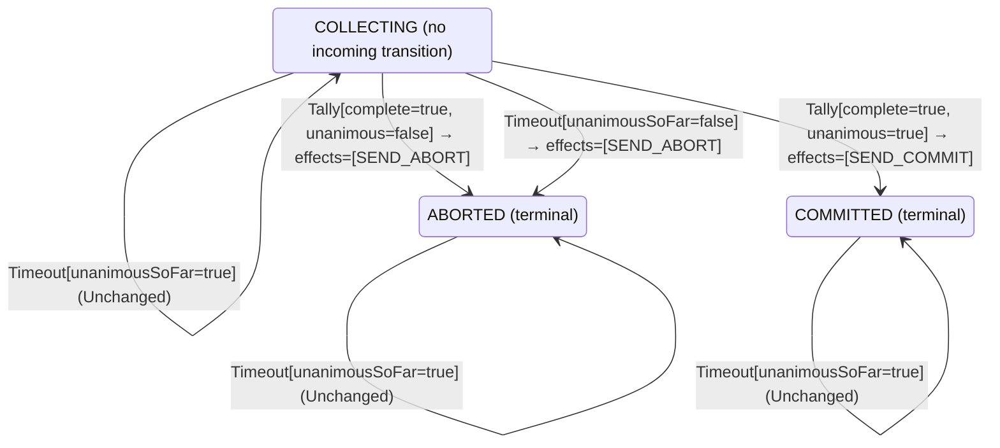

<!-- Generated by examples/tools/build.py from example.json and the verifier's output. Edit example.json. -->
# 057 · A coordinator that waits for the last vote when every vote so far is yes blocks forever

[← All examples](../README.md)

| Verdict | Categories | Severity if shipped | Change | Verified unit | Approach |
|---|---|---|---|---|---|
| **✗ Violation: EveryParticipantDecides, 6-step trace then forever** | functional | critical | feature, behaviour change intended | [`Coordinator#decide`](../../examples/apps/quorum/src/main/java/net/terminalvalue/quorum/twopc/Coordinator.java) | [D1: Protocol model checking](../../examples/apps/quorum/spec/README.md) |

> When the vote collection times out, the two-phase-commit coordinator aborts: a participant that has not answered may have given up. A developer makes it keep collecting instead when every vote that did arrive was yes, so as not to throw away a transaction every responder approved. Every safety invariant of the protocol model still holds, and so does the contract diff the reviewer approves. The model's liveness property, that every participant eventually decides, does not: TLC shows a six-step run after which two prepared participants hold their locks forever.

Tags: [distributed-transactions](../README.md#tag-distributed-transactions), [liveness](../README.md#tag-liveness), [tla-liveness](../README.md#tag-tla-liveness), [tla-refinement](../README.md#tag-tla-refinement), [generated-operator](../README.md#tag-generated-operator), [multiple-configurations](../README.md#tag-multiple-configurations)

## The change

On a `Timeout` in `COLLECTING`, answer `unchanged` when `unanimousSoFar` is true, and abort as before when it is false. The reasoning in the comment: the missing participants may only be slow, and the next vote completes the tally, so a yes commits and a no aborts, as always. The contract diff is one case, `decide(COLLECTING, Timeout[unanimousSoFar=true])`, from a transition to `ABORTED` to unchanged, and a test for it is added. The reviewer approves the diff.

**Before** ([`Coordinator.java`](../../examples/apps/quorum/src/main/java/net/terminalvalue/quorum/twopc/Coordinator.java), line 28):

```java
                : tally.unanimous() ? transition(COMMITTED, SEND_COMMIT) : transition(ABORTED, SEND_ABORT);
        case COMMITTED, ABORTED -> unchanged("already decided");
    };
    case Timeout _ -> switch (phase) {
        case COLLECTING -> transition(ABORTED, SEND_ABORT); // presumed abort
        case COMMITTED, ABORTED -> unchanged("already decided");
    };
};
```

**After:**

```java
                : tally.unanimous() ? transition(COMMITTED, SEND_COMMIT) : transition(ABORTED, SEND_ABORT);
        case COMMITTED, ABORTED -> unchanged("already decided");
    };
    case Timeout timeout -> switch (phase) {
        // Every vote so far is yes: the missing participants may only be slow, and aborting throws away
        // work every responder approved. Keep collecting; the next vote completes the tally.
        case COLLECTING -> timeout.unanimousSoFar()
                ? unchanged("every vote so far is yes; waiting for the rest")
                : transition(ABORTED, SEND_ABORT); // presumed abort
        case COMMITTED, ABORTED -> unchanged("already decided");
    };
};
```

<details><summary>Patch</summary>

```diff
--- a/examples/apps/quorum/src/main/java/net/terminalvalue/quorum/twopc/Coordinator.java
+++ b/examples/apps/quorum/src/main/java/net/terminalvalue/quorum/twopc/Coordinator.java
@@ -28,8 +28,12 @@
                         : tally.unanimous() ? transition(COMMITTED, SEND_COMMIT) : transition(ABORTED, SEND_ABORT);
                 case COMMITTED, ABORTED -> unchanged("already decided");
             };
-            case Timeout _ -> switch (phase) {
-                case COLLECTING -> transition(ABORTED, SEND_ABORT); // presumed abort
+            case Timeout timeout -> switch (phase) {
+                // Every vote so far is yes: the missing participants may only be slow, and aborting throws away
+                // work every responder approved. Keep collecting; the next vote completes the tally.
+                case COLLECTING -> timeout.unanimousSoFar()
+                        ? unchanged("every vote so far is yes; waiting for the rest")
+                        : transition(ABORTED, SEND_ABORT); // presumed abort
                 case COMMITTED, ABORTED -> unchanged("already decided");
             };
         };
--- a/examples/apps/quorum/src/test/java/net/terminalvalue/quorum/twopc/CoordinatorTest.java
+++ b/examples/apps/quorum/src/test/java/net/terminalvalue/quorum/twopc/CoordinatorTest.java
@@ -32,6 +32,10 @@
                 Coordinator.decide(Phase.COLLECTING, new Timeout(false)));
     }
 
+    public static void keepsCollectingOnTimeoutWhenEveryVoteSoFarIsYes() {
+        check(Coordinator.decide(Phase.COLLECTING, new Timeout(true)) instanceof Decision.Unchanged, "wait for the rest");
+    }
+
     public static void aDecisionIsFinal() {
         check(Coordinator.decide(Phase.COMMITTED, new Timeout(true)) instanceof Decision.Unchanged, "committed stays");
         check(Coordinator.decide(Phase.ABORTED, new Tally(true, true)) instanceof Decision.Unchanged, "aborted stays");
```

</details>

## What the verifier found

The model is checked under 7 configurations, and the verdict is the first that fails:

| Configuration | What it checks | Model | Result |
|---|---|---|---|
| three participants (`spec/TwoPhaseCommit.cfg`) | every run from the initial state, every interleaving within the configuration's bounds | Participants = {p1, p2, p3}, MaxCrashes = 0, MaxParticipantCrashes = 0 | ✗ Violation: EveryParticipantDecides, 6-step trace then forever |
| the inductive step (`spec/TwoPhaseCommitInductive.cfg`) | that the invariant `Inductive` is inductive: TLC starts from every state the invariant admits, reachable or not, rather than from the initial state, takes one step, and checks the invariant again, conjunct by conjunct. No counterexample is a proof of atomicity by induction, for any run of the protocol however long; a counterexample is one step from a state that need not be reachable | Participants = {p1, p2, p3}, MaxCrashes = 0, MaxParticipantCrashes = 0 | ✓ Verified: all invariants hold in 736 states |
| crashes (`spec/TwoPhaseCommitCrash.cfg`) | every run from the initial state in which the coordinator may crash, twice at most: between steps, or after logging a phase change and before the broadcast goes out, and restart on the recovery rule, generated from `Recovery#decide`; the same invariants and temporal properties, under the added fairness condition that a crashed coordinator restarts | Participants = {p1, p2, p3}, MaxCrashes = 2, MaxParticipantCrashes = 0 | ✗ Violation: EveryParticipantDecides, 6-step trace then forever |
| the inductive step with crashes (`spec/TwoPhaseCommitCrashInductive.cfg`) | that the invariant `Inductive` is closed under a crash and a restart as well: TLC starts from every state the invariant admits, the coordinator up or down, takes one step, and checks the invariant again | Participants = {p1, p2, p3}, MaxCrashes = 1, MaxParticipantCrashes = 0 | ✓ Verified: all invariants hold in 2,728 states |
| participant crashes (`spec/TwoPhaseCommitParticipantCrash.cfg`) | every run from the initial state in which a participant may crash, once, between steps or after logging a vote and before sending it, and restart on the participant's rule, generated from `Participant#decide`, while the coordinator may crash once as well; the same invariants and temporal properties, under the added fairness condition that a crashed participant restarts | Participants = {p1, p2, p3}, MaxCrashes = 1, MaxParticipantCrashes = 1 | ✗ Violation: EveryParticipantDecides, 6-step trace then forever |
| the inductive step with participant crashes (`spec/TwoPhaseCommitParticipantCrashInductive.cfg`) | that the invariant `Inductive` is closed under a participant's crash and restart as well: TLC starts from every state the invariant admits, each process up or down, takes one step, and checks the invariant again | Participants = {p1, p2, p3}, MaxCrashes = 1, MaxParticipantCrashes = 1 | ✓ Verified: all invariants hold in 18,636 states |
| the recorded runs (`spec/TwoPhaseCommitTrace.cfg`) | the Java nodes against the model: the coordinator node, its log and its broadcast, and the participant nodes, their logs and their votes, run through eleven scripted scenarios with crashes of either process injected after a given I/O operation, the state after each step recorded in the model's variables (`TwoPhaseCommitTraces.tla`, regenerated from the patched classes); TLC walks each recorded run and checks that it starts in the model's initial state and that every step is a step of the model's next-state relation. A step the model has no action for is one the glue took that the model's verdicts do not cover | Participants = {"p1", "p2", "p3"}, MaxCrashes = 2, MaxParticipantCrashes = 2 | ✓ Verified: all invariants and properties hold in 103 states |

TLC found a run of the system under three participants that violates the temporal property **EveryParticipantDecides** (every participant eventually commits or aborts, under the fairness the model assumes: participants vote or give up, the coordinator counts every vote and fires its timer while votes are missing, participants apply a decision once made, and a crashed process restarts): after the 6 steps below, the system stays in that state forever, and the property never comes true. The run respects every fairness condition the model assumes; the parts that could act, do. Each step is one action of one part of the system:

1. **Initial state**: every participant working, no vote counted, no decision, every process up.
2. **Vote**, `Participant.prepare`: a participant votes yes (and holds its locks) or no (and aborts), as its rule decides; it logs the state before it sends the vote, and a crash can fall between the two. `inbox = {[from |-> p1, vote |-> "YES"]}`, `pstate = (p1 :> "PREPARED" @@ p2 :> "WORKING" @@ p3 :> "WORKING")`
3. **Vote**, `Participant.prepare`: a participant votes yes (and holds its locks) or no (and aborts), as its rule decides; it logs the state before it sends the vote, and a crash can fall between the two. `inbox = {[from |-> p1, vote |-> "YES"], [from |-> p2, vote |-> "YES"]}`, `pstate = (p1 :> "PREPARED" @@ p2 :> "PREPARED" @@ p3 :> "WORKING")`
4. **ReceiveVote**, `Coordinator.onVote`: the coordinator counts a vote and decides on the tally. `inbox = {[from |-> p1, vote |-> "YES"]}`, `votes = (p1 :> "NONE" @@ p2 :> "YES" @@ p3 :> "NONE")`
5. **ReceiveVote**, `Coordinator.onVote`: the coordinator counts a vote and decides on the tally. `inbox = {}`, `votes = (p1 :> "YES" @@ p2 :> "YES" @@ p3 :> "NONE")`
6. **ParticipantTimeout**, `Participant.timeout`: a participant that has not voted gives up on its own. `pstate = (p1 :> "PREPARED" @@ p2 :> "PREPARED" @@ p3 :> "ABORTED")`

The model is small (Participants = {p1, p2, p3}, MaxCrashes = 0, MaxParticipantCrashes = 0), which is what keeps the trace readable. TLC explored every interleaving of the participants, the coordinator and the votes in flight within those bounds.

Under crashes TLC found the same run, and reported it the same way.

<details><summary>The counterexample under participant crashes: temporal property <b>EveryParticipantDecides</b>, 6 steps</summary>

Temporal property **EveryParticipantDecides**: every participant eventually commits or aborts, under the fairness the model assumes: participants vote or give up, the coordinator counts every vote and fires its timer while votes are missing, participants apply a decision once made, and a crashed process restarts. After the last step the system stays in that state forever.

1. **Initial state**: every participant working, no vote counted, no decision, every process up.
2. **Vote**, `Participant.prepare`: a participant votes yes (and holds its locks) or no (and aborts), as its rule decides; it logs the state before it sends the vote, and a crash can fall between the two. `pcrashes = 1`, `pstate = (p1 :> "WORKING" @@ p2 :> "ABORTED" @@ p3 :> "WORKING")`, `pup = (p1 :> TRUE @@ p2 :> FALSE @@ p3 :> TRUE)`
3. **ParticipantRecover**, `Participant.recover`: a participant restarts with the state it logged and acts on its rule's decision: on the committed rule, a prepared one holds its locks and waits, one that had not voted aborts. `pup = (p1 :> TRUE @@ p2 :> TRUE @@ p3 :> TRUE)`
4. **ParticipantTimeout**, `Participant.timeout`: a participant that has not voted gives up on its own. `pstate = (p1 :> "WORKING" @@ p2 :> "ABORTED" @@ p3 :> "ABORTED")`
5. **Vote**, `Participant.prepare`: a participant votes yes (and holds its locks) or no (and aborts), as its rule decides; it logs the state before it sends the vote, and a crash can fall between the two. `inbox = {[from |-> p1, vote |-> "YES"]}`, `pstate = (p1 :> "PREPARED" @@ p2 :> "ABORTED" @@ p3 :> "ABORTED")`
6. **ReceiveVote**, `Coordinator.onVote`: the coordinator counts a vote and decides on the tally. `inbox = {}`, `votes = (p1 :> "YES" @@ p2 :> "NONE" @@ p3 :> "NONE")`

</details>

**What the verdict rests on.** TLC counted how often a step of the model took each row of the generated operators. A row no step takes is one the model says nothing about, whatever the verdict.

| Configuration | Rows of `Coordinator#decide` taken | Rows of `Recovery#decide` taken | Rows of `Participant#decide` taken |
|---|---|---|---|
| three participants | stopped at the counterexample | stopped at the counterexample | stopped at the counterexample |
| the inductive step (from the states the invariant admits, not from a run) | 10 of 18 | 0 of 3 | 6 of 28 |
| crashes | stopped at the counterexample | stopped at the counterexample | stopped at the counterexample |
| the inductive step with crashes (from the states the invariant admits, not from a run) | 10 of 18 | 3 of 3 | 6 of 28 |
| participant crashes | stopped at the counterexample | stopped at the counterexample | stopped at the counterexample |
| the inductive step with participant crashes (from the states the invariant admits, not from a run) | 10 of 18 | 3 of 3 | 10 of 28 |

The change alters 1 row of the contract:

- `decide(COLLECTING, Timeout[unanimousSoFar=true])`: `Transition[next=ABORTED, effects=[SEND_ABORT]]` → `Unchanged[reason="every vote so far is yes; waiting for the rest"]`, taken under the inductive step, the inductive step with crashes, the inductive step with participant crashes

The run under three participants, crashes, participant crashes stopped at its counterexample, the steps above, and its counts are left out: the verdict rests on the counterexample.

<details><summary>Rows no step takes under the inductive step</summary>

`net.terminalvalue.quorum.twopc.Coordinator#decide`:

```
decide(COMMITTED, Tally[complete=false, unanimous=false]) => Unchanged
decide(COMMITTED, Tally[complete=false, unanimous=true]) => Unchanged
decide(COMMITTED, Tally[complete=true, unanimous=false]) => Unchanged
decide(COMMITTED, Tally[complete=true, unanimous=true]) => Unchanged
decide(COMMITTED, Timeout[unanimousSoFar=false]) => Unchanged
decide(COMMITTED, Timeout[unanimousSoFar=true]) => Unchanged
decide(ABORTED, Timeout[unanimousSoFar=false]) => Unchanged
decide(ABORTED, Timeout[unanimousSoFar=true]) => Unchanged
```

`net.terminalvalue.quorum.twopc.Recovery#decide`:

```
decide(COLLECTING, Restarted[]) => Transition[next=ABORTED, effects=[SEND_ABORT]]
decide(COMMITTED, Restarted[]) => Transition[next=COMMITTED, effects=[SEND_COMMIT]]
decide(ABORTED, Restarted[]) => Transition[next=ABORTED, effects=[SEND_ABORT]]
```

`net.terminalvalue.quorum.twopc.Participant#decide`:

```
decide(WORKING, Learned[outcome=NONE]) => Unchanged
decide(WORKING, Learned[outcome=COMMIT]) => Transition[next=COMMITTED, effects=[]]
decide(WORKING, Restarted[]) => Transition[next=ABORTED, effects=[]]
decide(PREPARED, Prepare[able=false]) => Rejected
decide(PREPARED, Prepare[able=true]) => Rejected
decide(PREPARED, GiveUp[]) => Rejected
decide(PREPARED, Learned[outcome=NONE]) => Unchanged
decide(PREPARED, Restarted[]) => Unchanged
decide(COMMITTED, Prepare[able=false]) => Rejected
decide(COMMITTED, Prepare[able=true]) => Rejected
decide(COMMITTED, GiveUp[]) => Rejected
decide(COMMITTED, Learned[outcome=NONE]) => Unchanged
decide(COMMITTED, Learned[outcome=COMMIT]) => Unchanged
decide(COMMITTED, Learned[outcome=ABORT]) => Unchanged
decide(COMMITTED, Restarted[]) => Unchanged
decide(ABORTED, Prepare[able=false]) => Rejected
decide(ABORTED, Prepare[able=true]) => Rejected
decide(ABORTED, GiveUp[]) => Rejected
decide(ABORTED, Learned[outcome=NONE]) => Unchanged
decide(ABORTED, Learned[outcome=COMMIT]) => Unchanged
decide(ABORTED, Learned[outcome=ABORT]) => Unchanged
decide(ABORTED, Restarted[]) => Unchanged
```

</details>

The state machine the patched code implements, drawn from its derived contract (`jvmcontract statemachine`); a state with no way in or no way out is marked:



## Would the existing tests have caught it?

Yes, in this repo: `NodesTest.abortsOnTheTimerWithAVoteMissing` fails (`java -ea net.terminalvalue.quorum.Tests`). That test was written for this property. The contract needed no one to anticipate it.

## Why it matters

A participant that voted yes is prepared: it holds its locks and cannot abort on its own, because the coordinator may still commit. That is the blocking property of two-phase commit, and the protocol lives with it because the coordinator is bound to decide: the timeout is what turns a participant that never answers into an abort. With this change, one participant that gives up before voting, a crash, a network partition, a client that went away, leaves a coordinator that waits for a vote that will never come, and every participant that voted yes waits with it, holding its locks, for as long as the system runs. No invariant is ever false: nothing wrong is observed, because nothing is observed at all. The unit tests check the decision on each input, and each decision is the intended one.

## Why the verdict is right

The model gained two things in this cycle, both temporal: fairness conditions, which say what each part of the system is assumed to get round to (participants vote or give up, the coordinator counts every vote that reaches it and fires its timer while votes are missing, participants apply a decision once made), and the property `EveryParticipantDecides`, `\A p \in Participants : <>(pstate[p] \in {"COMMITTED", "ABORTED"})`, which TLC checks over every infinite behaviour that respects the fairness conditions. On the committed coordinator it holds in all 728 states. On the patched one TLC finds a counterexample: p1 and p2 vote yes, the coordinator counts the two votes, and p3 gives up without voting. The coordinator's timer fires, and fires again, and each time the rule says to keep collecting; p1 and p2 are prepared, and stay prepared. TLC reports the six steps and that the system stays in that state forever, which is what a liveness counterexample is: a finite prefix and an infinite rest. The tool checks the model's two temporal properties one at a time to name the violated one, since TLC does not. Deadlock detection would not have found this: the coordinator's timer is always enabled, so some action can always be taken; it is just that none of them helps. That is the difference between a deadlock and a liveness failure, and why the model states both.

## What to do

Revert. Gray's presumed-abort rule is the timeout's whole job: a participant that did not answer in time is treated as having voted no, so that the ones that voted yes are released. If slow participants are the concern, lengthen the timer, or give them one more period and abort after it, which example 058 does and proves live. The liveness property stays in the model's build, so that the next change to the timeout rule is checked against it.

## Notes

- The two-phase-commit model (`apps/quorum/spec/TwoPhaseCommit.tla`) is built like Box Office's: the coordinator's state machine is generated from its B8 contract. An example of this model is checked under every configuration the model lists, and its verdict is the first that fails.
- This configuration states fairness conditions and a liveness property (every participant eventually decides), and checks that the model implements Lamport and Gray's transaction-commit specification, a refinement TLC checks step by step.
- Waiting for the last vote when every vote so far is yes leaves a prepared participant holding its locks forever: a liveness failure no invariant and no deadlock check can state, found under the model's fairness conditions.

## Evidence

How the verdict was reached: three participants: TLC 2.19 explored 385 distinct states in 1 s, for the model Participants = {p1, p2, p3}, MaxCrashes = 0, MaxParticipantCrashes = 0; the inductive step: TLC 2.19 explored 736 distinct states to depth 1 in 1 s, for the model Participants = {p1, p2, p3}, MaxCrashes = 0, MaxParticipantCrashes = 0; crashes: TLC 2.19 explored 2,638 distinct states in 2 s, for the model Participants = {p1, p2, p3}, MaxCrashes = 2, MaxParticipantCrashes = 0; the inductive step with crashes: TLC 2.19 explored 2,728 distinct states to depth 1 in 1 s, for the model Participants = {p1, p2, p3}, MaxCrashes = 1, MaxParticipantCrashes = 0; participant crashes: TLC 2.19 explored 4,796 distinct states in 3 s, for the model Participants = {p1, p2, p3}, MaxCrashes = 1, MaxParticipantCrashes = 1; the inductive step with participant crashes: TLC 2.19 explored 18,636 distinct states to depth 1 in 2 s, for the model Participants = {p1, p2, p3}, MaxCrashes = 1, MaxParticipantCrashes = 1; the recorded runs: TLC 2.19 explored 103 distinct states to depth 12 in 0 s, for the model Participants = {"p1", "p2", "p3"}, MaxCrashes = 2, MaxParticipantCrashes = 2.

This result was recorded before runs fingerprinted their inputs, so whether it still matches the current patch and sources is not known.

<details><summary>Verifier output</summary>

```text
== three participants: spec/TwoPhaseCommit.cfg ==
TLC2 Version 2.19 of 08 August 2024 (rev: 5a47802)
Running breadth-first search Model-Checking with fp 1 and seed 1 with 1 worker on 2 cores with 2185MB heap and 64MB offheap memory [pid: 1068895] (Linux 6.6.87.2-microsoft-standard-WSL2 aarch64, Eclipse Adoptium 25.0.4.1 x86_64, MSBDiskFPSet, DiskStateQueue).
Parsing file examples/apps/quorum/spec/TwoPhaseCommit.tla
Parsing file examples/tools/tla/standard-modules/Naturals.tla
Parsing file examples/tools/tla/standard-modules/Sequences.tla
Parsing file examples/tools/tla/standard-modules/FiniteSets.tla
Parsing file examples/apps/quorum/spec/CoordinatorContract.tla
Parsing file examples/apps/quorum/spec/RecoveryContract.tla
Parsing file examples/apps/quorum/spec/ParticipantContract.tla
Parsing file examples/apps/quorum/spec/TCommit.tla
Semantic processing of module Naturals
Semantic processing of module Sequences
Semantic processing of module FiniteSets
Semantic processing of module CoordinatorContract
Semantic processing of module RecoveryContract
Semantic processing of module ParticipantContract
Semantic processing of module TCommit
Semantic processing of module TwoPhaseCommit
Starting... (2026-11-03 23:46:31)
Implied-temporal checking--satisfiability problem has 3 branches.
Computing initial states...
Finished computing initial states: 1 distinct state generated at 2026-11-03 23:46:31.
Checking 3 branches of temporal properties for the complete state space with 1155 total distinct states at (2026-11-03 23:46:32)
Error: Temporal properties were violated.

Error: The following behavior constitutes a counter-example:

State 1: <Initial predicate>
/\ phase = "COLLECTING"
/\ pcrashes = 0
/\ decision = "NONE"
/\ pstate = (p1 :> "WORKING" @@ p2 :> "WORKING" @@ p3 :> "WORKING")
/\ crashes = 0
/\ votes = (p1 :> "NONE" @@ p2 :> "NONE" @@ p3 :> "NONE")
/\ up = TRUE
/\ pup = (p1 :> TRUE @@ p2 :> TRUE @@ p3 :> TRUE)
/\ inbox = {}

State 2: <Vote line 98, col 5 to line 99, col 111 of module TwoPhaseCommit>
/\ phase = "COLLECTING"
/\ pcrashes = 0
/\ decision = "NONE"
/\ pstate = (p1 :> "PREPARED" @@ p2 :> "WORKING" @@ p3 :> "WORKING")
/\ crashes = 0
/\ votes = (p1 :> "NONE" @@ p2 :> "NONE" @@ p3 :> "NONE")
/\ up = TRUE
/\ pup = (p1 :> TRUE @@ p2 :> TRUE @@ p3 :> TRUE)
/\ inbox = {[from |-> p1, vote |-> "YES"]}

State 3: <Vote line 98, col 5 to line 99, col 111 of module TwoPhaseCommit>
/\ phase = "COLLECTING"
/\ pcrashes = 0
/\ decision = "NONE"
/\ pstate = (p1 :> "PREPARED" @@ p2 :> "PREPARED" @@ p3 :> "WORKING")
/\ crashes = 0
/\ votes = (p1 :> "NONE" @@ p2 :> "NONE" @@ p3 :> "NONE")
/\ up = TRUE
/\ pup = (p1 :> TRUE @@ p2 :> TRUE @@ p3 :> TRUE)
/\ inbox = {[from |-> p1, vote |-> "YES"], [from |-> p2, vote |-> "YES"]}

State 4: <ReceiveVote line 159, col 5 to line 167, col 42 of module TwoPhaseCommit>
/\ phase = "COLLECTING"
/\ pcrashes = 0
/\ decision = "NONE"
/\ pstate = (p1 :> "PREPARED" @@ p2 :> "PREPARED" @@ p3 :> "WORKING")
/\ crashes = 0
/\ votes = (p1 :> "NONE" @@ p2 :> "YES" @@ p3 :> "NONE")
/\ up = TRUE
/\ pup = (p1 :> TRUE @@ p2 :> TRUE @@ p3 :> TRUE)
/\ inbox = {[from |-> p1, vote |-> "YES"]}

State 5: <ReceiveVote line 159, col 5 to line 167, col 42 of module TwoPhaseCommit>
/\ phase = "COLLECTING"
/\ pcrashes = 0
/\ decision = "NONE"
/\ pstate = (p1 :> "PREPARED" @@ p2 :> "PREPARED" @@ p3 :> "WORKING")
/\ crashes = 0
/\ votes = (p1 :> "YES" @@ p2 :> "YES" @@ p3 :> "NONE")
/\ up = TRUE
/\ pup = (p1 :> TRUE @@ p2 :> TRUE @@ p3 :> TRUE)
/\ inbox = {}

State 6: <ParticipantTimeout line 104, col 5 to line 105, col 65 of module TwoPhaseCommit>
/\ phase = "COLLECTING"
/\ pcrashes = 0
/\ decision = "NONE"
/\ pstate = (p1 :> "PREPARED" @@ p2 :> "PREPARED" @@ p3 :> "ABORTED")
/\ crashes = 0
/\ votes = (p1 :> "YES" @@ p2 :> "YES" @@ p3 :> "NONE")
/\ up = TRUE
/\ pup = (p1 :> TRUE @@ p2 :> TRUE @@ p3 :> TRUE)
/\ inbox = {}

State 7: Stuttering
Finished checking temporal properties in 00s at 2026-11-03 23:46:32
The coverage statistics at 2026-11-03 23:46:32
<Init line 195, col 1 to line 195, col 4 of module TwoPhaseCommit>: 2:2
  line 196, col 5 to line 204, col 19 of module TwoPhaseCommit: 2
<Vote line 97, col 1 to line 97, col 7 of module TwoPhaseCommit>: 42:316
  line 98, col 8 to line 98, col 28 of module TwoPhaseCommit: 1325
  |line 98, col 8 to line 98, col 16 of module TwoPhaseCommit: 1167
  line 88, col 8 to line 88, col 13 of module TwoPhaseCommit: 316
  line 89, col 8 to line 89, col 28 of module TwoPhaseCommit: 632
  |line 89, col 8 to line 89, col 13 of module TwoPhaseCommit: 316
  line 90, col 8 to line 90, col 46 of module TwoPhaseCommit: 316
  line 91, col 11 to line 91, col 41 of module TwoPhaseCommit: 316
  |line 91, col 20 to line 91, col 41 of module TwoPhaseCommit: 316
  ||line 91, col 20 to line 91, col 24 of module TwoPhaseCommit: 316
  ||line 91, col 31 to line 91, col 41 of module TwoPhaseCommit: 316
  |||line 79, col 5 to line 79, col 130 of module TwoPhaseCommit: 316
  ||||line 79, col 8 to line 79, col 25 of module TwoPhaseCommit: 316
  ||||line 79, col 32 to line 79, col 61 of module TwoPhaseCommit: 158:162
  ||||line 79, col 68 to line 79, col 130 of module TwoPhaseCommit: 158
  line 91, col 46 to line 91, col 72 of module TwoPhaseCommit: 316
  line 82, col 26 to line 82, col 57 of module TwoPhaseCommit: 316
  line 82, col 62 to line 82, col 93 of module TwoPhaseCommit: 0
  line 82, col 98 to line 82, col 121 of module TwoPhaseCommit: 0
  line 92, col 36 to line 92, col 77 of module TwoPhaseCommit: 0
  line 93, col 8 to line 93, col 56 of module TwoPhaseCommit: 316
  line 99, col 37 to line 99, col 37 of module TwoPhaseCommit: 316
  line 99, col 40 to line 99, col 110 of module TwoPhaseCommit: 316
  |line 13, col 3 to line 40, col 72 of module ParticipantContract: 316
  ||line 13, col 8 to line 13, col 102 of module ParticipantContract: 316
  |||line 13, col 8 to line 13, col 54 of module ParticipantContract: 316
  ||||line 13, col 9 to line 13, col 31 of module ParticipantContract: 316
  |||||line 13, col 27 to line 13, col 31 of module ParticipantContract: 632
  |||||line 13, col 18 to line 13, col 23 of module ParticipantContract: 316:948
  ||||line 13, col 37 to line 13, col 54 of module ParticipantContract: 316
  |||line 13, col 59 to line 13, col 102 of module ParticipantContract: 316
  ||line 13, col 107 to line 13, col 142 of module ParticipantContract: 158
  ||line 14, col 8 to line 14, col 114 of module ParticipantContract: 158
  |line 99, col 59 to line 99, col 67 of module TwoPhaseCommit: 316
  |line 99, col 70 to line 99, col 109 of module TwoPhaseCommit: 316
  line 99, col 17 to line 99, col 29 of module TwoPhaseCommit: 158:474
<ParticipantTimeout line 103, col 1 to line 103, col 21 of module TwoPhaseCommit>: 21:156
  line 104, col 8 to line 104, col 28 of module TwoPhaseCommit: 1321
  |line 104, col 8 to line 104, col 16 of module TwoPhaseCommit: 1165
  line 88, col 8 to line 88, col 13 of module TwoPhaseCommit: 156
  line 89, col 8 to line 89, col 28 of module TwoPhaseCommit: 312
  |line 89, col 8 to line 89, col 13 of module TwoPhaseCommit: 156
  line 90, col 8 to line 90, col 46 of module TwoPhaseCommit: 156
  line 91, col 11 to line 91, col 41 of module TwoPhaseCommit: 156
  line 91, col 46 to line 91, col 72 of module TwoPhaseCommit: 156
  line 82, col 26 to line 82, col 57 of module TwoPhaseCommit: 156
  line 82, col 62 to line 82, col 93 of module TwoPhaseCommit: 0
  line 82, col 98 to line 82, col 121 of module TwoPhaseCommit: 0
  line 92, col 36 to line 92, col 77 of module TwoPhaseCommit: 0
  line 93, col 8 to line 93, col 56 of module TwoPhaseCommit: 156
  line 105, col 12 to line 105, col 12 of module TwoPhaseCommit: 156
  line 105, col 15 to line 105, col 64 of module TwoPhaseCommit: 156
  |line 13, col 3 to line 40, col 72 of module ParticipantContract: 156
  ||line 13, col 8 to line 13, col 102 of module ParticipantContract: 156
  |||line 13, col 8 to line 13, col 54 of module ParticipantContract: 156
  ||||line 13, col 9 to line 13, col 31 of module ParticipantContract: 156
  |||||line 13, col 27 to line 13, col 31 of module ParticipantContract: 312
  |||||line 13, col 18 to line 13, col 23 of module ParticipantContract: 156:468
  ||||line 13, col 37 to line 13, col 54 of module ParticipantContract: 156
  |||line 13, col 59 to line 13, col 102 of module ParticipantContract: 156
  ||line 14, col 8 to line 14, col 114 of module ParticipantContract: 156
  ||line 15, col 8 to line 15, col 87 of module ParticipantContract: 156
  |line 105, col 34 to line 105, col 42 of module TwoPhaseCommit: 156
  |line 105, col 45 to line 105, col 63 of module TwoPhaseCommit: 156
<Learn line 108, col 1 to line 108, col 8 of module TwoPhaseCommit>: 85:147
  line 109, col 8 to line 109, col 24 of module TwoPhaseCommit: 1311
  |line 109, col 8 to line 109, col 15 of module TwoPhaseCommit: 1164
  line 110, col 8 to line 110, col 44 of module TwoPhaseCommit: 678
  |line 110, col 8 to line 110, col 16 of module TwoPhaseCommit: 531
  |line 110, col 22 to line 110, col 44 of module TwoPhaseCommit: 531
  line 88, col 8 to line 88, col 13 of module TwoPhaseCommit: 147
  line 89, col 8 to line 89, col 28 of module TwoPhaseCommit: 294
  |line 89, col 8 to line 89, col 13 of module TwoPhaseCommit: 147
  line 90, col 8 to line 90, col 46 of module TwoPhaseCommit: 147
  line 91, col 11 to line 91, col 41 of module TwoPhaseCommit: 147
  line 91, col 46 to line 91, col 72 of module TwoPhaseCommit: 147
  line 82, col 26 to line 82, col 57 of module TwoPhaseCommit: 147
  line 82, col 62 to line 82, col 93 of module TwoPhaseCommit: 0
  line 82, col 98 to line 82, col 121 of module TwoPhaseCommit: 0
  line 92, col 36 to line 92, col 77 of module TwoPhaseCommit: 0
  line 93, col 8 to line 93, col 56 of module TwoPhaseCommit: 147
  line 111, col 12 to line 111, col 12 of module TwoPhaseCommit: 147
  line 111, col 15 to line 111, col 87 of module TwoPhaseCommit: 147
  |line 13, col 3 to line 40, col 72 of module ParticipantContract: 147
  ||line 13, col 8 to line 13, col 102 of module ParticipantContract: 147
  |||line 13, col 8 to line 13, col 54 of module ParticipantContract: 147
  ||||line 13, col 9 to line 13, col 31 of module ParticipantContract: 147
  |||||line 13, col 27 to line 13, col 31 of module ParticipantContract: 294
  |||||line 13, col 18 to line 13, col 23 of module ParticipantContract: 147:441
  ||||line 13, col 37 to line 13, col 54 of module ParticipantContract: 147
  |||line 13, col 59 to line 13, col 102 of module ParticipantContract: 45
  ||line 14, col 8 to line 14, col 72 of module ParticipantContract: 147
  |||line 14, col 8 to line 14, col 25 of module ParticipantContract: 147
  |||line 14, col 30 to line 14, col 72 of module ParticipantContract: 45
  ||line 15, col 8 to line 15, col 56 of module ParticipantContract: 147
  |||line 15, col 8 to line 15, col 25 of module ParticipantContract: 147
  |||line 15, col 30 to line 15, col 56 of module ParticipantContract: 45
  ||line 16, col 8 to line 16, col 77 of module ParticipantContract: 147
  |||line 16, col 8 to line 16, col 25 of module ParticipantContract: 147
  |||line 16, col 30 to line 16, col 77 of module ParticipantContract: 45
  ||line 17, col 8 to line 17, col 79 of module ParticipantContract: 147
  |||line 17, col 8 to line 17, col 25 of module ParticipantContract: 147
  |||line 17, col 30 to line 17, col 79 of module ParticipantContract: 45
  ||line 18, col 8 to line 18, col 78 of module ParticipantContract: 147
  |||line 18, col 8 to line 18, col 25 of module ParticipantContract: 147
  |||line 18, col 30 to line 18, col 78 of module ParticipantContract: 45
  ||line 18, col 83 to line 18, col 109 of module ParticipantContract: 45
  ||line 19, col 8 to line 19, col 90 of module ParticipantContract: 102
  ||line 20, col 8 to line 20, col 86 of module ParticipantContract: 102
  ||line 21, col 8 to line 21, col 85 of module ParticipantContract: 102
  ||line 22, col 8 to line 22, col 69 of module ParticipantContract: 102
  ||line 23, col 8 to line 23, col 91 of module ParticipantContract: 102
  ||line 24, col 8 to line 24, col 80 of module ParticipantContract: 102
  ||line 24, col 85 to line 24, col 113 of module ParticipantContract: 12
  ||line 25, col 8 to line 25, col 110 of module ParticipantContract: 90
  |line 111, col 34 to line 111, col 42 of module TwoPhaseCommit: 147
  |line 111, col 45 to line 111, col 86 of module TwoPhaseCommit: 147
<ParticipantCrash line 114, col 1 to line 114, col 19 of module TwoPhaseCommit>: 0:0
  line 115, col 8 to line 115, col 13 of module TwoPhaseCommit: 1155
  line 82, col 26 to line 82, col 57 of module TwoPhaseCommit: 1155
  line 82, col 62 to line 82, col 93 of module TwoPhaseCommit: 0
  line 82, col 98 to line 82, col 121 of module TwoPhaseCommit: 0
  line 117, col 8 to line 117, col 71 of module TwoPhaseCommit: 0
<ParticipantRecover line 122, col 1 to line 122, col 21 of module TwoPhaseCommit>: 0:0
  line 123, col 8 to line 123, col 14 of module TwoPhaseCommit: 1155
  line 125, col 14 to line 125, col 97 of module TwoPhaseCommit: 0
  line 126, col 14 to line 126, col 44 of module TwoPhaseCommit: 0
  line 127, col 8 to line 127, col 38 of module TwoPhaseCommit: 0
  line 128, col 8 to line 128, col 66 of module TwoPhaseCommit: 0
<ReceiveVote line 158, col 1 to line 158, col 14 of module TwoPhaseCommit>: 152:354
  line 159, col 8 to line 159, col 18 of module TwoPhaseCommit: 2668
  |line 159, col 8 to line 159, col 8 of module TwoPhaseCommit: 2314
  |line 159, col 14 to line 159, col 18 of module TwoPhaseCommit: 2314
  line 160, col 8 to line 160, col 27 of module TwoPhaseCommit: 354
  line 161, col 8 to line 161, col 49 of module TwoPhaseCommit: 354
  line 154, col 13 to line 154, col 14 of module TwoPhaseCommit: 354
  line 145, col 8 to line 145, col 28 of module TwoPhaseCommit: 354
  line 146, col 13 to line 146, col 27 of module TwoPhaseCommit: 24
  line 147, col 16 to line 147, col 39 of module TwoPhaseCommit: 24
  |line 147, col 28 to line 147, col 39 of module TwoPhaseCommit: 24
  ||line 134, col 17 to line 134, col 110 of module TwoPhaseCommit: 24
  |||line 134, col 20 to line 134, col 40 of module TwoPhaseCommit: 24
  |||line 134, col 61 to line 134, col 110 of module TwoPhaseCommit: 21
  line 147, col 44 to line 147, col 53 of module TwoPhaseCommit: 24
  line 147, col 58 to line 147, col 74 of module TwoPhaseCommit: 24
  line 138, col 12 to line 138, col 31 of module TwoPhaseCommit: 24
  line 138, col 36 to line 138, col 46 of module TwoPhaseCommit: 0
  line 138, col 51 to line 138, col 72 of module TwoPhaseCommit: 0
  line 148, col 27 to line 148, col 44 of module TwoPhaseCommit: 0
  line 149, col 13 to line 149, col 41 of module TwoPhaseCommit: 330
  line 150, col 16 to line 150, col 25 of module TwoPhaseCommit: 330
  line 150, col 30 to line 150, col 46 of module TwoPhaseCommit: 330
  line 138, col 12 to line 138, col 31 of module TwoPhaseCommit: 330
  line 138, col 36 to line 138, col 46 of module TwoPhaseCommit: 0
  line 138, col 51 to line 138, col 72 of module TwoPhaseCommit: 0
  line 166, col 17 to line 166, col 36 of module TwoPhaseCommit: 468
  |line 13, col 3 to line 30, col 95 of module CoordinatorContract: 468
  ||line 13, col 8 to line 13, col 128 of module CoordinatorContract: 468
  |||line 13, col 8 to line 13, col 57 of module CoordinatorContract: 468
  ||||line 13, col 9 to line 13, col 31 of module CoordinatorContract: 468
  |||||line 13, col 27 to line 13, col 31 of module CoordinatorContract: 936
  |||||line 13, col 18 to line 13, col 23 of module CoordinatorContract: 468:1404
  ||||line 13, col 37 to line 13, col 57 of module CoordinatorContract: 468
  |||line 13, col 62 to line 13, col 128 of module CoordinatorContract: 333
  ||line 13, col 133 to line 13, col 141 of module CoordinatorContract: 120
  ||line 14, col 8 to line 14, col 98 of module CoordinatorContract: 348
  |||line 14, col 8 to line 14, col 28 of module CoordinatorContract: 348
  |||line 14, col 33 to line 14, col 98 of module CoordinatorContract: 213
  ||line 14, col 103 to line 14, col 111 of module CoordinatorContract: 75
  ||line 15, col 8 to line 15, col 98 of module CoordinatorContract: 273
  |||line 15, col 8 to line 15, col 28 of module CoordinatorContract: 273
  |||line 15, col 33 to line 15, col 98 of module CoordinatorContract: 138
  ||line 15, col 103 to line 15, col 141 of module CoordinatorContract: 126
  ||line 16, col 8 to line 16, col 97 of module CoordinatorContract: 147
  |||line 16, col 8 to line 16, col 28 of module CoordinatorContract: 147
  |||line 16, col 33 to line 16, col 97 of module CoordinatorContract: 12
  ||line 16, col 102 to line 16, col 143 of module CoordinatorContract: 12
  ||line 17, col 8 to line 17, col 129 of module CoordinatorContract: 135
  ||line 18, col 8 to line 18, col 98 of module CoordinatorContract: 135
  ||line 19, col 8 to line 19, col 111 of module CoordinatorContract: 135
  ||line 20, col 8 to line 20, col 110 of module CoordinatorContract: 135
  ||line 21, col 8 to line 21, col 110 of module CoordinatorContract: 135
  ||line 22, col 8 to line 22, col 109 of module CoordinatorContract: 135
  ||line 23, col 8 to line 23, col 98 of module CoordinatorContract: 135
  ||line 24, col 8 to line 24, col 97 of module CoordinatorContract: 135
  ||line 25, col 8 to line 25, col 96 of module CoordinatorContract: 135
  ||line 25, col 101 to line 25, col 109 of module CoordinatorContract: 90
  ||line 26, col 8 to line 26, col 108 of module CoordinatorContract: 45
  ||line 27, col 8 to line 27, col 108 of module CoordinatorContract: 45
  |line 166, col 24 to line 166, col 28 of module TwoPhaseCommit: 468
  |line 166, col 31 to line 166, col 35 of module TwoPhaseCommit: 921
  ||line 163, col 21 to line 165, col 72 of module TwoPhaseCommit: 921
  |||line 164, col 35 to line 164, col 56 of module TwoPhaseCommit: 921
  ||||line 164, col 35 to line 164, col 41 of module TwoPhaseCommit: 921
  |||||line 162, col 23 to line 162, col 63 of module TwoPhaseCommit: 921
  ||||||line 162, col 45 to line 162, col 62 of module TwoPhaseCommit: 2763
  ||||||line 162, col 30 to line 162, col 41 of module TwoPhaseCommit: 921
  ||||line 164, col 45 to line 164, col 56 of module TwoPhaseCommit: 921
  |||line 165, col 36 to line 165, col 71 of module TwoPhaseCommit: 921
  ||||line 165, col 55 to line 165, col 71 of module TwoPhaseCommit: 1427
  ||||line 165, col 45 to line 165, col 51 of module TwoPhaseCommit: 921
  |||||line 162, col 23 to line 162, col 63 of module TwoPhaseCommit: 921:2348
  ||||||line 162, col 45 to line 162, col 62 of module TwoPhaseCommit: 2763
  ||||||line 162, col 30 to line 162, col 41 of module TwoPhaseCommit: 921
  line 167, col 8 to line 167, col 42 of module TwoPhaseCommit: 354
<CoordinatorTimeout line 170, col 1 to line 170, col 18 of module TwoPhaseCommit>: 84:208
  line 171, col 8 to line 171, col 27 of module TwoPhaseCommit: 593
  |line 171, col 8 to line 171, col 12 of module TwoPhaseCommit: 385
  line 172, col 8 to line 172, col 29 of module TwoPhaseCommit: 416
  |line 172, col 8 to line 172, col 14 of module TwoPhaseCommit: 208
  ||line 69, col 12 to line 69, col 51 of module TwoPhaseCommit: 208
  |||line 69, col 34 to line 69, col 50 of module TwoPhaseCommit: 624
  |||line 69, col 19 to line 69, col 30 of module TwoPhaseCommit: 208
  |line 172, col 18 to line 172, col 29 of module TwoPhaseCommit: 208
  line 154, col 13 to line 154, col 14 of module TwoPhaseCommit: 208
  line 145, col 8 to line 145, col 28 of module TwoPhaseCommit: 208
  line 146, col 13 to line 146, col 27 of module TwoPhaseCommit: 84
  line 147, col 16 to line 147, col 53 of module TwoPhaseCommit: 84
  line 147, col 58 to line 147, col 74 of module TwoPhaseCommit: 84
  line 138, col 12 to line 138, col 31 of module TwoPhaseCommit: 84
  line 138, col 36 to line 138, col 46 of module TwoPhaseCommit: 0
  line 138, col 51 to line 138, col 72 of module TwoPhaseCommit: 0
  line 148, col 27 to line 148, col 44 of module TwoPhaseCommit: 0
  line 149, col 13 to line 149, col 41 of module TwoPhaseCommit: 124
  line 150, col 16 to line 150, col 25 of module TwoPhaseCommit: 124
  line 150, col 30 to line 150, col 46 of module TwoPhaseCommit: 124
  line 138, col 12 to line 138, col 31 of module TwoPhaseCommit: 124
  line 138, col 36 to line 138, col 46 of module TwoPhaseCommit: 0
  line 138, col 51 to line 138, col 72 of module TwoPhaseCommit: 0
  line 173, col 14 to line 173, col 104 of module TwoPhaseCommit: 208
  |line 13, col 3 to line 30, col 95 of module CoordinatorContract: 208
  ||line 13, col 8 to line 13, col 128 of module CoordinatorContract: 208
  |||line 13, col 8 to line 13, col 57 of module CoordinatorContract: 208
  ||||line 13, col 9 to line 13, col 31 of module CoordinatorContract: 208
  |||||line 13, col 27 to line 13, col 31 of module CoordinatorContract: 416
  |||||line 13, col 18 to line 13, col 23 of module CoordinatorContract: 208:624
  ||||line 13, col 37 to line 13, col 57 of module CoordinatorContract: 208
  |||line 13, col 62 to line 13, col 128 of module CoordinatorContract: 208
  ||line 14, col 8 to line 14, col 111 of module CoordinatorContract: 208
  ||line 15, col 8 to line 15, col 141 of module CoordinatorContract: 208
  ||line 16, col 8 to line 16, col 143 of module CoordinatorContract: 208
  ||line 17, col 8 to line 17, col 86 of module CoordinatorContract: 208
  ||line 17, col 91 to line 17, col 129 of module CoordinatorContract: 84
  ||line 18, col 8 to line 18, col 98 of module CoordinatorContract: 124
  |line 173, col 21 to line 173, col 25 of module TwoPhaseCommit: 208
  |line 173, col 28 to line 173, col 103 of module TwoPhaseCommit: 208
  ||line 173, col 68 to line 173, col 102 of module TwoPhaseCommit: 208
  |||line 173, col 87 to line 173, col 102 of module TwoPhaseCommit: 168
  |||line 173, col 77 to line 173, col 83 of module TwoPhaseCommit: 208
  ||||line 69, col 12 to line 69, col 51 of module TwoPhaseCommit: 208:376
  |||||line 69, col 34 to line 69, col 50 of module TwoPhaseCommit: 624
  |||||line 69, col 19 to line 69, col 30 of module TwoPhaseCommit: 208
  line 174, col 8 to line 174, col 56 of module TwoPhaseCommit: 208
<Crash line 177, col 1 to line 177, col 5 of module TwoPhaseCommit>: 0:0
  line 138, col 12 to line 138, col 31 of module TwoPhaseCommit: 385
  line 138, col 36 to line 138, col 46 of module TwoPhaseCommit: 0
  line 138, col 51 to line 138, col 72 of module TwoPhaseCommit: 0
  line 180, col 8 to line 180, col 73 of module TwoPhaseCommit: 0
<Recover line 186, col 1 to line 186, col 7 of module TwoPhaseCommit>: 0:0
  line 187, col 8 to line 187, col 10 of module TwoPhaseCommit: 385
  line 146, col 13 to line 146, col 27 of module TwoPhaseCommit: 0
  line 147, col 16 to line 147, col 39 of module TwoPhaseCommit: 0
  line 147, col 44 to line 147, col 53 of module TwoPhaseCommit: 0
  line 147, col 58 to line 147, col 74 of module TwoPhaseCommit: 0
  line 138, col 36 to line 138, col 46 of module TwoPhaseCommit: 0
  line 138, col 51 to line 138, col 72 of module TwoPhaseCommit: 0
  line 148, col 27 to line 148, col 44 of module TwoPhaseCommit: 0
  line 149, col 13 to line 149, col 41 of module TwoPhaseCommit: 0
  line 150, col 16 to line 150, col 25 of module TwoPhaseCommit: 0
  line 150, col 30 to line 150, col 46 of module TwoPhaseCommit: 0
  line 138, col 36 to line 138, col 46 of module TwoPhaseCommit: 0
  line 138, col 51 to line 138, col 72 of module TwoPhaseCommit: 0
  line 189, col 8 to line 189, col 56 of module TwoPhaseCommit: 0
<TypeOK line 236, col 1 to line 236, col 6 of module TwoPhaseCommit>
  line 237, col 5 to line 244, col 44 of module TwoPhaseCommit: 385
  |line 237, col 8 to line 237, col 55 of module TwoPhaseCommit: 385
  |line 238, col 8 to line 238, col 92 of module TwoPhaseCommit: 385
  ||line 238, col 32 to line 238, col 92 of module TwoPhaseCommit: 1155
  ||line 238, col 17 to line 238, col 28 of module TwoPhaseCommit: 385
  |line 239, col 8 to line 239, col 65 of module TwoPhaseCommit: 385
  ||line 239, col 32 to line 239, col 65 of module TwoPhaseCommit: 1155
  ||line 239, col 17 to line 239, col 28 of module TwoPhaseCommit: 385
  |line 240, col 8 to line 240, col 47 of module TwoPhaseCommit: 385
  |line 241, col 8 to line 241, col 21 of module TwoPhaseCommit: 385
  |line 242, col 8 to line 242, col 32 of module TwoPhaseCommit: 385
  |line 243, col 8 to line 243, col 40 of module TwoPhaseCommit: 385
  |line 244, col 8 to line 244, col 44 of module TwoPhaseCommit: 385
<Atomicity line 248, col 1 to line 248, col 9 of module TwoPhaseCommit>
  line 249, col 5 to line 250, col 56 of module TwoPhaseCommit: 385
  |line 249, col 6 to line 249, col 75 of module TwoPhaseCommit: 385
  ||line 249, col 6 to line 249, col 24 of module TwoPhaseCommit: 385
  ||line 249, col 29 to line 249, col 75 of module TwoPhaseCommit: 377
  |||line 249, col 53 to line 249, col 75 of module TwoPhaseCommit: 1131
  |||line 249, col 38 to line 249, col 49 of module TwoPhaseCommit: 377
  |line 250, col 12 to line 250, col 56 of module TwoPhaseCommit: 8
  ||line 250, col 36 to line 250, col 56 of module TwoPhaseCommit: 24
  ||line 250, col 21 to line 250, col 32 of module TwoPhaseCommit: 8
<CommitFollowsTheCoordinator line 253, col 1 to line 253, col 27 of module TwoPhaseCommit>
  line 254, col 5 to line 254, col 94 of module TwoPhaseCommit: 385
  |line 254, col 29 to line 254, col 94 of module TwoPhaseCommit: 1155
  ||line 254, col 29 to line 254, col 51 of module TwoPhaseCommit: 1155
  ||line 254, col 56 to line 254, col 94 of module TwoPhaseCommit: 12
  |line 254, col 14 to line 254, col 25 of module TwoPhaseCommit: 385
End of statistics.
1166 states generated, 385 distinct states found, 0 states left on queue.
Finished in 01s at (2026-11-03 23:46:32)
(jvmcontract checked the temporal properties one at a time to name the violated one: EveryParticipantDecides)

== the inductive step: spec/TwoPhaseCommitInductive.cfg ==
TLC2 Version 2.19 of 08 August 2024 (rev: 5a47802)
Running breadth-first search Model-Checking with fp 1 and seed 1 with 1 worker on 2 cores with 2185MB heap and 64MB offheap memory [pid: 1069021] (Linux 6.6.87.2-microsoft-standard-WSL2 aarch64, Eclipse Adoptium 25.0.4.1 x86_64, MSBDiskFPSet, DiskStateQueue).
Parsing file examples/apps/quorum/spec/TwoPhaseCommit.tla
Parsing file examples/tools/tla/standard-modules/Naturals.tla
Parsing file examples/tools/tla/standard-modules/Sequences.tla
Parsing file examples/tools/tla/standard-modules/FiniteSets.tla
Parsing file examples/apps/quorum/spec/CoordinatorContract.tla
Parsing file examples/apps/quorum/spec/RecoveryContract.tla
Parsing file examples/apps/quorum/spec/ParticipantContract.tla
Parsing file examples/apps/quorum/spec/TCommit.tla
Semantic processing of module Naturals
Semantic processing of module Sequences
Semantic processing of module FiniteSets
Semantic processing of module CoordinatorContract
Semantic processing of module RecoveryContract
Semantic processing of module ParticipantContract
Semantic processing of module TCommit
Semantic processing of module TwoPhaseCommit
Starting... (2026-11-03 23:46:32)
Computing initial states...
Computed 2 initial states...
Computed 4 initial states...
Computed 8 initial states...
Computed 16 initial states...
Computed 32 initial states...
Computed 64 initial states...
Computed 128 initial states...
Computed 256 initial states...
Computed 512 initial states...
Finished computing initial states: 736 distinct states generated at 2026-11-03 23:46:33.
Model checking completed. No error has been found.
  Estimates of the probability that TLC did not check all reachable states
  because two distinct states had the same fingerprint:
  calculated (optimistic):  val = 9.9E-14
Rows of net.terminalvalue.quorum.twopc.Coordinator#decide a step of the model takes: 10 of 18; never taken (8):
  decide(COMMITTED, Tally[complete=false, unanimous=false]) => Unchanged
  decide(COMMITTED, Tally[complete=false, unanimous=true]) => Unchanged
  decide(COMMITTED, Tally[complete=true, unanimous=false]) => Unchanged
  decide(COMMITTED, Tally[complete=true, unanimous=true]) => Unchanged
  decide(COMMITTED, Timeout[unanimousSoFar=false]) => Unchanged
  decide(COMMITTED, Timeout[unanimousSoFar=true]) => Unchanged
  decide(ABORTED, Timeout[unanimousSoFar=false]) => Unchanged
  decide(ABORTED, Timeout[unanimousSoFar=true]) => Unchanged
Rows of net.terminalvalue.quorum.twopc.Recovery#decide a step of the model takes: 0 of 3; never taken (3):
  decide(COLLECTING, Restarted[]) => Transition[next=ABORTED, effects=[SEND_ABORT]]
  decide(COMMITTED, Restarted[]) => Transition[next=COMMITTED, effects=[SEND_COMMIT]]
  decide(ABORTED, Restarted[]) => Transition[next=ABORTED, effects=[SEND_ABORT]]
Rows of net.terminalvalue.quorum.twopc.Participant#decide a step of the model takes: 6 of 28; never taken (22):
  decide(WORKING, Learned[outcome=NONE]) => Unchanged
  decide(WORKING, Learned[outcome=COMMIT]) => Transition[next=COMMITTED, effects=[]]
  decide(WORKING, Restarted[]) => Transition[next=ABORTED, effects=[]]
  decide(PREPARED, Prepare[able=false]) => Rejected
  decide(PREPARED, Prepare[able=true]) => Rejected
  decide(PREPARED, GiveUp[]) => Rejected
  decide(PREPARED, Learned[outcome=NONE]) => Unchanged
  decide(PREPARED, Restarted[]) => Unchanged
  decide(COMMITTED, Prepare[able=false]) => Rejected
  decide(COMMITTED, Prepare[able=true]) => Rejected
  decide(COMMITTED, GiveUp[]) => Rejected
  decide(COMMITTED, Learned[outcome=NONE]) => Unchanged
  decide(COMMITTED, Learned[outcome=COMMIT]) => Unchanged
  decide(COMMITTED, Learned[outcome=ABORT]) => Unchanged
  decide(COMMITTED, Restarted[]) => Unchanged
  decide(ABORTED, Prepare[able=false]) => Rejected
  decide(ABORTED, Prepare[able=true]) => Rejected
  decide(ABORTED, GiveUp[]) => Rejected
  decide(ABORTED, Learned[outcome=NONE]) => Unchanged
  decide(ABORTED, Learned[outcome=COMMIT]) => Unchanged
  decide(ABORTED, Learned[outcome=ABORT]) => Unchanged
  decide(ABORTED, Restarted[]) => Unchanged
3224 states generated, 736 distinct states found, 0 states left on queue.
The depth of the complete state graph search is 1.
The average outdegree of the complete state graph is 0 (minimum is 0, the maximum 0 and the 95th percentile is 0).
Finished in 01s at (2026-11-03 23:46:33)

== crashes: spec/TwoPhaseCommitCrash.cfg ==
TLC2 Version 2.19 of 08 August 2024 (rev: 5a47802)
Running breadth-first search Model-Checking with fp 1 and seed 1 with 1 worker on 2 cores with 2185MB heap and 64MB offheap memory [pid: 1069267] (Linux 6.6.87.2-microsoft-standard-WSL2 aarch64, Eclipse Adoptium 25.0.4.1 x86_64, MSBDiskFPSet, DiskStateQueue).
Parsing file examples/apps/quorum/spec/TwoPhaseCommit.tla
Parsing file examples/tools/tla/standard-modules/Naturals.tla
Parsing file examples/tools/tla/standard-modules/Sequences.tla
Parsing file examples/tools/tla/standard-modules/FiniteSets.tla
Parsing file examples/apps/quorum/spec/CoordinatorContract.tla
Parsing file examples/apps/quorum/spec/RecoveryContract.tla
Parsing file examples/apps/quorum/spec/ParticipantContract.tla
Parsing file examples/apps/quorum/spec/TCommit.tla
Semantic processing of module Naturals
Semantic processing of module Sequences
Semantic processing of module FiniteSets
Semantic processing of module CoordinatorContract
Semantic processing of module RecoveryContract
Semantic processing of module ParticipantContract
Semantic processing of module TCommit
Semantic processing of module TwoPhaseCommit
Starting... (2026-11-03 23:46:37)
Implied-temporal checking--satisfiability problem has 3 branches.
Computing initial states...
Finished computing initial states: 1 distinct state generated at 2026-11-03 23:46:37.
Checking 3 branches of temporal properties for the complete state space with 7914 total distinct states at (2026-11-03 23:46:39)
Error: Temporal properties were violated.

Error: The following behavior constitutes a counter-example:

State 1: <Initial predicate>
/\ phase = "COLLECTING"
/\ pcrashes = 0
/\ decision = "NONE"
/\ pstate = (p1 :> "WORKING" @@ p2 :> "WORKING" @@ p3 :> "WORKING")
/\ crashes = 0
/\ votes = (p1 :> "NONE" @@ p2 :> "NONE" @@ p3 :> "NONE")
/\ up = TRUE
/\ pup = (p1 :> TRUE @@ p2 :> TRUE @@ p3 :> TRUE)
/\ inbox = {}

State 2: <Vote line 98, col 5 to line 99, col 111 of module TwoPhaseCommit>
/\ phase = "COLLECTING"
/\ pcrashes = 0
/\ decision = "NONE"
/\ pstate = (p1 :> "PREPARED" @@ p2 :> "WORKING" @@ p3 :> "WORKING")
/\ crashes = 0
/\ votes = (p1 :> "NONE" @@ p2 :> "NONE" @@ p3 :> "NONE")
/\ up = TRUE
/\ pup = (p1 :> TRUE @@ p2 :> TRUE @@ p3 :> TRUE)
/\ inbox = {[from |-> p1, vote |-> "YES"]}

State 3: <Vote line 98, col 5 to line 99, col 111 of module TwoPhaseCommit>
/\ phase = "COLLECTING"
/\ pcrashes = 0
/\ decision = "NONE"
/\ pstate = (p1 :> "PREPARED" @@ p2 :> "PREPARED" @@ p3 :> "WORKING")
/\ crashes = 0
/\ votes = (p1 :> "NONE" @@ p2 :> "NONE" @@ p3 :> "NONE")
/\ up = TRUE
/\ pup = (p1 :> TRUE @@ p2 :> TRUE @@ p3 :> TRUE)
/\ inbox = {[from |-> p1, vote |-> "YES"], [from |-> p2, vote |-> "YES"]}

State 4: <ReceiveVote line 159, col 5 to line 167, col 42 of module TwoPhaseCommit>
/\ phase = "COLLECTING"
/\ pcrashes = 0
/\ decision = "NONE"
/\ pstate = (p1 :> "PREPARED" @@ p2 :> "PREPARED" @@ p3 :> "WORKING")
/\ crashes = 0
/\ votes = (p1 :> "NONE" @@ p2 :> "YES" @@ p3 :> "NONE")
/\ up = TRUE
/\ pup = (p1 :> TRUE @@ p2 :> TRUE @@ p3 :> TRUE)
/\ inbox = {[from |-> p1, vote |-> "YES"]}

State 5: <ReceiveVote line 159, col 5 to line 167, col 42 of module TwoPhaseCommit>
/\ phase = "COLLECTING"
/\ pcrashes = 0
/\ decision = "NONE"
/\ pstate = (p1 :> "PREPARED" @@ p2 :> "PREPARED" @@ p3 :> "WORKING")
/\ crashes = 0
/\ votes = (p1 :> "YES" @@ p2 :> "YES" @@ p3 :> "NONE")
/\ up = TRUE
/\ pup = (p1 :> TRUE @@ p2 :> TRUE @@ p3 :> TRUE)
/\ inbox = {}

State 6: <ParticipantTimeout line 104, col 5 to line 105, col 65 of module TwoPhaseCommit>
/\ phase = "COLLECTING"
/\ pcrashes = 0
/\ decision = "NONE"
/\ pstate = (p1 :> "PREPARED" @@ p2 :> "PREPARED" @@ p3 :> "ABORTED")
/\ crashes = 0
/\ votes = (p1 :> "YES" @@ p2 :> "YES" @@ p3 :> "NONE")
/\ up = TRUE
/\ pup = (p1 :> TRUE @@ p2 :> TRUE @@ p3 :> TRUE)
/\ inbox = {}

State 7: Stuttering
Finished checking temporal properties in 00s at 2026-11-03 23:46:39
The coverage statistics at 2026-11-03 23:46:39
<Init line 195, col 1 to line 195, col 4 of module TwoPhaseCommit>: 2:2
  line 196, col 5 to line 204, col 19 of module TwoPhaseCommit: 2
<Vote line 97, col 1 to line 97, col 7 of module TwoPhaseCommit>: 42:2056
  line 98, col 8 to line 98, col 28 of module TwoPhaseCommit: 8954
  |line 98, col 8 to line 98, col 16 of module TwoPhaseCommit: 7926
  line 88, col 8 to line 88, col 13 of module TwoPhaseCommit: 2056
  line 89, col 8 to line 89, col 28 of module TwoPhaseCommit: 4112
  |line 89, col 8 to line 89, col 13 of module TwoPhaseCommit: 2056
  line 90, col 8 to line 90, col 46 of module TwoPhaseCommit: 2056
  line 91, col 11 to line 91, col 41 of module TwoPhaseCommit: 2056
  |line 91, col 20 to line 91, col 41 of module TwoPhaseCommit: 2056
  ||line 91, col 20 to line 91, col 24 of module TwoPhaseCommit: 2056
  ||line 91, col 31 to line 91, col 41 of module TwoPhaseCommit: 2056
  |||line 79, col 5 to line 79, col 130 of module TwoPhaseCommit: 2056
  ||||line 79, col 8 to line 79, col 25 of module TwoPhaseCommit: 2056
  ||||line 79, col 32 to line 79, col 61 of module TwoPhaseCommit: 1028:1164
  ||||line 79, col 68 to line 79, col 130 of module TwoPhaseCommit: 1028
  line 91, col 46 to line 91, col 72 of module TwoPhaseCommit: 2056
  line 82, col 26 to line 82, col 57 of module TwoPhaseCommit: 2056
  line 82, col 62 to line 82, col 93 of module TwoPhaseCommit: 0
  line 82, col 98 to line 82, col 121 of module TwoPhaseCommit: 0
  line 92, col 36 to line 92, col 77 of module TwoPhaseCommit: 0
  line 93, col 8 to line 93, col 56 of module TwoPhaseCommit: 2056
  line 99, col 37 to line 99, col 37 of module TwoPhaseCommit: 2056
  line 99, col 40 to line 99, col 110 of module TwoPhaseCommit: 2056
  |line 13, col 3 to line 40, col 72 of module ParticipantContract: 2056
  ||line 13, col 8 to line 13, col 102 of module ParticipantContract: 2056
  |||line 13, col 8 to line 13, col 54 of module ParticipantContract: 2056
  ||||line 13, col 9 to line 13, col 31 of module ParticipantContract: 2056
  |||||line 13, col 27 to line 13, col 31 of module ParticipantContract: 4112
  |||||line 13, col 18 to line 13, col 23 of module ParticipantContract: 2056:6168
  ||||line 13, col 37 to line 13, col 54 of module ParticipantContract: 2056
  |||line 13, col 59 to line 13, col 102 of module ParticipantContract: 2056
  ||line 13, col 107 to line 13, col 142 of module ParticipantContract: 1028
  ||line 14, col 8 to line 14, col 114 of module ParticipantContract: 1028
  |line 99, col 59 to line 99, col 67 of module TwoPhaseCommit: 2056
  |line 99, col 70 to line 99, col 109 of module TwoPhaseCommit: 2056
  line 99, col 17 to line 99, col 29 of module TwoPhaseCommit: 1028:3084
<ParticipantTimeout line 103, col 1 to line 103, col 21 of module TwoPhaseCommit>: 21:1026
  line 104, col 8 to line 104, col 28 of module TwoPhaseCommit: 8950
  |line 104, col 8 to line 104, col 16 of module TwoPhaseCommit: 7924
  line 88, col 8 to line 88, col 13 of module TwoPhaseCommit: 1026
  line 89, col 8 to line 89, col 28 of module TwoPhaseCommit: 2052
  |line 89, col 8 to line 89, col 13 of module TwoPhaseCommit: 1026
  line 90, col 8 to line 90, col 46 of module TwoPhaseCommit: 1026
  line 91, col 11 to line 91, col 41 of module TwoPhaseCommit: 1026
  line 91, col 46 to line 91, col 72 of module TwoPhaseCommit: 1026
  line 82, col 26 to line 82, col 57 of module TwoPhaseCommit: 1026
  line 82, col 62 to line 82, col 93 of module TwoPhaseCommit: 0
  line 82, col 98 to line 82, col 121 of module TwoPhaseCommit: 0
  line 92, col 36 to line 92, col 77 of module TwoPhaseCommit: 0
  line 93, col 8 to line 93, col 56 of module TwoPhaseCommit: 1026
  line 105, col 12 to line 105, col 12 of module TwoPhaseCommit: 1026
  line 105, col 15 to line 105, col 64 of module TwoPhaseCommit: 1026
  |line 13, col 3 to line 40, col 72 of module ParticipantContract: 1026
  ||line 13, col 8 to line 13, col 102 of module ParticipantContract: 1026
  |||line 13, col 8 to line 13, col 54 of module ParticipantContract: 1026
  ||||line 13, col 9 to line 13, col 31 of module ParticipantContract: 1026
  |||||line 13, col 27 to line 13, col 31 of module ParticipantContract: 2052
  |||||line 13, col 18 to line 13, col 23 of module ParticipantContract: 1026:3078
  ||||line 13, col 37 to line 13, col 54 of module ParticipantContract: 1026
  |||line 13, col 59 to line 13, col 102 of module ParticipantContract: 1026
  ||line 14, col 8 to line 14, col 114 of module ParticipantContract: 1026
  ||line 15, col 8 to line 15, col 87 of module ParticipantContract: 1026
  |line 105, col 34 to line 105, col 42 of module TwoPhaseCommit: 1026
  |line 105, col 45 to line 105, col 63 of module TwoPhaseCommit: 1026
<Learn line 108, col 1 to line 108, col 8 of module TwoPhaseCommit>: 677:2058
  line 109, col 8 to line 109, col 24 of module TwoPhaseCommit: 9981
  |line 109, col 8 to line 109, col 15 of module TwoPhaseCommit: 7923
  line 110, col 8 to line 110, col 44 of module TwoPhaseCommit: 7800
  |line 110, col 8 to line 110, col 16 of module TwoPhaseCommit: 5742
  |line 110, col 22 to line 110, col 44 of module TwoPhaseCommit: 5742
  line 88, col 8 to line 88, col 13 of module TwoPhaseCommit: 2058
  line 89, col 8 to line 89, col 28 of module TwoPhaseCommit: 4116
  |line 89, col 8 to line 89, col 13 of module TwoPhaseCommit: 2058
  line 90, col 8 to line 90, col 46 of module TwoPhaseCommit: 2058
  line 91, col 11 to line 91, col 41 of module TwoPhaseCommit: 2058
  line 91, col 46 to line 91, col 72 of module TwoPhaseCommit: 2058
  line 82, col 26 to line 82, col 57 of module TwoPhaseCommit: 2058
  line 82, col 62 to line 82, col 93 of module TwoPhaseCommit: 0
  line 82, col 98 to line 82, col 121 of module TwoPhaseCommit: 0
  line 92, col 36 to line 92, col 77 of module TwoPhaseCommit: 0
  line 93, col 8 to line 93, col 56 of module TwoPhaseCommit: 2058
  line 111, col 12 to line 111, col 12 of module TwoPhaseCommit: 2058
  line 111, col 15 to line 111, col 87 of module TwoPhaseCommit: 2058
  |line 13, col 3 to line 40, col 72 of module ParticipantContract: 2058
  ||line 13, col 8 to line 13, col 102 of module ParticipantContract: 2058
  |||line 13, col 8 to line 13, col 54 of module ParticipantContract: 2058
  ||||line 13, col 9 to line 13, col 31 of module ParticipantContract: 2058
  |||||line 13, col 27 to line 13, col 31 of module ParticipantContract: 4116
  |||||line 13, col 18 to line 13, col 23 of module ParticipantContract: 2058:6174
  ||||line 13, col 37 to line 13, col 54 of module ParticipantContract: 2058
  |||line 13, col 59 to line 13, col 102 of module ParticipantContract: 666
  ||line 14, col 8 to line 14, col 72 of module ParticipantContract: 2058
  |||line 14, col 8 to line 14, col 25 of module ParticipantContract: 2058
  |||line 14, col 30 to line 14, col 72 of module ParticipantContract: 666
  ||line 15, col 8 to line 15, col 56 of module ParticipantContract: 2058
  |||line 15, col 8 to line 15, col 25 of module ParticipantContract: 2058
  |||line 15, col 30 to line 15, col 56 of module ParticipantContract: 666
  ||line 16, col 8 to line 16, col 77 of module ParticipantContract: 2058
  |||line 16, col 8 to line 16, col 25 of module ParticipantContract: 2058
  |||line 16, col 30 to line 16, col 77 of module ParticipantContract: 666
  ||line 17, col 8 to line 17, col 79 of module ParticipantContract: 2058
  |||line 17, col 8 to line 17, col 25 of module ParticipantContract: 2058
  |||line 17, col 30 to line 17, col 79 of module ParticipantContract: 666
  ||line 18, col 8 to line 18, col 78 of module ParticipantContract: 2058
  |||line 18, col 8 to line 18, col 25 of module ParticipantContract: 2058
  |||line 18, col 30 to line 18, col 78 of module ParticipantContract: 666
  ||line 18, col 83 to line 18, col 109 of module ParticipantContract: 666
  ||line 19, col 8 to line 19, col 90 of module ParticipantContract: 1392
  ||line 20, col 8 to line 20, col 86 of module ParticipantContract: 1392
  ||line 21, col 8 to line 21, col 85 of module ParticipantContract: 1392
  ||line 22, col 8 to line 22, col 69 of module ParticipantContract: 1392
  ||line 23, col 8 to line 23, col 91 of module ParticipantContract: 1392
  ||line 24, col 8 to line 24, col 80 of module ParticipantContract: 1392
  ||line 24, col 85 to line 24, col 113 of module ParticipantContract: 60
  ||line 25, col 8 to line 25, col 110 of module ParticipantContract: 1332
  |line 111, col 34 to line 111, col 42 of module TwoPhaseCommit: 2058
  |line 111, col 45 to line 111, col 86 of module TwoPhaseCommit: 2058
<ParticipantCrash line 114, col 1 to line 114, col 19 of module TwoPhaseCommit>: 0:0
  line 115, col 8 to line 115, col 13 of module TwoPhaseCommit: 7914
  line 82, col 26 to line 82, col 57 of module TwoPhaseCommit: 7914
  line 82, col 62 to line 82, col 93 of module TwoPhaseCommit: 0
  line 82, col 98 to line 82, col 121 of module TwoPhaseCommit: 0
  line 117, col 8 to line 117, col 71 of module TwoPhaseCommit: 0
<ParticipantRecover line 122, col 1 to line 122, col 21 of module TwoPhaseCommit>: 0:0
  line 123, col 8 to line 123, col 14 of module TwoPhaseCommit: 7914
  line 125, col 14 to line 125, col 97 of module TwoPhaseCommit: 0
  line 126, col 14 to line 126, col 44 of module TwoPhaseCommit: 0
  line 127, col 8 to line 127, col 38 of module TwoPhaseCommit: 0
  line 128, col 8 to line 128, col 66 of module TwoPhaseCommit: 0
<ReceiveVote line 158, col 1 to line 158, col 14 of module TwoPhaseCommit>: 549:2436
  line 159, col 8 to line 159, col 18 of module TwoPhaseCommit: 17338
  |line 159, col 8 to line 159, col 8 of module TwoPhaseCommit: 15832
  |line 159, col 14 to line 159, col 18 of module TwoPhaseCommit: 15832
  line 160, col 8 to line 160, col 27 of module TwoPhaseCommit: 1506
  |line 160, col 17 to line 160, col 27 of module TwoPhaseCommit: 2715
  line 161, col 8 to line 161, col 49 of module TwoPhaseCommit: 1506
  |line 161, col 17 to line 161, col 49 of module TwoPhaseCommit: 2715
  line 154, col 13 to line 154, col 14 of module TwoPhaseCommit: 1506
  line 145, col 8 to line 145, col 28 of module TwoPhaseCommit: 1506
  line 146, col 13 to line 146, col 27 of module TwoPhaseCommit: 24
  line 147, col 16 to line 147, col 39 of module TwoPhaseCommit: 24
  |line 147, col 28 to line 147, col 39 of module TwoPhaseCommit: 24
  ||line 134, col 17 to line 134, col 110 of module TwoPhaseCommit: 24
  |||line 134, col 20 to line 134, col 40 of module TwoPhaseCommit: 24
  |||line 134, col 61 to line 134, col 110 of module TwoPhaseCommit: 21
  line 147, col 44 to line 147, col 53 of module TwoPhaseCommit: 24
  line 147, col 58 to line 147, col 74 of module TwoPhaseCommit: 24
  line 148, col 16 to line 148, col 22 of module TwoPhaseCommit: 24
  line 148, col 27 to line 148, col 44 of module TwoPhaseCommit: 24
  line 149, col 13 to line 149, col 41 of module TwoPhaseCommit: 1482
  line 150, col 16 to line 150, col 25 of module TwoPhaseCommit: 1482
  line 150, col 30 to line 150, col 46 of module TwoPhaseCommit: 1482
  line 138, col 12 to line 138, col 31 of module TwoPhaseCommit: 906
  |line 138, col 12 to line 138, col 18 of module TwoPhaseCommit: 1482
  |line 138, col 22 to line 138, col 31 of module TwoPhaseCommit: 1482
  line 138, col 36 to line 138, col 46 of module TwoPhaseCommit: 906
  line 138, col 51 to line 138, col 72 of module TwoPhaseCommit: 906
  line 166, col 17 to line 166, col 36 of module TwoPhaseCommit: 1620
  |line 13, col 3 to line 30, col 95 of module CoordinatorContract: 1620
  ||line 13, col 8 to line 13, col 128 of module CoordinatorContract: 1620
  |||line 13, col 8 to line 13, col 57 of module CoordinatorContract: 1620
  ||||line 13, col 9 to line 13, col 31 of module CoordinatorContract: 1620
  |||||line 13, col 27 to line 13, col 31 of module CoordinatorContract: 3240
  |||||line 13, col 18 to line 13, col 23 of module CoordinatorContract: 1620:4860
  ||||line 13, col 37 to line 13, col 57 of module CoordinatorContract: 1620
  |||line 13, col 62 to line 13, col 128 of module CoordinatorContract: 333
  ||line 13, col 133 to line 13, col 141 of module CoordinatorContract: 120
  ||line 14, col 8 to line 14, col 98 of module CoordinatorContract: 1500
  |||line 14, col 8 to line 14, col 28 of module CoordinatorContract: 1500
  |||line 14, col 33 to line 14, col 98 of module CoordinatorContract: 213
  ||line 14, col 103 to line 14, col 111 of module CoordinatorContract: 75
  ||line 15, col 8 to line 15, col 98 of module CoordinatorContract: 1425
  |||line 15, col 8 to line 15, col 28 of module CoordinatorContract: 1425
  |||line 15, col 33 to line 15, col 98 of module CoordinatorContract: 138
  ||line 15, col 103 to line 15, col 141 of module CoordinatorContract: 126
  ||line 16, col 8 to line 16, col 97 of module CoordinatorContract: 1299
  |||line 16, col 8 to line 16, col 28 of module CoordinatorContract: 1299
  |||line 16, col 33 to line 16, col 97 of module CoordinatorContract: 12
  ||line 16, col 102 to line 16, col 143 of module CoordinatorContract: 12
  ||line 17, col 8 to line 17, col 129 of module CoordinatorContract: 1287
  ||line 18, col 8 to line 18, col 98 of module CoordinatorContract: 1287
  ||line 19, col 8 to line 19, col 111 of module CoordinatorContract: 1287
  ||line 20, col 8 to line 20, col 110 of module CoordinatorContract: 1287
  ||line 21, col 8 to line 21, col 110 of module CoordinatorContract: 1287
  ||line 22, col 8 to line 22, col 109 of module CoordinatorContract: 1287
  ||line 23, col 8 to line 23, col 98 of module CoordinatorContract: 1287
  ||line 24, col 8 to line 24, col 97 of module CoordinatorContract: 1287
  ||line 25, col 8 to line 25, col 96 of module CoordinatorContract: 1287
  ||line 25, col 101 to line 25, col 109 of module CoordinatorContract: 540
  ||line 26, col 8 to line 26, col 95 of module CoordinatorContract: 747
  ||line 26, col 100 to line 26, col 108 of module CoordinatorContract: 540
  ||line 27, col 8 to line 27, col 95 of module CoordinatorContract: 207
  ||line 27, col 100 to line 27, col 108 of module CoordinatorContract: 159
  ||line 28, col 8 to line 28, col 107 of module CoordinatorContract: 48
  |line 166, col 24 to line 166, col 28 of module TwoPhaseCommit: 1620
  |line 166, col 31 to line 166, col 35 of module TwoPhaseCommit: 2985
  ||line 163, col 21 to line 165, col 72 of module TwoPhaseCommit: 2985
  |||line 164, col 35 to line 164, col 56 of module TwoPhaseCommit: 2985
  ||||line 164, col 35 to line 164, col 41 of module TwoPhaseCommit: 2985
  |||||line 162, col 23 to line 162, col 63 of module TwoPhaseCommit: 2985
  ||||||line 162, col 45 to line 162, col 62 of module TwoPhaseCommit: 8955
  ||||||line 162, col 30 to line 162, col 41 of module TwoPhaseCommit: 2985
  ||||line 164, col 45 to line 164, col 56 of module TwoPhaseCommit: 2985
  |||line 165, col 36 to line 165, col 71 of module TwoPhaseCommit: 2985
  ||||line 165, col 55 to line 165, col 71 of module TwoPhaseCommit: 4727
  ||||line 165, col 45 to line 165, col 51 of module TwoPhaseCommit: 2985
  |||||line 162, col 23 to line 162, col 63 of module TwoPhaseCommit: 2985:7712
  ||||||line 162, col 45 to line 162, col 62 of module TwoPhaseCommit: 8955
  ||||||line 162, col 30 to line 162, col 41 of module TwoPhaseCommit: 2985
  line 167, col 8 to line 167, col 42 of module TwoPhaseCommit: 2436
<CoordinatorTimeout line 170, col 1 to line 170, col 18 of module TwoPhaseCommit>: 232:416
  line 171, col 8 to line 171, col 27 of module TwoPhaseCommit: 2846
  |line 171, col 8 to line 171, col 12 of module TwoPhaseCommit: 2638
  line 172, col 8 to line 172, col 29 of module TwoPhaseCommit: 624
  |line 172, col 8 to line 172, col 14 of module TwoPhaseCommit: 416
  ||line 69, col 12 to line 69, col 51 of module TwoPhaseCommit: 416
  |||line 69, col 34 to line 69, col 50 of module TwoPhaseCommit: 1248
  |||line 69, col 19 to line 69, col 30 of module TwoPhaseCommit: 416
  |line 172, col 18 to line 172, col 29 of module TwoPhaseCommit: 416
  line 154, col 13 to line 154, col 14 of module TwoPhaseCommit: 208
  line 145, col 8 to line 145, col 28 of module TwoPhaseCommit: 208
  line 146, col 13 to line 146, col 27 of module TwoPhaseCommit: 84
  line 147, col 16 to line 147, col 53 of module TwoPhaseCommit: 84
  line 147, col 58 to line 147, col 74 of module TwoPhaseCommit: 84
  line 148, col 16 to line 148, col 22 of module TwoPhaseCommit: 84
  line 148, col 27 to line 148, col 44 of module TwoPhaseCommit: 84
  line 149, col 13 to line 149, col 41 of module TwoPhaseCommit: 124
  line 150, col 16 to line 150, col 25 of module TwoPhaseCommit: 124
  line 150, col 30 to line 150, col 46 of module TwoPhaseCommit: 124
  line 151, col 16 to line 151, col 22 of module TwoPhaseCommit: 124
  line 173, col 14 to line 173, col 104 of module TwoPhaseCommit: 208
  |line 13, col 3 to line 30, col 95 of module CoordinatorContract: 208
  ||line 13, col 8 to line 13, col 128 of module CoordinatorContract: 208
  |||line 13, col 8 to line 13, col 57 of module CoordinatorContract: 208
  ||||line 13, col 9 to line 13, col 31 of module CoordinatorContract: 208
  |||||line 13, col 27 to line 13, col 31 of module CoordinatorContract: 416
  |||||line 13, col 18 to line 13, col 23 of module CoordinatorContract: 208:624
  ||||line 13, col 37 to line 13, col 57 of module CoordinatorContract: 208
  |||line 13, col 62 to line 13, col 128 of module CoordinatorContract: 208
  ||line 14, col 8 to line 14, col 111 of module CoordinatorContract: 208
  ||line 15, col 8 to line 15, col 141 of module CoordinatorContract: 208
  ||line 16, col 8 to line 16, col 143 of module CoordinatorContract: 208
  ||line 17, col 8 to line 17, col 86 of module CoordinatorContract: 208
  ||line 17, col 91 to line 17, col 129 of module CoordinatorContract: 84
  ||line 18, col 8 to line 18, col 98 of module CoordinatorContract: 124
  |line 173, col 21 to line 173, col 25 of module TwoPhaseCommit: 208
  |line 173, col 28 to line 173, col 103 of module TwoPhaseCommit: 208
  ||line 173, col 68 to line 173, col 102 of module TwoPhaseCommit: 208
  |||line 173, col 87 to line 173, col 102 of module TwoPhaseCommit: 168
  |||line 173, col 77 to line 173, col 83 of module TwoPhaseCommit: 208
  ||||line 69, col 12 to line 69, col 51 of module TwoPhaseCommit: 208:376
  |||||line 69, col 34 to line 69, col 50 of module TwoPhaseCommit: 624
  |||||line 69, col 19 to line 69, col 30 of module TwoPhaseCommit: 208
  line 174, col 8 to line 174, col 56 of module TwoPhaseCommit: 416
<Crash line 177, col 1 to line 177, col 5 of module TwoPhaseCommit>: 452:905
  line 178, col 8 to line 178, col 9 of module TwoPhaseCommit: 905
  line 138, col 12 to line 138, col 31 of module TwoPhaseCommit: 905
  |line 138, col 12 to line 138, col 18 of module TwoPhaseCommit: 1425
  |line 138, col 22 to line 138, col 31 of module TwoPhaseCommit: 1425
  line 138, col 36 to line 138, col 46 of module TwoPhaseCommit: 905
  line 138, col 51 to line 138, col 72 of module TwoPhaseCommit: 905
  line 180, col 8 to line 180, col 73 of module TwoPhaseCommit: 905
<Recover line 186, col 1 to line 186, col 7 of module TwoPhaseCommit>: 664:1690
  line 187, col 8 to line 187, col 10 of module TwoPhaseCommit: 3851
  |line 187, col 9 to line 187, col 10 of module TwoPhaseCommit: 2638
  line 145, col 8 to line 145, col 28 of module TwoPhaseCommit: 1213
  line 146, col 13 to line 146, col 27 of module TwoPhaseCommit: 1213
  line 147, col 16 to line 147, col 39 of module TwoPhaseCommit: 1213
  |line 147, col 28 to line 147, col 39 of module TwoPhaseCommit: 1213
  ||line 134, col 17 to line 134, col 110 of module TwoPhaseCommit: 1213
  |||line 134, col 20 to line 134, col 40 of module TwoPhaseCommit: 1213
  |||line 134, col 61 to line 134, col 110 of module TwoPhaseCommit: 1195
  line 147, col 44 to line 147, col 53 of module TwoPhaseCommit: 1213
  line 147, col 58 to line 147, col 74 of module TwoPhaseCommit: 1213
  line 138, col 12 to line 138, col 31 of module TwoPhaseCommit: 477
  |line 138, col 12 to line 138, col 18 of module TwoPhaseCommit: 1213
  |line 138, col 22 to line 138, col 31 of module TwoPhaseCommit: 1213
  line 138, col 36 to line 138, col 46 of module TwoPhaseCommit: 477
  line 138, col 51 to line 138, col 72 of module TwoPhaseCommit: 477
  line 148, col 27 to line 148, col 44 of module TwoPhaseCommit: 477
  line 149, col 13 to line 149, col 41 of module TwoPhaseCommit: 0
  line 150, col 16 to line 150, col 25 of module TwoPhaseCommit: 0
  line 150, col 30 to line 150, col 46 of module TwoPhaseCommit: 0
  line 138, col 36 to line 138, col 46 of module TwoPhaseCommit: 0
  line 138, col 51 to line 138, col 72 of module TwoPhaseCommit: 0
  line 188, col 16 to line 188, col 61 of module TwoPhaseCommit: 1213
  |line 13, col 3 to line 15, col 102 of module RecoveryContract: 1213
  ||line 13, col 8 to line 13, col 91 of module RecoveryContract: 1213
  |||line 13, col 8 to line 13, col 57 of module RecoveryContract: 1213
  ||||line 13, col 9 to line 13, col 31 of module RecoveryContract: 1213
  |||||line 13, col 27 to line 13, col 31 of module RecoveryContract: 2426
  |||||line 13, col 18 to line 13, col 23 of module RecoveryContract: 1213:3639
  ||||line 13, col 37 to line 13, col 57 of module RecoveryContract: 1213
  |||line 13, col 62 to line 13, col 91 of module RecoveryContract: 208
  ||line 13, col 96 to line 13, col 134 of module RecoveryContract: 208
  ||line 14, col 8 to line 14, col 61 of module RecoveryContract: 1005
  |||line 14, col 8 to line 14, col 27 of module RecoveryContract: 1005
  |||line 14, col 32 to line 14, col 61 of module RecoveryContract: 18
  ||line 14, col 66 to line 14, col 107 of module RecoveryContract: 18
  ||line 15, col 8 to line 15, col 102 of module RecoveryContract: 987
  |line 188, col 32 to line 188, col 36 of module TwoPhaseCommit: 1213
  |line 188, col 39 to line 188, col 60 of module TwoPhaseCommit: 1213
  line 189, col 8 to line 189, col 56 of module TwoPhaseCommit: 1690
<TypeOK line 236, col 1 to line 236, col 6 of module TwoPhaseCommit>
  line 237, col 5 to line 244, col 44 of module TwoPhaseCommit: 2638
  |line 237, col 8 to line 237, col 55 of module TwoPhaseCommit: 2638
  |line 238, col 8 to line 238, col 92 of module TwoPhaseCommit: 2638
  ||line 238, col 32 to line 238, col 92 of module TwoPhaseCommit: 7914
  ||line 238, col 17 to line 238, col 28 of module TwoPhaseCommit: 2638
  |line 239, col 8 to line 239, col 65 of module TwoPhaseCommit: 2638
  ||line 239, col 32 to line 239, col 65 of module TwoPhaseCommit: 7914
  ||line 239, col 17 to line 239, col 28 of module TwoPhaseCommit: 2638
  |line 240, col 8 to line 240, col 47 of module TwoPhaseCommit: 2638
  |line 241, col 8 to line 241, col 21 of module TwoPhaseCommit: 2638
  |line 242, col 8 to line 242, col 32 of module TwoPhaseCommit: 2638
  |line 243, col 8 to line 243, col 40 of module TwoPhaseCommit: 2638
  |line 244, col 8 to line 244, col 44 of module TwoPhaseCommit: 2638
<Atomicity line 248, col 1 to line 248, col 9 of module TwoPhaseCommit>
  line 249, col 5 to line 250, col 56 of module TwoPhaseCommit: 2638
  |line 249, col 6 to line 249, col 75 of module TwoPhaseCommit: 2638
  ||line 249, col 6 to line 249, col 24 of module TwoPhaseCommit: 2638
  ||line 249, col 29 to line 249, col 75 of module TwoPhaseCommit: 2596
  |||line 249, col 53 to line 249, col 75 of module TwoPhaseCommit: 7788
  |||line 249, col 38 to line 249, col 49 of module TwoPhaseCommit: 2596
  |line 250, col 12 to line 250, col 56 of module TwoPhaseCommit: 42
  ||line 250, col 36 to line 250, col 56 of module TwoPhaseCommit: 126
  ||line 250, col 21 to line 250, col 32 of module TwoPhaseCommit: 42
<CommitFollowsTheCoordinator line 253, col 1 to line 253, col 27 of module TwoPhaseCommit>
  line 254, col 5 to line 254, col 94 of module TwoPhaseCommit: 2638
  |line 254, col 29 to line 254, col 94 of module TwoPhaseCommit: 7914
  ||line 254, col 29 to line 254, col 51 of module TwoPhaseCommit: 7914
  ||line 254, col 56 to line 254, col 94 of module TwoPhaseCommit: 60
  |line 254, col 14 to line 254, col 25 of module TwoPhaseCommit: 2638
End of statistics.
10569 states generated, 2638 distinct states found, 0 states left on queue.
Finished in 02s at (2026-11-03 23:46:39)
(jvmcontract checked the temporal properties one at a time to name the violated one: EveryParticipantDecides)

== the inductive step with crashes: spec/TwoPhaseCommitCrashInductive.cfg ==
TLC2 Version 2.19 of 08 August 2024 (rev: 5a47802)
Running breadth-first search Model-Checking with fp 1 and seed 1 with 1 worker on 2 cores with 2185MB heap and 64MB offheap memory [pid: 1069418] (Linux 6.6.87.2-microsoft-standard-WSL2 aarch64, Eclipse Adoptium 25.0.4.1 x86_64, MSBDiskFPSet, DiskStateQueue).
Parsing file examples/apps/quorum/spec/TwoPhaseCommit.tla
Parsing file examples/tools/tla/standard-modules/Naturals.tla
Parsing file examples/tools/tla/standard-modules/Sequences.tla
Parsing file examples/tools/tla/standard-modules/FiniteSets.tla
Parsing file examples/apps/quorum/spec/CoordinatorContract.tla
Parsing file examples/apps/quorum/spec/RecoveryContract.tla
Parsing file examples/apps/quorum/spec/ParticipantContract.tla
Parsing file examples/apps/quorum/spec/TCommit.tla
Semantic processing of module Naturals
Semantic processing of module Sequences
Semantic processing of module FiniteSets
Semantic processing of module CoordinatorContract
Semantic processing of module RecoveryContract
Semantic processing of module ParticipantContract
Semantic processing of module TCommit
Semantic processing of module TwoPhaseCommit
Starting... (2026-11-03 23:46:40)
Computing initial states...
Computed 2 initial states...
Computed 4 initial states...
Computed 8 initial states...
Computed 16 initial states...
Computed 32 initial states...
Computed 64 initial states...
Computed 128 initial states...
Computed 256 initial states...
Computed 512 initial states...
Computed 1024 initial states...
Computed 2048 initial states...
Finished computing initial states: 2728 distinct states generated at 2026-11-03 23:46:40.
Model checking completed. No error has been found.
  Estimates of the probability that TLC did not check all reachable states
  because two distinct states had the same fingerprint:
  calculated (optimistic):  val = 1.5E-12
Rows of net.terminalvalue.quorum.twopc.Coordinator#decide a step of the model takes: 10 of 18; never taken (8):
  decide(COMMITTED, Tally[complete=false, unanimous=false]) => Unchanged
  decide(COMMITTED, Tally[complete=false, unanimous=true]) => Unchanged
  decide(COMMITTED, Tally[complete=true, unanimous=false]) => Unchanged
  decide(COMMITTED, Tally[complete=true, unanimous=true]) => Unchanged
  decide(COMMITTED, Timeout[unanimousSoFar=false]) => Unchanged
  decide(COMMITTED, Timeout[unanimousSoFar=true]) => Unchanged
  decide(ABORTED, Timeout[unanimousSoFar=false]) => Unchanged
  decide(ABORTED, Timeout[unanimousSoFar=true]) => Unchanged
Rows of net.terminalvalue.quorum.twopc.Recovery#decide a step of the model takes: 3 of 3.
Rows of net.terminalvalue.quorum.twopc.Participant#decide a step of the model takes: 6 of 28; never taken (22):
  decide(WORKING, Learned[outcome=NONE]) => Unchanged
  decide(WORKING, Learned[outcome=COMMIT]) => Transition[next=COMMITTED, effects=[]]
  decide(WORKING, Restarted[]) => Transition[next=ABORTED, effects=[]]
  decide(PREPARED, Prepare[able=false]) => Rejected
  decide(PREPARED, Prepare[able=true]) => Rejected
  decide(PREPARED, GiveUp[]) => Rejected
  decide(PREPARED, Learned[outcome=NONE]) => Unchanged
  decide(PREPARED, Restarted[]) => Unchanged
  decide(COMMITTED, Prepare[able=false]) => Rejected
  decide(COMMITTED, Prepare[able=true]) => Rejected
  decide(COMMITTED, GiveUp[]) => Rejected
  decide(COMMITTED, Learned[outcome=NONE]) => Unchanged
  decide(COMMITTED, Learned[outcome=COMMIT]) => Unchanged
  decide(COMMITTED, Learned[outcome=ABORT]) => Unchanged
  decide(COMMITTED, Restarted[]) => Unchanged
  decide(ABORTED, Prepare[able=false]) => Rejected
  decide(ABORTED, Prepare[able=true]) => Rejected
  decide(ABORTED, GiveUp[]) => Rejected
  decide(ABORTED, Learned[outcome=NONE]) => Unchanged
  decide(ABORTED, Learned[outcome=COMMIT]) => Unchanged
  decide(ABORTED, Learned[outcome=ABORT]) => Unchanged
  decide(ABORTED, Restarted[]) => Unchanged
12760 states generated, 2728 distinct states found, 0 states left on queue.
The depth of the complete state graph search is 1.
The average outdegree of the complete state graph is 0 (minimum is 0, the maximum 0 and the 95th percentile is 0).
Finished in 01s at (2026-11-03 23:46:41)

== participant crashes: spec/TwoPhaseCommitParticipantCrash.cfg ==
TLC2 Version 2.19 of 08 August 2024 (rev: 5a47802)
Running breadth-first search Model-Checking with fp 1 and seed 1 with 1 worker on 2 cores with 2185MB heap and 64MB offheap memory [pid: 1069744] (Linux 6.6.87.2-microsoft-standard-WSL2 aarch64, Eclipse Adoptium 25.0.4.1 x86_64, MSBDiskFPSet, DiskStateQueue).
Parsing file examples/apps/quorum/spec/TwoPhaseCommit.tla
Parsing file examples/tools/tla/standard-modules/Naturals.tla
Parsing file examples/tools/tla/standard-modules/Sequences.tla
Parsing file examples/tools/tla/standard-modules/FiniteSets.tla
Parsing file examples/apps/quorum/spec/CoordinatorContract.tla
Parsing file examples/apps/quorum/spec/RecoveryContract.tla
Parsing file examples/apps/quorum/spec/ParticipantContract.tla
Parsing file examples/apps/quorum/spec/TCommit.tla
Semantic processing of module Naturals
Semantic processing of module Sequences
Semantic processing of module FiniteSets
Semantic processing of module CoordinatorContract
Semantic processing of module RecoveryContract
Semantic processing of module ParticipantContract
Semantic processing of module TCommit
Semantic processing of module TwoPhaseCommit
Starting... (2026-11-03 23:46:45)
Implied-temporal checking--satisfiability problem has 3 branches.
Computing initial states...
Finished computing initial states: 1 distinct state generated at 2026-11-03 23:46:46.
Checking 3 branches of temporal properties for the current state space with 10862 total distinct states at (2026-11-03 23:46:49)
Error: Temporal properties were violated.

Error: The following behavior constitutes a counter-example:

State 1: <Initial predicate>
/\ phase = "COLLECTING"
/\ pcrashes = 0
/\ decision = "NONE"
/\ pstate = (p1 :> "WORKING" @@ p2 :> "WORKING" @@ p3 :> "WORKING")
/\ crashes = 0
/\ votes = (p1 :> "NONE" @@ p2 :> "NONE" @@ p3 :> "NONE")
/\ up = TRUE
/\ pup = (p1 :> TRUE @@ p2 :> TRUE @@ p3 :> TRUE)
/\ inbox = {}

State 2: <Vote line 98, col 5 to line 99, col 111 of module TwoPhaseCommit>
/\ phase = "COLLECTING"
/\ pcrashes = 1
/\ decision = "NONE"
/\ pstate = (p1 :> "WORKING" @@ p2 :> "ABORTED" @@ p3 :> "WORKING")
/\ crashes = 0
/\ votes = (p1 :> "NONE" @@ p2 :> "NONE" @@ p3 :> "NONE")
/\ up = TRUE
/\ pup = (p1 :> TRUE @@ p2 :> FALSE @@ p3 :> TRUE)
/\ inbox = {}

State 3: <ParticipantRecover line 123, col 5 to line 128, col 66 of module TwoPhaseCommit>
/\ phase = "COLLECTING"
/\ pcrashes = 1
/\ decision = "NONE"
/\ pstate = (p1 :> "WORKING" @@ p2 :> "ABORTED" @@ p3 :> "WORKING")
/\ crashes = 0
/\ votes = (p1 :> "NONE" @@ p2 :> "NONE" @@ p3 :> "NONE")
/\ up = TRUE
/\ pup = (p1 :> TRUE @@ p2 :> TRUE @@ p3 :> TRUE)
/\ inbox = {}

State 4: <ParticipantTimeout line 104, col 5 to line 105, col 65 of module TwoPhaseCommit>
/\ phase = "COLLECTING"
/\ pcrashes = 1
/\ decision = "NONE"
/\ pstate = (p1 :> "WORKING" @@ p2 :> "ABORTED" @@ p3 :> "ABORTED")
/\ crashes = 0
/\ votes = (p1 :> "NONE" @@ p2 :> "NONE" @@ p3 :> "NONE")
/\ up = TRUE
/\ pup = (p1 :> TRUE @@ p2 :> TRUE @@ p3 :> TRUE)
/\ inbox = {}

State 5: <Vote line 98, col 5 to line 99, col 111 of module TwoPhaseCommit>
/\ phase = "COLLECTING"
/\ pcrashes = 1
/\ decision = "NONE"
/\ pstate = (p1 :> "PREPARED" @@ p2 :> "ABORTED" @@ p3 :> "ABORTED")
/\ crashes = 0
/\ votes = (p1 :> "NONE" @@ p2 :> "NONE" @@ p3 :> "NONE")
/\ up = TRUE
/\ pup = (p1 :> TRUE @@ p2 :> TRUE @@ p3 :> TRUE)
/\ inbox = {[from |-> p1, vote |-> "YES"]}

State 6: <ReceiveVote line 159, col 5 to line 167, col 42 of module TwoPhaseCommit>
/\ phase = "COLLECTING"
/\ pcrashes = 1
/\ decision = "NONE"
/\ pstate = (p1 :> "PREPARED" @@ p2 :> "ABORTED" @@ p3 :> "ABORTED")
/\ crashes = 0
/\ votes = (p1 :> "YES" @@ p2 :> "NONE" @@ p3 :> "NONE")
/\ up = TRUE
/\ pup = (p1 :> TRUE @@ p2 :> TRUE @@ p3 :> TRUE)
/\ inbox = {}

State 7: Stuttering
Finished checking temporal properties in 00s at 2026-11-03 23:46:49
The coverage statistics at 2026-11-03 23:46:49
<Init line 195, col 1 to line 195, col 4 of module TwoPhaseCommit>: 2:2
  line 196, col 5 to line 204, col 19 of module TwoPhaseCommit: 2
<Vote line 97, col 1 to line 97, col 7 of module TwoPhaseCommit>: 198:5022
  line 98, col 8 to line 98, col 28 of module TwoPhaseCommit: 10019
  |line 98, col 8 to line 98, col 16 of module TwoPhaseCommit: 8340
  line 88, col 8 to line 88, col 13 of module TwoPhaseCommit: 3358
  |line 88, col 8 to line 88, col 10 of module TwoPhaseCommit: 3892
  |line 88, col 12 to line 88, col 12 of module TwoPhaseCommit: 3892
  line 89, col 8 to line 89, col 28 of module TwoPhaseCommit: 6716
  |line 89, col 8 to line 89, col 13 of module TwoPhaseCommit: 3358
  line 90, col 8 to line 90, col 46 of module TwoPhaseCommit: 3358
  line 91, col 11 to line 91, col 41 of module TwoPhaseCommit: 3358
  |line 91, col 20 to line 91, col 41 of module TwoPhaseCommit: 3358
  ||line 91, col 20 to line 91, col 24 of module TwoPhaseCommit: 3358
  ||line 91, col 31 to line 91, col 41 of module TwoPhaseCommit: 3358
  |||line 79, col 5 to line 79, col 130 of module TwoPhaseCommit: 3358
  ||||line 79, col 8 to line 79, col 25 of module TwoPhaseCommit: 3358
  ||||line 79, col 32 to line 79, col 61 of module TwoPhaseCommit: 1679:1804
  ||||line 79, col 68 to line 79, col 130 of module TwoPhaseCommit: 1679
  line 91, col 46 to line 91, col 72 of module TwoPhaseCommit: 3358
  line 82, col 26 to line 82, col 57 of module TwoPhaseCommit: 832
  |line 82, col 26 to line 82, col 33 of module TwoPhaseCommit: 3358
  |line 82, col 37 to line 82, col 57 of module TwoPhaseCommit: 3358
  line 82, col 62 to line 82, col 93 of module TwoPhaseCommit: 832
  line 82, col 98 to line 82, col 121 of module TwoPhaseCommit: 832
  line 92, col 36 to line 92, col 77 of module TwoPhaseCommit: 1664
  |line 92, col 47 to line 92, col 77 of module TwoPhaseCommit: 832:2496
  ||line 92, col 48 to line 92, col 52 of module TwoPhaseCommit: 832
  ||line 92, col 55 to line 92, col 76 of module TwoPhaseCommit: 832
  |||line 92, col 55 to line 92, col 59 of module TwoPhaseCommit: 832
  |||line 92, col 66 to line 92, col 76 of module TwoPhaseCommit: 832
  ||||line 79, col 5 to line 79, col 130 of module TwoPhaseCommit: 832
  |||||line 79, col 8 to line 79, col 25 of module TwoPhaseCommit: 832
  |||||line 79, col 32 to line 79, col 61 of module TwoPhaseCommit: 416:468
  |||||line 79, col 68 to line 79, col 130 of module TwoPhaseCommit: 416
  line 93, col 8 to line 93, col 56 of module TwoPhaseCommit: 5022
  line 99, col 37 to line 99, col 37 of module TwoPhaseCommit: 3892
  line 99, col 40 to line 99, col 110 of module TwoPhaseCommit: 3358
  |line 13, col 3 to line 40, col 72 of module ParticipantContract: 3358
  ||line 13, col 8 to line 13, col 102 of module ParticipantContract: 3358
  |||line 13, col 8 to line 13, col 54 of module ParticipantContract: 3358
  ||||line 13, col 9 to line 13, col 31 of module ParticipantContract: 3358
  |||||line 13, col 27 to line 13, col 31 of module ParticipantContract: 6716
  |||||line 13, col 18 to line 13, col 23 of module ParticipantContract: 3358:10074
  ||||line 13, col 37 to line 13, col 54 of module ParticipantContract: 3358
  |||line 13, col 59 to line 13, col 102 of module ParticipantContract: 3358
  ||line 13, col 107 to line 13, col 142 of module ParticipantContract: 1679
  ||line 14, col 8 to line 14, col 114 of module ParticipantContract: 1679
  |line 99, col 59 to line 99, col 67 of module TwoPhaseCommit: 3358
  |line 99, col 70 to line 99, col 109 of module TwoPhaseCommit: 3358
  line 99, col 17 to line 99, col 29 of module TwoPhaseCommit: 1946:5838
<ParticipantTimeout line 103, col 1 to line 103, col 21 of module TwoPhaseCommit>: 57:2092
  line 104, col 8 to line 104, col 28 of module TwoPhaseCommit: 10015
  |line 104, col 8 to line 104, col 16 of module TwoPhaseCommit: 8338
  line 88, col 8 to line 88, col 13 of module TwoPhaseCommit: 1677
  |line 88, col 8 to line 88, col 10 of module TwoPhaseCommit: 1944
  |line 88, col 12 to line 88, col 12 of module TwoPhaseCommit: 1944
  line 89, col 8 to line 89, col 28 of module TwoPhaseCommit: 3354
  |line 89, col 8 to line 89, col 13 of module TwoPhaseCommit: 1677
  line 90, col 8 to line 90, col 46 of module TwoPhaseCommit: 1677
  line 91, col 11 to line 91, col 41 of module TwoPhaseCommit: 1677
  line 91, col 46 to line 91, col 72 of module TwoPhaseCommit: 1677
  line 82, col 26 to line 82, col 57 of module TwoPhaseCommit: 415
  |line 82, col 26 to line 82, col 33 of module TwoPhaseCommit: 1677
  |line 82, col 37 to line 82, col 57 of module TwoPhaseCommit: 1677
  line 82, col 62 to line 82, col 93 of module TwoPhaseCommit: 415
  line 82, col 98 to line 82, col 121 of module TwoPhaseCommit: 415
  line 92, col 36 to line 92, col 77 of module TwoPhaseCommit: 415
  line 93, col 8 to line 93, col 56 of module TwoPhaseCommit: 2092
  line 105, col 12 to line 105, col 12 of module TwoPhaseCommit: 1944
  line 105, col 15 to line 105, col 64 of module TwoPhaseCommit: 1677
  |line 13, col 3 to line 40, col 72 of module ParticipantContract: 1677
  ||line 13, col 8 to line 13, col 102 of module ParticipantContract: 1677
  |||line 13, col 8 to line 13, col 54 of module ParticipantContract: 1677
  ||||line 13, col 9 to line 13, col 31 of module ParticipantContract: 1677
  |||||line 13, col 27 to line 13, col 31 of module ParticipantContract: 3354
  |||||line 13, col 18 to line 13, col 23 of module ParticipantContract: 1677:5031
  ||||line 13, col 37 to line 13, col 54 of module ParticipantContract: 1677
  |||line 13, col 59 to line 13, col 102 of module ParticipantContract: 1677
  ||line 14, col 8 to line 14, col 114 of module ParticipantContract: 1677
  ||line 15, col 8 to line 15, col 87 of module ParticipantContract: 1677
  |line 105, col 34 to line 105, col 42 of module TwoPhaseCommit: 1677
  |line 105, col 45 to line 105, col 63 of module TwoPhaseCommit: 1677
<Learn line 108, col 1 to line 108, col 8 of module TwoPhaseCommit>: 466:1341
  line 109, col 8 to line 109, col 24 of module TwoPhaseCommit: 9362
  |line 109, col 8 to line 109, col 15 of module TwoPhaseCommit: 8337
  line 110, col 8 to line 110, col 44 of module TwoPhaseCommit: 2993
  |line 110, col 8 to line 110, col 16 of module TwoPhaseCommit: 1968
  |line 110, col 22 to line 110, col 44 of module TwoPhaseCommit: 1968
  line 88, col 8 to line 88, col 13 of module TwoPhaseCommit: 1025
  |line 88, col 8 to line 88, col 10 of module TwoPhaseCommit: 1237
  |line 88, col 12 to line 88, col 12 of module TwoPhaseCommit: 1237
  line 89, col 8 to line 89, col 28 of module TwoPhaseCommit: 2050
  |line 89, col 8 to line 89, col 13 of module TwoPhaseCommit: 1025
  line 90, col 8 to line 90, col 46 of module TwoPhaseCommit: 1025
  line 91, col 11 to line 91, col 41 of module TwoPhaseCommit: 1025
  line 91, col 46 to line 91, col 72 of module TwoPhaseCommit: 1025
  line 82, col 26 to line 82, col 57 of module TwoPhaseCommit: 316
  |line 82, col 26 to line 82, col 33 of module TwoPhaseCommit: 1025
  |line 82, col 37 to line 82, col 57 of module TwoPhaseCommit: 1025
  line 82, col 62 to line 82, col 93 of module TwoPhaseCommit: 316
  line 82, col 98 to line 82, col 121 of module TwoPhaseCommit: 316
  line 92, col 36 to line 92, col 77 of module TwoPhaseCommit: 316
  line 93, col 8 to line 93, col 56 of module TwoPhaseCommit: 1341
  line 111, col 12 to line 111, col 12 of module TwoPhaseCommit: 1237
  line 111, col 15 to line 111, col 87 of module TwoPhaseCommit: 1025
  |line 13, col 3 to line 40, col 72 of module ParticipantContract: 1025
  ||line 13, col 8 to line 13, col 102 of module ParticipantContract: 1025
  |||line 13, col 8 to line 13, col 54 of module ParticipantContract: 1025
  ||||line 13, col 9 to line 13, col 31 of module ParticipantContract: 1025
  |||||line 13, col 27 to line 13, col 31 of module ParticipantContract: 2050
  |||||line 13, col 18 to line 13, col 23 of module ParticipantContract: 1025:3075
  ||||line 13, col 37 to line 13, col 54 of module ParticipantContract: 1025
  |||line 13, col 59 to line 13, col 102 of module ParticipantContract: 596
  ||line 14, col 8 to line 14, col 72 of module ParticipantContract: 1025
  |||line 14, col 8 to line 14, col 25 of module ParticipantContract: 1025
  |||line 14, col 30 to line 14, col 72 of module ParticipantContract: 596
  ||line 15, col 8 to line 15, col 56 of module ParticipantContract: 1025
  |||line 15, col 8 to line 15, col 25 of module ParticipantContract: 1025
  |||line 15, col 30 to line 15, col 56 of module ParticipantContract: 596
  ||line 16, col 8 to line 16, col 77 of module ParticipantContract: 1025
  |||line 16, col 8 to line 16, col 25 of module ParticipantContract: 1025
  |||line 16, col 30 to line 16, col 77 of module ParticipantContract: 596
  ||line 17, col 8 to line 17, col 79 of module ParticipantContract: 1025
  |||line 17, col 8 to line 17, col 25 of module ParticipantContract: 1025
  |||line 17, col 30 to line 17, col 79 of module ParticipantContract: 596
  ||line 18, col 8 to line 18, col 78 of module ParticipantContract: 1025
  |||line 18, col 8 to line 18, col 25 of module ParticipantContract: 1025
  |||line 18, col 30 to line 18, col 78 of module ParticipantContract: 596
  ||line 18, col 83 to line 18, col 109 of module ParticipantContract: 596
  ||line 19, col 8 to line 19, col 90 of module ParticipantContract: 429
  ||line 20, col 8 to line 20, col 86 of module ParticipantContract: 429
  ||line 21, col 8 to line 21, col 85 of module ParticipantContract: 429
  ||line 22, col 8 to line 22, col 69 of module ParticipantContract: 429
  ||line 23, col 8 to line 23, col 91 of module ParticipantContract: 429
  ||line 24, col 8 to line 24, col 113 of module ParticipantContract: 429
  ||line 25, col 8 to line 25, col 110 of module ParticipantContract: 429
  |line 111, col 34 to line 111, col 42 of module TwoPhaseCommit: 1025
  |line 111, col 45 to line 111, col 86 of module TwoPhaseCommit: 1025
<ParticipantCrash line 114, col 1 to line 114, col 19 of module TwoPhaseCommit>: 414:1752
  line 115, col 8 to line 115, col 13 of module TwoPhaseCommit: 1752
  |line 115, col 8 to line 115, col 10 of module TwoPhaseCommit: 8330
  |line 115, col 12 to line 115, col 12 of module TwoPhaseCommit: 8330
  line 82, col 26 to line 82, col 57 of module TwoPhaseCommit: 1752
  |line 82, col 26 to line 82, col 33 of module TwoPhaseCommit: 6547
  |line 82, col 37 to line 82, col 57 of module TwoPhaseCommit: 6547
  line 82, col 62 to line 82, col 93 of module TwoPhaseCommit: 1752
  line 82, col 98 to line 82, col 121 of module TwoPhaseCommit: 1752
  line 116, col 27 to line 116, col 27 of module TwoPhaseCommit: 1752
  line 117, col 8 to line 117, col 71 of module TwoPhaseCommit: 1752
<ParticipantRecover line 122, col 1 to line 122, col 21 of module TwoPhaseCommit>: 850:1783
  line 123, col 8 to line 123, col 14 of module TwoPhaseCommit: 10113
  |line 123, col 9 to line 123, col 14 of module TwoPhaseCommit: 8330
  line 125, col 14 to line 125, col 97 of module TwoPhaseCommit: 1783
  |line 125, col 24 to line 125, col 97 of module TwoPhaseCommit: 1783
  ||line 125, col 25 to line 125, col 30 of module TwoPhaseCommit: 1783
  ||line 125, col 39 to line 125, col 96 of module TwoPhaseCommit: 1783
  ||line 125, col 46 to line 125, col 96 of module TwoPhaseCommit: 1783
  |||line 125, col 49 to line 125, col 69 of module TwoPhaseCommit: 1783
  ||||line 125, col 49 to line 125, col 54 of module TwoPhaseCommit: 1783
  |||||line 125, col 49 to line 125, col 49 of module TwoPhaseCommit: 1783
  ||||||line 124, col 17 to line 124, col 69 of module TwoPhaseCommit: 1783
  |||||||line 13, col 3 to line 40, col 72 of module ParticipantContract: 1783
  ||||||||line 13, col 8 to line 13, col 102 of module ParticipantContract: 1783
  |||||||||line 13, col 8 to line 13, col 54 of module ParticipantContract: 1783
  ||||||||||line 13, col 9 to line 13, col 31 of module ParticipantContract: 1783
  |||||||||||line 13, col 27 to line 13, col 31 of module ParticipantContract: 3566
  |||||||||||line 13, col 18 to line 13, col 23 of module ParticipantContract: 1783:5349
  ||||||||||line 13, col 37 to line 13, col 54 of module ParticipantContract: 1783
  |||||||||line 13, col 59 to line 13, col 102 of module ParticipantContract: 267
  ||||||||line 14, col 8 to line 14, col 72 of module ParticipantContract: 1783
  |||||||||line 14, col 8 to line 14, col 25 of module ParticipantContract: 1783
  |||||||||line 14, col 30 to line 14, col 72 of module ParticipantContract: 267
  ||||||||line 15, col 8 to line 15, col 56 of module ParticipantContract: 1783
  |||||||||line 15, col 8 to line 15, col 25 of module ParticipantContract: 1783
  |||||||||line 15, col 30 to line 15, col 56 of module ParticipantContract: 267
  ||||||||line 16, col 8 to line 16, col 77 of module ParticipantContract: 1783
  |||||||||line 16, col 8 to line 16, col 25 of module ParticipantContract: 1783
  |||||||||line 16, col 30 to line 16, col 77 of module ParticipantContract: 267
  ||||||||line 17, col 8 to line 17, col 79 of module ParticipantContract: 1783
  |||||||||line 17, col 8 to line 17, col 25 of module ParticipantContract: 1783
  |||||||||line 17, col 30 to line 17, col 79 of module ParticipantContract: 267
  ||||||||line 18, col 8 to line 18, col 78 of module ParticipantContract: 1783
  |||||||||line 18, col 8 to line 18, col 25 of module ParticipantContract: 1783
  |||||||||line 18, col 30 to line 18, col 78 of module ParticipantContract: 267
  ||||||||line 19, col 8 to line 19, col 59 of module ParticipantContract: 1783
  |||||||||line 19, col 8 to line 19, col 25 of module ParticipantContract: 1783
  |||||||||line 19, col 30 to line 19, col 59 of module ParticipantContract: 267
  ||||||||line 19, col 64 to line 19, col 90 of module ParticipantContract: 267
  ||||||||line 20, col 8 to line 20, col 74 of module ParticipantContract: 1516
  |||||||||line 20, col 8 to line 20, col 26 of module ParticipantContract: 1516
  |||||||||line 20, col 31 to line 20, col 74 of module ParticipantContract: 709
  ||||||||line 21, col 8 to line 21, col 73 of module ParticipantContract: 1516
  |||||||||line 21, col 8 to line 21, col 26 of module ParticipantContract: 1516
  |||||||||line 21, col 31 to line 21, col 73 of module ParticipantContract: 709
  ||||||||line 22, col 8 to line 22, col 57 of module ParticipantContract: 1516
  |||||||||line 22, col 8 to line 22, col 26 of module ParticipantContract: 1516
  |||||||||line 22, col 31 to line 22, col 57 of module ParticipantContract: 709
  ||||||||line 23, col 8 to line 23, col 78 of module ParticipantContract: 1516
  |||||||||line 23, col 8 to line 23, col 26 of module ParticipantContract: 1516
  |||||||||line 23, col 31 to line 23, col 78 of module ParticipantContract: 709
  ||||||||line 24, col 8 to line 24, col 80 of module ParticipantContract: 1516
  |||||||||line 24, col 8 to line 24, col 26 of module ParticipantContract: 1516
  |||||||||line 24, col 31 to line 24, col 80 of module ParticipantContract: 709
  ||||||||line 25, col 8 to line 25, col 79 of module ParticipantContract: 1516
  |||||||||line 25, col 8 to line 25, col 26 of module ParticipantContract: 1516
  |||||||||line 25, col 31 to line 25, col 79 of module ParticipantContract: 709
  ||||||||line 26, col 8 to line 26, col 60 of module ParticipantContract: 1516
  |||||||||line 26, col 8 to line 26, col 26 of module ParticipantContract: 1516
  |||||||||line 26, col 31 to line 26, col 60 of module ParticipantContract: 709
  ||||||||line 26, col 65 to line 26, col 73 of module ParticipantContract: 709
  ||||||||line 27, col 8 to line 27, col 87 of module ParticipantContract: 807
  ||||||||line 28, col 8 to line 28, col 86 of module ParticipantContract: 807
  ||||||||line 29, col 8 to line 29, col 70 of module ParticipantContract: 807
  ||||||||line 30, col 8 to line 30, col 92 of module ParticipantContract: 807
  ||||||||line 31, col 8 to line 31, col 94 of module ParticipantContract: 807
  ||||||||line 32, col 8 to line 32, col 93 of module ParticipantContract: 807
  ||||||||line 33, col 8 to line 33, col 74 of module ParticipantContract: 807
  ||||||||line 34, col 8 to line 34, col 85 of module ParticipantContract: 807
  ||||||||line 35, col 8 to line 35, col 84 of module ParticipantContract: 807
  ||||||||line 36, col 8 to line 36, col 68 of module ParticipantContract: 807
  ||||||||line 37, col 8 to line 37, col 90 of module ParticipantContract: 807
  ||||||||line 38, col 8 to line 38, col 92 of module ParticipantContract: 807
  ||||||||line 39, col 8 to line 39, col 91 of module ParticipantContract: 807
  ||||||||line 40, col 8 to line 40, col 72 of module ParticipantContract: 807
  |||||||line 124, col 36 to line 124, col 44 of module TwoPhaseCommit: 1783
  |||||||line 124, col 47 to line 124, col 68 of module TwoPhaseCommit: 1783
  |||line 125, col 76 to line 125, col 81 of module TwoPhaseCommit: 267
  ||||line 125, col 76 to line 125, col 76 of module TwoPhaseCommit: 267
  |||||line 124, col 17 to line 124, col 69 of module TwoPhaseCommit: 267
  ||||||line 13, col 3 to line 40, col 72 of module ParticipantContract: 267
  |||||||line 13, col 8 to line 13, col 102 of module ParticipantContract: 267
  ||||||||line 13, col 8 to line 13, col 54 of module ParticipantContract: 267
  |||||||||line 13, col 9 to line 13, col 31 of module ParticipantContract: 267
  ||||||||||line 13, col 27 to line 13, col 31 of module ParticipantContract: 534
  ||||||||||line 13, col 18 to line 13, col 23 of module ParticipantContract: 267:801
  |||||||||line 13, col 37 to line 13, col 54 of module ParticipantContract: 267
  ||||||||line 13, col 59 to line 13, col 102 of module ParticipantContract: 267
  |||||||line 14, col 8 to line 14, col 114 of module ParticipantContract: 267
  |||||||line 15, col 8 to line 15, col 87 of module ParticipantContract: 267
  |||||||line 16, col 8 to line 16, col 90 of module ParticipantContract: 267
  |||||||line 17, col 8 to line 17, col 112 of module ParticipantContract: 267
  |||||||line 18, col 8 to line 18, col 109 of module ParticipantContract: 267
  |||||||line 19, col 8 to line 19, col 90 of module ParticipantContract: 267
  ||||||line 124, col 36 to line 124, col 44 of module TwoPhaseCommit: 267
  ||||||line 124, col 47 to line 124, col 68 of module TwoPhaseCommit: 267
  |||line 125, col 88 to line 125, col 96 of module TwoPhaseCommit: 1516
  line 126, col 14 to line 126, col 44 of module TwoPhaseCommit: 1783
  |line 126, col 23 to line 126, col 44 of module TwoPhaseCommit: 1783
  ||line 126, col 23 to line 126, col 27 of module TwoPhaseCommit: 1783
  ||line 126, col 34 to line 126, col 44 of module TwoPhaseCommit: 1783
  |||line 79, col 5 to line 79, col 130 of module TwoPhaseCommit: 1783
  |||line 126, col 43 to line 126, col 43 of module TwoPhaseCommit: 1783
  ||||line 124, col 17 to line 124, col 69 of module TwoPhaseCommit: 1783
  |||||line 13, col 3 to line 40, col 72 of module ParticipantContract: 1783
  ||||||line 13, col 8 to line 13, col 102 of module ParticipantContract: 1783
  |||||||line 13, col 8 to line 13, col 54 of module ParticipantContract: 1783
  ||||||||line 13, col 9 to line 13, col 31 of module ParticipantContract: 1783
  |||||||||line 13, col 27 to line 13, col 31 of module ParticipantContract: 3566
  |||||||||line 13, col 18 to line 13, col 23 of module ParticipantContract: 1783:5349
  ||||||||line 13, col 37 to line 13, col 54 of module ParticipantContract: 1783
  |||||||line 13, col 59 to line 13, col 102 of module ParticipantContract: 267
  ||||||line 14, col 8 to line 14, col 72 of module ParticipantContract: 1783
  |||||||line 14, col 8 to line 14, col 25 of module ParticipantContract: 1783
  |||||||line 14, col 30 to line 14, col 72 of module ParticipantContract: 267
  ||||||line 15, col 8 to line 15, col 56 of module ParticipantContract: 1783
  |||||||line 15, col 8 to line 15, col 25 of module ParticipantContract: 1783
  |||||||line 15, col 30 to line 15, col 56 of module ParticipantContract: 267
  ||||||line 16, col 8 to line 16, col 77 of module ParticipantContract: 1783
  |||||||line 16, col 8 to line 16, col 25 of module ParticipantContract: 1783
  |||||||line 16, col 30 to line 16, col 77 of module ParticipantContract: 267
  ||||||line 17, col 8 to line 17, col 79 of module ParticipantContract: 1783
  |||||||line 17, col 8 to line 17, col 25 of module ParticipantContract: 1783
  |||||||line 17, col 30 to line 17, col 79 of module ParticipantContract: 267
  ||||||line 18, col 8 to line 18, col 78 of module ParticipantContract: 1783
  |||||||line 18, col 8 to line 18, col 25 of module ParticipantContract: 1783
  |||||||line 18, col 30 to line 18, col 78 of module ParticipantContract: 267
  ||||||line 19, col 8 to line 19, col 59 of module ParticipantContract: 1783
  |||||||line 19, col 8 to line 19, col 25 of module ParticipantContract: 1783
  |||||||line 19, col 30 to line 19, col 59 of module ParticipantContract: 267
  ||||||line 19, col 64 to line 19, col 90 of module ParticipantContract: 267
  ||||||line 20, col 8 to line 20, col 74 of module ParticipantContract: 1516
  |||||||line 20, col 8 to line 20, col 26 of module ParticipantContract: 1516
  |||||||line 20, col 31 to line 20, col 74 of module ParticipantContract: 709
  ||||||line 21, col 8 to line 21, col 73 of module ParticipantContract: 1516
  |||||||line 21, col 8 to line 21, col 26 of module ParticipantContract: 1516
  |||||||line 21, col 31 to line 21, col 73 of module ParticipantContract: 709
  ||||||line 22, col 8 to line 22, col 57 of module ParticipantContract: 1516
  |||||||line 22, col 8 to line 22, col 26 of module ParticipantContract: 1516
  |||||||line 22, col 31 to line 22, col 57 of module ParticipantContract: 709
  ||||||line 23, col 8 to line 23, col 78 of module ParticipantContract: 1516
  |||||||line 23, col 8 to line 23, col 26 of module ParticipantContract: 1516
  |||||||line 23, col 31 to line 23, col 78 of module ParticipantContract: 709
  ||||||line 24, col 8 to line 24, col 80 of module ParticipantContract: 1516
  |||||||line 24, col 8 to line 24, col 26 of module ParticipantContract: 1516
  |||||||line 24, col 31 to line 24, col 80 of module ParticipantContract: 709
  ||||||line 25, col 8 to line 25, col 79 of module ParticipantContract: 1516
  |||||||line 25, col 8 to line 25, col 26 of module ParticipantContract: 1516
  |||||||line 25, col 31 to line 25, col 79 of module ParticipantContract: 709
  ||||||line 26, col 8 to line 26, col 60 of module ParticipantContract: 1516
  |||||||line 26, col 8 to line 26, col 26 of module ParticipantContract: 1516
  |||||||line 26, col 31 to line 26, col 60 of module ParticipantContract: 709
  ||||||line 26, col 65 to line 26, col 73 of module ParticipantContract: 709
  ||||||line 27, col 8 to line 27, col 87 of module ParticipantContract: 807
  ||||||line 28, col 8 to line 28, col 86 of module ParticipantContract: 807
  ||||||line 29, col 8 to line 29, col 70 of module ParticipantContract: 807
  ||||||line 30, col 8 to line 30, col 92 of module ParticipantContract: 807
  ||||||line 31, col 8 to line 31, col 94 of module ParticipantContract: 807
  ||||||line 32, col 8 to line 32, col 93 of module ParticipantContract: 807
  ||||||line 33, col 8 to line 33, col 74 of module ParticipantContract: 807
  ||||||line 34, col 8 to line 34, col 85 of module ParticipantContract: 807
  ||||||line 35, col 8 to line 35, col 84 of module ParticipantContract: 807
  ||||||line 36, col 8 to line 36, col 68 of module ParticipantContract: 807
  ||||||line 37, col 8 to line 37, col 90 of module ParticipantContract: 807
  ||||||line 38, col 8 to line 38, col 92 of module ParticipantContract: 807
  ||||||line 39, col 8 to line 39, col 91 of module ParticipantContract: 807
  ||||||line 40, col 8 to line 40, col 72 of module ParticipantContract: 807
  |||||line 124, col 36 to line 124, col 44 of module TwoPhaseCommit: 1783
  |||||line 124, col 47 to line 124, col 68 of module TwoPhaseCommit: 1783
  line 127, col 8 to line 127, col 38 of module TwoPhaseCommit: 1783
  line 128, col 8 to line 128, col 66 of module TwoPhaseCommit: 1783
<ReceiveVote line 158, col 1 to line 158, col 14 of module TwoPhaseCommit>: 1238:2841
  line 159, col 8 to line 159, col 18 of module TwoPhaseCommit: 18341
  |line 159, col 8 to line 159, col 8 of module TwoPhaseCommit: 16663
  |line 159, col 14 to line 159, col 18 of module TwoPhaseCommit: 16663
  line 160, col 8 to line 160, col 27 of module TwoPhaseCommit: 1678
  |line 160, col 17 to line 160, col 27 of module TwoPhaseCommit: 2779
  line 161, col 8 to line 161, col 49 of module TwoPhaseCommit: 1678
  |line 161, col 17 to line 161, col 49 of module TwoPhaseCommit: 2779
  line 154, col 13 to line 154, col 14 of module TwoPhaseCommit: 1678
  line 145, col 8 to line 145, col 28 of module TwoPhaseCommit: 1678
  line 146, col 13 to line 146, col 27 of module TwoPhaseCommit: 36
  line 147, col 16 to line 147, col 39 of module TwoPhaseCommit: 36
  |line 147, col 28 to line 147, col 39 of module TwoPhaseCommit: 36
  ||line 134, col 17 to line 134, col 110 of module TwoPhaseCommit: 36
  |||line 134, col 20 to line 134, col 40 of module TwoPhaseCommit: 36
  |||line 134, col 61 to line 134, col 110 of module TwoPhaseCommit: 27
  line 147, col 44 to line 147, col 53 of module TwoPhaseCommit: 36
  line 147, col 58 to line 147, col 74 of module TwoPhaseCommit: 36
  line 148, col 16 to line 148, col 22 of module TwoPhaseCommit: 36
  line 148, col 27 to line 148, col 44 of module TwoPhaseCommit: 36
  line 149, col 13 to line 149, col 41 of module TwoPhaseCommit: 1642
  line 150, col 16 to line 150, col 25 of module TwoPhaseCommit: 1642
  line 150, col 30 to line 150, col 46 of module TwoPhaseCommit: 1642
  line 138, col 12 to line 138, col 31 of module TwoPhaseCommit: 1127
  |line 138, col 12 to line 138, col 18 of module TwoPhaseCommit: 1642
  |line 138, col 22 to line 138, col 31 of module TwoPhaseCommit: 1642
  line 138, col 36 to line 138, col 46 of module TwoPhaseCommit: 1127
  line 138, col 51 to line 138, col 72 of module TwoPhaseCommit: 1127
  line 166, col 17 to line 166, col 36 of module TwoPhaseCommit: 1840
  |line 13, col 3 to line 30, col 95 of module CoordinatorContract: 1840
  ||line 13, col 8 to line 13, col 128 of module CoordinatorContract: 1840
  |||line 13, col 8 to line 13, col 57 of module CoordinatorContract: 1840
  ||||line 13, col 9 to line 13, col 31 of module CoordinatorContract: 1840
  |||||line 13, col 27 to line 13, col 31 of module CoordinatorContract: 3680
  |||||line 13, col 18 to line 13, col 23 of module CoordinatorContract: 1840:5520
  ||||line 13, col 37 to line 13, col 57 of module CoordinatorContract: 1840
  |||line 13, col 62 to line 13, col 128 of module CoordinatorContract: 1247
  ||line 13, col 133 to line 13, col 141 of module CoordinatorContract: 634
  ||line 14, col 8 to line 14, col 98 of module CoordinatorContract: 1206
  |||line 14, col 8 to line 14, col 28 of module CoordinatorContract: 1206
  |||line 14, col 33 to line 14, col 98 of module CoordinatorContract: 613
  ||line 14, col 103 to line 14, col 111 of module CoordinatorContract: 415
  ||line 15, col 8 to line 15, col 98 of module CoordinatorContract: 791
  |||line 15, col 8 to line 15, col 28 of module CoordinatorContract: 791
  |||line 15, col 33 to line 15, col 98 of module CoordinatorContract: 198
  ||line 15, col 103 to line 15, col 141 of module CoordinatorContract: 162
  ||line 16, col 8 to line 16, col 97 of module CoordinatorContract: 629
  |||line 16, col 8 to line 16, col 28 of module CoordinatorContract: 629
  |||line 16, col 33 to line 16, col 97 of module CoordinatorContract: 36
  ||line 16, col 102 to line 16, col 143 of module CoordinatorContract: 36
  ||line 17, col 8 to line 17, col 129 of module CoordinatorContract: 593
  ||line 18, col 8 to line 18, col 98 of module CoordinatorContract: 593
  ||line 19, col 8 to line 19, col 111 of module CoordinatorContract: 593
  ||line 20, col 8 to line 20, col 110 of module CoordinatorContract: 593
  ||line 21, col 8 to line 21, col 110 of module CoordinatorContract: 593
  ||line 22, col 8 to line 22, col 109 of module CoordinatorContract: 593
  ||line 23, col 8 to line 23, col 98 of module CoordinatorContract: 593
  ||line 24, col 8 to line 24, col 97 of module CoordinatorContract: 593
  ||line 25, col 8 to line 25, col 96 of module CoordinatorContract: 593
  ||line 25, col 101 to line 25, col 109 of module CoordinatorContract: 315
  ||line 26, col 8 to line 26, col 108 of module CoordinatorContract: 278
  |line 166, col 24 to line 166, col 28 of module TwoPhaseCommit: 1840
  |line 166, col 31 to line 166, col 35 of module TwoPhaseCommit: 2965
  ||line 163, col 21 to line 165, col 72 of module TwoPhaseCommit: 2965
  |||line 164, col 35 to line 164, col 56 of module TwoPhaseCommit: 2965
  ||||line 164, col 35 to line 164, col 41 of module TwoPhaseCommit: 2965
  |||||line 162, col 23 to line 162, col 63 of module TwoPhaseCommit: 2965
  ||||||line 162, col 45 to line 162, col 62 of module TwoPhaseCommit: 8895
  ||||||line 162, col 30 to line 162, col 41 of module TwoPhaseCommit: 2965
  ||||line 164, col 45 to line 164, col 56 of module TwoPhaseCommit: 2965
  |||line 165, col 36 to line 165, col 71 of module TwoPhaseCommit: 2965
  ||||line 165, col 55 to line 165, col 71 of module TwoPhaseCommit: 4589
  ||||line 165, col 45 to line 165, col 51 of module TwoPhaseCommit: 2965
  |||||line 162, col 23 to line 162, col 63 of module TwoPhaseCommit: 2965:7554
  ||||||line 162, col 45 to line 162, col 62 of module TwoPhaseCommit: 8895
  ||||||line 162, col 30 to line 162, col 41 of module TwoPhaseCommit: 2965
  line 167, col 8 to line 167, col 42 of module TwoPhaseCommit: 2841
<CoordinatorTimeout line 170, col 1 to line 170, col 18 of module TwoPhaseCommit>: 752:2058
  line 171, col 8 to line 171, col 27 of module TwoPhaseCommit: 3806
  |line 171, col 8 to line 171, col 12 of module TwoPhaseCommit: 2777
  line 172, col 8 to line 172, col 29 of module TwoPhaseCommit: 3047
  |line 172, col 8 to line 172, col 14 of module TwoPhaseCommit: 2018
  ||line 69, col 12 to line 69, col 51 of module TwoPhaseCommit: 2018
  |||line 69, col 34 to line 69, col 50 of module TwoPhaseCommit: 6054
  |||line 69, col 19 to line 69, col 30 of module TwoPhaseCommit: 2018
  |line 172, col 18 to line 172, col 29 of module TwoPhaseCommit: 2018
  line 154, col 13 to line 154, col 14 of module TwoPhaseCommit: 1029
  line 145, col 8 to line 145, col 28 of module TwoPhaseCommit: 1029
  line 146, col 13 to line 146, col 27 of module TwoPhaseCommit: 311
  line 147, col 16 to line 147, col 53 of module TwoPhaseCommit: 311
  line 147, col 58 to line 147, col 74 of module TwoPhaseCommit: 311
  line 148, col 16 to line 148, col 22 of module TwoPhaseCommit: 311
  line 148, col 27 to line 148, col 44 of module TwoPhaseCommit: 311
  line 149, col 13 to line 149, col 41 of module TwoPhaseCommit: 718
  line 150, col 16 to line 150, col 25 of module TwoPhaseCommit: 718
  line 150, col 30 to line 150, col 46 of module TwoPhaseCommit: 718
  line 151, col 16 to line 151, col 22 of module TwoPhaseCommit: 718
  line 173, col 14 to line 173, col 104 of module TwoPhaseCommit: 1029
  |line 13, col 3 to line 30, col 95 of module CoordinatorContract: 1029
  ||line 13, col 8 to line 13, col 128 of module CoordinatorContract: 1029
  |||line 13, col 8 to line 13, col 57 of module CoordinatorContract: 1029
  ||||line 13, col 9 to line 13, col 31 of module CoordinatorContract: 1029
  |||||line 13, col 27 to line 13, col 31 of module CoordinatorContract: 2058
  |||||line 13, col 18 to line 13, col 23 of module CoordinatorContract: 1029:3087
  ||||line 13, col 37 to line 13, col 57 of module CoordinatorContract: 1029
  |||line 13, col 62 to line 13, col 128 of module CoordinatorContract: 1029
  ||line 14, col 8 to line 14, col 111 of module CoordinatorContract: 1029
  ||line 15, col 8 to line 15, col 141 of module CoordinatorContract: 1029
  ||line 16, col 8 to line 16, col 143 of module CoordinatorContract: 1029
  ||line 17, col 8 to line 17, col 86 of module CoordinatorContract: 1029
  ||line 17, col 91 to line 17, col 129 of module CoordinatorContract: 311
  ||line 18, col 8 to line 18, col 98 of module CoordinatorContract: 718
  |line 173, col 21 to line 173, col 25 of module TwoPhaseCommit: 1029
  |line 173, col 28 to line 173, col 103 of module TwoPhaseCommit: 1029
  ||line 173, col 68 to line 173, col 102 of module TwoPhaseCommit: 1029
  |||line 173, col 87 to line 173, col 102 of module TwoPhaseCommit: 685
  |||line 173, col 77 to line 173, col 83 of module TwoPhaseCommit: 1029
  ||||line 69, col 12 to line 69, col 51 of module TwoPhaseCommit: 1029:1714
  |||||line 69, col 34 to line 69, col 50 of module TwoPhaseCommit: 3087
  |||||line 69, col 19 to line 69, col 30 of module TwoPhaseCommit: 1029
  line 174, col 8 to line 174, col 56 of module TwoPhaseCommit: 2058
<Crash line 177, col 1 to line 177, col 5 of module TwoPhaseCommit>: 92:1138
  line 178, col 8 to line 178, col 9 of module TwoPhaseCommit: 1138
  line 138, col 12 to line 138, col 31 of module TwoPhaseCommit: 1138
  |line 138, col 12 to line 138, col 18 of module TwoPhaseCommit: 1671
  |line 138, col 22 to line 138, col 31 of module TwoPhaseCommit: 1671
  line 138, col 36 to line 138, col 46 of module TwoPhaseCommit: 1138
  line 138, col 51 to line 138, col 72 of module TwoPhaseCommit: 1138
  line 180, col 8 to line 180, col 73 of module TwoPhaseCommit: 1138
<Recover line 186, col 1 to line 186, col 7 of module TwoPhaseCommit>: 728:1106
  line 187, col 8 to line 187, col 10 of module TwoPhaseCommit: 3883
  |line 187, col 9 to line 187, col 10 of module TwoPhaseCommit: 2777
  line 145, col 8 to line 145, col 28 of module TwoPhaseCommit: 1106
  line 146, col 13 to line 146, col 27 of module TwoPhaseCommit: 1106
  line 147, col 16 to line 147, col 53 of module TwoPhaseCommit: 1106
  line 147, col 58 to line 147, col 74 of module TwoPhaseCommit: 1106
  line 138, col 12 to line 138, col 31 of module TwoPhaseCommit: 1106
  line 138, col 36 to line 138, col 46 of module TwoPhaseCommit: 0
  line 138, col 51 to line 138, col 72 of module TwoPhaseCommit: 0
  line 148, col 27 to line 148, col 44 of module TwoPhaseCommit: 0
  line 149, col 13 to line 149, col 41 of module TwoPhaseCommit: 0
  line 150, col 16 to line 150, col 25 of module TwoPhaseCommit: 0
  line 150, col 30 to line 150, col 46 of module TwoPhaseCommit: 0
  line 138, col 36 to line 138, col 46 of module TwoPhaseCommit: 0
  line 138, col 51 to line 138, col 72 of module TwoPhaseCommit: 0
  line 188, col 16 to line 188, col 61 of module TwoPhaseCommit: 1106
  |line 13, col 3 to line 15, col 102 of module RecoveryContract: 1106
  ||line 13, col 8 to line 13, col 91 of module RecoveryContract: 1106
  |||line 13, col 8 to line 13, col 57 of module RecoveryContract: 1106
  ||||line 13, col 9 to line 13, col 31 of module RecoveryContract: 1106
  |||||line 13, col 27 to line 13, col 31 of module RecoveryContract: 2212
  |||||line 13, col 18 to line 13, col 23 of module RecoveryContract: 1106:3318
  ||||line 13, col 37 to line 13, col 57 of module RecoveryContract: 1106
  |||line 13, col 62 to line 13, col 91 of module RecoveryContract: 989
  ||line 13, col 96 to line 13, col 134 of module RecoveryContract: 989
  ||line 14, col 8 to line 14, col 107 of module RecoveryContract: 117
  ||line 15, col 8 to line 15, col 102 of module RecoveryContract: 117
  |line 188, col 32 to line 188, col 36 of module TwoPhaseCommit: 1106
  |line 188, col 39 to line 188, col 60 of module TwoPhaseCommit: 1106
  line 189, col 8 to line 189, col 56 of module TwoPhaseCommit: 1106
<TypeOK line 236, col 1 to line 236, col 6 of module TwoPhaseCommit>
  line 237, col 5 to line 244, col 44 of module TwoPhaseCommit: 4796
  |line 237, col 8 to line 237, col 55 of module TwoPhaseCommit: 4796
  |line 238, col 8 to line 238, col 92 of module TwoPhaseCommit: 4796
  ||line 238, col 32 to line 238, col 92 of module TwoPhaseCommit: 14388
  ||line 238, col 17 to line 238, col 28 of module TwoPhaseCommit: 4796
  |line 239, col 8 to line 239, col 65 of module TwoPhaseCommit: 4796
  ||line 239, col 32 to line 239, col 65 of module TwoPhaseCommit: 14388
  ||line 239, col 17 to line 239, col 28 of module TwoPhaseCommit: 4796
  |line 240, col 8 to line 240, col 47 of module TwoPhaseCommit: 4796
  |line 241, col 8 to line 241, col 21 of module TwoPhaseCommit: 4796
  |line 242, col 8 to line 242, col 32 of module TwoPhaseCommit: 4796
  |line 243, col 8 to line 243, col 40 of module TwoPhaseCommit: 4796
  |line 244, col 8 to line 244, col 44 of module TwoPhaseCommit: 4796
<Atomicity line 248, col 1 to line 248, col 9 of module TwoPhaseCommit>
  line 249, col 5 to line 250, col 56 of module TwoPhaseCommit: 4796
  |line 249, col 6 to line 249, col 75 of module TwoPhaseCommit: 4796
  ||line 249, col 6 to line 249, col 24 of module TwoPhaseCommit: 4796
  ||line 249, col 29 to line 249, col 75 of module TwoPhaseCommit: 4790
  |||line 249, col 53 to line 249, col 75 of module TwoPhaseCommit: 14370
  |||line 249, col 38 to line 249, col 49 of module TwoPhaseCommit: 4790
  |line 250, col 12 to line 250, col 56 of module TwoPhaseCommit: 6
  ||line 250, col 36 to line 250, col 56 of module TwoPhaseCommit: 18
  ||line 250, col 21 to line 250, col 32 of module TwoPhaseCommit: 6
<CommitFollowsTheCoordinator line 253, col 1 to line 253, col 27 of module TwoPhaseCommit>
  line 254, col 5 to line 254, col 94 of module TwoPhaseCommit: 4796
  |line 254, col 29 to line 254, col 94 of module TwoPhaseCommit: 14388
  |line 254, col 14 to line 254, col 25 of module TwoPhaseCommit: 4796
End of statistics.
19100 states generated, 4796 distinct states found, 2020 states left on queue.
Finished in 03s at (2026-11-03 23:46:49)
(jvmcontract checked the temporal properties one at a time to name the violated one: EveryParticipantDecides)

== the inductive step with participant crashes: spec/TwoPhaseCommitParticipantCrashInductive.cfg ==
TLC2 Version 2.19 of 08 August 2024 (rev: 5a47802)
Running breadth-first search Model-Checking with fp 1 and seed 1 with 1 worker on 2 cores with 2185MB heap and 64MB offheap memory [pid: 1069946] (Linux 6.6.87.2-microsoft-standard-WSL2 aarch64, Eclipse Adoptium 25.0.4.1 x86_64, MSBDiskFPSet, DiskStateQueue).
Parsing file examples/apps/quorum/spec/TwoPhaseCommit.tla
Parsing file examples/tools/tla/standard-modules/Naturals.tla
Parsing file examples/tools/tla/standard-modules/Sequences.tla
Parsing file examples/tools/tla/standard-modules/FiniteSets.tla
Parsing file examples/apps/quorum/spec/CoordinatorContract.tla
Parsing file examples/apps/quorum/spec/RecoveryContract.tla
Parsing file examples/apps/quorum/spec/ParticipantContract.tla
Parsing file examples/apps/quorum/spec/TCommit.tla
Semantic processing of module Naturals
Semantic processing of module Sequences
Semantic processing of module FiniteSets
Semantic processing of module CoordinatorContract
Semantic processing of module RecoveryContract
Semantic processing of module ParticipantContract
Semantic processing of module TCommit
Semantic processing of module TwoPhaseCommit
Starting... (2026-11-03 23:46:50)
Computing initial states...
Computed 2 initial states...
Computed 4 initial states...
Computed 8 initial states...
Computed 16 initial states...
Computed 32 initial states...
Computed 64 initial states...
Computed 128 initial states...
Computed 256 initial states...
Computed 512 initial states...
Computed 1024 initial states...
Computed 2048 initial states...
Computed 4096 initial states...
Computed 8192 initial states...
Computed 16384 initial states...
Computed 32768 initial states...
Finished computing initial states: 33204 states generated, with 18636 of them distinct at 2026-11-03 23:46:51.
Model checking completed. No error has been found.
  Estimates of the probability that TLC did not check all reachable states
  because two distinct states had the same fingerprint:
  calculated (optimistic):  val = 1.0E-10
  based on the actual fingerprints:  val = 1.9E-11
Rows of net.terminalvalue.quorum.twopc.Coordinator#decide a step of the model takes: 10 of 18; never taken (8):
  decide(COMMITTED, Tally[complete=false, unanimous=false]) => Unchanged
  decide(COMMITTED, Tally[complete=false, unanimous=true]) => Unchanged
  decide(COMMITTED, Tally[complete=true, unanimous=false]) => Unchanged
  decide(COMMITTED, Tally[complete=true, unanimous=true]) => Unchanged
  decide(COMMITTED, Timeout[unanimousSoFar=false]) => Unchanged
  decide(COMMITTED, Timeout[unanimousSoFar=true]) => Unchanged
  decide(ABORTED, Timeout[unanimousSoFar=false]) => Unchanged
  decide(ABORTED, Timeout[unanimousSoFar=true]) => Unchanged
Rows of net.terminalvalue.quorum.twopc.Recovery#decide a step of the model takes: 3 of 3.
Rows of net.terminalvalue.quorum.twopc.Participant#decide a step of the model takes: 10 of 28; never taken (18):
  decide(WORKING, Learned[outcome=NONE]) => Unchanged
  decide(WORKING, Learned[outcome=COMMIT]) => Transition[next=COMMITTED, effects=[]]
  decide(PREPARED, Prepare[able=false]) => Rejected
  decide(PREPARED, Prepare[able=true]) => Rejected
  decide(PREPARED, GiveUp[]) => Rejected
  decide(PREPARED, Learned[outcome=NONE]) => Unchanged
  decide(COMMITTED, Prepare[able=false]) => Rejected
  decide(COMMITTED, Prepare[able=true]) => Rejected
  decide(COMMITTED, GiveUp[]) => Rejected
  decide(COMMITTED, Learned[outcome=NONE]) => Unchanged
  decide(COMMITTED, Learned[outcome=COMMIT]) => Unchanged
  decide(COMMITTED, Learned[outcome=ABORT]) => Unchanged
  decide(ABORTED, Prepare[able=false]) => Rejected
  decide(ABORTED, Prepare[able=true]) => Rejected
  decide(ABORTED, GiveUp[]) => Rejected
  decide(ABORTED, Learned[outcome=NONE]) => Unchanged
  decide(ABORTED, Learned[outcome=COMMIT]) => Unchanged
  decide(ABORTED, Learned[outcome=ABORT]) => Unchanged
120032 states generated, 18636 distinct states found, 0 states left on queue.
The depth of the complete state graph search is 1.
The average outdegree of the complete state graph is 0 (minimum is 0, the maximum 0 and the 95th percentile is 0).
Finished in 02s at (2026-11-03 23:46:51)

== the recorded runs: spec/TwoPhaseCommitTrace.cfg ==
TLC2 Version 2.19 of 08 August 2024 (rev: 5a47802)
Running breadth-first search Model-Checking with fp 1 and seed 1 with 1 worker on 2 cores with 2185MB heap and 64MB offheap memory [pid: 1070081] (Linux 6.6.87.2-microsoft-standard-WSL2 aarch64, Eclipse Adoptium 25.0.4.1 x86_64, MSBDiskFPSet, DiskStateQueue).
Parsing file examples/apps/quorum/spec/TwoPhaseCommitTrace.tla
Parsing file examples/apps/quorum/spec/TwoPhaseCommit.tla
Parsing file examples/apps/quorum/spec/TwoPhaseCommitTraces.tla
Parsing file examples/tools/tla/standard-modules/Naturals.tla
Parsing file examples/tools/tla/standard-modules/Sequences.tla
Parsing file examples/tools/tla/standard-modules/FiniteSets.tla
Parsing file examples/apps/quorum/spec/CoordinatorContract.tla
Parsing file examples/apps/quorum/spec/RecoveryContract.tla
Parsing file examples/apps/quorum/spec/ParticipantContract.tla
Parsing file examples/apps/quorum/spec/TCommit.tla
Semantic processing of module Naturals
Semantic processing of module Sequences
Semantic processing of module FiniteSets
Semantic processing of module CoordinatorContract
Semantic processing of module RecoveryContract
Semantic processing of module ParticipantContract
Semantic processing of module TCommit
Semantic processing of module TwoPhaseCommit
Semantic processing of module TwoPhaseCommitTraces
Semantic processing of module TwoPhaseCommitTrace
Starting... (2026-11-03 23:46:52)
Computing initial states...
Computed 2 initial states...
Computed 4 initial states...
Computed 8 initial states...
Finished computing initial states: 11 distinct states generated at 2026-11-03 23:46:52.
Model checking completed. No error has been found.
  Estimates of the probability that TLC did not check all reachable states
  because two distinct states had the same fingerprint:
  calculated (optimistic):  val = 0.0
103 states generated, 103 distinct states found, 0 states left on queue.
The depth of the complete state graph search is 12.
The average outdegree of the complete state graph is 1 (minimum is 0, the maximum 1 and the 95th percentile is 1).
Finished in 00s at (2026-11-03 23:46:52)
```

</details>

<details><summary>SARIF report (as uploaded to GitHub code scanning or SonarQube)</summary>

```json
{
  "version": "2.1.0",
  "$schema": "https://json.schemastore.org/sarif-2.1.0.json",
  "runs": [
    {
      "tool": {
        "driver": {
          "name": "jvmcontract tlc",
          "rules": [
            {
              "id": "invariant-violated",
              "shortDescription": {
                "text": "TLC found a behaviour of the model that violates an invariant or a temporal property, or ends in a deadlock."
              }
            },
            {
              "id": "unverifiable",
              "shortDescription": {
                "text": "TLC could not check the model."
              }
            }
          ]
        }
      },
      "results": [
        {
          "ruleId": "invariant-violated",
          "level": "error",
          "message": {
            "text": "Temporal property EveryParticipantDecides of spec/TwoPhaseCommit.tla (three participants) is violated: after 6 steps the system stays in that state forever"
          },
          "locations": [
            {
              "physicalLocation": {
                "artifactLocation": {
                  "uri": "examples/apps/quorum/src/main/java/net/terminalvalue/quorum/twopc/Coordinator.java"
                },
                "region": {
                  "startLine": 28
                }
              }
            }
          ]
        },
        {
          "ruleId": "invariant-violated",
          "level": "error",
          "message": {
            "text": "Temporal property EveryParticipantDecides of spec/TwoPhaseCommit.tla (crashes) is violated: after 6 steps the system stays in that state forever"
          },
          "locations": [
            {
              "physicalLocation": {
                "artifactLocation": {
                  "uri": "examples/apps/quorum/src/main/java/net/terminalvalue/quorum/twopc/Coordinator.java"
                },
                "region": {
                  "startLine": 28
                }
              }
            }
          ]
        },
        {
          "ruleId": "invariant-violated",
          "level": "error",
          "message": {
            "text": "Temporal property EveryParticipantDecides of spec/TwoPhaseCommit.tla (participant crashes) is violated: after 6 steps the system stays in that state forever"
          },
          "locations": [
            {
              "physicalLocation": {
                "artifactLocation": {
                  "uri": "examples/apps/quorum/src/main/java/net/terminalvalue/quorum/twopc/Coordinator.java"
                },
                "region": {
                  "startLine": 28
                }
              }
            }
          ]
        }
      ]
    }
  ]
}
```

</details>

**Provenance:** Constructed from the blocking property of two-phase commit (Gray, 1978; Lamport and Gray, 2004), by removing the timeout that bounds it.

- [Gray, Notes on Data Base Operating Systems (1978): two-phase commit and the blocking of a prepared participant](https://jimgray.azurewebsites.net/papers/dbos.pdf)
- [Lamport and Gray, Consensus on Transaction Commit: the TCommit and TwoPhase specifications](https://lamport.azurewebsites.net/video/consensus-on-transaction-commit.pdf)
- [Lamport, Specifying Systems, chapter 8: liveness and fairness](https://lamport.azurewebsites.net/tla/book.html)
## Reproduce

```bash
python3 examples/tools/build.py 057
```

This applies `change.patch` to a temporary copy of the repo, runs the verifier on it, and rewrites this page.
