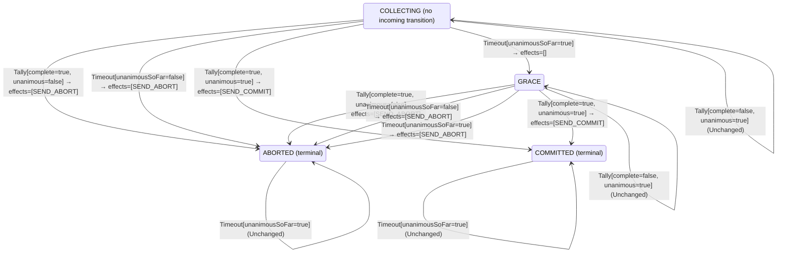

<!-- Generated by examples/tools/build.py from example.json and the verifier's output. Edit example.json. -->
# 058 · A grace period for the last vote, proved to keep every participant deciding

[← All examples](../README.md)

| Verdict | Categories | Severity if shipped | Change | Verified unit | Approach |
|---|---|---|---|---|---|
| **✓ Verified: all invariants and properties hold in 936 states, and under 6 more configurations** | functional, no-false-positive | none | feature, behaviour change intended | [`Coordinator#decide`](../../examples/apps/quorum/src/main/java/net/terminalvalue/quorum/twopc/Coordinator.java) | [D1: Protocol model checking](../../examples/apps/quorum/spec/README.md) |

> The developer of example 057 tries again: when the collection times out with every vote so far yes, the coordinator moves to a new phase, `GRACE`, and waits one more period; a second timeout aborts. The contract gains a phase and seven cases, and the model's guard on the timer, its type invariant and its inductive invariant gain the phase. TLC checks the invariants, the liveness property that every participant eventually decides, and that the protocol still implements Lamport and Gray's transaction commit specification, and all of them hold in every state and every behaviour; and the inductive step holds too, so atomicity is proved for the new protocol by induction, not only by search.

Tags: [distributed-transactions](../README.md#tag-distributed-transactions), [liveness](../README.md#tag-liveness), [tla-liveness](../README.md#tag-tla-liveness), [tla-refinement](../README.md#tag-tla-refinement), [generated-operator](../README.md#tag-generated-operator), [multiple-configurations](../README.md#tag-multiple-configurations)

## The change

Add `GRACE` to `Phase`. On a `Timeout` in `COLLECTING` with `unanimousSoFar`, move to `GRACE` with no effects; a `Timeout` in `GRACE` aborts; a `Tally` in `GRACE` is decided as in `COLLECTING`. The recovery rule treats a restart in `GRACE` as one in `COLLECTING`: no decision logged, presumed abort. The model's `CoordinatorTimeout` action and `TypeOK` admit the new phase, and so do the two places the inductive invariant names the phases: `DecisionMatchesThePhase`, where a coordinator in `GRACE` has broadcast nothing yet, and the enumeration `InductiveInit`. The contract's domain grows from 28 to 35 cases; two tests are added.

**Before** ([`Coordinator.java`](../../examples/apps/quorum/src/main/java/net/terminalvalue/quorum/twopc/Coordinator.java), line 6):

```java
import static net.terminalvalue.quorum.twopc.CoordinatorEffect.SEND_COMMIT;
import static net.terminalvalue.quorum.twopc.Phase.ABORTED;
import static net.terminalvalue.quorum.twopc.Phase.COMMITTED;

import net.terminalvalue.quorum.Decision;
import net.terminalvalue.quorum.twopc.CoordinatorEvent.Tally;
    // ...
    public static Decision<Phase, CoordinatorEffect> decide(Phase phase, CoordinatorEvent event) {
        return switch (event) {
            case Tally tally -> switch (phase) {
                case COLLECTING -> !tally.complete()
                        ? unchanged("waiting for the remaining votes")
                        : tally.unanimous() ? transition(COMMITTED, SEND_COMMIT) : transition(ABORTED, SEND_ABORT);
                case COMMITTED, ABORTED -> unchanged("already decided");
            };
            case Timeout _ -> switch (phase) {
                case COLLECTING -> transition(ABORTED, SEND_ABORT); // presumed abort
                case COMMITTED, ABORTED -> unchanged("already decided");
            };
        };
```

**After:**

```java
import static net.terminalvalue.quorum.twopc.CoordinatorEffect.SEND_COMMIT;
import static net.terminalvalue.quorum.twopc.Phase.ABORTED;
import static net.terminalvalue.quorum.twopc.Phase.COMMITTED;
import static net.terminalvalue.quorum.twopc.Phase.GRACE;

import net.terminalvalue.quorum.Decision;
import net.terminalvalue.quorum.twopc.CoordinatorEvent.Tally;
    // ...
    public static Decision<Phase, CoordinatorEffect> decide(Phase phase, CoordinatorEvent event) {
        return switch (event) {
            case Tally tally -> switch (phase) {
                case COLLECTING, GRACE -> !tally.complete()
                        ? unchanged("waiting for the remaining votes")
                        : tally.unanimous() ? transition(COMMITTED, SEND_COMMIT) : transition(ABORTED, SEND_ABORT);
                case COMMITTED, ABORTED -> unchanged("already decided");
            };
            case Timeout timeout -> switch (phase) {
                // Every vote so far is yes: the missing participants may only be slow, and aborting throws away
                // work every responder approved. Give them one more period; a second timeout aborts.
                case COLLECTING -> timeout.unanimousSoFar() ? transition(GRACE) : transition(ABORTED, SEND_ABORT);
                case GRACE -> transition(ABORTED, SEND_ABORT); // presumed abort
                case COMMITTED, ABORTED -> unchanged("already decided");
            };
        };
```

<details><summary>Patch</summary>

```diff
--- a/examples/apps/quorum/src/main/java/net/terminalvalue/quorum/twopc/Phase.java
+++ b/examples/apps/quorum/src/main/java/net/terminalvalue/quorum/twopc/Phase.java
@@ -4,6 +4,8 @@
 public enum Phase {
     /** Prepare was sent; votes are coming in. */
     COLLECTING,
+    /** The timer fired with votes missing and every vote so far yes: one more period for the rest. */
+    GRACE,
     COMMITTED,
     ABORTED
 }
--- a/examples/apps/quorum/src/main/java/net/terminalvalue/quorum/twopc/Coordinator.java
+++ b/examples/apps/quorum/src/main/java/net/terminalvalue/quorum/twopc/Coordinator.java
@@ -6,6 +6,7 @@
 import static net.terminalvalue.quorum.twopc.CoordinatorEffect.SEND_COMMIT;
 import static net.terminalvalue.quorum.twopc.Phase.ABORTED;
 import static net.terminalvalue.quorum.twopc.Phase.COMMITTED;
+import static net.terminalvalue.quorum.twopc.Phase.GRACE;
 
 import net.terminalvalue.quorum.Decision;
 import net.terminalvalue.quorum.twopc.CoordinatorEvent.Tally;
@@ -23,13 +24,16 @@
     public static Decision<Phase, CoordinatorEffect> decide(Phase phase, CoordinatorEvent event) {
         return switch (event) {
             case Tally tally -> switch (phase) {
-                case COLLECTING -> !tally.complete()
+                case COLLECTING, GRACE -> !tally.complete()
                         ? unchanged("waiting for the remaining votes")
                         : tally.unanimous() ? transition(COMMITTED, SEND_COMMIT) : transition(ABORTED, SEND_ABORT);
                 case COMMITTED, ABORTED -> unchanged("already decided");
             };
-            case Timeout _ -> switch (phase) {
-                case COLLECTING -> transition(ABORTED, SEND_ABORT); // presumed abort
+            case Timeout timeout -> switch (phase) {
+                // Every vote so far is yes: the missing participants may only be slow, and aborting throws away
+                // work every responder approved. Give them one more period; a second timeout aborts.
+                case COLLECTING -> timeout.unanimousSoFar() ? transition(GRACE) : transition(ABORTED, SEND_ABORT);
+                case GRACE -> transition(ABORTED, SEND_ABORT); // presumed abort
                 case COMMITTED, ABORTED -> unchanged("already decided");
             };
         };
--- a/examples/apps/quorum/src/main/java/net/terminalvalue/quorum/twopc/Recovery.java
+++ b/examples/apps/quorum/src/main/java/net/terminalvalue/quorum/twopc/Recovery.java
@@ -24,7 +24,7 @@
     public static Decision<Phase, CoordinatorEffect> decide(Phase logged, RecoveryEvent event) {
         return switch (event) {
             case Restarted _ -> switch (logged) {
-                case COLLECTING -> transition(ABORTED, SEND_ABORT); // presumed abort
+                case COLLECTING, GRACE -> transition(ABORTED, SEND_ABORT); // presumed abort
                 case COMMITTED -> transition(COMMITTED, SEND_COMMIT);
                 case ABORTED -> transition(ABORTED, SEND_ABORT);
             };
--- a/examples/apps/quorum/src/test/java/net/terminalvalue/quorum/twopc/CoordinatorTest.java
+++ b/examples/apps/quorum/src/test/java/net/terminalvalue/quorum/twopc/CoordinatorTest.java
@@ -32,6 +32,16 @@
                 Coordinator.decide(Phase.COLLECTING, new Timeout(false)));
     }
 
+    public static void waitsOneMorePeriodWhenEveryVoteSoFarIsYes() {
+        equal(new Transition<Phase, CoordinatorEffect>(Phase.GRACE, List.of()),
+                Coordinator.decide(Phase.COLLECTING, new Timeout(true)));
+    }
+
+    public static void abortsOnTheSecondTimeout() {
+        equal(new Transition<>(Phase.ABORTED, List.of(CoordinatorEffect.SEND_ABORT)),
+                Coordinator.decide(Phase.GRACE, new Timeout(true)));
+    }
+
     public static void aDecisionIsFinal() {
         check(Coordinator.decide(Phase.COMMITTED, new Timeout(true)) instanceof Decision.Unchanged, "committed stays");
         check(Coordinator.decide(Phase.ABORTED, new Tally(true, true)) instanceof Decision.Unchanged, "aborted stays");
--- a/examples/apps/quorum/spec/TwoPhaseCommit.tla
+++ b/examples/apps/quorum/spec/TwoPhaseCommit.tla
@@ -168,7 +168,7 @@
 
 \* Coordinator.onTimeout: the collection timer fires while votes are missing.
 CoordinatorTimeout ==
-    /\ phase = "COLLECTING"
+    /\ phase \in {"COLLECTING", "GRACE"}
     /\ Counted # Participants
     /\ Apply(Decide(phase, [kind |-> "Timeout", unanimousSoFar |-> \A p \in Counted : votes[p] = "YES"]))
     /\ UNCHANGED <<pstate, votes, inbox, pup, pcrashes>>
@@ -234,7 +234,7 @@
 (***************************************************************************)
 
 TypeOK ==
-    /\ phase \in {"COLLECTING", "COMMITTED", "ABORTED"}
+    /\ phase \in {"COLLECTING", "GRACE", "COMMITTED", "ABORTED"}
     /\ \A p \in Participants : pstate[p] \in {"WORKING", "PREPARED", "COMMITTED", "ABORTED"}
     /\ \A p \in Participants : votes[p] \in {"YES", "NO", "NONE"}
     /\ decision \in {"NONE", "COMMIT", "ABORT"}
@@ -291,7 +291,7 @@
 \* decided coordinator may have nothing out yet: a crash can fall between the phase change, which it logs, and the
 \* broadcast, which Recover then does.
 DecisionMatchesThePhase ==
-    decision \in {"NONE", CASE phase = "COLLECTING" -> "NONE" [] phase = "COMMITTED" -> "COMMIT" [] phase = "ABORTED" -> "ABORT"}
+    decision \in {"NONE", CASE phase \in {"COLLECTING", "GRACE"} -> "NONE" [] phase = "COMMITTED" -> "COMMIT" [] phase = "ABORTED" -> "ABORT"}
 
 \* A coordinator that is up and decided has its decision out: it broadcast it when it decided, or on restarting.
 BroadcastOnceUp == up /\ phase \in {"COMMITTED", "ABORTED"} => decision # "NONE"
@@ -330,7 +330,7 @@
 \* Inductive as an initial predicate: every state it admits, enumerated variable by variable, with each conjunct right
 \* after the last variable it mentions, so that TLC discards a partial state as soon as a conjunct fails.
 InductiveInit ==
-    /\ phase \in {"COLLECTING", "COMMITTED", "ABORTED"}
+    /\ phase \in {"COLLECTING", "GRACE", "COMMITTED", "ABORTED"}
     /\ decision \in {"NONE", "COMMIT", "ABORT"}
     /\ DecisionMatchesThePhase
     /\ pstate \in [Participants -> {"WORKING", "PREPARED", "COMMITTED", "ABORTED"}]
```

</details>

## What the verifier found

The model is checked under 7 configurations, and the verdict is the first that fails:

| Configuration | What it checks | Model | Result |
|---|---|---|---|
| three participants (`spec/TwoPhaseCommit.cfg`) | every run from the initial state, every interleaving within the configuration's bounds | Participants = {p1, p2, p3}, MaxCrashes = 0, MaxParticipantCrashes = 0 | ✓ Verified: all invariants and properties hold in 936 states |
| the inductive step (`spec/TwoPhaseCommitInductive.cfg`) | that the invariant `Inductive` is inductive: TLC starts from every state the invariant admits, reachable or not, rather than from the initial state, takes one step, and checks the invariant again, conjunct by conjunct. No counterexample is a proof of atomicity by induction, for any run of the protocol however long; a counterexample is one step from a state that need not be reachable | Participants = {p1, p2, p3}, MaxCrashes = 0, MaxParticipantCrashes = 0 | ✓ Verified: all invariants hold in 952 states |
| crashes (`spec/TwoPhaseCommitCrash.cfg`) | every run from the initial state in which the coordinator may crash, twice at most: between steps, or after logging a phase change and before the broadcast goes out, and restart on the recovery rule, generated from `Recovery#decide`; the same invariants and temporal properties, under the added fairness condition that a crashed coordinator restarts | Participants = {p1, p2, p3}, MaxCrashes = 2, MaxParticipantCrashes = 0 | ✓ Verified: all invariants and properties hold in 3,864 states |
| the inductive step with crashes (`spec/TwoPhaseCommitCrashInductive.cfg`) | that the invariant `Inductive` is closed under a crash and a restart as well: TLC starts from every state the invariant admits, the coordinator up or down, takes one step, and checks the invariant again | Participants = {p1, p2, p3}, MaxCrashes = 1, MaxParticipantCrashes = 0 | ✓ Verified: all invariants hold in 3,376 states |
| participant crashes (`spec/TwoPhaseCommitParticipantCrash.cfg`) | every run from the initial state in which a participant may crash, once, between steps or after logging a vote and before sending it, and restart on the participant's rule, generated from `Participant#decide`, while the coordinator may crash once as well; the same invariants and temporal properties, under the added fairness condition that a crashed participant restarts | Participants = {p1, p2, p3}, MaxCrashes = 1, MaxParticipantCrashes = 1 | ✓ Verified: all invariants and properties hold in 15,264 states |
| the inductive step with participant crashes (`spec/TwoPhaseCommitParticipantCrashInductive.cfg`) | that the invariant `Inductive` is closed under a participant's crash and restart as well: TLC starts from every state the invariant admits, each process up or down, takes one step, and checks the invariant again | Participants = {p1, p2, p3}, MaxCrashes = 1, MaxParticipantCrashes = 1 | ✓ Verified: all invariants hold in 23,400 states |
| the recorded runs (`spec/TwoPhaseCommitTrace.cfg`) | the Java nodes against the model: the coordinator node, its log and its broadcast, and the participant nodes, their logs and their votes, run through eleven scripted scenarios with crashes of either process injected after a given I/O operation, the state after each step recorded in the model's variables (`TwoPhaseCommitTraces.tla`, regenerated from the patched classes); TLC walks each recorded run and checks that it starts in the model's initial state and that every step is a step of the model's next-state relation. A step the model has no action for is one the glue took that the model's verdicts do not cover | Participants = {"p1", "p2", "p3"}, MaxCrashes = 2, MaxParticipantCrashes = 2 | ✓ Verified: all invariants and properties hold in 103 states |

Every invariant holds in every reachable state of the model, and every temporal property holds of every behaviour, the infinite ones included under three participants: 936 distinct states, which is every interleaving of the participants, the coordinator and the votes in flight within the model's bounds (Participants = {p1, p2, p3}, MaxCrashes = 0, MaxParticipantCrashes = 0).

The coordinator's decision rule, its recovery rule and the participant's rule inside the model are generated from the behavioural contracts of the patched code, so the model checks the decisions the processes really make: the coordinator's on a vote, a timeout and a restart, and a participant's when asked to prepare, when it gives up, when it reads the decision and when it restarts.

The other configurations hold too, as the table says: the inductive step, 952 states; crashes, 3,864 states; the inductive step with crashes, 3,376 states; participant crashes, 15,264 states; the inductive step with participant crashes, 23,400 states; the recorded runs, 103 states.

**What the verdict rests on.** TLC counted how often a step of the model took each row of the generated operators. A row no step takes is one the model says nothing about, whatever the verdict.

| Configuration | Rows of `Coordinator#decide` taken | Rows of `Recovery#decide` taken | Rows of `Participant#decide` taken |
|---|---|---|---|
| three participants | 16 of 24 | 0 of 4 | 6 of 28 |
| the inductive step (from the states the invariant admits, not from a run) | 16 of 24 | 0 of 4 | 6 of 28 |
| crashes | 16 of 24 | 4 of 4 | 6 of 28 |
| the inductive step with crashes (from the states the invariant admits, not from a run) | 16 of 24 | 4 of 4 | 6 of 28 |
| participant crashes | 16 of 24 | 4 of 4 | 10 of 28 |
| the inductive step with participant crashes (from the states the invariant admits, not from a run) | 16 of 24 | 4 of 4 | 10 of 28 |

The change alters 8 rows of the contract, and 2 with a null argument, which the model leaves out:

- `decide(COLLECTING, Timeout[unanimousSoFar=true])`: `Transition[next=ABORTED, effects=[SEND_ABORT]]` → `Transition[next=GRACE, effects=[]]`, taken under three participants, the inductive step, crashes, the inductive step with crashes, participant crashes, the inductive step with participant crashes
- `decide(GRACE, Tally[complete=false, unanimous=false])`: a new row → `Unchanged[reason="waiting for the remaining votes"]`, taken under three participants, the inductive step, crashes, the inductive step with crashes, participant crashes, the inductive step with participant crashes
- `decide(GRACE, Tally[complete=false, unanimous=true])`: a new row → `Unchanged[reason="waiting for the remaining votes"]`, taken under three participants, the inductive step, crashes, the inductive step with crashes, participant crashes, the inductive step with participant crashes
- `decide(GRACE, Tally[complete=true, unanimous=false])`: a new row → `Transition[next=ABORTED, effects=[SEND_ABORT]]`, taken under three participants, the inductive step, crashes, the inductive step with crashes, participant crashes, the inductive step with participant crashes
- `decide(GRACE, Tally[complete=true, unanimous=true])`: a new row → `Transition[next=COMMITTED, effects=[SEND_COMMIT]]`, taken under three participants, the inductive step, crashes, the inductive step with crashes, participant crashes, the inductive step with participant crashes
- `decide(GRACE, Timeout[unanimousSoFar=false])`: a new row → `Transition[next=ABORTED, effects=[SEND_ABORT]]`, taken under three participants, the inductive step, crashes, the inductive step with crashes, participant crashes, the inductive step with participant crashes
- `decide(GRACE, Timeout[unanimousSoFar=true])`: a new row → `Transition[next=ABORTED, effects=[SEND_ABORT]]`, taken under three participants, the inductive step, crashes, the inductive step with crashes, participant crashes, the inductive step with participant crashes
- `decide(GRACE, Restarted[])`: a new row → `Transition[next=ABORTED, effects=[SEND_ABORT]]`, taken under crashes, the inductive step with crashes, participant crashes, the inductive step with participant crashes

Runs of the model take every row the change alters: the verdict rests on the change.

<details><summary>Rows no step takes under three participants</summary>

`net.terminalvalue.quorum.twopc.Coordinator#decide`:

```
decide(COMMITTED, Tally[complete=false, unanimous=false]) => Unchanged
decide(COMMITTED, Tally[complete=false, unanimous=true]) => Unchanged
decide(COMMITTED, Tally[complete=true, unanimous=false]) => Unchanged
decide(COMMITTED, Tally[complete=true, unanimous=true]) => Unchanged
decide(COMMITTED, Timeout[unanimousSoFar=false]) => Unchanged
decide(COMMITTED, Timeout[unanimousSoFar=true]) => Unchanged
decide(ABORTED, Timeout[unanimousSoFar=false]) => Unchanged
decide(ABORTED, Timeout[unanimousSoFar=true]) => Unchanged
```

`net.terminalvalue.quorum.twopc.Recovery#decide`:

```
decide(COLLECTING, Restarted[]) => Transition[next=ABORTED, effects=[SEND_ABORT]]
decide(GRACE, Restarted[]) => Transition[next=ABORTED, effects=[SEND_ABORT]]
decide(COMMITTED, Restarted[]) => Transition[next=COMMITTED, effects=[SEND_COMMIT]]
decide(ABORTED, Restarted[]) => Transition[next=ABORTED, effects=[SEND_ABORT]]
```

`net.terminalvalue.quorum.twopc.Participant#decide`:

```
decide(WORKING, Learned[outcome=NONE]) => Unchanged
decide(WORKING, Learned[outcome=COMMIT]) => Transition[next=COMMITTED, effects=[]]
decide(WORKING, Restarted[]) => Transition[next=ABORTED, effects=[]]
decide(PREPARED, Prepare[able=false]) => Rejected
decide(PREPARED, Prepare[able=true]) => Rejected
decide(PREPARED, GiveUp[]) => Rejected
decide(PREPARED, Learned[outcome=NONE]) => Unchanged
decide(PREPARED, Restarted[]) => Unchanged
decide(COMMITTED, Prepare[able=false]) => Rejected
decide(COMMITTED, Prepare[able=true]) => Rejected
decide(COMMITTED, GiveUp[]) => Rejected
decide(COMMITTED, Learned[outcome=NONE]) => Unchanged
decide(COMMITTED, Learned[outcome=COMMIT]) => Unchanged
decide(COMMITTED, Learned[outcome=ABORT]) => Unchanged
decide(COMMITTED, Restarted[]) => Unchanged
decide(ABORTED, Prepare[able=false]) => Rejected
decide(ABORTED, Prepare[able=true]) => Rejected
decide(ABORTED, GiveUp[]) => Rejected
decide(ABORTED, Learned[outcome=NONE]) => Unchanged
decide(ABORTED, Learned[outcome=COMMIT]) => Unchanged
decide(ABORTED, Learned[outcome=ABORT]) => Unchanged
decide(ABORTED, Restarted[]) => Unchanged
```

</details>

The state machine the patched code implements, drawn from its derived contract (`jvmcontract statemachine`); a state with no way in or no way out is marked:



## Would the existing tests have caught it?

Yes, in this repo: `NodesTest.abortsOnTheTimerWithAVoteMissing` fails (`java -ea net.terminalvalue.quorum.Tests`). That test was written for this property. The contract needed no one to anticipate it.

## Why it matters

The same as in example 057: a prepared participant is released only by a decision, so a coordinator that can wait must still be bound to decide. The change also adds a phase, which is where a protocol implementation gets its bugs: a vote that arrives in the new phase, the timer firing in it, a decision made from it. Whether the new phase can commit over a no, or leave a participant waiting, is a question about every order of votes and timeouts, which is the model's question.

## Why the verdict is right

The coordinator's rule in the model is generated from the regenerated contract, so the model runs the new rule, `GRACE` included. TLC explores every reachable state for three participants and checks three kinds of statement. The invariants: no participant has aborted once anything committed, and a participant commits only on the coordinator's decision after voting yes. The liveness property `EveryParticipantDecides`, under the model's fairness conditions: the second timeout is what makes it true, since the timer keeps firing while votes are missing, and in `GRACE` it aborts. And the refinement `ImplementsTransactionCommit`: `TCommit.tla` is Lamport and Gray's specification of what any commit protocol must achieve, with no coordinator, messages or timers, in which a participant may commit only once every participant is prepared or committed and may abort only while none has committed; the model instantiates it on the participants' states and asks TLC to check, step by step, that every step of the protocol is a step transaction commit allows. All three hold. The inductive configuration then starts from every state the extended invariant admits, 952 of them against 936 reachable, takes one step of the new rule, and lands in a state the invariant admits every time: the proof of atomicity by induction carries over to the new phase, at the price of telling the invariant what the phase means. This is the proof that the grace period is a different protocol from example 057's, and a correct one: it waits, and then it decides.

## What to do

Merge. The contract diff is committed with the change, and the model's invariants, liveness property, refinement and inductive step are checked on every build.

## Notes

- The two-phase-commit model (`apps/quorum/spec/TwoPhaseCommit.tla`) is built like Box Office's: the coordinator's state machine is generated from its B8 contract. An example of this model is checked under every configuration the model lists, and its verdict is the first that fails.
- This configuration states fairness conditions and a liveness property (every participant eventually decides), and checks that the model implements Lamport and Gray's transaction-commit specification, a refinement TLC checks step by step.
- A grace period for the last vote, with a second timeout, keeps every participant deciding and still implements transaction commit. Pairs with 057.

## Evidence

How the verdict was reached: three participants: TLC 2.19 explored 936 distinct states to depth 12 in 1 s, for the model Participants = {p1, p2, p3}, MaxCrashes = 0, MaxParticipantCrashes = 0; the inductive step: TLC 2.19 explored 952 distinct states to depth 1 in 1 s, for the model Participants = {p1, p2, p3}, MaxCrashes = 0, MaxParticipantCrashes = 0; crashes: TLC 2.19 explored 3,864 distinct states to depth 12 in 3 s, for the model Participants = {p1, p2, p3}, MaxCrashes = 2, MaxParticipantCrashes = 0; the inductive step with crashes: TLC 2.19 explored 3,376 distinct states to depth 1 in 1 s, for the model Participants = {p1, p2, p3}, MaxCrashes = 1, MaxParticipantCrashes = 0; participant crashes: TLC 2.19 explored 15,264 distinct states to depth 13 in 12 s, for the model Participants = {p1, p2, p3}, MaxCrashes = 1, MaxParticipantCrashes = 1; the inductive step with participant crashes: TLC 2.19 explored 23,400 distinct states to depth 1 in 2 s, for the model Participants = {p1, p2, p3}, MaxCrashes = 1, MaxParticipantCrashes = 1; the recorded runs: TLC 2.19 explored 103 distinct states to depth 12 in 0 s, for the model Participants = {"p1", "p2", "p3"}, MaxCrashes = 2, MaxParticipantCrashes = 2.

<details><summary>Verifier output</summary>

```text
== three participants: spec/TwoPhaseCommit.cfg ==
TLC2 Version 2.19 of 08 August 2024 (rev: 5a47802)
Running breadth-first search Model-Checking with fp 1 and seed 1 with 1 worker on 2 cores with 2185MB heap and 64MB offheap memory [pid: 1070396] (Linux 6.6.87.2-microsoft-standard-WSL2 aarch64, Eclipse Adoptium 25.0.4.1 x86_64, MSBDiskFPSet, DiskStateQueue).
Parsing file examples/apps/quorum/spec/TwoPhaseCommit.tla
Parsing file examples/tools/tla/standard-modules/Naturals.tla
Parsing file examples/tools/tla/standard-modules/Sequences.tla
Parsing file examples/tools/tla/standard-modules/FiniteSets.tla
Parsing file examples/apps/quorum/spec/CoordinatorContract.tla
Parsing file examples/apps/quorum/spec/RecoveryContract.tla
Parsing file examples/apps/quorum/spec/ParticipantContract.tla
Parsing file examples/apps/quorum/spec/TCommit.tla
Semantic processing of module Naturals
Semantic processing of module Sequences
Semantic processing of module FiniteSets
Semantic processing of module CoordinatorContract
Semantic processing of module RecoveryContract
Semantic processing of module ParticipantContract
Semantic processing of module TCommit
Semantic processing of module TwoPhaseCommit
Starting... (2026-11-03 23:46:57)
Implied-temporal checking--satisfiability problem has 3 branches.
Computing initial states...
Finished computing initial states: 1 distinct state generated at 2026-11-03 23:46:57.
Checking 3 branches of temporal properties for the complete state space with 2808 total distinct states at (2026-11-03 23:46:58)
Finished checking temporal properties in 00s at 2026-11-03 23:46:58
Model checking completed. No error has been found.
  Estimates of the probability that TLC did not check all reachable states
  because two distinct states had the same fingerprint:
  calculated (optimistic):  val = 1.2E-13
Rows of net.terminalvalue.quorum.twopc.Coordinator#decide a step of the model takes: 16 of 24; never taken (8):
  decide(COMMITTED, Tally[complete=false, unanimous=false]) => Unchanged
  decide(COMMITTED, Tally[complete=false, unanimous=true]) => Unchanged
  decide(COMMITTED, Tally[complete=true, unanimous=false]) => Unchanged
  decide(COMMITTED, Tally[complete=true, unanimous=true]) => Unchanged
  decide(COMMITTED, Timeout[unanimousSoFar=false]) => Unchanged
  decide(COMMITTED, Timeout[unanimousSoFar=true]) => Unchanged
  decide(ABORTED, Timeout[unanimousSoFar=false]) => Unchanged
  decide(ABORTED, Timeout[unanimousSoFar=true]) => Unchanged
Rows of net.terminalvalue.quorum.twopc.Recovery#decide a step of the model takes: 0 of 4; never taken (4):
  decide(COLLECTING, Restarted[]) => Transition[next=ABORTED, effects=[SEND_ABORT]]
  decide(GRACE, Restarted[]) => Transition[next=ABORTED, effects=[SEND_ABORT]]
  decide(COMMITTED, Restarted[]) => Transition[next=COMMITTED, effects=[SEND_COMMIT]]
  decide(ABORTED, Restarted[]) => Transition[next=ABORTED, effects=[SEND_ABORT]]
Rows of net.terminalvalue.quorum.twopc.Participant#decide a step of the model takes: 6 of 28; never taken (22):
  decide(WORKING, Learned[outcome=NONE]) => Unchanged
  decide(WORKING, Learned[outcome=COMMIT]) => Transition[next=COMMITTED, effects=[]]
  decide(WORKING, Restarted[]) => Transition[next=ABORTED, effects=[]]
  decide(PREPARED, Prepare[able=false]) => Rejected
  decide(PREPARED, Prepare[able=true]) => Rejected
  decide(PREPARED, GiveUp[]) => Rejected
  decide(PREPARED, Learned[outcome=NONE]) => Unchanged
  decide(PREPARED, Restarted[]) => Unchanged
  decide(COMMITTED, Prepare[able=false]) => Rejected
  decide(COMMITTED, Prepare[able=true]) => Rejected
  decide(COMMITTED, GiveUp[]) => Rejected
  decide(COMMITTED, Learned[outcome=NONE]) => Unchanged
  decide(COMMITTED, Learned[outcome=COMMIT]) => Unchanged
  decide(COMMITTED, Learned[outcome=ABORT]) => Unchanged
  decide(COMMITTED, Restarted[]) => Unchanged
  decide(ABORTED, Prepare[able=false]) => Rejected
  decide(ABORTED, Prepare[able=true]) => Rejected
  decide(ABORTED, GiveUp[]) => Rejected
  decide(ABORTED, Learned[outcome=NONE]) => Unchanged
  decide(ABORTED, Learned[outcome=COMMIT]) => Unchanged
  decide(ABORTED, Learned[outcome=ABORT]) => Unchanged
  decide(ABORTED, Restarted[]) => Unchanged
3237 states generated, 936 distinct states found, 0 states left on queue.
The depth of the complete state graph search is 12.
The average outdegree of the complete state graph is 1 (minimum is 0, the maximum 10 and the 95th percentile is 3).
Finished in 01s at (2026-11-03 23:46:58)

== the inductive step: spec/TwoPhaseCommitInductive.cfg ==
TLC2 Version 2.19 of 08 August 2024 (rev: 5a47802)
Running breadth-first search Model-Checking with fp 1 and seed 1 with 1 worker on 2 cores with 2185MB heap and 64MB offheap memory [pid: 1070522] (Linux 6.6.87.2-microsoft-standard-WSL2 aarch64, Eclipse Adoptium 25.0.4.1 x86_64, MSBDiskFPSet, DiskStateQueue).
Parsing file examples/apps/quorum/spec/TwoPhaseCommit.tla
Parsing file examples/tools/tla/standard-modules/Naturals.tla
Parsing file examples/tools/tla/standard-modules/Sequences.tla
Parsing file examples/tools/tla/standard-modules/FiniteSets.tla
Parsing file examples/apps/quorum/spec/CoordinatorContract.tla
Parsing file examples/apps/quorum/spec/RecoveryContract.tla
Parsing file examples/apps/quorum/spec/ParticipantContract.tla
Parsing file examples/apps/quorum/spec/TCommit.tla
Semantic processing of module Naturals
Semantic processing of module Sequences
Semantic processing of module FiniteSets
Semantic processing of module CoordinatorContract
Semantic processing of module RecoveryContract
Semantic processing of module ParticipantContract
Semantic processing of module TCommit
Semantic processing of module TwoPhaseCommit
Starting... (2026-11-03 23:46:59)
Computing initial states...
Computed 2 initial states...
Computed 4 initial states...
Computed 8 initial states...
Computed 16 initial states...
Computed 32 initial states...
Computed 64 initial states...
Computed 128 initial states...
Computed 256 initial states...
Computed 512 initial states...
Finished computing initial states: 952 distinct states generated at 2026-11-03 23:47:00.
Model checking completed. No error has been found.
  Estimates of the probability that TLC did not check all reachable states
  because two distinct states had the same fingerprint:
  calculated (optimistic):  val = 1.7E-13
Rows of net.terminalvalue.quorum.twopc.Coordinator#decide a step of the model takes: 16 of 24; never taken (8):
  decide(COMMITTED, Tally[complete=false, unanimous=false]) => Unchanged
  decide(COMMITTED, Tally[complete=false, unanimous=true]) => Unchanged
  decide(COMMITTED, Tally[complete=true, unanimous=false]) => Unchanged
  decide(COMMITTED, Tally[complete=true, unanimous=true]) => Unchanged
  decide(COMMITTED, Timeout[unanimousSoFar=false]) => Unchanged
  decide(COMMITTED, Timeout[unanimousSoFar=true]) => Unchanged
  decide(ABORTED, Timeout[unanimousSoFar=false]) => Unchanged
  decide(ABORTED, Timeout[unanimousSoFar=true]) => Unchanged
Rows of net.terminalvalue.quorum.twopc.Recovery#decide a step of the model takes: 0 of 4; never taken (4):
  decide(COLLECTING, Restarted[]) => Transition[next=ABORTED, effects=[SEND_ABORT]]
  decide(GRACE, Restarted[]) => Transition[next=ABORTED, effects=[SEND_ABORT]]
  decide(COMMITTED, Restarted[]) => Transition[next=COMMITTED, effects=[SEND_COMMIT]]
  decide(ABORTED, Restarted[]) => Transition[next=ABORTED, effects=[SEND_ABORT]]
Rows of net.terminalvalue.quorum.twopc.Participant#decide a step of the model takes: 6 of 28; never taken (22):
  decide(WORKING, Learned[outcome=NONE]) => Unchanged
  decide(WORKING, Learned[outcome=COMMIT]) => Transition[next=COMMITTED, effects=[]]
  decide(WORKING, Restarted[]) => Transition[next=ABORTED, effects=[]]
  decide(PREPARED, Prepare[able=false]) => Rejected
  decide(PREPARED, Prepare[able=true]) => Rejected
  decide(PREPARED, GiveUp[]) => Rejected
  decide(PREPARED, Learned[outcome=NONE]) => Unchanged
  decide(PREPARED, Restarted[]) => Unchanged
  decide(COMMITTED, Prepare[able=false]) => Rejected
  decide(COMMITTED, Prepare[able=true]) => Rejected
  decide(COMMITTED, GiveUp[]) => Rejected
  decide(COMMITTED, Learned[outcome=NONE]) => Unchanged
  decide(COMMITTED, Learned[outcome=COMMIT]) => Unchanged
  decide(COMMITTED, Learned[outcome=ABORT]) => Unchanged
  decide(COMMITTED, Restarted[]) => Unchanged
  decide(ABORTED, Prepare[able=false]) => Rejected
  decide(ABORTED, Prepare[able=true]) => Rejected
  decide(ABORTED, GiveUp[]) => Rejected
  decide(ABORTED, Learned[outcome=NONE]) => Unchanged
  decide(ABORTED, Learned[outcome=COMMIT]) => Unchanged
  decide(ABORTED, Learned[outcome=ABORT]) => Unchanged
  decide(ABORTED, Restarted[]) => Unchanged
4188 states generated, 952 distinct states found, 0 states left on queue.
The depth of the complete state graph search is 1.
The average outdegree of the complete state graph is 0 (minimum is 0, the maximum 0 and the 95th percentile is 0).
Finished in 01s at (2026-11-03 23:47:00)

== crashes: spec/TwoPhaseCommitCrash.cfg ==
TLC2 Version 2.19 of 08 August 2024 (rev: 5a47802)
Running breadth-first search Model-Checking with fp 1 and seed 1 with 1 worker on 2 cores with 2185MB heap and 64MB offheap memory [pid: 1070627] (Linux 6.6.87.2-microsoft-standard-WSL2 aarch64, Eclipse Adoptium 25.0.4.1 x86_64, MSBDiskFPSet, DiskStateQueue).
Parsing file examples/apps/quorum/spec/TwoPhaseCommit.tla
Parsing file examples/tools/tla/standard-modules/Naturals.tla
Parsing file examples/tools/tla/standard-modules/Sequences.tla
Parsing file examples/tools/tla/standard-modules/FiniteSets.tla
Parsing file examples/apps/quorum/spec/CoordinatorContract.tla
Parsing file examples/apps/quorum/spec/RecoveryContract.tla
Parsing file examples/apps/quorum/spec/ParticipantContract.tla
Parsing file examples/apps/quorum/spec/TCommit.tla
Semantic processing of module Naturals
Semantic processing of module Sequences
Semantic processing of module FiniteSets
Semantic processing of module CoordinatorContract
Semantic processing of module RecoveryContract
Semantic processing of module ParticipantContract
Semantic processing of module TCommit
Semantic processing of module TwoPhaseCommit
Starting... (2026-11-03 23:47:00)
Implied-temporal checking--satisfiability problem has 3 branches.
Computing initial states...
Finished computing initial states: 1 distinct state generated at 2026-11-03 23:47:01.
Checking 3 branches of temporal properties for the current state space with 9607 total distinct states at (2026-11-03 23:47:04)
Finished checking temporal properties in 00s at 2026-11-03 23:47:04
Checking 3 branches of temporal properties for the complete state space with 11592 total distinct states at (2026-11-03 23:47:04)
Finished checking temporal properties in 00s at 2026-11-03 23:47:04
Model checking completed. No error has been found.
  Estimates of the probability that TLC did not check all reachable states
  because two distinct states had the same fingerprint:
  calculated (optimistic):  val = 2.7E-12
Rows of net.terminalvalue.quorum.twopc.Coordinator#decide a step of the model takes: 16 of 24; never taken (8):
  decide(COMMITTED, Tally[complete=false, unanimous=false]) => Unchanged
  decide(COMMITTED, Tally[complete=false, unanimous=true]) => Unchanged
  decide(COMMITTED, Tally[complete=true, unanimous=false]) => Unchanged
  decide(COMMITTED, Tally[complete=true, unanimous=true]) => Unchanged
  decide(COMMITTED, Timeout[unanimousSoFar=false]) => Unchanged
  decide(COMMITTED, Timeout[unanimousSoFar=true]) => Unchanged
  decide(ABORTED, Timeout[unanimousSoFar=false]) => Unchanged
  decide(ABORTED, Timeout[unanimousSoFar=true]) => Unchanged
Rows of net.terminalvalue.quorum.twopc.Recovery#decide a step of the model takes: 4 of 4.
Rows of net.terminalvalue.quorum.twopc.Participant#decide a step of the model takes: 6 of 28; never taken (22):
  decide(WORKING, Learned[outcome=NONE]) => Unchanged
  decide(WORKING, Learned[outcome=COMMIT]) => Transition[next=COMMITTED, effects=[]]
  decide(WORKING, Restarted[]) => Transition[next=ABORTED, effects=[]]
  decide(PREPARED, Prepare[able=false]) => Rejected
  decide(PREPARED, Prepare[able=true]) => Rejected
  decide(PREPARED, GiveUp[]) => Rejected
  decide(PREPARED, Learned[outcome=NONE]) => Unchanged
  decide(PREPARED, Restarted[]) => Unchanged
  decide(COMMITTED, Prepare[able=false]) => Rejected
  decide(COMMITTED, Prepare[able=true]) => Rejected
  decide(COMMITTED, GiveUp[]) => Rejected
  decide(COMMITTED, Learned[outcome=NONE]) => Unchanged
  decide(COMMITTED, Learned[outcome=COMMIT]) => Unchanged
  decide(COMMITTED, Learned[outcome=ABORT]) => Unchanged
  decide(COMMITTED, Restarted[]) => Unchanged
  decide(ABORTED, Prepare[able=false]) => Rejected
  decide(ABORTED, Prepare[able=true]) => Rejected
  decide(ABORTED, GiveUp[]) => Rejected
  decide(ABORTED, Learned[outcome=NONE]) => Unchanged
  decide(ABORTED, Learned[outcome=COMMIT]) => Unchanged
  decide(ABORTED, Learned[outcome=ABORT]) => Unchanged
  decide(ABORTED, Restarted[]) => Unchanged
16837 states generated, 3864 distinct states found, 0 states left on queue.
The depth of the complete state graph search is 12.
The average outdegree of the complete state graph is 1 (minimum is 0, the maximum 12 and the 95th percentile is 4).
Finished in 03s at (2026-11-03 23:47:04)

== the inductive step with crashes: spec/TwoPhaseCommitCrashInductive.cfg ==
TLC2 Version 2.19 of 08 August 2024 (rev: 5a47802)
Running breadth-first search Model-Checking with fp 1 and seed 1 with 1 worker on 2 cores with 2185MB heap and 64MB offheap memory [pid: 1070861] (Linux 6.6.87.2-microsoft-standard-WSL2 aarch64, Eclipse Adoptium 25.0.4.1 x86_64, MSBDiskFPSet, DiskStateQueue).
Parsing file examples/apps/quorum/spec/TwoPhaseCommit.tla
Parsing file examples/tools/tla/standard-modules/Naturals.tla
Parsing file examples/tools/tla/standard-modules/Sequences.tla
Parsing file examples/tools/tla/standard-modules/FiniteSets.tla
Parsing file examples/apps/quorum/spec/CoordinatorContract.tla
Parsing file examples/apps/quorum/spec/RecoveryContract.tla
Parsing file examples/apps/quorum/spec/ParticipantContract.tla
Parsing file examples/apps/quorum/spec/TCommit.tla
Semantic processing of module Naturals
Semantic processing of module Sequences
Semantic processing of module FiniteSets
Semantic processing of module CoordinatorContract
Semantic processing of module RecoveryContract
Semantic processing of module ParticipantContract
Semantic processing of module TCommit
Semantic processing of module TwoPhaseCommit
Starting... (2026-11-03 23:47:05)
Computing initial states...
Computed 2 initial states...
Computed 4 initial states...
Computed 8 initial states...
Computed 16 initial states...
Computed 32 initial states...
Computed 64 initial states...
Computed 128 initial states...
Computed 256 initial states...
Computed 512 initial states...
Computed 1024 initial states...
Computed 2048 initial states...
Finished computing initial states: 3376 distinct states generated at 2026-11-03 23:47:06.
Model checking completed. No error has been found.
  Estimates of the probability that TLC did not check all reachable states
  because two distinct states had the same fingerprint:
  calculated (optimistic):  val = 2.3E-12
Rows of net.terminalvalue.quorum.twopc.Coordinator#decide a step of the model takes: 16 of 24; never taken (8):
  decide(COMMITTED, Tally[complete=false, unanimous=false]) => Unchanged
  decide(COMMITTED, Tally[complete=false, unanimous=true]) => Unchanged
  decide(COMMITTED, Tally[complete=true, unanimous=false]) => Unchanged
  decide(COMMITTED, Tally[complete=true, unanimous=true]) => Unchanged
  decide(COMMITTED, Timeout[unanimousSoFar=false]) => Unchanged
  decide(COMMITTED, Timeout[unanimousSoFar=true]) => Unchanged
  decide(ABORTED, Timeout[unanimousSoFar=false]) => Unchanged
  decide(ABORTED, Timeout[unanimousSoFar=true]) => Unchanged
Rows of net.terminalvalue.quorum.twopc.Recovery#decide a step of the model takes: 4 of 4.
Rows of net.terminalvalue.quorum.twopc.Participant#decide a step of the model takes: 6 of 28; never taken (22):
  decide(WORKING, Learned[outcome=NONE]) => Unchanged
  decide(WORKING, Learned[outcome=COMMIT]) => Transition[next=COMMITTED, effects=[]]
  decide(WORKING, Restarted[]) => Transition[next=ABORTED, effects=[]]
  decide(PREPARED, Prepare[able=false]) => Rejected
  decide(PREPARED, Prepare[able=true]) => Rejected
  decide(PREPARED, GiveUp[]) => Rejected
  decide(PREPARED, Learned[outcome=NONE]) => Unchanged
  decide(PREPARED, Restarted[]) => Unchanged
  decide(COMMITTED, Prepare[able=false]) => Rejected
  decide(COMMITTED, Prepare[able=true]) => Rejected
  decide(COMMITTED, GiveUp[]) => Rejected
  decide(COMMITTED, Learned[outcome=NONE]) => Unchanged
  decide(COMMITTED, Learned[outcome=COMMIT]) => Unchanged
  decide(COMMITTED, Learned[outcome=ABORT]) => Unchanged
  decide(COMMITTED, Restarted[]) => Unchanged
  decide(ABORTED, Prepare[able=false]) => Rejected
  decide(ABORTED, Prepare[able=true]) => Rejected
  decide(ABORTED, GiveUp[]) => Rejected
  decide(ABORTED, Learned[outcome=NONE]) => Unchanged
  decide(ABORTED, Learned[outcome=COMMIT]) => Unchanged
  decide(ABORTED, Learned[outcome=ABORT]) => Unchanged
  decide(ABORTED, Restarted[]) => Unchanged
16084 states generated, 3376 distinct states found, 0 states left on queue.
The depth of the complete state graph search is 1.
The average outdegree of the complete state graph is 0 (minimum is 0, the maximum 0 and the 95th percentile is 0).
Finished in 01s at (2026-11-03 23:47:06)

== participant crashes: spec/TwoPhaseCommitParticipantCrash.cfg ==
TLC2 Version 2.19 of 08 August 2024 (rev: 5a47802)
Running breadth-first search Model-Checking with fp 1 and seed 1 with 1 worker on 2 cores with 2185MB heap and 64MB offheap memory [pid: 1070964] (Linux 6.6.87.2-microsoft-standard-WSL2 aarch64, Eclipse Adoptium 25.0.4.1 x86_64, MSBDiskFPSet, DiskStateQueue).
Parsing file examples/apps/quorum/spec/TwoPhaseCommit.tla
Parsing file examples/tools/tla/standard-modules/Naturals.tla
Parsing file examples/tools/tla/standard-modules/Sequences.tla
Parsing file examples/tools/tla/standard-modules/FiniteSets.tla
Parsing file examples/apps/quorum/spec/CoordinatorContract.tla
Parsing file examples/apps/quorum/spec/RecoveryContract.tla
Parsing file examples/apps/quorum/spec/ParticipantContract.tla
Parsing file examples/apps/quorum/spec/TCommit.tla
Semantic processing of module Naturals
Semantic processing of module Sequences
Semantic processing of module FiniteSets
Semantic processing of module CoordinatorContract
Semantic processing of module RecoveryContract
Semantic processing of module ParticipantContract
Semantic processing of module TCommit
Semantic processing of module TwoPhaseCommit
Starting... (2026-11-03 23:47:07)
Implied-temporal checking--satisfiability problem has 3 branches.
Computing initial states...
Finished computing initial states: 1 distinct state generated at 2026-11-03 23:47:07.
Checking 3 branches of temporal properties for the current state space with 10461 total distinct states at (2026-11-03 23:47:10)
Finished checking temporal properties in 00s at 2026-11-03 23:47:10
Checking 3 branches of temporal properties for the complete state space with 45792 total distinct states at (2026-11-03 23:47:20)
Finished checking temporal properties in 00s at 2026-11-03 23:47:20
Model checking completed. No error has been found.
  Estimates of the probability that TLC did not check all reachable states
  because two distinct states had the same fingerprint:
  calculated (optimistic):  val = 5.3E-11
Rows of net.terminalvalue.quorum.twopc.Coordinator#decide a step of the model takes: 16 of 24; never taken (8):
  decide(COMMITTED, Tally[complete=false, unanimous=false]) => Unchanged
  decide(COMMITTED, Tally[complete=false, unanimous=true]) => Unchanged
  decide(COMMITTED, Tally[complete=true, unanimous=false]) => Unchanged
  decide(COMMITTED, Tally[complete=true, unanimous=true]) => Unchanged
  decide(COMMITTED, Timeout[unanimousSoFar=false]) => Unchanged
  decide(COMMITTED, Timeout[unanimousSoFar=true]) => Unchanged
  decide(ABORTED, Timeout[unanimousSoFar=false]) => Unchanged
  decide(ABORTED, Timeout[unanimousSoFar=true]) => Unchanged
Rows of net.terminalvalue.quorum.twopc.Recovery#decide a step of the model takes: 4 of 4.
Rows of net.terminalvalue.quorum.twopc.Participant#decide a step of the model takes: 10 of 28; never taken (18):
  decide(WORKING, Learned[outcome=NONE]) => Unchanged
  decide(WORKING, Learned[outcome=COMMIT]) => Transition[next=COMMITTED, effects=[]]
  decide(PREPARED, Prepare[able=false]) => Rejected
  decide(PREPARED, Prepare[able=true]) => Rejected
  decide(PREPARED, GiveUp[]) => Rejected
  decide(PREPARED, Learned[outcome=NONE]) => Unchanged
  decide(COMMITTED, Prepare[able=false]) => Rejected
  decide(COMMITTED, Prepare[able=true]) => Rejected
  decide(COMMITTED, GiveUp[]) => Rejected
  decide(COMMITTED, Learned[outcome=NONE]) => Unchanged
  decide(COMMITTED, Learned[outcome=COMMIT]) => Unchanged
  decide(COMMITTED, Learned[outcome=ABORT]) => Unchanged
  decide(ABORTED, Prepare[able=false]) => Rejected
  decide(ABORTED, Prepare[able=true]) => Rejected
  decide(ABORTED, GiveUp[]) => Rejected
  decide(ABORTED, Learned[outcome=NONE]) => Unchanged
  decide(ABORTED, Learned[outcome=COMMIT]) => Unchanged
  decide(ABORTED, Learned[outcome=ABORT]) => Unchanged
79561 states generated, 15264 distinct states found, 0 states left on queue.
The depth of the complete state graph search is 13.
The average outdegree of the complete state graph is 1 (minimum is 0, the maximum 27 and the 95th percentile is 4).
Finished in 13s at (2026-11-03 23:47:20)

== the inductive step with participant crashes: spec/TwoPhaseCommitParticipantCrashInductive.cfg ==
TLC2 Version 2.19 of 08 August 2024 (rev: 5a47802)
Running breadth-first search Model-Checking with fp 1 and seed 1 with 1 worker on 2 cores with 2185MB heap and 64MB offheap memory [pid: 1071639] (Linux 6.6.87.2-microsoft-standard-WSL2 aarch64, Eclipse Adoptium 25.0.4.1 x86_64, MSBDiskFPSet, DiskStateQueue).
Parsing file examples/apps/quorum/spec/TwoPhaseCommit.tla
Parsing file examples/tools/tla/standard-modules/Naturals.tla
Parsing file examples/tools/tla/standard-modules/Sequences.tla
Parsing file examples/tools/tla/standard-modules/FiniteSets.tla
Parsing file examples/apps/quorum/spec/CoordinatorContract.tla
Parsing file examples/apps/quorum/spec/RecoveryContract.tla
Parsing file examples/apps/quorum/spec/ParticipantContract.tla
Parsing file examples/apps/quorum/spec/TCommit.tla
Semantic processing of module Naturals
Semantic processing of module Sequences
Semantic processing of module FiniteSets
Semantic processing of module CoordinatorContract
Semantic processing of module RecoveryContract
Semantic processing of module ParticipantContract
Semantic processing of module TCommit
Semantic processing of module TwoPhaseCommit
Starting... (2026-11-03 23:47:21)
Computing initial states...
Computed 2 initial states...
Computed 4 initial states...
Computed 8 initial states...
Computed 16 initial states...
Computed 32 initial states...
Computed 64 initial states...
Computed 128 initial states...
Computed 256 initial states...
Computed 512 initial states...
Computed 1024 initial states...
Computed 2048 initial states...
Computed 4096 initial states...
Computed 8192 initial states...
Computed 16384 initial states...
Computed 32768 initial states...
Finished computing initial states: 42600 states generated, with 23400 of them distinct at 2026-11-03 23:47:22.
Model checking completed. No error has been found.
  Estimates of the probability that TLC did not check all reachable states
  because two distinct states had the same fingerprint:
  calculated (optimistic):  val = 1.6E-10
  based on the actual fingerprints:  val = 2.5E-9
Rows of net.terminalvalue.quorum.twopc.Coordinator#decide a step of the model takes: 16 of 24; never taken (8):
  decide(COMMITTED, Tally[complete=false, unanimous=false]) => Unchanged
  decide(COMMITTED, Tally[complete=false, unanimous=true]) => Unchanged
  decide(COMMITTED, Tally[complete=true, unanimous=false]) => Unchanged
  decide(COMMITTED, Tally[complete=true, unanimous=true]) => Unchanged
  decide(COMMITTED, Timeout[unanimousSoFar=false]) => Unchanged
  decide(COMMITTED, Timeout[unanimousSoFar=true]) => Unchanged
  decide(ABORTED, Timeout[unanimousSoFar=false]) => Unchanged
  decide(ABORTED, Timeout[unanimousSoFar=true]) => Unchanged
Rows of net.terminalvalue.quorum.twopc.Recovery#decide a step of the model takes: 4 of 4.
Rows of net.terminalvalue.quorum.twopc.Participant#decide a step of the model takes: 10 of 28; never taken (18):
  decide(WORKING, Learned[outcome=NONE]) => Unchanged
  decide(WORKING, Learned[outcome=COMMIT]) => Transition[next=COMMITTED, effects=[]]
  decide(PREPARED, Prepare[able=false]) => Rejected
  decide(PREPARED, Prepare[able=true]) => Rejected
  decide(PREPARED, GiveUp[]) => Rejected
  decide(PREPARED, Learned[outcome=NONE]) => Unchanged
  decide(COMMITTED, Prepare[able=false]) => Rejected
  decide(COMMITTED, Prepare[able=true]) => Rejected
  decide(COMMITTED, GiveUp[]) => Rejected
  decide(COMMITTED, Learned[outcome=NONE]) => Unchanged
  decide(COMMITTED, Learned[outcome=COMMIT]) => Unchanged
  decide(COMMITTED, Learned[outcome=ABORT]) => Unchanged
  decide(ABORTED, Prepare[able=false]) => Rejected
  decide(ABORTED, Prepare[able=true]) => Rejected
  decide(ABORTED, GiveUp[]) => Rejected
  decide(ABORTED, Learned[outcome=NONE]) => Unchanged
  decide(ABORTED, Learned[outcome=COMMIT]) => Unchanged
  decide(ABORTED, Learned[outcome=ABORT]) => Unchanged
153016 states generated, 23400 distinct states found, 0 states left on queue.
The depth of the complete state graph search is 1.
The average outdegree of the complete state graph is 0 (minimum is 0, the maximum 0 and the 95th percentile is 0).
Finished in 02s at (2026-11-03 23:47:23)

== the recorded runs: spec/TwoPhaseCommitTrace.cfg ==
TLC2 Version 2.19 of 08 August 2024 (rev: 5a47802)
Running breadth-first search Model-Checking with fp 1 and seed 1 with 1 worker on 2 cores with 2185MB heap and 64MB offheap memory [pid: 1071805] (Linux 6.6.87.2-microsoft-standard-WSL2 aarch64, Eclipse Adoptium 25.0.4.1 x86_64, MSBDiskFPSet, DiskStateQueue).
Parsing file examples/apps/quorum/spec/TwoPhaseCommitTrace.tla
Parsing file examples/apps/quorum/spec/TwoPhaseCommit.tla
Parsing file examples/apps/quorum/spec/TwoPhaseCommitTraces.tla
Parsing file examples/tools/tla/standard-modules/Naturals.tla
Parsing file examples/tools/tla/standard-modules/Sequences.tla
Parsing file examples/tools/tla/standard-modules/FiniteSets.tla
Parsing file examples/apps/quorum/spec/CoordinatorContract.tla
Parsing file examples/apps/quorum/spec/RecoveryContract.tla
Parsing file examples/apps/quorum/spec/ParticipantContract.tla
Parsing file examples/apps/quorum/spec/TCommit.tla
Semantic processing of module Naturals
Semantic processing of module Sequences
Semantic processing of module FiniteSets
Semantic processing of module CoordinatorContract
Semantic processing of module RecoveryContract
Semantic processing of module ParticipantContract
Semantic processing of module TCommit
Semantic processing of module TwoPhaseCommit
Semantic processing of module TwoPhaseCommitTraces
Semantic processing of module TwoPhaseCommitTrace
Starting... (2026-11-03 23:47:24)
Computing initial states...
Computed 2 initial states...
Computed 4 initial states...
Computed 8 initial states...
Finished computing initial states: 11 distinct states generated at 2026-11-03 23:47:24.
Model checking completed. No error has been found.
  Estimates of the probability that TLC did not check all reachable states
  because two distinct states had the same fingerprint:
  calculated (optimistic):  val = 0.0
103 states generated, 103 distinct states found, 0 states left on queue.
The depth of the complete state graph search is 12.
The average outdegree of the complete state graph is 1 (minimum is 0, the maximum 1 and the 95th percentile is 1).
Finished in 00s at (2026-11-03 23:47:24)
```

</details>

<details><summary>SARIF report (as uploaded to GitHub code scanning or SonarQube)</summary>

```json
{
  "version": "2.1.0",
  "$schema": "https://json.schemastore.org/sarif-2.1.0.json",
  "runs": [
    {
      "tool": {
        "driver": {
          "name": "jvmcontract tlc",
          "rules": [
            {
              "id": "invariant-violated",
              "shortDescription": {
                "text": "TLC found a behaviour of the model that violates an invariant or a temporal property, or ends in a deadlock."
              }
            },
            {
              "id": "unverifiable",
              "shortDescription": {
                "text": "TLC could not check the model."
              }
            }
          ]
        }
      },
      "results": []
    }
  ]
}
```

</details>

**Provenance:** Constructed as the repair of example 057, to show an intended change to a protocol's timing accepted on the strength of a liveness proof and a refinement.

- [Lamport and Gray, Consensus on Transaction Commit: the TCommit and TwoPhase specifications](https://lamport.azurewebsites.net/video/consensus-on-transaction-commit.pdf)
- [Lamport, Specifying Systems, chapter 8: liveness and fairness](https://lamport.azurewebsites.net/tla/book.html)
## Reproduce

```bash
python3 examples/tools/build.py 058
```

This applies `change.patch` to a temporary copy of the repo, runs the verifier on it, and rewrites this page.
