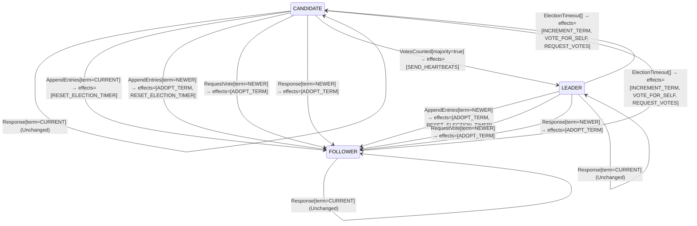

<!-- Generated by examples/tools/build.py from example.json and the verifier's output. Edit example.json. -->
# 060 · One timeout rule for every role makes a leader campaign against itself

[← All examples](../README.md)

| Verdict | Categories | Severity if shipped | Change | Verified unit | Approach |
|---|---|---|---|---|---|
| **✗ Violation: LeadersNeverCampaign, 4-step trace** | functional | high | cleanup, behaviour change intended | [`RoleMachine#decide`](../../examples/apps/quorum/src/main/java/net/terminalvalue/quorum/raft/RoleMachine.java) | [D1: Protocol model checking](../../examples/apps/quorum/spec/README.md) |

> A follower or candidate whose election timer fires becomes a candidate of the next term; a leader's timer firing is ignored, since a leader holds no elections. A developer folds the two cases into one: every server runs for office when its timer fires, and the leader's case was dead code because the timer is stopped when a server wins. The contract diff is one case and is approved. Every invariant of the election model holds, because a candidate of term 2 is an ordinary state. The action property that a leader never becomes a candidate does not: TLC shows the four-step run in which a leader deposes itself.

Tags: [consensus](../README.md#tag-consensus), [leader-election](../README.md#tag-leader-election), [dropped-case](../README.md#tag-dropped-case), [tla-action-property](../README.md#tag-tla-action-property), [generated-operator](../README.md#tag-generated-operator), [multiple-configurations](../README.md#tag-multiple-configurations)

## The change

Replace the switch on the role in the `ElectionTimeout` case with one transition, `CANDIDATE` with `INCREMENT_TERM`, `VOTE_FOR_SELF` and `REQUEST_VOTES`, for every role. The reasoning in the comment: a leader's election timer is stopped when it wins, so the leader case is unreachable, and one rule is clearer than two. The behavioural contract is regenerated and its diff is the one case `decide(LEADER, ElectionTimeout[])`, unchanged to a transition. The reviewer approves it as dead code made uniform.

**Before** ([`RoleMachine.java`](../../examples/apps/quorum/src/main/java/net/terminalvalue/quorum/raft/RoleMachine.java), line 35):

```java

public static Decision<Role, RoleEffect> decide(Role role, RoleEvent event) {
    return switch (event) {
        case ElectionTimeout _ -> switch (role) {
            case FOLLOWER, CANDIDATE -> transition(CANDIDATE, INCREMENT_TERM, VOTE_FOR_SELF, REQUEST_VOTES);
            case LEADER -> unchanged("a leader does not hold elections");
        };
        case VotesCounted votes -> switch (role) {
            case CANDIDATE -> votes.majority() ? transition(LEADER, SEND_HEARTBEATS) : unchanged("no majority yet");
            case FOLLOWER, LEADER -> unchanged("votes of an election this server is no longer in");
```

**After:**

```java

public static Decision<Role, RoleEffect> decide(Role role, RoleEvent event) {
    return switch (event) {
        // One rule for every role: a server whose election timer fires runs for office. A leader's timer is
        // stopped when it wins, so the case for it was dead code.
        case ElectionTimeout _ -> transition(CANDIDATE, INCREMENT_TERM, VOTE_FOR_SELF, REQUEST_VOTES);
        case VotesCounted votes -> switch (role) {
            case CANDIDATE -> votes.majority() ? transition(LEADER, SEND_HEARTBEATS) : unchanged("no majority yet");
            case FOLLOWER, LEADER -> unchanged("votes of an election this server is no longer in");
```

<details><summary>Patch</summary>

```diff
--- a/examples/apps/quorum/src/main/java/net/terminalvalue/quorum/raft/RoleMachine.java
+++ b/examples/apps/quorum/src/main/java/net/terminalvalue/quorum/raft/RoleMachine.java
@@ -35,10 +35,9 @@
 
     public static Decision<Role, RoleEffect> decide(Role role, RoleEvent event) {
         return switch (event) {
-            case ElectionTimeout _ -> switch (role) {
-                case FOLLOWER, CANDIDATE -> transition(CANDIDATE, INCREMENT_TERM, VOTE_FOR_SELF, REQUEST_VOTES);
-                case LEADER -> unchanged("a leader does not hold elections");
-            };
+            // One rule for every role: a server whose election timer fires runs for office. A leader's timer is
+            // stopped when it wins, so the case for it was dead code.
+            case ElectionTimeout _ -> transition(CANDIDATE, INCREMENT_TERM, VOTE_FOR_SELF, REQUEST_VOTES);
             case VotesCounted votes -> switch (role) {
                 case CANDIDATE -> votes.majority() ? transition(LEADER, SEND_HEARTBEATS) : unchanged("no majority yet");
                 case FOLLOWER, LEADER -> unchanged("votes of an election this server is no longer in");
```

</details>

## What the verifier found

The model is checked under 7 configurations, and the verdict is the first that fails:

| Configuration | What it checks | Model | Result |
|---|---|---|---|
| three servers (`spec/RaftElection.cfg`) | every run from the initial state, every interleaving within the configuration's bounds | Servers = {s1, s2, s3}, MaxTerm = 3, LeftBehind = {}, DelayedReplies = FALSE, History = FALSE | ✗ Violation: LeadersNeverCampaign, 4-step trace |
| the inductive step (`spec/RaftElectionInductive.cfg`) | that the invariant `Inductive` is inductive: TLC starts from every state the invariant admits, reachable or not, rather than from the initial state, takes one step, and checks the invariant again, conjunct by conjunct. No counterexample is a proof of election safety by induction, for any run of the cluster however long; a counterexample is one step from a state that need not be reachable | Servers = {s1, s2, s3}, MaxTerm = 3, LeftBehind = {}, DelayedReplies = FALSE, History = FALSE | ✗ Violation: LeadersNeverCampaign, 2-step trace |
| four servers (`spec/RaftElectionFour.cfg`) | every run with four servers, a cluster in which a candidate can hold a vote besides its own and still be short of a majority, which three servers never show; under a symmetry set, so that of the states that differ only by the servers' names TLC explores one | Servers = {s1, s2, s3, s4}, MaxTerm = 3, LeftBehind = {}, DelayedReplies = FALSE, History = FALSE | ✗ Violation: LeadersNeverCampaign, 5-step trace |
| fairness (`spec/RaftElectionLive.cfg`) | the two liveness properties, under the fairness conditions `Fairness`: a server whose timer nothing resets times out, a candidate asks for the votes it lacks, a leader sends its heartbeats. A counterexample is a run that goes on forever without satisfying a property: a prefix, then a state or a cycle the system never leaves | Servers = {s1, s2, s3}, MaxTerm = 3, LeftBehind = {}, DelayedReplies = FALSE, History = FALSE | ✗ Violation: LeadersNeverCampaign, 4-step trace |
| a server left behind (`spec/RaftElectionLogs.cfg`) | the election restriction: one server holds the log a deposed leader of term 1 left behind, three entries of its term, while the other two hold an entry of term 2 that a majority holds and is therefore committed, so that the longer log is the one behind; every run with these logs, which nothing changes, under the invariant `LeaderCompleteness` besides the usual ones | Servers = {s1, s2, s3}, MaxTerm = 3, LeftBehind = {s1}, DelayedReplies = FALSE, History = FALSE | ✗ Violation: LeadersNeverCampaign, 4-step trace |
| delayed replies (`spec/RaftElectionDelayed.cfg`) | every run of three servers and two terms in which the reply to a vote request is a step of its own, which the candidate may take after it has timed out into a newer term, stepped down, or won; the one-step RPC of the other configurations never hands the role machine a reply from an older term than the server's own, and this one does, under the usual invariants and action properties | Servers = {s1, s2, s3}, MaxTerm = 2, LeftBehind = {}, DelayedReplies = TRUE, History = FALSE | ✗ Violation: LeadersNeverCampaign, 5-step trace |
| history (`spec/RaftElectionHistory.cfg`) | every run of three servers and three terms with the two history variables recording, `elected`, every term a server has led, and `voted`, every vote cast, under the two invariants that are about a run rather than a state: at most one leader elected per term and at most one vote per server per term, as the paper states them. The state invariants of the other configurations hold in a run in which a term's leader steps down and the term then elects another; these do not | Servers = {s1, s2, s3}, MaxTerm = 3, LeftBehind = {}, DelayedReplies = FALSE, History = TRUE | ✓ Verified: all invariants hold in 11,824 states |

TLC found a run of the system under three servers, 4 steps long, whose last step violates the action property **LeadersNeverCampaign** (a leader never becomes a candidate: it leaves office as the follower of a newer term, or by stepping down, never by starting an election against itself; a property of steps, which no invariant can state). Each step is one action of one part of the system:

1. **Initial state**: every server a follower in term 0, no vote cast, no vote held.
2. **Timeout**, `Server.onElectionTimeout`: a server's election timer fires, and the server acts on the role machine's decision. `currentTerm = (s1 :> 1 @@ s2 :> 0 @@ s3 :> 0)`, `role = (s1 :> "CANDIDATE" @@ s2 :> "FOLLOWER" @@ s3 :> "FOLLOWER")`, `votedFor = (s1 :> s1 @@ s2 :> "none" @@ s3 :> "none")`, `votes = (s1 :> {s1} @@ s2 :> {} @@ s3 :> {})`
3. **Canvass**, `Server.requestVote`: a candidate asks one server for its vote and gets the answer; the request and the reply each go through the role machine, then the vote rule on the voter, given its ballot and the candidate's term and log against its own, and the tally on the candidate. `currentTerm = (s1 :> 1 @@ s2 :> 1 @@ s3 :> 0)`, `role = (s1 :> "LEADER" @@ s2 :> "FOLLOWER" @@ s3 :> "FOLLOWER")`, `votedFor = (s1 :> s1 @@ s2 :> s1 @@ s3 :> "none")`, `votes = (s1 :> {s1, s2} @@ s2 :> {} @@ s3 :> {})`
4. **Timeout**, `Server.onElectionTimeout`: a server's election timer fires, and the server acts on the role machine's decision. `currentTerm = (s1 :> 2 @@ s2 :> 1 @@ s3 :> 0)`, `role = (s1 :> "CANDIDATE" @@ s2 :> "FOLLOWER" @@ s3 :> "FOLLOWER")`, `votes = (s1 :> {s1} @@ s2 :> {} @@ s3 :> {})`

The model is small (Servers = {s1, s2, s3}, MaxTerm = 3, LeftBehind = {}, DelayedReplies = FALSE, History = FALSE), which is what keeps the trace readable. TLC explored every interleaving of the servers, their terms and votes, and the RPCs between them within those bounds.

<details><summary>The counterexample under the inductive step: action property <b>LeadersNeverCampaign</b>, 2 steps</summary>

Action property **LeadersNeverCampaign**: a leader never becomes a candidate: it leaves office as the follower of a newer term, or by stepping down, never by starting an election against itself; a property of steps, which no invariant can state.

1. **Starting state**, a state the invariant `Inductive` admits, which need not be reachable: `currentTerm = (s1 :> 0 @@ s2 :> 1 @@ s3 :> 1)`, `elected = {}`, `replies = {}`, `role = (s1 :> "FOLLOWER" @@ s2 :> "FOLLOWER" @@ s3 :> "LEADER")`, `voted = {}`, `votedFor = (s1 :> "none" @@ s2 :> s3 @@ s3 :> s3)`, `votes = (s1 :> {} @@ s2 :> {} @@ s3 :> {s2, s3})`
2. **Timeout**, `Server.onElectionTimeout`: a server's election timer fires, and the server acts on the role machine's decision. `currentTerm = (s1 :> 0 @@ s2 :> 1 @@ s3 :> 2)`, `role = (s1 :> "FOLLOWER" @@ s2 :> "FOLLOWER" @@ s3 :> "CANDIDATE")`, `votes = (s1 :> {} @@ s2 :> {} @@ s3 :> {s3})`

</details>

<details><summary>The counterexample under four servers: action property <b>LeadersNeverCampaign</b>, 5 steps</summary>

Action property **LeadersNeverCampaign**: a leader never becomes a candidate: it leaves office as the follower of a newer term, or by stepping down, never by starting an election against itself; a property of steps, which no invariant can state.

1. **Initial state**: every server a follower in term 0, no vote cast, no vote held.
2. **Timeout**, `Server.onElectionTimeout`: a server's election timer fires, and the server acts on the role machine's decision. `currentTerm = (s1 :> 1 @@ s2 :> 0 @@ s3 :> 0 @@ s4 :> 0)`, `role = (s1 :> "CANDIDATE" @@ s2 :> "FOLLOWER" @@ s3 :> "FOLLOWER" @@ s4 :> "FOLLOWER")`, `votedFor = (s1 :> s1 @@ s2 :> "none" @@ s3 :> "none" @@ s4 :> "none")`, `votes = (s1 :> {s1} @@ s2 :> {} @@ s3 :> {} @@ s4 :> {})`
3. **Canvass**, `Server.requestVote`: a candidate asks one server for its vote and gets the answer; the request and the reply each go through the role machine, then the vote rule on the voter, given its ballot and the candidate's term and log against its own, and the tally on the candidate. `currentTerm = (s1 :> 1 @@ s2 :> 1 @@ s3 :> 0 @@ s4 :> 0)`, `votedFor = (s1 :> s1 @@ s2 :> s1 @@ s3 :> "none" @@ s4 :> "none")`, `votes = (s1 :> {s1, s2} @@ s2 :> {} @@ s3 :> {} @@ s4 :> {})`
4. **Canvass**, `Server.requestVote`: a candidate asks one server for its vote and gets the answer; the request and the reply each go through the role machine, then the vote rule on the voter, given its ballot and the candidate's term and log against its own, and the tally on the candidate. `currentTerm = (s1 :> 1 @@ s2 :> 1 @@ s3 :> 1 @@ s4 :> 0)`, `role = (s1 :> "LEADER" @@ s2 :> "FOLLOWER" @@ s3 :> "FOLLOWER" @@ s4 :> "FOLLOWER")`, `votedFor = (s1 :> s1 @@ s2 :> s1 @@ s3 :> s1 @@ s4 :> "none")`, `votes = (s1 :> {s1, s2, s3} @@ s2 :> {} @@ s3 :> {} @@ s4 :> {})`
5. **Timeout**, `Server.onElectionTimeout`: a server's election timer fires, and the server acts on the role machine's decision. `currentTerm = (s1 :> 2 @@ s2 :> 1 @@ s3 :> 1 @@ s4 :> 0)`, `role = (s1 :> "CANDIDATE" @@ s2 :> "FOLLOWER" @@ s3 :> "FOLLOWER" @@ s4 :> "FOLLOWER")`, `votes = (s1 :> {s1} @@ s2 :> {} @@ s3 :> {} @@ s4 :> {})`

</details>

Under fairness TLC found the same run, and reported it the same way.

<details><summary>The counterexample under a server left behind: action property <b>LeadersNeverCampaign</b>, 4 steps</summary>

Action property **LeadersNeverCampaign**: a leader never becomes a candidate: it leaves office as the follower of a newer term, or by stepping down, never by starting an election against itself; a property of steps, which no invariant can state.

1. **Initial state**: every server a follower in term 0, no vote cast, no vote held.
2. **Timeout**, `Server.onElectionTimeout`: a server's election timer fires, and the server acts on the role machine's decision. `currentTerm = (s1 :> 0 @@ s2 :> 1 @@ s3 :> 0)`, `role = (s1 :> "FOLLOWER" @@ s2 :> "CANDIDATE" @@ s3 :> "FOLLOWER")`, `votedFor = (s1 :> "none" @@ s2 :> s2 @@ s3 :> "none")`, `votes = (s1 :> {} @@ s2 :> {s2} @@ s3 :> {})`
3. **Canvass**, `Server.requestVote`: a candidate asks one server for its vote and gets the answer; the request and the reply each go through the role machine, then the vote rule on the voter, given its ballot and the candidate's term and log against its own, and the tally on the candidate. `currentTerm = (s1 :> 1 @@ s2 :> 1 @@ s3 :> 0)`, `role = (s1 :> "FOLLOWER" @@ s2 :> "LEADER" @@ s3 :> "FOLLOWER")`, `votedFor = (s1 :> s2 @@ s2 :> s2 @@ s3 :> "none")`, `votes = (s1 :> {} @@ s2 :> {s1, s2} @@ s3 :> {})`
4. **Timeout**, `Server.onElectionTimeout`: a server's election timer fires, and the server acts on the role machine's decision. `currentTerm = (s1 :> 1 @@ s2 :> 2 @@ s3 :> 0)`, `role = (s1 :> "FOLLOWER" @@ s2 :> "CANDIDATE" @@ s3 :> "FOLLOWER")`, `votes = (s1 :> {} @@ s2 :> {s2} @@ s3 :> {})`

</details>

<details><summary>The counterexample under delayed replies: action property <b>LeadersNeverCampaign</b>, 5 steps</summary>

Action property **LeadersNeverCampaign**: a leader never becomes a candidate: it leaves office as the follower of a newer term, or by stepping down, never by starting an election against itself; a property of steps, which no invariant can state.

1. **Initial state**: every server a follower in term 0, no vote cast, no vote held.
2. **Timeout**, `Server.onElectionTimeout`: a server's election timer fires, and the server acts on the role machine's decision. `currentTerm = (s1 :> 1 @@ s2 :> 0 @@ s3 :> 0)`, `role = (s1 :> "CANDIDATE" @@ s2 :> "FOLLOWER" @@ s3 :> "FOLLOWER")`, `votedFor = (s1 :> s1 @@ s2 :> "none" @@ s3 :> "none")`, `votes = (s1 :> {s1} @@ s2 :> {} @@ s3 :> {})`
3. **Ask**, `Server.requestVote`, the request alone: a candidate asks one server for its vote, which the voter decides as in `Canvass`, and the reply waits on the wire with the term the voter answered in. `currentTerm = (s1 :> 1 @@ s2 :> 1 @@ s3 :> 0)`, `replies = {[term |-> 1, granted |-> TRUE, to |-> s1, from |-> s2]}`, `votedFor = (s1 :> s1 @@ s2 :> s1 @@ s3 :> "none")`
4. **Answer**, `Server.onVote`: the candidate takes a reply that waited; its term goes through the role machine as it compares with the candidate's term now, a granted vote of the current term goes into the tally, and the tally through the role machine. `replies = {}`, `role = (s1 :> "LEADER" @@ s2 :> "FOLLOWER" @@ s3 :> "FOLLOWER")`, `votes = (s1 :> {s1, s2} @@ s2 :> {} @@ s3 :> {})`
5. **Timeout**, `Server.onElectionTimeout`: a server's election timer fires, and the server acts on the role machine's decision. `currentTerm = (s1 :> 2 @@ s2 :> 1 @@ s3 :> 0)`, `role = (s1 :> "CANDIDATE" @@ s2 :> "FOLLOWER" @@ s3 :> "FOLLOWER")`, `votes = (s1 :> {s1} @@ s2 :> {} @@ s3 :> {})`

</details>

**What the verdict rests on.** TLC counted how often a step of the model took each row of the generated operators. A row no step takes is one the model says nothing about, whatever the verdict.

| Configuration | Rows of `RoleMachine#decide` taken | Rows of `VoteRule#decide` taken |
|---|---|---|
| three servers | stopped at the counterexample | stopped at the counterexample |
| the inductive step (from the states the invariant admits, not from a run) | stopped at the counterexample | stopped at the counterexample |
| four servers | stopped at the counterexample | stopped at the counterexample |
| fairness | stopped at the counterexample | stopped at the counterexample |
| a server left behind | stopped at the counterexample | stopped at the counterexample |
| delayed replies | stopped at the counterexample | stopped at the counterexample |
| history | 27 of 36 | 4 of 27 |

The change alters 1 row of the contract, and 1 with a null argument, which the model leaves out:

- `decide(LEADER, ElectionTimeout[])`: `Unchanged[reason="a leader does not hold elections"]` → `Transition[next=CANDIDATE, effects=[INCREMENT_TERM, VOTE_FOR_SELF, REQUEST_VOTES]]`, taken under history

The run under three servers, the inductive step, four servers, fairness, a server left behind, delayed replies stopped at its counterexample, the steps above, and its counts are left out: the verdict rests on the counterexample.

<details><summary>Rows no step takes under history</summary>

`net.terminalvalue.quorum.raft.RoleMachine#decide`:

```
decide(FOLLOWER, VotesCounted[majority=true]) => Unchanged
decide(FOLLOWER, Response[term=OLDER]) => Unchanged
decide(FOLLOWER, Response[term=CURRENT]) => Unchanged
decide(FOLLOWER, Response[term=NEWER]) => Transition[next=FOLLOWER, effects=[ADOPT_TERM]]
decide(CANDIDATE, Response[term=OLDER]) => Unchanged
decide(LEADER, VotesCounted[majority=false]) => Unchanged
decide(LEADER, VotesCounted[majority=true]) => Unchanged
decide(LEADER, AppendEntries[term=CURRENT]) => throws IllegalStateException
decide(LEADER, Response[term=OLDER]) => Unchanged
```

`net.terminalvalue.quorum.raft.VoteRule#decide`:

```
decide(OPEN, VoteRequest[term=OLDER, log=BEHIND]) => Rejected
decide(OPEN, VoteRequest[term=OLDER, log=AHEAD]) => Rejected
decide(OPEN, VoteRequest[term=CURRENT, log=BEHIND]) => Rejected
decide(OPEN, VoteRequest[term=CURRENT, log=AHEAD]) => Transition[next=FOR_THE_CANDIDATE, effects=[GRANT]]
decide(OPEN, VoteRequest[term=NEWER, log=BEHIND]) => Rejected
decide(OPEN, VoteRequest[term=NEWER, log=EVEN]) => Transition[next=FOR_THE_CANDIDATE, effects=[GRANT]]
decide(OPEN, VoteRequest[term=NEWER, log=AHEAD]) => Transition[next=FOR_THE_CANDIDATE, effects=[GRANT]]
decide(FOR_THE_CANDIDATE, VoteRequest[term=OLDER, log=BEHIND]) => Rejected
decide(FOR_THE_CANDIDATE, VoteRequest[term=OLDER, log=EVEN]) => Rejected
decide(FOR_THE_CANDIDATE, VoteRequest[term=OLDER, log=AHEAD]) => Rejected
decide(FOR_THE_CANDIDATE, VoteRequest[term=CURRENT, log=BEHIND]) => Rejected
decide(FOR_THE_CANDIDATE, VoteRequest[term=CURRENT, log=EVEN]) => Transition[next=FOR_THE_CANDIDATE, effects=[GRANT]]
decide(FOR_THE_CANDIDATE, VoteRequest[term=CURRENT, log=AHEAD]) => Transition[next=FOR_THE_CANDIDATE, effects=[GRANT]]
decide(FOR_THE_CANDIDATE, VoteRequest[term=NEWER, log=BEHIND]) => Rejected
decide(FOR_THE_CANDIDATE, VoteRequest[term=NEWER, log=EVEN]) => Transition[next=FOR_THE_CANDIDATE, effects=[GRANT]]
decide(FOR_THE_CANDIDATE, VoteRequest[term=NEWER, log=AHEAD]) => Transition[next=FOR_THE_CANDIDATE, effects=[GRANT]]
decide(FOR_ANOTHER, VoteRequest[term=OLDER, log=BEHIND]) => Rejected
decide(FOR_ANOTHER, VoteRequest[term=OLDER, log=AHEAD]) => Rejected
decide(FOR_ANOTHER, VoteRequest[term=CURRENT, log=BEHIND]) => Rejected
decide(FOR_ANOTHER, VoteRequest[term=CURRENT, log=AHEAD]) => Rejected
decide(FOR_ANOTHER, VoteRequest[term=NEWER, log=BEHIND]) => Rejected
decide(FOR_ANOTHER, VoteRequest[term=NEWER, log=EVEN]) => Transition[next=FOR_THE_CANDIDATE, effects=[GRANT]]
decide(FOR_ANOTHER, VoteRequest[term=NEWER, log=AHEAD]) => Transition[next=FOR_THE_CANDIDATE, effects=[GRANT]]
```

</details>

The state machine the patched code implements, drawn from its derived contract (`jvmcontract statemachine`); a state with no way in or no way out is marked:



## Would the existing tests have caught it?

No: every existing unit test passes (`java -ea net.terminalvalue.quorum.Tests`, run against the patched code).

## Why it matters

The timer is stopped by the server that wins, in the same code path as the transition to leader, and it is stopped again by every heartbeat the leader sends itself; a leader whose timer fires is a leader whose timer handling has a bug or a race, which is the ordinary condition of timer code. Under the committed rule such a firing is harmless. Under this one the leader resigns into a candidacy: it increments its term, votes for itself and asks for votes, so the cluster has no leader until the election completes, every follower adopts the new term, and clients see a leader change with no failure behind it. A timer that misfires periodically produces an election every period, in a cluster where nothing is wrong. Election safety is never violated, and no invariant is, because every state along the way is a state the protocol allows: a leader in term 1, then a candidate in term 2. What is wrong is the step between them.

## Why the verdict is right

The election model states two action properties, `[][A]_vars` formulas that TLC checks on every step rather than every state: that terms never decrease, and `LeadersNeverCampaign`, `[][\A s \in Servers : role[s] = "LEADER" => role'[s] # "CANDIDATE"]_vars`, that a server which is a leader before a step is not a candidate after it. On the committed rule both hold on every step of the 610 states. On the patched one TLC reports the run: s1's timer fires and it runs for term 1; s1 asks s2, which adopts the term and grants, and s1 leads term 1; s1's timer fires again, and the generated rule makes it a candidate of term 2. The last step is the violation; its two end states are each unremarkable, which is why no invariant can state this property and the model states it as one of steps. The tool reports an action property by its name, as TLC does, and the trace ends at the offending step rather than going on forever as a liveness counterexample would: the property is a safety property, violated by a finite behaviour.

## What to do

Revert. The case is not dead code, it is the rule that makes the timer's state irrelevant to a leader: whatever the timer does, a leader holds no election, and Raft's leaders leave office only on hearing a newer term (figure 2, rules for all servers). A developer who wants a leader to notice that it has lost its majority should make it step down as a follower, which example 061 does and proves safe; stepping down into a candidacy with a fresh term is the one thing it must not do. The action property stays in the model's build, so that the next change to the timeout rule is checked step by step.

## Notes

- The Raft election model (`apps/quorum/spec/RaftElection.tla`) is built around the role machine, generated from its contract, with election safety as an invariant and two action properties, `[][A]_v` formulas that constrain each step: terms never decrease, a leader never campaigns. An example is checked under all of the model's configurations, and its verdict is the first that fails.
- One timeout rule for every role makes a leader resign into an election against itself.

## Evidence

How the verdict was reached: three servers: TLC 2.19 explored 29 distinct states to depth 4 in 0 s, for the model Servers = {s1, s2, s3}, MaxTerm = 3, LeftBehind = {}, DelayedReplies = FALSE, History = FALSE; the inductive step: TLC 2.19 explored 17,470 distinct states to depth 1 in 5 s, for the model Servers = {s1, s2, s3}, MaxTerm = 3, LeftBehind = {}, DelayedReplies = FALSE, History = FALSE; four servers: TLC 2.19 explored 35 distinct states to depth 5 in 0 s, for the model Servers = {s1, s2, s3, s4}, MaxTerm = 3, LeftBehind = {}, DelayedReplies = FALSE, History = FALSE; fairness: TLC 2.19 explored 29 distinct states to depth 4 in 0 s, for the model Servers = {s1, s2, s3}, MaxTerm = 3, LeftBehind = {}, DelayedReplies = FALSE, History = FALSE; a server left behind: TLC 2.19 explored 40 distinct states to depth 4 in 0 s, for the model Servers = {s1, s2, s3}, MaxTerm = 3, LeftBehind = {s1}, DelayedReplies = FALSE, History = FALSE; delayed replies: TLC 2.19 explored 129 distinct states to depth 5 in 0 s, for the model Servers = {s1, s2, s3}, MaxTerm = 2, LeftBehind = {}, DelayedReplies = TRUE, History = FALSE; history: TLC 2.19 explored 11,824 distinct states to depth 11 in 3 s, for the model Servers = {s1, s2, s3}, MaxTerm = 3, LeftBehind = {}, DelayedReplies = FALSE, History = TRUE.

<details><summary>Verifier output</summary>

```text
== three servers: spec/RaftElection.cfg ==
TLC2 Version 2.19 of 08 August 2024 (rev: 5a47802)
Running breadth-first search Model-Checking with fp 1 and seed 1 with 1 worker on 8 cores with 910MB heap and 64MB offheap memory [pid: 2619882] (Linux 6.6.87.2-microsoft-standard-WSL2 aarch64, Eclipse Adoptium 25.0.4.1 x86_64, MSBDiskFPSet, DiskStateQueue).
Parsing file examples/apps/quorum/spec/RaftElection.tla
Parsing file examples/tools/tla/standard-modules/Naturals.tla
Parsing file examples/tools/tla/standard-modules/FiniteSets.tla
Parsing file examples/tools/tla/standard-modules/Sequences.tla
Parsing file examples/tools/tla/standard-modules/TLC.tla
Parsing file examples/apps/quorum/spec/RoleMachineContract.tla
Parsing file examples/apps/quorum/spec/VoteRuleContract.tla
Semantic processing of module Naturals
Semantic processing of module Sequences
Semantic processing of module FiniteSets
Semantic processing of module TLC
Semantic processing of module RoleMachineContract
Semantic processing of module VoteRuleContract
Semantic processing of module RaftElection
Starting... (2026-11-02 03:37:09)
Computing initial states...
Finished computing initial states: 1 distinct state generated at 2026-11-02 03:37:10.
Error: Action property LeadersNeverCampaign is violated.
Error: The behavior up to this point is:
State 1: <Initial predicate>
/\ replies = {}
/\ currentTerm = (s1 :> 0 @@ s2 :> 0 @@ s3 :> 0)
/\ voted = {}
/\ votes = (s1 :> {} @@ s2 :> {} @@ s3 :> {})
/\ role = (s1 :> "FOLLOWER" @@ s2 :> "FOLLOWER" @@ s3 :> "FOLLOWER")
/\ votedFor = (s1 :> "none" @@ s2 :> "none" @@ s3 :> "none")
/\ elected = {}

State 2: <Timeout line 147, col 15 to line 147, col 88 of module RaftElection>
/\ replies = {}
/\ currentTerm = (s1 :> 1 @@ s2 :> 0 @@ s3 :> 0)
/\ voted = {}
/\ votes = (s1 :> {s1} @@ s2 :> {} @@ s3 :> {})
/\ role = (s1 :> "CANDIDATE" @@ s2 :> "FOLLOWER" @@ s3 :> "FOLLOWER")
/\ votedFor = (s1 :> s1 @@ s2 :> "none" @@ s3 :> "none")
/\ elected = {}

State 3: <Canvass line 176, col 5 to line 180, col 30 of module RaftElection>
/\ replies = {}
/\ currentTerm = (s1 :> 1 @@ s2 :> 1 @@ s3 :> 0)
/\ voted = {}
/\ votes = (s1 :> {s1, s2} @@ s2 :> {} @@ s3 :> {})
/\ role = (s1 :> "LEADER" @@ s2 :> "FOLLOWER" @@ s3 :> "FOLLOWER")
/\ votedFor = (s1 :> s1 @@ s2 :> s1 @@ s3 :> "none")
/\ elected = {}

State 4: <Timeout line 147, col 15 to line 147, col 88 of module RaftElection>
/\ replies = {}
/\ currentTerm = (s1 :> 2 @@ s2 :> 1 @@ s3 :> 0)
/\ voted = {}
/\ votes = (s1 :> {s1} @@ s2 :> {} @@ s3 :> {})
/\ role = (s1 :> "CANDIDATE" @@ s2 :> "FOLLOWER" @@ s3 :> "FOLLOWER")
/\ votedFor = (s1 :> s1 @@ s2 :> s1 @@ s3 :> "none")
/\ elected = {}

Rows of net.terminalvalue.quorum.raft.RoleMachine#decide a step of the model takes: 8 of 36; never taken (28):
  decide(FOLLOWER, VotesCounted[majority=false]) => Unchanged
  decide(FOLLOWER, VotesCounted[majority=true]) => Unchanged
  decide(FOLLOWER, AppendEntries[term=OLDER]) => Rejected
  decide(FOLLOWER, AppendEntries[term=CURRENT]) => Transition[next=FOLLOWER, effects=[RESET_ELECTION_TIMER]]
  decide(FOLLOWER, AppendEntries[term=NEWER]) => Transition[next=FOLLOWER, effects=[ADOPT_TERM, RESET_ELECTION_TIMER]]
  decide(FOLLOWER, RequestVote[term=OLDER]) => Unchanged
  decide(FOLLOWER, RequestVote[term=CURRENT]) => Unchanged
  decide(FOLLOWER, Response[term=OLDER]) => Unchanged
  decide(FOLLOWER, Response[term=CURRENT]) => Unchanged
  decide(FOLLOWER, Response[term=NEWER]) => Transition[next=FOLLOWER, effects=[ADOPT_TERM]]
  decide(CANDIDATE, AppendEntries[term=OLDER]) => Rejected
  decide(CANDIDATE, AppendEntries[term=CURRENT]) => Transition[next=FOLLOWER, effects=[RESET_ELECTION_TIMER]]
  decide(CANDIDATE, AppendEntries[term=NEWER]) => Transition[next=FOLLOWER, effects=[ADOPT_TERM, RESET_ELECTION_TIMER]]
  decide(CANDIDATE, RequestVote[term=OLDER]) => Unchanged
  decide(CANDIDATE, RequestVote[term=NEWER]) => Transition[next=FOLLOWER, effects=[ADOPT_TERM]]
  decide(CANDIDATE, Response[term=OLDER]) => Unchanged
  decide(CANDIDATE, Response[term=NEWER]) => Transition[next=FOLLOWER, effects=[ADOPT_TERM]]
  decide(LEADER, VotesCounted[majority=false]) => Unchanged
  decide(LEADER, VotesCounted[majority=true]) => Unchanged
  decide(LEADER, AppendEntries[term=OLDER]) => Rejected
  decide(LEADER, AppendEntries[term=CURRENT]) => throws IllegalStateException
  decide(LEADER, AppendEntries[term=NEWER]) => Transition[next=FOLLOWER, effects=[ADOPT_TERM, RESET_ELECTION_TIMER]]
  decide(LEADER, RequestVote[term=OLDER]) => Unchanged
  decide(LEADER, RequestVote[term=CURRENT]) => Unchanged
  decide(LEADER, RequestVote[term=NEWER]) => Transition[next=FOLLOWER, effects=[ADOPT_TERM]]
  decide(LEADER, Response[term=OLDER]) => Unchanged
  decide(LEADER, Response[term=CURRENT]) => Unchanged
  decide(LEADER, Response[term=NEWER]) => Transition[next=FOLLOWER, effects=[ADOPT_TERM]]
Rows of net.terminalvalue.quorum.raft.VoteRule#decide a step of the model takes: 2 of 27; never taken (25):
  decide(OPEN, VoteRequest[term=OLDER, log=BEHIND]) => Rejected
  decide(OPEN, VoteRequest[term=OLDER, log=EVEN]) => Rejected
  decide(OPEN, VoteRequest[term=OLDER, log=AHEAD]) => Rejected
  decide(OPEN, VoteRequest[term=CURRENT, log=BEHIND]) => Rejected
  decide(OPEN, VoteRequest[term=CURRENT, log=AHEAD]) => Transition[next=FOR_THE_CANDIDATE, effects=[GRANT]]
  decide(OPEN, VoteRequest[term=NEWER, log=BEHIND]) => Rejected
  decide(OPEN, VoteRequest[term=NEWER, log=EVEN]) => Transition[next=FOR_THE_CANDIDATE, effects=[GRANT]]
  decide(OPEN, VoteRequest[term=NEWER, log=AHEAD]) => Transition[next=FOR_THE_CANDIDATE, effects=[GRANT]]
  decide(FOR_THE_CANDIDATE, VoteRequest[term=OLDER, log=BEHIND]) => Rejected
  decide(FOR_THE_CANDIDATE, VoteRequest[term=OLDER, log=EVEN]) => Rejected
  decide(FOR_THE_CANDIDATE, VoteRequest[term=OLDER, log=AHEAD]) => Rejected
  decide(FOR_THE_CANDIDATE, VoteRequest[term=CURRENT, log=BEHIND]) => Rejected
  decide(FOR_THE_CANDIDATE, VoteRequest[term=CURRENT, log=EVEN]) => Transition[next=FOR_THE_CANDIDATE, effects=[GRANT]]
  decide(FOR_THE_CANDIDATE, VoteRequest[term=CURRENT, log=AHEAD]) => Transition[next=FOR_THE_CANDIDATE, effects=[GRANT]]
  decide(FOR_THE_CANDIDATE, VoteRequest[term=NEWER, log=BEHIND]) => Rejected
  decide(FOR_THE_CANDIDATE, VoteRequest[term=NEWER, log=EVEN]) => Transition[next=FOR_THE_CANDIDATE, effects=[GRANT]]
  decide(FOR_THE_CANDIDATE, VoteRequest[term=NEWER, log=AHEAD]) => Transition[next=FOR_THE_CANDIDATE, effects=[GRANT]]
  decide(FOR_ANOTHER, VoteRequest[term=OLDER, log=BEHIND]) => Rejected
  decide(FOR_ANOTHER, VoteRequest[term=OLDER, log=EVEN]) => Rejected
  decide(FOR_ANOTHER, VoteRequest[term=OLDER, log=AHEAD]) => Rejected
  decide(FOR_ANOTHER, VoteRequest[term=CURRENT, log=BEHIND]) => Rejected
  decide(FOR_ANOTHER, VoteRequest[term=CURRENT, log=AHEAD]) => Rejected
  decide(FOR_ANOTHER, VoteRequest[term=NEWER, log=BEHIND]) => Rejected
  decide(FOR_ANOTHER, VoteRequest[term=NEWER, log=EVEN]) => Transition[next=FOR_THE_CANDIDATE, effects=[GRANT]]
  decide(FOR_ANOTHER, VoteRequest[term=NEWER, log=AHEAD]) => Transition[next=FOR_THE_CANDIDATE, effects=[GRANT]]
39 states generated, 29 distinct states found, 20 states left on queue.
The depth of the complete state graph search is 4.
The average outdegree of the complete state graph is 4 (minimum is 3, the maximum 5 and the 95th percentile is 5).
Finished in 00s at (2026-11-02 03:37:10)

== the inductive step: spec/RaftElectionInductive.cfg ==
TLC2 Version 2.19 of 08 August 2024 (rev: 5a47802)
Running breadth-first search Model-Checking with fp 1 and seed 1 with 1 worker on 8 cores with 910MB heap and 64MB offheap memory [pid: 2620014] (Linux 6.6.87.2-microsoft-standard-WSL2 aarch64, Eclipse Adoptium 25.0.4.1 x86_64, MSBDiskFPSet, DiskStateQueue).
Parsing file examples/apps/quorum/spec/RaftElection.tla
Parsing file examples/tools/tla/standard-modules/Naturals.tla
Parsing file examples/tools/tla/standard-modules/FiniteSets.tla
Parsing file examples/tools/tla/standard-modules/Sequences.tla
Parsing file examples/tools/tla/standard-modules/TLC.tla
Parsing file examples/apps/quorum/spec/RoleMachineContract.tla
Parsing file examples/apps/quorum/spec/VoteRuleContract.tla
Semantic processing of module Naturals
Semantic processing of module Sequences
Semantic processing of module FiniteSets
Semantic processing of module TLC
Semantic processing of module RoleMachineContract
Semantic processing of module VoteRuleContract
Semantic processing of module RaftElection
Starting... (2026-11-02 03:37:11)
Computing initial states...
Computed 2 initial states...
Computed 4 initial states...
Computed 8 initial states...
Computed 16 initial states...
Computed 32 initial states...
Computed 64 initial states...
Computed 128 initial states...
Computed 256 initial states...
Computed 512 initial states...
Computed 1024 initial states...
Computed 2048 initial states...
Computed 4096 initial states...
Computed 8192 initial states...
Computed 16384 initial states...
Finished computing initial states: 17470 distinct states generated at 2026-11-02 03:37:15.
Error: Action property LeadersNeverCampaign is violated.
Error: The behavior up to this point is:
State 1: <Initial predicate>
/\ replies = {}
/\ currentTerm = (s1 :> 0 @@ s2 :> 1 @@ s3 :> 1)
/\ voted = {}
/\ votes = (s1 :> {} @@ s2 :> {} @@ s3 :> {s2, s3})
/\ role = (s1 :> "FOLLOWER" @@ s2 :> "FOLLOWER" @@ s3 :> "LEADER")
/\ votedFor = (s1 :> "none" @@ s2 :> s3 @@ s3 :> s3)
/\ elected = {}

State 2: <Timeout line 147, col 15 to line 147, col 88 of module RaftElection>
/\ replies = {}
/\ currentTerm = (s1 :> 0 @@ s2 :> 1 @@ s3 :> 2)
/\ voted = {}
/\ votes = (s1 :> {} @@ s2 :> {} @@ s3 :> {s3})
/\ role = (s1 :> "FOLLOWER" @@ s2 :> "FOLLOWER" @@ s3 :> "CANDIDATE")
/\ votedFor = (s1 :> "none" @@ s2 :> s3 @@ s3 :> s3)
/\ elected = {}

Rows of net.terminalvalue.quorum.raft.RoleMachine#decide a step of the model takes: 8 of 36; never taken (28):
  decide(FOLLOWER, VotesCounted[majority=false]) => Unchanged
  decide(FOLLOWER, VotesCounted[majority=true]) => Unchanged
  decide(FOLLOWER, AppendEntries[term=OLDER]) => Rejected
  decide(FOLLOWER, AppendEntries[term=CURRENT]) => Transition[next=FOLLOWER, effects=[RESET_ELECTION_TIMER]]
  decide(FOLLOWER, AppendEntries[term=NEWER]) => Transition[next=FOLLOWER, effects=[ADOPT_TERM, RESET_ELECTION_TIMER]]
  decide(FOLLOWER, RequestVote[term=OLDER]) => Unchanged
  decide(FOLLOWER, Response[term=OLDER]) => Unchanged
  decide(FOLLOWER, Response[term=CURRENT]) => Unchanged
  decide(FOLLOWER, Response[term=NEWER]) => Transition[next=FOLLOWER, effects=[ADOPT_TERM]]
  decide(CANDIDATE, AppendEntries[term=OLDER]) => Rejected
  decide(CANDIDATE, AppendEntries[term=CURRENT]) => Transition[next=FOLLOWER, effects=[RESET_ELECTION_TIMER]]
  decide(CANDIDATE, AppendEntries[term=NEWER]) => Transition[next=FOLLOWER, effects=[ADOPT_TERM, RESET_ELECTION_TIMER]]
  decide(CANDIDATE, RequestVote[term=OLDER]) => Unchanged
  decide(CANDIDATE, RequestVote[term=CURRENT]) => Unchanged
  decide(CANDIDATE, RequestVote[term=NEWER]) => Transition[next=FOLLOWER, effects=[ADOPT_TERM]]
  decide(CANDIDATE, Response[term=OLDER]) => Unchanged
  decide(CANDIDATE, Response[term=NEWER]) => Transition[next=FOLLOWER, effects=[ADOPT_TERM]]
  decide(LEADER, VotesCounted[majority=false]) => Unchanged
  decide(LEADER, VotesCounted[majority=true]) => Unchanged
  decide(LEADER, AppendEntries[term=OLDER]) => Rejected
  decide(LEADER, AppendEntries[term=CURRENT]) => throws IllegalStateException
  decide(LEADER, AppendEntries[term=NEWER]) => Transition[next=FOLLOWER, effects=[ADOPT_TERM, RESET_ELECTION_TIMER]]
  decide(LEADER, RequestVote[term=OLDER]) => Unchanged
  decide(LEADER, RequestVote[term=CURRENT]) => Unchanged
  decide(LEADER, RequestVote[term=NEWER]) => Transition[next=FOLLOWER, effects=[ADOPT_TERM]]
  decide(LEADER, Response[term=OLDER]) => Unchanged
  decide(LEADER, Response[term=CURRENT]) => Unchanged
  decide(LEADER, Response[term=NEWER]) => Transition[next=FOLLOWER, effects=[ADOPT_TERM]]
Rows of net.terminalvalue.quorum.raft.VoteRule#decide a step of the model takes: 3 of 27; never taken (24):
  decide(OPEN, VoteRequest[term=OLDER, log=BEHIND]) => Rejected
  decide(OPEN, VoteRequest[term=OLDER, log=EVEN]) => Rejected
  decide(OPEN, VoteRequest[term=OLDER, log=AHEAD]) => Rejected
  decide(OPEN, VoteRequest[term=CURRENT, log=BEHIND]) => Rejected
  decide(OPEN, VoteRequest[term=CURRENT, log=AHEAD]) => Transition[next=FOR_THE_CANDIDATE, effects=[GRANT]]
  decide(OPEN, VoteRequest[term=NEWER, log=BEHIND]) => Rejected
  decide(OPEN, VoteRequest[term=NEWER, log=EVEN]) => Transition[next=FOR_THE_CANDIDATE, effects=[GRANT]]
  decide(OPEN, VoteRequest[term=NEWER, log=AHEAD]) => Transition[next=FOR_THE_CANDIDATE, effects=[GRANT]]
  decide(FOR_THE_CANDIDATE, VoteRequest[term=OLDER, log=BEHIND]) => Rejected
  decide(FOR_THE_CANDIDATE, VoteRequest[term=OLDER, log=EVEN]) => Rejected
  decide(FOR_THE_CANDIDATE, VoteRequest[term=OLDER, log=AHEAD]) => Rejected
  decide(FOR_THE_CANDIDATE, VoteRequest[term=CURRENT, log=BEHIND]) => Rejected
  decide(FOR_THE_CANDIDATE, VoteRequest[term=CURRENT, log=AHEAD]) => Transition[next=FOR_THE_CANDIDATE, effects=[GRANT]]
  decide(FOR_THE_CANDIDATE, VoteRequest[term=NEWER, log=BEHIND]) => Rejected
  decide(FOR_THE_CANDIDATE, VoteRequest[term=NEWER, log=EVEN]) => Transition[next=FOR_THE_CANDIDATE, effects=[GRANT]]
  decide(FOR_THE_CANDIDATE, VoteRequest[term=NEWER, log=AHEAD]) => Transition[next=FOR_THE_CANDIDATE, effects=[GRANT]]
  decide(FOR_ANOTHER, VoteRequest[term=OLDER, log=BEHIND]) => Rejected
  decide(FOR_ANOTHER, VoteRequest[term=OLDER, log=EVEN]) => Rejected
  decide(FOR_ANOTHER, VoteRequest[term=OLDER, log=AHEAD]) => Rejected
  decide(FOR_ANOTHER, VoteRequest[term=CURRENT, log=BEHIND]) => Rejected
  decide(FOR_ANOTHER, VoteRequest[term=CURRENT, log=AHEAD]) => Rejected
  decide(FOR_ANOTHER, VoteRequest[term=NEWER, log=BEHIND]) => Rejected
  decide(FOR_ANOTHER, VoteRequest[term=NEWER, log=EVEN]) => Transition[next=FOR_THE_CANDIDATE, effects=[GRANT]]
  decide(FOR_ANOTHER, VoteRequest[term=NEWER, log=AHEAD]) => Transition[next=FOR_THE_CANDIDATE, effects=[GRANT]]
17660 states generated, 17470 distinct states found, 17411 states left on queue.
The depth of the complete state graph search is 1.
The average outdegree of the complete state graph is 0 (minimum is 0, the maximum 0 and the 95th percentile is 0).
Finished in 05s at (2026-11-02 03:37:16)

== four servers: spec/RaftElectionFour.cfg ==
TLC2 Version 2.19 of 08 August 2024 (rev: 5a47802)
Running breadth-first search Model-Checking with fp 1 and seed 1 with 1 worker on 8 cores with 910MB heap and 64MB offheap memory [pid: 2620296] (Linux 6.6.87.2-microsoft-standard-WSL2 aarch64, Eclipse Adoptium 25.0.4.1 x86_64, MSBDiskFPSet, DiskStateQueue).
Parsing file examples/apps/quorum/spec/RaftElection.tla
Parsing file examples/tools/tla/standard-modules/Naturals.tla
Parsing file examples/tools/tla/standard-modules/FiniteSets.tla
Parsing file examples/tools/tla/standard-modules/Sequences.tla
Parsing file examples/tools/tla/standard-modules/TLC.tla
Parsing file examples/apps/quorum/spec/RoleMachineContract.tla
Parsing file examples/apps/quorum/spec/VoteRuleContract.tla
Semantic processing of module Naturals
Semantic processing of module Sequences
Semantic processing of module FiniteSets
Semantic processing of module TLC
Semantic processing of module RoleMachineContract
Semantic processing of module VoteRuleContract
Semantic processing of module RaftElection
Starting... (2026-11-02 03:37:16)
Computing initial states...
Finished computing initial states: 1 distinct state generated at 2026-11-02 03:37:17.
Error: Action property LeadersNeverCampaign is violated.
Error: The behavior up to this point is:
State 1: <Initial predicate>
/\ replies = {}
/\ currentTerm = (s1 :> 0 @@ s2 :> 0 @@ s3 :> 0 @@ s4 :> 0)
/\ voted = {}
/\ votes = (s1 :> {} @@ s2 :> {} @@ s3 :> {} @@ s4 :> {})
/\ role = (s1 :> "FOLLOWER" @@ s2 :> "FOLLOWER" @@ s3 :> "FOLLOWER" @@ s4 :> "FOLLOWER")
/\ votedFor = (s1 :> "none" @@ s2 :> "none" @@ s3 :> "none" @@ s4 :> "none")
/\ elected = {}

State 2: <Timeout line 147, col 15 to line 147, col 88 of module RaftElection>
/\ replies = {}
/\ currentTerm = (s1 :> 1 @@ s2 :> 0 @@ s3 :> 0 @@ s4 :> 0)
/\ voted = {}
/\ votes = (s1 :> {s1} @@ s2 :> {} @@ s3 :> {} @@ s4 :> {})
/\ role = (s1 :> "CANDIDATE" @@ s2 :> "FOLLOWER" @@ s3 :> "FOLLOWER" @@ s4 :> "FOLLOWER")
/\ votedFor = (s1 :> s1 @@ s2 :> "none" @@ s3 :> "none" @@ s4 :> "none")
/\ elected = {}

State 3: <Canvass line 176, col 5 to line 180, col 30 of module RaftElection>
/\ replies = {}
/\ currentTerm = (s1 :> 1 @@ s2 :> 1 @@ s3 :> 0 @@ s4 :> 0)
/\ voted = {}
/\ votes = (s1 :> {s1, s2} @@ s2 :> {} @@ s3 :> {} @@ s4 :> {})
/\ role = (s1 :> "CANDIDATE" @@ s2 :> "FOLLOWER" @@ s3 :> "FOLLOWER" @@ s4 :> "FOLLOWER")
/\ votedFor = (s1 :> s1 @@ s2 :> s1 @@ s3 :> "none" @@ s4 :> "none")
/\ elected = {}

State 4: <Canvass line 176, col 5 to line 180, col 30 of module RaftElection>
/\ replies = {}
/\ currentTerm = (s1 :> 1 @@ s2 :> 1 @@ s3 :> 1 @@ s4 :> 0)
/\ voted = {}
/\ votes = (s1 :> {s1, s2, s3} @@ s2 :> {} @@ s3 :> {} @@ s4 :> {})
/\ role = (s1 :> "LEADER" @@ s2 :> "FOLLOWER" @@ s3 :> "FOLLOWER" @@ s4 :> "FOLLOWER")
/\ votedFor = (s1 :> s1 @@ s2 :> s1 @@ s3 :> s1 @@ s4 :> "none")
/\ elected = {}

State 5: <Timeout line 147, col 15 to line 147, col 88 of module RaftElection>
/\ replies = {}
/\ currentTerm = (s1 :> 2 @@ s2 :> 1 @@ s3 :> 1 @@ s4 :> 0)
/\ voted = {}
/\ votes = (s1 :> {s1} @@ s2 :> {} @@ s3 :> {} @@ s4 :> {})
/\ role = (s1 :> "CANDIDATE" @@ s2 :> "FOLLOWER" @@ s3 :> "FOLLOWER" @@ s4 :> "FOLLOWER")
/\ votedFor = (s1 :> s1 @@ s2 :> s1 @@ s3 :> s1 @@ s4 :> "none")
/\ elected = {}

Rows of net.terminalvalue.quorum.raft.RoleMachine#decide a step of the model takes: 13 of 36; never taken (23):
  decide(FOLLOWER, VotesCounted[majority=true]) => Unchanged
  decide(FOLLOWER, AppendEntries[term=OLDER]) => Rejected
  decide(FOLLOWER, AppendEntries[term=CURRENT]) => Transition[next=FOLLOWER, effects=[RESET_ELECTION_TIMER]]
  decide(FOLLOWER, AppendEntries[term=NEWER]) => Transition[next=FOLLOWER, effects=[ADOPT_TERM, RESET_ELECTION_TIMER]]
  decide(FOLLOWER, RequestVote[term=OLDER]) => Unchanged
  decide(FOLLOWER, Response[term=OLDER]) => Unchanged
  decide(FOLLOWER, Response[term=CURRENT]) => Unchanged
  decide(FOLLOWER, Response[term=NEWER]) => Transition[next=FOLLOWER, effects=[ADOPT_TERM]]
  decide(CANDIDATE, AppendEntries[term=OLDER]) => Rejected
  decide(CANDIDATE, AppendEntries[term=CURRENT]) => Transition[next=FOLLOWER, effects=[RESET_ELECTION_TIMER]]
  decide(CANDIDATE, AppendEntries[term=NEWER]) => Transition[next=FOLLOWER, effects=[ADOPT_TERM, RESET_ELECTION_TIMER]]
  decide(CANDIDATE, Response[term=OLDER]) => Unchanged
  decide(LEADER, VotesCounted[majority=false]) => Unchanged
  decide(LEADER, VotesCounted[majority=true]) => Unchanged
  decide(LEADER, AppendEntries[term=OLDER]) => Rejected
  decide(LEADER, AppendEntries[term=CURRENT]) => throws IllegalStateException
  decide(LEADER, AppendEntries[term=NEWER]) => Transition[next=FOLLOWER, effects=[ADOPT_TERM, RESET_ELECTION_TIMER]]
  decide(LEADER, RequestVote[term=OLDER]) => Unchanged
  decide(LEADER, RequestVote[term=CURRENT]) => Unchanged
  decide(LEADER, RequestVote[term=NEWER]) => Transition[next=FOLLOWER, effects=[ADOPT_TERM]]
  decide(LEADER, Response[term=OLDER]) => Unchanged
  decide(LEADER, Response[term=CURRENT]) => Unchanged
  decide(LEADER, Response[term=NEWER]) => Transition[next=FOLLOWER, effects=[ADOPT_TERM]]
Rows of net.terminalvalue.quorum.raft.VoteRule#decide a step of the model takes: 3 of 27; never taken (24):
  decide(OPEN, VoteRequest[term=OLDER, log=BEHIND]) => Rejected
  decide(OPEN, VoteRequest[term=OLDER, log=EVEN]) => Rejected
  decide(OPEN, VoteRequest[term=OLDER, log=AHEAD]) => Rejected
  decide(OPEN, VoteRequest[term=CURRENT, log=BEHIND]) => Rejected
  decide(OPEN, VoteRequest[term=CURRENT, log=AHEAD]) => Transition[next=FOR_THE_CANDIDATE, effects=[GRANT]]
  decide(OPEN, VoteRequest[term=NEWER, log=BEHIND]) => Rejected
  decide(OPEN, VoteRequest[term=NEWER, log=EVEN]) => Transition[next=FOR_THE_CANDIDATE, effects=[GRANT]]
  decide(OPEN, VoteRequest[term=NEWER, log=AHEAD]) => Transition[next=FOR_THE_CANDIDATE, effects=[GRANT]]
  decide(FOR_THE_CANDIDATE, VoteRequest[term=OLDER, log=BEHIND]) => Rejected
  decide(FOR_THE_CANDIDATE, VoteRequest[term=OLDER, log=EVEN]) => Rejected
  decide(FOR_THE_CANDIDATE, VoteRequest[term=OLDER, log=AHEAD]) => Rejected
  decide(FOR_THE_CANDIDATE, VoteRequest[term=CURRENT, log=BEHIND]) => Rejected
  decide(FOR_THE_CANDIDATE, VoteRequest[term=CURRENT, log=EVEN]) => Transition[next=FOR_THE_CANDIDATE, effects=[GRANT]]
  decide(FOR_THE_CANDIDATE, VoteRequest[term=CURRENT, log=AHEAD]) => Transition[next=FOR_THE_CANDIDATE, effects=[GRANT]]
  decide(FOR_THE_CANDIDATE, VoteRequest[term=NEWER, log=BEHIND]) => Rejected
  decide(FOR_THE_CANDIDATE, VoteRequest[term=NEWER, log=EVEN]) => Transition[next=FOR_THE_CANDIDATE, effects=[GRANT]]
  decide(FOR_THE_CANDIDATE, VoteRequest[term=NEWER, log=AHEAD]) => Transition[next=FOR_THE_CANDIDATE, effects=[GRANT]]
  decide(FOR_ANOTHER, VoteRequest[term=OLDER, log=BEHIND]) => Rejected
  decide(FOR_ANOTHER, VoteRequest[term=OLDER, log=AHEAD]) => Rejected
  decide(FOR_ANOTHER, VoteRequest[term=CURRENT, log=BEHIND]) => Rejected
  decide(FOR_ANOTHER, VoteRequest[term=CURRENT, log=AHEAD]) => Rejected
  decide(FOR_ANOTHER, VoteRequest[term=NEWER, log=BEHIND]) => Rejected
  decide(FOR_ANOTHER, VoteRequest[term=NEWER, log=EVEN]) => Transition[next=FOR_THE_CANDIDATE, effects=[GRANT]]
  decide(FOR_ANOTHER, VoteRequest[term=NEWER, log=AHEAD]) => Transition[next=FOR_THE_CANDIDATE, effects=[GRANT]]
96 states generated, 35 distinct states found, 21 states left on queue.
The depth of the complete state graph search is 5.
The average outdegree of the complete state graph is 3 (minimum is 1, the maximum 5 and the 95th percentile is 5).
Finished in 00s at (2026-11-02 03:37:17)

== fairness: spec/RaftElectionLive.cfg ==
TLC2 Version 2.19 of 08 August 2024 (rev: 5a47802)
Running breadth-first search Model-Checking with fp 1 and seed 1 with 1 worker on 8 cores with 910MB heap and 64MB offheap memory [pid: 2620380] (Linux 6.6.87.2-microsoft-standard-WSL2 aarch64, Eclipse Adoptium 25.0.4.1 x86_64, MSBDiskFPSet, DiskStateQueue).
Parsing file examples/apps/quorum/spec/RaftElection.tla
Parsing file examples/tools/tla/standard-modules/Naturals.tla
Parsing file examples/tools/tla/standard-modules/FiniteSets.tla
Parsing file examples/tools/tla/standard-modules/Sequences.tla
Parsing file examples/tools/tla/standard-modules/TLC.tla
Parsing file examples/apps/quorum/spec/RoleMachineContract.tla
Parsing file examples/apps/quorum/spec/VoteRuleContract.tla
Semantic processing of module Naturals
Semantic processing of module Sequences
Semantic processing of module FiniteSets
Semantic processing of module TLC
Semantic processing of module RoleMachineContract
Semantic processing of module VoteRuleContract
Semantic processing of module RaftElection
Starting... (2026-11-02 03:37:18)
Implied-temporal checking--satisfiability problem has 4 branches.
Computing initial states...
Finished computing initial states: 1 distinct state generated at 2026-11-02 03:37:18.
Error: Action property LeadersNeverCampaign is violated.
Error: The behavior up to this point is:
State 1: <Initial predicate>
/\ replies = {}
/\ currentTerm = (s1 :> 0 @@ s2 :> 0 @@ s3 :> 0)
/\ voted = {}
/\ votes = (s1 :> {} @@ s2 :> {} @@ s3 :> {})
/\ role = (s1 :> "FOLLOWER" @@ s2 :> "FOLLOWER" @@ s3 :> "FOLLOWER")
/\ votedFor = (s1 :> "none" @@ s2 :> "none" @@ s3 :> "none")
/\ elected = {}

State 2: <Timeout line 147, col 15 to line 147, col 88 of module RaftElection>
/\ replies = {}
/\ currentTerm = (s1 :> 1 @@ s2 :> 0 @@ s3 :> 0)
/\ voted = {}
/\ votes = (s1 :> {s1} @@ s2 :> {} @@ s3 :> {})
/\ role = (s1 :> "CANDIDATE" @@ s2 :> "FOLLOWER" @@ s3 :> "FOLLOWER")
/\ votedFor = (s1 :> s1 @@ s2 :> "none" @@ s3 :> "none")
/\ elected = {}

State 3: <Canvass line 176, col 5 to line 180, col 30 of module RaftElection>
/\ replies = {}
/\ currentTerm = (s1 :> 1 @@ s2 :> 1 @@ s3 :> 0)
/\ voted = {}
/\ votes = (s1 :> {s1, s2} @@ s2 :> {} @@ s3 :> {})
/\ role = (s1 :> "LEADER" @@ s2 :> "FOLLOWER" @@ s3 :> "FOLLOWER")
/\ votedFor = (s1 :> s1 @@ s2 :> s1 @@ s3 :> "none")
/\ elected = {}

State 4: <Timeout line 147, col 15 to line 147, col 88 of module RaftElection>
/\ replies = {}
/\ currentTerm = (s1 :> 2 @@ s2 :> 1 @@ s3 :> 0)
/\ voted = {}
/\ votes = (s1 :> {s1} @@ s2 :> {} @@ s3 :> {})
/\ role = (s1 :> "CANDIDATE" @@ s2 :> "FOLLOWER" @@ s3 :> "FOLLOWER")
/\ votedFor = (s1 :> s1 @@ s2 :> s1 @@ s3 :> "none")
/\ elected = {}

Rows of net.terminalvalue.quorum.raft.RoleMachine#decide a step of the model takes: 8 of 36; never taken (28):
  decide(FOLLOWER, VotesCounted[majority=false]) => Unchanged
  decide(FOLLOWER, VotesCounted[majority=true]) => Unchanged
  decide(FOLLOWER, AppendEntries[term=OLDER]) => Rejected
  decide(FOLLOWER, AppendEntries[term=CURRENT]) => Transition[next=FOLLOWER, effects=[RESET_ELECTION_TIMER]]
  decide(FOLLOWER, AppendEntries[term=NEWER]) => Transition[next=FOLLOWER, effects=[ADOPT_TERM, RESET_ELECTION_TIMER]]
  decide(FOLLOWER, RequestVote[term=OLDER]) => Unchanged
  decide(FOLLOWER, RequestVote[term=CURRENT]) => Unchanged
  decide(FOLLOWER, Response[term=OLDER]) => Unchanged
  decide(FOLLOWER, Response[term=CURRENT]) => Unchanged
  decide(FOLLOWER, Response[term=NEWER]) => Transition[next=FOLLOWER, effects=[ADOPT_TERM]]
  decide(CANDIDATE, AppendEntries[term=OLDER]) => Rejected
  decide(CANDIDATE, AppendEntries[term=CURRENT]) => Transition[next=FOLLOWER, effects=[RESET_ELECTION_TIMER]]
  decide(CANDIDATE, AppendEntries[term=NEWER]) => Transition[next=FOLLOWER, effects=[ADOPT_TERM, RESET_ELECTION_TIMER]]
  decide(CANDIDATE, RequestVote[term=OLDER]) => Unchanged
  decide(CANDIDATE, RequestVote[term=NEWER]) => Transition[next=FOLLOWER, effects=[ADOPT_TERM]]
  decide(CANDIDATE, Response[term=OLDER]) => Unchanged
  decide(CANDIDATE, Response[term=NEWER]) => Transition[next=FOLLOWER, effects=[ADOPT_TERM]]
  decide(LEADER, VotesCounted[majority=false]) => Unchanged
  decide(LEADER, VotesCounted[majority=true]) => Unchanged
  decide(LEADER, AppendEntries[term=OLDER]) => Rejected
  decide(LEADER, AppendEntries[term=CURRENT]) => throws IllegalStateException
  decide(LEADER, AppendEntries[term=NEWER]) => Transition[next=FOLLOWER, effects=[ADOPT_TERM, RESET_ELECTION_TIMER]]
  decide(LEADER, RequestVote[term=OLDER]) => Unchanged
  decide(LEADER, RequestVote[term=CURRENT]) => Unchanged
  decide(LEADER, RequestVote[term=NEWER]) => Transition[next=FOLLOWER, effects=[ADOPT_TERM]]
  decide(LEADER, Response[term=OLDER]) => Unchanged
  decide(LEADER, Response[term=CURRENT]) => Unchanged
  decide(LEADER, Response[term=NEWER]) => Transition[next=FOLLOWER, effects=[ADOPT_TERM]]
Rows of net.terminalvalue.quorum.raft.VoteRule#decide a step of the model takes: 2 of 27; never taken (25):
  decide(OPEN, VoteRequest[term=OLDER, log=BEHIND]) => Rejected
  decide(OPEN, VoteRequest[term=OLDER, log=EVEN]) => Rejected
  decide(OPEN, VoteRequest[term=OLDER, log=AHEAD]) => Rejected
  decide(OPEN, VoteRequest[term=CURRENT, log=BEHIND]) => Rejected
  decide(OPEN, VoteRequest[term=CURRENT, log=AHEAD]) => Transition[next=FOR_THE_CANDIDATE, effects=[GRANT]]
  decide(OPEN, VoteRequest[term=NEWER, log=BEHIND]) => Rejected
  decide(OPEN, VoteRequest[term=NEWER, log=EVEN]) => Transition[next=FOR_THE_CANDIDATE, effects=[GRANT]]
  decide(OPEN, VoteRequest[term=NEWER, log=AHEAD]) => Transition[next=FOR_THE_CANDIDATE, effects=[GRANT]]
  decide(FOR_THE_CANDIDATE, VoteRequest[term=OLDER, log=BEHIND]) => Rejected
  decide(FOR_THE_CANDIDATE, VoteRequest[term=OLDER, log=EVEN]) => Rejected
  decide(FOR_THE_CANDIDATE, VoteRequest[term=OLDER, log=AHEAD]) => Rejected
  decide(FOR_THE_CANDIDATE, VoteRequest[term=CURRENT, log=BEHIND]) => Rejected
  decide(FOR_THE_CANDIDATE, VoteRequest[term=CURRENT, log=EVEN]) => Transition[next=FOR_THE_CANDIDATE, effects=[GRANT]]
  decide(FOR_THE_CANDIDATE, VoteRequest[term=CURRENT, log=AHEAD]) => Transition[next=FOR_THE_CANDIDATE, effects=[GRANT]]
  decide(FOR_THE_CANDIDATE, VoteRequest[term=NEWER, log=BEHIND]) => Rejected
  decide(FOR_THE_CANDIDATE, VoteRequest[term=NEWER, log=EVEN]) => Transition[next=FOR_THE_CANDIDATE, effects=[GRANT]]
  decide(FOR_THE_CANDIDATE, VoteRequest[term=NEWER, log=AHEAD]) => Transition[next=FOR_THE_CANDIDATE, effects=[GRANT]]
  decide(FOR_ANOTHER, VoteRequest[term=OLDER, log=BEHIND]) => Rejected
  decide(FOR_ANOTHER, VoteRequest[term=OLDER, log=EVEN]) => Rejected
  decide(FOR_ANOTHER, VoteRequest[term=OLDER, log=AHEAD]) => Rejected
  decide(FOR_ANOTHER, VoteRequest[term=CURRENT, log=BEHIND]) => Rejected
  decide(FOR_ANOTHER, VoteRequest[term=CURRENT, log=AHEAD]) => Rejected
  decide(FOR_ANOTHER, VoteRequest[term=NEWER, log=BEHIND]) => Rejected
  decide(FOR_ANOTHER, VoteRequest[term=NEWER, log=EVEN]) => Transition[next=FOR_THE_CANDIDATE, effects=[GRANT]]
  decide(FOR_ANOTHER, VoteRequest[term=NEWER, log=AHEAD]) => Transition[next=FOR_THE_CANDIDATE, effects=[GRANT]]
39 states generated, 29 distinct states found, 20 states left on queue.
The depth of the complete state graph search is 4.
The average outdegree of the complete state graph is 4 (minimum is 3, the maximum 5 and the 95th percentile is 5).
Finished in 00s at (2026-11-02 03:37:18)

== a server left behind: spec/RaftElectionLogs.cfg ==
TLC2 Version 2.19 of 08 August 2024 (rev: 5a47802)
Running breadth-first search Model-Checking with fp 1 and seed 1 with 1 worker on 8 cores with 910MB heap and 64MB offheap memory [pid: 2620481] (Linux 6.6.87.2-microsoft-standard-WSL2 aarch64, Eclipse Adoptium 25.0.4.1 x86_64, MSBDiskFPSet, DiskStateQueue).
Parsing file examples/apps/quorum/spec/RaftElection.tla
Parsing file examples/tools/tla/standard-modules/Naturals.tla
Parsing file examples/tools/tla/standard-modules/FiniteSets.tla
Parsing file examples/tools/tla/standard-modules/Sequences.tla
Parsing file examples/tools/tla/standard-modules/TLC.tla
Parsing file examples/apps/quorum/spec/RoleMachineContract.tla
Parsing file examples/apps/quorum/spec/VoteRuleContract.tla
Semantic processing of module Naturals
Semantic processing of module Sequences
Semantic processing of module FiniteSets
Semantic processing of module TLC
Semantic processing of module RoleMachineContract
Semantic processing of module VoteRuleContract
Semantic processing of module RaftElection
Starting... (2026-11-02 03:37:19)
Computing initial states...
Finished computing initial states: 1 distinct state generated at 2026-11-02 03:37:19.
Error: Action property LeadersNeverCampaign is violated.
Error: The behavior up to this point is:
State 1: <Initial predicate>
/\ replies = {}
/\ currentTerm = (s1 :> 0 @@ s2 :> 0 @@ s3 :> 0)
/\ voted = {}
/\ votes = (s1 :> {} @@ s2 :> {} @@ s3 :> {})
/\ role = (s1 :> "FOLLOWER" @@ s2 :> "FOLLOWER" @@ s3 :> "FOLLOWER")
/\ votedFor = (s1 :> "none" @@ s2 :> "none" @@ s3 :> "none")
/\ elected = {}

State 2: <Timeout line 147, col 15 to line 147, col 88 of module RaftElection>
/\ replies = {}
/\ currentTerm = (s1 :> 0 @@ s2 :> 1 @@ s3 :> 0)
/\ voted = {}
/\ votes = (s1 :> {} @@ s2 :> {s2} @@ s3 :> {})
/\ role = (s1 :> "FOLLOWER" @@ s2 :> "CANDIDATE" @@ s3 :> "FOLLOWER")
/\ votedFor = (s1 :> "none" @@ s2 :> s2 @@ s3 :> "none")
/\ elected = {}

State 3: <Canvass line 176, col 5 to line 180, col 30 of module RaftElection>
/\ replies = {}
/\ currentTerm = (s1 :> 1 @@ s2 :> 1 @@ s3 :> 0)
/\ voted = {}
/\ votes = (s1 :> {} @@ s2 :> {s1, s2} @@ s3 :> {})
/\ role = (s1 :> "FOLLOWER" @@ s2 :> "LEADER" @@ s3 :> "FOLLOWER")
/\ votedFor = (s1 :> s2 @@ s2 :> s2 @@ s3 :> "none")
/\ elected = {}

State 4: <Timeout line 147, col 15 to line 147, col 88 of module RaftElection>
/\ replies = {}
/\ currentTerm = (s1 :> 1 @@ s2 :> 2 @@ s3 :> 0)
/\ voted = {}
/\ votes = (s1 :> {} @@ s2 :> {s2} @@ s3 :> {})
/\ role = (s1 :> "FOLLOWER" @@ s2 :> "CANDIDATE" @@ s3 :> "FOLLOWER")
/\ votedFor = (s1 :> s2 @@ s2 :> s2 @@ s3 :> "none")
/\ elected = {}

Rows of net.terminalvalue.quorum.raft.RoleMachine#decide a step of the model takes: 9 of 36; never taken (27):
  decide(FOLLOWER, VotesCounted[majority=false]) => Unchanged
  decide(FOLLOWER, VotesCounted[majority=true]) => Unchanged
  decide(FOLLOWER, AppendEntries[term=OLDER]) => Rejected
  decide(FOLLOWER, AppendEntries[term=CURRENT]) => Transition[next=FOLLOWER, effects=[RESET_ELECTION_TIMER]]
  decide(FOLLOWER, AppendEntries[term=NEWER]) => Transition[next=FOLLOWER, effects=[ADOPT_TERM, RESET_ELECTION_TIMER]]
  decide(FOLLOWER, RequestVote[term=OLDER]) => Unchanged
  decide(FOLLOWER, Response[term=OLDER]) => Unchanged
  decide(FOLLOWER, Response[term=CURRENT]) => Unchanged
  decide(FOLLOWER, Response[term=NEWER]) => Transition[next=FOLLOWER, effects=[ADOPT_TERM]]
  decide(CANDIDATE, AppendEntries[term=OLDER]) => Rejected
  decide(CANDIDATE, AppendEntries[term=CURRENT]) => Transition[next=FOLLOWER, effects=[RESET_ELECTION_TIMER]]
  decide(CANDIDATE, AppendEntries[term=NEWER]) => Transition[next=FOLLOWER, effects=[ADOPT_TERM, RESET_ELECTION_TIMER]]
  decide(CANDIDATE, RequestVote[term=OLDER]) => Unchanged
  decide(CANDIDATE, RequestVote[term=NEWER]) => Transition[next=FOLLOWER, effects=[ADOPT_TERM]]
  decide(CANDIDATE, Response[term=OLDER]) => Unchanged
  decide(CANDIDATE, Response[term=NEWER]) => Transition[next=FOLLOWER, effects=[ADOPT_TERM]]
  decide(LEADER, VotesCounted[majority=false]) => Unchanged
  decide(LEADER, VotesCounted[majority=true]) => Unchanged
  decide(LEADER, AppendEntries[term=OLDER]) => Rejected
  decide(LEADER, AppendEntries[term=CURRENT]) => throws IllegalStateException
  decide(LEADER, AppendEntries[term=NEWER]) => Transition[next=FOLLOWER, effects=[ADOPT_TERM, RESET_ELECTION_TIMER]]
  decide(LEADER, RequestVote[term=OLDER]) => Unchanged
  decide(LEADER, RequestVote[term=CURRENT]) => Unchanged
  decide(LEADER, RequestVote[term=NEWER]) => Transition[next=FOLLOWER, effects=[ADOPT_TERM]]
  decide(LEADER, Response[term=OLDER]) => Unchanged
  decide(LEADER, Response[term=CURRENT]) => Unchanged
  decide(LEADER, Response[term=NEWER]) => Transition[next=FOLLOWER, effects=[ADOPT_TERM]]
Rows of net.terminalvalue.quorum.raft.VoteRule#decide a step of the model takes: 6 of 27; never taken (21):
  decide(OPEN, VoteRequest[term=OLDER, log=BEHIND]) => Rejected
  decide(OPEN, VoteRequest[term=OLDER, log=EVEN]) => Rejected
  decide(OPEN, VoteRequest[term=OLDER, log=AHEAD]) => Rejected
  decide(OPEN, VoteRequest[term=NEWER, log=BEHIND]) => Rejected
  decide(OPEN, VoteRequest[term=NEWER, log=EVEN]) => Transition[next=FOR_THE_CANDIDATE, effects=[GRANT]]
  decide(OPEN, VoteRequest[term=NEWER, log=AHEAD]) => Transition[next=FOR_THE_CANDIDATE, effects=[GRANT]]
  decide(FOR_THE_CANDIDATE, VoteRequest[term=OLDER, log=BEHIND]) => Rejected
  decide(FOR_THE_CANDIDATE, VoteRequest[term=OLDER, log=EVEN]) => Rejected
  decide(FOR_THE_CANDIDATE, VoteRequest[term=OLDER, log=AHEAD]) => Rejected
  decide(FOR_THE_CANDIDATE, VoteRequest[term=CURRENT, log=BEHIND]) => Rejected
  decide(FOR_THE_CANDIDATE, VoteRequest[term=CURRENT, log=EVEN]) => Transition[next=FOR_THE_CANDIDATE, effects=[GRANT]]
  decide(FOR_THE_CANDIDATE, VoteRequest[term=CURRENT, log=AHEAD]) => Transition[next=FOR_THE_CANDIDATE, effects=[GRANT]]
  decide(FOR_THE_CANDIDATE, VoteRequest[term=NEWER, log=BEHIND]) => Rejected
  decide(FOR_THE_CANDIDATE, VoteRequest[term=NEWER, log=EVEN]) => Transition[next=FOR_THE_CANDIDATE, effects=[GRANT]]
  decide(FOR_THE_CANDIDATE, VoteRequest[term=NEWER, log=AHEAD]) => Transition[next=FOR_THE_CANDIDATE, effects=[GRANT]]
  decide(FOR_ANOTHER, VoteRequest[term=OLDER, log=BEHIND]) => Rejected
  decide(FOR_ANOTHER, VoteRequest[term=OLDER, log=EVEN]) => Rejected
  decide(FOR_ANOTHER, VoteRequest[term=OLDER, log=AHEAD]) => Rejected
  decide(FOR_ANOTHER, VoteRequest[term=NEWER, log=BEHIND]) => Rejected
  decide(FOR_ANOTHER, VoteRequest[term=NEWER, log=EVEN]) => Transition[next=FOR_THE_CANDIDATE, effects=[GRANT]]
  decide(FOR_ANOTHER, VoteRequest[term=NEWER, log=AHEAD]) => Transition[next=FOR_THE_CANDIDATE, effects=[GRANT]]
62 states generated, 40 distinct states found, 27 states left on queue.
The depth of the complete state graph search is 4.
The average outdegree of the complete state graph is 3 (minimum is 1, the maximum 5 and the 95th percentile is 5).
Finished in 00s at (2026-11-02 03:37:20)

== delayed replies: spec/RaftElectionDelayed.cfg ==
TLC2 Version 2.19 of 08 August 2024 (rev: 5a47802)
Running breadth-first search Model-Checking with fp 1 and seed 1 with 1 worker on 8 cores with 910MB heap and 64MB offheap memory [pid: 2620577] (Linux 6.6.87.2-microsoft-standard-WSL2 aarch64, Eclipse Adoptium 25.0.4.1 x86_64, MSBDiskFPSet, DiskStateQueue).
Parsing file examples/apps/quorum/spec/RaftElection.tla
Parsing file examples/tools/tla/standard-modules/Naturals.tla
Parsing file examples/tools/tla/standard-modules/FiniteSets.tla
Parsing file examples/tools/tla/standard-modules/Sequences.tla
Parsing file examples/tools/tla/standard-modules/TLC.tla
Parsing file examples/apps/quorum/spec/RoleMachineContract.tla
Parsing file examples/apps/quorum/spec/VoteRuleContract.tla
Semantic processing of module Naturals
Semantic processing of module Sequences
Semantic processing of module FiniteSets
Semantic processing of module TLC
Semantic processing of module RoleMachineContract
Semantic processing of module VoteRuleContract
Semantic processing of module RaftElection
Starting... (2026-11-02 03:37:20)
Computing initial states...
Finished computing initial states: 1 distinct state generated at 2026-11-02 03:37:21.
Error: Action property LeadersNeverCampaign is violated.
Error: The behavior up to this point is:
State 1: <Initial predicate>
/\ replies = {}
/\ currentTerm = (s1 :> 0 @@ s2 :> 0 @@ s3 :> 0)
/\ voted = {}
/\ votes = (s1 :> {} @@ s2 :> {} @@ s3 :> {})
/\ role = (s1 :> "FOLLOWER" @@ s2 :> "FOLLOWER" @@ s3 :> "FOLLOWER")
/\ votedFor = (s1 :> "none" @@ s2 :> "none" @@ s3 :> "none")
/\ elected = {}

State 2: <Timeout line 147, col 15 to line 147, col 88 of module RaftElection>
/\ replies = {}
/\ currentTerm = (s1 :> 1 @@ s2 :> 0 @@ s3 :> 0)
/\ voted = {}
/\ votes = (s1 :> {s1} @@ s2 :> {} @@ s3 :> {})
/\ role = (s1 :> "CANDIDATE" @@ s2 :> "FOLLOWER" @@ s3 :> "FOLLOWER")
/\ votedFor = (s1 :> s1 @@ s2 :> "none" @@ s3 :> "none")
/\ elected = {}

State 3: <Ask line 204, col 5 to line 209, col 26 of module RaftElection>
/\ replies = {[term |-> 1, granted |-> TRUE, to |-> s1, from |-> s2]}
/\ currentTerm = (s1 :> 1 @@ s2 :> 1 @@ s3 :> 0)
/\ voted = {}
/\ votes = (s1 :> {s1} @@ s2 :> {} @@ s3 :> {})
/\ role = (s1 :> "CANDIDATE" @@ s2 :> "FOLLOWER" @@ s3 :> "FOLLOWER")
/\ votedFor = (s1 :> s1 @@ s2 :> s1 @@ s3 :> "none")
/\ elected = {}

State 4: <Answer line 230, col 5 to line 232, col 29 of module RaftElection>
/\ replies = {}
/\ currentTerm = (s1 :> 1 @@ s2 :> 1 @@ s3 :> 0)
/\ voted = {}
/\ votes = (s1 :> {s1, s2} @@ s2 :> {} @@ s3 :> {})
/\ role = (s1 :> "LEADER" @@ s2 :> "FOLLOWER" @@ s3 :> "FOLLOWER")
/\ votedFor = (s1 :> s1 @@ s2 :> s1 @@ s3 :> "none")
/\ elected = {}

State 5: <Timeout line 147, col 15 to line 147, col 88 of module RaftElection>
/\ replies = {}
/\ currentTerm = (s1 :> 2 @@ s2 :> 1 @@ s3 :> 0)
/\ voted = {}
/\ votes = (s1 :> {s1} @@ s2 :> {} @@ s3 :> {})
/\ role = (s1 :> "CANDIDATE" @@ s2 :> "FOLLOWER" @@ s3 :> "FOLLOWER")
/\ votedFor = (s1 :> s1 @@ s2 :> s1 @@ s3 :> "none")
/\ elected = {}

Rows of net.terminalvalue.quorum.raft.RoleMachine#decide a step of the model takes: 12 of 36; never taken (24):
  decide(FOLLOWER, VotesCounted[majority=false]) => Unchanged
  decide(FOLLOWER, VotesCounted[majority=true]) => Unchanged
  decide(FOLLOWER, AppendEntries[term=OLDER]) => Rejected
  decide(FOLLOWER, AppendEntries[term=CURRENT]) => Transition[next=FOLLOWER, effects=[RESET_ELECTION_TIMER]]
  decide(FOLLOWER, AppendEntries[term=NEWER]) => Transition[next=FOLLOWER, effects=[ADOPT_TERM, RESET_ELECTION_TIMER]]
  decide(FOLLOWER, RequestVote[term=OLDER]) => Unchanged
  decide(FOLLOWER, Response[term=OLDER]) => Unchanged
  decide(FOLLOWER, Response[term=CURRENT]) => Unchanged
  decide(FOLLOWER, Response[term=NEWER]) => Transition[next=FOLLOWER, effects=[ADOPT_TERM]]
  decide(CANDIDATE, AppendEntries[term=OLDER]) => Rejected
  decide(CANDIDATE, AppendEntries[term=CURRENT]) => Transition[next=FOLLOWER, effects=[RESET_ELECTION_TIMER]]
  decide(CANDIDATE, AppendEntries[term=NEWER]) => Transition[next=FOLLOWER, effects=[ADOPT_TERM, RESET_ELECTION_TIMER]]
  decide(CANDIDATE, Response[term=NEWER]) => Transition[next=FOLLOWER, effects=[ADOPT_TERM]]
  decide(LEADER, VotesCounted[majority=false]) => Unchanged
  decide(LEADER, VotesCounted[majority=true]) => Unchanged
  decide(LEADER, AppendEntries[term=OLDER]) => Rejected
  decide(LEADER, AppendEntries[term=CURRENT]) => throws IllegalStateException
  decide(LEADER, AppendEntries[term=NEWER]) => Transition[next=FOLLOWER, effects=[ADOPT_TERM, RESET_ELECTION_TIMER]]
  decide(LEADER, RequestVote[term=OLDER]) => Unchanged
  decide(LEADER, RequestVote[term=CURRENT]) => Unchanged
  decide(LEADER, RequestVote[term=NEWER]) => Transition[next=FOLLOWER, effects=[ADOPT_TERM]]
  decide(LEADER, Response[term=OLDER]) => Unchanged
  decide(LEADER, Response[term=CURRENT]) => Unchanged
  decide(LEADER, Response[term=NEWER]) => Transition[next=FOLLOWER, effects=[ADOPT_TERM]]
Rows of net.terminalvalue.quorum.raft.VoteRule#decide a step of the model takes: 3 of 27; never taken (24):
  decide(OPEN, VoteRequest[term=OLDER, log=BEHIND]) => Rejected
  decide(OPEN, VoteRequest[term=OLDER, log=EVEN]) => Rejected
  decide(OPEN, VoteRequest[term=OLDER, log=AHEAD]) => Rejected
  decide(OPEN, VoteRequest[term=CURRENT, log=BEHIND]) => Rejected
  decide(OPEN, VoteRequest[term=CURRENT, log=AHEAD]) => Transition[next=FOR_THE_CANDIDATE, effects=[GRANT]]
  decide(OPEN, VoteRequest[term=NEWER, log=BEHIND]) => Rejected
  decide(OPEN, VoteRequest[term=NEWER, log=EVEN]) => Transition[next=FOR_THE_CANDIDATE, effects=[GRANT]]
  decide(OPEN, VoteRequest[term=NEWER, log=AHEAD]) => Transition[next=FOR_THE_CANDIDATE, effects=[GRANT]]
  decide(FOR_THE_CANDIDATE, VoteRequest[term=OLDER, log=BEHIND]) => Rejected
  decide(FOR_THE_CANDIDATE, VoteRequest[term=OLDER, log=EVEN]) => Rejected
  decide(FOR_THE_CANDIDATE, VoteRequest[term=OLDER, log=AHEAD]) => Rejected
  decide(FOR_THE_CANDIDATE, VoteRequest[term=CURRENT, log=BEHIND]) => Rejected
  decide(FOR_THE_CANDIDATE, VoteRequest[term=CURRENT, log=EVEN]) => Transition[next=FOR_THE_CANDIDATE, effects=[GRANT]]
  decide(FOR_THE_CANDIDATE, VoteRequest[term=CURRENT, log=AHEAD]) => Transition[next=FOR_THE_CANDIDATE, effects=[GRANT]]
  decide(FOR_THE_CANDIDATE, VoteRequest[term=NEWER, log=BEHIND]) => Rejected
  decide(FOR_THE_CANDIDATE, VoteRequest[term=NEWER, log=EVEN]) => Transition[next=FOR_THE_CANDIDATE, effects=[GRANT]]
  decide(FOR_THE_CANDIDATE, VoteRequest[term=NEWER, log=AHEAD]) => Transition[next=FOR_THE_CANDIDATE, effects=[GRANT]]
  decide(FOR_ANOTHER, VoteRequest[term=OLDER, log=BEHIND]) => Rejected
  decide(FOR_ANOTHER, VoteRequest[term=OLDER, log=AHEAD]) => Rejected
  decide(FOR_ANOTHER, VoteRequest[term=CURRENT, log=BEHIND]) => Rejected
  decide(FOR_ANOTHER, VoteRequest[term=CURRENT, log=AHEAD]) => Rejected
  decide(FOR_ANOTHER, VoteRequest[term=NEWER, log=BEHIND]) => Rejected
  decide(FOR_ANOTHER, VoteRequest[term=NEWER, log=EVEN]) => Transition[next=FOR_THE_CANDIDATE, effects=[GRANT]]
  decide(FOR_ANOTHER, VoteRequest[term=NEWER, log=AHEAD]) => Transition[next=FOR_THE_CANDIDATE, effects=[GRANT]]
188 states generated, 129 distinct states found, 95 states left on queue.
The depth of the complete state graph search is 5.
The average outdegree of the complete state graph is 4 (minimum is 1, the maximum 7 and the 95th percentile is 6).
Finished in 00s at (2026-11-02 03:37:21)

== history: spec/RaftElectionHistory.cfg ==
TLC2 Version 2.19 of 08 August 2024 (rev: 5a47802)
Running breadth-first search Model-Checking with fp 1 and seed 1 with 1 worker on 8 cores with 910MB heap and 64MB offheap memory [pid: 2620681] (Linux 6.6.87.2-microsoft-standard-WSL2 aarch64, Eclipse Adoptium 25.0.4.1 x86_64, MSBDiskFPSet, DiskStateQueue).
Parsing file examples/apps/quorum/spec/RaftElection.tla
Parsing file examples/tools/tla/standard-modules/Naturals.tla
Parsing file examples/tools/tla/standard-modules/FiniteSets.tla
Parsing file examples/tools/tla/standard-modules/Sequences.tla
Parsing file examples/tools/tla/standard-modules/TLC.tla
Parsing file examples/apps/quorum/spec/RoleMachineContract.tla
Parsing file examples/apps/quorum/spec/VoteRuleContract.tla
Semantic processing of module Naturals
Semantic processing of module Sequences
Semantic processing of module FiniteSets
Semantic processing of module TLC
Semantic processing of module RoleMachineContract
Semantic processing of module VoteRuleContract
Semantic processing of module RaftElection
Starting... (2026-11-02 03:37:21)
Computing initial states...
Finished computing initial states: 1 distinct state generated at 2026-11-02 03:37:22.
Model checking completed. No error has been found.
  Estimates of the probability that TLC did not check all reachable states
  because two distinct states had the same fingerprint:
  calculated (optimistic):  val = 2.2E-11
Rows of net.terminalvalue.quorum.raft.RoleMachine#decide a step of the model takes: 27 of 36; never taken (9):
  decide(FOLLOWER, VotesCounted[majority=true]) => Unchanged
  decide(FOLLOWER, Response[term=OLDER]) => Unchanged
  decide(FOLLOWER, Response[term=CURRENT]) => Unchanged
  decide(FOLLOWER, Response[term=NEWER]) => Transition[next=FOLLOWER, effects=[ADOPT_TERM]]
  decide(CANDIDATE, Response[term=OLDER]) => Unchanged
  decide(LEADER, VotesCounted[majority=false]) => Unchanged
  decide(LEADER, VotesCounted[majority=true]) => Unchanged
  decide(LEADER, AppendEntries[term=CURRENT]) => throws IllegalStateException
  decide(LEADER, Response[term=OLDER]) => Unchanged
Rows of net.terminalvalue.quorum.raft.VoteRule#decide a step of the model takes: 4 of 27; never taken (23):
  decide(OPEN, VoteRequest[term=OLDER, log=BEHIND]) => Rejected
  decide(OPEN, VoteRequest[term=OLDER, log=AHEAD]) => Rejected
  decide(OPEN, VoteRequest[term=CURRENT, log=BEHIND]) => Rejected
  decide(OPEN, VoteRequest[term=CURRENT, log=AHEAD]) => Transition[next=FOR_THE_CANDIDATE, effects=[GRANT]]
  decide(OPEN, VoteRequest[term=NEWER, log=BEHIND]) => Rejected
  decide(OPEN, VoteRequest[term=NEWER, log=EVEN]) => Transition[next=FOR_THE_CANDIDATE, effects=[GRANT]]
  decide(OPEN, VoteRequest[term=NEWER, log=AHEAD]) => Transition[next=FOR_THE_CANDIDATE, effects=[GRANT]]
  decide(FOR_THE_CANDIDATE, VoteRequest[term=OLDER, log=BEHIND]) => Rejected
  decide(FOR_THE_CANDIDATE, VoteRequest[term=OLDER, log=EVEN]) => Rejected
  decide(FOR_THE_CANDIDATE, VoteRequest[term=OLDER, log=AHEAD]) => Rejected
  decide(FOR_THE_CANDIDATE, VoteRequest[term=CURRENT, log=BEHIND]) => Rejected
  decide(FOR_THE_CANDIDATE, VoteRequest[term=CURRENT, log=EVEN]) => Transition[next=FOR_THE_CANDIDATE, effects=[GRANT]]
  decide(FOR_THE_CANDIDATE, VoteRequest[term=CURRENT, log=AHEAD]) => Transition[next=FOR_THE_CANDIDATE, effects=[GRANT]]
  decide(FOR_THE_CANDIDATE, VoteRequest[term=NEWER, log=BEHIND]) => Rejected
  decide(FOR_THE_CANDIDATE, VoteRequest[term=NEWER, log=EVEN]) => Transition[next=FOR_THE_CANDIDATE, effects=[GRANT]]
  decide(FOR_THE_CANDIDATE, VoteRequest[term=NEWER, log=AHEAD]) => Transition[next=FOR_THE_CANDIDATE, effects=[GRANT]]
  decide(FOR_ANOTHER, VoteRequest[term=OLDER, log=BEHIND]) => Rejected
  decide(FOR_ANOTHER, VoteRequest[term=OLDER, log=AHEAD]) => Rejected
  decide(FOR_ANOTHER, VoteRequest[term=CURRENT, log=BEHIND]) => Rejected
  decide(FOR_ANOTHER, VoteRequest[term=CURRENT, log=AHEAD]) => Rejected
  decide(FOR_ANOTHER, VoteRequest[term=NEWER, log=BEHIND]) => Rejected
  decide(FOR_ANOTHER, VoteRequest[term=NEWER, log=EVEN]) => Transition[next=FOR_THE_CANDIDATE, effects=[GRANT]]
  decide(FOR_ANOTHER, VoteRequest[term=NEWER, log=AHEAD]) => Transition[next=FOR_THE_CANDIDATE, effects=[GRANT]]
46609 states generated, 11824 distinct states found, 0 states left on queue.
The depth of the complete state graph search is 11.
The average outdegree of the complete state graph is 1 (minimum is 0, the maximum 8 and the 95th percentile is 4).
Finished in 03s at (2026-11-02 03:37:24)
```

</details>

<details><summary>SARIF report (as uploaded to GitHub code scanning or SonarQube)</summary>

```json
{
  "version": "2.1.0",
  "$schema": "https://json.schemastore.org/sarif-2.1.0.json",
  "runs": [
    {
      "tool": {
        "driver": {
          "name": "jvmcontract tlc",
          "rules": [
            {
              "id": "invariant-violated",
              "shortDescription": {
                "text": "TLC found a behaviour of the model that violates an invariant or a temporal property, or ends in a deadlock."
              }
            },
            {
              "id": "unverifiable",
              "shortDescription": {
                "text": "TLC could not check the model."
              }
            }
          ]
        }
      },
      "results": [
        {
          "ruleId": "invariant-violated",
          "level": "error",
          "message": {
            "text": "Action property LeadersNeverCampaign of spec/RaftElection.tla (three servers) is violated after 4 steps"
          },
          "locations": [
            {
              "physicalLocation": {
                "artifactLocation": {
                  "uri": "examples/apps/quorum/src/main/java/net/terminalvalue/quorum/raft/RoleMachine.java"
                },
                "region": {
                  "startLine": 35
                }
              }
            }
          ]
        },
        {
          "ruleId": "invariant-violated",
          "level": "error",
          "message": {
            "text": "Action property LeadersNeverCampaign of spec/RaftElection.tla (the inductive step) is violated after 2 steps"
          },
          "locations": [
            {
              "physicalLocation": {
                "artifactLocation": {
                  "uri": "examples/apps/quorum/src/main/java/net/terminalvalue/quorum/raft/RoleMachine.java"
                },
                "region": {
                  "startLine": 35
                }
              }
            }
          ]
        },
        {
          "ruleId": "invariant-violated",
          "level": "error",
          "message": {
            "text": "Action property LeadersNeverCampaign of spec/RaftElection.tla (four servers) is violated after 5 steps"
          },
          "locations": [
            {
              "physicalLocation": {
                "artifactLocation": {
                  "uri": "examples/apps/quorum/src/main/java/net/terminalvalue/quorum/raft/RoleMachine.java"
                },
                "region": {
                  "startLine": 35
                }
              }
            }
          ]
        },
        {
          "ruleId": "invariant-violated",
          "level": "error",
          "message": {
            "text": "Action property LeadersNeverCampaign of spec/RaftElection.tla (fairness) is violated after 4 steps"
          },
          "locations": [
            {
              "physicalLocation": {
                "artifactLocation": {
                  "uri": "examples/apps/quorum/src/main/java/net/terminalvalue/quorum/raft/RoleMachine.java"
                },
                "region": {
                  "startLine": 35
                }
              }
            }
          ]
        },
        {
          "ruleId": "invariant-violated",
          "level": "error",
          "message": {
            "text": "Action property LeadersNeverCampaign of spec/RaftElection.tla (a server left behind) is violated after 4 steps"
          },
          "locations": [
            {
              "physicalLocation": {
                "artifactLocation": {
                  "uri": "examples/apps/quorum/src/main/java/net/terminalvalue/quorum/raft/RoleMachine.java"
                },
                "region": {
                  "startLine": 35
                }
              }
            }
          ]
        },
        {
          "ruleId": "invariant-violated",
          "level": "error",
          "message": {
            "text": "Action property LeadersNeverCampaign of spec/RaftElection.tla (delayed replies) is violated after 5 steps"
          },
          "locations": [
            {
              "physicalLocation": {
                "artifactLocation": {
                  "uri": "examples/apps/quorum/src/main/java/net/terminalvalue/quorum/raft/RoleMachine.java"
                },
                "region": {
                  "startLine": 35
                }
              }
            }
          ]
        }
      ]
    }
  ]
}
```

</details>

**Provenance:** Constructed from the leader case of the election timeout in Raft (a leader does not hold elections), by folding it into the follower and candidate case.

- [Ongaro and Ousterhout, In Search of an Understandable Consensus Algorithm (2014): section 5.2, leader election, and figure 3, election safety](https://raft.github.io/raft.pdf)
- [Lamport, Specifying Systems, section 8.9: action properties, [][A]_v](https://lamport.azurewebsites.net/tla/book.html)
## Reproduce

```bash
python3 examples/tools/build.py 060
```

This applies `change.patch` to a temporary copy of the repo, runs the verifier on it, and rewrites this page.
