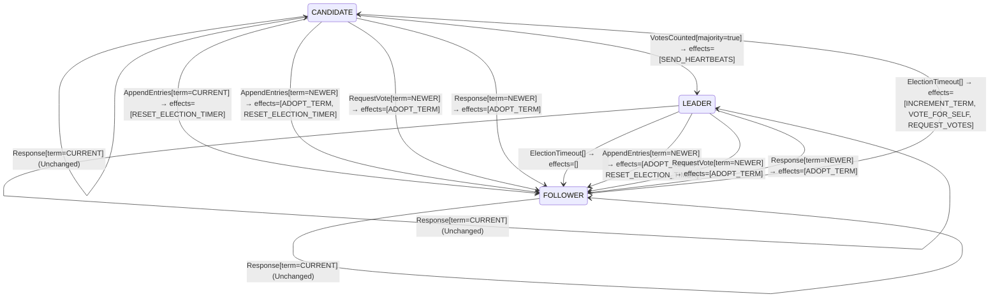

<!-- Generated by examples/tools/build.py from example.json and the verifier's output. Edit example.json. -->
# 061 · A leader that steps down when its timer fires, proved to keep one leader per term

[← All examples](../README.md)

| Verdict | Categories | Severity if shipped | Change | Verified unit | Approach |
|---|---|---|---|---|---|
| **✓ Verified: all invariants and properties hold in 1,153 states, and under 6 more configurations** | functional, no-false-positive | none | feature, behaviour change intended | [`RoleMachine#decide`](../../examples/apps/quorum/src/main/java/net/terminalvalue/quorum/raft/RoleMachine.java) | [D1: Protocol model checking](../../examples/apps/quorum/spec/README.md) |

> A Raft leader cut off from the majority keeps believing it leads, and keeps serving reads from a state the rest of the cluster has moved past, until some message from the newer term reaches it. A developer adds the check etcd calls CheckQuorum: a leader whose election timer fires, meaning no majority acknowledged it for a whole timeout, steps down to follower. The contract diff is one case and is approved. The election model proves the change keeps every invariant and both action properties, in 1,153 states: one leader per term, terms that never go backwards, and no leader that campaigns.

Tags: [consensus](../README.md#tag-consensus), [leader-election](../README.md#tag-leader-election), [agreement](../README.md#tag-agreement), [tla-action-property](../README.md#tag-tla-action-property), [generated-operator](../README.md#tag-generated-operator), [multiple-configurations](../README.md#tag-multiple-configurations)

## The change

In the `ElectionTimeout` case, make a `LEADER` transition to `FOLLOWER`, with no effects: it keeps its term and its vote, and its timer now runs as a follower's, so that it will run for office again if no leader is heard from. The reasoning in the comment: a leader whose timer fires has not heard from a majority in a whole timeout and may be partitioned away from a cluster that has elected a successor; stepping down stops it from serving stale reads. The behavioural contract is regenerated and its diff is the one case `decide(LEADER, ElectionTimeout[])`, unchanged to a transition; a test for it is added. The reviewer approves the diff.

**Before** ([`RoleMachine.java`](../../examples/apps/quorum/src/main/java/net/terminalvalue/quorum/raft/RoleMachine.java), line 37):

```java
return switch (event) {
    case ElectionTimeout _ -> switch (role) {
        case FOLLOWER, CANDIDATE -> transition(CANDIDATE, INCREMENT_TERM, VOTE_FOR_SELF, REQUEST_VOTES);
        case LEADER -> unchanged("a leader does not hold elections");
    };
    case VotesCounted votes -> switch (role) {
        case CANDIDATE -> votes.majority() ? transition(LEADER, SEND_HEARTBEATS) : unchanged("no majority yet");
```

**After:**

```java
return switch (event) {
    case ElectionTimeout _ -> switch (role) {
        case FOLLOWER, CANDIDATE -> transition(CANDIDATE, INCREMENT_TERM, VOTE_FOR_SELF, REQUEST_VOTES);
        // A leader whose election timer fires has not heard from a majority in a whole timeout: it may be
        // cut off from a cluster that has elected another leader, and must not keep serving reads as if
        // it still led. Step down, and let the timer run as a follower's.
        case LEADER -> transition(FOLLOWER);
    };
    case VotesCounted votes -> switch (role) {
        case CANDIDATE -> votes.majority() ? transition(LEADER, SEND_HEARTBEATS) : unchanged("no majority yet");
```

<details><summary>Patch</summary>

```diff
--- a/examples/apps/quorum/src/main/java/net/terminalvalue/quorum/raft/RoleMachine.java
+++ b/examples/apps/quorum/src/main/java/net/terminalvalue/quorum/raft/RoleMachine.java
@@ -37,7 +37,10 @@
         return switch (event) {
             case ElectionTimeout _ -> switch (role) {
                 case FOLLOWER, CANDIDATE -> transition(CANDIDATE, INCREMENT_TERM, VOTE_FOR_SELF, REQUEST_VOTES);
-                case LEADER -> unchanged("a leader does not hold elections");
+                // A leader whose election timer fires has not heard from a majority in a whole timeout: it may be
+                // cut off from a cluster that has elected another leader, and must not keep serving reads as if
+                // it still led. Step down, and let the timer run as a follower's.
+                case LEADER -> transition(FOLLOWER);
             };
             case VotesCounted votes -> switch (role) {
                 case CANDIDATE -> votes.majority() ? transition(LEADER, SEND_HEARTBEATS) : unchanged("no majority yet");
--- a/examples/apps/quorum/src/test/java/net/terminalvalue/quorum/raft/RoleMachineTest.java
+++ b/examples/apps/quorum/src/test/java/net/terminalvalue/quorum/raft/RoleMachineTest.java
@@ -32,6 +32,10 @@
                 RoleMachine.decide(Role.LEADER, new RoleEvent.AppendEntries(TermOrder.NEWER)));
     }
 
+    public static void leaderStepsDownWhenItsTimerFires() {
+        equal(new Transition<Role, RoleEffect>(Role.FOLLOWER, List.of()), RoleMachine.decide(Role.LEADER, new RoleEvent.ElectionTimeout()));
+    }
+
     public static void staleLeaderIsRejected() {
         check(RoleMachine.decide(Role.FOLLOWER, new RoleEvent.AppendEntries(TermOrder.OLDER)) instanceof Decision.Rejected, "stale");
     }
```

</details>

## What the verifier found

The model is checked under 7 configurations, and the verdict is the first that fails:

| Configuration | What it checks | Model | Result |
|---|---|---|---|
| three servers (`spec/RaftElection.cfg`) | every run from the initial state, every interleaving within the configuration's bounds | Servers = {s1, s2, s3}, MaxTerm = 3, LeftBehind = {}, DelayedReplies = FALSE, History = FALSE | ✓ Verified: all invariants and properties hold in 1,153 states |
| the inductive step (`spec/RaftElectionInductive.cfg`) | that the invariant `Inductive` is inductive: TLC starts from every state the invariant admits, reachable or not, rather than from the initial state, takes one step, and checks the invariant again, conjunct by conjunct. No counterexample is a proof of election safety by induction, for any run of the cluster however long; a counterexample is one step from a state that need not be reachable | Servers = {s1, s2, s3}, MaxTerm = 3, LeftBehind = {}, DelayedReplies = FALSE, History = FALSE | ✓ Verified: all invariants and properties hold in 17,470 states |
| four servers (`spec/RaftElectionFour.cfg`) | every run with four servers, a cluster in which a candidate can hold a vote besides its own and still be short of a majority, which three servers never show; under a symmetry set, so that of the states that differ only by the servers' names TLC explores one | Servers = {s1, s2, s3, s4}, MaxTerm = 3, LeftBehind = {}, DelayedReplies = FALSE, History = FALSE | ✓ Verified: all invariants and properties hold in 1,101 states |
| fairness (`spec/RaftElectionLive.cfg`) | the two liveness properties, under the fairness conditions `Fairness`: a server whose timer nothing resets times out, a candidate asks for the votes it lacks, a leader sends its heartbeats. A counterexample is a run that goes on forever without satisfying a property: a prefix, then a state or a cycle the system never leaves | Servers = {s1, s2, s3}, MaxTerm = 3, LeftBehind = {}, DelayedReplies = FALSE, History = FALSE | ✓ Verified: all invariants and properties hold in 1,153 states |
| a server left behind (`spec/RaftElectionLogs.cfg`) | the election restriction: one server holds the log a deposed leader of term 1 left behind, three entries of its term, while the other two hold an entry of term 2 that a majority holds and is therefore committed, so that the longer log is the one behind; every run with these logs, which nothing changes, under the invariant `LeaderCompleteness` besides the usual ones | Servers = {s1, s2, s3}, MaxTerm = 3, LeftBehind = {s1}, DelayedReplies = FALSE, History = FALSE | ✓ Verified: all invariants and properties hold in 792 states |
| delayed replies (`spec/RaftElectionDelayed.cfg`) | every run of three servers and two terms in which the reply to a vote request is a step of its own, which the candidate may take after it has timed out into a newer term, stepped down, or won; the one-step RPC of the other configurations never hands the role machine a reply from an older term than the server's own, and this one does, under the usual invariants and action properties | Servers = {s1, s2, s3}, MaxTerm = 2, LeftBehind = {}, DelayedReplies = TRUE, History = FALSE | ✓ Verified: all invariants and properties hold in 21,680 states |
| history (`spec/RaftElectionHistory.cfg`) | every run of three servers and three terms with the two history variables recording, `elected`, every term a server has led, and `voted`, every vote cast, under the two invariants that are about a run rather than a state: at most one leader elected per term and at most one vote per server per term, as the paper states them. The state invariants of the other configurations hold in a run in which a term's leader steps down and the term then elects another; these do not | Servers = {s1, s2, s3}, MaxTerm = 3, LeftBehind = {}, DelayedReplies = FALSE, History = TRUE | ✓ Verified: all invariants hold in 13,918 states |

Every invariant holds in every reachable state of the model, and every temporal property holds of every behaviour, the infinite ones included under three servers: 1,153 distinct states, which is every interleaving of the servers, their terms and votes, and the RPCs between them within the model's bounds (Servers = {s1, s2, s3}, MaxTerm = 3, LeftBehind = {}, DelayedReplies = FALSE, History = FALSE).

The servers' role machine and vote rule inside the model are generated from the behavioural contracts of the patched code, so the model checks the role transitions the servers really make and the votes they really grant.

The other configurations hold too, as the table says: the inductive step, 17,470 states; four servers, 1,101 states; fairness, 1,153 states; a server left behind, 792 states; delayed replies, 21,680 states; history, 13,918 states.

**What the verdict rests on.** TLC counted how often a step of the model took each row of the generated operators. A row no step takes is one the model says nothing about, whatever the verdict.

| Configuration | Rows of `RoleMachine#decide` taken | Rows of `VoteRule#decide` taken |
|---|---|---|
| three servers | 27 of 36 | 4 of 27 |
| the inductive step (from the states the invariant admits, not from a run) | 27 of 36 | 6 of 27 |
| four servers | 27 of 36 | 4 of 27 |
| fairness | 27 of 36 | 4 of 27 |
| a server left behind | 27 of 36 | 12 of 27 |
| delayed replies | 34 of 36 | 4 of 27 |
| history | 27 of 36 | 4 of 27 |

The change alters 1 row of the contract:

- `decide(LEADER, ElectionTimeout[])`: `Unchanged[reason="a leader does not hold elections"]` → `Transition[next=FOLLOWER, effects=[]]`, taken under three servers, the inductive step, four servers, fairness, a server left behind, delayed replies, history

Runs of the model take every row the change alters: the verdict rests on the change.

<details><summary>Rows no step takes under three servers</summary>

`net.terminalvalue.quorum.raft.RoleMachine#decide`:

```
decide(FOLLOWER, VotesCounted[majority=true]) => Unchanged
decide(FOLLOWER, Response[term=OLDER]) => Unchanged
decide(FOLLOWER, Response[term=CURRENT]) => Unchanged
decide(FOLLOWER, Response[term=NEWER]) => Transition[next=FOLLOWER, effects=[ADOPT_TERM]]
decide(CANDIDATE, Response[term=OLDER]) => Unchanged
decide(LEADER, VotesCounted[majority=false]) => Unchanged
decide(LEADER, VotesCounted[majority=true]) => Unchanged
decide(LEADER, AppendEntries[term=CURRENT]) => throws IllegalStateException
decide(LEADER, Response[term=OLDER]) => Unchanged
```

`net.terminalvalue.quorum.raft.VoteRule#decide`:

```
decide(OPEN, VoteRequest[term=OLDER, log=BEHIND]) => Rejected
decide(OPEN, VoteRequest[term=OLDER, log=AHEAD]) => Rejected
decide(OPEN, VoteRequest[term=CURRENT, log=BEHIND]) => Rejected
decide(OPEN, VoteRequest[term=CURRENT, log=AHEAD]) => Transition[next=FOR_THE_CANDIDATE, effects=[GRANT]]
decide(OPEN, VoteRequest[term=NEWER, log=BEHIND]) => Rejected
decide(OPEN, VoteRequest[term=NEWER, log=EVEN]) => Transition[next=FOR_THE_CANDIDATE, effects=[GRANT]]
decide(OPEN, VoteRequest[term=NEWER, log=AHEAD]) => Transition[next=FOR_THE_CANDIDATE, effects=[GRANT]]
decide(FOR_THE_CANDIDATE, VoteRequest[term=OLDER, log=BEHIND]) => Rejected
decide(FOR_THE_CANDIDATE, VoteRequest[term=OLDER, log=EVEN]) => Rejected
decide(FOR_THE_CANDIDATE, VoteRequest[term=OLDER, log=AHEAD]) => Rejected
decide(FOR_THE_CANDIDATE, VoteRequest[term=CURRENT, log=BEHIND]) => Rejected
decide(FOR_THE_CANDIDATE, VoteRequest[term=CURRENT, log=EVEN]) => Transition[next=FOR_THE_CANDIDATE, effects=[GRANT]]
decide(FOR_THE_CANDIDATE, VoteRequest[term=CURRENT, log=AHEAD]) => Transition[next=FOR_THE_CANDIDATE, effects=[GRANT]]
decide(FOR_THE_CANDIDATE, VoteRequest[term=NEWER, log=BEHIND]) => Rejected
decide(FOR_THE_CANDIDATE, VoteRequest[term=NEWER, log=EVEN]) => Transition[next=FOR_THE_CANDIDATE, effects=[GRANT]]
decide(FOR_THE_CANDIDATE, VoteRequest[term=NEWER, log=AHEAD]) => Transition[next=FOR_THE_CANDIDATE, effects=[GRANT]]
decide(FOR_ANOTHER, VoteRequest[term=OLDER, log=BEHIND]) => Rejected
decide(FOR_ANOTHER, VoteRequest[term=OLDER, log=AHEAD]) => Rejected
decide(FOR_ANOTHER, VoteRequest[term=CURRENT, log=BEHIND]) => Rejected
decide(FOR_ANOTHER, VoteRequest[term=CURRENT, log=AHEAD]) => Rejected
decide(FOR_ANOTHER, VoteRequest[term=NEWER, log=BEHIND]) => Rejected
decide(FOR_ANOTHER, VoteRequest[term=NEWER, log=EVEN]) => Transition[next=FOR_THE_CANDIDATE, effects=[GRANT]]
decide(FOR_ANOTHER, VoteRequest[term=NEWER, log=AHEAD]) => Transition[next=FOR_THE_CANDIDATE, effects=[GRANT]]
```

</details>

The state machine the patched code implements, drawn from its derived contract (`jvmcontract statemachine`); a state with no way in or no way out is marked:



## Would the existing tests have caught it?

Every existing unit test passes, as it should (`java -ea net.terminalvalue.quorum.Tests`, run against the patched code).

## Why it matters

A leader that leaves office on a timer is a new way for the cluster to lose its leader, and the question for the reviewer is whether it is also a new way to get two. It is not, and the model shows why: the server steps down in its own term, with its vote still recorded, so it can neither be elected nor elect anyone in that term, and a new term needs an election the old leader takes part in as a follower. The change is the one example 060 should have made: stepping down to follower is safe where resigning into a candidacy is not. Since the change is a disabled case made live, the risk the model rules out is a design risk, not a slip.

## Why the verdict is right

The election model's role machine is generated from the behavioural contract of the patched `RoleMachine#decide`, which the tool proves the bytecode satisfies on all 52 inputs. TLC checks every interleaving of three servers over three terms: the timers fire whenever the model likes, so the new step-down happens at every point at which a leader exists, including while a candidate of a newer term is canvassing and while the stepped-down leader's heartbeats are still being answered. It finds every invariant true in all 1,153 reachable states (up from 610, since a leader can now become a follower of its own term, a state the committed rule never reaches) and both action properties true on every step: `TermsNeverDecrease`, and `LeadersNeverCampaign`, which the step from leader to follower satisfies. Nothing in the model assumes the step-down happens for a reason; a leader with a healthy majority that steps down is as safe as one that was partitioned, just less available.

## What to do

Merge. The property the model does not check is availability: a leader that steps down needlessly costs an election, which is why etcd makes the check depend on acknowledgements from a majority rather than on the timer alone, and why the timeout should be a full election timeout rather than a heartbeat interval. That is a tuning question the model has nothing to say about; what it says is that no tuning of it can produce two leaders.

## Notes

- The Raft election model (`apps/quorum/spec/RaftElection.tla`) is built around the role machine, generated from its contract, with election safety as an invariant and two action properties, `[][A]_v` formulas that constrain each step: terms never decrease, a leader never campaigns. An example is checked under all of the model's configurations, and its verdict is the first that fails.

## Evidence

How the verdict was reached: three servers: TLC 2.19 explored 1,153 distinct states to depth 10 in 1 s, for the model Servers = {s1, s2, s3}, MaxTerm = 3, LeftBehind = {}, DelayedReplies = FALSE, History = FALSE; the inductive step: TLC 2.19 explored 17,470 distinct states to depth 1 in 8 s, for the model Servers = {s1, s2, s3}, MaxTerm = 3, LeftBehind = {}, DelayedReplies = FALSE, History = FALSE; four servers: TLC 2.19 explored 1,101 distinct states to depth 12 in 1 s, for the model Servers = {s1, s2, s3, s4}, MaxTerm = 3, LeftBehind = {}, DelayedReplies = FALSE, History = FALSE; fairness: TLC 2.19 explored 1,153 distinct states to depth 10 in 6 s, for the model Servers = {s1, s2, s3}, MaxTerm = 3, LeftBehind = {}, DelayedReplies = FALSE, History = FALSE; a server left behind: TLC 2.19 explored 792 distinct states to depth 10 in 1 s, for the model Servers = {s1, s2, s3}, MaxTerm = 3, LeftBehind = {s1}, DelayedReplies = FALSE, History = FALSE; delayed replies: TLC 2.19 explored 21,680 distinct states to depth 14 in 7 s, for the model Servers = {s1, s2, s3}, MaxTerm = 2, LeftBehind = {}, DelayedReplies = TRUE, History = FALSE; history: TLC 2.19 explored 13,918 distinct states to depth 13 in 3 s, for the model Servers = {s1, s2, s3}, MaxTerm = 3, LeftBehind = {}, DelayedReplies = FALSE, History = TRUE.

<details><summary>Verifier output</summary>

```text
== three servers: spec/RaftElection.cfg ==
TLC2 Version 2.19 of 08 August 2024 (rev: 5a47802)
Running breadth-first search Model-Checking with fp 1 and seed 1 with 1 worker on 8 cores with 910MB heap and 64MB offheap memory [pid: 2621041] (Linux 6.6.87.2-microsoft-standard-WSL2 aarch64, Eclipse Adoptium 25.0.4.1 x86_64, MSBDiskFPSet, DiskStateQueue).
Parsing file examples/apps/quorum/spec/RaftElection.tla
Parsing file examples/tools/tla/standard-modules/Naturals.tla
Parsing file examples/tools/tla/standard-modules/FiniteSets.tla
Parsing file examples/tools/tla/standard-modules/Sequences.tla
Parsing file examples/tools/tla/standard-modules/TLC.tla
Parsing file examples/apps/quorum/spec/RoleMachineContract.tla
Parsing file examples/apps/quorum/spec/VoteRuleContract.tla
Semantic processing of module Naturals
Semantic processing of module Sequences
Semantic processing of module FiniteSets
Semantic processing of module TLC
Semantic processing of module RoleMachineContract
Semantic processing of module VoteRuleContract
Semantic processing of module RaftElection
Starting... (2026-11-02 03:37:27)
Computing initial states...
Finished computing initial states: 1 distinct state generated at 2026-11-02 03:37:27.
Model checking completed. No error has been found.
  Estimates of the probability that TLC did not check all reachable states
  because two distinct states had the same fingerprint:
  calculated (optimistic):  val = 2.9E-13
Rows of net.terminalvalue.quorum.raft.RoleMachine#decide a step of the model takes: 27 of 36; never taken (9):
  decide(FOLLOWER, VotesCounted[majority=true]) => Unchanged
  decide(FOLLOWER, Response[term=OLDER]) => Unchanged
  decide(FOLLOWER, Response[term=CURRENT]) => Unchanged
  decide(FOLLOWER, Response[term=NEWER]) => Transition[next=FOLLOWER, effects=[ADOPT_TERM]]
  decide(CANDIDATE, Response[term=OLDER]) => Unchanged
  decide(LEADER, VotesCounted[majority=false]) => Unchanged
  decide(LEADER, VotesCounted[majority=true]) => Unchanged
  decide(LEADER, AppendEntries[term=CURRENT]) => throws IllegalStateException
  decide(LEADER, Response[term=OLDER]) => Unchanged
Rows of net.terminalvalue.quorum.raft.VoteRule#decide a step of the model takes: 4 of 27; never taken (23):
  decide(OPEN, VoteRequest[term=OLDER, log=BEHIND]) => Rejected
  decide(OPEN, VoteRequest[term=OLDER, log=AHEAD]) => Rejected
  decide(OPEN, VoteRequest[term=CURRENT, log=BEHIND]) => Rejected
  decide(OPEN, VoteRequest[term=CURRENT, log=AHEAD]) => Transition[next=FOR_THE_CANDIDATE, effects=[GRANT]]
  decide(OPEN, VoteRequest[term=NEWER, log=BEHIND]) => Rejected
  decide(OPEN, VoteRequest[term=NEWER, log=EVEN]) => Transition[next=FOR_THE_CANDIDATE, effects=[GRANT]]
  decide(OPEN, VoteRequest[term=NEWER, log=AHEAD]) => Transition[next=FOR_THE_CANDIDATE, effects=[GRANT]]
  decide(FOR_THE_CANDIDATE, VoteRequest[term=OLDER, log=BEHIND]) => Rejected
  decide(FOR_THE_CANDIDATE, VoteRequest[term=OLDER, log=EVEN]) => Rejected
  decide(FOR_THE_CANDIDATE, VoteRequest[term=OLDER, log=AHEAD]) => Rejected
  decide(FOR_THE_CANDIDATE, VoteRequest[term=CURRENT, log=BEHIND]) => Rejected
  decide(FOR_THE_CANDIDATE, VoteRequest[term=CURRENT, log=EVEN]) => Transition[next=FOR_THE_CANDIDATE, effects=[GRANT]]
  decide(FOR_THE_CANDIDATE, VoteRequest[term=CURRENT, log=AHEAD]) => Transition[next=FOR_THE_CANDIDATE, effects=[GRANT]]
  decide(FOR_THE_CANDIDATE, VoteRequest[term=NEWER, log=BEHIND]) => Rejected
  decide(FOR_THE_CANDIDATE, VoteRequest[term=NEWER, log=EVEN]) => Transition[next=FOR_THE_CANDIDATE, effects=[GRANT]]
  decide(FOR_THE_CANDIDATE, VoteRequest[term=NEWER, log=AHEAD]) => Transition[next=FOR_THE_CANDIDATE, effects=[GRANT]]
  decide(FOR_ANOTHER, VoteRequest[term=OLDER, log=BEHIND]) => Rejected
  decide(FOR_ANOTHER, VoteRequest[term=OLDER, log=AHEAD]) => Rejected
  decide(FOR_ANOTHER, VoteRequest[term=CURRENT, log=BEHIND]) => Rejected
  decide(FOR_ANOTHER, VoteRequest[term=CURRENT, log=AHEAD]) => Rejected
  decide(FOR_ANOTHER, VoteRequest[term=NEWER, log=BEHIND]) => Rejected
  decide(FOR_ANOTHER, VoteRequest[term=NEWER, log=EVEN]) => Transition[next=FOR_THE_CANDIDATE, effects=[GRANT]]
  decide(FOR_ANOTHER, VoteRequest[term=NEWER, log=AHEAD]) => Transition[next=FOR_THE_CANDIDATE, effects=[GRANT]]
5779 states generated, 1153 distinct states found, 0 states left on queue.
The depth of the complete state graph search is 10.
The average outdegree of the complete state graph is 1 (minimum is 0, the maximum 5 and the 95th percentile is 3).
Finished in 01s at (2026-11-02 03:37:28)

== the inductive step: spec/RaftElectionInductive.cfg ==
TLC2 Version 2.19 of 08 August 2024 (rev: 5a47802)
Running breadth-first search Model-Checking with fp 1 and seed 1 with 1 worker on 8 cores with 910MB heap and 64MB offheap memory [pid: 2621146] (Linux 6.6.87.2-microsoft-standard-WSL2 aarch64, Eclipse Adoptium 25.0.4.1 x86_64, MSBDiskFPSet, DiskStateQueue).
Parsing file examples/apps/quorum/spec/RaftElection.tla
Parsing file examples/tools/tla/standard-modules/Naturals.tla
Parsing file examples/tools/tla/standard-modules/FiniteSets.tla
Parsing file examples/tools/tla/standard-modules/Sequences.tla
Parsing file examples/tools/tla/standard-modules/TLC.tla
Parsing file examples/apps/quorum/spec/RoleMachineContract.tla
Parsing file examples/apps/quorum/spec/VoteRuleContract.tla
Semantic processing of module Naturals
Semantic processing of module Sequences
Semantic processing of module FiniteSets
Semantic processing of module TLC
Semantic processing of module RoleMachineContract
Semantic processing of module VoteRuleContract
Semantic processing of module RaftElection
Starting... (2026-11-02 03:37:29)
Computing initial states...
Computed 2 initial states...
Computed 4 initial states...
Computed 8 initial states...
Computed 16 initial states...
Computed 32 initial states...
Computed 64 initial states...
Computed 128 initial states...
Computed 256 initial states...
Computed 512 initial states...
Computed 1024 initial states...
Computed 2048 initial states...
Computed 4096 initial states...
Computed 8192 initial states...
Computed 16384 initial states...
Finished computing initial states: 17470 distinct states generated at 2026-11-02 03:37:34.
Model checking completed. No error has been found.
  Estimates of the probability that TLC did not check all reachable states
  because two distinct states had the same fingerprint:
  calculated (optimistic):  val = 5.6E-11
Rows of net.terminalvalue.quorum.raft.RoleMachine#decide a step of the model takes: 27 of 36; never taken (9):
  decide(FOLLOWER, VotesCounted[majority=true]) => Unchanged
  decide(FOLLOWER, Response[term=OLDER]) => Unchanged
  decide(FOLLOWER, Response[term=CURRENT]) => Unchanged
  decide(FOLLOWER, Response[term=NEWER]) => Transition[next=FOLLOWER, effects=[ADOPT_TERM]]
  decide(CANDIDATE, Response[term=OLDER]) => Unchanged
  decide(LEADER, VotesCounted[majority=false]) => Unchanged
  decide(LEADER, VotesCounted[majority=true]) => Unchanged
  decide(LEADER, AppendEntries[term=CURRENT]) => throws IllegalStateException
  decide(LEADER, Response[term=OLDER]) => Unchanged
Rows of net.terminalvalue.quorum.raft.VoteRule#decide a step of the model takes: 6 of 27; never taken (21):
  decide(OPEN, VoteRequest[term=OLDER, log=BEHIND]) => Rejected
  decide(OPEN, VoteRequest[term=OLDER, log=AHEAD]) => Rejected
  decide(OPEN, VoteRequest[term=CURRENT, log=BEHIND]) => Rejected
  decide(OPEN, VoteRequest[term=CURRENT, log=AHEAD]) => Transition[next=FOR_THE_CANDIDATE, effects=[GRANT]]
  decide(OPEN, VoteRequest[term=NEWER, log=BEHIND]) => Rejected
  decide(OPEN, VoteRequest[term=NEWER, log=EVEN]) => Transition[next=FOR_THE_CANDIDATE, effects=[GRANT]]
  decide(OPEN, VoteRequest[term=NEWER, log=AHEAD]) => Transition[next=FOR_THE_CANDIDATE, effects=[GRANT]]
  decide(FOR_THE_CANDIDATE, VoteRequest[term=OLDER, log=BEHIND]) => Rejected
  decide(FOR_THE_CANDIDATE, VoteRequest[term=OLDER, log=AHEAD]) => Rejected
  decide(FOR_THE_CANDIDATE, VoteRequest[term=CURRENT, log=BEHIND]) => Rejected
  decide(FOR_THE_CANDIDATE, VoteRequest[term=CURRENT, log=AHEAD]) => Transition[next=FOR_THE_CANDIDATE, effects=[GRANT]]
  decide(FOR_THE_CANDIDATE, VoteRequest[term=NEWER, log=BEHIND]) => Rejected
  decide(FOR_THE_CANDIDATE, VoteRequest[term=NEWER, log=EVEN]) => Transition[next=FOR_THE_CANDIDATE, effects=[GRANT]]
  decide(FOR_THE_CANDIDATE, VoteRequest[term=NEWER, log=AHEAD]) => Transition[next=FOR_THE_CANDIDATE, effects=[GRANT]]
  decide(FOR_ANOTHER, VoteRequest[term=OLDER, log=BEHIND]) => Rejected
  decide(FOR_ANOTHER, VoteRequest[term=OLDER, log=AHEAD]) => Rejected
  decide(FOR_ANOTHER, VoteRequest[term=CURRENT, log=BEHIND]) => Rejected
  decide(FOR_ANOTHER, VoteRequest[term=CURRENT, log=AHEAD]) => Rejected
  decide(FOR_ANOTHER, VoteRequest[term=NEWER, log=BEHIND]) => Rejected
  decide(FOR_ANOTHER, VoteRequest[term=NEWER, log=EVEN]) => Transition[next=FOR_THE_CANDIDATE, effects=[GRANT]]
  decide(FOR_ANOTHER, VoteRequest[term=NEWER, log=AHEAD]) => Transition[next=FOR_THE_CANDIDATE, effects=[GRANT]]
76099 states generated, 17470 distinct states found, 0 states left on queue.
The depth of the complete state graph search is 1.
The average outdegree of the complete state graph is 0 (minimum is 0, the maximum 0 and the 95th percentile is 0).
Finished in 08s at (2026-11-02 03:37:37)

== four servers: spec/RaftElectionFour.cfg ==
TLC2 Version 2.19 of 08 August 2024 (rev: 5a47802)
Running breadth-first search Model-Checking with fp 1 and seed 1 with 1 worker on 8 cores with 910MB heap and 64MB offheap memory [pid: 2621586] (Linux 6.6.87.2-microsoft-standard-WSL2 aarch64, Eclipse Adoptium 25.0.4.1 x86_64, MSBDiskFPSet, DiskStateQueue).
Parsing file examples/apps/quorum/spec/RaftElection.tla
Parsing file examples/tools/tla/standard-modules/Naturals.tla
Parsing file examples/tools/tla/standard-modules/FiniteSets.tla
Parsing file examples/tools/tla/standard-modules/Sequences.tla
Parsing file examples/tools/tla/standard-modules/TLC.tla
Parsing file examples/apps/quorum/spec/RoleMachineContract.tla
Parsing file examples/apps/quorum/spec/VoteRuleContract.tla
Semantic processing of module Naturals
Semantic processing of module Sequences
Semantic processing of module FiniteSets
Semantic processing of module TLC
Semantic processing of module RoleMachineContract
Semantic processing of module VoteRuleContract
Semantic processing of module RaftElection
Starting... (2026-11-02 03:37:37)
Computing initial states...
Finished computing initial states: 1 distinct state generated at 2026-11-02 03:37:38.
Model checking completed. No error has been found.
  Estimates of the probability that TLC did not check all reachable states
  because two distinct states had the same fingerprint:
  calculated (optimistic):  val = 4.7E-13
Rows of net.terminalvalue.quorum.raft.RoleMachine#decide a step of the model takes: 27 of 36; never taken (9):
  decide(FOLLOWER, VotesCounted[majority=true]) => Unchanged
  decide(FOLLOWER, Response[term=OLDER]) => Unchanged
  decide(FOLLOWER, Response[term=CURRENT]) => Unchanged
  decide(FOLLOWER, Response[term=NEWER]) => Transition[next=FOLLOWER, effects=[ADOPT_TERM]]
  decide(CANDIDATE, Response[term=OLDER]) => Unchanged
  decide(LEADER, VotesCounted[majority=false]) => Unchanged
  decide(LEADER, VotesCounted[majority=true]) => Unchanged
  decide(LEADER, AppendEntries[term=CURRENT]) => throws IllegalStateException
  decide(LEADER, Response[term=OLDER]) => Unchanged
Rows of net.terminalvalue.quorum.raft.VoteRule#decide a step of the model takes: 4 of 27; never taken (23):
  decide(OPEN, VoteRequest[term=OLDER, log=BEHIND]) => Rejected
  decide(OPEN, VoteRequest[term=OLDER, log=AHEAD]) => Rejected
  decide(OPEN, VoteRequest[term=CURRENT, log=BEHIND]) => Rejected
  decide(OPEN, VoteRequest[term=CURRENT, log=AHEAD]) => Transition[next=FOR_THE_CANDIDATE, effects=[GRANT]]
  decide(OPEN, VoteRequest[term=NEWER, log=BEHIND]) => Rejected
  decide(OPEN, VoteRequest[term=NEWER, log=EVEN]) => Transition[next=FOR_THE_CANDIDATE, effects=[GRANT]]
  decide(OPEN, VoteRequest[term=NEWER, log=AHEAD]) => Transition[next=FOR_THE_CANDIDATE, effects=[GRANT]]
  decide(FOR_THE_CANDIDATE, VoteRequest[term=OLDER, log=BEHIND]) => Rejected
  decide(FOR_THE_CANDIDATE, VoteRequest[term=OLDER, log=EVEN]) => Rejected
  decide(FOR_THE_CANDIDATE, VoteRequest[term=OLDER, log=AHEAD]) => Rejected
  decide(FOR_THE_CANDIDATE, VoteRequest[term=CURRENT, log=BEHIND]) => Rejected
  decide(FOR_THE_CANDIDATE, VoteRequest[term=CURRENT, log=EVEN]) => Transition[next=FOR_THE_CANDIDATE, effects=[GRANT]]
  decide(FOR_THE_CANDIDATE, VoteRequest[term=CURRENT, log=AHEAD]) => Transition[next=FOR_THE_CANDIDATE, effects=[GRANT]]
  decide(FOR_THE_CANDIDATE, VoteRequest[term=NEWER, log=BEHIND]) => Rejected
  decide(FOR_THE_CANDIDATE, VoteRequest[term=NEWER, log=EVEN]) => Transition[next=FOR_THE_CANDIDATE, effects=[GRANT]]
  decide(FOR_THE_CANDIDATE, VoteRequest[term=NEWER, log=AHEAD]) => Transition[next=FOR_THE_CANDIDATE, effects=[GRANT]]
  decide(FOR_ANOTHER, VoteRequest[term=OLDER, log=BEHIND]) => Rejected
  decide(FOR_ANOTHER, VoteRequest[term=OLDER, log=AHEAD]) => Rejected
  decide(FOR_ANOTHER, VoteRequest[term=CURRENT, log=BEHIND]) => Rejected
  decide(FOR_ANOTHER, VoteRequest[term=CURRENT, log=AHEAD]) => Rejected
  decide(FOR_ANOTHER, VoteRequest[term=NEWER, log=BEHIND]) => Rejected
  decide(FOR_ANOTHER, VoteRequest[term=NEWER, log=EVEN]) => Transition[next=FOR_THE_CANDIDATE, effects=[GRANT]]
  decide(FOR_ANOTHER, VoteRequest[term=NEWER, log=AHEAD]) => Transition[next=FOR_THE_CANDIDATE, effects=[GRANT]]
9033 states generated, 1101 distinct states found, 0 states left on queue.
The depth of the complete state graph search is 12.
The average outdegree of the complete state graph is 1 (minimum is 0, the maximum 8 and the 95th percentile is 4).
Finished in 01s at (2026-11-02 03:37:39)

== fairness: spec/RaftElectionLive.cfg ==
TLC2 Version 2.19 of 08 August 2024 (rev: 5a47802)
Running breadth-first search Model-Checking with fp 1 and seed 1 with 1 worker on 8 cores with 910MB heap and 64MB offheap memory [pid: 2621721] (Linux 6.6.87.2-microsoft-standard-WSL2 aarch64, Eclipse Adoptium 25.0.4.1 x86_64, MSBDiskFPSet, DiskStateQueue).
Parsing file examples/apps/quorum/spec/RaftElection.tla
Parsing file examples/tools/tla/standard-modules/Naturals.tla
Parsing file examples/tools/tla/standard-modules/FiniteSets.tla
Parsing file examples/tools/tla/standard-modules/Sequences.tla
Parsing file examples/tools/tla/standard-modules/TLC.tla
Parsing file examples/apps/quorum/spec/RoleMachineContract.tla
Parsing file examples/apps/quorum/spec/VoteRuleContract.tla
Semantic processing of module Naturals
Semantic processing of module Sequences
Semantic processing of module FiniteSets
Semantic processing of module TLC
Semantic processing of module RoleMachineContract
Semantic processing of module VoteRuleContract
Semantic processing of module RaftElection
Starting... (2026-11-02 03:37:40)
Implied-temporal checking--satisfiability problem has 4 branches.
Computing initial states...
Finished computing initial states: 1 distinct state generated at 2026-11-02 03:37:40.
Checking 4 branches of temporal properties for the current state space with 3253 total distinct states at (2026-11-02 03:37:43)
Finished checking temporal properties in 00s at 2026-11-02 03:37:43
Checking 4 branches of temporal properties for the complete state space with 4612 total distinct states at (2026-11-02 03:37:45)
Finished checking temporal properties in 00s at 2026-11-02 03:37:45
Model checking completed. No error has been found.
  Estimates of the probability that TLC did not check all reachable states
  because two distinct states had the same fingerprint:
  calculated (optimistic):  val = 2.9E-13
Rows of net.terminalvalue.quorum.raft.RoleMachine#decide a step of the model takes: 27 of 36; never taken (9):
  decide(FOLLOWER, VotesCounted[majority=true]) => Unchanged
  decide(FOLLOWER, Response[term=OLDER]) => Unchanged
  decide(FOLLOWER, Response[term=CURRENT]) => Unchanged
  decide(FOLLOWER, Response[term=NEWER]) => Transition[next=FOLLOWER, effects=[ADOPT_TERM]]
  decide(CANDIDATE, Response[term=OLDER]) => Unchanged
  decide(LEADER, VotesCounted[majority=false]) => Unchanged
  decide(LEADER, VotesCounted[majority=true]) => Unchanged
  decide(LEADER, AppendEntries[term=CURRENT]) => throws IllegalStateException
  decide(LEADER, Response[term=OLDER]) => Unchanged
Rows of net.terminalvalue.quorum.raft.VoteRule#decide a step of the model takes: 4 of 27; never taken (23):
  decide(OPEN, VoteRequest[term=OLDER, log=BEHIND]) => Rejected
  decide(OPEN, VoteRequest[term=OLDER, log=AHEAD]) => Rejected
  decide(OPEN, VoteRequest[term=CURRENT, log=BEHIND]) => Rejected
  decide(OPEN, VoteRequest[term=CURRENT, log=AHEAD]) => Transition[next=FOR_THE_CANDIDATE, effects=[GRANT]]
  decide(OPEN, VoteRequest[term=NEWER, log=BEHIND]) => Rejected
  decide(OPEN, VoteRequest[term=NEWER, log=EVEN]) => Transition[next=FOR_THE_CANDIDATE, effects=[GRANT]]
  decide(OPEN, VoteRequest[term=NEWER, log=AHEAD]) => Transition[next=FOR_THE_CANDIDATE, effects=[GRANT]]
  decide(FOR_THE_CANDIDATE, VoteRequest[term=OLDER, log=BEHIND]) => Rejected
  decide(FOR_THE_CANDIDATE, VoteRequest[term=OLDER, log=EVEN]) => Rejected
  decide(FOR_THE_CANDIDATE, VoteRequest[term=OLDER, log=AHEAD]) => Rejected
  decide(FOR_THE_CANDIDATE, VoteRequest[term=CURRENT, log=BEHIND]) => Rejected
  decide(FOR_THE_CANDIDATE, VoteRequest[term=CURRENT, log=EVEN]) => Transition[next=FOR_THE_CANDIDATE, effects=[GRANT]]
  decide(FOR_THE_CANDIDATE, VoteRequest[term=CURRENT, log=AHEAD]) => Transition[next=FOR_THE_CANDIDATE, effects=[GRANT]]
  decide(FOR_THE_CANDIDATE, VoteRequest[term=NEWER, log=BEHIND]) => Rejected
  decide(FOR_THE_CANDIDATE, VoteRequest[term=NEWER, log=EVEN]) => Transition[next=FOR_THE_CANDIDATE, effects=[GRANT]]
  decide(FOR_THE_CANDIDATE, VoteRequest[term=NEWER, log=AHEAD]) => Transition[next=FOR_THE_CANDIDATE, effects=[GRANT]]
  decide(FOR_ANOTHER, VoteRequest[term=OLDER, log=BEHIND]) => Rejected
  decide(FOR_ANOTHER, VoteRequest[term=OLDER, log=AHEAD]) => Rejected
  decide(FOR_ANOTHER, VoteRequest[term=CURRENT, log=BEHIND]) => Rejected
  decide(FOR_ANOTHER, VoteRequest[term=CURRENT, log=AHEAD]) => Rejected
  decide(FOR_ANOTHER, VoteRequest[term=NEWER, log=BEHIND]) => Rejected
  decide(FOR_ANOTHER, VoteRequest[term=NEWER, log=EVEN]) => Transition[next=FOR_THE_CANDIDATE, effects=[GRANT]]
  decide(FOR_ANOTHER, VoteRequest[term=NEWER, log=AHEAD]) => Transition[next=FOR_THE_CANDIDATE, effects=[GRANT]]
5779 states generated, 1153 distinct states found, 0 states left on queue.
The depth of the complete state graph search is 10.
The average outdegree of the complete state graph is 1 (minimum is 0, the maximum 5 and the 95th percentile is 3).
Finished in 06s at (2026-11-02 03:37:45)

== a server left behind: spec/RaftElectionLogs.cfg ==
TLC2 Version 2.19 of 08 August 2024 (rev: 5a47802)
Running breadth-first search Model-Checking with fp 1 and seed 1 with 1 worker on 8 cores with 910MB heap and 64MB offheap memory [pid: 2622062] (Linux 6.6.87.2-microsoft-standard-WSL2 aarch64, Eclipse Adoptium 25.0.4.1 x86_64, MSBDiskFPSet, DiskStateQueue).
Parsing file examples/apps/quorum/spec/RaftElection.tla
Parsing file examples/tools/tla/standard-modules/Naturals.tla
Parsing file examples/tools/tla/standard-modules/FiniteSets.tla
Parsing file examples/tools/tla/standard-modules/Sequences.tla
Parsing file examples/tools/tla/standard-modules/TLC.tla
Parsing file examples/apps/quorum/spec/RoleMachineContract.tla
Parsing file examples/apps/quorum/spec/VoteRuleContract.tla
Semantic processing of module Naturals
Semantic processing of module Sequences
Semantic processing of module FiniteSets
Semantic processing of module TLC
Semantic processing of module RoleMachineContract
Semantic processing of module VoteRuleContract
Semantic processing of module RaftElection
Starting... (2026-11-02 03:37:46)
Computing initial states...
Finished computing initial states: 1 distinct state generated at 2026-11-02 03:37:47.
Model checking completed. No error has been found.
  Estimates of the probability that TLC did not check all reachable states
  because two distinct states had the same fingerprint:
  calculated (optimistic):  val = 1.4E-13
Rows of net.terminalvalue.quorum.raft.RoleMachine#decide a step of the model takes: 27 of 36; never taken (9):
  decide(FOLLOWER, VotesCounted[majority=true]) => Unchanged
  decide(FOLLOWER, Response[term=OLDER]) => Unchanged
  decide(FOLLOWER, Response[term=CURRENT]) => Unchanged
  decide(FOLLOWER, Response[term=NEWER]) => Transition[next=FOLLOWER, effects=[ADOPT_TERM]]
  decide(CANDIDATE, Response[term=OLDER]) => Unchanged
  decide(LEADER, VotesCounted[majority=false]) => Unchanged
  decide(LEADER, VotesCounted[majority=true]) => Unchanged
  decide(LEADER, AppendEntries[term=CURRENT]) => throws IllegalStateException
  decide(LEADER, Response[term=OLDER]) => Unchanged
Rows of net.terminalvalue.quorum.raft.VoteRule#decide a step of the model takes: 12 of 27; never taken (15):
  decide(OPEN, VoteRequest[term=NEWER, log=BEHIND]) => Rejected
  decide(OPEN, VoteRequest[term=NEWER, log=EVEN]) => Transition[next=FOR_THE_CANDIDATE, effects=[GRANT]]
  decide(OPEN, VoteRequest[term=NEWER, log=AHEAD]) => Transition[next=FOR_THE_CANDIDATE, effects=[GRANT]]
  decide(FOR_THE_CANDIDATE, VoteRequest[term=OLDER, log=BEHIND]) => Rejected
  decide(FOR_THE_CANDIDATE, VoteRequest[term=OLDER, log=EVEN]) => Rejected
  decide(FOR_THE_CANDIDATE, VoteRequest[term=OLDER, log=AHEAD]) => Rejected
  decide(FOR_THE_CANDIDATE, VoteRequest[term=CURRENT, log=BEHIND]) => Rejected
  decide(FOR_THE_CANDIDATE, VoteRequest[term=CURRENT, log=EVEN]) => Transition[next=FOR_THE_CANDIDATE, effects=[GRANT]]
  decide(FOR_THE_CANDIDATE, VoteRequest[term=CURRENT, log=AHEAD]) => Transition[next=FOR_THE_CANDIDATE, effects=[GRANT]]
  decide(FOR_THE_CANDIDATE, VoteRequest[term=NEWER, log=BEHIND]) => Rejected
  decide(FOR_THE_CANDIDATE, VoteRequest[term=NEWER, log=EVEN]) => Transition[next=FOR_THE_CANDIDATE, effects=[GRANT]]
  decide(FOR_THE_CANDIDATE, VoteRequest[term=NEWER, log=AHEAD]) => Transition[next=FOR_THE_CANDIDATE, effects=[GRANT]]
  decide(FOR_ANOTHER, VoteRequest[term=NEWER, log=BEHIND]) => Rejected
  decide(FOR_ANOTHER, VoteRequest[term=NEWER, log=EVEN]) => Transition[next=FOR_THE_CANDIDATE, effects=[GRANT]]
  decide(FOR_ANOTHER, VoteRequest[term=NEWER, log=AHEAD]) => Transition[next=FOR_THE_CANDIDATE, effects=[GRANT]]
4027 states generated, 792 distinct states found, 0 states left on queue.
The depth of the complete state graph search is 10.
The average outdegree of the complete state graph is 1 (minimum is 0, the maximum 5 and the 95th percentile is 3).
Finished in 01s at (2026-11-02 03:37:47)

== delayed replies: spec/RaftElectionDelayed.cfg ==
TLC2 Version 2.19 of 08 August 2024 (rev: 5a47802)
Running breadth-first search Model-Checking with fp 1 and seed 1 with 1 worker on 8 cores with 910MB heap and 64MB offheap memory [pid: 2622191] (Linux 6.6.87.2-microsoft-standard-WSL2 aarch64, Eclipse Adoptium 25.0.4.1 x86_64, MSBDiskFPSet, DiskStateQueue).
Parsing file examples/apps/quorum/spec/RaftElection.tla
Parsing file examples/tools/tla/standard-modules/Naturals.tla
Parsing file examples/tools/tla/standard-modules/FiniteSets.tla
Parsing file examples/tools/tla/standard-modules/Sequences.tla
Parsing file examples/tools/tla/standard-modules/TLC.tla
Parsing file examples/apps/quorum/spec/RoleMachineContract.tla
Parsing file examples/apps/quorum/spec/VoteRuleContract.tla
Semantic processing of module Naturals
Semantic processing of module Sequences
Semantic processing of module FiniteSets
Semantic processing of module TLC
Semantic processing of module RoleMachineContract
Semantic processing of module VoteRuleContract
Semantic processing of module RaftElection
Starting... (2026-11-02 03:37:48)
Computing initial states...
Finished computing initial states: 1 distinct state generated at 2026-11-02 03:37:49.
Model checking completed. No error has been found.
  Estimates of the probability that TLC did not check all reachable states
  because two distinct states had the same fingerprint:
  calculated (optimistic):  val = 1.2E-10
  based on the actual fingerprints:  val = 5.0E-11
Rows of net.terminalvalue.quorum.raft.RoleMachine#decide a step of the model takes: 34 of 36; never taken (2):
  decide(LEADER, VotesCounted[majority=false]) => Unchanged
  decide(LEADER, AppendEntries[term=CURRENT]) => throws IllegalStateException
Rows of net.terminalvalue.quorum.raft.VoteRule#decide a step of the model takes: 4 of 27; never taken (23):
  decide(OPEN, VoteRequest[term=OLDER, log=BEHIND]) => Rejected
  decide(OPEN, VoteRequest[term=OLDER, log=AHEAD]) => Rejected
  decide(OPEN, VoteRequest[term=CURRENT, log=BEHIND]) => Rejected
  decide(OPEN, VoteRequest[term=CURRENT, log=AHEAD]) => Transition[next=FOR_THE_CANDIDATE, effects=[GRANT]]
  decide(OPEN, VoteRequest[term=NEWER, log=BEHIND]) => Rejected
  decide(OPEN, VoteRequest[term=NEWER, log=EVEN]) => Transition[next=FOR_THE_CANDIDATE, effects=[GRANT]]
  decide(OPEN, VoteRequest[term=NEWER, log=AHEAD]) => Transition[next=FOR_THE_CANDIDATE, effects=[GRANT]]
  decide(FOR_THE_CANDIDATE, VoteRequest[term=OLDER, log=BEHIND]) => Rejected
  decide(FOR_THE_CANDIDATE, VoteRequest[term=OLDER, log=EVEN]) => Rejected
  decide(FOR_THE_CANDIDATE, VoteRequest[term=OLDER, log=AHEAD]) => Rejected
  decide(FOR_THE_CANDIDATE, VoteRequest[term=CURRENT, log=BEHIND]) => Rejected
  decide(FOR_THE_CANDIDATE, VoteRequest[term=CURRENT, log=EVEN]) => Transition[next=FOR_THE_CANDIDATE, effects=[GRANT]]
  decide(FOR_THE_CANDIDATE, VoteRequest[term=CURRENT, log=AHEAD]) => Transition[next=FOR_THE_CANDIDATE, effects=[GRANT]]
  decide(FOR_THE_CANDIDATE, VoteRequest[term=NEWER, log=BEHIND]) => Rejected
  decide(FOR_THE_CANDIDATE, VoteRequest[term=NEWER, log=EVEN]) => Transition[next=FOR_THE_CANDIDATE, effects=[GRANT]]
  decide(FOR_THE_CANDIDATE, VoteRequest[term=NEWER, log=AHEAD]) => Transition[next=FOR_THE_CANDIDATE, effects=[GRANT]]
  decide(FOR_ANOTHER, VoteRequest[term=OLDER, log=BEHIND]) => Rejected
  decide(FOR_ANOTHER, VoteRequest[term=OLDER, log=AHEAD]) => Rejected
  decide(FOR_ANOTHER, VoteRequest[term=CURRENT, log=BEHIND]) => Rejected
  decide(FOR_ANOTHER, VoteRequest[term=CURRENT, log=AHEAD]) => Rejected
  decide(FOR_ANOTHER, VoteRequest[term=NEWER, log=BEHIND]) => Rejected
  decide(FOR_ANOTHER, VoteRequest[term=NEWER, log=EVEN]) => Transition[next=FOR_THE_CANDIDATE, effects=[GRANT]]
  decide(FOR_ANOTHER, VoteRequest[term=NEWER, log=AHEAD]) => Transition[next=FOR_THE_CANDIDATE, effects=[GRANT]]
122821 states generated, 21680 distinct states found, 0 states left on queue.
The depth of the complete state graph search is 14.
The average outdegree of the complete state graph is 1 (minimum is 0, the maximum 7 and the 95th percentile is 3).
Finished in 07s at (2026-11-02 03:37:56)

== history: spec/RaftElectionHistory.cfg ==
TLC2 Version 2.19 of 08 August 2024 (rev: 5a47802)
Running breadth-first search Model-Checking with fp 1 and seed 1 with 1 worker on 8 cores with 910MB heap and 64MB offheap memory [pid: 2622626] (Linux 6.6.87.2-microsoft-standard-WSL2 aarch64, Eclipse Adoptium 25.0.4.1 x86_64, MSBDiskFPSet, DiskStateQueue).
Parsing file examples/apps/quorum/spec/RaftElection.tla
Parsing file examples/tools/tla/standard-modules/Naturals.tla
Parsing file examples/tools/tla/standard-modules/FiniteSets.tla
Parsing file examples/tools/tla/standard-modules/Sequences.tla
Parsing file examples/tools/tla/standard-modules/TLC.tla
Parsing file examples/apps/quorum/spec/RoleMachineContract.tla
Parsing file examples/apps/quorum/spec/VoteRuleContract.tla
Semantic processing of module Naturals
Semantic processing of module Sequences
Semantic processing of module FiniteSets
Semantic processing of module TLC
Semantic processing of module RoleMachineContract
Semantic processing of module VoteRuleContract
Semantic processing of module RaftElection
Starting... (2026-11-02 03:37:56)
Computing initial states...
Finished computing initial states: 1 distinct state generated at 2026-11-02 03:37:57.
Model checking completed. No error has been found.
  Estimates of the probability that TLC did not check all reachable states
  because two distinct states had the same fingerprint:
  calculated (optimistic):  val = 3.1E-11
Rows of net.terminalvalue.quorum.raft.RoleMachine#decide a step of the model takes: 27 of 36; never taken (9):
  decide(FOLLOWER, VotesCounted[majority=true]) => Unchanged
  decide(FOLLOWER, Response[term=OLDER]) => Unchanged
  decide(FOLLOWER, Response[term=CURRENT]) => Unchanged
  decide(FOLLOWER, Response[term=NEWER]) => Transition[next=FOLLOWER, effects=[ADOPT_TERM]]
  decide(CANDIDATE, Response[term=OLDER]) => Unchanged
  decide(LEADER, VotesCounted[majority=false]) => Unchanged
  decide(LEADER, VotesCounted[majority=true]) => Unchanged
  decide(LEADER, AppendEntries[term=CURRENT]) => throws IllegalStateException
  decide(LEADER, Response[term=OLDER]) => Unchanged
Rows of net.terminalvalue.quorum.raft.VoteRule#decide a step of the model takes: 4 of 27; never taken (23):
  decide(OPEN, VoteRequest[term=OLDER, log=BEHIND]) => Rejected
  decide(OPEN, VoteRequest[term=OLDER, log=AHEAD]) => Rejected
  decide(OPEN, VoteRequest[term=CURRENT, log=BEHIND]) => Rejected
  decide(OPEN, VoteRequest[term=CURRENT, log=AHEAD]) => Transition[next=FOR_THE_CANDIDATE, effects=[GRANT]]
  decide(OPEN, VoteRequest[term=NEWER, log=BEHIND]) => Rejected
  decide(OPEN, VoteRequest[term=NEWER, log=EVEN]) => Transition[next=FOR_THE_CANDIDATE, effects=[GRANT]]
  decide(OPEN, VoteRequest[term=NEWER, log=AHEAD]) => Transition[next=FOR_THE_CANDIDATE, effects=[GRANT]]
  decide(FOR_THE_CANDIDATE, VoteRequest[term=OLDER, log=BEHIND]) => Rejected
  decide(FOR_THE_CANDIDATE, VoteRequest[term=OLDER, log=EVEN]) => Rejected
  decide(FOR_THE_CANDIDATE, VoteRequest[term=OLDER, log=AHEAD]) => Rejected
  decide(FOR_THE_CANDIDATE, VoteRequest[term=CURRENT, log=BEHIND]) => Rejected
  decide(FOR_THE_CANDIDATE, VoteRequest[term=CURRENT, log=EVEN]) => Transition[next=FOR_THE_CANDIDATE, effects=[GRANT]]
  decide(FOR_THE_CANDIDATE, VoteRequest[term=CURRENT, log=AHEAD]) => Transition[next=FOR_THE_CANDIDATE, effects=[GRANT]]
  decide(FOR_THE_CANDIDATE, VoteRequest[term=NEWER, log=BEHIND]) => Rejected
  decide(FOR_THE_CANDIDATE, VoteRequest[term=NEWER, log=EVEN]) => Transition[next=FOR_THE_CANDIDATE, effects=[GRANT]]
  decide(FOR_THE_CANDIDATE, VoteRequest[term=NEWER, log=AHEAD]) => Transition[next=FOR_THE_CANDIDATE, effects=[GRANT]]
  decide(FOR_ANOTHER, VoteRequest[term=OLDER, log=BEHIND]) => Rejected
  decide(FOR_ANOTHER, VoteRequest[term=OLDER, log=AHEAD]) => Rejected
  decide(FOR_ANOTHER, VoteRequest[term=CURRENT, log=BEHIND]) => Rejected
  decide(FOR_ANOTHER, VoteRequest[term=CURRENT, log=AHEAD]) => Rejected
  decide(FOR_ANOTHER, VoteRequest[term=NEWER, log=BEHIND]) => Rejected
  decide(FOR_ANOTHER, VoteRequest[term=NEWER, log=EVEN]) => Transition[next=FOR_THE_CANDIDATE, effects=[GRANT]]
  decide(FOR_ANOTHER, VoteRequest[term=NEWER, log=AHEAD]) => Transition[next=FOR_THE_CANDIDATE, effects=[GRANT]]
54895 states generated, 13918 distinct states found, 0 states left on queue.
The depth of the complete state graph search is 13.
The average outdegree of the complete state graph is 1 (minimum is 0, the maximum 8 and the 95th percentile is 4).
Finished in 03s at (2026-11-02 03:37:59)
```

</details>

<details><summary>SARIF report (as uploaded to GitHub code scanning or SonarQube)</summary>

```json
{
  "version": "2.1.0",
  "$schema": "https://json.schemastore.org/sarif-2.1.0.json",
  "runs": [
    {
      "tool": {
        "driver": {
          "name": "jvmcontract tlc",
          "rules": [
            {
              "id": "invariant-violated",
              "shortDescription": {
                "text": "TLC found a behaviour of the model that violates an invariant or a temporal property, or ends in a deadlock."
              }
            },
            {
              "id": "unverifiable",
              "shortDescription": {
                "text": "TLC could not check the model."
              }
            }
          ]
        }
      },
      "results": []
    }
  ]
}
```

</details>

**Provenance:** Constructed from the CheckQuorum option of etcd's Raft library, as a change to the role machine's handling of a leader's election timeout.

- [etcd raft, Config.CheckQuorum: a leader that has not heard from a majority in an election timeout steps down](https://pkg.go.dev/go.etcd.io/raft/v3#Config)
- [Ongaro, Consensus: Bridging Theory and Practice (2014): chapter 3, the basic algorithm, and section 4.2.3, disruptive servers](https://web.stanford.edu/~ouster/cgi-bin/papers/OngaroPhD.pdf)
- [Ongaro and Ousterhout, In Search of an Understandable Consensus Algorithm (2014): section 5.2, leader election, and figure 3, election safety](https://raft.github.io/raft.pdf)
## Reproduce

```bash
python3 examples/tools/build.py 061
```

This applies `change.patch` to a temporary copy of the repo, runs the verifier on it, and rewrites this page.
