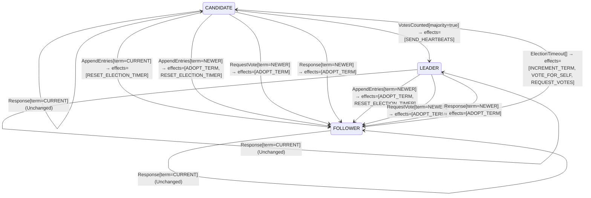

<!-- Generated by examples/tools/build.py from example.json and the verifier's output. Edit example.json. -->
# 062 · A candidate that retries its election without voting for itself again elects two leaders

[← All examples](../README.md)

| Verdict | Categories | Severity if shipped | Change | Verified unit | Approach |
|---|---|---|---|---|---|
| **✗ Violation: ElectionSafety, 7-step trace** | functional | critical | feature, behaviour change intended | [`RoleMachine#decide`](../../examples/apps/quorum/src/main/java/net/terminalvalue/quorum/raft/RoleMachine.java) | [D1: Protocol model checking](../../examples/apps/quorum/spec/README.md) |

> A Raft candidate whose election timed out starts a new one: a new term, a vote for itself, a request to every other server. A developer trims the retry: the tally already holds the candidate's own vote, so it need not vote again, and the request goes only to the servers that never answered. The contract diff is one case and is approved. The election model finds the bug under each of its three safety configurations, each in its own way: a seven-step run of three servers in which two candidates elect each other, the one step that breaks the inductive invariant (a candidate of a term it has not voted in), and an eight-step run of four servers in which a vote cast in term 1 is counted in term 2.

Tags: [consensus](../README.md#tag-consensus), [leader-election](../README.md#tag-leader-election), [agreement](../README.md#tag-agreement), [tla-inductive-invariant](../README.md#tag-tla-inductive-invariant), [tla-symmetry](../README.md#tag-tla-symmetry), [generated-operator](../README.md#tag-generated-operator), [multiple-configurations](../README.md#tag-multiple-configurations)

## The change

Split the `ElectionTimeout` case by role: a follower runs as before, with `INCREMENT_TERM`, `VOTE_FOR_SELF` and `REQUEST_VOTES`; a candidate retries with `INCREMENT_TERM` and `REQUEST_VOTES` only. The reasoning in the comment: a candidate's tally already holds its own vote, cast when it first ran, so voting again is pointless, and `REQUEST_VOTES` asks only the servers whose vote the tally lacks, so a retry costs one RPC per server that never answered instead of one per server. The behavioural contract is regenerated and its diff is the one case `decide(CANDIDATE, ElectionTimeout[])`, whose effects lose `VOTE_FOR_SELF`; a test for the new effects is added. The reviewer approves the diff: the effect that was dropped looks redundant.

**Before** ([`RoleMachine.java`](../../examples/apps/quorum/src/main/java/net/terminalvalue/quorum/raft/RoleMachine.java), line 36):

```java
public static Decision<Role, RoleEffect> decide(Role role, RoleEvent event) {
    return switch (event) {
        case ElectionTimeout _ -> switch (role) {
            case FOLLOWER, CANDIDATE -> transition(CANDIDATE, INCREMENT_TERM, VOTE_FOR_SELF, REQUEST_VOTES);
            case LEADER -> unchanged("a leader does not hold elections");
        };
        case VotesCounted votes -> switch (role) {
```

**After:**

```java
public static Decision<Role, RoleEffect> decide(Role role, RoleEvent event) {
    return switch (event) {
        case ElectionTimeout _ -> switch (role) {
            case FOLLOWER -> transition(CANDIDATE, INCREMENT_TERM, VOTE_FOR_SELF, REQUEST_VOTES);
            // A candidate whose election timed out tries again in a new term. Its tally already holds its own
            // vote, cast when it first ran, so it need not vote again, and REQUEST_VOTES asks only the servers
            // whose vote the tally lacks: the ones that never answered.
            case CANDIDATE -> transition(CANDIDATE, INCREMENT_TERM, REQUEST_VOTES);
            case LEADER -> unchanged("a leader does not hold elections");
        };
        case VotesCounted votes -> switch (role) {
```

<details><summary>Patch</summary>

```diff
--- a/examples/apps/quorum/src/main/java/net/terminalvalue/quorum/raft/RoleMachine.java
+++ b/examples/apps/quorum/src/main/java/net/terminalvalue/quorum/raft/RoleMachine.java
@@ -36,7 +36,11 @@
     public static Decision<Role, RoleEffect> decide(Role role, RoleEvent event) {
         return switch (event) {
             case ElectionTimeout _ -> switch (role) {
-                case FOLLOWER, CANDIDATE -> transition(CANDIDATE, INCREMENT_TERM, VOTE_FOR_SELF, REQUEST_VOTES);
+                case FOLLOWER -> transition(CANDIDATE, INCREMENT_TERM, VOTE_FOR_SELF, REQUEST_VOTES);
+                // A candidate whose election timed out tries again in a new term. Its tally already holds its own
+                // vote, cast when it first ran, so it need not vote again, and REQUEST_VOTES asks only the servers
+                // whose vote the tally lacks: the ones that never answered.
+                case CANDIDATE -> transition(CANDIDATE, INCREMENT_TERM, REQUEST_VOTES);
                 case LEADER -> unchanged("a leader does not hold elections");
             };
             case VotesCounted votes -> switch (role) {
--- a/examples/apps/quorum/src/test/java/net/terminalvalue/quorum/raft/RoleMachineTest.java
+++ b/examples/apps/quorum/src/test/java/net/terminalvalue/quorum/raft/RoleMachineTest.java
@@ -32,6 +32,11 @@
                 RoleMachine.decide(Role.LEADER, new RoleEvent.AppendEntries(TermOrder.NEWER)));
     }
 
+    public static void candidateRetriesWithTheVotesItHolds() {
+        equal(new Transition<>(Role.CANDIDATE, List.of(RoleEffect.INCREMENT_TERM, RoleEffect.REQUEST_VOTES)),
+                RoleMachine.decide(Role.CANDIDATE, new RoleEvent.ElectionTimeout()));
+    }
+
     public static void staleLeaderIsRejected() {
         check(RoleMachine.decide(Role.FOLLOWER, new RoleEvent.AppendEntries(TermOrder.OLDER)) instanceof Decision.Rejected, "stale");
     }
```

</details>

## What the verifier found

The model is checked under 7 configurations, and the verdict is the first that fails:

| Configuration | What it checks | Model | Result |
|---|---|---|---|
| three servers (`spec/RaftElection.cfg`) | every run from the initial state, every interleaving within the configuration's bounds | Servers = {s1, s2, s3}, MaxTerm = 3, LeftBehind = {}, DelayedReplies = FALSE, History = FALSE | ✗ Violation: ElectionSafety, 7-step trace |
| the inductive step (`spec/RaftElectionInductive.cfg`) | that the invariant `Inductive` is inductive: TLC starts from every state the invariant admits, reachable or not, rather than from the initial state, takes one step, and checks the invariant again, conjunct by conjunct. No counterexample is a proof of election safety by induction, for any run of the cluster however long; a counterexample is one step from a state that need not be reachable | Servers = {s1, s2, s3}, MaxTerm = 3, LeftBehind = {}, DelayedReplies = FALSE, History = FALSE | ✗ Violation: CampaignersVoteForThemselves, 2-step trace |
| four servers (`spec/RaftElectionFour.cfg`) | every run with four servers, a cluster in which a candidate can hold a vote besides its own and still be short of a majority, which three servers never show; under a symmetry set, so that of the states that differ only by the servers' names TLC explores one | Servers = {s1, s2, s3, s4}, MaxTerm = 3, LeftBehind = {}, DelayedReplies = FALSE, History = FALSE | ✗ Violation: ElectionSafety, 8-step trace |
| fairness (`spec/RaftElectionLive.cfg`) | the two liveness properties, under the fairness conditions `Fairness`: a server whose timer nothing resets times out, a candidate asks for the votes it lacks, a leader sends its heartbeats. A counterexample is a run that goes on forever without satisfying a property: a prefix, then a state or a cycle the system never leaves | Servers = {s1, s2, s3}, MaxTerm = 3, LeftBehind = {}, DelayedReplies = FALSE, History = FALSE | ✗ Violation: ElectionSafety, 7-step trace |
| a server left behind (`spec/RaftElectionLogs.cfg`) | the election restriction: one server holds the log a deposed leader of term 1 left behind, three entries of its term, while the other two hold an entry of term 2 that a majority holds and is therefore committed, so that the longer log is the one behind; every run with these logs, which nothing changes, under the invariant `LeaderCompleteness` besides the usual ones | Servers = {s1, s2, s3}, MaxTerm = 3, LeftBehind = {s1}, DelayedReplies = FALSE, History = FALSE | ✗ Violation: ElectionSafety, 7-step trace |
| delayed replies (`spec/RaftElectionDelayed.cfg`) | every run of three servers and two terms in which the reply to a vote request is a step of its own, which the candidate may take after it has timed out into a newer term, stepped down, or won; the one-step RPC of the other configurations never hands the role machine a reply from an older term than the server's own, and this one does, under the usual invariants and action properties | Servers = {s1, s2, s3}, MaxTerm = 2, LeftBehind = {}, DelayedReplies = TRUE, History = FALSE | ✗ Violation: ElectionSafety, 9-step trace |
| history (`spec/RaftElectionHistory.cfg`) | every run of three servers and three terms with the two history variables recording, `elected`, every term a server has led, and `voted`, every vote cast, under the two invariants that are about a run rather than a state: at most one leader elected per term and at most one vote per server per term, as the paper states them. The state invariants of the other configurations hold in a run in which a term's leader steps down and the term then elects another; these do not | Servers = {s1, s2, s3}, MaxTerm = 3, LeftBehind = {}, DelayedReplies = FALSE, History = TRUE | ✗ Violation: AtMostOneLeaderPerTerm, 7-step trace |

TLC found a run of the system under three servers, 7 steps long, that violates the invariant **ElectionSafety** (at most one leader per term). Each step is one action of one part of the system:

1. **Initial state**: every server a follower in term 0, no vote cast, no vote held.
2. **Timeout**, `Server.onElectionTimeout`: a server's election timer fires, and the server acts on the role machine's decision. `currentTerm = (s1 :> 1 @@ s2 :> 0 @@ s3 :> 0)`, `role = (s1 :> "CANDIDATE" @@ s2 :> "FOLLOWER" @@ s3 :> "FOLLOWER")`, `votedFor = (s1 :> s1 @@ s2 :> "none" @@ s3 :> "none")`, `votes = (s1 :> {s1} @@ s2 :> {} @@ s3 :> {})`
3. **Timeout**, `Server.onElectionTimeout`: a server's election timer fires, and the server acts on the role machine's decision. `currentTerm = (s1 :> 2 @@ s2 :> 0 @@ s3 :> 0)`, `votedFor = (s1 :> "none" @@ s2 :> "none" @@ s3 :> "none")`
4. **Timeout**, `Server.onElectionTimeout`: a server's election timer fires, and the server acts on the role machine's decision. `currentTerm = (s1 :> 2 @@ s2 :> 1 @@ s3 :> 0)`, `role = (s1 :> "CANDIDATE" @@ s2 :> "CANDIDATE" @@ s3 :> "FOLLOWER")`, `votedFor = (s1 :> "none" @@ s2 :> s2 @@ s3 :> "none")`, `votes = (s1 :> {s1} @@ s2 :> {s2} @@ s3 :> {})`
5. **Timeout**, `Server.onElectionTimeout`: a server's election timer fires, and the server acts on the role machine's decision. `currentTerm = (s1 :> 2 @@ s2 :> 2 @@ s3 :> 0)`, `votedFor = (s1 :> "none" @@ s2 :> "none" @@ s3 :> "none")`
6. **Canvass**, `Server.requestVote`: a candidate asks one server for its vote and gets the answer; the request and the reply each go through the role machine, then the vote rule on the voter, given its ballot and the candidate's term and log against its own, and the tally on the candidate. `role = (s1 :> "CANDIDATE" @@ s2 :> "LEADER" @@ s3 :> "FOLLOWER")`, `votedFor = (s1 :> s2 @@ s2 :> "none" @@ s3 :> "none")`, `votes = (s1 :> {s1} @@ s2 :> {s1, s2} @@ s3 :> {})`
7. **Canvass**, `Server.requestVote`: a candidate asks one server for its vote and gets the answer; the request and the reply each go through the role machine, then the vote rule on the voter, given its ballot and the candidate's term and log against its own, and the tally on the candidate. `role = (s1 :> "LEADER" @@ s2 :> "LEADER" @@ s3 :> "FOLLOWER")`, `votedFor = (s1 :> s2 @@ s2 :> s1 @@ s3 :> "none")`, `votes = (s1 :> {s1, s2} @@ s2 :> {s1, s2} @@ s3 :> {})`

The model is small (Servers = {s1, s2, s3}, MaxTerm = 3, LeftBehind = {}, DelayedReplies = FALSE, History = FALSE), which is what keeps the trace readable. TLC explored every interleaving of the servers, their terms and votes, and the RPCs between them within those bounds.

<details><summary>The counterexample under the inductive step: invariant <b>CampaignersVoteForThemselves</b>, 2 steps</summary>

Invariant **CampaignersVoteForThemselves**: a candidate or leader voted for itself in its term, and holds its own vote.

1. **Starting state**, a state the invariant `Inductive` admits, which need not be reachable: `currentTerm = (s1 :> 0 @@ s2 :> 0 @@ s3 :> 1)`, `elected = {}`, `replies = {}`, `role = (s1 :> "FOLLOWER" @@ s2 :> "FOLLOWER" @@ s3 :> "CANDIDATE")`, `voted = {}`, `votedFor = (s1 :> "none" @@ s2 :> "none" @@ s3 :> s3)`, `votes = (s1 :> {} @@ s2 :> {} @@ s3 :> {s3})`
2. **Timeout**, `Server.onElectionTimeout`: a server's election timer fires, and the server acts on the role machine's decision. `currentTerm = (s1 :> 0 @@ s2 :> 0 @@ s3 :> 2)`, `votedFor = (s1 :> "none" @@ s2 :> "none" @@ s3 :> "none")`

</details>

<details><summary>The counterexample under four servers: invariant <b>ElectionSafety</b>, 8 steps</summary>

Invariant **ElectionSafety**: at most one leader per term.

1. **Initial state**: every server a follower in term 0, no vote cast, no vote held.
2. **Timeout**, `Server.onElectionTimeout`: a server's election timer fires, and the server acts on the role machine's decision. `currentTerm = (s1 :> 1 @@ s2 :> 0 @@ s3 :> 0 @@ s4 :> 0)`, `role = (s1 :> "CANDIDATE" @@ s2 :> "FOLLOWER" @@ s3 :> "FOLLOWER" @@ s4 :> "FOLLOWER")`, `votedFor = (s1 :> s1 @@ s2 :> "none" @@ s3 :> "none" @@ s4 :> "none")`, `votes = (s1 :> {s1} @@ s2 :> {} @@ s3 :> {} @@ s4 :> {})`
3. **Canvass**, `Server.requestVote`: a candidate asks one server for its vote and gets the answer; the request and the reply each go through the role machine, then the vote rule on the voter, given its ballot and the candidate's term and log against its own, and the tally on the candidate. `currentTerm = (s1 :> 1 @@ s2 :> 1 @@ s3 :> 0 @@ s4 :> 0)`, `votedFor = (s1 :> s1 @@ s2 :> s1 @@ s3 :> "none" @@ s4 :> "none")`, `votes = (s1 :> {s1, s2} @@ s2 :> {} @@ s3 :> {} @@ s4 :> {})`
4. **Timeout**, `Server.onElectionTimeout`: a server's election timer fires, and the server acts on the role machine's decision. `currentTerm = (s1 :> 2 @@ s2 :> 1 @@ s3 :> 0 @@ s4 :> 0)`, `votedFor = (s1 :> "none" @@ s2 :> s1 @@ s3 :> "none" @@ s4 :> "none")`
5. **Timeout**, `Server.onElectionTimeout`: a server's election timer fires, and the server acts on the role machine's decision. `currentTerm = (s1 :> 2 @@ s2 :> 2 @@ s3 :> 0 @@ s4 :> 0)`, `role = (s1 :> "CANDIDATE" @@ s2 :> "CANDIDATE" @@ s3 :> "FOLLOWER" @@ s4 :> "FOLLOWER")`, `votedFor = (s1 :> "none" @@ s2 :> s2 @@ s3 :> "none" @@ s4 :> "none")`, `votes = (s1 :> {s1, s2} @@ s2 :> {s2} @@ s3 :> {} @@ s4 :> {})`
6. **Canvass**, `Server.requestVote`: a candidate asks one server for its vote and gets the answer; the request and the reply each go through the role machine, then the vote rule on the voter, given its ballot and the candidate's term and log against its own, and the tally on the candidate. `votedFor = (s1 :> s2 @@ s2 :> s2 @@ s3 :> "none" @@ s4 :> "none")`, `votes = (s1 :> {s1, s2} @@ s2 :> {s1, s2} @@ s3 :> {} @@ s4 :> {})`
7. **Canvass**, `Server.requestVote`: a candidate asks one server for its vote and gets the answer; the request and the reply each go through the role machine, then the vote rule on the voter, given its ballot and the candidate's term and log against its own, and the tally on the candidate. `currentTerm = (s1 :> 2 @@ s2 :> 2 @@ s3 :> 2 @@ s4 :> 0)`, `role = (s1 :> "LEADER" @@ s2 :> "CANDIDATE" @@ s3 :> "FOLLOWER" @@ s4 :> "FOLLOWER")`, `votedFor = (s1 :> s2 @@ s2 :> s2 @@ s3 :> s1 @@ s4 :> "none")`, `votes = (s1 :> {s1, s2, s3} @@ s2 :> {s1, s2} @@ s3 :> {} @@ s4 :> {})`
8. **Canvass**, `Server.requestVote`: a candidate asks one server for its vote and gets the answer; the request and the reply each go through the role machine, then the vote rule on the voter, given its ballot and the candidate's term and log against its own, and the tally on the candidate. `currentTerm = (s1 :> 2 @@ s2 :> 2 @@ s3 :> 2 @@ s4 :> 2)`, `role = (s1 :> "LEADER" @@ s2 :> "LEADER" @@ s3 :> "FOLLOWER" @@ s4 :> "FOLLOWER")`, `votedFor = (s1 :> s2 @@ s2 :> s2 @@ s3 :> s1 @@ s4 :> s2)`, `votes = (s1 :> {s1, s2, s3} @@ s2 :> {s1, s2, s4} @@ s3 :> {} @@ s4 :> {})`

</details>

Under fairness TLC found the same run, and reported it the same way.

<details><summary>The counterexample under a server left behind: invariant <b>ElectionSafety</b>, 7 steps</summary>

Invariant **ElectionSafety**: at most one leader per term.

1. **Initial state**: every server a follower in term 0, no vote cast, no vote held.
2. **Timeout**, `Server.onElectionTimeout`: a server's election timer fires, and the server acts on the role machine's decision. `currentTerm = (s1 :> 0 @@ s2 :> 1 @@ s3 :> 0)`, `role = (s1 :> "FOLLOWER" @@ s2 :> "CANDIDATE" @@ s3 :> "FOLLOWER")`, `votedFor = (s1 :> "none" @@ s2 :> s2 @@ s3 :> "none")`, `votes = (s1 :> {} @@ s2 :> {s2} @@ s3 :> {})`
3. **Timeout**, `Server.onElectionTimeout`: a server's election timer fires, and the server acts on the role machine's decision. `currentTerm = (s1 :> 0 @@ s2 :> 2 @@ s3 :> 0)`, `votedFor = (s1 :> "none" @@ s2 :> "none" @@ s3 :> "none")`
4. **Timeout**, `Server.onElectionTimeout`: a server's election timer fires, and the server acts on the role machine's decision. `currentTerm = (s1 :> 0 @@ s2 :> 2 @@ s3 :> 1)`, `role = (s1 :> "FOLLOWER" @@ s2 :> "CANDIDATE" @@ s3 :> "CANDIDATE")`, `votedFor = (s1 :> "none" @@ s2 :> "none" @@ s3 :> s3)`, `votes = (s1 :> {} @@ s2 :> {s2} @@ s3 :> {s3})`
5. **Timeout**, `Server.onElectionTimeout`: a server's election timer fires, and the server acts on the role machine's decision. `currentTerm = (s1 :> 0 @@ s2 :> 2 @@ s3 :> 2)`, `votedFor = (s1 :> "none" @@ s2 :> "none" @@ s3 :> "none")`
6. **Canvass**, `Server.requestVote`: a candidate asks one server for its vote and gets the answer; the request and the reply each go through the role machine, then the vote rule on the voter, given its ballot and the candidate's term and log against its own, and the tally on the candidate. `currentTerm = (s1 :> 2 @@ s2 :> 2 @@ s3 :> 2)`, `role = (s1 :> "FOLLOWER" @@ s2 :> "LEADER" @@ s3 :> "CANDIDATE")`, `votedFor = (s1 :> s2 @@ s2 :> "none" @@ s3 :> "none")`, `votes = (s1 :> {} @@ s2 :> {s1, s2} @@ s3 :> {s3})`
7. **Canvass**, `Server.requestVote`: a candidate asks one server for its vote and gets the answer; the request and the reply each go through the role machine, then the vote rule on the voter, given its ballot and the candidate's term and log against its own, and the tally on the candidate. `role = (s1 :> "FOLLOWER" @@ s2 :> "LEADER" @@ s3 :> "LEADER")`, `votedFor = (s1 :> s2 @@ s2 :> s3 @@ s3 :> "none")`, `votes = (s1 :> {} @@ s2 :> {s1, s2} @@ s3 :> {s2, s3})`

</details>

<details><summary>The counterexample under delayed replies: invariant <b>ElectionSafety</b>, 9 steps</summary>

Invariant **ElectionSafety**: at most one leader per term.

1. **Initial state**: every server a follower in term 0, no vote cast, no vote held.
2. **Timeout**, `Server.onElectionTimeout`: a server's election timer fires, and the server acts on the role machine's decision. `currentTerm = (s1 :> 1 @@ s2 :> 0 @@ s3 :> 0)`, `role = (s1 :> "CANDIDATE" @@ s2 :> "FOLLOWER" @@ s3 :> "FOLLOWER")`, `votedFor = (s1 :> s1 @@ s2 :> "none" @@ s3 :> "none")`, `votes = (s1 :> {s1} @@ s2 :> {} @@ s3 :> {})`
3. **Timeout**, `Server.onElectionTimeout`: a server's election timer fires, and the server acts on the role machine's decision. `currentTerm = (s1 :> 2 @@ s2 :> 0 @@ s3 :> 0)`, `votedFor = (s1 :> "none" @@ s2 :> "none" @@ s3 :> "none")`
4. **Timeout**, `Server.onElectionTimeout`: a server's election timer fires, and the server acts on the role machine's decision. `currentTerm = (s1 :> 2 @@ s2 :> 1 @@ s3 :> 0)`, `role = (s1 :> "CANDIDATE" @@ s2 :> "CANDIDATE" @@ s3 :> "FOLLOWER")`, `votedFor = (s1 :> "none" @@ s2 :> s2 @@ s3 :> "none")`, `votes = (s1 :> {s1} @@ s2 :> {s2} @@ s3 :> {})`
5. **Timeout**, `Server.onElectionTimeout`: a server's election timer fires, and the server acts on the role machine's decision. `currentTerm = (s1 :> 2 @@ s2 :> 2 @@ s3 :> 0)`, `votedFor = (s1 :> "none" @@ s2 :> "none" @@ s3 :> "none")`
6. **Ask**, `Server.requestVote`, the request alone: a candidate asks one server for its vote, which the voter decides as in `Canvass`, and the reply waits on the wire with the term the voter answered in. `replies = {[term |-> 2, granted |-> TRUE, to |-> s2, from |-> s1]}`, `votedFor = (s1 :> s2 @@ s2 :> "none" @@ s3 :> "none")`
7. **Answer**, `Server.onVote`: the candidate takes a reply that waited; its term goes through the role machine as it compares with the candidate's term now, a granted vote of the current term goes into the tally, and the tally through the role machine. `replies = {}`, `role = (s1 :> "CANDIDATE" @@ s2 :> "LEADER" @@ s3 :> "FOLLOWER")`, `votes = (s1 :> {s1} @@ s2 :> {s1, s2} @@ s3 :> {})`
8. **Ask**, `Server.requestVote`, the request alone: a candidate asks one server for its vote, which the voter decides as in `Canvass`, and the reply waits on the wire with the term the voter answered in. `replies = {[term |-> 2, granted |-> TRUE, to |-> s1, from |-> s2]}`, `votedFor = (s1 :> s2 @@ s2 :> s1 @@ s3 :> "none")`
9. **Answer**, `Server.onVote`: the candidate takes a reply that waited; its term goes through the role machine as it compares with the candidate's term now, a granted vote of the current term goes into the tally, and the tally through the role machine. `replies = {}`, `role = (s1 :> "LEADER" @@ s2 :> "LEADER" @@ s3 :> "FOLLOWER")`, `votes = (s1 :> {s1, s2} @@ s2 :> {s1, s2} @@ s3 :> {})`

</details>

<details><summary>The counterexample under history: invariant <b>AtMostOneLeaderPerTerm</b>, 7 steps</summary>

Invariant **AtMostOneLeaderPerTerm**: AtMostOneLeaderPerTerm.

1. **Initial state**: every server a follower in term 0, no vote cast, no vote held.
2. **Timeout**, `Server.onElectionTimeout`: a server's election timer fires, and the server acts on the role machine's decision. `currentTerm = (s1 :> 1 @@ s2 :> 0 @@ s3 :> 0)`, `role = (s1 :> "CANDIDATE" @@ s2 :> "FOLLOWER" @@ s3 :> "FOLLOWER")`, `voted = {<<s1, 1, s1>>}`, `votedFor = (s1 :> s1 @@ s2 :> "none" @@ s3 :> "none")`, `votes = (s1 :> {s1} @@ s2 :> {} @@ s3 :> {})`
3. **Timeout**, `Server.onElectionTimeout`: a server's election timer fires, and the server acts on the role machine's decision. `currentTerm = (s1 :> 2 @@ s2 :> 0 @@ s3 :> 0)`, `votedFor = (s1 :> "none" @@ s2 :> "none" @@ s3 :> "none")`
4. **Timeout**, `Server.onElectionTimeout`: a server's election timer fires, and the server acts on the role machine's decision. `currentTerm = (s1 :> 2 @@ s2 :> 1 @@ s3 :> 0)`, `role = (s1 :> "CANDIDATE" @@ s2 :> "CANDIDATE" @@ s3 :> "FOLLOWER")`, `voted = {<<s1, 1, s1>>, <<s2, 1, s2>>}`, `votedFor = (s1 :> "none" @@ s2 :> s2 @@ s3 :> "none")`, `votes = (s1 :> {s1} @@ s2 :> {s2} @@ s3 :> {})`
5. **Timeout**, `Server.onElectionTimeout`: a server's election timer fires, and the server acts on the role machine's decision. `currentTerm = (s1 :> 2 @@ s2 :> 2 @@ s3 :> 0)`, `votedFor = (s1 :> "none" @@ s2 :> "none" @@ s3 :> "none")`
6. **Canvass**, `Server.requestVote`: a candidate asks one server for its vote and gets the answer; the request and the reply each go through the role machine, then the vote rule on the voter, given its ballot and the candidate's term and log against its own, and the tally on the candidate. `elected = {<<s2, 2>>}`, `role = (s1 :> "CANDIDATE" @@ s2 :> "LEADER" @@ s3 :> "FOLLOWER")`, `voted = {<<s1, 1, s1>>, <<s1, 2, s2>>, <<s2, 1, s2>>}`, `votedFor = (s1 :> s2 @@ s2 :> "none" @@ s3 :> "none")`, `votes = (s1 :> {s1} @@ s2 :> {s1, s2} @@ s3 :> {})`
7. **Canvass**, `Server.requestVote`: a candidate asks one server for its vote and gets the answer; the request and the reply each go through the role machine, then the vote rule on the voter, given its ballot and the candidate's term and log against its own, and the tally on the candidate. `elected = {<<s1, 2>>, <<s2, 2>>}`, `role = (s1 :> "LEADER" @@ s2 :> "LEADER" @@ s3 :> "FOLLOWER")`, `voted = {<<s1, 1, s1>>, <<s1, 2, s2>>, <<s2, 1, s2>>, <<s2, 2, s1>>}`, `votedFor = (s1 :> s2 @@ s2 :> s1 @@ s3 :> "none")`, `votes = (s1 :> {s1, s2} @@ s2 :> {s1, s2} @@ s3 :> {})`

</details>

The state machine the patched code implements, drawn from its derived contract (`jvmcontract statemachine`); a state with no way in or no way out is marked:



## Would the existing tests have caught it?

No: every existing unit test passes (`java -ea net.terminalvalue.quorum.Tests`, run against the patched code).

## Why it matters

A vote is cast in a term, and so is a tally: `VOTE_FOR_SELF` is not a vote added to a tally but the start of a new one, in the new term, with the server's own vote in it. Without it the server enters its new term with no vote recorded there and a tally left over from the old one. Two things follow, and each is enough for two leaders. The server is free to vote in its new term, and does, for the first candidate of that term that asks, while still campaigning with its own vote in its tally: two candidates that retry into the same term vote for each other, and in a cluster of three each then holds a majority. And the other votes in the tally, granted in the old term by servers that have since voted again in the new one, count towards a majority of the new term: a vote cast once is counted twice. Election safety (Raft, figure 3) is gone, and with it every guarantee about the log. The contract diff is exactly what the developer intended.

## Why the verdict is right

The election model is checked under four configurations, and all four fail; the three that check safety each find the bug in their own way, and the liveness check reports the same run as the first before it gets to its own properties. With three servers and three terms TLC reports the shortest run that breaks `ElectionSafety`: s1's timer fires twice and s2's twice, so both are candidates of term 2, each with its own vote from term 1 in its tally and no vote recorded in term 2; s2 asks s1, which is free and grants, and s2 has two votes of three; s1 asks s2, which is free and grants, and s1 has two votes of three. Two leaders in term 2, holding each other's votes. The inductive step starts from every state the invariant `Inductive` admits, reachable or not, and finds the one step that leaves it: a candidate of term 1 whose timer fires becomes a candidate of term 2 with `votedFor` empty, and `CampaignersVoteForThemselves`, that a candidate or leader voted for itself in its term, no longer holds; that conjunct is the reason the other conjuncts, and election safety, hold, and the step that breaks it is the bug's definition. With four servers, where a candidate can hold a vote besides its own and still be short of a majority, the run is longer and shows the other half of the bug: s2 votes for s1 in term 1, s1 retries into term 2 with s2's vote still in its tally, and that vote, together with s3's cast in term 2, makes s1 the leader of term 2, while s2, which also retried, collects s1's free vote and s4's and leads term 2 too. The symmetry set in that configuration lets TLC explore one of each 24 states that differ only by the servers' names.

## What to do

Revert. The rules for candidates in figure 2 of the Raft paper start every election, the retries included, with the same three steps: increment the term, vote for self, send the requests. There is no vote to save: the old tally was a tally of the old term, and in the new one every server, this one included, has one vote to cast. A retry that spares the servers that already answered is unsound for the same reason, since they answered for the old term. The configurations stay in the model's build: the inductive step names the conjunct a change breaks in one step, four servers show the tallies three servers cannot, and the liveness check (063, 064) catches what no safety property can.

## Notes

- The Raft election model (`apps/quorum/spec/RaftElection.tla`) is built around the role machine, generated from its contract, with election safety as an invariant and two action properties, `[][A]_v` formulas that constrain each step: terms never decrease, a leader never campaigns. An example is checked under all of the model's configurations, and its verdict is the first that fails.
- The model's second and third configurations are an inductive invariant checked from every state it admits (`RaftElectionInductive.cfg`), which proves election safety by induction and gives one-step counterexamples, and four servers under a symmetry set (`RaftElectionFour.cfg`).
- The model finds it three ways: as a run, as the one step that breaks its inductive invariant, and in a cluster of four.

## Evidence

How the verdict was reached: three servers: TLC 2.19 explored 401 distinct states to depth 7 in 1 s, for the model Servers = {s1, s2, s3}, MaxTerm = 3, LeftBehind = {}, DelayedReplies = FALSE, History = FALSE; the inductive step: TLC 2.19 explored 17,471 distinct states to depth 2 in 6 s, for the model Servers = {s1, s2, s3}, MaxTerm = 3, LeftBehind = {}, DelayedReplies = FALSE, History = FALSE; four servers: TLC 2.19 explored 740 distinct states to depth 8 in 1 s, for the model Servers = {s1, s2, s3, s4}, MaxTerm = 3, LeftBehind = {}, DelayedReplies = FALSE, History = FALSE; fairness: TLC 2.19 explored 401 distinct states to depth 7 in 2 s, for the model Servers = {s1, s2, s3}, MaxTerm = 3, LeftBehind = {}, DelayedReplies = FALSE, History = FALSE; a server left behind: TLC 2.19 explored 578 distinct states to depth 7 in 1 s, for the model Servers = {s1, s2, s3}, MaxTerm = 3, LeftBehind = {s1}, DelayedReplies = FALSE, History = FALSE; delayed replies: TLC 2.19 explored 4,609 distinct states to depth 9 in 2 s, for the model Servers = {s1, s2, s3}, MaxTerm = 2, LeftBehind = {}, DelayedReplies = TRUE, History = FALSE; history: TLC 2.19 explored 487 distinct states to depth 7 in 0 s, for the model Servers = {s1, s2, s3}, MaxTerm = 3, LeftBehind = {}, DelayedReplies = FALSE, History = TRUE.

This result was recorded before runs fingerprinted their inputs, so whether it still matches the current patch and sources is not known.

<details><summary>Verifier output</summary>

```text
== three servers: spec/RaftElection.cfg ==
TLC2 Version 2.19 of 08 August 2024 (rev: 5a47802)
Running breadth-first search Model-Checking with fp 1 and seed 1 with 1 worker on 2 cores with 2185MB heap and 64MB offheap memory [pid: 1077738] (Linux 6.6.87.2-microsoft-standard-WSL2 aarch64, Eclipse Adoptium 25.0.4.1 x86_64, MSBDiskFPSet, DiskStateQueue).
Parsing file examples/apps/quorum/spec/RaftElection.tla
Parsing file examples/tools/tla/standard-modules/Naturals.tla
Parsing file examples/tools/tla/standard-modules/FiniteSets.tla
Parsing file examples/tools/tla/standard-modules/Sequences.tla
Parsing file examples/tools/tla/standard-modules/TLC.tla
Parsing file examples/apps/quorum/spec/RoleMachineContract.tla
Parsing file examples/apps/quorum/spec/VoteRuleContract.tla
Semantic processing of module Naturals
Semantic processing of module Sequences
Semantic processing of module FiniteSets
Semantic processing of module TLC
Semantic processing of module RoleMachineContract
Semantic processing of module VoteRuleContract
Semantic processing of module RaftElection
Starting... (2026-11-03 23:49:16)
Computing initial states...
Finished computing initial states: 1 distinct state generated at 2026-11-03 23:49:16.
Error: Invariant ElectionSafety is violated.
Error: The behavior up to this point is:
State 1: <Initial predicate>
/\ replies = {}
/\ currentTerm = (s1 :> 0 @@ s2 :> 0 @@ s3 :> 0)
/\ voted = {}
/\ votes = (s1 :> {} @@ s2 :> {} @@ s3 :> {})
/\ role = (s1 :> "FOLLOWER" @@ s2 :> "FOLLOWER" @@ s3 :> "FOLLOWER")
/\ votedFor = (s1 :> "none" @@ s2 :> "none" @@ s3 :> "none")
/\ elected = {}

State 2: <Timeout line 147, col 15 to line 147, col 88 of module RaftElection>
/\ replies = {}
/\ currentTerm = (s1 :> 1 @@ s2 :> 0 @@ s3 :> 0)
/\ voted = {}
/\ votes = (s1 :> {s1} @@ s2 :> {} @@ s3 :> {})
/\ role = (s1 :> "CANDIDATE" @@ s2 :> "FOLLOWER" @@ s3 :> "FOLLOWER")
/\ votedFor = (s1 :> s1 @@ s2 :> "none" @@ s3 :> "none")
/\ elected = {}

State 3: <Timeout line 147, col 15 to line 147, col 88 of module RaftElection>
/\ replies = {}
/\ currentTerm = (s1 :> 2 @@ s2 :> 0 @@ s3 :> 0)
/\ voted = {}
/\ votes = (s1 :> {s1} @@ s2 :> {} @@ s3 :> {})
/\ role = (s1 :> "CANDIDATE" @@ s2 :> "FOLLOWER" @@ s3 :> "FOLLOWER")
/\ votedFor = (s1 :> "none" @@ s2 :> "none" @@ s3 :> "none")
/\ elected = {}

State 4: <Timeout line 147, col 15 to line 147, col 88 of module RaftElection>
/\ replies = {}
/\ currentTerm = (s1 :> 2 @@ s2 :> 1 @@ s3 :> 0)
/\ voted = {}
/\ votes = (s1 :> {s1} @@ s2 :> {s2} @@ s3 :> {})
/\ role = (s1 :> "CANDIDATE" @@ s2 :> "CANDIDATE" @@ s3 :> "FOLLOWER")
/\ votedFor = (s1 :> "none" @@ s2 :> s2 @@ s3 :> "none")
/\ elected = {}

State 5: <Timeout line 147, col 15 to line 147, col 88 of module RaftElection>
/\ replies = {}
/\ currentTerm = (s1 :> 2 @@ s2 :> 2 @@ s3 :> 0)
/\ voted = {}
/\ votes = (s1 :> {s1} @@ s2 :> {s2} @@ s3 :> {})
/\ role = (s1 :> "CANDIDATE" @@ s2 :> "CANDIDATE" @@ s3 :> "FOLLOWER")
/\ votedFor = (s1 :> "none" @@ s2 :> "none" @@ s3 :> "none")
/\ elected = {}

State 6: <Canvass line 176, col 5 to line 180, col 30 of module RaftElection>
/\ replies = {}
/\ currentTerm = (s1 :> 2 @@ s2 :> 2 @@ s3 :> 0)
/\ voted = {}
/\ votes = (s1 :> {s1} @@ s2 :> {s1, s2} @@ s3 :> {})
/\ role = (s1 :> "CANDIDATE" @@ s2 :> "LEADER" @@ s3 :> "FOLLOWER")
/\ votedFor = (s1 :> s2 @@ s2 :> "none" @@ s3 :> "none")
/\ elected = {}

State 7: <Canvass line 176, col 5 to line 180, col 30 of module RaftElection>
/\ replies = {}
/\ currentTerm = (s1 :> 2 @@ s2 :> 2 @@ s3 :> 0)
/\ voted = {}
/\ votes = (s1 :> {s1, s2} @@ s2 :> {s1, s2} @@ s3 :> {})
/\ role = (s1 :> "LEADER" @@ s2 :> "LEADER" @@ s3 :> "FOLLOWER")
/\ votedFor = (s1 :> s2 @@ s2 :> s1 @@ s3 :> "none")
/\ elected = {}

Rows of net.terminalvalue.quorum.raft.RoleMachine#decide a step of the model takes: 27 of 36; never taken (9):
  decide(FOLLOWER, VotesCounted[majority=true]) => Unchanged
  decide(FOLLOWER, Response[term=OLDER]) => Unchanged
  decide(FOLLOWER, Response[term=CURRENT]) => Unchanged
  decide(FOLLOWER, Response[term=NEWER]) => Transition[next=FOLLOWER, effects=[ADOPT_TERM]]
  decide(CANDIDATE, Response[term=OLDER]) => Unchanged
  decide(LEADER, VotesCounted[majority=false]) => Unchanged
  decide(LEADER, VotesCounted[majority=true]) => Unchanged
  decide(LEADER, AppendEntries[term=CURRENT]) => throws IllegalStateException
  decide(LEADER, Response[term=OLDER]) => Unchanged
Rows of net.terminalvalue.quorum.raft.VoteRule#decide a step of the model takes: 4 of 27; never taken (23):
  decide(OPEN, VoteRequest[term=OLDER, log=BEHIND]) => Rejected
  decide(OPEN, VoteRequest[term=OLDER, log=AHEAD]) => Rejected
  decide(OPEN, VoteRequest[term=CURRENT, log=BEHIND]) => Rejected
  decide(OPEN, VoteRequest[term=CURRENT, log=AHEAD]) => Transition[next=FOR_THE_CANDIDATE, effects=[GRANT]]
  decide(OPEN, VoteRequest[term=NEWER, log=BEHIND]) => Rejected
  decide(OPEN, VoteRequest[term=NEWER, log=EVEN]) => Transition[next=FOR_THE_CANDIDATE, effects=[GRANT]]
  decide(OPEN, VoteRequest[term=NEWER, log=AHEAD]) => Transition[next=FOR_THE_CANDIDATE, effects=[GRANT]]
  decide(FOR_THE_CANDIDATE, VoteRequest[term=OLDER, log=BEHIND]) => Rejected
  decide(FOR_THE_CANDIDATE, VoteRequest[term=OLDER, log=EVEN]) => Rejected
  decide(FOR_THE_CANDIDATE, VoteRequest[term=OLDER, log=AHEAD]) => Rejected
  decide(FOR_THE_CANDIDATE, VoteRequest[term=CURRENT, log=BEHIND]) => Rejected
  decide(FOR_THE_CANDIDATE, VoteRequest[term=CURRENT, log=EVEN]) => Transition[next=FOR_THE_CANDIDATE, effects=[GRANT]]
  decide(FOR_THE_CANDIDATE, VoteRequest[term=CURRENT, log=AHEAD]) => Transition[next=FOR_THE_CANDIDATE, effects=[GRANT]]
  decide(FOR_THE_CANDIDATE, VoteRequest[term=NEWER, log=BEHIND]) => Rejected
  decide(FOR_THE_CANDIDATE, VoteRequest[term=NEWER, log=EVEN]) => Transition[next=FOR_THE_CANDIDATE, effects=[GRANT]]
  decide(FOR_THE_CANDIDATE, VoteRequest[term=NEWER, log=AHEAD]) => Transition[next=FOR_THE_CANDIDATE, effects=[GRANT]]
  decide(FOR_ANOTHER, VoteRequest[term=OLDER, log=BEHIND]) => Rejected
  decide(FOR_ANOTHER, VoteRequest[term=OLDER, log=AHEAD]) => Rejected
  decide(FOR_ANOTHER, VoteRequest[term=CURRENT, log=BEHIND]) => Rejected
  decide(FOR_ANOTHER, VoteRequest[term=CURRENT, log=AHEAD]) => Rejected
  decide(FOR_ANOTHER, VoteRequest[term=NEWER, log=BEHIND]) => Rejected
  decide(FOR_ANOTHER, VoteRequest[term=NEWER, log=EVEN]) => Transition[next=FOR_THE_CANDIDATE, effects=[GRANT]]
  decide(FOR_ANOTHER, VoteRequest[term=NEWER, log=AHEAD]) => Transition[next=FOR_THE_CANDIDATE, effects=[GRANT]]
951 states generated, 401 distinct states found, 240 states left on queue.
The depth of the complete state graph search is 7.
The average outdegree of the complete state graph is 3 (minimum is 0, the maximum 6 and the 95th percentile is 5).
Finished in 01s at (2026-11-03 23:49:17)

== the inductive step: spec/RaftElectionInductive.cfg ==
TLC2 Version 2.19 of 08 August 2024 (rev: 5a47802)
Running breadth-first search Model-Checking with fp 1 and seed 1 with 1 worker on 2 cores with 2185MB heap and 64MB offheap memory [pid: 1077827] (Linux 6.6.87.2-microsoft-standard-WSL2 aarch64, Eclipse Adoptium 25.0.4.1 x86_64, MSBDiskFPSet, DiskStateQueue).
Parsing file examples/apps/quorum/spec/RaftElection.tla
Parsing file examples/tools/tla/standard-modules/Naturals.tla
Parsing file examples/tools/tla/standard-modules/FiniteSets.tla
Parsing file examples/tools/tla/standard-modules/Sequences.tla
Parsing file examples/tools/tla/standard-modules/TLC.tla
Parsing file examples/apps/quorum/spec/RoleMachineContract.tla
Parsing file examples/apps/quorum/spec/VoteRuleContract.tla
Semantic processing of module Naturals
Semantic processing of module Sequences
Semantic processing of module FiniteSets
Semantic processing of module TLC
Semantic processing of module RoleMachineContract
Semantic processing of module VoteRuleContract
Semantic processing of module RaftElection
Starting... (2026-11-03 23:49:17)
Computing initial states...
Computed 2 initial states...
Computed 4 initial states...
Computed 8 initial states...
Computed 16 initial states...
Computed 32 initial states...
Computed 64 initial states...
Computed 128 initial states...
Computed 256 initial states...
Computed 512 initial states...
Computed 1024 initial states...
Computed 2048 initial states...
Computed 4096 initial states...
Computed 8192 initial states...
Computed 16384 initial states...
Finished computing initial states: 17470 distinct states generated at 2026-11-03 23:49:24.
Error: Invariant CampaignersVoteForThemselves is violated.
Error: The behavior up to this point is:
State 1: <Initial predicate>
/\ replies = {}
/\ currentTerm = (s1 :> 0 @@ s2 :> 0 @@ s3 :> 1)
/\ voted = {}
/\ votes = (s1 :> {} @@ s2 :> {} @@ s3 :> {s3})
/\ role = (s1 :> "FOLLOWER" @@ s2 :> "FOLLOWER" @@ s3 :> "CANDIDATE")
/\ votedFor = (s1 :> "none" @@ s2 :> "none" @@ s3 :> s3)
/\ elected = {}

State 2: <Timeout line 147, col 15 to line 147, col 88 of module RaftElection>
/\ replies = {}
/\ currentTerm = (s1 :> 0 @@ s2 :> 0 @@ s3 :> 2)
/\ voted = {}
/\ votes = (s1 :> {} @@ s2 :> {} @@ s3 :> {s3})
/\ role = (s1 :> "FOLLOWER" @@ s2 :> "FOLLOWER" @@ s3 :> "CANDIDATE")
/\ votedFor = (s1 :> "none" @@ s2 :> "none" @@ s3 :> "none")
/\ elected = {}

Rows of net.terminalvalue.quorum.raft.RoleMachine#decide a step of the model takes: 2 of 36; never taken (34):
  decide(FOLLOWER, VotesCounted[majority=false]) => Unchanged
  decide(FOLLOWER, VotesCounted[majority=true]) => Unchanged
  decide(FOLLOWER, AppendEntries[term=OLDER]) => Rejected
  decide(FOLLOWER, AppendEntries[term=CURRENT]) => Transition[next=FOLLOWER, effects=[RESET_ELECTION_TIMER]]
  decide(FOLLOWER, AppendEntries[term=NEWER]) => Transition[next=FOLLOWER, effects=[ADOPT_TERM, RESET_ELECTION_TIMER]]
  decide(FOLLOWER, RequestVote[term=OLDER]) => Unchanged
  decide(FOLLOWER, RequestVote[term=CURRENT]) => Unchanged
  decide(FOLLOWER, RequestVote[term=NEWER]) => Transition[next=FOLLOWER, effects=[ADOPT_TERM]]
  decide(FOLLOWER, Response[term=OLDER]) => Unchanged
  decide(FOLLOWER, Response[term=CURRENT]) => Unchanged
  decide(FOLLOWER, Response[term=NEWER]) => Transition[next=FOLLOWER, effects=[ADOPT_TERM]]
  decide(CANDIDATE, VotesCounted[majority=false]) => Unchanged
  decide(CANDIDATE, VotesCounted[majority=true]) => Transition[next=LEADER, effects=[SEND_HEARTBEATS]]
  decide(CANDIDATE, AppendEntries[term=OLDER]) => Rejected
  decide(CANDIDATE, AppendEntries[term=CURRENT]) => Transition[next=FOLLOWER, effects=[RESET_ELECTION_TIMER]]
  decide(CANDIDATE, AppendEntries[term=NEWER]) => Transition[next=FOLLOWER, effects=[ADOPT_TERM, RESET_ELECTION_TIMER]]
  decide(CANDIDATE, RequestVote[term=OLDER]) => Unchanged
  decide(CANDIDATE, RequestVote[term=CURRENT]) => Unchanged
  decide(CANDIDATE, RequestVote[term=NEWER]) => Transition[next=FOLLOWER, effects=[ADOPT_TERM]]
  decide(CANDIDATE, Response[term=OLDER]) => Unchanged
  decide(CANDIDATE, Response[term=CURRENT]) => Unchanged
  decide(CANDIDATE, Response[term=NEWER]) => Transition[next=FOLLOWER, effects=[ADOPT_TERM]]
  decide(LEADER, ElectionTimeout[]) => Unchanged
  decide(LEADER, VotesCounted[majority=false]) => Unchanged
  decide(LEADER, VotesCounted[majority=true]) => Unchanged
  decide(LEADER, AppendEntries[term=OLDER]) => Rejected
  decide(LEADER, AppendEntries[term=CURRENT]) => throws IllegalStateException
  decide(LEADER, AppendEntries[term=NEWER]) => Transition[next=FOLLOWER, effects=[ADOPT_TERM, RESET_ELECTION_TIMER]]
  decide(LEADER, RequestVote[term=OLDER]) => Unchanged
  decide(LEADER, RequestVote[term=CURRENT]) => Unchanged
  decide(LEADER, RequestVote[term=NEWER]) => Transition[next=FOLLOWER, effects=[ADOPT_TERM]]
  decide(LEADER, Response[term=OLDER]) => Unchanged
  decide(LEADER, Response[term=CURRENT]) => Unchanged
  decide(LEADER, Response[term=NEWER]) => Transition[next=FOLLOWER, effects=[ADOPT_TERM]]
Rows of net.terminalvalue.quorum.raft.VoteRule#decide a step of the model takes: 0 of 27; never taken (27):
  decide(OPEN, VoteRequest[term=OLDER, log=BEHIND]) => Rejected
  decide(OPEN, VoteRequest[term=OLDER, log=EVEN]) => Rejected
  decide(OPEN, VoteRequest[term=OLDER, log=AHEAD]) => Rejected
  decide(OPEN, VoteRequest[term=CURRENT, log=BEHIND]) => Rejected
  decide(OPEN, VoteRequest[term=CURRENT, log=EVEN]) => Transition[next=FOR_THE_CANDIDATE, effects=[GRANT]]
  decide(OPEN, VoteRequest[term=CURRENT, log=AHEAD]) => Transition[next=FOR_THE_CANDIDATE, effects=[GRANT]]
  decide(OPEN, VoteRequest[term=NEWER, log=BEHIND]) => Rejected
  decide(OPEN, VoteRequest[term=NEWER, log=EVEN]) => Transition[next=FOR_THE_CANDIDATE, effects=[GRANT]]
  decide(OPEN, VoteRequest[term=NEWER, log=AHEAD]) => Transition[next=FOR_THE_CANDIDATE, effects=[GRANT]]
  decide(FOR_THE_CANDIDATE, VoteRequest[term=OLDER, log=BEHIND]) => Rejected
  decide(FOR_THE_CANDIDATE, VoteRequest[term=OLDER, log=EVEN]) => Rejected
  decide(FOR_THE_CANDIDATE, VoteRequest[term=OLDER, log=AHEAD]) => Rejected
  decide(FOR_THE_CANDIDATE, VoteRequest[term=CURRENT, log=BEHIND]) => Rejected
  decide(FOR_THE_CANDIDATE, VoteRequest[term=CURRENT, log=EVEN]) => Transition[next=FOR_THE_CANDIDATE, effects=[GRANT]]
  decide(FOR_THE_CANDIDATE, VoteRequest[term=CURRENT, log=AHEAD]) => Transition[next=FOR_THE_CANDIDATE, effects=[GRANT]]
  decide(FOR_THE_CANDIDATE, VoteRequest[term=NEWER, log=BEHIND]) => Rejected
  decide(FOR_THE_CANDIDATE, VoteRequest[term=NEWER, log=EVEN]) => Transition[next=FOR_THE_CANDIDATE, effects=[GRANT]]
  decide(FOR_THE_CANDIDATE, VoteRequest[term=NEWER, log=AHEAD]) => Transition[next=FOR_THE_CANDIDATE, effects=[GRANT]]
  decide(FOR_ANOTHER, VoteRequest[term=OLDER, log=BEHIND]) => Rejected
  decide(FOR_ANOTHER, VoteRequest[term=OLDER, log=EVEN]) => Rejected
  decide(FOR_ANOTHER, VoteRequest[term=OLDER, log=AHEAD]) => Rejected
  decide(FOR_ANOTHER, VoteRequest[term=CURRENT, log=BEHIND]) => Rejected
  decide(FOR_ANOTHER, VoteRequest[term=CURRENT, log=EVEN]) => Rejected
  decide(FOR_ANOTHER, VoteRequest[term=CURRENT, log=AHEAD]) => Rejected
  decide(FOR_ANOTHER, VoteRequest[term=NEWER, log=BEHIND]) => Rejected
  decide(FOR_ANOTHER, VoteRequest[term=NEWER, log=EVEN]) => Transition[next=FOR_THE_CANDIDATE, effects=[GRANT]]
  decide(FOR_ANOTHER, VoteRequest[term=NEWER, log=AHEAD]) => Transition[next=FOR_THE_CANDIDATE, effects=[GRANT]]
17491 states generated, 17471 distinct states found, 17463 states left on queue.
The depth of the complete state graph search is 2.
The average outdegree of the complete state graph is 0 (minimum is 0, the maximum 0 and the 95th percentile is 0).
Finished in 06s at (2026-11-03 23:49:24)

== four servers: spec/RaftElectionFour.cfg ==
TLC2 Version 2.19 of 08 August 2024 (rev: 5a47802)
Running breadth-first search Model-Checking with fp 1 and seed 1 with 1 worker on 2 cores with 2185MB heap and 64MB offheap memory [pid: 1078203] (Linux 6.6.87.2-microsoft-standard-WSL2 aarch64, Eclipse Adoptium 25.0.4.1 x86_64, MSBDiskFPSet, DiskStateQueue).
Parsing file examples/apps/quorum/spec/RaftElection.tla
Parsing file examples/tools/tla/standard-modules/Naturals.tla
Parsing file examples/tools/tla/standard-modules/FiniteSets.tla
Parsing file examples/tools/tla/standard-modules/Sequences.tla
Parsing file examples/tools/tla/standard-modules/TLC.tla
Parsing file examples/apps/quorum/spec/RoleMachineContract.tla
Parsing file examples/apps/quorum/spec/VoteRuleContract.tla
Semantic processing of module Naturals
Semantic processing of module Sequences
Semantic processing of module FiniteSets
Semantic processing of module TLC
Semantic processing of module RoleMachineContract
Semantic processing of module VoteRuleContract
Semantic processing of module RaftElection
Starting... (2026-11-03 23:49:25)
Computing initial states...
Finished computing initial states: 1 distinct state generated at 2026-11-03 23:49:25.
Error: Invariant ElectionSafety is violated.
Error: The behavior up to this point is:
State 1: <Initial predicate>
/\ replies = {}
/\ currentTerm = (s1 :> 0 @@ s2 :> 0 @@ s3 :> 0 @@ s4 :> 0)
/\ voted = {}
/\ votes = (s1 :> {} @@ s2 :> {} @@ s3 :> {} @@ s4 :> {})
/\ role = (s1 :> "FOLLOWER" @@ s2 :> "FOLLOWER" @@ s3 :> "FOLLOWER" @@ s4 :> "FOLLOWER")
/\ votedFor = (s1 :> "none" @@ s2 :> "none" @@ s3 :> "none" @@ s4 :> "none")
/\ elected = {}

State 2: <Timeout line 147, col 15 to line 147, col 88 of module RaftElection>
/\ replies = {}
/\ currentTerm = (s1 :> 1 @@ s2 :> 0 @@ s3 :> 0 @@ s4 :> 0)
/\ voted = {}
/\ votes = (s1 :> {s1} @@ s2 :> {} @@ s3 :> {} @@ s4 :> {})
/\ role = (s1 :> "CANDIDATE" @@ s2 :> "FOLLOWER" @@ s3 :> "FOLLOWER" @@ s4 :> "FOLLOWER")
/\ votedFor = (s1 :> s1 @@ s2 :> "none" @@ s3 :> "none" @@ s4 :> "none")
/\ elected = {}

State 3: <Canvass line 176, col 5 to line 180, col 30 of module RaftElection>
/\ replies = {}
/\ currentTerm = (s1 :> 1 @@ s2 :> 1 @@ s3 :> 0 @@ s4 :> 0)
/\ voted = {}
/\ votes = (s1 :> {s1, s2} @@ s2 :> {} @@ s3 :> {} @@ s4 :> {})
/\ role = (s1 :> "CANDIDATE" @@ s2 :> "FOLLOWER" @@ s3 :> "FOLLOWER" @@ s4 :> "FOLLOWER")
/\ votedFor = (s1 :> s1 @@ s2 :> s1 @@ s3 :> "none" @@ s4 :> "none")
/\ elected = {}

State 4: <Timeout line 147, col 15 to line 147, col 88 of module RaftElection>
/\ replies = {}
/\ currentTerm = (s1 :> 2 @@ s2 :> 1 @@ s3 :> 0 @@ s4 :> 0)
/\ voted = {}
/\ votes = (s1 :> {s1, s2} @@ s2 :> {} @@ s3 :> {} @@ s4 :> {})
/\ role = (s1 :> "CANDIDATE" @@ s2 :> "FOLLOWER" @@ s3 :> "FOLLOWER" @@ s4 :> "FOLLOWER")
/\ votedFor = (s1 :> "none" @@ s2 :> s1 @@ s3 :> "none" @@ s4 :> "none")
/\ elected = {}

State 5: <Timeout line 147, col 15 to line 147, col 88 of module RaftElection>
/\ replies = {}
/\ currentTerm = (s1 :> 2 @@ s2 :> 2 @@ s3 :> 0 @@ s4 :> 0)
/\ voted = {}
/\ votes = (s1 :> {s1, s2} @@ s2 :> {s2} @@ s3 :> {} @@ s4 :> {})
/\ role = (s1 :> "CANDIDATE" @@ s2 :> "CANDIDATE" @@ s3 :> "FOLLOWER" @@ s4 :> "FOLLOWER")
/\ votedFor = (s1 :> "none" @@ s2 :> s2 @@ s3 :> "none" @@ s4 :> "none")
/\ elected = {}

State 6: <Canvass line 176, col 5 to line 180, col 30 of module RaftElection>
/\ replies = {}
/\ currentTerm = (s1 :> 2 @@ s2 :> 2 @@ s3 :> 0 @@ s4 :> 0)
/\ voted = {}
/\ votes = (s1 :> {s1, s2} @@ s2 :> {s1, s2} @@ s3 :> {} @@ s4 :> {})
/\ role = (s1 :> "CANDIDATE" @@ s2 :> "CANDIDATE" @@ s3 :> "FOLLOWER" @@ s4 :> "FOLLOWER")
/\ votedFor = (s1 :> s2 @@ s2 :> s2 @@ s3 :> "none" @@ s4 :> "none")
/\ elected = {}

State 7: <Canvass line 176, col 5 to line 180, col 30 of module RaftElection>
/\ replies = {}
/\ currentTerm = (s1 :> 2 @@ s2 :> 2 @@ s3 :> 2 @@ s4 :> 0)
/\ voted = {}
/\ votes = (s1 :> {s1, s2, s3} @@ s2 :> {s1, s2} @@ s3 :> {} @@ s4 :> {})
/\ role = (s1 :> "LEADER" @@ s2 :> "CANDIDATE" @@ s3 :> "FOLLOWER" @@ s4 :> "FOLLOWER")
/\ votedFor = (s1 :> s2 @@ s2 :> s2 @@ s3 :> s1 @@ s4 :> "none")
/\ elected = {}

State 8: <Canvass line 176, col 5 to line 180, col 30 of module RaftElection>
/\ replies = {}
/\ currentTerm = (s1 :> 2 @@ s2 :> 2 @@ s3 :> 2 @@ s4 :> 2)
/\ voted = {}
/\ votes = (s1 :> {s1, s2, s3} @@ s2 :> {s1, s2, s4} @@ s3 :> {} @@ s4 :> {})
/\ role = (s1 :> "LEADER" @@ s2 :> "LEADER" @@ s3 :> "FOLLOWER" @@ s4 :> "FOLLOWER")
/\ votedFor = (s1 :> s2 @@ s2 :> s2 @@ s3 :> s1 @@ s4 :> s2)
/\ elected = {}

Rows of net.terminalvalue.quorum.raft.RoleMachine#decide a step of the model takes: 25 of 36; never taken (11):
  decide(FOLLOWER, VotesCounted[majority=true]) => Unchanged
  decide(FOLLOWER, Response[term=OLDER]) => Unchanged
  decide(FOLLOWER, Response[term=CURRENT]) => Unchanged
  decide(FOLLOWER, Response[term=NEWER]) => Transition[next=FOLLOWER, effects=[ADOPT_TERM]]
  decide(CANDIDATE, Response[term=OLDER]) => Unchanged
  decide(LEADER, VotesCounted[majority=false]) => Unchanged
  decide(LEADER, VotesCounted[majority=true]) => Unchanged
  decide(LEADER, AppendEntries[term=OLDER]) => Rejected
  decide(LEADER, AppendEntries[term=CURRENT]) => throws IllegalStateException
  decide(LEADER, AppendEntries[term=NEWER]) => Transition[next=FOLLOWER, effects=[ADOPT_TERM, RESET_ELECTION_TIMER]]
  decide(LEADER, Response[term=OLDER]) => Unchanged
Rows of net.terminalvalue.quorum.raft.VoteRule#decide a step of the model takes: 4 of 27; never taken (23):
  decide(OPEN, VoteRequest[term=OLDER, log=BEHIND]) => Rejected
  decide(OPEN, VoteRequest[term=OLDER, log=AHEAD]) => Rejected
  decide(OPEN, VoteRequest[term=CURRENT, log=BEHIND]) => Rejected
  decide(OPEN, VoteRequest[term=CURRENT, log=AHEAD]) => Transition[next=FOR_THE_CANDIDATE, effects=[GRANT]]
  decide(OPEN, VoteRequest[term=NEWER, log=BEHIND]) => Rejected
  decide(OPEN, VoteRequest[term=NEWER, log=EVEN]) => Transition[next=FOR_THE_CANDIDATE, effects=[GRANT]]
  decide(OPEN, VoteRequest[term=NEWER, log=AHEAD]) => Transition[next=FOR_THE_CANDIDATE, effects=[GRANT]]
  decide(FOR_THE_CANDIDATE, VoteRequest[term=OLDER, log=BEHIND]) => Rejected
  decide(FOR_THE_CANDIDATE, VoteRequest[term=OLDER, log=EVEN]) => Rejected
  decide(FOR_THE_CANDIDATE, VoteRequest[term=OLDER, log=AHEAD]) => Rejected
  decide(FOR_THE_CANDIDATE, VoteRequest[term=CURRENT, log=BEHIND]) => Rejected
  decide(FOR_THE_CANDIDATE, VoteRequest[term=CURRENT, log=EVEN]) => Transition[next=FOR_THE_CANDIDATE, effects=[GRANT]]
  decide(FOR_THE_CANDIDATE, VoteRequest[term=CURRENT, log=AHEAD]) => Transition[next=FOR_THE_CANDIDATE, effects=[GRANT]]
  decide(FOR_THE_CANDIDATE, VoteRequest[term=NEWER, log=BEHIND]) => Rejected
  decide(FOR_THE_CANDIDATE, VoteRequest[term=NEWER, log=EVEN]) => Transition[next=FOR_THE_CANDIDATE, effects=[GRANT]]
  decide(FOR_THE_CANDIDATE, VoteRequest[term=NEWER, log=AHEAD]) => Transition[next=FOR_THE_CANDIDATE, effects=[GRANT]]
  decide(FOR_ANOTHER, VoteRequest[term=OLDER, log=BEHIND]) => Rejected
  decide(FOR_ANOTHER, VoteRequest[term=OLDER, log=AHEAD]) => Rejected
  decide(FOR_ANOTHER, VoteRequest[term=CURRENT, log=BEHIND]) => Rejected
  decide(FOR_ANOTHER, VoteRequest[term=CURRENT, log=AHEAD]) => Rejected
  decide(FOR_ANOTHER, VoteRequest[term=NEWER, log=BEHIND]) => Rejected
  decide(FOR_ANOTHER, VoteRequest[term=NEWER, log=EVEN]) => Transition[next=FOR_THE_CANDIDATE, effects=[GRANT]]
  decide(FOR_ANOTHER, VoteRequest[term=NEWER, log=AHEAD]) => Transition[next=FOR_THE_CANDIDATE, effects=[GRANT]]
2348 states generated, 740 distinct states found, 470 states left on queue.
The depth of the complete state graph search is 8.
The average outdegree of the complete state graph is 3 (minimum is 0, the maximum 8 and the 95th percentile is 6).
Finished in 01s at (2026-11-03 23:49:26)

== fairness: spec/RaftElectionLive.cfg ==
TLC2 Version 2.19 of 08 August 2024 (rev: 5a47802)
Running breadth-first search Model-Checking with fp 1 and seed 1 with 1 worker on 2 cores with 2185MB heap and 64MB offheap memory [pid: 1078311] (Linux 6.6.87.2-microsoft-standard-WSL2 aarch64, Eclipse Adoptium 25.0.4.1 x86_64, MSBDiskFPSet, DiskStateQueue).
Parsing file examples/apps/quorum/spec/RaftElection.tla
Parsing file examples/tools/tla/standard-modules/Naturals.tla
Parsing file examples/tools/tla/standard-modules/FiniteSets.tla
Parsing file examples/tools/tla/standard-modules/Sequences.tla
Parsing file examples/tools/tla/standard-modules/TLC.tla
Parsing file examples/apps/quorum/spec/RoleMachineContract.tla
Parsing file examples/apps/quorum/spec/VoteRuleContract.tla
Semantic processing of module Naturals
Semantic processing of module Sequences
Semantic processing of module FiniteSets
Semantic processing of module TLC
Semantic processing of module RoleMachineContract
Semantic processing of module VoteRuleContract
Semantic processing of module RaftElection
Starting... (2026-11-03 23:49:27)
Implied-temporal checking--satisfiability problem has 4 branches.
Computing initial states...
Finished computing initial states: 1 distinct state generated at 2026-11-03 23:49:27.
Error: Invariant ElectionSafety is violated.
Error: The behavior up to this point is:
State 1: <Initial predicate>
/\ replies = {}
/\ currentTerm = (s1 :> 0 @@ s2 :> 0 @@ s3 :> 0)
/\ voted = {}
/\ votes = (s1 :> {} @@ s2 :> {} @@ s3 :> {})
/\ role = (s1 :> "FOLLOWER" @@ s2 :> "FOLLOWER" @@ s3 :> "FOLLOWER")
/\ votedFor = (s1 :> "none" @@ s2 :> "none" @@ s3 :> "none")
/\ elected = {}

State 2: <Timeout line 147, col 15 to line 147, col 88 of module RaftElection>
/\ replies = {}
/\ currentTerm = (s1 :> 1 @@ s2 :> 0 @@ s3 :> 0)
/\ voted = {}
/\ votes = (s1 :> {s1} @@ s2 :> {} @@ s3 :> {})
/\ role = (s1 :> "CANDIDATE" @@ s2 :> "FOLLOWER" @@ s3 :> "FOLLOWER")
/\ votedFor = (s1 :> s1 @@ s2 :> "none" @@ s3 :> "none")
/\ elected = {}

State 3: <Timeout line 147, col 15 to line 147, col 88 of module RaftElection>
/\ replies = {}
/\ currentTerm = (s1 :> 2 @@ s2 :> 0 @@ s3 :> 0)
/\ voted = {}
/\ votes = (s1 :> {s1} @@ s2 :> {} @@ s3 :> {})
/\ role = (s1 :> "CANDIDATE" @@ s2 :> "FOLLOWER" @@ s3 :> "FOLLOWER")
/\ votedFor = (s1 :> "none" @@ s2 :> "none" @@ s3 :> "none")
/\ elected = {}

State 4: <Timeout line 147, col 15 to line 147, col 88 of module RaftElection>
/\ replies = {}
/\ currentTerm = (s1 :> 2 @@ s2 :> 1 @@ s3 :> 0)
/\ voted = {}
/\ votes = (s1 :> {s1} @@ s2 :> {s2} @@ s3 :> {})
/\ role = (s1 :> "CANDIDATE" @@ s2 :> "CANDIDATE" @@ s3 :> "FOLLOWER")
/\ votedFor = (s1 :> "none" @@ s2 :> s2 @@ s3 :> "none")
/\ elected = {}

State 5: <Timeout line 147, col 15 to line 147, col 88 of module RaftElection>
/\ replies = {}
/\ currentTerm = (s1 :> 2 @@ s2 :> 2 @@ s3 :> 0)
/\ voted = {}
/\ votes = (s1 :> {s1} @@ s2 :> {s2} @@ s3 :> {})
/\ role = (s1 :> "CANDIDATE" @@ s2 :> "CANDIDATE" @@ s3 :> "FOLLOWER")
/\ votedFor = (s1 :> "none" @@ s2 :> "none" @@ s3 :> "none")
/\ elected = {}

State 6: <Canvass line 176, col 5 to line 180, col 30 of module RaftElection>
/\ replies = {}
/\ currentTerm = (s1 :> 2 @@ s2 :> 2 @@ s3 :> 0)
/\ voted = {}
/\ votes = (s1 :> {s1} @@ s2 :> {s1, s2} @@ s3 :> {})
/\ role = (s1 :> "CANDIDATE" @@ s2 :> "LEADER" @@ s3 :> "FOLLOWER")
/\ votedFor = (s1 :> s2 @@ s2 :> "none" @@ s3 :> "none")
/\ elected = {}

State 7: <Canvass line 176, col 5 to line 180, col 30 of module RaftElection>
/\ replies = {}
/\ currentTerm = (s1 :> 2 @@ s2 :> 2 @@ s3 :> 0)
/\ voted = {}
/\ votes = (s1 :> {s1, s2} @@ s2 :> {s1, s2} @@ s3 :> {})
/\ role = (s1 :> "LEADER" @@ s2 :> "LEADER" @@ s3 :> "FOLLOWER")
/\ votedFor = (s1 :> s2 @@ s2 :> s1 @@ s3 :> "none")
/\ elected = {}

Rows of net.terminalvalue.quorum.raft.RoleMachine#decide a step of the model takes: 27 of 36; never taken (9):
  decide(FOLLOWER, VotesCounted[majority=true]) => Unchanged
  decide(FOLLOWER, Response[term=OLDER]) => Unchanged
  decide(FOLLOWER, Response[term=CURRENT]) => Unchanged
  decide(FOLLOWER, Response[term=NEWER]) => Transition[next=FOLLOWER, effects=[ADOPT_TERM]]
  decide(CANDIDATE, Response[term=OLDER]) => Unchanged
  decide(LEADER, VotesCounted[majority=false]) => Unchanged
  decide(LEADER, VotesCounted[majority=true]) => Unchanged
  decide(LEADER, AppendEntries[term=CURRENT]) => throws IllegalStateException
  decide(LEADER, Response[term=OLDER]) => Unchanged
Rows of net.terminalvalue.quorum.raft.VoteRule#decide a step of the model takes: 4 of 27; never taken (23):
  decide(OPEN, VoteRequest[term=OLDER, log=BEHIND]) => Rejected
  decide(OPEN, VoteRequest[term=OLDER, log=AHEAD]) => Rejected
  decide(OPEN, VoteRequest[term=CURRENT, log=BEHIND]) => Rejected
  decide(OPEN, VoteRequest[term=CURRENT, log=AHEAD]) => Transition[next=FOR_THE_CANDIDATE, effects=[GRANT]]
  decide(OPEN, VoteRequest[term=NEWER, log=BEHIND]) => Rejected
  decide(OPEN, VoteRequest[term=NEWER, log=EVEN]) => Transition[next=FOR_THE_CANDIDATE, effects=[GRANT]]
  decide(OPEN, VoteRequest[term=NEWER, log=AHEAD]) => Transition[next=FOR_THE_CANDIDATE, effects=[GRANT]]
  decide(FOR_THE_CANDIDATE, VoteRequest[term=OLDER, log=BEHIND]) => Rejected
  decide(FOR_THE_CANDIDATE, VoteRequest[term=OLDER, log=EVEN]) => Rejected
  decide(FOR_THE_CANDIDATE, VoteRequest[term=OLDER, log=AHEAD]) => Rejected
  decide(FOR_THE_CANDIDATE, VoteRequest[term=CURRENT, log=BEHIND]) => Rejected
  decide(FOR_THE_CANDIDATE, VoteRequest[term=CURRENT, log=EVEN]) => Transition[next=FOR_THE_CANDIDATE, effects=[GRANT]]
  decide(FOR_THE_CANDIDATE, VoteRequest[term=CURRENT, log=AHEAD]) => Transition[next=FOR_THE_CANDIDATE, effects=[GRANT]]
  decide(FOR_THE_CANDIDATE, VoteRequest[term=NEWER, log=BEHIND]) => Rejected
  decide(FOR_THE_CANDIDATE, VoteRequest[term=NEWER, log=EVEN]) => Transition[next=FOR_THE_CANDIDATE, effects=[GRANT]]
  decide(FOR_THE_CANDIDATE, VoteRequest[term=NEWER, log=AHEAD]) => Transition[next=FOR_THE_CANDIDATE, effects=[GRANT]]
  decide(FOR_ANOTHER, VoteRequest[term=OLDER, log=BEHIND]) => Rejected
  decide(FOR_ANOTHER, VoteRequest[term=OLDER, log=AHEAD]) => Rejected
  decide(FOR_ANOTHER, VoteRequest[term=CURRENT, log=BEHIND]) => Rejected
  decide(FOR_ANOTHER, VoteRequest[term=CURRENT, log=AHEAD]) => Rejected
  decide(FOR_ANOTHER, VoteRequest[term=NEWER, log=BEHIND]) => Rejected
  decide(FOR_ANOTHER, VoteRequest[term=NEWER, log=EVEN]) => Transition[next=FOR_THE_CANDIDATE, effects=[GRANT]]
  decide(FOR_ANOTHER, VoteRequest[term=NEWER, log=AHEAD]) => Transition[next=FOR_THE_CANDIDATE, effects=[GRANT]]
951 states generated, 401 distinct states found, 240 states left on queue.
The depth of the complete state graph search is 7.
The average outdegree of the complete state graph is 3 (minimum is 0, the maximum 6 and the 95th percentile is 5).
Finished in 02s at (2026-11-03 23:49:28)

== a server left behind: spec/RaftElectionLogs.cfg ==
TLC2 Version 2.19 of 08 August 2024 (rev: 5a47802)
Running breadth-first search Model-Checking with fp 1 and seed 1 with 1 worker on 2 cores with 2185MB heap and 64MB offheap memory [pid: 1078455] (Linux 6.6.87.2-microsoft-standard-WSL2 aarch64, Eclipse Adoptium 25.0.4.1 x86_64, MSBDiskFPSet, DiskStateQueue).
Parsing file examples/apps/quorum/spec/RaftElection.tla
Parsing file examples/tools/tla/standard-modules/Naturals.tla
Parsing file examples/tools/tla/standard-modules/FiniteSets.tla
Parsing file examples/tools/tla/standard-modules/Sequences.tla
Parsing file examples/tools/tla/standard-modules/TLC.tla
Parsing file examples/apps/quorum/spec/RoleMachineContract.tla
Parsing file examples/apps/quorum/spec/VoteRuleContract.tla
Semantic processing of module Naturals
Semantic processing of module Sequences
Semantic processing of module FiniteSets
Semantic processing of module TLC
Semantic processing of module RoleMachineContract
Semantic processing of module VoteRuleContract
Semantic processing of module RaftElection
Starting... (2026-11-03 23:49:29)
Computing initial states...
Finished computing initial states: 1 distinct state generated at 2026-11-03 23:49:30.
Error: Invariant ElectionSafety is violated.
Error: The behavior up to this point is:
State 1: <Initial predicate>
/\ replies = {}
/\ currentTerm = (s1 :> 0 @@ s2 :> 0 @@ s3 :> 0)
/\ voted = {}
/\ votes = (s1 :> {} @@ s2 :> {} @@ s3 :> {})
/\ role = (s1 :> "FOLLOWER" @@ s2 :> "FOLLOWER" @@ s3 :> "FOLLOWER")
/\ votedFor = (s1 :> "none" @@ s2 :> "none" @@ s3 :> "none")
/\ elected = {}

State 2: <Timeout line 147, col 15 to line 147, col 88 of module RaftElection>
/\ replies = {}
/\ currentTerm = (s1 :> 0 @@ s2 :> 1 @@ s3 :> 0)
/\ voted = {}
/\ votes = (s1 :> {} @@ s2 :> {s2} @@ s3 :> {})
/\ role = (s1 :> "FOLLOWER" @@ s2 :> "CANDIDATE" @@ s3 :> "FOLLOWER")
/\ votedFor = (s1 :> "none" @@ s2 :> s2 @@ s3 :> "none")
/\ elected = {}

State 3: <Timeout line 147, col 15 to line 147, col 88 of module RaftElection>
/\ replies = {}
/\ currentTerm = (s1 :> 0 @@ s2 :> 2 @@ s3 :> 0)
/\ voted = {}
/\ votes = (s1 :> {} @@ s2 :> {s2} @@ s3 :> {})
/\ role = (s1 :> "FOLLOWER" @@ s2 :> "CANDIDATE" @@ s3 :> "FOLLOWER")
/\ votedFor = (s1 :> "none" @@ s2 :> "none" @@ s3 :> "none")
/\ elected = {}

State 4: <Timeout line 147, col 15 to line 147, col 88 of module RaftElection>
/\ replies = {}
/\ currentTerm = (s1 :> 0 @@ s2 :> 2 @@ s3 :> 1)
/\ voted = {}
/\ votes = (s1 :> {} @@ s2 :> {s2} @@ s3 :> {s3})
/\ role = (s1 :> "FOLLOWER" @@ s2 :> "CANDIDATE" @@ s3 :> "CANDIDATE")
/\ votedFor = (s1 :> "none" @@ s2 :> "none" @@ s3 :> s3)
/\ elected = {}

State 5: <Timeout line 147, col 15 to line 147, col 88 of module RaftElection>
/\ replies = {}
/\ currentTerm = (s1 :> 0 @@ s2 :> 2 @@ s3 :> 2)
/\ voted = {}
/\ votes = (s1 :> {} @@ s2 :> {s2} @@ s3 :> {s3})
/\ role = (s1 :> "FOLLOWER" @@ s2 :> "CANDIDATE" @@ s3 :> "CANDIDATE")
/\ votedFor = (s1 :> "none" @@ s2 :> "none" @@ s3 :> "none")
/\ elected = {}

State 6: <Canvass line 176, col 5 to line 180, col 30 of module RaftElection>
/\ replies = {}
/\ currentTerm = (s1 :> 2 @@ s2 :> 2 @@ s3 :> 2)
/\ voted = {}
/\ votes = (s1 :> {} @@ s2 :> {s1, s2} @@ s3 :> {s3})
/\ role = (s1 :> "FOLLOWER" @@ s2 :> "LEADER" @@ s3 :> "CANDIDATE")
/\ votedFor = (s1 :> s2 @@ s2 :> "none" @@ s3 :> "none")
/\ elected = {}

State 7: <Canvass line 176, col 5 to line 180, col 30 of module RaftElection>
/\ replies = {}
/\ currentTerm = (s1 :> 2 @@ s2 :> 2 @@ s3 :> 2)
/\ voted = {}
/\ votes = (s1 :> {} @@ s2 :> {s1, s2} @@ s3 :> {s2, s3})
/\ role = (s1 :> "FOLLOWER" @@ s2 :> "LEADER" @@ s3 :> "LEADER")
/\ votedFor = (s1 :> s2 @@ s2 :> s3 @@ s3 :> "none")
/\ elected = {}

Rows of net.terminalvalue.quorum.raft.RoleMachine#decide a step of the model takes: 27 of 36; never taken (9):
  decide(FOLLOWER, VotesCounted[majority=true]) => Unchanged
  decide(FOLLOWER, Response[term=OLDER]) => Unchanged
  decide(FOLLOWER, Response[term=CURRENT]) => Unchanged
  decide(FOLLOWER, Response[term=NEWER]) => Transition[next=FOLLOWER, effects=[ADOPT_TERM]]
  decide(CANDIDATE, Response[term=OLDER]) => Unchanged
  decide(LEADER, VotesCounted[majority=false]) => Unchanged
  decide(LEADER, VotesCounted[majority=true]) => Unchanged
  decide(LEADER, AppendEntries[term=CURRENT]) => throws IllegalStateException
  decide(LEADER, Response[term=OLDER]) => Unchanged
Rows of net.terminalvalue.quorum.raft.VoteRule#decide a step of the model takes: 12 of 27; never taken (15):
  decide(OPEN, VoteRequest[term=NEWER, log=BEHIND]) => Rejected
  decide(OPEN, VoteRequest[term=NEWER, log=EVEN]) => Transition[next=FOR_THE_CANDIDATE, effects=[GRANT]]
  decide(OPEN, VoteRequest[term=NEWER, log=AHEAD]) => Transition[next=FOR_THE_CANDIDATE, effects=[GRANT]]
  decide(FOR_THE_CANDIDATE, VoteRequest[term=OLDER, log=BEHIND]) => Rejected
  decide(FOR_THE_CANDIDATE, VoteRequest[term=OLDER, log=EVEN]) => Rejected
  decide(FOR_THE_CANDIDATE, VoteRequest[term=OLDER, log=AHEAD]) => Rejected
  decide(FOR_THE_CANDIDATE, VoteRequest[term=CURRENT, log=BEHIND]) => Rejected
  decide(FOR_THE_CANDIDATE, VoteRequest[term=CURRENT, log=EVEN]) => Transition[next=FOR_THE_CANDIDATE, effects=[GRANT]]
  decide(FOR_THE_CANDIDATE, VoteRequest[term=CURRENT, log=AHEAD]) => Transition[next=FOR_THE_CANDIDATE, effects=[GRANT]]
  decide(FOR_THE_CANDIDATE, VoteRequest[term=NEWER, log=BEHIND]) => Rejected
  decide(FOR_THE_CANDIDATE, VoteRequest[term=NEWER, log=EVEN]) => Transition[next=FOR_THE_CANDIDATE, effects=[GRANT]]
  decide(FOR_THE_CANDIDATE, VoteRequest[term=NEWER, log=AHEAD]) => Transition[next=FOR_THE_CANDIDATE, effects=[GRANT]]
  decide(FOR_ANOTHER, VoteRequest[term=NEWER, log=BEHIND]) => Rejected
  decide(FOR_ANOTHER, VoteRequest[term=NEWER, log=EVEN]) => Transition[next=FOR_THE_CANDIDATE, effects=[GRANT]]
  decide(FOR_ANOTHER, VoteRequest[term=NEWER, log=AHEAD]) => Transition[next=FOR_THE_CANDIDATE, effects=[GRANT]]
1630 states generated, 578 distinct states found, 306 states left on queue.
The depth of the complete state graph search is 7.
The average outdegree of the complete state graph is 2 (minimum is 0, the maximum 5 and the 95th percentile is 4).
Finished in 01s at (2026-11-03 23:49:30)

== delayed replies: spec/RaftElectionDelayed.cfg ==
TLC2 Version 2.19 of 08 August 2024 (rev: 5a47802)
Running breadth-first search Model-Checking with fp 1 and seed 1 with 1 worker on 2 cores with 2185MB heap and 64MB offheap memory [pid: 1078565] (Linux 6.6.87.2-microsoft-standard-WSL2 aarch64, Eclipse Adoptium 25.0.4.1 x86_64, MSBDiskFPSet, DiskStateQueue).
Parsing file examples/apps/quorum/spec/RaftElection.tla
Parsing file examples/tools/tla/standard-modules/Naturals.tla
Parsing file examples/tools/tla/standard-modules/FiniteSets.tla
Parsing file examples/tools/tla/standard-modules/Sequences.tla
Parsing file examples/tools/tla/standard-modules/TLC.tla
Parsing file examples/apps/quorum/spec/RoleMachineContract.tla
Parsing file examples/apps/quorum/spec/VoteRuleContract.tla
Semantic processing of module Naturals
Semantic processing of module Sequences
Semantic processing of module FiniteSets
Semantic processing of module TLC
Semantic processing of module RoleMachineContract
Semantic processing of module VoteRuleContract
Semantic processing of module RaftElection
Starting... (2026-11-03 23:49:31)
Computing initial states...
Finished computing initial states: 1 distinct state generated at 2026-11-03 23:49:31.
Error: Invariant ElectionSafety is violated.
Error: The behavior up to this point is:
State 1: <Initial predicate>
/\ replies = {}
/\ currentTerm = (s1 :> 0 @@ s2 :> 0 @@ s3 :> 0)
/\ voted = {}
/\ votes = (s1 :> {} @@ s2 :> {} @@ s3 :> {})
/\ role = (s1 :> "FOLLOWER" @@ s2 :> "FOLLOWER" @@ s3 :> "FOLLOWER")
/\ votedFor = (s1 :> "none" @@ s2 :> "none" @@ s3 :> "none")
/\ elected = {}

State 2: <Timeout line 147, col 15 to line 147, col 88 of module RaftElection>
/\ replies = {}
/\ currentTerm = (s1 :> 1 @@ s2 :> 0 @@ s3 :> 0)
/\ voted = {}
/\ votes = (s1 :> {s1} @@ s2 :> {} @@ s3 :> {})
/\ role = (s1 :> "CANDIDATE" @@ s2 :> "FOLLOWER" @@ s3 :> "FOLLOWER")
/\ votedFor = (s1 :> s1 @@ s2 :> "none" @@ s3 :> "none")
/\ elected = {}

State 3: <Timeout line 147, col 15 to line 147, col 88 of module RaftElection>
/\ replies = {}
/\ currentTerm = (s1 :> 2 @@ s2 :> 0 @@ s3 :> 0)
/\ voted = {}
/\ votes = (s1 :> {s1} @@ s2 :> {} @@ s3 :> {})
/\ role = (s1 :> "CANDIDATE" @@ s2 :> "FOLLOWER" @@ s3 :> "FOLLOWER")
/\ votedFor = (s1 :> "none" @@ s2 :> "none" @@ s3 :> "none")
/\ elected = {}

State 4: <Timeout line 147, col 15 to line 147, col 88 of module RaftElection>
/\ replies = {}
/\ currentTerm = (s1 :> 2 @@ s2 :> 1 @@ s3 :> 0)
/\ voted = {}
/\ votes = (s1 :> {s1} @@ s2 :> {s2} @@ s3 :> {})
/\ role = (s1 :> "CANDIDATE" @@ s2 :> "CANDIDATE" @@ s3 :> "FOLLOWER")
/\ votedFor = (s1 :> "none" @@ s2 :> s2 @@ s3 :> "none")
/\ elected = {}

State 5: <Timeout line 147, col 15 to line 147, col 88 of module RaftElection>
/\ replies = {}
/\ currentTerm = (s1 :> 2 @@ s2 :> 2 @@ s3 :> 0)
/\ voted = {}
/\ votes = (s1 :> {s1} @@ s2 :> {s2} @@ s3 :> {})
/\ role = (s1 :> "CANDIDATE" @@ s2 :> "CANDIDATE" @@ s3 :> "FOLLOWER")
/\ votedFor = (s1 :> "none" @@ s2 :> "none" @@ s3 :> "none")
/\ elected = {}

State 6: <Ask line 204, col 5 to line 209, col 26 of module RaftElection>
/\ replies = {[term |-> 2, granted |-> TRUE, to |-> s2, from |-> s1]}
/\ currentTerm = (s1 :> 2 @@ s2 :> 2 @@ s3 :> 0)
/\ voted = {}
/\ votes = (s1 :> {s1} @@ s2 :> {s2} @@ s3 :> {})
/\ role = (s1 :> "CANDIDATE" @@ s2 :> "CANDIDATE" @@ s3 :> "FOLLOWER")
/\ votedFor = (s1 :> s2 @@ s2 :> "none" @@ s3 :> "none")
/\ elected = {}

State 7: <Answer line 230, col 5 to line 232, col 29 of module RaftElection>
/\ replies = {}
/\ currentTerm = (s1 :> 2 @@ s2 :> 2 @@ s3 :> 0)
/\ voted = {}
/\ votes = (s1 :> {s1} @@ s2 :> {s1, s2} @@ s3 :> {})
/\ role = (s1 :> "CANDIDATE" @@ s2 :> "LEADER" @@ s3 :> "FOLLOWER")
/\ votedFor = (s1 :> s2 @@ s2 :> "none" @@ s3 :> "none")
/\ elected = {}

State 8: <Ask line 204, col 5 to line 209, col 26 of module RaftElection>
/\ replies = {[term |-> 2, granted |-> TRUE, to |-> s1, from |-> s2]}
/\ currentTerm = (s1 :> 2 @@ s2 :> 2 @@ s3 :> 0)
/\ voted = {}
/\ votes = (s1 :> {s1} @@ s2 :> {s1, s2} @@ s3 :> {})
/\ role = (s1 :> "CANDIDATE" @@ s2 :> "LEADER" @@ s3 :> "FOLLOWER")
/\ votedFor = (s1 :> s2 @@ s2 :> s1 @@ s3 :> "none")
/\ elected = {}

State 9: <Answer line 230, col 5 to line 232, col 29 of module RaftElection>
/\ replies = {}
/\ currentTerm = (s1 :> 2 @@ s2 :> 2 @@ s3 :> 0)
/\ voted = {}
/\ votes = (s1 :> {s1, s2} @@ s2 :> {s1, s2} @@ s3 :> {})
/\ role = (s1 :> "LEADER" @@ s2 :> "LEADER" @@ s3 :> "FOLLOWER")
/\ votedFor = (s1 :> s2 @@ s2 :> s1 @@ s3 :> "none")
/\ elected = {}

Rows of net.terminalvalue.quorum.raft.RoleMachine#decide a step of the model takes: 32 of 36; never taken (4):
  decide(FOLLOWER, VotesCounted[majority=true]) => Unchanged
  decide(FOLLOWER, Response[term=NEWER]) => Transition[next=FOLLOWER, effects=[ADOPT_TERM]]
  decide(LEADER, VotesCounted[majority=false]) => Unchanged
  decide(LEADER, AppendEntries[term=CURRENT]) => throws IllegalStateException
Rows of net.terminalvalue.quorum.raft.VoteRule#decide a step of the model takes: 4 of 27; never taken (23):
  decide(OPEN, VoteRequest[term=OLDER, log=BEHIND]) => Rejected
  decide(OPEN, VoteRequest[term=OLDER, log=AHEAD]) => Rejected
  decide(OPEN, VoteRequest[term=CURRENT, log=BEHIND]) => Rejected
  decide(OPEN, VoteRequest[term=CURRENT, log=AHEAD]) => Transition[next=FOR_THE_CANDIDATE, effects=[GRANT]]
  decide(OPEN, VoteRequest[term=NEWER, log=BEHIND]) => Rejected
  decide(OPEN, VoteRequest[term=NEWER, log=EVEN]) => Transition[next=FOR_THE_CANDIDATE, effects=[GRANT]]
  decide(OPEN, VoteRequest[term=NEWER, log=AHEAD]) => Transition[next=FOR_THE_CANDIDATE, effects=[GRANT]]
  decide(FOR_THE_CANDIDATE, VoteRequest[term=OLDER, log=BEHIND]) => Rejected
  decide(FOR_THE_CANDIDATE, VoteRequest[term=OLDER, log=EVEN]) => Rejected
  decide(FOR_THE_CANDIDATE, VoteRequest[term=OLDER, log=AHEAD]) => Rejected
  decide(FOR_THE_CANDIDATE, VoteRequest[term=CURRENT, log=BEHIND]) => Rejected
  decide(FOR_THE_CANDIDATE, VoteRequest[term=CURRENT, log=EVEN]) => Transition[next=FOR_THE_CANDIDATE, effects=[GRANT]]
  decide(FOR_THE_CANDIDATE, VoteRequest[term=CURRENT, log=AHEAD]) => Transition[next=FOR_THE_CANDIDATE, effects=[GRANT]]
  decide(FOR_THE_CANDIDATE, VoteRequest[term=NEWER, log=BEHIND]) => Rejected
  decide(FOR_THE_CANDIDATE, VoteRequest[term=NEWER, log=EVEN]) => Transition[next=FOR_THE_CANDIDATE, effects=[GRANT]]
  decide(FOR_THE_CANDIDATE, VoteRequest[term=NEWER, log=AHEAD]) => Transition[next=FOR_THE_CANDIDATE, effects=[GRANT]]
  decide(FOR_ANOTHER, VoteRequest[term=OLDER, log=BEHIND]) => Rejected
  decide(FOR_ANOTHER, VoteRequest[term=OLDER, log=AHEAD]) => Rejected
  decide(FOR_ANOTHER, VoteRequest[term=CURRENT, log=BEHIND]) => Rejected
  decide(FOR_ANOTHER, VoteRequest[term=CURRENT, log=AHEAD]) => Rejected
  decide(FOR_ANOTHER, VoteRequest[term=NEWER, log=BEHIND]) => Rejected
  decide(FOR_ANOTHER, VoteRequest[term=NEWER, log=EVEN]) => Transition[next=FOR_THE_CANDIDATE, effects=[GRANT]]
  decide(FOR_ANOTHER, VoteRequest[term=NEWER, log=AHEAD]) => Transition[next=FOR_THE_CANDIDATE, effects=[GRANT]]
10316 states generated, 4609 distinct states found, 2760 states left on queue.
The depth of the complete state graph search is 9.
The average outdegree of the complete state graph is 2 (minimum is 0, the maximum 7 and the 95th percentile is 5).
Finished in 02s at (2026-11-03 23:49:33)

== history: spec/RaftElectionHistory.cfg ==
TLC2 Version 2.19 of 08 August 2024 (rev: 5a47802)
Running breadth-first search Model-Checking with fp 1 and seed 1 with 1 worker on 2 cores with 2185MB heap and 64MB offheap memory [pid: 1078678] (Linux 6.6.87.2-microsoft-standard-WSL2 aarch64, Eclipse Adoptium 25.0.4.1 x86_64, MSBDiskFPSet, DiskStateQueue).
Parsing file examples/apps/quorum/spec/RaftElection.tla
Parsing file examples/tools/tla/standard-modules/Naturals.tla
Parsing file examples/tools/tla/standard-modules/FiniteSets.tla
Parsing file examples/tools/tla/standard-modules/Sequences.tla
Parsing file examples/tools/tla/standard-modules/TLC.tla
Parsing file examples/apps/quorum/spec/RoleMachineContract.tla
Parsing file examples/apps/quorum/spec/VoteRuleContract.tla
Semantic processing of module Naturals
Semantic processing of module Sequences
Semantic processing of module FiniteSets
Semantic processing of module TLC
Semantic processing of module RoleMachineContract
Semantic processing of module VoteRuleContract
Semantic processing of module RaftElection
Starting... (2026-11-03 23:49:33)
Computing initial states...
Finished computing initial states: 1 distinct state generated at 2026-11-03 23:49:34.
Error: Invariant AtMostOneLeaderPerTerm is violated.
Error: The behavior up to this point is:
State 1: <Initial predicate>
/\ replies = {}
/\ currentTerm = (s1 :> 0 @@ s2 :> 0 @@ s3 :> 0)
/\ voted = {}
/\ votes = (s1 :> {} @@ s2 :> {} @@ s3 :> {})
/\ role = (s1 :> "FOLLOWER" @@ s2 :> "FOLLOWER" @@ s3 :> "FOLLOWER")
/\ votedFor = (s1 :> "none" @@ s2 :> "none" @@ s3 :> "none")
/\ elected = {}

State 2: <Timeout line 147, col 15 to line 147, col 88 of module RaftElection>
/\ replies = {}
/\ currentTerm = (s1 :> 1 @@ s2 :> 0 @@ s3 :> 0)
/\ voted = {<<s1, 1, s1>>}
/\ votes = (s1 :> {s1} @@ s2 :> {} @@ s3 :> {})
/\ role = (s1 :> "CANDIDATE" @@ s2 :> "FOLLOWER" @@ s3 :> "FOLLOWER")
/\ votedFor = (s1 :> s1 @@ s2 :> "none" @@ s3 :> "none")
/\ elected = {}

State 3: <Timeout line 147, col 15 to line 147, col 88 of module RaftElection>
/\ replies = {}
/\ currentTerm = (s1 :> 2 @@ s2 :> 0 @@ s3 :> 0)
/\ voted = {<<s1, 1, s1>>}
/\ votes = (s1 :> {s1} @@ s2 :> {} @@ s3 :> {})
/\ role = (s1 :> "CANDIDATE" @@ s2 :> "FOLLOWER" @@ s3 :> "FOLLOWER")
/\ votedFor = (s1 :> "none" @@ s2 :> "none" @@ s3 :> "none")
/\ elected = {}

State 4: <Timeout line 147, col 15 to line 147, col 88 of module RaftElection>
/\ replies = {}
/\ currentTerm = (s1 :> 2 @@ s2 :> 1 @@ s3 :> 0)
/\ voted = {<<s1, 1, s1>>, <<s2, 1, s2>>}
/\ votes = (s1 :> {s1} @@ s2 :> {s2} @@ s3 :> {})
/\ role = (s1 :> "CANDIDATE" @@ s2 :> "CANDIDATE" @@ s3 :> "FOLLOWER")
/\ votedFor = (s1 :> "none" @@ s2 :> s2 @@ s3 :> "none")
/\ elected = {}

State 5: <Timeout line 147, col 15 to line 147, col 88 of module RaftElection>
/\ replies = {}
/\ currentTerm = (s1 :> 2 @@ s2 :> 2 @@ s3 :> 0)
/\ voted = {<<s1, 1, s1>>, <<s2, 1, s2>>}
/\ votes = (s1 :> {s1} @@ s2 :> {s2} @@ s3 :> {})
/\ role = (s1 :> "CANDIDATE" @@ s2 :> "CANDIDATE" @@ s3 :> "FOLLOWER")
/\ votedFor = (s1 :> "none" @@ s2 :> "none" @@ s3 :> "none")
/\ elected = {}

State 6: <Canvass line 176, col 5 to line 180, col 30 of module RaftElection>
/\ replies = {}
/\ currentTerm = (s1 :> 2 @@ s2 :> 2 @@ s3 :> 0)
/\ voted = {<<s1, 1, s1>>, <<s1, 2, s2>>, <<s2, 1, s2>>}
/\ votes = (s1 :> {s1} @@ s2 :> {s1, s2} @@ s3 :> {})
/\ role = (s1 :> "CANDIDATE" @@ s2 :> "LEADER" @@ s3 :> "FOLLOWER")
/\ votedFor = (s1 :> s2 @@ s2 :> "none" @@ s3 :> "none")
/\ elected = {<<s2, 2>>}

State 7: <Canvass line 176, col 5 to line 180, col 30 of module RaftElection>
/\ replies = {}
/\ currentTerm = (s1 :> 2 @@ s2 :> 2 @@ s3 :> 0)
/\ voted = {<<s1, 1, s1>>, <<s1, 2, s2>>, <<s2, 1, s2>>, <<s2, 2, s1>>}
/\ votes = (s1 :> {s1, s2} @@ s2 :> {s1, s2} @@ s3 :> {})
/\ role = (s1 :> "LEADER" @@ s2 :> "LEADER" @@ s3 :> "FOLLOWER")
/\ votedFor = (s1 :> s2 @@ s2 :> s1 @@ s3 :> "none")
/\ elected = {<<s1, 2>>, <<s2, 2>>}

Rows of net.terminalvalue.quorum.raft.RoleMachine#decide a step of the model takes: 27 of 36; never taken (9):
  decide(FOLLOWER, VotesCounted[majority=true]) => Unchanged
  decide(FOLLOWER, Response[term=OLDER]) => Unchanged
  decide(FOLLOWER, Response[term=CURRENT]) => Unchanged
  decide(FOLLOWER, Response[term=NEWER]) => Transition[next=FOLLOWER, effects=[ADOPT_TERM]]
  decide(CANDIDATE, Response[term=OLDER]) => Unchanged
  decide(LEADER, VotesCounted[majority=false]) => Unchanged
  decide(LEADER, VotesCounted[majority=true]) => Unchanged
  decide(LEADER, AppendEntries[term=CURRENT]) => throws IllegalStateException
  decide(LEADER, Response[term=OLDER]) => Unchanged
Rows of net.terminalvalue.quorum.raft.VoteRule#decide a step of the model takes: 4 of 27; never taken (23):
  decide(OPEN, VoteRequest[term=OLDER, log=BEHIND]) => Rejected
  decide(OPEN, VoteRequest[term=OLDER, log=AHEAD]) => Rejected
  decide(OPEN, VoteRequest[term=CURRENT, log=BEHIND]) => Rejected
  decide(OPEN, VoteRequest[term=CURRENT, log=AHEAD]) => Transition[next=FOR_THE_CANDIDATE, effects=[GRANT]]
  decide(OPEN, VoteRequest[term=NEWER, log=BEHIND]) => Rejected
  decide(OPEN, VoteRequest[term=NEWER, log=EVEN]) => Transition[next=FOR_THE_CANDIDATE, effects=[GRANT]]
  decide(OPEN, VoteRequest[term=NEWER, log=AHEAD]) => Transition[next=FOR_THE_CANDIDATE, effects=[GRANT]]
  decide(FOR_THE_CANDIDATE, VoteRequest[term=OLDER, log=BEHIND]) => Rejected
  decide(FOR_THE_CANDIDATE, VoteRequest[term=OLDER, log=EVEN]) => Rejected
  decide(FOR_THE_CANDIDATE, VoteRequest[term=OLDER, log=AHEAD]) => Rejected
  decide(FOR_THE_CANDIDATE, VoteRequest[term=CURRENT, log=BEHIND]) => Rejected
  decide(FOR_THE_CANDIDATE, VoteRequest[term=CURRENT, log=EVEN]) => Transition[next=FOR_THE_CANDIDATE, effects=[GRANT]]
  decide(FOR_THE_CANDIDATE, VoteRequest[term=CURRENT, log=AHEAD]) => Transition[next=FOR_THE_CANDIDATE, effects=[GRANT]]
  decide(FOR_THE_CANDIDATE, VoteRequest[term=NEWER, log=BEHIND]) => Rejected
  decide(FOR_THE_CANDIDATE, VoteRequest[term=NEWER, log=EVEN]) => Transition[next=FOR_THE_CANDIDATE, effects=[GRANT]]
  decide(FOR_THE_CANDIDATE, VoteRequest[term=NEWER, log=AHEAD]) => Transition[next=FOR_THE_CANDIDATE, effects=[GRANT]]
  decide(FOR_ANOTHER, VoteRequest[term=OLDER, log=BEHIND]) => Rejected
  decide(FOR_ANOTHER, VoteRequest[term=OLDER, log=AHEAD]) => Rejected
  decide(FOR_ANOTHER, VoteRequest[term=CURRENT, log=BEHIND]) => Rejected
  decide(FOR_ANOTHER, VoteRequest[term=CURRENT, log=AHEAD]) => Rejected
  decide(FOR_ANOTHER, VoteRequest[term=NEWER, log=BEHIND]) => Rejected
  decide(FOR_ANOTHER, VoteRequest[term=NEWER, log=EVEN]) => Transition[next=FOR_THE_CANDIDATE, effects=[GRANT]]
  decide(FOR_ANOTHER, VoteRequest[term=NEWER, log=AHEAD]) => Transition[next=FOR_THE_CANDIDATE, effects=[GRANT]]
987 states generated, 487 distinct states found, 318 states left on queue.
The depth of the complete state graph search is 7.
The average outdegree of the complete state graph is 3 (minimum is 0, the maximum 6 and the 95th percentile is 6).
Finished in 00s at (2026-11-03 23:49:34)
```

</details>

<details><summary>SARIF report (as uploaded to GitHub code scanning or SonarQube)</summary>

```json
{
  "version": "2.1.0",
  "$schema": "https://json.schemastore.org/sarif-2.1.0.json",
  "runs": [
    {
      "tool": {
        "driver": {
          "name": "jvmcontract tlc",
          "rules": [
            {
              "id": "invariant-violated",
              "shortDescription": {
                "text": "TLC found a behaviour of the model that violates an invariant or a temporal property, or ends in a deadlock."
              }
            },
            {
              "id": "unverifiable",
              "shortDescription": {
                "text": "TLC could not check the model."
              }
            }
          ]
        }
      },
      "results": [
        {
          "ruleId": "invariant-violated",
          "level": "error",
          "message": {
            "text": "Invariant ElectionSafety of spec/RaftElection.tla (three servers) is violated after 7 steps"
          },
          "locations": [
            {
              "physicalLocation": {
                "artifactLocation": {
                  "uri": "examples/apps/quorum/src/main/java/net/terminalvalue/quorum/raft/RoleMachine.java"
                },
                "region": {
                  "startLine": 36
                }
              }
            }
          ]
        },
        {
          "ruleId": "invariant-violated",
          "level": "error",
          "message": {
            "text": "Invariant CampaignersVoteForThemselves of spec/RaftElection.tla (the inductive step) is violated after 2 steps"
          },
          "locations": [
            {
              "physicalLocation": {
                "artifactLocation": {
                  "uri": "examples/apps/quorum/src/main/java/net/terminalvalue/quorum/raft/RoleMachine.java"
                },
                "region": {
                  "startLine": 36
                }
              }
            }
          ]
        },
        {
          "ruleId": "invariant-violated",
          "level": "error",
          "message": {
            "text": "Invariant ElectionSafety of spec/RaftElection.tla (four servers) is violated after 8 steps"
          },
          "locations": [
            {
              "physicalLocation": {
                "artifactLocation": {
                  "uri": "examples/apps/quorum/src/main/java/net/terminalvalue/quorum/raft/RoleMachine.java"
                },
                "region": {
                  "startLine": 36
                }
              }
            }
          ]
        },
        {
          "ruleId": "invariant-violated",
          "level": "error",
          "message": {
            "text": "Invariant ElectionSafety of spec/RaftElection.tla (fairness) is violated after 7 steps"
          },
          "locations": [
            {
              "physicalLocation": {
                "artifactLocation": {
                  "uri": "examples/apps/quorum/src/main/java/net/terminalvalue/quorum/raft/RoleMachine.java"
                },
                "region": {
                  "startLine": 36
                }
              }
            }
          ]
        },
        {
          "ruleId": "invariant-violated",
          "level": "error",
          "message": {
            "text": "Invariant ElectionSafety of spec/RaftElection.tla (a server left behind) is violated after 7 steps"
          },
          "locations": [
            {
              "physicalLocation": {
                "artifactLocation": {
                  "uri": "examples/apps/quorum/src/main/java/net/terminalvalue/quorum/raft/RoleMachine.java"
                },
                "region": {
                  "startLine": 36
                }
              }
            }
          ]
        },
        {
          "ruleId": "invariant-violated",
          "level": "error",
          "message": {
            "text": "Invariant ElectionSafety of spec/RaftElection.tla (delayed replies) is violated after 9 steps"
          },
          "locations": [
            {
              "physicalLocation": {
                "artifactLocation": {
                  "uri": "examples/apps/quorum/src/main/java/net/terminalvalue/quorum/raft/RoleMachine.java"
                },
                "region": {
                  "startLine": 36
                }
              }
            }
          ]
        },
        {
          "ruleId": "invariant-violated",
          "level": "error",
          "message": {
            "text": "Invariant AtMostOneLeaderPerTerm of spec/RaftElection.tla (history) is violated after 7 steps"
          },
          "locations": [
            {
              "physicalLocation": {
                "artifactLocation": {
                  "uri": "examples/apps/quorum/src/main/java/net/terminalvalue/quorum/raft/RoleMachine.java"
                },
                "region": {
                  "startLine": 36
                }
              }
            }
          ]
        }
      ]
    }
  ]
}
```

</details>

**Provenance:** Constructed from the rules for candidates in figure 2 of the Raft paper, by dropping the vote for self from a candidate's retry.

- [Ongaro and Ousterhout, In Search of an Understandable Consensus Algorithm (2014): figure 2, the rules for candidates, and section 5.2, leader election and split votes](https://raft.github.io/raft.pdf)
- [Lamport, Using TLC to Check Inductive Invariance (2018): the invariant as TLC's initial predicate](https://lamport.azurewebsites.net/tla/inductive-invariant.pdf)
- [Lamport, Specifying Systems, section 14.3.4: symmetry sets in TLC](https://lamport.azurewebsites.net/tla/book.html)
## Reproduce

```bash
python3 examples/tools/build.py 062
```

This applies `change.patch` to a temporary copy of the repo, runs the verifier on it, and rewrites this page.
