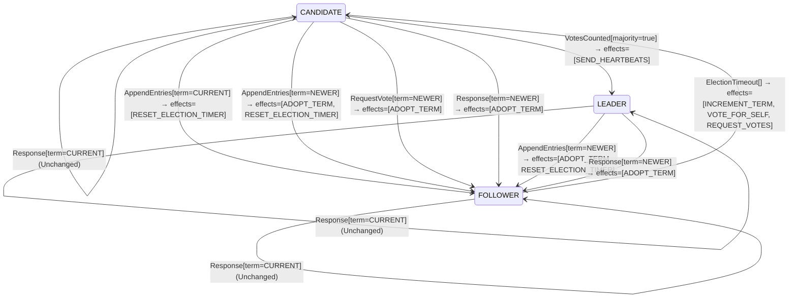

<!-- Generated by examples/tools/build.py from example.json and the verifier's output. Edit example.json. -->
# 065 · A leader that ignores vote requests from newer terms votes twice in a term

[← All examples](../README.md)

| Verdict | Categories | Severity if shipped | Change | Verified unit | Approach |
|---|---|---|---|---|---|
| **✗ Violation: ElectionSafety, 8-step trace** | functional | critical | feature, behaviour change intended | [`RoleMachine#decide`](../../examples/apps/quorum/src/main/java/net/terminalvalue/quorum/raft/RoleMachine.java) | [D1: Protocol model checking](../../examples/apps/quorum/spec/README.md) |

> A Raft server that hears a newer term from anyone becomes a follower of that term. A developer exempts the leader from the vote request: a leader should keep serving until a newer leader's heartbeat, or a reply from a newer term, proves the cluster has moved on, so that a server that comes back from a partition with an inflated term cannot depose a working leader on every retry. The contract diff is one case and is approved. The election model finds the bug under all three of its safety configurations: an eight-step run of three servers in which the leader's vote elects two candidates of the same term, the one step that breaks the inductive invariant (a leader that holds a vote cast in an older term), and a longer run of four servers.

Tags: [consensus](../README.md#tag-consensus), [leader-election](../README.md#tag-leader-election), [agreement](../README.md#tag-agreement), [composition](../README.md#tag-composition), [generated-operator](../README.md#tag-generated-operator), [multiple-configurations](../README.md#tag-multiple-configurations)

## The change

Make the `RequestVote` case keep a leader in office: a follower or candidate that hears a newer term still becomes its follower with `ADOPT_TERM`, a leader is `unchanged`. The reasoning in the comment: a leader has a majority's confidence, and a vote request is not proof that the cluster has moved on, whereas a newer leader's `AppendEntries` or a reply from a newer term is (both still make it step down). The concern is the disruptive server of Ongaro's thesis, section 4.2.3: one that was partitioned, timed out repeatedly, and comes back with a term far ahead of the cluster's. The behavioural contract is regenerated and its diff is the one case `decide(LEADER, RequestVote[NEWER])`, now `unchanged`. The reviewer approves the diff: the leader still steps down on the other two signals.

**Before** ([`RoleMachine.java`](../../examples/apps/quorum/src/main/java/net/terminalvalue/quorum/raft/RoleMachine.java), line 52):

```java
    };
    case OLDER -> rejected("stale leader");
};
case RequestVote vote -> vote.term() == NEWER
        ? transition(FOLLOWER, ADOPT_TERM)
        : unchanged("the vote itself is decided by the vote rule");
case Response response -> response.term() == NEWER
```

**After:**

```java
    };
    case OLDER -> rejected("stale leader");
};
// A leader keeps serving until a newer leader's AppendEntries, or a reply from a newer term, proves the
// cluster has moved on. A vote request alone does not: a server that was partitioned and comes back with
// an inflated term would otherwise depose a working leader every time it retries.
case RequestVote vote -> vote.term() == NEWER && role != LEADER
        ? transition(FOLLOWER, ADOPT_TERM)
        : unchanged("the vote itself is decided by the vote rule");
case Response response -> response.term() == NEWER
```

<details><summary>Patch</summary>

```diff
--- a/examples/apps/quorum/src/main/java/net/terminalvalue/quorum/raft/RoleMachine.java
+++ b/examples/apps/quorum/src/main/java/net/terminalvalue/quorum/raft/RoleMachine.java
@@ -52,7 +52,10 @@
                 };
                 case OLDER -> rejected("stale leader");
             };
-            case RequestVote vote -> vote.term() == NEWER
+            // A leader keeps serving until a newer leader's AppendEntries, or a reply from a newer term, proves the
+            // cluster has moved on. A vote request alone does not: a server that was partitioned and comes back with
+            // an inflated term would otherwise depose a working leader every time it retries.
+            case RequestVote vote -> vote.term() == NEWER && role != LEADER
                     ? transition(FOLLOWER, ADOPT_TERM)
                     : unchanged("the vote itself is decided by the vote rule");
             case Response response -> response.term() == NEWER
```

</details>

## What the verifier found

The model is checked under 7 configurations, and the verdict is the first that fails:

| Configuration | What it checks | Model | Result |
|---|---|---|---|
| three servers (`spec/RaftElection.cfg`) | every run from the initial state, every interleaving within the configuration's bounds | Servers = {s1, s2, s3}, MaxTerm = 3, LeftBehind = {}, DelayedReplies = FALSE, History = FALSE | ✗ Violation: ElectionSafety, 8-step trace |
| the inductive step (`spec/RaftElectionInductive.cfg`) | that the invariant `Inductive` is inductive: TLC starts from every state the invariant admits, reachable or not, rather than from the initial state, takes one step, and checks the invariant again, conjunct by conjunct. No counterexample is a proof of election safety by induction, for any run of the cluster however long; a counterexample is one step from a state that need not be reachable | Servers = {s1, s2, s3}, MaxTerm = 3, LeftBehind = {}, DelayedReplies = FALSE, History = FALSE | ✗ Violation: VotesAreBound, 2-step trace |
| four servers (`spec/RaftElectionFour.cfg`) | every run with four servers, a cluster in which a candidate can hold a vote besides its own and still be short of a majority, which three servers never show; under a symmetry set, so that of the states that differ only by the servers' names TLC explores one | Servers = {s1, s2, s3, s4}, MaxTerm = 3, LeftBehind = {}, DelayedReplies = FALSE, History = FALSE | ✗ Violation: ElectionSafety, 13-step trace |
| fairness (`spec/RaftElectionLive.cfg`) | the two liveness properties, under the fairness conditions `Fairness`: a server whose timer nothing resets times out, a candidate asks for the votes it lacks, a leader sends its heartbeats. A counterexample is a run that goes on forever without satisfying a property: a prefix, then a state or a cycle the system never leaves | Servers = {s1, s2, s3}, MaxTerm = 3, LeftBehind = {}, DelayedReplies = FALSE, History = FALSE | ✗ Violation: ElectionSafety, 8-step trace |
| a server left behind (`spec/RaftElectionLogs.cfg`) | the election restriction: one server holds the log a deposed leader of term 1 left behind, three entries of its term, while the other two hold an entry of term 2 that a majority holds and is therefore committed, so that the longer log is the one behind; every run with these logs, which nothing changes, under the invariant `LeaderCompleteness` besides the usual ones | Servers = {s1, s2, s3}, MaxTerm = 3, LeftBehind = {s1}, DelayedReplies = FALSE, History = FALSE | ✗ Violation: ElectionSafety, 10-step trace |
| delayed replies (`spec/RaftElectionDelayed.cfg`) | every run of three servers and two terms in which the reply to a vote request is a step of its own, which the candidate may take after it has timed out into a newer term, stepped down, or won; the one-step RPC of the other configurations never hands the role machine a reply from an older term than the server's own, and this one does, under the usual invariants and action properties | Servers = {s1, s2, s3}, MaxTerm = 2, LeftBehind = {}, DelayedReplies = TRUE, History = FALSE | ✓ Verified: all invariants and properties hold in 24,515 states |
| history (`spec/RaftElectionHistory.cfg`) | every run of three servers and three terms with the two history variables recording, `elected`, every term a server has led, and `voted`, every vote cast, under the two invariants that are about a run rather than a state: at most one leader elected per term and at most one vote per server per term, as the paper states them. The state invariants of the other configurations hold in a run in which a term's leader steps down and the term then elects another; these do not | Servers = {s1, s2, s3}, MaxTerm = 3, LeftBehind = {}, DelayedReplies = FALSE, History = TRUE | ✗ Violation: AtMostOneVotePerTerm, 5-step trace |

TLC found a run of the system under three servers, 8 steps long, that violates the invariant **ElectionSafety** (at most one leader per term). Each step is one action of one part of the system:

1. **Initial state**: every server a follower in term 0, no vote cast, no vote held.
2. **Timeout**, `Server.onElectionTimeout`: a server's election timer fires, and the server acts on the role machine's decision. `currentTerm = (s1 :> 1 @@ s2 :> 0 @@ s3 :> 0)`, `role = (s1 :> "CANDIDATE" @@ s2 :> "FOLLOWER" @@ s3 :> "FOLLOWER")`, `votedFor = (s1 :> s1 @@ s2 :> "none" @@ s3 :> "none")`, `votes = (s1 :> {s1} @@ s2 :> {} @@ s3 :> {})`
3. **Timeout**, `Server.onElectionTimeout`: a server's election timer fires, and the server acts on the role machine's decision. `currentTerm = (s1 :> 2 @@ s2 :> 0 @@ s3 :> 0)`
4. **Timeout**, `Server.onElectionTimeout`: a server's election timer fires, and the server acts on the role machine's decision. `currentTerm = (s1 :> 2 @@ s2 :> 1 @@ s3 :> 0)`, `role = (s1 :> "CANDIDATE" @@ s2 :> "CANDIDATE" @@ s3 :> "FOLLOWER")`, `votedFor = (s1 :> s1 @@ s2 :> s2 @@ s3 :> "none")`, `votes = (s1 :> {s1} @@ s2 :> {s2} @@ s3 :> {})`
5. **Canvass**, `Server.requestVote`: a candidate asks one server for its vote and gets the answer; the request and the reply each go through the role machine, then the vote rule on the voter, given its ballot and the candidate's term and log against its own, and the tally on the candidate. `currentTerm = (s1 :> 2 @@ s2 :> 1 @@ s3 :> 1)`, `role = (s1 :> "CANDIDATE" @@ s2 :> "LEADER" @@ s3 :> "FOLLOWER")`, `votedFor = (s1 :> s1 @@ s2 :> s2 @@ s3 :> s2)`, `votes = (s1 :> {s1} @@ s2 :> {s2, s3} @@ s3 :> {})`
6. **Timeout**, `Server.onElectionTimeout`: a server's election timer fires, and the server acts on the role machine's decision. `currentTerm = (s1 :> 2 @@ s2 :> 1 @@ s3 :> 2)`, `role = (s1 :> "CANDIDATE" @@ s2 :> "LEADER" @@ s3 :> "CANDIDATE")`, `votedFor = (s1 :> s1 @@ s2 :> s2 @@ s3 :> s3)`, `votes = (s1 :> {s1} @@ s2 :> {s2, s3} @@ s3 :> {s3})`
7. **Canvass**, `Server.requestVote`: a candidate asks one server for its vote and gets the answer; the request and the reply each go through the role machine, then the vote rule on the voter, given its ballot and the candidate's term and log against its own, and the tally on the candidate. `role = (s1 :> "LEADER" @@ s2 :> "LEADER" @@ s3 :> "CANDIDATE")`, `votedFor = (s1 :> s1 @@ s2 :> s1 @@ s3 :> s3)`, `votes = (s1 :> {s1, s2} @@ s2 :> {s2, s3} @@ s3 :> {s3})`
8. **Canvass**, `Server.requestVote`: a candidate asks one server for its vote and gets the answer; the request and the reply each go through the role machine, then the vote rule on the voter, given its ballot and the candidate's term and log against its own, and the tally on the candidate. `role = (s1 :> "LEADER" @@ s2 :> "LEADER" @@ s3 :> "LEADER")`, `votedFor = (s1 :> s1 @@ s2 :> s3 @@ s3 :> s3)`, `votes = (s1 :> {s1, s2} @@ s2 :> {s2, s3} @@ s3 :> {s2, s3})`

The model is small (Servers = {s1, s2, s3}, MaxTerm = 3, LeftBehind = {}, DelayedReplies = FALSE, History = FALSE), which is what keeps the trace readable. TLC explored every interleaving of the servers, their terms and votes, and the RPCs between them within those bounds.

<details><summary>The counterexample under the inductive step: invariant <b>VotesAreBound</b>, 2 steps</summary>

Invariant **VotesAreBound**: a vote in a tally was cast in the tally's term: the voter is still in that term and voted for the tally's owner, or has since moved to a newer term.

1. **Starting state**, a state the invariant `Inductive` admits, which need not be reachable: `currentTerm = (s1 :> 0 @@ s2 :> 1 @@ s3 :> 2)`, `elected = {}`, `replies = {}`, `role = (s1 :> "FOLLOWER" @@ s2 :> "LEADER" @@ s3 :> "CANDIDATE")`, `voted = {}`, `votedFor = (s1 :> "none" @@ s2 :> s2 @@ s3 :> s3)`, `votes = (s1 :> {} @@ s2 :> {s2, s3} @@ s3 :> {s3})`
2. **Canvass**, `Server.requestVote`: a candidate asks one server for its vote and gets the answer; the request and the reply each go through the role machine, then the vote rule on the voter, given its ballot and the candidate's term and log against its own, and the tally on the candidate. `role = (s1 :> "FOLLOWER" @@ s2 :> "LEADER" @@ s3 :> "LEADER")`, `votedFor = (s1 :> "none" @@ s2 :> s3 @@ s3 :> s3)`, `votes = (s1 :> {} @@ s2 :> {s2, s3} @@ s3 :> {s2, s3})`

</details>

<details><summary>The counterexample under four servers: invariant <b>ElectionSafety</b>, 13 steps</summary>

Invariant **ElectionSafety**: at most one leader per term.

1. **Initial state**: every server a follower in term 0, no vote cast, no vote held.
2. **Timeout**, `Server.onElectionTimeout`: a server's election timer fires, and the server acts on the role machine's decision. `currentTerm = (s1 :> 1 @@ s2 :> 0 @@ s3 :> 0 @@ s4 :> 0)`, `role = (s1 :> "CANDIDATE" @@ s2 :> "FOLLOWER" @@ s3 :> "FOLLOWER" @@ s4 :> "FOLLOWER")`, `votedFor = (s1 :> s1 @@ s2 :> "none" @@ s3 :> "none" @@ s4 :> "none")`, `votes = (s1 :> {s1} @@ s2 :> {} @@ s3 :> {} @@ s4 :> {})`
3. **Canvass**, `Server.requestVote`: a candidate asks one server for its vote and gets the answer; the request and the reply each go through the role machine, then the vote rule on the voter, given its ballot and the candidate's term and log against its own, and the tally on the candidate. `currentTerm = (s1 :> 1 @@ s2 :> 1 @@ s3 :> 0 @@ s4 :> 0)`, `votedFor = (s1 :> s1 @@ s2 :> s1 @@ s3 :> "none" @@ s4 :> "none")`, `votes = (s1 :> {s1, s2} @@ s2 :> {} @@ s3 :> {} @@ s4 :> {})`
4. **Timeout**, `Server.onElectionTimeout`: a server's election timer fires, and the server acts on the role machine's decision. `currentTerm = (s1 :> 1 @@ s2 :> 2 @@ s3 :> 0 @@ s4 :> 0)`, `role = (s1 :> "CANDIDATE" @@ s2 :> "CANDIDATE" @@ s3 :> "FOLLOWER" @@ s4 :> "FOLLOWER")`, `votedFor = (s1 :> s1 @@ s2 :> s2 @@ s3 :> "none" @@ s4 :> "none")`, `votes = (s1 :> {s1, s2} @@ s2 :> {s2} @@ s3 :> {} @@ s4 :> {})`
5. **Canvass**, `Server.requestVote`: a candidate asks one server for its vote and gets the answer; the request and the reply each go through the role machine, then the vote rule on the voter, given its ballot and the candidate's term and log against its own, and the tally on the candidate. `currentTerm = (s1 :> 1 @@ s2 :> 2 @@ s3 :> 1 @@ s4 :> 0)`, `role = (s1 :> "LEADER" @@ s2 :> "CANDIDATE" @@ s3 :> "FOLLOWER" @@ s4 :> "FOLLOWER")`, `votedFor = (s1 :> s1 @@ s2 :> s2 @@ s3 :> s1 @@ s4 :> "none")`, `votes = (s1 :> {s1, s2, s3} @@ s2 :> {s2} @@ s3 :> {} @@ s4 :> {})`
6. **Canvass**, `Server.requestVote`: a candidate asks one server for its vote and gets the answer; the request and the reply each go through the role machine, then the vote rule on the voter, given its ballot and the candidate's term and log against its own, and the tally on the candidate. `currentTerm = (s1 :> 1 @@ s2 :> 2 @@ s3 :> 2 @@ s4 :> 0)`, `votedFor = (s1 :> s1 @@ s2 :> s2 @@ s3 :> s2 @@ s4 :> "none")`, `votes = (s1 :> {s1, s2, s3} @@ s2 :> {s2, s3} @@ s3 :> {} @@ s4 :> {})`
7. **Timeout**, `Server.onElectionTimeout`: a server's election timer fires, and the server acts on the role machine's decision. `currentTerm = (s1 :> 1 @@ s2 :> 2 @@ s3 :> 3 @@ s4 :> 0)`, `role = (s1 :> "LEADER" @@ s2 :> "CANDIDATE" @@ s3 :> "CANDIDATE" @@ s4 :> "FOLLOWER")`, `votedFor = (s1 :> s1 @@ s2 :> s2 @@ s3 :> s3 @@ s4 :> "none")`, `votes = (s1 :> {s1, s2, s3} @@ s2 :> {s2, s3} @@ s3 :> {s3} @@ s4 :> {})`
8. **Canvass**, `Server.requestVote`: a candidate asks one server for its vote and gets the answer; the request and the reply each go through the role machine, then the vote rule on the voter, given its ballot and the candidate's term and log against its own, and the tally on the candidate. `votedFor = (s1 :> s3 @@ s2 :> s2 @@ s3 :> s3 @@ s4 :> "none")`, `votes = (s1 :> {s1, s2, s3} @@ s2 :> {s2, s3} @@ s3 :> {s1, s3} @@ s4 :> {})`
9. **Canvass**, `Server.requestVote`: a candidate asks one server for its vote and gets the answer; the request and the reply each go through the role machine, then the vote rule on the voter, given its ballot and the candidate's term and log against its own, and the tally on the candidate. `currentTerm = (s1 :> 1 @@ s2 :> 2 @@ s3 :> 3 @@ s4 :> 2)`, `role = (s1 :> "LEADER" @@ s2 :> "LEADER" @@ s3 :> "CANDIDATE" @@ s4 :> "FOLLOWER")`, `votedFor = (s1 :> s3 @@ s2 :> s2 @@ s3 :> s3 @@ s4 :> s2)`, `votes = (s1 :> {s1, s2, s3} @@ s2 :> {s2, s3, s4} @@ s3 :> {s1, s3} @@ s4 :> {})`
10. **Timeout**, `Server.onElectionTimeout`: a server's election timer fires, and the server acts on the role machine's decision. `currentTerm = (s1 :> 1 @@ s2 :> 2 @@ s3 :> 3 @@ s4 :> 3)`, `role = (s1 :> "LEADER" @@ s2 :> "LEADER" @@ s3 :> "CANDIDATE" @@ s4 :> "CANDIDATE")`, `votedFor = (s1 :> s3 @@ s2 :> s2 @@ s3 :> s3 @@ s4 :> s4)`, `votes = (s1 :> {s1, s2, s3} @@ s2 :> {s2, s3, s4} @@ s3 :> {s1, s3} @@ s4 :> {s4})`
11. **Canvass**, `Server.requestVote`: a candidate asks one server for its vote and gets the answer; the request and the reply each go through the role machine, then the vote rule on the voter, given its ballot and the candidate's term and log against its own, and the tally on the candidate. `votedFor = (s1 :> s4 @@ s2 :> s2 @@ s3 :> s3 @@ s4 :> s4)`, `votes = (s1 :> {s1, s2, s3} @@ s2 :> {s2, s3, s4} @@ s3 :> {s1, s3} @@ s4 :> {s1, s4})`
12. **Canvass**, `Server.requestVote`: a candidate asks one server for its vote and gets the answer; the request and the reply each go through the role machine, then the vote rule on the voter, given its ballot and the candidate's term and log against its own, and the tally on the candidate. `role = (s1 :> "LEADER" @@ s2 :> "LEADER" @@ s3 :> "LEADER" @@ s4 :> "CANDIDATE")`, `votedFor = (s1 :> s4 @@ s2 :> s3 @@ s3 :> s3 @@ s4 :> s4)`, `votes = ( s1 :> {s1, s2, s3} @@ s2 :> {s2, s3, s4} @@ s3 :> {s1, s2, s3} @@ s4 :> {s1, s4} )`
13. **Canvass**, `Server.requestVote`: a candidate asks one server for its vote and gets the answer; the request and the reply each go through the role machine, then the vote rule on the voter, given its ballot and the candidate's term and log against its own, and the tally on the candidate. `role = (s1 :> "LEADER" @@ s2 :> "LEADER" @@ s3 :> "LEADER" @@ s4 :> "LEADER")`, `votedFor = (s1 :> s4 @@ s2 :> s4 @@ s3 :> s3 @@ s4 :> s4)`, `votes = ( s1 :> {s1, s2, s3} @@ s2 :> {s2, s3, s4} @@ s3 :> {s1, s2, s3} @@ s4 :> {s1, s2, s4} )`

</details>

Under fairness TLC found the same run, and reported it the same way.

<details><summary>The counterexample under a server left behind: invariant <b>ElectionSafety</b>, 10 steps</summary>

Invariant **ElectionSafety**: at most one leader per term.

1. **Initial state**: every server a follower in term 0, no vote cast, no vote held.
2. **Timeout**, `Server.onElectionTimeout`: a server's election timer fires, and the server acts on the role machine's decision. `currentTerm = (s1 :> 0 @@ s2 :> 1 @@ s3 :> 0)`, `role = (s1 :> "FOLLOWER" @@ s2 :> "CANDIDATE" @@ s3 :> "FOLLOWER")`, `votedFor = (s1 :> "none" @@ s2 :> s2 @@ s3 :> "none")`, `votes = (s1 :> {} @@ s2 :> {s2} @@ s3 :> {})`
3. **Canvass**, `Server.requestVote`: a candidate asks one server for its vote and gets the answer; the request and the reply each go through the role machine, then the vote rule on the voter, given its ballot and the candidate's term and log against its own, and the tally on the candidate. `currentTerm = (s1 :> 1 @@ s2 :> 1 @@ s3 :> 0)`, `role = (s1 :> "FOLLOWER" @@ s2 :> "LEADER" @@ s3 :> "FOLLOWER")`, `votedFor = (s1 :> s2 @@ s2 :> s2 @@ s3 :> "none")`, `votes = (s1 :> {} @@ s2 :> {s1, s2} @@ s3 :> {})`
4. **Timeout**, `Server.onElectionTimeout`: a server's election timer fires, and the server acts on the role machine's decision. `currentTerm = (s1 :> 2 @@ s2 :> 1 @@ s3 :> 0)`, `role = (s1 :> "CANDIDATE" @@ s2 :> "LEADER" @@ s3 :> "FOLLOWER")`, `votedFor = (s1 :> s1 @@ s2 :> s2 @@ s3 :> "none")`, `votes = (s1 :> {s1} @@ s2 :> {s1, s2} @@ s3 :> {})`
5. **Canvass**, `Server.requestVote`: a candidate asks one server for its vote and gets the answer; the request and the reply each go through the role machine, then the vote rule on the voter, given its ballot and the candidate's term and log against its own, and the tally on the candidate. `currentTerm = (s1 :> 2 @@ s2 :> 1 @@ s3 :> 2)`
6. **Timeout**, `Server.onElectionTimeout`: a server's election timer fires, and the server acts on the role machine's decision. `currentTerm = (s1 :> 2 @@ s2 :> 1 @@ s3 :> 3)`, `role = (s1 :> "CANDIDATE" @@ s2 :> "LEADER" @@ s3 :> "CANDIDATE")`, `votedFor = (s1 :> s1 @@ s2 :> s2 @@ s3 :> s3)`, `votes = (s1 :> {s1} @@ s2 :> {s1, s2} @@ s3 :> {s3})`
7. **Canvass**, `Server.requestVote`: a candidate asks one server for its vote and gets the answer; the request and the reply each go through the role machine, then the vote rule on the voter, given its ballot and the candidate's term and log against its own, and the tally on the candidate. `role = (s1 :> "CANDIDATE" @@ s2 :> "LEADER" @@ s3 :> "LEADER")`, `votedFor = (s1 :> s1 @@ s2 :> s3 @@ s3 :> s3)`, `votes = (s1 :> {s1} @@ s2 :> {s1, s2} @@ s3 :> {s2, s3})`
8. **Heartbeat**, `Server.appendEntries`: a leader sends one server a heartbeat and gets the answer; the server adopts a newer term or yields to the leader of its own, and a stale leader is rejected and steps down. `currentTerm = (s1 :> 2 @@ s2 :> 2 @@ s3 :> 3)`, `role = (s1 :> "CANDIDATE" @@ s2 :> "FOLLOWER" @@ s3 :> "LEADER")`, `votedFor = (s1 :> s1 @@ s2 :> "none" @@ s3 :> s3)`, `votes = (s1 :> {s1} @@ s2 :> {} @@ s3 :> {s2, s3})`
9. **Timeout**, `Server.onElectionTimeout`: a server's election timer fires, and the server acts on the role machine's decision. `currentTerm = (s1 :> 2 @@ s2 :> 3 @@ s3 :> 3)`, `role = (s1 :> "CANDIDATE" @@ s2 :> "CANDIDATE" @@ s3 :> "LEADER")`, `votedFor = (s1 :> s1 @@ s2 :> s2 @@ s3 :> s3)`, `votes = (s1 :> {s1} @@ s2 :> {s2} @@ s3 :> {s2, s3})`
10. **Canvass**, `Server.requestVote`: a candidate asks one server for its vote and gets the answer; the request and the reply each go through the role machine, then the vote rule on the voter, given its ballot and the candidate's term and log against its own, and the tally on the candidate. `currentTerm = (s1 :> 3 @@ s2 :> 3 @@ s3 :> 3)`, `role = (s1 :> "FOLLOWER" @@ s2 :> "LEADER" @@ s3 :> "LEADER")`, `votedFor = (s1 :> s2 @@ s2 :> s2 @@ s3 :> s3)`, `votes = (s1 :> {} @@ s2 :> {s1, s2} @@ s3 :> {s2, s3})`

</details>

<details><summary>The counterexample under history: invariant <b>AtMostOneVotePerTerm</b>, 5 steps</summary>

Invariant **AtMostOneVotePerTerm**: AtMostOneVotePerTerm.

1. **Initial state**: every server a follower in term 0, no vote cast, no vote held.
2. **Timeout**, `Server.onElectionTimeout`: a server's election timer fires, and the server acts on the role machine's decision. `currentTerm = (s1 :> 1 @@ s2 :> 0 @@ s3 :> 0)`, `role = (s1 :> "CANDIDATE" @@ s2 :> "FOLLOWER" @@ s3 :> "FOLLOWER")`, `voted = {<<s1, 1, s1>>}`, `votedFor = (s1 :> s1 @@ s2 :> "none" @@ s3 :> "none")`, `votes = (s1 :> {s1} @@ s2 :> {} @@ s3 :> {})`
3. **Canvass**, `Server.requestVote`: a candidate asks one server for its vote and gets the answer; the request and the reply each go through the role machine, then the vote rule on the voter, given its ballot and the candidate's term and log against its own, and the tally on the candidate. `currentTerm = (s1 :> 1 @@ s2 :> 1 @@ s3 :> 0)`, `elected = {<<s1, 1>>}`, `role = (s1 :> "LEADER" @@ s2 :> "FOLLOWER" @@ s3 :> "FOLLOWER")`, `voted = {<<s1, 1, s1>>, <<s2, 1, s1>>}`, `votedFor = (s1 :> s1 @@ s2 :> s1 @@ s3 :> "none")`, `votes = (s1 :> {s1, s2} @@ s2 :> {} @@ s3 :> {})`
4. **Timeout**, `Server.onElectionTimeout`: a server's election timer fires, and the server acts on the role machine's decision. `currentTerm = (s1 :> 1 @@ s2 :> 2 @@ s3 :> 0)`, `role = (s1 :> "LEADER" @@ s2 :> "CANDIDATE" @@ s3 :> "FOLLOWER")`, `voted = {<<s1, 1, s1>>, <<s2, 1, s1>>, <<s2, 2, s2>>}`, `votedFor = (s1 :> s1 @@ s2 :> s2 @@ s3 :> "none")`, `votes = (s1 :> {s1, s2} @@ s2 :> {s2} @@ s3 :> {})`
5. **Canvass**, `Server.requestVote`: a candidate asks one server for its vote and gets the answer; the request and the reply each go through the role machine, then the vote rule on the voter, given its ballot and the candidate's term and log against its own, and the tally on the candidate. `elected = {<<s1, 1>>, <<s2, 2>>}`, `role = (s1 :> "LEADER" @@ s2 :> "LEADER" @@ s3 :> "FOLLOWER")`, `voted = {<<s1, 1, s1>>, <<s1, 1, s2>>, <<s2, 1, s1>>, <<s2, 2, s2>>}`, `votedFor = (s1 :> s2 @@ s2 :> s2 @@ s3 :> "none")`, `votes = (s1 :> {s1, s2} @@ s2 :> {s1, s2} @@ s3 :> {})`

</details>

**What the verdict rests on.** TLC counted how often a step of the model took each row of the generated operators. A row no step takes is one the model says nothing about, whatever the verdict.

| Configuration | Rows of `RoleMachine#decide` taken | Rows of `VoteRule#decide` taken |
|---|---|---|
| three servers | stopped at the counterexample | stopped at the counterexample |
| the inductive step (from the states the invariant admits, not from a run) | stopped at the counterexample | stopped at the counterexample |
| four servers | stopped at the counterexample | stopped at the counterexample |
| fairness | stopped at the counterexample | stopped at the counterexample |
| a server left behind | stopped at the counterexample | stopped at the counterexample |
| delayed replies | 33 of 36 | 6 of 27 |
| history | stopped at the counterexample | stopped at the counterexample |

The change alters 1 row of the contract:

- `decide(LEADER, RequestVote[term=NEWER])`: `Transition[next=FOLLOWER, effects=[ADOPT_TERM]]` → `Unchanged[reason="the vote itself is decided by the vote rule"]`, taken under delayed replies

The run under three servers, the inductive step, four servers, fairness, a server left behind, history stopped at its counterexample, the steps above, and its counts are left out: the verdict rests on the counterexample.

<details><summary>Rows no step takes under delayed replies</summary>

`net.terminalvalue.quorum.raft.RoleMachine#decide`:

```
decide(FOLLOWER, VotesCounted[majority=true]) => Unchanged
decide(LEADER, VotesCounted[majority=false]) => Unchanged
decide(LEADER, AppendEntries[term=CURRENT]) => throws IllegalStateException
```

`net.terminalvalue.quorum.raft.VoteRule#decide`:

```
decide(OPEN, VoteRequest[term=OLDER, log=BEHIND]) => Rejected
decide(OPEN, VoteRequest[term=OLDER, log=AHEAD]) => Rejected
decide(OPEN, VoteRequest[term=CURRENT, log=BEHIND]) => Rejected
decide(OPEN, VoteRequest[term=CURRENT, log=AHEAD]) => Transition[next=FOR_THE_CANDIDATE, effects=[GRANT]]
decide(OPEN, VoteRequest[term=NEWER, log=BEHIND]) => Rejected
decide(OPEN, VoteRequest[term=NEWER, log=EVEN]) => Transition[next=FOR_THE_CANDIDATE, effects=[GRANT]]
decide(OPEN, VoteRequest[term=NEWER, log=AHEAD]) => Transition[next=FOR_THE_CANDIDATE, effects=[GRANT]]
decide(FOR_THE_CANDIDATE, VoteRequest[term=OLDER, log=BEHIND]) => Rejected
decide(FOR_THE_CANDIDATE, VoteRequest[term=OLDER, log=EVEN]) => Rejected
decide(FOR_THE_CANDIDATE, VoteRequest[term=OLDER, log=AHEAD]) => Rejected
decide(FOR_THE_CANDIDATE, VoteRequest[term=CURRENT, log=BEHIND]) => Rejected
decide(FOR_THE_CANDIDATE, VoteRequest[term=CURRENT, log=EVEN]) => Transition[next=FOR_THE_CANDIDATE, effects=[GRANT]]
decide(FOR_THE_CANDIDATE, VoteRequest[term=CURRENT, log=AHEAD]) => Transition[next=FOR_THE_CANDIDATE, effects=[GRANT]]
decide(FOR_THE_CANDIDATE, VoteRequest[term=NEWER, log=BEHIND]) => Rejected
decide(FOR_THE_CANDIDATE, VoteRequest[term=NEWER, log=AHEAD]) => Transition[next=FOR_THE_CANDIDATE, effects=[GRANT]]
decide(FOR_ANOTHER, VoteRequest[term=OLDER, log=BEHIND]) => Rejected
decide(FOR_ANOTHER, VoteRequest[term=OLDER, log=AHEAD]) => Rejected
decide(FOR_ANOTHER, VoteRequest[term=CURRENT, log=BEHIND]) => Rejected
decide(FOR_ANOTHER, VoteRequest[term=CURRENT, log=AHEAD]) => Rejected
decide(FOR_ANOTHER, VoteRequest[term=NEWER, log=BEHIND]) => Rejected
decide(FOR_ANOTHER, VoteRequest[term=NEWER, log=AHEAD]) => Transition[next=FOR_THE_CANDIDATE, effects=[GRANT]]
```

</details>

The state machine the patched code implements, drawn from its derived contract (`jvmcontract statemachine`); a state with no way in or no way out is marked:



## Would the existing tests have caught it?

No: every existing unit test passes (`java -ea net.terminalvalue.quorum.Tests`, run against the patched code).

## Why it matters

The vote. A server answers a vote request in two steps, the role machine first and then the vote rule, and the vote rule assumes the role machine ran: by the time it decides, a request from a newer term has made the server a follower of that term with no vote cast in it, which is why `VoteRule.grant` treats a candidate whose term is ahead of the server's as asking for a free vote. With the role machine told to stay put, that assumption is false for a leader. The leader grants the vote, since the candidate's term is ahead of its own, without entering the candidate's term, so it has no record of having voted in it; the next candidate of that term is ahead of it too, and gets the vote as well. A vote is cast per term, and the term is what `ADOPT_TERM` moves the server to; a server that votes in a term it has not entered votes in it as often as it is asked. Two candidates of one term holding the same leader's vote each have a majority of three, and election safety (Raft, figure 3) is gone. The contract diff is exactly what the developer intended, and the leader does step down on the signals the comment names; the bug is in what it does before it steps down.

## Why the verdict is right

The election model is checked under four configurations, and the three that check safety all fail. With three servers and three terms TLC reports the shortest run that breaks `ElectionSafety`: s1's timer fires twice, so s1 is a candidate of term 2; s2's fires once and s2 asks s3, which enters term 1 and grants, so s2 leads term 1; s3's timer fires and s3 is a candidate of term 2. s1 asks s2: the leader stays in term 1, and the vote rule, seeing a candidate ahead of it, grants; s1 holds two votes of three and leads term 2. s3 asks s2: still in term 1, still behind a candidate of term 2, s2 grants again, and s3 leads term 2 too, with the same vote. The inductive step starts from every state the invariant `Inductive` admits and finds the one step that leaves it: a leader of term 1 answers a candidate of term 2 and the candidate wins with its vote, which breaks `VotesAreBound`, that a vote in a tally was cast in the tally's term, the conjunct that carries the whole argument for one leader per term. With four servers under the symmetry set the run is longer and ends the same way. The fourth configuration, the liveness check, checks the same invariants while it explores and reports the same eight-step run before it gets to the temporal properties: TLC checks invariants during the search and temporal properties after it.

## What to do

Revert. The rule the developer wanted exists, in Ongaro's thesis (section 4.2.3): a server that has heard from a leader within the minimum election timeout ignores the request, the term and the vote both, and that takes a clock and a change to the vote rule as much as to the role machine. In this kernel the vote rule assumes the role machine ran first, so a role machine that does not adopt the term must also make the vote rule refuse, or the two disagree about what term the server is in. The example is a cousin of 014, where the leader ignored newer terms in replies and the behavioural contract caught the missing transition; here the transition is missing on purpose, the contract records the developer's intent, and the model shows what the rest of the protocol does with it.

## Notes

- The Raft election model (`apps/quorum/spec/RaftElection.tla`) is built around the role machine, generated from its contract, with election safety as an invariant and two action properties, `[][A]_v` formulas that constrain each step: terms never decrease, a leader never campaigns. An example is checked under all of the model's configurations, and its verdict is the first that fails.
- `RaftElectionLive.cfg` checks liveness under fairness: a timer nothing resets fires, a candidate asks for the votes it lacks, a leader sends its heartbeats. Each action's enabling condition is written out as a state predicate, so that TLC need not compute `ENABLED` on every step of the liveness check. A retry rule can keep every safety property and still break liveness.
- The vote rule assumes the role machine ran first; a leader that ignores vote requests from newer terms breaks that and votes twice in a term.

## Evidence

How the verdict was reached: three servers: TLC 2.19 explored 657 distinct states to depth 8 in 1 s, for the model Servers = {s1, s2, s3}, MaxTerm = 3, LeftBehind = {}, DelayedReplies = FALSE, History = FALSE; the inductive step: TLC 2.19 explored 17,471 distinct states to depth 2 in 6 s, for the model Servers = {s1, s2, s3}, MaxTerm = 3, LeftBehind = {}, DelayedReplies = FALSE, History = FALSE; four servers: TLC 2.19 explored 2,855 distinct states to depth 13 in 3 s, for the model Servers = {s1, s2, s3, s4}, MaxTerm = 3, LeftBehind = {}, DelayedReplies = FALSE, History = FALSE; fairness: TLC 2.19 explored 657 distinct states to depth 8 in 2 s, for the model Servers = {s1, s2, s3}, MaxTerm = 3, LeftBehind = {}, DelayedReplies = FALSE, History = FALSE; a server left behind: TLC 2.19 explored 607 distinct states to depth 10 in 1 s, for the model Servers = {s1, s2, s3}, MaxTerm = 3, LeftBehind = {s1}, DelayedReplies = FALSE, History = FALSE; delayed replies: TLC 2.19 explored 24,515 distinct states to depth 15 in 9 s, for the model Servers = {s1, s2, s3}, MaxTerm = 2, LeftBehind = {}, DelayedReplies = TRUE, History = FALSE; history: TLC 2.19 explored 91 distinct states to depth 5 in 0 s, for the model Servers = {s1, s2, s3}, MaxTerm = 3, LeftBehind = {}, DelayedReplies = FALSE, History = TRUE.

<details><summary>Verifier output</summary>

```text
== three servers: spec/RaftElection.cfg ==
TLC2 Version 2.19 of 08 August 2024 (rev: 5a47802)
Running breadth-first search Model-Checking with fp 1 and seed 1 with 1 worker on 2 cores with 2185MB heap and 64MB offheap memory [pid: 943456] (Linux 6.6.87.2-microsoft-standard-WSL2 aarch64, Eclipse Adoptium 25.0.4.1 x86_64, MSBDiskFPSet, DiskStateQueue).
Parsing file examples/apps/quorum/spec/RaftElection.tla
Parsing file examples/tools/tla/standard-modules/Naturals.tla
Parsing file examples/tools/tla/standard-modules/FiniteSets.tla
Parsing file examples/tools/tla/standard-modules/Sequences.tla
Parsing file examples/tools/tla/standard-modules/TLC.tla
Parsing file examples/apps/quorum/spec/RoleMachineContract.tla
Parsing file examples/apps/quorum/spec/VoteRuleContract.tla
Semantic processing of module Naturals
Semantic processing of module Sequences
Semantic processing of module FiniteSets
Semantic processing of module TLC
Semantic processing of module RoleMachineContract
Semantic processing of module VoteRuleContract
Semantic processing of module RaftElection
Starting... (2026-11-02 21:37:09)
Computing initial states...
Finished computing initial states: 1 distinct state generated at 2026-11-02 21:37:09.
Error: Invariant ElectionSafety is violated.
Error: The behavior up to this point is:
State 1: <Initial predicate>
/\ replies = {}
/\ currentTerm = (s1 :> 0 @@ s2 :> 0 @@ s3 :> 0)
/\ voted = {}
/\ votes = (s1 :> {} @@ s2 :> {} @@ s3 :> {})
/\ role = (s1 :> "FOLLOWER" @@ s2 :> "FOLLOWER" @@ s3 :> "FOLLOWER")
/\ votedFor = (s1 :> "none" @@ s2 :> "none" @@ s3 :> "none")
/\ elected = {}

State 2: <Timeout line 147, col 15 to line 147, col 88 of module RaftElection>
/\ replies = {}
/\ currentTerm = (s1 :> 1 @@ s2 :> 0 @@ s3 :> 0)
/\ voted = {}
/\ votes = (s1 :> {s1} @@ s2 :> {} @@ s3 :> {})
/\ role = (s1 :> "CANDIDATE" @@ s2 :> "FOLLOWER" @@ s3 :> "FOLLOWER")
/\ votedFor = (s1 :> s1 @@ s2 :> "none" @@ s3 :> "none")
/\ elected = {}

State 3: <Timeout line 147, col 15 to line 147, col 88 of module RaftElection>
/\ replies = {}
/\ currentTerm = (s1 :> 2 @@ s2 :> 0 @@ s3 :> 0)
/\ voted = {}
/\ votes = (s1 :> {s1} @@ s2 :> {} @@ s3 :> {})
/\ role = (s1 :> "CANDIDATE" @@ s2 :> "FOLLOWER" @@ s3 :> "FOLLOWER")
/\ votedFor = (s1 :> s1 @@ s2 :> "none" @@ s3 :> "none")
/\ elected = {}

State 4: <Timeout line 147, col 15 to line 147, col 88 of module RaftElection>
/\ replies = {}
/\ currentTerm = (s1 :> 2 @@ s2 :> 1 @@ s3 :> 0)
/\ voted = {}
/\ votes = (s1 :> {s1} @@ s2 :> {s2} @@ s3 :> {})
/\ role = (s1 :> "CANDIDATE" @@ s2 :> "CANDIDATE" @@ s3 :> "FOLLOWER")
/\ votedFor = (s1 :> s1 @@ s2 :> s2 @@ s3 :> "none")
/\ elected = {}

State 5: <Canvass line 176, col 5 to line 180, col 30 of module RaftElection>
/\ replies = {}
/\ currentTerm = (s1 :> 2 @@ s2 :> 1 @@ s3 :> 1)
/\ voted = {}
/\ votes = (s1 :> {s1} @@ s2 :> {s2, s3} @@ s3 :> {})
/\ role = (s1 :> "CANDIDATE" @@ s2 :> "LEADER" @@ s3 :> "FOLLOWER")
/\ votedFor = (s1 :> s1 @@ s2 :> s2 @@ s3 :> s2)
/\ elected = {}

State 6: <Timeout line 147, col 15 to line 147, col 88 of module RaftElection>
/\ replies = {}
/\ currentTerm = (s1 :> 2 @@ s2 :> 1 @@ s3 :> 2)
/\ voted = {}
/\ votes = (s1 :> {s1} @@ s2 :> {s2, s3} @@ s3 :> {s3})
/\ role = (s1 :> "CANDIDATE" @@ s2 :> "LEADER" @@ s3 :> "CANDIDATE")
/\ votedFor = (s1 :> s1 @@ s2 :> s2 @@ s3 :> s3)
/\ elected = {}

State 7: <Canvass line 176, col 5 to line 180, col 30 of module RaftElection>
/\ replies = {}
/\ currentTerm = (s1 :> 2 @@ s2 :> 1 @@ s3 :> 2)
/\ voted = {}
/\ votes = (s1 :> {s1, s2} @@ s2 :> {s2, s3} @@ s3 :> {s3})
/\ role = (s1 :> "LEADER" @@ s2 :> "LEADER" @@ s3 :> "CANDIDATE")
/\ votedFor = (s1 :> s1 @@ s2 :> s1 @@ s3 :> s3)
/\ elected = {}

State 8: <Canvass line 176, col 5 to line 180, col 30 of module RaftElection>
/\ replies = {}
/\ currentTerm = (s1 :> 2 @@ s2 :> 1 @@ s3 :> 2)
/\ voted = {}
/\ votes = (s1 :> {s1, s2} @@ s2 :> {s2, s3} @@ s3 :> {s2, s3})
/\ role = (s1 :> "LEADER" @@ s2 :> "LEADER" @@ s3 :> "LEADER")
/\ votedFor = (s1 :> s1 @@ s2 :> s3 @@ s3 :> s3)
/\ elected = {}

Rows of net.terminalvalue.quorum.raft.RoleMachine#decide a step of the model takes: 28 of 36; never taken (8):
  decide(FOLLOWER, VotesCounted[majority=true]) => Unchanged
  decide(FOLLOWER, Response[term=OLDER]) => Unchanged
  decide(FOLLOWER, Response[term=CURRENT]) => Unchanged
  decide(FOLLOWER, Response[term=NEWER]) => Transition[next=FOLLOWER, effects=[ADOPT_TERM]]
  decide(LEADER, VotesCounted[majority=false]) => Unchanged
  decide(LEADER, VotesCounted[majority=true]) => Unchanged
  decide(LEADER, AppendEntries[term=CURRENT]) => throws IllegalStateException
  decide(LEADER, Response[term=OLDER]) => Unchanged
Rows of net.terminalvalue.quorum.raft.VoteRule#decide a step of the model takes: 5 of 27; never taken (22):
  decide(OPEN, VoteRequest[term=OLDER, log=BEHIND]) => Rejected
  decide(OPEN, VoteRequest[term=OLDER, log=AHEAD]) => Rejected
  decide(OPEN, VoteRequest[term=CURRENT, log=BEHIND]) => Rejected
  decide(OPEN, VoteRequest[term=CURRENT, log=AHEAD]) => Transition[next=FOR_THE_CANDIDATE, effects=[GRANT]]
  decide(OPEN, VoteRequest[term=NEWER, log=BEHIND]) => Rejected
  decide(OPEN, VoteRequest[term=NEWER, log=EVEN]) => Transition[next=FOR_THE_CANDIDATE, effects=[GRANT]]
  decide(OPEN, VoteRequest[term=NEWER, log=AHEAD]) => Transition[next=FOR_THE_CANDIDATE, effects=[GRANT]]
  decide(FOR_THE_CANDIDATE, VoteRequest[term=OLDER, log=BEHIND]) => Rejected
  decide(FOR_THE_CANDIDATE, VoteRequest[term=OLDER, log=EVEN]) => Rejected
  decide(FOR_THE_CANDIDATE, VoteRequest[term=OLDER, log=AHEAD]) => Rejected
  decide(FOR_THE_CANDIDATE, VoteRequest[term=CURRENT, log=BEHIND]) => Rejected
  decide(FOR_THE_CANDIDATE, VoteRequest[term=CURRENT, log=EVEN]) => Transition[next=FOR_THE_CANDIDATE, effects=[GRANT]]
  decide(FOR_THE_CANDIDATE, VoteRequest[term=CURRENT, log=AHEAD]) => Transition[next=FOR_THE_CANDIDATE, effects=[GRANT]]
  decide(FOR_THE_CANDIDATE, VoteRequest[term=NEWER, log=BEHIND]) => Rejected
  decide(FOR_THE_CANDIDATE, VoteRequest[term=NEWER, log=EVEN]) => Transition[next=FOR_THE_CANDIDATE, effects=[GRANT]]
  decide(FOR_THE_CANDIDATE, VoteRequest[term=NEWER, log=AHEAD]) => Transition[next=FOR_THE_CANDIDATE, effects=[GRANT]]
  decide(FOR_ANOTHER, VoteRequest[term=OLDER, log=BEHIND]) => Rejected
  decide(FOR_ANOTHER, VoteRequest[term=OLDER, log=AHEAD]) => Rejected
  decide(FOR_ANOTHER, VoteRequest[term=CURRENT, log=BEHIND]) => Rejected
  decide(FOR_ANOTHER, VoteRequest[term=CURRENT, log=AHEAD]) => Rejected
  decide(FOR_ANOTHER, VoteRequest[term=NEWER, log=BEHIND]) => Rejected
  decide(FOR_ANOTHER, VoteRequest[term=NEWER, log=AHEAD]) => Transition[next=FOR_THE_CANDIDATE, effects=[GRANT]]
2156 states generated, 657 distinct states found, 307 states left on queue.
The depth of the complete state graph search is 8.
The average outdegree of the complete state graph is 2 (minimum is 0, the maximum 5 and the 95th percentile is 4).
Finished in 01s at (2026-11-02 21:37:10)

== the inductive step: spec/RaftElectionInductive.cfg ==
TLC2 Version 2.19 of 08 August 2024 (rev: 5a47802)
Running breadth-first search Model-Checking with fp 1 and seed 1 with 1 worker on 2 cores with 2185MB heap and 64MB offheap memory [pid: 943564] (Linux 6.6.87.2-microsoft-standard-WSL2 aarch64, Eclipse Adoptium 25.0.4.1 x86_64, MSBDiskFPSet, DiskStateQueue).
Parsing file examples/apps/quorum/spec/RaftElection.tla
Parsing file examples/tools/tla/standard-modules/Naturals.tla
Parsing file examples/tools/tla/standard-modules/FiniteSets.tla
Parsing file examples/tools/tla/standard-modules/Sequences.tla
Parsing file examples/tools/tla/standard-modules/TLC.tla
Parsing file examples/apps/quorum/spec/RoleMachineContract.tla
Parsing file examples/apps/quorum/spec/VoteRuleContract.tla
Semantic processing of module Naturals
Semantic processing of module Sequences
Semantic processing of module FiniteSets
Semantic processing of module TLC
Semantic processing of module RoleMachineContract
Semantic processing of module VoteRuleContract
Semantic processing of module RaftElection
Starting... (2026-11-02 21:37:11)
Computing initial states...
Computed 2 initial states...
Computed 4 initial states...
Computed 8 initial states...
Computed 16 initial states...
Computed 32 initial states...
Computed 64 initial states...
Computed 128 initial states...
Computed 256 initial states...
Computed 512 initial states...
Computed 1024 initial states...
Computed 2048 initial states...
Computed 4096 initial states...
Computed 8192 initial states...
Computed 16384 initial states...
Finished computing initial states: 17470 distinct states generated at 2026-11-02 21:37:17.
Error: Invariant VotesAreBound is violated.
Error: The behavior up to this point is:
State 1: <Initial predicate>
/\ replies = {}
/\ currentTerm = (s1 :> 0 @@ s2 :> 1 @@ s3 :> 2)
/\ voted = {}
/\ votes = (s1 :> {} @@ s2 :> {s2, s3} @@ s3 :> {s3})
/\ role = (s1 :> "FOLLOWER" @@ s2 :> "LEADER" @@ s3 :> "CANDIDATE")
/\ votedFor = (s1 :> "none" @@ s2 :> s2 @@ s3 :> s3)
/\ elected = {}

State 2: <Canvass line 176, col 5 to line 180, col 30 of module RaftElection>
/\ replies = {}
/\ currentTerm = (s1 :> 0 @@ s2 :> 1 @@ s3 :> 2)
/\ voted = {}
/\ votes = (s1 :> {} @@ s2 :> {s2, s3} @@ s3 :> {s2, s3})
/\ role = (s1 :> "FOLLOWER" @@ s2 :> "LEADER" @@ s3 :> "LEADER")
/\ votedFor = (s1 :> "none" @@ s2 :> s3 @@ s3 :> s3)
/\ elected = {}

Rows of net.terminalvalue.quorum.raft.RoleMachine#decide a step of the model takes: 21 of 36; never taken (15):
  decide(FOLLOWER, VotesCounted[majority=true]) => Unchanged
  decide(FOLLOWER, Response[term=OLDER]) => Unchanged
  decide(FOLLOWER, Response[term=CURRENT]) => Unchanged
  decide(FOLLOWER, Response[term=NEWER]) => Transition[next=FOLLOWER, effects=[ADOPT_TERM]]
  decide(CANDIDATE, AppendEntries[term=OLDER]) => Rejected
  decide(CANDIDATE, AppendEntries[term=CURRENT]) => Transition[next=FOLLOWER, effects=[RESET_ELECTION_TIMER]]
  decide(CANDIDATE, AppendEntries[term=NEWER]) => Transition[next=FOLLOWER, effects=[ADOPT_TERM, RESET_ELECTION_TIMER]]
  decide(LEADER, VotesCounted[majority=false]) => Unchanged
  decide(LEADER, VotesCounted[majority=true]) => Unchanged
  decide(LEADER, AppendEntries[term=OLDER]) => Rejected
  decide(LEADER, AppendEntries[term=CURRENT]) => throws IllegalStateException
  decide(LEADER, AppendEntries[term=NEWER]) => Transition[next=FOLLOWER, effects=[ADOPT_TERM, RESET_ELECTION_TIMER]]
  decide(LEADER, RequestVote[term=OLDER]) => Unchanged
  decide(LEADER, RequestVote[term=CURRENT]) => Unchanged
  decide(LEADER, Response[term=OLDER]) => Unchanged
Rows of net.terminalvalue.quorum.raft.VoteRule#decide a step of the model takes: 7 of 27; never taken (20):
  decide(OPEN, VoteRequest[term=OLDER, log=BEHIND]) => Rejected
  decide(OPEN, VoteRequest[term=OLDER, log=AHEAD]) => Rejected
  decide(OPEN, VoteRequest[term=CURRENT, log=BEHIND]) => Rejected
  decide(OPEN, VoteRequest[term=CURRENT, log=AHEAD]) => Transition[next=FOR_THE_CANDIDATE, effects=[GRANT]]
  decide(OPEN, VoteRequest[term=NEWER, log=BEHIND]) => Rejected
  decide(OPEN, VoteRequest[term=NEWER, log=EVEN]) => Transition[next=FOR_THE_CANDIDATE, effects=[GRANT]]
  decide(OPEN, VoteRequest[term=NEWER, log=AHEAD]) => Transition[next=FOR_THE_CANDIDATE, effects=[GRANT]]
  decide(FOR_THE_CANDIDATE, VoteRequest[term=OLDER, log=BEHIND]) => Rejected
  decide(FOR_THE_CANDIDATE, VoteRequest[term=OLDER, log=AHEAD]) => Rejected
  decide(FOR_THE_CANDIDATE, VoteRequest[term=CURRENT, log=BEHIND]) => Rejected
  decide(FOR_THE_CANDIDATE, VoteRequest[term=CURRENT, log=AHEAD]) => Transition[next=FOR_THE_CANDIDATE, effects=[GRANT]]
  decide(FOR_THE_CANDIDATE, VoteRequest[term=NEWER, log=BEHIND]) => Rejected
  decide(FOR_THE_CANDIDATE, VoteRequest[term=NEWER, log=EVEN]) => Transition[next=FOR_THE_CANDIDATE, effects=[GRANT]]
  decide(FOR_THE_CANDIDATE, VoteRequest[term=NEWER, log=AHEAD]) => Transition[next=FOR_THE_CANDIDATE, effects=[GRANT]]
  decide(FOR_ANOTHER, VoteRequest[term=OLDER, log=BEHIND]) => Rejected
  decide(FOR_ANOTHER, VoteRequest[term=OLDER, log=AHEAD]) => Rejected
  decide(FOR_ANOTHER, VoteRequest[term=CURRENT, log=BEHIND]) => Rejected
  decide(FOR_ANOTHER, VoteRequest[term=CURRENT, log=AHEAD]) => Rejected
  decide(FOR_ANOTHER, VoteRequest[term=NEWER, log=BEHIND]) => Rejected
  decide(FOR_ANOTHER, VoteRequest[term=NEWER, log=AHEAD]) => Transition[next=FOR_THE_CANDIDATE, effects=[GRANT]]
17911 states generated, 17471 distinct states found, 17349 states left on queue.
The depth of the complete state graph search is 2.
The average outdegree of the complete state graph is 0 (minimum is 0, the maximum 0 and the 95th percentile is 0).
Finished in 06s at (2026-11-02 21:37:17)

== four servers: spec/RaftElectionFour.cfg ==
TLC2 Version 2.19 of 08 August 2024 (rev: 5a47802)
Running breadth-first search Model-Checking with fp 1 and seed 1 with 1 worker on 2 cores with 2185MB heap and 64MB offheap memory [pid: 943928] (Linux 6.6.87.2-microsoft-standard-WSL2 aarch64, Eclipse Adoptium 25.0.4.1 x86_64, MSBDiskFPSet, DiskStateQueue).
Parsing file examples/apps/quorum/spec/RaftElection.tla
Parsing file examples/tools/tla/standard-modules/Naturals.tla
Parsing file examples/tools/tla/standard-modules/FiniteSets.tla
Parsing file examples/tools/tla/standard-modules/Sequences.tla
Parsing file examples/tools/tla/standard-modules/TLC.tla
Parsing file examples/apps/quorum/spec/RoleMachineContract.tla
Parsing file examples/apps/quorum/spec/VoteRuleContract.tla
Semantic processing of module Naturals
Semantic processing of module Sequences
Semantic processing of module FiniteSets
Semantic processing of module TLC
Semantic processing of module RoleMachineContract
Semantic processing of module VoteRuleContract
Semantic processing of module RaftElection
Starting... (2026-11-02 21:37:18)
Computing initial states...
Finished computing initial states: 1 distinct state generated at 2026-11-02 21:37:18.
Error: Invariant ElectionSafety is violated.
Error: The behavior up to this point is:
State 1: <Initial predicate>
/\ replies = {}
/\ currentTerm = (s1 :> 0 @@ s2 :> 0 @@ s3 :> 0 @@ s4 :> 0)
/\ voted = {}
/\ votes = (s1 :> {} @@ s2 :> {} @@ s3 :> {} @@ s4 :> {})
/\ role = (s1 :> "FOLLOWER" @@ s2 :> "FOLLOWER" @@ s3 :> "FOLLOWER" @@ s4 :> "FOLLOWER")
/\ votedFor = (s1 :> "none" @@ s2 :> "none" @@ s3 :> "none" @@ s4 :> "none")
/\ elected = {}

State 2: <Timeout line 147, col 15 to line 147, col 88 of module RaftElection>
/\ replies = {}
/\ currentTerm = (s1 :> 1 @@ s2 :> 0 @@ s3 :> 0 @@ s4 :> 0)
/\ voted = {}
/\ votes = (s1 :> {s1} @@ s2 :> {} @@ s3 :> {} @@ s4 :> {})
/\ role = (s1 :> "CANDIDATE" @@ s2 :> "FOLLOWER" @@ s3 :> "FOLLOWER" @@ s4 :> "FOLLOWER")
/\ votedFor = (s1 :> s1 @@ s2 :> "none" @@ s3 :> "none" @@ s4 :> "none")
/\ elected = {}

State 3: <Canvass line 176, col 5 to line 180, col 30 of module RaftElection>
/\ replies = {}
/\ currentTerm = (s1 :> 1 @@ s2 :> 1 @@ s3 :> 0 @@ s4 :> 0)
/\ voted = {}
/\ votes = (s1 :> {s1, s2} @@ s2 :> {} @@ s3 :> {} @@ s4 :> {})
/\ role = (s1 :> "CANDIDATE" @@ s2 :> "FOLLOWER" @@ s3 :> "FOLLOWER" @@ s4 :> "FOLLOWER")
/\ votedFor = (s1 :> s1 @@ s2 :> s1 @@ s3 :> "none" @@ s4 :> "none")
/\ elected = {}

State 4: <Timeout line 147, col 15 to line 147, col 88 of module RaftElection>
/\ replies = {}
/\ currentTerm = (s1 :> 1 @@ s2 :> 2 @@ s3 :> 0 @@ s4 :> 0)
/\ voted = {}
/\ votes = (s1 :> {s1, s2} @@ s2 :> {s2} @@ s3 :> {} @@ s4 :> {})
/\ role = (s1 :> "CANDIDATE" @@ s2 :> "CANDIDATE" @@ s3 :> "FOLLOWER" @@ s4 :> "FOLLOWER")
/\ votedFor = (s1 :> s1 @@ s2 :> s2 @@ s3 :> "none" @@ s4 :> "none")
/\ elected = {}

State 5: <Canvass line 176, col 5 to line 180, col 30 of module RaftElection>
/\ replies = {}
/\ currentTerm = (s1 :> 1 @@ s2 :> 2 @@ s3 :> 1 @@ s4 :> 0)
/\ voted = {}
/\ votes = (s1 :> {s1, s2, s3} @@ s2 :> {s2} @@ s3 :> {} @@ s4 :> {})
/\ role = (s1 :> "LEADER" @@ s2 :> "CANDIDATE" @@ s3 :> "FOLLOWER" @@ s4 :> "FOLLOWER")
/\ votedFor = (s1 :> s1 @@ s2 :> s2 @@ s3 :> s1 @@ s4 :> "none")
/\ elected = {}

State 6: <Canvass line 176, col 5 to line 180, col 30 of module RaftElection>
/\ replies = {}
/\ currentTerm = (s1 :> 1 @@ s2 :> 2 @@ s3 :> 2 @@ s4 :> 0)
/\ voted = {}
/\ votes = (s1 :> {s1, s2, s3} @@ s2 :> {s2, s3} @@ s3 :> {} @@ s4 :> {})
/\ role = (s1 :> "LEADER" @@ s2 :> "CANDIDATE" @@ s3 :> "FOLLOWER" @@ s4 :> "FOLLOWER")
/\ votedFor = (s1 :> s1 @@ s2 :> s2 @@ s3 :> s2 @@ s4 :> "none")
/\ elected = {}

State 7: <Timeout line 147, col 15 to line 147, col 88 of module RaftElection>
/\ replies = {}
/\ currentTerm = (s1 :> 1 @@ s2 :> 2 @@ s3 :> 3 @@ s4 :> 0)
/\ voted = {}
/\ votes = (s1 :> {s1, s2, s3} @@ s2 :> {s2, s3} @@ s3 :> {s3} @@ s4 :> {})
/\ role = (s1 :> "LEADER" @@ s2 :> "CANDIDATE" @@ s3 :> "CANDIDATE" @@ s4 :> "FOLLOWER")
/\ votedFor = (s1 :> s1 @@ s2 :> s2 @@ s3 :> s3 @@ s4 :> "none")
/\ elected = {}

State 8: <Canvass line 176, col 5 to line 180, col 30 of module RaftElection>
/\ replies = {}
/\ currentTerm = (s1 :> 1 @@ s2 :> 2 @@ s3 :> 3 @@ s4 :> 0)
/\ voted = {}
/\ votes = (s1 :> {s1, s2, s3} @@ s2 :> {s2, s3} @@ s3 :> {s1, s3} @@ s4 :> {})
/\ role = (s1 :> "LEADER" @@ s2 :> "CANDIDATE" @@ s3 :> "CANDIDATE" @@ s4 :> "FOLLOWER")
/\ votedFor = (s1 :> s3 @@ s2 :> s2 @@ s3 :> s3 @@ s4 :> "none")
/\ elected = {}

State 9: <Canvass line 176, col 5 to line 180, col 30 of module RaftElection>
/\ replies = {}
/\ currentTerm = (s1 :> 1 @@ s2 :> 2 @@ s3 :> 3 @@ s4 :> 2)
/\ voted = {}
/\ votes = (s1 :> {s1, s2, s3} @@ s2 :> {s2, s3, s4} @@ s3 :> {s1, s3} @@ s4 :> {})
/\ role = (s1 :> "LEADER" @@ s2 :> "LEADER" @@ s3 :> "CANDIDATE" @@ s4 :> "FOLLOWER")
/\ votedFor = (s1 :> s3 @@ s2 :> s2 @@ s3 :> s3 @@ s4 :> s2)
/\ elected = {}

State 10: <Timeout line 147, col 15 to line 147, col 88 of module RaftElection>
/\ replies = {}
/\ currentTerm = (s1 :> 1 @@ s2 :> 2 @@ s3 :> 3 @@ s4 :> 3)
/\ voted = {}
/\ votes = (s1 :> {s1, s2, s3} @@ s2 :> {s2, s3, s4} @@ s3 :> {s1, s3} @@ s4 :> {s4})
/\ role = (s1 :> "LEADER" @@ s2 :> "LEADER" @@ s3 :> "CANDIDATE" @@ s4 :> "CANDIDATE")
/\ votedFor = (s1 :> s3 @@ s2 :> s2 @@ s3 :> s3 @@ s4 :> s4)
/\ elected = {}

State 11: <Canvass line 176, col 5 to line 180, col 30 of module RaftElection>
/\ replies = {}
/\ currentTerm = (s1 :> 1 @@ s2 :> 2 @@ s3 :> 3 @@ s4 :> 3)
/\ voted = {}
/\ votes = (s1 :> {s1, s2, s3} @@ s2 :> {s2, s3, s4} @@ s3 :> {s1, s3} @@ s4 :> {s1, s4})
/\ role = (s1 :> "LEADER" @@ s2 :> "LEADER" @@ s3 :> "CANDIDATE" @@ s4 :> "CANDIDATE")
/\ votedFor = (s1 :> s4 @@ s2 :> s2 @@ s3 :> s3 @@ s4 :> s4)
/\ elected = {}

State 12: <Canvass line 176, col 5 to line 180, col 30 of module RaftElection>
/\ replies = {}
/\ currentTerm = (s1 :> 1 @@ s2 :> 2 @@ s3 :> 3 @@ s4 :> 3)
/\ voted = {}
/\ votes = ( s1 :> {s1, s2, s3} @@
  s2 :> {s2, s3, s4} @@
  s3 :> {s1, s2, s3} @@
  s4 :> {s1, s4} )
/\ role = (s1 :> "LEADER" @@ s2 :> "LEADER" @@ s3 :> "LEADER" @@ s4 :> "CANDIDATE")
/\ votedFor = (s1 :> s4 @@ s2 :> s3 @@ s3 :> s3 @@ s4 :> s4)
/\ elected = {}

State 13: <Canvass line 176, col 5 to line 180, col 30 of module RaftElection>
/\ replies = {}
/\ currentTerm = (s1 :> 1 @@ s2 :> 2 @@ s3 :> 3 @@ s4 :> 3)
/\ voted = {}
/\ votes = ( s1 :> {s1, s2, s3} @@
  s2 :> {s2, s3, s4} @@
  s3 :> {s1, s2, s3} @@
  s4 :> {s1, s2, s4} )
/\ role = (s1 :> "LEADER" @@ s2 :> "LEADER" @@ s3 :> "LEADER" @@ s4 :> "LEADER")
/\ votedFor = (s1 :> s4 @@ s2 :> s4 @@ s3 :> s3 @@ s4 :> s4)
/\ elected = {}

Rows of net.terminalvalue.quorum.raft.RoleMachine#decide a step of the model takes: 28 of 36; never taken (8):
  decide(FOLLOWER, VotesCounted[majority=true]) => Unchanged
  decide(FOLLOWER, Response[term=OLDER]) => Unchanged
  decide(FOLLOWER, Response[term=CURRENT]) => Unchanged
  decide(FOLLOWER, Response[term=NEWER]) => Transition[next=FOLLOWER, effects=[ADOPT_TERM]]
  decide(LEADER, VotesCounted[majority=false]) => Unchanged
  decide(LEADER, VotesCounted[majority=true]) => Unchanged
  decide(LEADER, AppendEntries[term=CURRENT]) => throws IllegalStateException
  decide(LEADER, Response[term=OLDER]) => Unchanged
Rows of net.terminalvalue.quorum.raft.VoteRule#decide a step of the model takes: 6 of 27; never taken (21):
  decide(OPEN, VoteRequest[term=OLDER, log=BEHIND]) => Rejected
  decide(OPEN, VoteRequest[term=OLDER, log=AHEAD]) => Rejected
  decide(OPEN, VoteRequest[term=CURRENT, log=BEHIND]) => Rejected
  decide(OPEN, VoteRequest[term=CURRENT, log=AHEAD]) => Transition[next=FOR_THE_CANDIDATE, effects=[GRANT]]
  decide(OPEN, VoteRequest[term=NEWER, log=BEHIND]) => Rejected
  decide(OPEN, VoteRequest[term=NEWER, log=EVEN]) => Transition[next=FOR_THE_CANDIDATE, effects=[GRANT]]
  decide(OPEN, VoteRequest[term=NEWER, log=AHEAD]) => Transition[next=FOR_THE_CANDIDATE, effects=[GRANT]]
  decide(FOR_THE_CANDIDATE, VoteRequest[term=OLDER, log=BEHIND]) => Rejected
  decide(FOR_THE_CANDIDATE, VoteRequest[term=OLDER, log=EVEN]) => Rejected
  decide(FOR_THE_CANDIDATE, VoteRequest[term=OLDER, log=AHEAD]) => Rejected
  decide(FOR_THE_CANDIDATE, VoteRequest[term=CURRENT, log=BEHIND]) => Rejected
  decide(FOR_THE_CANDIDATE, VoteRequest[term=CURRENT, log=EVEN]) => Transition[next=FOR_THE_CANDIDATE, effects=[GRANT]]
  decide(FOR_THE_CANDIDATE, VoteRequest[term=CURRENT, log=AHEAD]) => Transition[next=FOR_THE_CANDIDATE, effects=[GRANT]]
  decide(FOR_THE_CANDIDATE, VoteRequest[term=NEWER, log=BEHIND]) => Rejected
  decide(FOR_THE_CANDIDATE, VoteRequest[term=NEWER, log=AHEAD]) => Transition[next=FOR_THE_CANDIDATE, effects=[GRANT]]
  decide(FOR_ANOTHER, VoteRequest[term=OLDER, log=BEHIND]) => Rejected
  decide(FOR_ANOTHER, VoteRequest[term=OLDER, log=AHEAD]) => Rejected
  decide(FOR_ANOTHER, VoteRequest[term=CURRENT, log=BEHIND]) => Rejected
  decide(FOR_ANOTHER, VoteRequest[term=CURRENT, log=AHEAD]) => Rejected
  decide(FOR_ANOTHER, VoteRequest[term=NEWER, log=BEHIND]) => Rejected
  decide(FOR_ANOTHER, VoteRequest[term=NEWER, log=AHEAD]) => Transition[next=FOR_THE_CANDIDATE, effects=[GRANT]]
21856 states generated, 2855 distinct states found, 429 states left on queue.
The depth of the complete state graph search is 13.
The average outdegree of the complete state graph is 1 (minimum is 0, the maximum 9 and the 95th percentile is 4).
Finished in 03s at (2026-11-02 21:37:21)

== fairness: spec/RaftElectionLive.cfg ==
TLC2 Version 2.19 of 08 August 2024 (rev: 5a47802)
Running breadth-first search Model-Checking with fp 1 and seed 1 with 1 worker on 2 cores with 2185MB heap and 64MB offheap memory [pid: 944139] (Linux 6.6.87.2-microsoft-standard-WSL2 aarch64, Eclipse Adoptium 25.0.4.1 x86_64, MSBDiskFPSet, DiskStateQueue).
Parsing file examples/apps/quorum/spec/RaftElection.tla
Parsing file examples/tools/tla/standard-modules/Naturals.tla
Parsing file examples/tools/tla/standard-modules/FiniteSets.tla
Parsing file examples/tools/tla/standard-modules/Sequences.tla
Parsing file examples/tools/tla/standard-modules/TLC.tla
Parsing file examples/apps/quorum/spec/RoleMachineContract.tla
Parsing file examples/apps/quorum/spec/VoteRuleContract.tla
Semantic processing of module Naturals
Semantic processing of module Sequences
Semantic processing of module FiniteSets
Semantic processing of module TLC
Semantic processing of module RoleMachineContract
Semantic processing of module VoteRuleContract
Semantic processing of module RaftElection
Starting... (2026-11-02 21:37:21)
Implied-temporal checking--satisfiability problem has 4 branches.
Computing initial states...
Finished computing initial states: 1 distinct state generated at 2026-11-02 21:37:22.
Error: Invariant ElectionSafety is violated.
Error: The behavior up to this point is:
State 1: <Initial predicate>
/\ replies = {}
/\ currentTerm = (s1 :> 0 @@ s2 :> 0 @@ s3 :> 0)
/\ voted = {}
/\ votes = (s1 :> {} @@ s2 :> {} @@ s3 :> {})
/\ role = (s1 :> "FOLLOWER" @@ s2 :> "FOLLOWER" @@ s3 :> "FOLLOWER")
/\ votedFor = (s1 :> "none" @@ s2 :> "none" @@ s3 :> "none")
/\ elected = {}

State 2: <Timeout line 147, col 15 to line 147, col 88 of module RaftElection>
/\ replies = {}
/\ currentTerm = (s1 :> 1 @@ s2 :> 0 @@ s3 :> 0)
/\ voted = {}
/\ votes = (s1 :> {s1} @@ s2 :> {} @@ s3 :> {})
/\ role = (s1 :> "CANDIDATE" @@ s2 :> "FOLLOWER" @@ s3 :> "FOLLOWER")
/\ votedFor = (s1 :> s1 @@ s2 :> "none" @@ s3 :> "none")
/\ elected = {}

State 3: <Timeout line 147, col 15 to line 147, col 88 of module RaftElection>
/\ replies = {}
/\ currentTerm = (s1 :> 2 @@ s2 :> 0 @@ s3 :> 0)
/\ voted = {}
/\ votes = (s1 :> {s1} @@ s2 :> {} @@ s3 :> {})
/\ role = (s1 :> "CANDIDATE" @@ s2 :> "FOLLOWER" @@ s3 :> "FOLLOWER")
/\ votedFor = (s1 :> s1 @@ s2 :> "none" @@ s3 :> "none")
/\ elected = {}

State 4: <Timeout line 147, col 15 to line 147, col 88 of module RaftElection>
/\ replies = {}
/\ currentTerm = (s1 :> 2 @@ s2 :> 1 @@ s3 :> 0)
/\ voted = {}
/\ votes = (s1 :> {s1} @@ s2 :> {s2} @@ s3 :> {})
/\ role = (s1 :> "CANDIDATE" @@ s2 :> "CANDIDATE" @@ s3 :> "FOLLOWER")
/\ votedFor = (s1 :> s1 @@ s2 :> s2 @@ s3 :> "none")
/\ elected = {}

State 5: <Canvass line 176, col 5 to line 180, col 30 of module RaftElection>
/\ replies = {}
/\ currentTerm = (s1 :> 2 @@ s2 :> 1 @@ s3 :> 1)
/\ voted = {}
/\ votes = (s1 :> {s1} @@ s2 :> {s2, s3} @@ s3 :> {})
/\ role = (s1 :> "CANDIDATE" @@ s2 :> "LEADER" @@ s3 :> "FOLLOWER")
/\ votedFor = (s1 :> s1 @@ s2 :> s2 @@ s3 :> s2)
/\ elected = {}

State 6: <Timeout line 147, col 15 to line 147, col 88 of module RaftElection>
/\ replies = {}
/\ currentTerm = (s1 :> 2 @@ s2 :> 1 @@ s3 :> 2)
/\ voted = {}
/\ votes = (s1 :> {s1} @@ s2 :> {s2, s3} @@ s3 :> {s3})
/\ role = (s1 :> "CANDIDATE" @@ s2 :> "LEADER" @@ s3 :> "CANDIDATE")
/\ votedFor = (s1 :> s1 @@ s2 :> s2 @@ s3 :> s3)
/\ elected = {}

State 7: <Canvass line 176, col 5 to line 180, col 30 of module RaftElection>
/\ replies = {}
/\ currentTerm = (s1 :> 2 @@ s2 :> 1 @@ s3 :> 2)
/\ voted = {}
/\ votes = (s1 :> {s1, s2} @@ s2 :> {s2, s3} @@ s3 :> {s3})
/\ role = (s1 :> "LEADER" @@ s2 :> "LEADER" @@ s3 :> "CANDIDATE")
/\ votedFor = (s1 :> s1 @@ s2 :> s1 @@ s3 :> s3)
/\ elected = {}

State 8: <Canvass line 176, col 5 to line 180, col 30 of module RaftElection>
/\ replies = {}
/\ currentTerm = (s1 :> 2 @@ s2 :> 1 @@ s3 :> 2)
/\ voted = {}
/\ votes = (s1 :> {s1, s2} @@ s2 :> {s2, s3} @@ s3 :> {s2, s3})
/\ role = (s1 :> "LEADER" @@ s2 :> "LEADER" @@ s3 :> "LEADER")
/\ votedFor = (s1 :> s1 @@ s2 :> s3 @@ s3 :> s3)
/\ elected = {}

Rows of net.terminalvalue.quorum.raft.RoleMachine#decide a step of the model takes: 28 of 36; never taken (8):
  decide(FOLLOWER, VotesCounted[majority=true]) => Unchanged
  decide(FOLLOWER, Response[term=OLDER]) => Unchanged
  decide(FOLLOWER, Response[term=CURRENT]) => Unchanged
  decide(FOLLOWER, Response[term=NEWER]) => Transition[next=FOLLOWER, effects=[ADOPT_TERM]]
  decide(LEADER, VotesCounted[majority=false]) => Unchanged
  decide(LEADER, VotesCounted[majority=true]) => Unchanged
  decide(LEADER, AppendEntries[term=CURRENT]) => throws IllegalStateException
  decide(LEADER, Response[term=OLDER]) => Unchanged
Rows of net.terminalvalue.quorum.raft.VoteRule#decide a step of the model takes: 5 of 27; never taken (22):
  decide(OPEN, VoteRequest[term=OLDER, log=BEHIND]) => Rejected
  decide(OPEN, VoteRequest[term=OLDER, log=AHEAD]) => Rejected
  decide(OPEN, VoteRequest[term=CURRENT, log=BEHIND]) => Rejected
  decide(OPEN, VoteRequest[term=CURRENT, log=AHEAD]) => Transition[next=FOR_THE_CANDIDATE, effects=[GRANT]]
  decide(OPEN, VoteRequest[term=NEWER, log=BEHIND]) => Rejected
  decide(OPEN, VoteRequest[term=NEWER, log=EVEN]) => Transition[next=FOR_THE_CANDIDATE, effects=[GRANT]]
  decide(OPEN, VoteRequest[term=NEWER, log=AHEAD]) => Transition[next=FOR_THE_CANDIDATE, effects=[GRANT]]
  decide(FOR_THE_CANDIDATE, VoteRequest[term=OLDER, log=BEHIND]) => Rejected
  decide(FOR_THE_CANDIDATE, VoteRequest[term=OLDER, log=EVEN]) => Rejected
  decide(FOR_THE_CANDIDATE, VoteRequest[term=OLDER, log=AHEAD]) => Rejected
  decide(FOR_THE_CANDIDATE, VoteRequest[term=CURRENT, log=BEHIND]) => Rejected
  decide(FOR_THE_CANDIDATE, VoteRequest[term=CURRENT, log=EVEN]) => Transition[next=FOR_THE_CANDIDATE, effects=[GRANT]]
  decide(FOR_THE_CANDIDATE, VoteRequest[term=CURRENT, log=AHEAD]) => Transition[next=FOR_THE_CANDIDATE, effects=[GRANT]]
  decide(FOR_THE_CANDIDATE, VoteRequest[term=NEWER, log=BEHIND]) => Rejected
  decide(FOR_THE_CANDIDATE, VoteRequest[term=NEWER, log=EVEN]) => Transition[next=FOR_THE_CANDIDATE, effects=[GRANT]]
  decide(FOR_THE_CANDIDATE, VoteRequest[term=NEWER, log=AHEAD]) => Transition[next=FOR_THE_CANDIDATE, effects=[GRANT]]
  decide(FOR_ANOTHER, VoteRequest[term=OLDER, log=BEHIND]) => Rejected
  decide(FOR_ANOTHER, VoteRequest[term=OLDER, log=AHEAD]) => Rejected
  decide(FOR_ANOTHER, VoteRequest[term=CURRENT, log=BEHIND]) => Rejected
  decide(FOR_ANOTHER, VoteRequest[term=CURRENT, log=AHEAD]) => Rejected
  decide(FOR_ANOTHER, VoteRequest[term=NEWER, log=BEHIND]) => Rejected
  decide(FOR_ANOTHER, VoteRequest[term=NEWER, log=AHEAD]) => Transition[next=FOR_THE_CANDIDATE, effects=[GRANT]]
2156 states generated, 657 distinct states found, 307 states left on queue.
The depth of the complete state graph search is 8.
The average outdegree of the complete state graph is 2 (minimum is 0, the maximum 5 and the 95th percentile is 4).
Finished in 02s at (2026-11-02 21:37:24)

== a server left behind: spec/RaftElectionLogs.cfg ==
TLC2 Version 2.19 of 08 August 2024 (rev: 5a47802)
Running breadth-first search Model-Checking with fp 1 and seed 1 with 1 worker on 2 cores with 2185MB heap and 64MB offheap memory [pid: 944308] (Linux 6.6.87.2-microsoft-standard-WSL2 aarch64, Eclipse Adoptium 25.0.4.1 x86_64, MSBDiskFPSet, DiskStateQueue).
Parsing file examples/apps/quorum/spec/RaftElection.tla
Parsing file examples/tools/tla/standard-modules/Naturals.tla
Parsing file examples/tools/tla/standard-modules/FiniteSets.tla
Parsing file examples/tools/tla/standard-modules/Sequences.tla
Parsing file examples/tools/tla/standard-modules/TLC.tla
Parsing file examples/apps/quorum/spec/RoleMachineContract.tla
Parsing file examples/apps/quorum/spec/VoteRuleContract.tla
Semantic processing of module Naturals
Semantic processing of module Sequences
Semantic processing of module FiniteSets
Semantic processing of module TLC
Semantic processing of module RoleMachineContract
Semantic processing of module VoteRuleContract
Semantic processing of module RaftElection
Starting... (2026-11-02 21:37:24)
Computing initial states...
Finished computing initial states: 1 distinct state generated at 2026-11-02 21:37:25.
Error: Invariant ElectionSafety is violated.
Error: The behavior up to this point is:
State 1: <Initial predicate>
/\ replies = {}
/\ currentTerm = (s1 :> 0 @@ s2 :> 0 @@ s3 :> 0)
/\ voted = {}
/\ votes = (s1 :> {} @@ s2 :> {} @@ s3 :> {})
/\ role = (s1 :> "FOLLOWER" @@ s2 :> "FOLLOWER" @@ s3 :> "FOLLOWER")
/\ votedFor = (s1 :> "none" @@ s2 :> "none" @@ s3 :> "none")
/\ elected = {}

State 2: <Timeout line 147, col 15 to line 147, col 88 of module RaftElection>
/\ replies = {}
/\ currentTerm = (s1 :> 0 @@ s2 :> 1 @@ s3 :> 0)
/\ voted = {}
/\ votes = (s1 :> {} @@ s2 :> {s2} @@ s3 :> {})
/\ role = (s1 :> "FOLLOWER" @@ s2 :> "CANDIDATE" @@ s3 :> "FOLLOWER")
/\ votedFor = (s1 :> "none" @@ s2 :> s2 @@ s3 :> "none")
/\ elected = {}

State 3: <Canvass line 176, col 5 to line 180, col 30 of module RaftElection>
/\ replies = {}
/\ currentTerm = (s1 :> 1 @@ s2 :> 1 @@ s3 :> 0)
/\ voted = {}
/\ votes = (s1 :> {} @@ s2 :> {s1, s2} @@ s3 :> {})
/\ role = (s1 :> "FOLLOWER" @@ s2 :> "LEADER" @@ s3 :> "FOLLOWER")
/\ votedFor = (s1 :> s2 @@ s2 :> s2 @@ s3 :> "none")
/\ elected = {}

State 4: <Timeout line 147, col 15 to line 147, col 88 of module RaftElection>
/\ replies = {}
/\ currentTerm = (s1 :> 2 @@ s2 :> 1 @@ s3 :> 0)
/\ voted = {}
/\ votes = (s1 :> {s1} @@ s2 :> {s1, s2} @@ s3 :> {})
/\ role = (s1 :> "CANDIDATE" @@ s2 :> "LEADER" @@ s3 :> "FOLLOWER")
/\ votedFor = (s1 :> s1 @@ s2 :> s2 @@ s3 :> "none")
/\ elected = {}

State 5: <Canvass line 176, col 5 to line 180, col 30 of module RaftElection>
/\ replies = {}
/\ currentTerm = (s1 :> 2 @@ s2 :> 1 @@ s3 :> 2)
/\ voted = {}
/\ votes = (s1 :> {s1} @@ s2 :> {s1, s2} @@ s3 :> {})
/\ role = (s1 :> "CANDIDATE" @@ s2 :> "LEADER" @@ s3 :> "FOLLOWER")
/\ votedFor = (s1 :> s1 @@ s2 :> s2 @@ s3 :> "none")
/\ elected = {}

State 6: <Timeout line 147, col 15 to line 147, col 88 of module RaftElection>
/\ replies = {}
/\ currentTerm = (s1 :> 2 @@ s2 :> 1 @@ s3 :> 3)
/\ voted = {}
/\ votes = (s1 :> {s1} @@ s2 :> {s1, s2} @@ s3 :> {s3})
/\ role = (s1 :> "CANDIDATE" @@ s2 :> "LEADER" @@ s3 :> "CANDIDATE")
/\ votedFor = (s1 :> s1 @@ s2 :> s2 @@ s3 :> s3)
/\ elected = {}

State 7: <Canvass line 176, col 5 to line 180, col 30 of module RaftElection>
/\ replies = {}
/\ currentTerm = (s1 :> 2 @@ s2 :> 1 @@ s3 :> 3)
/\ voted = {}
/\ votes = (s1 :> {s1} @@ s2 :> {s1, s2} @@ s3 :> {s2, s3})
/\ role = (s1 :> "CANDIDATE" @@ s2 :> "LEADER" @@ s3 :> "LEADER")
/\ votedFor = (s1 :> s1 @@ s2 :> s3 @@ s3 :> s3)
/\ elected = {}

State 8: <Heartbeat line 251, col 5 to line 254, col 32 of module RaftElection>
/\ replies = {}
/\ currentTerm = (s1 :> 2 @@ s2 :> 2 @@ s3 :> 3)
/\ voted = {}
/\ votes = (s1 :> {s1} @@ s2 :> {} @@ s3 :> {s2, s3})
/\ role = (s1 :> "CANDIDATE" @@ s2 :> "FOLLOWER" @@ s3 :> "LEADER")
/\ votedFor = (s1 :> s1 @@ s2 :> "none" @@ s3 :> s3)
/\ elected = {}

State 9: <Timeout line 147, col 15 to line 147, col 88 of module RaftElection>
/\ replies = {}
/\ currentTerm = (s1 :> 2 @@ s2 :> 3 @@ s3 :> 3)
/\ voted = {}
/\ votes = (s1 :> {s1} @@ s2 :> {s2} @@ s3 :> {s2, s3})
/\ role = (s1 :> "CANDIDATE" @@ s2 :> "CANDIDATE" @@ s3 :> "LEADER")
/\ votedFor = (s1 :> s1 @@ s2 :> s2 @@ s3 :> s3)
/\ elected = {}

State 10: <Canvass line 176, col 5 to line 180, col 30 of module RaftElection>
/\ replies = {}
/\ currentTerm = (s1 :> 3 @@ s2 :> 3 @@ s3 :> 3)
/\ voted = {}
/\ votes = (s1 :> {} @@ s2 :> {s1, s2} @@ s3 :> {s2, s3})
/\ role = (s1 :> "FOLLOWER" @@ s2 :> "LEADER" @@ s3 :> "LEADER")
/\ votedFor = (s1 :> s2 @@ s2 :> s2 @@ s3 :> s3)
/\ elected = {}

Rows of net.terminalvalue.quorum.raft.RoleMachine#decide a step of the model takes: 28 of 36; never taken (8):
  decide(FOLLOWER, VotesCounted[majority=true]) => Unchanged
  decide(FOLLOWER, Response[term=OLDER]) => Unchanged
  decide(FOLLOWER, Response[term=CURRENT]) => Unchanged
  decide(FOLLOWER, Response[term=NEWER]) => Transition[next=FOLLOWER, effects=[ADOPT_TERM]]
  decide(LEADER, VotesCounted[majority=false]) => Unchanged
  decide(LEADER, VotesCounted[majority=true]) => Unchanged
  decide(LEADER, AppendEntries[term=CURRENT]) => throws IllegalStateException
  decide(LEADER, Response[term=OLDER]) => Unchanged
Rows of net.terminalvalue.quorum.raft.VoteRule#decide a step of the model takes: 14 of 27; never taken (13):
  decide(OPEN, VoteRequest[term=NEWER, log=BEHIND]) => Rejected
  decide(OPEN, VoteRequest[term=NEWER, log=EVEN]) => Transition[next=FOR_THE_CANDIDATE, effects=[GRANT]]
  decide(OPEN, VoteRequest[term=NEWER, log=AHEAD]) => Transition[next=FOR_THE_CANDIDATE, effects=[GRANT]]
  decide(FOR_THE_CANDIDATE, VoteRequest[term=OLDER, log=BEHIND]) => Rejected
  decide(FOR_THE_CANDIDATE, VoteRequest[term=OLDER, log=EVEN]) => Rejected
  decide(FOR_THE_CANDIDATE, VoteRequest[term=OLDER, log=AHEAD]) => Rejected
  decide(FOR_THE_CANDIDATE, VoteRequest[term=CURRENT, log=BEHIND]) => Rejected
  decide(FOR_THE_CANDIDATE, VoteRequest[term=CURRENT, log=EVEN]) => Transition[next=FOR_THE_CANDIDATE, effects=[GRANT]]
  decide(FOR_THE_CANDIDATE, VoteRequest[term=CURRENT, log=AHEAD]) => Transition[next=FOR_THE_CANDIDATE, effects=[GRANT]]
  decide(FOR_THE_CANDIDATE, VoteRequest[term=NEWER, log=BEHIND]) => Rejected
  decide(FOR_THE_CANDIDATE, VoteRequest[term=NEWER, log=EVEN]) => Transition[next=FOR_THE_CANDIDATE, effects=[GRANT]]
  decide(FOR_THE_CANDIDATE, VoteRequest[term=NEWER, log=AHEAD]) => Transition[next=FOR_THE_CANDIDATE, effects=[GRANT]]
  decide(FOR_ANOTHER, VoteRequest[term=NEWER, log=AHEAD]) => Transition[next=FOR_THE_CANDIDATE, effects=[GRANT]]
3240 states generated, 607 distinct states found, 25 states left on queue.
The depth of the complete state graph search is 10.
The average outdegree of the complete state graph is 1 (minimum is 0, the maximum 5 and the 95th percentile is 3).
Finished in 01s at (2026-11-02 21:37:26)

== delayed replies: spec/RaftElectionDelayed.cfg ==
TLC2 Version 2.19 of 08 August 2024 (rev: 5a47802)
Running breadth-first search Model-Checking with fp 1 and seed 1 with 1 worker on 2 cores with 2185MB heap and 64MB offheap memory [pid: 944453] (Linux 6.6.87.2-microsoft-standard-WSL2 aarch64, Eclipse Adoptium 25.0.4.1 x86_64, MSBDiskFPSet, DiskStateQueue).
Parsing file examples/apps/quorum/spec/RaftElection.tla
Parsing file examples/tools/tla/standard-modules/Naturals.tla
Parsing file examples/tools/tla/standard-modules/FiniteSets.tla
Parsing file examples/tools/tla/standard-modules/Sequences.tla
Parsing file examples/tools/tla/standard-modules/TLC.tla
Parsing file examples/apps/quorum/spec/RoleMachineContract.tla
Parsing file examples/apps/quorum/spec/VoteRuleContract.tla
Semantic processing of module Naturals
Semantic processing of module Sequences
Semantic processing of module FiniteSets
Semantic processing of module TLC
Semantic processing of module RoleMachineContract
Semantic processing of module VoteRuleContract
Semantic processing of module RaftElection
Starting... (2026-11-02 21:37:26)
Computing initial states...
Finished computing initial states: 1 distinct state generated at 2026-11-02 21:37:27.
Model checking completed. No error has been found.
  Estimates of the probability that TLC did not check all reachable states
  because two distinct states had the same fingerprint:
  calculated (optimistic):  val = 1.6E-10
  based on the actual fingerprints:  val = 5.0E-11
Rows of net.terminalvalue.quorum.raft.RoleMachine#decide a step of the model takes: 33 of 36; never taken (3):
  decide(FOLLOWER, VotesCounted[majority=true]) => Unchanged
  decide(LEADER, VotesCounted[majority=false]) => Unchanged
  decide(LEADER, AppendEntries[term=CURRENT]) => throws IllegalStateException
Rows of net.terminalvalue.quorum.raft.VoteRule#decide a step of the model takes: 6 of 27; never taken (21):
  decide(OPEN, VoteRequest[term=OLDER, log=BEHIND]) => Rejected
  decide(OPEN, VoteRequest[term=OLDER, log=AHEAD]) => Rejected
  decide(OPEN, VoteRequest[term=CURRENT, log=BEHIND]) => Rejected
  decide(OPEN, VoteRequest[term=CURRENT, log=AHEAD]) => Transition[next=FOR_THE_CANDIDATE, effects=[GRANT]]
  decide(OPEN, VoteRequest[term=NEWER, log=BEHIND]) => Rejected
  decide(OPEN, VoteRequest[term=NEWER, log=EVEN]) => Transition[next=FOR_THE_CANDIDATE, effects=[GRANT]]
  decide(OPEN, VoteRequest[term=NEWER, log=AHEAD]) => Transition[next=FOR_THE_CANDIDATE, effects=[GRANT]]
  decide(FOR_THE_CANDIDATE, VoteRequest[term=OLDER, log=BEHIND]) => Rejected
  decide(FOR_THE_CANDIDATE, VoteRequest[term=OLDER, log=EVEN]) => Rejected
  decide(FOR_THE_CANDIDATE, VoteRequest[term=OLDER, log=AHEAD]) => Rejected
  decide(FOR_THE_CANDIDATE, VoteRequest[term=CURRENT, log=BEHIND]) => Rejected
  decide(FOR_THE_CANDIDATE, VoteRequest[term=CURRENT, log=EVEN]) => Transition[next=FOR_THE_CANDIDATE, effects=[GRANT]]
  decide(FOR_THE_CANDIDATE, VoteRequest[term=CURRENT, log=AHEAD]) => Transition[next=FOR_THE_CANDIDATE, effects=[GRANT]]
  decide(FOR_THE_CANDIDATE, VoteRequest[term=NEWER, log=BEHIND]) => Rejected
  decide(FOR_THE_CANDIDATE, VoteRequest[term=NEWER, log=AHEAD]) => Transition[next=FOR_THE_CANDIDATE, effects=[GRANT]]
  decide(FOR_ANOTHER, VoteRequest[term=OLDER, log=BEHIND]) => Rejected
  decide(FOR_ANOTHER, VoteRequest[term=OLDER, log=AHEAD]) => Rejected
  decide(FOR_ANOTHER, VoteRequest[term=CURRENT, log=BEHIND]) => Rejected
  decide(FOR_ANOTHER, VoteRequest[term=CURRENT, log=AHEAD]) => Rejected
  decide(FOR_ANOTHER, VoteRequest[term=NEWER, log=BEHIND]) => Rejected
  decide(FOR_ANOTHER, VoteRequest[term=NEWER, log=AHEAD]) => Transition[next=FOR_THE_CANDIDATE, effects=[GRANT]]
142144 states generated, 24515 distinct states found, 0 states left on queue.
The depth of the complete state graph search is 15.
The average outdegree of the complete state graph is 1 (minimum is 0, the maximum 7 and the 95th percentile is 3).
Finished in 09s at (2026-11-02 21:37:35)

== history: spec/RaftElectionHistory.cfg ==
TLC2 Version 2.19 of 08 August 2024 (rev: 5a47802)
Running breadth-first search Model-Checking with fp 1 and seed 1 with 1 worker on 2 cores with 2185MB heap and 64MB offheap memory [pid: 944917] (Linux 6.6.87.2-microsoft-standard-WSL2 aarch64, Eclipse Adoptium 25.0.4.1 x86_64, MSBDiskFPSet, DiskStateQueue).
Parsing file examples/apps/quorum/spec/RaftElection.tla
Parsing file examples/tools/tla/standard-modules/Naturals.tla
Parsing file examples/tools/tla/standard-modules/FiniteSets.tla
Parsing file examples/tools/tla/standard-modules/Sequences.tla
Parsing file examples/tools/tla/standard-modules/TLC.tla
Parsing file examples/apps/quorum/spec/RoleMachineContract.tla
Parsing file examples/apps/quorum/spec/VoteRuleContract.tla
Semantic processing of module Naturals
Semantic processing of module Sequences
Semantic processing of module FiniteSets
Semantic processing of module TLC
Semantic processing of module RoleMachineContract
Semantic processing of module VoteRuleContract
Semantic processing of module RaftElection
Starting... (2026-11-02 21:37:36)
Computing initial states...
Finished computing initial states: 1 distinct state generated at 2026-11-02 21:37:37.
Error: Invariant AtMostOneVotePerTerm is violated.
Error: The behavior up to this point is:
State 1: <Initial predicate>
/\ replies = {}
/\ currentTerm = (s1 :> 0 @@ s2 :> 0 @@ s3 :> 0)
/\ voted = {}
/\ votes = (s1 :> {} @@ s2 :> {} @@ s3 :> {})
/\ role = (s1 :> "FOLLOWER" @@ s2 :> "FOLLOWER" @@ s3 :> "FOLLOWER")
/\ votedFor = (s1 :> "none" @@ s2 :> "none" @@ s3 :> "none")
/\ elected = {}

State 2: <Timeout line 147, col 15 to line 147, col 88 of module RaftElection>
/\ replies = {}
/\ currentTerm = (s1 :> 1 @@ s2 :> 0 @@ s3 :> 0)
/\ voted = {<<s1, 1, s1>>}
/\ votes = (s1 :> {s1} @@ s2 :> {} @@ s3 :> {})
/\ role = (s1 :> "CANDIDATE" @@ s2 :> "FOLLOWER" @@ s3 :> "FOLLOWER")
/\ votedFor = (s1 :> s1 @@ s2 :> "none" @@ s3 :> "none")
/\ elected = {}

State 3: <Canvass line 176, col 5 to line 180, col 30 of module RaftElection>
/\ replies = {}
/\ currentTerm = (s1 :> 1 @@ s2 :> 1 @@ s3 :> 0)
/\ voted = {<<s1, 1, s1>>, <<s2, 1, s1>>}
/\ votes = (s1 :> {s1, s2} @@ s2 :> {} @@ s3 :> {})
/\ role = (s1 :> "LEADER" @@ s2 :> "FOLLOWER" @@ s3 :> "FOLLOWER")
/\ votedFor = (s1 :> s1 @@ s2 :> s1 @@ s3 :> "none")
/\ elected = {<<s1, 1>>}

State 4: <Timeout line 147, col 15 to line 147, col 88 of module RaftElection>
/\ replies = {}
/\ currentTerm = (s1 :> 1 @@ s2 :> 2 @@ s3 :> 0)
/\ voted = {<<s1, 1, s1>>, <<s2, 1, s1>>, <<s2, 2, s2>>}
/\ votes = (s1 :> {s1, s2} @@ s2 :> {s2} @@ s3 :> {})
/\ role = (s1 :> "LEADER" @@ s2 :> "CANDIDATE" @@ s3 :> "FOLLOWER")
/\ votedFor = (s1 :> s1 @@ s2 :> s2 @@ s3 :> "none")
/\ elected = {<<s1, 1>>}

State 5: <Canvass line 176, col 5 to line 180, col 30 of module RaftElection>
/\ replies = {}
/\ currentTerm = (s1 :> 1 @@ s2 :> 2 @@ s3 :> 0)
/\ voted = {<<s1, 1, s1>>, <<s1, 1, s2>>, <<s2, 1, s1>>, <<s2, 2, s2>>}
/\ votes = (s1 :> {s1, s2} @@ s2 :> {s1, s2} @@ s3 :> {})
/\ role = (s1 :> "LEADER" @@ s2 :> "LEADER" @@ s3 :> "FOLLOWER")
/\ votedFor = (s1 :> s2 @@ s2 :> s2 @@ s3 :> "none")
/\ elected = {<<s1, 1>>, <<s2, 2>>}

Rows of net.terminalvalue.quorum.raft.RoleMachine#decide a step of the model takes: 20 of 36; never taken (16):
  decide(FOLLOWER, VotesCounted[majority=true]) => Unchanged
  decide(FOLLOWER, AppendEntries[term=OLDER]) => Rejected
  decide(FOLLOWER, RequestVote[term=OLDER]) => Unchanged
  decide(FOLLOWER, Response[term=OLDER]) => Unchanged
  decide(FOLLOWER, Response[term=CURRENT]) => Unchanged
  decide(FOLLOWER, Response[term=NEWER]) => Transition[next=FOLLOWER, effects=[ADOPT_TERM]]
  decide(CANDIDATE, AppendEntries[term=OLDER]) => Rejected
  decide(CANDIDATE, AppendEntries[term=NEWER]) => Transition[next=FOLLOWER, effects=[ADOPT_TERM, RESET_ELECTION_TIMER]]
  decide(LEADER, VotesCounted[majority=false]) => Unchanged
  decide(LEADER, VotesCounted[majority=true]) => Unchanged
  decide(LEADER, AppendEntries[term=OLDER]) => Rejected
  decide(LEADER, AppendEntries[term=CURRENT]) => throws IllegalStateException
  decide(LEADER, AppendEntries[term=NEWER]) => Transition[next=FOLLOWER, effects=[ADOPT_TERM, RESET_ELECTION_TIMER]]
  decide(LEADER, RequestVote[term=OLDER]) => Unchanged
  decide(LEADER, Response[term=OLDER]) => Unchanged
  decide(LEADER, Response[term=NEWER]) => Transition[next=FOLLOWER, effects=[ADOPT_TERM]]
Rows of net.terminalvalue.quorum.raft.VoteRule#decide a step of the model takes: 4 of 27; never taken (23):
  decide(OPEN, VoteRequest[term=OLDER, log=BEHIND]) => Rejected
  decide(OPEN, VoteRequest[term=OLDER, log=EVEN]) => Rejected
  decide(OPEN, VoteRequest[term=OLDER, log=AHEAD]) => Rejected
  decide(OPEN, VoteRequest[term=CURRENT, log=BEHIND]) => Rejected
  decide(OPEN, VoteRequest[term=CURRENT, log=AHEAD]) => Transition[next=FOR_THE_CANDIDATE, effects=[GRANT]]
  decide(OPEN, VoteRequest[term=NEWER, log=BEHIND]) => Rejected
  decide(OPEN, VoteRequest[term=NEWER, log=EVEN]) => Transition[next=FOR_THE_CANDIDATE, effects=[GRANT]]
  decide(OPEN, VoteRequest[term=NEWER, log=AHEAD]) => Transition[next=FOR_THE_CANDIDATE, effects=[GRANT]]
  decide(FOR_THE_CANDIDATE, VoteRequest[term=OLDER, log=BEHIND]) => Rejected
  decide(FOR_THE_CANDIDATE, VoteRequest[term=OLDER, log=EVEN]) => Rejected
  decide(FOR_THE_CANDIDATE, VoteRequest[term=OLDER, log=AHEAD]) => Rejected
  decide(FOR_THE_CANDIDATE, VoteRequest[term=CURRENT, log=BEHIND]) => Rejected
  decide(FOR_THE_CANDIDATE, VoteRequest[term=CURRENT, log=EVEN]) => Transition[next=FOR_THE_CANDIDATE, effects=[GRANT]]
  decide(FOR_THE_CANDIDATE, VoteRequest[term=CURRENT, log=AHEAD]) => Transition[next=FOR_THE_CANDIDATE, effects=[GRANT]]
  decide(FOR_THE_CANDIDATE, VoteRequest[term=NEWER, log=BEHIND]) => Rejected
  decide(FOR_THE_CANDIDATE, VoteRequest[term=NEWER, log=EVEN]) => Transition[next=FOR_THE_CANDIDATE, effects=[GRANT]]
  decide(FOR_THE_CANDIDATE, VoteRequest[term=NEWER, log=AHEAD]) => Transition[next=FOR_THE_CANDIDATE, effects=[GRANT]]
  decide(FOR_ANOTHER, VoteRequest[term=OLDER, log=BEHIND]) => Rejected
  decide(FOR_ANOTHER, VoteRequest[term=OLDER, log=AHEAD]) => Rejected
  decide(FOR_ANOTHER, VoteRequest[term=CURRENT, log=BEHIND]) => Rejected
  decide(FOR_ANOTHER, VoteRequest[term=CURRENT, log=AHEAD]) => Rejected
  decide(FOR_ANOTHER, VoteRequest[term=NEWER, log=BEHIND]) => Rejected
  decide(FOR_ANOTHER, VoteRequest[term=NEWER, log=AHEAD]) => Transition[next=FOR_THE_CANDIDATE, effects=[GRANT]]
168 states generated, 91 distinct states found, 61 states left on queue.
The depth of the complete state graph search is 5.
The average outdegree of the complete state graph is 3 (minimum is 1, the maximum 6 and the 95th percentile is 6).
Finished in 00s at (2026-11-02 21:37:37)
```

</details>

<details><summary>SARIF report (as uploaded to GitHub code scanning or SonarQube)</summary>

```json
{
  "version": "2.1.0",
  "$schema": "https://json.schemastore.org/sarif-2.1.0.json",
  "runs": [
    {
      "tool": {
        "driver": {
          "name": "jvmcontract tlc",
          "rules": [
            {
              "id": "invariant-violated",
              "shortDescription": {
                "text": "TLC found a behaviour of the model that violates an invariant or a temporal property, or ends in a deadlock."
              }
            },
            {
              "id": "unverifiable",
              "shortDescription": {
                "text": "TLC could not check the model."
              }
            }
          ]
        }
      },
      "results": [
        {
          "ruleId": "invariant-violated",
          "level": "error",
          "message": {
            "text": "Invariant ElectionSafety of spec/RaftElection.tla (three servers) is violated after 8 steps"
          },
          "locations": [
            {
              "physicalLocation": {
                "artifactLocation": {
                  "uri": "examples/apps/quorum/src/main/java/net/terminalvalue/quorum/raft/RoleMachine.java"
                },
                "region": {
                  "startLine": 52
                }
              }
            }
          ]
        },
        {
          "ruleId": "invariant-violated",
          "level": "error",
          "message": {
            "text": "Invariant VotesAreBound of spec/RaftElection.tla (the inductive step) is violated after 2 steps"
          },
          "locations": [
            {
              "physicalLocation": {
                "artifactLocation": {
                  "uri": "examples/apps/quorum/src/main/java/net/terminalvalue/quorum/raft/RoleMachine.java"
                },
                "region": {
                  "startLine": 52
                }
              }
            }
          ]
        },
        {
          "ruleId": "invariant-violated",
          "level": "error",
          "message": {
            "text": "Invariant ElectionSafety of spec/RaftElection.tla (four servers) is violated after 13 steps"
          },
          "locations": [
            {
              "physicalLocation": {
                "artifactLocation": {
                  "uri": "examples/apps/quorum/src/main/java/net/terminalvalue/quorum/raft/RoleMachine.java"
                },
                "region": {
                  "startLine": 52
                }
              }
            }
          ]
        },
        {
          "ruleId": "invariant-violated",
          "level": "error",
          "message": {
            "text": "Invariant ElectionSafety of spec/RaftElection.tla (fairness) is violated after 8 steps"
          },
          "locations": [
            {
              "physicalLocation": {
                "artifactLocation": {
                  "uri": "examples/apps/quorum/src/main/java/net/terminalvalue/quorum/raft/RoleMachine.java"
                },
                "region": {
                  "startLine": 52
                }
              }
            }
          ]
        },
        {
          "ruleId": "invariant-violated",
          "level": "error",
          "message": {
            "text": "Invariant ElectionSafety of spec/RaftElection.tla (a server left behind) is violated after 10 steps"
          },
          "locations": [
            {
              "physicalLocation": {
                "artifactLocation": {
                  "uri": "examples/apps/quorum/src/main/java/net/terminalvalue/quorum/raft/RoleMachine.java"
                },
                "region": {
                  "startLine": 52
                }
              }
            }
          ]
        },
        {
          "ruleId": "invariant-violated",
          "level": "error",
          "message": {
            "text": "Invariant AtMostOneVotePerTerm of spec/RaftElection.tla (history) is violated after 5 steps"
          },
          "locations": [
            {
              "physicalLocation": {
                "artifactLocation": {
                  "uri": "examples/apps/quorum/src/main/java/net/terminalvalue/quorum/raft/RoleMachine.java"
                },
                "region": {
                  "startLine": 52
                }
              }
            }
          ]
        }
      ]
    }
  ]
}
```

</details>

**Provenance:** Constructed from the rules for servers in figure 2 of the Raft paper (a newer term in any RPC makes the server a follower), by exempting the leader from vote requests, after the discussion of disruptive servers in section 4.2.3 of Ongaro's thesis.

- [Ongaro and Ousterhout, In Search of an Understandable Consensus Algorithm (2014): figure 2, the rules for candidates, and section 5.2, leader election and split votes](https://raft.github.io/raft.pdf)
- [Ongaro, Consensus: Bridging Theory and Practice (2014): chapter 3, the basic algorithm, and section 4.2.3, disruptive servers](https://web.stanford.edu/~ouster/cgi-bin/papers/OngaroPhD.pdf)
- [Lamport, Using TLC to Check Inductive Invariance (2018): the invariant as TLC's initial predicate](https://lamport.azurewebsites.net/tla/inductive-invariant.pdf)
## Reproduce

```bash
python3 examples/tools/build.py 065
```

This applies `change.patch` to a temporary copy of the repo, runs the verifier on it, and rewrites this page.
