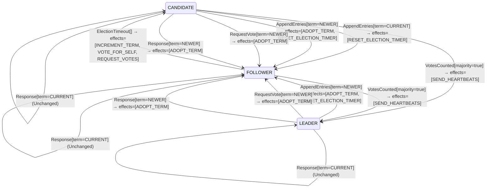

<!-- Generated by examples/tools/build.py from example.json and the verifier's output. Edit example.json. -->
# 074 · A follower that leads on a late majority passes a model that never counts votes late

[← All examples](../README.md)

| Verdict | Categories | Severity if shipped | Change | Verified unit | Approach |
|---|---|---|---|---|---|
| **✓ Verified, vacuously: no run takes the 1 row the change alters** | functional | critical | bug-fix, behaviour change intended | [`RoleMachine#decide`](../../examples/apps/quorum/src/main/java/net/terminalvalue/quorum/raft/RoleMachine.java) | [D1: Protocol model checking](../../examples/apps/quorum/spec/README.md) |

> Raft's role machine ignores a tally counted by a server that is no longer a candidate: the votes are of an election the server has left. A developer lets a follower that finds a majority in its tally take the leadership, reasoning that a candidate which stepped down while its votes were in flight was elected all the same; the contract changes in one row the model can see, and a test says so. The election model verifies the change under all five configurations, and coverage shows that no run takes the row: in the model a vote is counted in the step that grants it, by the candidate itself, and a server that steps down in that step empties its tally first, so there is no late majority to count. The verdict is vacuous, and the tool says so. In a cluster the late votes are of the term the server left: a candidate of term 1 that heard the leader of term 2, stepped down, and then counted its term-1 majority would lead term 2 beside its leader.

Tags: [consensus](../README.md#tag-consensus), [leader-election](../README.md#tag-leader-election), [stale-messages](../README.md#tag-stale-messages), [tla-coverage](../README.md#tag-tla-coverage), [generated-operator](../README.md#tag-generated-operator), [multiple-configurations](../README.md#tag-multiple-configurations)

## The change

Let a follower whose tally reaches a majority become the leader, as a candidate's does, with the reasoning in a comment: a candidate that stepped down while its votes were still in flight was elected all the same, and takes the leadership rather than let the term go to waste. The contract of `RoleMachine#decide` is regenerated: the row of a follower counting a majority goes from unchanged to a transition to leader with heartbeats (the row without a majority changes only in its reason). A test of the new row is added.

**Before** ([`RoleMachine.java`](../../examples/apps/quorum/src/main/java/net/terminalvalue/quorum/raft/RoleMachine.java), line 40):

```java
    case LEADER -> unchanged("a leader does not hold elections");
};
case VotesCounted votes -> switch (role) {
    case CANDIDATE -> votes.majority() ? transition(LEADER, SEND_HEARTBEATS) : unchanged("no majority yet");
    case FOLLOWER, LEADER -> unchanged("votes of an election this server is no longer in");
};
case AppendEntries entries -> switch (entries.term()) {
    case NEWER -> transition(FOLLOWER, ADOPT_TERM, RESET_ELECTION_TIMER);
```

**After:**

```java
    case LEADER -> unchanged("a leader does not hold elections");
};
case VotesCounted votes -> switch (role) {
    // A majority is a majority: a candidate that stepped down while its votes were still in flight was
    // elected all the same, and takes the leadership rather than let the term go to waste.
    case CANDIDATE, FOLLOWER -> votes.majority() ? transition(LEADER, SEND_HEARTBEATS) : unchanged("no majority yet");
    case LEADER -> unchanged("votes of an election this server is no longer in");
};
case AppendEntries entries -> switch (entries.term()) {
    case NEWER -> transition(FOLLOWER, ADOPT_TERM, RESET_ELECTION_TIMER);
```

<details><summary>Patch</summary>

```diff
--- a/examples/apps/quorum/src/main/java/net/terminalvalue/quorum/raft/RoleMachine.java
+++ b/examples/apps/quorum/src/main/java/net/terminalvalue/quorum/raft/RoleMachine.java
@@ -40,8 +40,10 @@
                 case LEADER -> unchanged("a leader does not hold elections");
             };
             case VotesCounted votes -> switch (role) {
-                case CANDIDATE -> votes.majority() ? transition(LEADER, SEND_HEARTBEATS) : unchanged("no majority yet");
-                case FOLLOWER, LEADER -> unchanged("votes of an election this server is no longer in");
+                // A majority is a majority: a candidate that stepped down while its votes were still in flight was
+                // elected all the same, and takes the leadership rather than let the term go to waste.
+                case CANDIDATE, FOLLOWER -> votes.majority() ? transition(LEADER, SEND_HEARTBEATS) : unchanged("no majority yet");
+                case LEADER -> unchanged("votes of an election this server is no longer in");
             };
             case AppendEntries entries -> switch (entries.term()) {
                 case NEWER -> transition(FOLLOWER, ADOPT_TERM, RESET_ELECTION_TIMER);
--- a/examples/apps/quorum/src/test/java/net/terminalvalue/quorum/raft/RoleMachineTest.java
+++ b/examples/apps/quorum/src/test/java/net/terminalvalue/quorum/raft/RoleMachineTest.java
@@ -22,6 +22,11 @@
         check(RoleMachine.decide(Role.CANDIDATE, new RoleEvent.VotesCounted(false)) instanceof Decision.Unchanged, "no majority: wait");
     }
 
+    public static void followerElectedWhileSteppingDownLeads() {
+        equal(new Transition<>(Role.LEADER, List.of(RoleEffect.SEND_HEARTBEATS)),
+                RoleMachine.decide(Role.FOLLOWER, new RoleEvent.VotesCounted(true)));
+    }
+
     public static void candidateYieldsToTheLeaderOfItsTerm() {
         equal(new Transition<>(Role.FOLLOWER, List.of(RoleEffect.RESET_ELECTION_TIMER)),
                 RoleMachine.decide(Role.CANDIDATE, new RoleEvent.AppendEntries(TermOrder.CURRENT)));
```

</details>

## What the verifier found

The model is checked under 7 configurations, and the verdict is the first that fails:

| Configuration | What it checks | Model | Result |
|---|---|---|---|
| three servers (`spec/RaftElection.cfg`) | every run from the initial state, every interleaving within the configuration's bounds | Servers = {s1, s2, s3}, MaxTerm = 3, LeftBehind = {}, DelayedReplies = FALSE, History = FALSE | ✓ Verified: all invariants and properties hold in 610 states |
| the inductive step (`spec/RaftElectionInductive.cfg`) | that the invariant `Inductive` is inductive: TLC starts from every state the invariant admits, reachable or not, rather than from the initial state, takes one step, and checks the invariant again, conjunct by conjunct. No counterexample is a proof of election safety by induction, for any run of the cluster however long; a counterexample is one step from a state that need not be reachable | Servers = {s1, s2, s3}, MaxTerm = 3, LeftBehind = {}, DelayedReplies = FALSE, History = FALSE | ✓ Verified: all invariants and properties hold in 17,470 states |
| four servers (`spec/RaftElectionFour.cfg`) | every run with four servers, a cluster in which a candidate can hold a vote besides its own and still be short of a majority, which three servers never show; under a symmetry set, so that of the states that differ only by the servers' names TLC explores one | Servers = {s1, s2, s3, s4}, MaxTerm = 3, LeftBehind = {}, DelayedReplies = FALSE, History = FALSE | ✓ Verified: all invariants and properties hold in 829 states |
| fairness (`spec/RaftElectionLive.cfg`) | the two liveness properties, under the fairness conditions `Fairness`: a server whose timer nothing resets times out, a candidate asks for the votes it lacks, a leader sends its heartbeats. A counterexample is a run that goes on forever without satisfying a property: a prefix, then a state or a cycle the system never leaves | Servers = {s1, s2, s3}, MaxTerm = 3, LeftBehind = {}, DelayedReplies = FALSE, History = FALSE | ✓ Verified: all invariants and properties hold in 610 states |
| a server left behind (`spec/RaftElectionLogs.cfg`) | the election restriction: one server holds the log a deposed leader of term 1 left behind, three entries of its term, while the other two hold an entry of term 2 that a majority holds and is therefore committed, so that the longer log is the one behind; every run with these logs, which nothing changes, under the invariant `LeaderCompleteness` besides the usual ones | Servers = {s1, s2, s3}, MaxTerm = 3, LeftBehind = {s1}, DelayedReplies = FALSE, History = FALSE | ✓ Verified: all invariants and properties hold in 461 states |
| delayed replies (`spec/RaftElectionDelayed.cfg`) | every run of three servers and two terms in which the reply to a vote request is a step of its own, which the candidate may take after it has timed out into a newer term, stepped down, or won; the one-step RPC of the other configurations never hands the role machine a reply from an older term than the server's own, and this one does, under the usual invariants and action properties | Servers = {s1, s2, s3}, MaxTerm = 2, LeftBehind = {}, DelayedReplies = TRUE, History = FALSE | ✓ Verified: all invariants and properties hold in 20,351 states |
| history (`spec/RaftElectionHistory.cfg`) | every run of three servers and three terms with the two history variables recording, `elected`, every term a server has led, and `voted`, every vote cast, under the two invariants that are about a run rather than a state: at most one leader elected per term and at most one vote per server per term, as the paper states them. The state invariants of the other configurations hold in a run in which a term's leader steps down and the term then elects another; these do not | Servers = {s1, s2, s3}, MaxTerm = 3, LeftBehind = {}, DelayedReplies = FALSE, History = TRUE | ✓ Verified: all invariants hold in 4,798 states |

Every invariant holds in every reachable state of the model under three servers: 610 distinct states, which is every interleaving of the servers, their terms and votes, and the RPCs between them within the model's bounds (Servers = {s1, s2, s3}, MaxTerm = 3, LeftBehind = {}, DelayedReplies = FALSE, History = FALSE).

The servers' role machine and vote rule inside the model are generated from the behavioural contracts of the patched code, so the model checks the role transitions the servers really make and the votes they really grant.

The other configurations hold too, as the table says: the inductive step, 17,470 states; four servers, 829 states; fairness, 610 states; a server left behind, 461 states; delayed replies, 20,351 states; history, 4,798 states.

**What the verdict rests on.** TLC counted how often a step of the model took each row of the generated operators. A row no step takes is one the model says nothing about, whatever the verdict.

| Configuration | Rows of `RoleMachine#decide` taken | Rows of `VoteRule#decide` taken |
|---|---|---|
| three servers | 27 of 36 | 4 of 27 |
| the inductive step (from the states the invariant admits, not from a run) | 27 of 36 | 6 of 27 |
| four servers | 27 of 36 | 4 of 27 |
| fairness | 27 of 36 | 4 of 27 |
| a server left behind | 27 of 36 | 12 of 27 |
| delayed replies | 33 of 36 | 4 of 27 |
| history | 27 of 36 | 4 of 27 |

The change alters 1 row of the contract:

- `decide(FOLLOWER, VotesCounted[majority=true])`: `Unchanged[reason="votes of an election this server is no longer in"]` → `Transition[next=LEADER, effects=[SEND_HEARTBEATS]]`, taken by no run

**No run of the model takes any of them.** The verdict is about the model as it was, and says nothing about the change.

<details><summary>Rows no step takes under three servers</summary>

`net.terminalvalue.quorum.raft.RoleMachine#decide`:

```
decide(FOLLOWER, VotesCounted[majority=true]) => Transition[next=LEADER, effects=[SEND_HEARTBEATS]]
decide(FOLLOWER, Response[term=OLDER]) => Unchanged
decide(FOLLOWER, Response[term=CURRENT]) => Unchanged
decide(FOLLOWER, Response[term=NEWER]) => Transition[next=FOLLOWER, effects=[ADOPT_TERM]]
decide(CANDIDATE, Response[term=OLDER]) => Unchanged
decide(LEADER, VotesCounted[majority=false]) => Unchanged
decide(LEADER, VotesCounted[majority=true]) => Unchanged
decide(LEADER, AppendEntries[term=CURRENT]) => throws IllegalStateException
decide(LEADER, Response[term=OLDER]) => Unchanged
```

`net.terminalvalue.quorum.raft.VoteRule#decide`:

```
decide(OPEN, VoteRequest[term=OLDER, log=BEHIND]) => Rejected
decide(OPEN, VoteRequest[term=OLDER, log=AHEAD]) => Rejected
decide(OPEN, VoteRequest[term=CURRENT, log=BEHIND]) => Rejected
decide(OPEN, VoteRequest[term=CURRENT, log=AHEAD]) => Transition[next=FOR_THE_CANDIDATE, effects=[GRANT]]
decide(OPEN, VoteRequest[term=NEWER, log=BEHIND]) => Rejected
decide(OPEN, VoteRequest[term=NEWER, log=EVEN]) => Transition[next=FOR_THE_CANDIDATE, effects=[GRANT]]
decide(OPEN, VoteRequest[term=NEWER, log=AHEAD]) => Transition[next=FOR_THE_CANDIDATE, effects=[GRANT]]
decide(FOR_THE_CANDIDATE, VoteRequest[term=OLDER, log=BEHIND]) => Rejected
decide(FOR_THE_CANDIDATE, VoteRequest[term=OLDER, log=EVEN]) => Rejected
decide(FOR_THE_CANDIDATE, VoteRequest[term=OLDER, log=AHEAD]) => Rejected
decide(FOR_THE_CANDIDATE, VoteRequest[term=CURRENT, log=BEHIND]) => Rejected
decide(FOR_THE_CANDIDATE, VoteRequest[term=CURRENT, log=EVEN]) => Transition[next=FOR_THE_CANDIDATE, effects=[GRANT]]
decide(FOR_THE_CANDIDATE, VoteRequest[term=CURRENT, log=AHEAD]) => Transition[next=FOR_THE_CANDIDATE, effects=[GRANT]]
decide(FOR_THE_CANDIDATE, VoteRequest[term=NEWER, log=BEHIND]) => Rejected
decide(FOR_THE_CANDIDATE, VoteRequest[term=NEWER, log=EVEN]) => Transition[next=FOR_THE_CANDIDATE, effects=[GRANT]]
decide(FOR_THE_CANDIDATE, VoteRequest[term=NEWER, log=AHEAD]) => Transition[next=FOR_THE_CANDIDATE, effects=[GRANT]]
decide(FOR_ANOTHER, VoteRequest[term=OLDER, log=BEHIND]) => Rejected
decide(FOR_ANOTHER, VoteRequest[term=OLDER, log=AHEAD]) => Rejected
decide(FOR_ANOTHER, VoteRequest[term=CURRENT, log=BEHIND]) => Rejected
decide(FOR_ANOTHER, VoteRequest[term=CURRENT, log=AHEAD]) => Rejected
decide(FOR_ANOTHER, VoteRequest[term=NEWER, log=BEHIND]) => Rejected
decide(FOR_ANOTHER, VoteRequest[term=NEWER, log=EVEN]) => Transition[next=FOR_THE_CANDIDATE, effects=[GRANT]]
decide(FOR_ANOTHER, VoteRequest[term=NEWER, log=AHEAD]) => Transition[next=FOR_THE_CANDIDATE, effects=[GRANT]]
```

</details>

**Where the model's rules come from.** Each operator the model checks is generated from the contract derived from the patched classes in this run:

- `RoleMachine#decide` (`spec/RoleMachineContract.tla`): the regenerated contract, 2 rows from the committed one, as the change intends
- `VoteRule#decide` (`spec/VoteRuleContract.tla`): the committed contract, which the patched classes still match

The state machine the patched code implements, drawn from its derived contract (`jvmcontract statemachine`); a state with no way in or no way out is marked:



## Would the existing tests have caught it?

Every existing unit test passes, as it should (`java -ea net.terminalvalue.quorum.Tests`, run against the patched code).

## Why it matters

A tally belongs to the term it was collected in, and a server stops being a candidate for one reason: it adopted a newer term, from a heartbeat or a vote request, or it heard the leader of its own. Its votes are then of an election the cluster has moved past. Count them anyway and a candidate of term 1 that stepped down for the leader of term 2, and whose term-1 replies arrive after that, finds a majority and leads term 2 without a single vote of term 2: two leaders of one term, each replicating its own entries, and election safety, the property Raft's correctness rests on, is gone. The added test checks what the developer intends, and the existing tests of the role machine do not ask a follower to count votes. The model verifies the change under five configurations, since none of them has a vote that arrives late; a reviewer sees a one-row contract diff with a comment that argues from fairness to a candidate.

## Why the verdict is right

The row the change alters is `decide(FOLLOWER, VotesCounted[majority=true])`, and under the three-server configuration steps of the model take 27 of the 36 rows of the role machine, this one not among them. The model's `Canvass` action is one RPC, request and reply: the voter decides, the candidate takes the reply through the role machine, adds a granted vote to its tally unless the reply's newer term made it a follower, in which case the tally is emptied, and counts the tally through the role machine as it then is. A follower therefore counts an empty tally, never a majority, and the row `decide(FOLLOWER, VotesCounted[majority=false])` is taken while the one the change alters is not. The inductive step starts from every state the invariant admits and takes no more rows of the role machine than a run does, because the late majority is not a state but a message in flight, which the model does not have. Every invariant and property holds under all five configurations, in 610 states under the first, and the verdict is verified, vacuously: a label the tool gives when every run finished and none from an initial state took a row the change alters that decides.

## What to do

Keep the row as it was: a server that leaves the candidate role leaves the election, and a tally is cleared when a term is adopted, which is what the committed kernel's effects do. To make the model see this change it would need votes in flight, a tally that outlives the step that fills it; that is the message set the model gave up for atomic RPCs when it blew past half a million states, and the coverage table on this page is the record of which rows that trade left unchecked. The rows no step takes are listed on every model-checking page now; a change that lands on one needs a test, a property or a bigger model, not a verdict.

## Notes

- The Raft election model (`apps/quorum/spec/RaftElection.tla`) is built around the role machine, generated from its contract, with election safety as an invariant and two action properties, `[][A]_v` formulas that constrain each step: terms never decrease, a leader never campaigns. An example is checked under all of the model's configurations, and its verdict is the first that fails.
- Every model-checking verdict comes with what it rests on: `jvmcontract tlc --coverage` reads TLC's coverage back against the generated operators row by row, and a verified verdict whose changed rows no run takes is labelled vacuous. Every model-checking page lists the rows no step takes.
- Verified vacuously: the model counts votes in the step that grants them, never late. Compare 081 to 083, where a configuration with delayed replies takes such rows.

## Evidence

How the verdict was reached: three servers: TLC 2.19 explored 610 distinct states to depth 10 in 1 s, for the model Servers = {s1, s2, s3}, MaxTerm = 3, LeftBehind = {}, DelayedReplies = FALSE, History = FALSE; the inductive step: TLC 2.19 explored 17,470 distinct states to depth 1 in 6 s, for the model Servers = {s1, s2, s3}, MaxTerm = 3, LeftBehind = {}, DelayedReplies = FALSE, History = FALSE; four servers: TLC 2.19 explored 829 distinct states to depth 12 in 1 s, for the model Servers = {s1, s2, s3, s4}, MaxTerm = 3, LeftBehind = {}, DelayedReplies = FALSE, History = FALSE; fairness: TLC 2.19 explored 610 distinct states to depth 10 in 2 s, for the model Servers = {s1, s2, s3}, MaxTerm = 3, LeftBehind = {}, DelayedReplies = FALSE, History = FALSE; a server left behind: TLC 2.19 explored 461 distinct states to depth 9 in 1 s, for the model Servers = {s1, s2, s3}, MaxTerm = 3, LeftBehind = {s1}, DelayedReplies = FALSE, History = FALSE; delayed replies: TLC 2.19 explored 20,351 distinct states to depth 14 in 5 s, for the model Servers = {s1, s2, s3}, MaxTerm = 2, LeftBehind = {}, DelayedReplies = TRUE, History = FALSE; history: TLC 2.19 explored 4,798 distinct states to depth 11 in 1 s, for the model Servers = {s1, s2, s3}, MaxTerm = 3, LeftBehind = {}, DelayedReplies = FALSE, History = TRUE.

This page renders attempt `20261106T181231Z-0ac29da5` at claim `435b831f9cd800b4`, in pipeline job `20261106-181100-example-074-d1-vacuous-role-machine-row`. Its claim is still the one the current files make: the patch, the sources it applies to, what is checked and the scope are those the run fingerprinted. The files below are the run's bundle.

<details><summary>Verifier output</summary>

```text
== three servers: spec/RaftElection.cfg ==
TLC2 Version 2.19 of 08 August 2024 (rev: 5a47802)
Running breadth-first search Model-Checking with fp 1 and seed 1 with 1 worker on 2 cores with 2457MB heap and 64MB offheap memory [pid: 80001] (Linux 7.0.0-43-generic amd64, Eclipse Adoptium 25.0.5 x86_64, MSBDiskFPSet, DiskStateQueue).
Parsing file examples/apps/quorum/spec/RaftElection.tla
Parsing file examples/tools/tla/standard-modules/Naturals.tla
Parsing file examples/tools/tla/standard-modules/FiniteSets.tla
Parsing file examples/tools/tla/standard-modules/Sequences.tla
Parsing file examples/tools/tla/standard-modules/TLC.tla
Parsing file examples/apps/quorum/spec/RoleMachineContract.tla
Parsing file examples/apps/quorum/spec/VoteRuleContract.tla
Semantic processing of module Naturals
Semantic processing of module Sequences
Semantic processing of module FiniteSets
Semantic processing of module TLC
Semantic processing of module RoleMachineContract
Semantic processing of module VoteRuleContract
Semantic processing of module RaftElection
Starting... (2026-11-06 18:12:33)
Computing initial states...
Finished computing initial states: 1 distinct state generated at 2026-11-06 18:12:34.
Model checking completed. No error has been found.
  Estimates of the probability that TLC did not check all reachable states
  because two distinct states had the same fingerprint:
  calculated (optimistic):  val = 9.0E-14
Rows of net.terminalvalue.quorum.raft.RoleMachine#decide a step of the model takes: 27 of 36; never taken (9):
  decide(FOLLOWER, VotesCounted[majority=true]) => Transition[next=LEADER, effects=[SEND_HEARTBEATS]]
  decide(FOLLOWER, Response[term=OLDER]) => Unchanged
  decide(FOLLOWER, Response[term=CURRENT]) => Unchanged
  decide(FOLLOWER, Response[term=NEWER]) => Transition[next=FOLLOWER, effects=[ADOPT_TERM]]
  decide(CANDIDATE, Response[term=OLDER]) => Unchanged
  decide(LEADER, VotesCounted[majority=false]) => Unchanged
  decide(LEADER, VotesCounted[majority=true]) => Unchanged
  decide(LEADER, AppendEntries[term=CURRENT]) => throws IllegalStateException
  decide(LEADER, Response[term=OLDER]) => Unchanged
Rows of net.terminalvalue.quorum.raft.VoteRule#decide a step of the model takes: 4 of 27; never taken (23):
  decide(OPEN, VoteRequest[term=OLDER, log=BEHIND]) => Rejected
  decide(OPEN, VoteRequest[term=OLDER, log=AHEAD]) => Rejected
  decide(OPEN, VoteRequest[term=CURRENT, log=BEHIND]) => Rejected
  decide(OPEN, VoteRequest[term=CURRENT, log=AHEAD]) => Transition[next=FOR_THE_CANDIDATE, effects=[GRANT]]
  decide(OPEN, VoteRequest[term=NEWER, log=BEHIND]) => Rejected
  decide(OPEN, VoteRequest[term=NEWER, log=EVEN]) => Transition[next=FOR_THE_CANDIDATE, effects=[GRANT]]
  decide(OPEN, VoteRequest[term=NEWER, log=AHEAD]) => Transition[next=FOR_THE_CANDIDATE, effects=[GRANT]]
  decide(FOR_THE_CANDIDATE, VoteRequest[term=OLDER, log=BEHIND]) => Rejected
  decide(FOR_THE_CANDIDATE, VoteRequest[term=OLDER, log=EVEN]) => Rejected
  decide(FOR_THE_CANDIDATE, VoteRequest[term=OLDER, log=AHEAD]) => Rejected
  decide(FOR_THE_CANDIDATE, VoteRequest[term=CURRENT, log=BEHIND]) => Rejected
  decide(FOR_THE_CANDIDATE, VoteRequest[term=CURRENT, log=EVEN]) => Transition[next=FOR_THE_CANDIDATE, effects=[GRANT]]
  decide(FOR_THE_CANDIDATE, VoteRequest[term=CURRENT, log=AHEAD]) => Transition[next=FOR_THE_CANDIDATE, effects=[GRANT]]
  decide(FOR_THE_CANDIDATE, VoteRequest[term=NEWER, log=BEHIND]) => Rejected
  decide(FOR_THE_CANDIDATE, VoteRequest[term=NEWER, log=EVEN]) => Transition[next=FOR_THE_CANDIDATE, effects=[GRANT]]
  decide(FOR_THE_CANDIDATE, VoteRequest[term=NEWER, log=AHEAD]) => Transition[next=FOR_THE_CANDIDATE, effects=[GRANT]]
  decide(FOR_ANOTHER, VoteRequest[term=OLDER, log=BEHIND]) => Rejected
  decide(FOR_ANOTHER, VoteRequest[term=OLDER, log=AHEAD]) => Rejected
  decide(FOR_ANOTHER, VoteRequest[term=CURRENT, log=BEHIND]) => Rejected
  decide(FOR_ANOTHER, VoteRequest[term=CURRENT, log=AHEAD]) => Rejected
  decide(FOR_ANOTHER, VoteRequest[term=NEWER, log=BEHIND]) => Rejected
  decide(FOR_ANOTHER, VoteRequest[term=NEWER, log=EVEN]) => Transition[next=FOR_THE_CANDIDATE, effects=[GRANT]]
  decide(FOR_ANOTHER, VoteRequest[term=NEWER, log=AHEAD]) => Transition[next=FOR_THE_CANDIDATE, effects=[GRANT]]
3328 states generated, 610 distinct states found, 0 states left on queue.
The depth of the complete state graph search is 10.
The average outdegree of the complete state graph is 1 (minimum is 0, the maximum 5 and the 95th percentile is 3).
Finished in 01s at (2026-11-06 18:12:35)

== the inductive step: spec/RaftElectionInductive.cfg ==
TLC2 Version 2.19 of 08 August 2024 (rev: 5a47802)
Running breadth-first search Model-Checking with fp 1 and seed 1 with 1 worker on 2 cores with 2457MB heap and 64MB offheap memory [pid: 80206] (Linux 7.0.0-43-generic amd64, Eclipse Adoptium 25.0.5 x86_64, MSBDiskFPSet, DiskStateQueue).
Parsing file examples/apps/quorum/spec/RaftElection.tla
Parsing file examples/tools/tla/standard-modules/Naturals.tla
Parsing file examples/tools/tla/standard-modules/FiniteSets.tla
Parsing file examples/tools/tla/standard-modules/Sequences.tla
Parsing file examples/tools/tla/standard-modules/TLC.tla
Parsing file examples/apps/quorum/spec/RoleMachineContract.tla
Parsing file examples/apps/quorum/spec/VoteRuleContract.tla
Semantic processing of module Naturals
Semantic processing of module Sequences
Semantic processing of module FiniteSets
Semantic processing of module TLC
Semantic processing of module RoleMachineContract
Semantic processing of module VoteRuleContract
Semantic processing of module RaftElection
Starting... (2026-11-06 18:12:35)
Computing initial states...
Computed 2 initial states...
Computed 4 initial states...
Computed 8 initial states...
Computed 16 initial states...
Computed 32 initial states...
Computed 64 initial states...
Computed 128 initial states...
Computed 256 initial states...
Computed 512 initial states...
Computed 1024 initial states...
Computed 2048 initial states...
Computed 4096 initial states...
Computed 8192 initial states...
Computed 16384 initial states...
Finished computing initial states: 17470 distinct states generated at 2026-11-06 18:12:40.
Model checking completed. No error has been found.
  Estimates of the probability that TLC did not check all reachable states
  because two distinct states had the same fingerprint:
  calculated (optimistic):  val = 5.6E-11
Rows of net.terminalvalue.quorum.raft.RoleMachine#decide a step of the model takes: 27 of 36; never taken (9):
  decide(FOLLOWER, VotesCounted[majority=true]) => Transition[next=LEADER, effects=[SEND_HEARTBEATS]]
  decide(FOLLOWER, Response[term=OLDER]) => Unchanged
  decide(FOLLOWER, Response[term=CURRENT]) => Unchanged
  decide(FOLLOWER, Response[term=NEWER]) => Transition[next=FOLLOWER, effects=[ADOPT_TERM]]
  decide(CANDIDATE, Response[term=OLDER]) => Unchanged
  decide(LEADER, VotesCounted[majority=false]) => Unchanged
  decide(LEADER, VotesCounted[majority=true]) => Unchanged
  decide(LEADER, AppendEntries[term=CURRENT]) => throws IllegalStateException
  decide(LEADER, Response[term=OLDER]) => Unchanged
Rows of net.terminalvalue.quorum.raft.VoteRule#decide a step of the model takes: 6 of 27; never taken (21):
  decide(OPEN, VoteRequest[term=OLDER, log=BEHIND]) => Rejected
  decide(OPEN, VoteRequest[term=OLDER, log=AHEAD]) => Rejected
  decide(OPEN, VoteRequest[term=CURRENT, log=BEHIND]) => Rejected
  decide(OPEN, VoteRequest[term=CURRENT, log=AHEAD]) => Transition[next=FOR_THE_CANDIDATE, effects=[GRANT]]
  decide(OPEN, VoteRequest[term=NEWER, log=BEHIND]) => Rejected
  decide(OPEN, VoteRequest[term=NEWER, log=EVEN]) => Transition[next=FOR_THE_CANDIDATE, effects=[GRANT]]
  decide(OPEN, VoteRequest[term=NEWER, log=AHEAD]) => Transition[next=FOR_THE_CANDIDATE, effects=[GRANT]]
  decide(FOR_THE_CANDIDATE, VoteRequest[term=OLDER, log=BEHIND]) => Rejected
  decide(FOR_THE_CANDIDATE, VoteRequest[term=OLDER, log=AHEAD]) => Rejected
  decide(FOR_THE_CANDIDATE, VoteRequest[term=CURRENT, log=BEHIND]) => Rejected
  decide(FOR_THE_CANDIDATE, VoteRequest[term=CURRENT, log=AHEAD]) => Transition[next=FOR_THE_CANDIDATE, effects=[GRANT]]
  decide(FOR_THE_CANDIDATE, VoteRequest[term=NEWER, log=BEHIND]) => Rejected
  decide(FOR_THE_CANDIDATE, VoteRequest[term=NEWER, log=EVEN]) => Transition[next=FOR_THE_CANDIDATE, effects=[GRANT]]
  decide(FOR_THE_CANDIDATE, VoteRequest[term=NEWER, log=AHEAD]) => Transition[next=FOR_THE_CANDIDATE, effects=[GRANT]]
  decide(FOR_ANOTHER, VoteRequest[term=OLDER, log=BEHIND]) => Rejected
  decide(FOR_ANOTHER, VoteRequest[term=OLDER, log=AHEAD]) => Rejected
  decide(FOR_ANOTHER, VoteRequest[term=CURRENT, log=BEHIND]) => Rejected
  decide(FOR_ANOTHER, VoteRequest[term=CURRENT, log=AHEAD]) => Rejected
  decide(FOR_ANOTHER, VoteRequest[term=NEWER, log=BEHIND]) => Rejected
  decide(FOR_ANOTHER, VoteRequest[term=NEWER, log=EVEN]) => Transition[next=FOR_THE_CANDIDATE, effects=[GRANT]]
  decide(FOR_ANOTHER, VoteRequest[term=NEWER, log=AHEAD]) => Transition[next=FOR_THE_CANDIDATE, effects=[GRANT]]
76099 states generated, 17470 distinct states found, 0 states left on queue.
The depth of the complete state graph search is 1.
The average outdegree of the complete state graph is 0 (minimum is 0, the maximum 0 and the 95th percentile is 0).
Finished in 06s at (2026-11-06 18:12:41)

== four servers: spec/RaftElectionFour.cfg ==
TLC2 Version 2.19 of 08 August 2024 (rev: 5a47802)
Running breadth-first search Model-Checking with fp 1 and seed 1 with 1 worker on 2 cores with 2457MB heap and 64MB offheap memory [pid: 80774] (Linux 7.0.0-43-generic amd64, Eclipse Adoptium 25.0.5 x86_64, MSBDiskFPSet, DiskStateQueue).
Parsing file examples/apps/quorum/spec/RaftElection.tla
Parsing file examples/tools/tla/standard-modules/Naturals.tla
Parsing file examples/tools/tla/standard-modules/FiniteSets.tla
Parsing file examples/tools/tla/standard-modules/Sequences.tla
Parsing file examples/tools/tla/standard-modules/TLC.tla
Parsing file examples/apps/quorum/spec/RoleMachineContract.tla
Parsing file examples/apps/quorum/spec/VoteRuleContract.tla
Semantic processing of module Naturals
Semantic processing of module Sequences
Semantic processing of module FiniteSets
Semantic processing of module TLC
Semantic processing of module RoleMachineContract
Semantic processing of module VoteRuleContract
Semantic processing of module RaftElection
Starting... (2026-11-06 18:12:42)
Computing initial states...
Finished computing initial states: 1 distinct state generated at 2026-11-06 18:12:42.
Model checking completed. No error has been found.
  Estimates of the probability that TLC did not check all reachable states
  because two distinct states had the same fingerprint:
  calculated (optimistic):  val = 2.8E-13
Rows of net.terminalvalue.quorum.raft.RoleMachine#decide a step of the model takes: 27 of 36; never taken (9):
  decide(FOLLOWER, VotesCounted[majority=true]) => Transition[next=LEADER, effects=[SEND_HEARTBEATS]]
  decide(FOLLOWER, Response[term=OLDER]) => Unchanged
  decide(FOLLOWER, Response[term=CURRENT]) => Unchanged
  decide(FOLLOWER, Response[term=NEWER]) => Transition[next=FOLLOWER, effects=[ADOPT_TERM]]
  decide(CANDIDATE, Response[term=OLDER]) => Unchanged
  decide(LEADER, VotesCounted[majority=false]) => Unchanged
  decide(LEADER, VotesCounted[majority=true]) => Unchanged
  decide(LEADER, AppendEntries[term=CURRENT]) => throws IllegalStateException
  decide(LEADER, Response[term=OLDER]) => Unchanged
Rows of net.terminalvalue.quorum.raft.VoteRule#decide a step of the model takes: 4 of 27; never taken (23):
  decide(OPEN, VoteRequest[term=OLDER, log=BEHIND]) => Rejected
  decide(OPEN, VoteRequest[term=OLDER, log=AHEAD]) => Rejected
  decide(OPEN, VoteRequest[term=CURRENT, log=BEHIND]) => Rejected
  decide(OPEN, VoteRequest[term=CURRENT, log=AHEAD]) => Transition[next=FOR_THE_CANDIDATE, effects=[GRANT]]
  decide(OPEN, VoteRequest[term=NEWER, log=BEHIND]) => Rejected
  decide(OPEN, VoteRequest[term=NEWER, log=EVEN]) => Transition[next=FOR_THE_CANDIDATE, effects=[GRANT]]
  decide(OPEN, VoteRequest[term=NEWER, log=AHEAD]) => Transition[next=FOR_THE_CANDIDATE, effects=[GRANT]]
  decide(FOR_THE_CANDIDATE, VoteRequest[term=OLDER, log=BEHIND]) => Rejected
  decide(FOR_THE_CANDIDATE, VoteRequest[term=OLDER, log=EVEN]) => Rejected
  decide(FOR_THE_CANDIDATE, VoteRequest[term=OLDER, log=AHEAD]) => Rejected
  decide(FOR_THE_CANDIDATE, VoteRequest[term=CURRENT, log=BEHIND]) => Rejected
  decide(FOR_THE_CANDIDATE, VoteRequest[term=CURRENT, log=EVEN]) => Transition[next=FOR_THE_CANDIDATE, effects=[GRANT]]
  decide(FOR_THE_CANDIDATE, VoteRequest[term=CURRENT, log=AHEAD]) => Transition[next=FOR_THE_CANDIDATE, effects=[GRANT]]
  decide(FOR_THE_CANDIDATE, VoteRequest[term=NEWER, log=BEHIND]) => Rejected
  decide(FOR_THE_CANDIDATE, VoteRequest[term=NEWER, log=EVEN]) => Transition[next=FOR_THE_CANDIDATE, effects=[GRANT]]
  decide(FOR_THE_CANDIDATE, VoteRequest[term=NEWER, log=AHEAD]) => Transition[next=FOR_THE_CANDIDATE, effects=[GRANT]]
  decide(FOR_ANOTHER, VoteRequest[term=OLDER, log=BEHIND]) => Rejected
  decide(FOR_ANOTHER, VoteRequest[term=OLDER, log=AHEAD]) => Rejected
  decide(FOR_ANOTHER, VoteRequest[term=CURRENT, log=BEHIND]) => Rejected
  decide(FOR_ANOTHER, VoteRequest[term=CURRENT, log=AHEAD]) => Rejected
  decide(FOR_ANOTHER, VoteRequest[term=NEWER, log=BEHIND]) => Rejected
  decide(FOR_ANOTHER, VoteRequest[term=NEWER, log=EVEN]) => Transition[next=FOR_THE_CANDIDATE, effects=[GRANT]]
  decide(FOR_ANOTHER, VoteRequest[term=NEWER, log=AHEAD]) => Transition[next=FOR_THE_CANDIDATE, effects=[GRANT]]
7125 states generated, 829 distinct states found, 0 states left on queue.
The depth of the complete state graph search is 12.
The average outdegree of the complete state graph is 1 (minimum is 0, the maximum 8 and the 95th percentile is 4).
Finished in 01s at (2026-11-06 18:12:43)

== fairness: spec/RaftElectionLive.cfg ==
TLC2 Version 2.19 of 08 August 2024 (rev: 5a47802)
Running breadth-first search Model-Checking with fp 1 and seed 1 with 1 worker on 2 cores with 2457MB heap and 64MB offheap memory [pid: 80903] (Linux 7.0.0-43-generic amd64, Eclipse Adoptium 25.0.5 x86_64, MSBDiskFPSet, DiskStateQueue).
Parsing file examples/apps/quorum/spec/RaftElection.tla
Parsing file examples/tools/tla/standard-modules/Naturals.tla
Parsing file examples/tools/tla/standard-modules/FiniteSets.tla
Parsing file examples/tools/tla/standard-modules/Sequences.tla
Parsing file examples/tools/tla/standard-modules/TLC.tla
Parsing file examples/apps/quorum/spec/RoleMachineContract.tla
Parsing file examples/apps/quorum/spec/VoteRuleContract.tla
Semantic processing of module Naturals
Semantic processing of module Sequences
Semantic processing of module FiniteSets
Semantic processing of module TLC
Semantic processing of module RoleMachineContract
Semantic processing of module VoteRuleContract
Semantic processing of module RaftElection
Starting... (2026-11-06 18:12:44)
Implied-temporal checking--satisfiability problem has 4 branches.
Computing initial states...
Finished computing initial states: 1 distinct state generated at 2026-11-06 18:12:45.
Checking 4 branches of temporal properties for the complete state space with 2440 total distinct states at (2026-11-06 18:12:46)
Finished checking temporal properties in 00s at 2026-11-06 18:12:46
Model checking completed. No error has been found.
  Estimates of the probability that TLC did not check all reachable states
  because two distinct states had the same fingerprint:
  calculated (optimistic):  val = 9.0E-14
Rows of net.terminalvalue.quorum.raft.RoleMachine#decide a step of the model takes: 27 of 36; never taken (9):
  decide(FOLLOWER, VotesCounted[majority=true]) => Transition[next=LEADER, effects=[SEND_HEARTBEATS]]
  decide(FOLLOWER, Response[term=OLDER]) => Unchanged
  decide(FOLLOWER, Response[term=CURRENT]) => Unchanged
  decide(FOLLOWER, Response[term=NEWER]) => Transition[next=FOLLOWER, effects=[ADOPT_TERM]]
  decide(CANDIDATE, Response[term=OLDER]) => Unchanged
  decide(LEADER, VotesCounted[majority=false]) => Unchanged
  decide(LEADER, VotesCounted[majority=true]) => Unchanged
  decide(LEADER, AppendEntries[term=CURRENT]) => throws IllegalStateException
  decide(LEADER, Response[term=OLDER]) => Unchanged
Rows of net.terminalvalue.quorum.raft.VoteRule#decide a step of the model takes: 4 of 27; never taken (23):
  decide(OPEN, VoteRequest[term=OLDER, log=BEHIND]) => Rejected
  decide(OPEN, VoteRequest[term=OLDER, log=AHEAD]) => Rejected
  decide(OPEN, VoteRequest[term=CURRENT, log=BEHIND]) => Rejected
  decide(OPEN, VoteRequest[term=CURRENT, log=AHEAD]) => Transition[next=FOR_THE_CANDIDATE, effects=[GRANT]]
  decide(OPEN, VoteRequest[term=NEWER, log=BEHIND]) => Rejected
  decide(OPEN, VoteRequest[term=NEWER, log=EVEN]) => Transition[next=FOR_THE_CANDIDATE, effects=[GRANT]]
  decide(OPEN, VoteRequest[term=NEWER, log=AHEAD]) => Transition[next=FOR_THE_CANDIDATE, effects=[GRANT]]
  decide(FOR_THE_CANDIDATE, VoteRequest[term=OLDER, log=BEHIND]) => Rejected
  decide(FOR_THE_CANDIDATE, VoteRequest[term=OLDER, log=EVEN]) => Rejected
  decide(FOR_THE_CANDIDATE, VoteRequest[term=OLDER, log=AHEAD]) => Rejected
  decide(FOR_THE_CANDIDATE, VoteRequest[term=CURRENT, log=BEHIND]) => Rejected
  decide(FOR_THE_CANDIDATE, VoteRequest[term=CURRENT, log=EVEN]) => Transition[next=FOR_THE_CANDIDATE, effects=[GRANT]]
  decide(FOR_THE_CANDIDATE, VoteRequest[term=CURRENT, log=AHEAD]) => Transition[next=FOR_THE_CANDIDATE, effects=[GRANT]]
  decide(FOR_THE_CANDIDATE, VoteRequest[term=NEWER, log=BEHIND]) => Rejected
  decide(FOR_THE_CANDIDATE, VoteRequest[term=NEWER, log=EVEN]) => Transition[next=FOR_THE_CANDIDATE, effects=[GRANT]]
  decide(FOR_THE_CANDIDATE, VoteRequest[term=NEWER, log=AHEAD]) => Transition[next=FOR_THE_CANDIDATE, effects=[GRANT]]
  decide(FOR_ANOTHER, VoteRequest[term=OLDER, log=BEHIND]) => Rejected
  decide(FOR_ANOTHER, VoteRequest[term=OLDER, log=AHEAD]) => Rejected
  decide(FOR_ANOTHER, VoteRequest[term=CURRENT, log=BEHIND]) => Rejected
  decide(FOR_ANOTHER, VoteRequest[term=CURRENT, log=AHEAD]) => Rejected
  decide(FOR_ANOTHER, VoteRequest[term=NEWER, log=BEHIND]) => Rejected
  decide(FOR_ANOTHER, VoteRequest[term=NEWER, log=EVEN]) => Transition[next=FOR_THE_CANDIDATE, effects=[GRANT]]
  decide(FOR_ANOTHER, VoteRequest[term=NEWER, log=AHEAD]) => Transition[next=FOR_THE_CANDIDATE, effects=[GRANT]]
3328 states generated, 610 distinct states found, 0 states left on queue.
The depth of the complete state graph search is 10.
The average outdegree of the complete state graph is 1 (minimum is 0, the maximum 5 and the 95th percentile is 3).
Finished in 02s at (2026-11-06 18:12:46)

== a server left behind: spec/RaftElectionLogs.cfg ==
TLC2 Version 2.19 of 08 August 2024 (rev: 5a47802)
Running breadth-first search Model-Checking with fp 1 and seed 1 with 1 worker on 2 cores with 2457MB heap and 64MB offheap memory [pid: 81061] (Linux 7.0.0-43-generic amd64, Eclipse Adoptium 25.0.5 x86_64, MSBDiskFPSet, DiskStateQueue).
Parsing file examples/apps/quorum/spec/RaftElection.tla
Parsing file examples/tools/tla/standard-modules/Naturals.tla
Parsing file examples/tools/tla/standard-modules/FiniteSets.tla
Parsing file examples/tools/tla/standard-modules/Sequences.tla
Parsing file examples/tools/tla/standard-modules/TLC.tla
Parsing file examples/apps/quorum/spec/RoleMachineContract.tla
Parsing file examples/apps/quorum/spec/VoteRuleContract.tla
Semantic processing of module Naturals
Semantic processing of module Sequences
Semantic processing of module FiniteSets
Semantic processing of module TLC
Semantic processing of module RoleMachineContract
Semantic processing of module VoteRuleContract
Semantic processing of module RaftElection
Starting... (2026-11-06 18:12:47)
Computing initial states...
Finished computing initial states: 1 distinct state generated at 2026-11-06 18:12:48.
Model checking completed. No error has been found.
  Estimates of the probability that TLC did not check all reachable states
  because two distinct states had the same fingerprint:
  calculated (optimistic):  val = 5.2E-14
Rows of net.terminalvalue.quorum.raft.RoleMachine#decide a step of the model takes: 27 of 36; never taken (9):
  decide(FOLLOWER, VotesCounted[majority=true]) => Transition[next=LEADER, effects=[SEND_HEARTBEATS]]
  decide(FOLLOWER, Response[term=OLDER]) => Unchanged
  decide(FOLLOWER, Response[term=CURRENT]) => Unchanged
  decide(FOLLOWER, Response[term=NEWER]) => Transition[next=FOLLOWER, effects=[ADOPT_TERM]]
  decide(CANDIDATE, Response[term=OLDER]) => Unchanged
  decide(LEADER, VotesCounted[majority=false]) => Unchanged
  decide(LEADER, VotesCounted[majority=true]) => Unchanged
  decide(LEADER, AppendEntries[term=CURRENT]) => throws IllegalStateException
  decide(LEADER, Response[term=OLDER]) => Unchanged
Rows of net.terminalvalue.quorum.raft.VoteRule#decide a step of the model takes: 12 of 27; never taken (15):
  decide(OPEN, VoteRequest[term=NEWER, log=BEHIND]) => Rejected
  decide(OPEN, VoteRequest[term=NEWER, log=EVEN]) => Transition[next=FOR_THE_CANDIDATE, effects=[GRANT]]
  decide(OPEN, VoteRequest[term=NEWER, log=AHEAD]) => Transition[next=FOR_THE_CANDIDATE, effects=[GRANT]]
  decide(FOR_THE_CANDIDATE, VoteRequest[term=OLDER, log=BEHIND]) => Rejected
  decide(FOR_THE_CANDIDATE, VoteRequest[term=OLDER, log=EVEN]) => Rejected
  decide(FOR_THE_CANDIDATE, VoteRequest[term=OLDER, log=AHEAD]) => Rejected
  decide(FOR_THE_CANDIDATE, VoteRequest[term=CURRENT, log=BEHIND]) => Rejected
  decide(FOR_THE_CANDIDATE, VoteRequest[term=CURRENT, log=EVEN]) => Transition[next=FOR_THE_CANDIDATE, effects=[GRANT]]
  decide(FOR_THE_CANDIDATE, VoteRequest[term=CURRENT, log=AHEAD]) => Transition[next=FOR_THE_CANDIDATE, effects=[GRANT]]
  decide(FOR_THE_CANDIDATE, VoteRequest[term=NEWER, log=BEHIND]) => Rejected
  decide(FOR_THE_CANDIDATE, VoteRequest[term=NEWER, log=EVEN]) => Transition[next=FOR_THE_CANDIDATE, effects=[GRANT]]
  decide(FOR_THE_CANDIDATE, VoteRequest[term=NEWER, log=AHEAD]) => Transition[next=FOR_THE_CANDIDATE, effects=[GRANT]]
  decide(FOR_ANOTHER, VoteRequest[term=NEWER, log=BEHIND]) => Rejected
  decide(FOR_ANOTHER, VoteRequest[term=NEWER, log=EVEN]) => Transition[next=FOR_THE_CANDIDATE, effects=[GRANT]]
  decide(FOR_ANOTHER, VoteRequest[term=NEWER, log=AHEAD]) => Transition[next=FOR_THE_CANDIDATE, effects=[GRANT]]
2526 states generated, 461 distinct states found, 0 states left on queue.
The depth of the complete state graph search is 9.
The average outdegree of the complete state graph is 1 (minimum is 0, the maximum 5 and the 95th percentile is 3).
Finished in 01s at (2026-11-06 18:12:48)

== delayed replies: spec/RaftElectionDelayed.cfg ==
TLC2 Version 2.19 of 08 August 2024 (rev: 5a47802)
Running breadth-first search Model-Checking with fp 1 and seed 1 with 1 worker on 2 cores with 2457MB heap and 64MB offheap memory [pid: 81181] (Linux 7.0.0-43-generic amd64, Eclipse Adoptium 25.0.5 x86_64, MSBDiskFPSet, DiskStateQueue).
Parsing file examples/apps/quorum/spec/RaftElection.tla
Parsing file examples/tools/tla/standard-modules/Naturals.tla
Parsing file examples/tools/tla/standard-modules/FiniteSets.tla
Parsing file examples/tools/tla/standard-modules/Sequences.tla
Parsing file examples/tools/tla/standard-modules/TLC.tla
Parsing file examples/apps/quorum/spec/RoleMachineContract.tla
Parsing file examples/apps/quorum/spec/VoteRuleContract.tla
Semantic processing of module Naturals
Semantic processing of module Sequences
Semantic processing of module FiniteSets
Semantic processing of module TLC
Semantic processing of module RoleMachineContract
Semantic processing of module VoteRuleContract
Semantic processing of module RaftElection
Starting... (2026-11-06 18:12:49)
Computing initial states...
Finished computing initial states: 1 distinct state generated at 2026-11-06 18:12:50.
Model checking completed. No error has been found.
  Estimates of the probability that TLC did not check all reachable states
  because two distinct states had the same fingerprint:
  calculated (optimistic):  val = 1.1E-10
  based on the actual fingerprints:  val = 5.0E-11
Rows of net.terminalvalue.quorum.raft.RoleMachine#decide a step of the model takes: 33 of 36; never taken (3):
  decide(FOLLOWER, VotesCounted[majority=true]) => Transition[next=LEADER, effects=[SEND_HEARTBEATS]]
  decide(LEADER, VotesCounted[majority=false]) => Unchanged
  decide(LEADER, AppendEntries[term=CURRENT]) => throws IllegalStateException
Rows of net.terminalvalue.quorum.raft.VoteRule#decide a step of the model takes: 4 of 27; never taken (23):
  decide(OPEN, VoteRequest[term=OLDER, log=BEHIND]) => Rejected
  decide(OPEN, VoteRequest[term=OLDER, log=AHEAD]) => Rejected
  decide(OPEN, VoteRequest[term=CURRENT, log=BEHIND]) => Rejected
  decide(OPEN, VoteRequest[term=CURRENT, log=AHEAD]) => Transition[next=FOR_THE_CANDIDATE, effects=[GRANT]]
  decide(OPEN, VoteRequest[term=NEWER, log=BEHIND]) => Rejected
  decide(OPEN, VoteRequest[term=NEWER, log=EVEN]) => Transition[next=FOR_THE_CANDIDATE, effects=[GRANT]]
  decide(OPEN, VoteRequest[term=NEWER, log=AHEAD]) => Transition[next=FOR_THE_CANDIDATE, effects=[GRANT]]
  decide(FOR_THE_CANDIDATE, VoteRequest[term=OLDER, log=BEHIND]) => Rejected
  decide(FOR_THE_CANDIDATE, VoteRequest[term=OLDER, log=EVEN]) => Rejected
  decide(FOR_THE_CANDIDATE, VoteRequest[term=OLDER, log=AHEAD]) => Rejected
  decide(FOR_THE_CANDIDATE, VoteRequest[term=CURRENT, log=BEHIND]) => Rejected
  decide(FOR_THE_CANDIDATE, VoteRequest[term=CURRENT, log=EVEN]) => Transition[next=FOR_THE_CANDIDATE, effects=[GRANT]]
  decide(FOR_THE_CANDIDATE, VoteRequest[term=CURRENT, log=AHEAD]) => Transition[next=FOR_THE_CANDIDATE, effects=[GRANT]]
  decide(FOR_THE_CANDIDATE, VoteRequest[term=NEWER, log=BEHIND]) => Rejected
  decide(FOR_THE_CANDIDATE, VoteRequest[term=NEWER, log=EVEN]) => Transition[next=FOR_THE_CANDIDATE, effects=[GRANT]]
  decide(FOR_THE_CANDIDATE, VoteRequest[term=NEWER, log=AHEAD]) => Transition[next=FOR_THE_CANDIDATE, effects=[GRANT]]
  decide(FOR_ANOTHER, VoteRequest[term=OLDER, log=BEHIND]) => Rejected
  decide(FOR_ANOTHER, VoteRequest[term=OLDER, log=AHEAD]) => Rejected
  decide(FOR_ANOTHER, VoteRequest[term=CURRENT, log=BEHIND]) => Rejected
  decide(FOR_ANOTHER, VoteRequest[term=CURRENT, log=AHEAD]) => Rejected
  decide(FOR_ANOTHER, VoteRequest[term=NEWER, log=BEHIND]) => Rejected
  decide(FOR_ANOTHER, VoteRequest[term=NEWER, log=EVEN]) => Transition[next=FOR_THE_CANDIDATE, effects=[GRANT]]
  decide(FOR_ANOTHER, VoteRequest[term=NEWER, log=AHEAD]) => Transition[next=FOR_THE_CANDIDATE, effects=[GRANT]]
115864 states generated, 20351 distinct states found, 0 states left on queue.
The depth of the complete state graph search is 14.
The average outdegree of the complete state graph is 1 (minimum is 0, the maximum 7 and the 95th percentile is 3).
Finished in 05s at (2026-11-06 18:12:54)

== history: spec/RaftElectionHistory.cfg ==
TLC2 Version 2.19 of 08 August 2024 (rev: 5a47802)
Running breadth-first search Model-Checking with fp 1 and seed 1 with 1 worker on 2 cores with 2457MB heap and 64MB offheap memory [pid: 81340] (Linux 7.0.0-43-generic amd64, Eclipse Adoptium 25.0.5 x86_64, MSBDiskFPSet, DiskStateQueue).
Parsing file examples/apps/quorum/spec/RaftElection.tla
Parsing file examples/tools/tla/standard-modules/Naturals.tla
Parsing file examples/tools/tla/standard-modules/FiniteSets.tla
Parsing file examples/tools/tla/standard-modules/Sequences.tla
Parsing file examples/tools/tla/standard-modules/TLC.tla
Parsing file examples/apps/quorum/spec/RoleMachineContract.tla
Parsing file examples/apps/quorum/spec/VoteRuleContract.tla
Semantic processing of module Naturals
Semantic processing of module Sequences
Semantic processing of module FiniteSets
Semantic processing of module TLC
Semantic processing of module RoleMachineContract
Semantic processing of module VoteRuleContract
Semantic processing of module RaftElection
Starting... (2026-11-06 18:12:55)
Computing initial states...
Finished computing initial states: 1 distinct state generated at 2026-11-06 18:12:55.
Model checking completed. No error has been found.
  Estimates of the probability that TLC did not check all reachable states
  because two distinct states had the same fingerprint:
  calculated (optimistic):  val = 3.8E-12
Rows of net.terminalvalue.quorum.raft.RoleMachine#decide a step of the model takes: 27 of 36; never taken (9):
  decide(FOLLOWER, VotesCounted[majority=true]) => Transition[next=LEADER, effects=[SEND_HEARTBEATS]]
  decide(FOLLOWER, Response[term=OLDER]) => Unchanged
  decide(FOLLOWER, Response[term=CURRENT]) => Unchanged
  decide(FOLLOWER, Response[term=NEWER]) => Transition[next=FOLLOWER, effects=[ADOPT_TERM]]
  decide(CANDIDATE, Response[term=OLDER]) => Unchanged
  decide(LEADER, VotesCounted[majority=false]) => Unchanged
  decide(LEADER, VotesCounted[majority=true]) => Unchanged
  decide(LEADER, AppendEntries[term=CURRENT]) => throws IllegalStateException
  decide(LEADER, Response[term=OLDER]) => Unchanged
Rows of net.terminalvalue.quorum.raft.VoteRule#decide a step of the model takes: 4 of 27; never taken (23):
  decide(OPEN, VoteRequest[term=OLDER, log=BEHIND]) => Rejected
  decide(OPEN, VoteRequest[term=OLDER, log=AHEAD]) => Rejected
  decide(OPEN, VoteRequest[term=CURRENT, log=BEHIND]) => Rejected
  decide(OPEN, VoteRequest[term=CURRENT, log=AHEAD]) => Transition[next=FOR_THE_CANDIDATE, effects=[GRANT]]
  decide(OPEN, VoteRequest[term=NEWER, log=BEHIND]) => Rejected
  decide(OPEN, VoteRequest[term=NEWER, log=EVEN]) => Transition[next=FOR_THE_CANDIDATE, effects=[GRANT]]
  decide(OPEN, VoteRequest[term=NEWER, log=AHEAD]) => Transition[next=FOR_THE_CANDIDATE, effects=[GRANT]]
  decide(FOR_THE_CANDIDATE, VoteRequest[term=OLDER, log=BEHIND]) => Rejected
  decide(FOR_THE_CANDIDATE, VoteRequest[term=OLDER, log=EVEN]) => Rejected
  decide(FOR_THE_CANDIDATE, VoteRequest[term=OLDER, log=AHEAD]) => Rejected
  decide(FOR_THE_CANDIDATE, VoteRequest[term=CURRENT, log=BEHIND]) => Rejected
  decide(FOR_THE_CANDIDATE, VoteRequest[term=CURRENT, log=EVEN]) => Transition[next=FOR_THE_CANDIDATE, effects=[GRANT]]
  decide(FOR_THE_CANDIDATE, VoteRequest[term=CURRENT, log=AHEAD]) => Transition[next=FOR_THE_CANDIDATE, effects=[GRANT]]
  decide(FOR_THE_CANDIDATE, VoteRequest[term=NEWER, log=BEHIND]) => Rejected
  decide(FOR_THE_CANDIDATE, VoteRequest[term=NEWER, log=EVEN]) => Transition[next=FOR_THE_CANDIDATE, effects=[GRANT]]
  decide(FOR_THE_CANDIDATE, VoteRequest[term=NEWER, log=AHEAD]) => Transition[next=FOR_THE_CANDIDATE, effects=[GRANT]]
  decide(FOR_ANOTHER, VoteRequest[term=OLDER, log=BEHIND]) => Rejected
  decide(FOR_ANOTHER, VoteRequest[term=OLDER, log=AHEAD]) => Rejected
  decide(FOR_ANOTHER, VoteRequest[term=CURRENT, log=BEHIND]) => Rejected
  decide(FOR_ANOTHER, VoteRequest[term=CURRENT, log=AHEAD]) => Rejected
  decide(FOR_ANOTHER, VoteRequest[term=NEWER, log=BEHIND]) => Rejected
  decide(FOR_ANOTHER, VoteRequest[term=NEWER, log=EVEN]) => Transition[next=FOR_THE_CANDIDATE, effects=[GRANT]]
  decide(FOR_ANOTHER, VoteRequest[term=NEWER, log=AHEAD]) => Transition[next=FOR_THE_CANDIDATE, effects=[GRANT]]
19537 states generated, 4798 distinct states found, 0 states left on queue.
The depth of the complete state graph search is 11.
The average outdegree of the complete state graph is 1 (minimum is 0, the maximum 7 and the 95th percentile is 4).
Finished in 01s at (2026-11-06 18:12:57)
```

</details>

<details><summary>SARIF report (as uploaded to GitHub code scanning or SonarQube)</summary>

```json
{
  "version": "2.1.0",
  "$schema": "https://json.schemastore.org/sarif-2.1.0.json",
  "runs": [
    {
      "tool": {
        "driver": {
          "name": "jvmcontract tlc",
          "rules": [
            {
              "id": "invariant-violated",
              "shortDescription": {
                "text": "TLC found a behaviour of the model that violates an invariant or a temporal property, or ends in a deadlock."
              }
            },
            {
              "id": "unverifiable",
              "shortDescription": {
                "text": "TLC could not check the model."
              }
            },
            {
              "id": "contract-changed",
              "shortDescription": {
                "text": "The patched code changes the behavioural contract a generated operator of the model comes from, and the change is not meant to alter behaviour."
              }
            }
          ]
        }
      },
      "results": []
    }
  ]
}
```

</details>

**Provenance:** Constructed from rule 1 of figure 2 for candidates, a majority of votes makes a candidate the leader, extended to a follower; the late-vote scenario is the one chapter 3 of the thesis guards against by having a server step down and discard its election state when it adopts a term.

- [Ongaro and Ousterhout, In Search of an Understandable Consensus Algorithm (2014): section 5.2, leader election, and figure 2, the RequestVote RPC](https://raft.github.io/raft.pdf)
- [Ongaro, Consensus: Bridging Theory and Practice (2014): section 3.4, leader election, and chapter 9, leader election evaluation](https://web.stanford.edu/~ouster/cgi-bin/papers/OngaroPhD.pdf)
- [TLC's coverage statistics (the -coverage option): how often each expression of the specification was evaluated](https://lamport.azurewebsites.net/tla/current-tools.pdf)
## Reproduce

```bash
python3 examples/tools/build.py 074
```

This applies `change.patch` to a temporary copy of the repo, runs the verifier on it, and rewrites this page.
