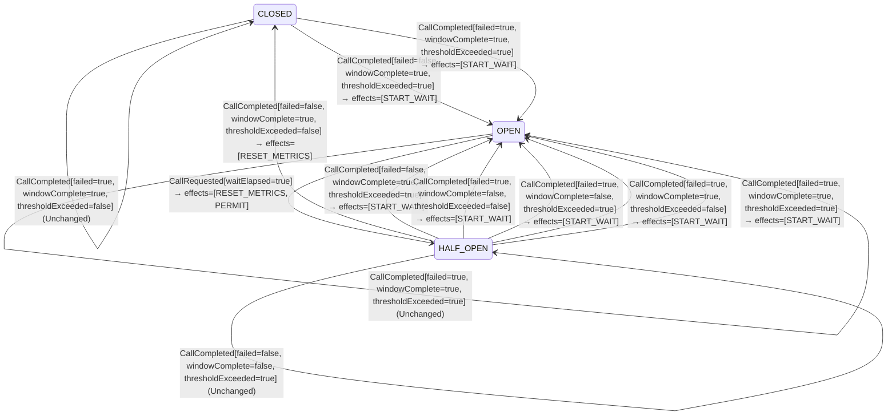

<!-- Generated by examples/tools/build.py from example.json and the verifier's output. Edit example.json. -->
# 075 · An open breaker that restarts its wait on each refused call never probes under load

[← All examples](../README.md)

| Verdict | Categories | Severity if shipped | Change | Verified unit | Approach |
|---|---|---|---|---|---|
| **✗ Violation: AnOpenBreakerProbesAgain, 8-step trace then forever (fairness)** | functional, performance | high | feature, behaviour change intended | [`CircuitBreaker#decide`](../../examples/apps/crosscut/src/main/java/net/terminalvalue/crosscut/resilience/CircuitBreaker.java) | [D1: Protocol model checking](../../examples/apps/crosscut/spec/README.md) |

> An open circuit breaker refuses calls until its wait has passed, then lets a probe through. A developer makes each refused call start the wait over, so that a caller which keeps hammering a failing dependency holds the breaker open until it stops; the contract changes in one row, from a rejection to a transition that stays open and starts the wait, and the test of the open state is updated to say so. Every safety invariant of the model holds: an open breaker still lets nothing through before its wait, still shields the dependency, still probes a limited number of times. The liveness check, a second configuration of the same model under fairness conditions, finds the run in which the caller never stops: two failures open the breaker, the dependency comes back, and from then on every tick of the clock is answered by a call that starts the wait over. The breaker stays open forever over a dependency that has recovered.

Tags: [resilience](../README.md#tag-resilience), [liveness](../README.md#tag-liveness), [tla-liveness](../README.md#tag-tla-liveness), [generated-operator](../README.md#tag-generated-operator), [multiple-configurations](../README.md#tag-multiple-configurations)

## The change

In the OPEN state, answer a call before the wait has elapsed with a transition that stays OPEN and carries START_WAIT, instead of a rejection, with the reasoning in a comment: a caller that keeps hammering a failing dependency holds the breaker open until it stops, and the wait is measured from the last call refused rather than from the failure that opened the breaker. The owner refuses a call the decision does not permit, as before. The contract of `CircuitBreaker#decide` is regenerated, and the one row of an open breaker asked before its wait has elapsed goes from `Rejected` to a transition. The test of the open state expects the transition; the class comment describes the new rule.

**Before** ([`CircuitBreaker.java`](../../examples/apps/crosscut/src/main/java/net/terminalvalue/crosscut/resilience/CircuitBreaker.java), line 19):

```java
 * {@code CircuitBreakerStateMachine}), as a total function from (state, event) to a decision.
 *
 * <p>CLOSED lets every call through and opens when a complete window's failure rate reaches the threshold. OPEN
 * rejects every call until the wait duration has passed, then lets a limited number of probe calls through as
 * HALF_OPEN. HALF_OPEN closes only once every permitted probe has completed with the failure rate below the
 * threshold; a probe that fails reopens the breaker at once.
 */
public final class CircuitBreaker {

    // ...
                case CLOSED, HALF_OPEN -> transition(state, PERMIT);
                case OPEN -> request.waitElapsed()
                        ? transition(HALF_OPEN, RESET_METRICS, PERMIT)
                        : rejected("the circuit breaker is open");
            };
            case CallCompleted call -> switch (state) {
                case CLOSED -> call.windowComplete() && call.thresholdExceeded()
```

**After:**

```java
 * {@code CircuitBreakerStateMachine}), as a total function from (state, event) to a decision.
 *
 * <p>CLOSED lets every call through and opens when a complete window's failure rate reaches the threshold. OPEN
 * refuses every call until the wait duration has passed, each refused call starting the wait over, then lets a
 * limited number of probe calls through as HALF_OPEN. HALF_OPEN closes only once every permitted probe has
 * completed with the failure rate below the threshold; a probe that fails reopens the breaker at once.
 */
public final class CircuitBreaker {

    // ...
                case CLOSED, HALF_OPEN -> transition(state, PERMIT);
                case OPEN -> request.waitElapsed()
                        ? transition(HALF_OPEN, RESET_METRICS, PERMIT)
                        // A call while open is refused, and starts the wait over: a caller that keeps hammering a
                        // failing dependency holds the breaker open until it stops, and the wait is measured from
                        // the last call refused rather than from the failure that opened the breaker.
                        : transition(OPEN, START_WAIT);
            };
            case CallCompleted call -> switch (state) {
                case CLOSED -> call.windowComplete() && call.thresholdExceeded()
```

<details><summary>Patch</summary>

```diff
--- a/examples/apps/crosscut/src/main/java/net/terminalvalue/crosscut/resilience/CircuitBreaker.java
+++ b/examples/apps/crosscut/src/main/java/net/terminalvalue/crosscut/resilience/CircuitBreaker.java
@@ -19,9 +19,9 @@
  * {@code CircuitBreakerStateMachine}), as a total function from (state, event) to a decision.
  *
  * <p>CLOSED lets every call through and opens when a complete window's failure rate reaches the threshold. OPEN
- * rejects every call until the wait duration has passed, then lets a limited number of probe calls through as
- * HALF_OPEN. HALF_OPEN closes only once every permitted probe has completed with the failure rate below the
- * threshold; a probe that fails reopens the breaker at once.
+ * refuses every call until the wait duration has passed, each refused call starting the wait over, then lets a
+ * limited number of probe calls through as HALF_OPEN. HALF_OPEN closes only once every permitted probe has
+ * completed with the failure rate below the threshold; a probe that fails reopens the breaker at once.
  */
 public final class CircuitBreaker {
 
@@ -33,7 +33,10 @@
                 case CLOSED, HALF_OPEN -> transition(state, PERMIT);
                 case OPEN -> request.waitElapsed()
                         ? transition(HALF_OPEN, RESET_METRICS, PERMIT)
-                        : rejected("the circuit breaker is open");
+                        // A call while open is refused, and starts the wait over: a caller that keeps hammering a
+                        // failing dependency holds the breaker open until it stops, and the wait is measured from
+                        // the last call refused rather than from the failure that opened the breaker.
+                        : transition(OPEN, START_WAIT);
             };
             case CallCompleted call -> switch (state) {
                 case CLOSED -> call.windowComplete() && call.thresholdExceeded()
--- a/examples/apps/crosscut/src/test/java/net/terminalvalue/crosscut/resilience/CircuitBreakerTest.java
+++ b/examples/apps/crosscut/src/test/java/net/terminalvalue/crosscut/resilience/CircuitBreakerTest.java
@@ -25,8 +25,8 @@
         check(CircuitBreaker.decide(CLOSED, new CallCompleted(true, false, true)) instanceof Decision.Unchanged, "too few calls to judge");
     }
 
-    public static void openRejectsUntilTheWaitHasPassed() {
-        check(CircuitBreaker.decide(OPEN, new CallRequested(false)) instanceof Decision.Rejected, "rejected");
+    public static void openRefusesAndRestartsTheWaitUntilItHasPassed() {
+        equal(new Transition<>(OPEN, List.of(BreakerEffect.START_WAIT)), CircuitBreaker.decide(OPEN, new CallRequested(false)));
         equal(new Transition<>(HALF_OPEN, List.of(BreakerEffect.RESET_METRICS, BreakerEffect.PERMIT)),
                 CircuitBreaker.decide(OPEN, new CallRequested(true)));
     }
```

</details>

## What the verifier found

The model is checked under 2 configurations, and the verdict is the first that fails:

| Configuration | What it checks | Model | Result |
|---|---|---|---|
| two calls in flight (`spec/CircuitBreaker.cfg`) | every run from the initial state, every interleaving within the configuration's bounds | WindowSize = 2, FailureRate = 50, PermittedProbes = 2, WaitDuration = 2, MaxInFlight = 2 | ✓ Verified: all invariants hold in 102 states |
| fairness (`spec/CircuitBreakerLive.cfg`) | the three liveness properties, under the fairness conditions `Fairness`: the caller keeps calling, every permitted call completes, the clock ticks, and nothing is assumed of the dependency. A counterexample is a run that goes on forever without satisfying a property: a prefix, then a state or a cycle the system never leaves | WindowSize = 2, FailureRate = 50, PermittedProbes = 2, WaitDuration = 2, MaxInFlight = 2 | ✗ Violation: AnOpenBreakerProbesAgain, 8-step trace then forever |

TLC found a run of the system under fairness that violates the temporal property **AnOpenBreakerProbesAgain** (an open breaker does not stay open: its wait elapses, and the next call is let through as a probe): after the 8 steps below, the system returns to step 7 and repeats steps 7 to 8 forever, and the property never comes true. The run respects every fairness condition the model assumes; the parts that could act, do. Each step is one action of one part of the system:

1. **Initial state**: the breaker closed, the window empty, no call in flight, no wait running, the dependency up or down.
2. **Request**, `CircuitBreaker.tryAcquirePermission`: a caller asks for a call; the owner reports whether the wait has elapsed and applies the decision, which lets the call through, starts a new metrics generation, or starts the wait. `current = 1`
3. **Complete**, `CircuitBreaker.onResult`, for a call of the current generation: the owner records the outcome, judges the window, and applies the decision. `current = 0`, `window = <<TRUE>>`
4. **Request**, `CircuitBreaker.tryAcquirePermission`: a caller asks for a call; the owner reports whether the wait has elapsed and applies the decision, which lets the call through, starts a new metrics generation, or starts the wait. `current = 1`
5. **Complete**, `CircuitBreaker.onResult`, for a call of the current generation: the owner records the outcome, judges the window, and applies the decision. `current = 0`, `state = "OPEN"`, `waitLeft = 2`, `window = <<TRUE, TRUE>>`
6. **DependencyFlips**, the dependency goes down, or comes back. `dependency = "UP"`
7. **Tick**, the clock advances: one tick less of the open state's wait. `waitLeft = 1`
8. **Request**, `CircuitBreaker.tryAcquirePermission`: a caller asks for a call; the owner reports whether the wait has elapsed and applies the decision, which lets the call through, starts a new metrics generation, or starts the wait. `waitLeft = 2`

The model is small (WindowSize = 2, FailureRate = 50, PermittedProbes = 2, WaitDuration = 2, MaxInFlight = 2), which is what keeps the trace readable. TLC explored every interleaving of the caller, the owner of the breaker with its window, its probes and its wait, the dependency and the clock within those bounds.

**What the verdict rests on.** TLC counted how often a step of the model took each row of the generated operators. A row no step takes is one the model says nothing about, whatever the verdict.

| Configuration | Rows of `CircuitBreaker#decide` taken |
|---|---|
| two calls in flight | 13 of 30 |
| fairness | stopped at the counterexample |

The change alters 1 row of the contract:

- `decide(OPEN, CallRequested[waitElapsed=false])`: `Rejected[reason="the circuit breaker is open"]` → `Transition[next=OPEN, effects=[START_WAIT]]`, taken under two calls in flight

The run under fairness stopped at its counterexample, the steps above, and its counts are left out: the verdict rests on the counterexample.

<details><summary>Rows no step takes under two calls in flight</summary>

`net.terminalvalue.crosscut.resilience.CircuitBreaker#decide`:

```
decide(CLOSED, CallRequested[waitElapsed=false]) => Transition[next=CLOSED, effects=[PERMIT]]
decide(CLOSED, CallCompleted[failed=false, windowComplete=false, thresholdExceeded=true]) => Unchanged
decide(CLOSED, CallCompleted[failed=true, windowComplete=false, thresholdExceeded=false]) => Unchanged
decide(CLOSED, CallCompleted[failed=true, windowComplete=true, thresholdExceeded=false]) => Unchanged
decide(OPEN, CallCompleted[failed=false, windowComplete=false, thresholdExceeded=false]) => Unchanged
decide(OPEN, CallCompleted[failed=false, windowComplete=false, thresholdExceeded=true]) => Unchanged
decide(OPEN, CallCompleted[failed=false, windowComplete=true, thresholdExceeded=false]) => Unchanged
decide(OPEN, CallCompleted[failed=false, windowComplete=true, thresholdExceeded=true]) => Unchanged
decide(OPEN, CallCompleted[failed=true, windowComplete=false, thresholdExceeded=false]) => Unchanged
decide(OPEN, CallCompleted[failed=true, windowComplete=false, thresholdExceeded=true]) => Unchanged
decide(OPEN, CallCompleted[failed=true, windowComplete=true, thresholdExceeded=false]) => Unchanged
decide(OPEN, CallCompleted[failed=true, windowComplete=true, thresholdExceeded=true]) => Unchanged
decide(HALF_OPEN, CallRequested[waitElapsed=false]) => Transition[next=HALF_OPEN, effects=[PERMIT]]
decide(HALF_OPEN, CallCompleted[failed=false, windowComplete=false, thresholdExceeded=true]) => Unchanged
decide(HALF_OPEN, CallCompleted[failed=false, windowComplete=true, thresholdExceeded=true]) => Transition[next=OPEN, effects=[START_WAIT]]
decide(HALF_OPEN, CallCompleted[failed=true, windowComplete=false, thresholdExceeded=false]) => Transition[next=OPEN, effects=[START_WAIT]]
decide(HALF_OPEN, CallCompleted[failed=true, windowComplete=true, thresholdExceeded=false]) => Transition[next=OPEN, effects=[START_WAIT]]
```

</details>

The state machine the patched code implements, drawn from its derived contract (`jvmcontract statemachine`); a state with no way in or no way out is marked:



## Would the existing tests have caught it?

No: every existing unit test passes (`java -ea net.terminalvalue.crosscut.Tests`, run against the patched code).

## Why it matters

The wait exists so that the dependency gets a quiet period and the breaker then finds out whether it has recovered. A wait measured from the last refused call never elapses while calls keep coming, and under a circuit breaker calls keep coming: the breaker is there because callers do not stop, and a refusal is cheap, so a service under load refuses at the rate it is asked. The dependency recovers and nobody ever asks it; the outage lasts exactly as long as the traffic does, which for a service that is called continuously is forever, or until an operator notices that a breaker has been open for an hour and resets it by hand. Nothing in the safety invariants can state this, because every state the run visits is a state the breaker is allowed to be in: open, with a wait running, letting nothing through. It is the run that is wrong, not any state of it, and that is a liveness property. The tests pass, because the developer updated the one that expected a rejection, and a reviewer who reads the comment sees a reasonable intention: back off from a dependency that is being hammered.

## Why the verdict is right

The model is checked under two configurations. The first, every interleaving within the model's bounds, checks the six safety invariants and finds them all holding in 102 states: the change does not let a call through early, does not probe too often, does not close too soon. The second checks three liveness properties under the fairness conditions of `LiveSpec`: the caller keeps calling, every permitted call completes, and the clock ticks, with nothing assumed about whether the dependency comes back. The first property, that an open breaker eventually probes again, fails, and TLC shows the run: the dependency is down, two calls fail and the window opens the breaker with a wait of two ticks, the dependency comes back, the clock ticks once, and a call is refused and starts the wait over. From there the run is a cycle of two steps, a tick and a refused call, that the system never leaves, and in every state of it the breaker is open. The run respects every fairness condition: the clock does tick, and the caller does call; it is the rule that turns each call into a fresh wait. The other two properties are not reached, since TLC reports the first that fails. The breaker of example 026 could be seen flapping; this one cannot be seen doing anything, which is the point of checking liveness beside the invariants.

## What to do

Keep the wait measured from the moment the breaker opened, as Resilience4j's `waitDurationInOpenState` is, and let the refusals be free of side effects. If a dependency under load should get a longer quiet period, lengthen the wait, or grow it on each reopening, which is a change the liveness check can confirm: a wait that grows still elapses. Then keep the liveness configuration in the build, as this module's `verify.sh` now does, so that the next rule which keeps a breaker open is found by the run that shows it, rather than by the operator who resets the breaker by hand.

## Notes

- The circuit-breaker model (`apps/crosscut/spec`) checks the breaker with the component that owns it for its invariants and, under fairness, for three liveness properties, each written for a different fate of the dependency behind it. A rule can keep every invariant and still fail one of them.
- Under a caller that keeps calling, the breaker stays open forever over a dependency that came back at step six. Every invariant holds in the run; only the liveness property for a dependency that recovers sees it, and the other two do not.

## Evidence

How the verdict was reached: two calls in flight: TLC 2.19 explored 102 distinct states to depth 19 in 0 s, for the model WindowSize = 2, FailureRate = 50, PermittedProbes = 2, WaitDuration = 2, MaxInFlight = 2; fairness: TLC 2.19 explored 102 distinct states in 0 s, for the model WindowSize = 2, FailureRate = 50, PermittedProbes = 2, WaitDuration = 2, MaxInFlight = 2.

This result was recorded before runs fingerprinted their inputs, so whether it still matches the current patch and sources is not known.

<details><summary>Verifier output</summary>

```text
== two calls in flight: spec/CircuitBreaker.cfg ==
TLC2 Version 2.19 of 08 August 2024 (rev: 5a47802)
Running breadth-first search Model-Checking with fp 1 and seed 1 with 1 worker on 2 cores with 2185MB heap and 64MB offheap memory [pid: 1098191] (Linux 6.6.87.2-microsoft-standard-WSL2 aarch64, Eclipse Adoptium 25.0.4.1 x86_64, MSBDiskFPSet, DiskStateQueue).
Parsing file examples/apps/crosscut/spec/CircuitBreaker.tla
Parsing file examples/tools/tla/standard-modules/Naturals.tla
Parsing file examples/tools/tla/standard-modules/Sequences.tla
Parsing file examples/tools/tla/standard-modules/FiniteSets.tla
Parsing file examples/apps/crosscut/spec/CircuitBreakerContract.tla
Semantic processing of module Naturals
Semantic processing of module Sequences
Semantic processing of module FiniteSets
Semantic processing of module CircuitBreakerContract
Semantic processing of module CircuitBreaker
Starting... (2026-11-03 23:55:05)
Computing initial states...
Finished computing initial states: 2 distinct states generated at 2026-11-03 23:55:05.
Model checking completed. No error has been found.
  Estimates of the probability that TLC did not check all reachable states
  because two distinct states had the same fingerprint:
  calculated (optimistic):  val = 1.1E-15
Rows of net.terminalvalue.crosscut.resilience.CircuitBreaker#decide a step of the model takes: 13 of 30; never taken (17):
  decide(CLOSED, CallRequested[waitElapsed=false]) => Transition[next=CLOSED, effects=[PERMIT]]
  decide(CLOSED, CallCompleted[failed=false, windowComplete=false, thresholdExceeded=true]) => Unchanged
  decide(CLOSED, CallCompleted[failed=true, windowComplete=false, thresholdExceeded=false]) => Unchanged
  decide(CLOSED, CallCompleted[failed=true, windowComplete=true, thresholdExceeded=false]) => Unchanged
  decide(OPEN, CallCompleted[failed=false, windowComplete=false, thresholdExceeded=false]) => Unchanged
  decide(OPEN, CallCompleted[failed=false, windowComplete=false, thresholdExceeded=true]) => Unchanged
  decide(OPEN, CallCompleted[failed=false, windowComplete=true, thresholdExceeded=false]) => Unchanged
  decide(OPEN, CallCompleted[failed=false, windowComplete=true, thresholdExceeded=true]) => Unchanged
  decide(OPEN, CallCompleted[failed=true, windowComplete=false, thresholdExceeded=false]) => Unchanged
  decide(OPEN, CallCompleted[failed=true, windowComplete=false, thresholdExceeded=true]) => Unchanged
  decide(OPEN, CallCompleted[failed=true, windowComplete=true, thresholdExceeded=false]) => Unchanged
  decide(OPEN, CallCompleted[failed=true, windowComplete=true, thresholdExceeded=true]) => Unchanged
  decide(HALF_OPEN, CallRequested[waitElapsed=false]) => Transition[next=HALF_OPEN, effects=[PERMIT]]
  decide(HALF_OPEN, CallCompleted[failed=false, windowComplete=false, thresholdExceeded=true]) => Unchanged
  decide(HALF_OPEN, CallCompleted[failed=false, windowComplete=true, thresholdExceeded=true]) => Transition[next=OPEN, effects=[START_WAIT]]
  decide(HALF_OPEN, CallCompleted[failed=true, windowComplete=false, thresholdExceeded=false]) => Transition[next=OPEN, effects=[START_WAIT]]
  decide(HALF_OPEN, CallCompleted[failed=true, windowComplete=true, thresholdExceeded=false]) => Transition[next=OPEN, effects=[START_WAIT]]
294 states generated, 102 distinct states found, 0 states left on queue.
The depth of the complete state graph search is 19.
The average outdegree of the complete state graph is 1 (minimum is 0, the maximum 3 and the 95th percentile is 2).
Finished in 00s at (2026-11-03 23:55:05)

== fairness: spec/CircuitBreakerLive.cfg ==
TLC2 Version 2.19 of 08 August 2024 (rev: 5a47802)
Running breadth-first search Model-Checking with fp 1 and seed 1 with 1 worker on 2 cores with 2185MB heap and 64MB offheap memory [pid: 1098367] (Linux 6.6.87.2-microsoft-standard-WSL2 aarch64, Eclipse Adoptium 25.0.4.1 x86_64, MSBDiskFPSet, DiskStateQueue).
Parsing file examples/apps/crosscut/spec/CircuitBreaker.tla
Parsing file examples/tools/tla/standard-modules/Naturals.tla
Parsing file examples/tools/tla/standard-modules/Sequences.tla
Parsing file examples/tools/tla/standard-modules/FiniteSets.tla
Parsing file examples/apps/crosscut/spec/CircuitBreakerContract.tla
Semantic processing of module Naturals
Semantic processing of module Sequences
Semantic processing of module FiniteSets
Semantic processing of module CircuitBreakerContract
Semantic processing of module CircuitBreaker
Starting... (2026-11-03 23:55:08)
Implied-temporal checking--satisfiability problem has 1 branches.
Computing initial states...
Finished computing initial states: 2 distinct states generated at 2026-11-03 23:55:08.
Checking temporal properties for the complete state space with 102 total distinct states at (2026-11-03 23:55:08)
Error: Temporal properties were violated.

Error: The following behavior constitutes a counter-example:

State 1: <Initial predicate>
/\ state = "CLOSED"
/\ window = <<>>
/\ probedEarly = FALSE
/\ current = 0
/\ waitLeft = 0
/\ dependency = "DOWN"
/\ stale = 0
/\ closedEarly = FALSE

State 2: <Request line 68, col 5 to line 78, col 44 of module CircuitBreaker>
/\ state = "CLOSED"
/\ window = <<>>
/\ probedEarly = FALSE
/\ current = 1
/\ waitLeft = 0
/\ dependency = "DOWN"
/\ stale = 0
/\ closedEarly = FALSE

State 3: <Complete line 84, col 5 to line 97, col 44 of module CircuitBreaker>
/\ state = "CLOSED"
/\ window = <<TRUE>>
/\ probedEarly = FALSE
/\ current = 0
/\ waitLeft = 0
/\ dependency = "DOWN"
/\ stale = 0
/\ closedEarly = FALSE

State 4: <Request line 68, col 5 to line 78, col 44 of module CircuitBreaker>
/\ state = "CLOSED"
/\ window = <<TRUE>>
/\ probedEarly = FALSE
/\ current = 1
/\ waitLeft = 0
/\ dependency = "DOWN"
/\ stale = 0
/\ closedEarly = FALSE

State 5: <Complete line 84, col 5 to line 97, col 44 of module CircuitBreaker>
/\ state = "OPEN"
/\ window = <<TRUE, TRUE>>
/\ probedEarly = FALSE
/\ current = 0
/\ waitLeft = 2
/\ dependency = "DOWN"
/\ stale = 0
/\ closedEarly = FALSE

State 6: <DependencyFlips line 117, col 5 to line 118, col 86 of module CircuitBreaker>
/\ state = "OPEN"
/\ window = <<TRUE, TRUE>>
/\ probedEarly = FALSE
/\ current = 0
/\ waitLeft = 2
/\ dependency = "UP"
/\ stale = 0
/\ closedEarly = FALSE

State 7: <Tick line 111, col 5 to line 113, col 88 of module CircuitBreaker>
/\ state = "OPEN"
/\ window = <<TRUE, TRUE>>
/\ probedEarly = FALSE
/\ current = 0
/\ waitLeft = 1
/\ dependency = "UP"
/\ stale = 0
/\ closedEarly = FALSE

State 8: <Request line 68, col 5 to line 78, col 44 of module CircuitBreaker>
/\ state = "OPEN"
/\ window = <<TRUE, TRUE>>
/\ probedEarly = FALSE
/\ current = 0
/\ waitLeft = 2
/\ dependency = "UP"
/\ stale = 0
/\ closedEarly = FALSE

Back to state 7: <Tick line 111, col 5 to line 113, col 88 of module CircuitBreaker>

Finished checking temporal properties in 00s at 2026-11-03 23:55:08
The coverage statistics at 2026-11-03 23:55:08
<Init line 124, col 1 to line 124, col 4 of module CircuitBreaker>: 4:4
  line 126, col 8 to line 126, col 36 of module CircuitBreaker: 2
  line 127, col 8 to line 127, col 20 of module CircuitBreaker: 4
  line 131, col 8 to line 131, col 26 of module CircuitBreaker: 4
  line 132, col 8 to line 132, col 26 of module CircuitBreaker: 4
<Request line 67, col 1 to line 67, col 7 of module CircuitBreaker>: 15:94
  line 68, col 8 to line 68, col 36 of module CircuitBreaker: 94
  |line 68, col 8 to line 68, col 22 of module CircuitBreaker: 118
  |line 68, col 26 to line 68, col 36 of module CircuitBreaker: 118
  line 69, col 8 to line 69, col 69 of module CircuitBreaker: 88
  |line 69, col 8 to line 69, col 26 of module CircuitBreaker: 96
  |line 69, col 31 to line 69, col 69 of module CircuitBreaker: 6
  ||line 69, col 31 to line 69, col 51 of module CircuitBreaker: 8
  ||line 69, col 55 to line 69, col 69 of module CircuitBreaker: 8
  line 72, col 14 to line 72, col 69 of module CircuitBreaker: 94
  |line 72, col 23 to line 72, col 69 of module CircuitBreaker: 94
  ||line 72, col 26 to line 72, col 46 of module CircuitBreaker: 94
  |||line 72, col 26 to line 72, col 31 of module CircuitBreaker: 94
  ||||line 72, col 26 to line 72, col 26 of module CircuitBreaker: 94
  |||||line 70, col 17 to line 70, col 89 of module CircuitBreaker: 94
  ||||||line 13, col 3 to line 42, col 175 of module CircuitBreakerContract: 94
  |||||||line 13, col 8 to line 13, col 114 of module CircuitBreakerContract: 94
  ||||||||line 13, col 8 to line 13, col 53 of module CircuitBreakerContract: 94
  |||||||||line 13, col 9 to line 13, col 31 of module CircuitBreakerContract: 94
  ||||||||||line 13, col 27 to line 13, col 31 of module CircuitBreakerContract: 188
  ||||||||||line 13, col 18 to line 13, col 23 of module CircuitBreakerContract: 94:282
  |||||||||line 13, col 37 to line 13, col 53 of module CircuitBreakerContract: 94
  ||||||||line 13, col 58 to line 13, col 114 of module CircuitBreakerContract: 28
  |||||||line 14, col 8 to line 14, col 84 of module CircuitBreakerContract: 94
  ||||||||line 14, col 8 to line 14, col 24 of module CircuitBreakerContract: 94
  ||||||||line 14, col 29 to line 14, col 84 of module CircuitBreakerContract: 28
  |||||||line 14, col 89 to line 14, col 122 of module CircuitBreakerContract: 28
  |||||||line 15, col 8 to line 15, col 148 of module CircuitBreakerContract: 66
  |||||||line 16, col 8 to line 16, col 147 of module CircuitBreakerContract: 66
  |||||||line 17, col 8 to line 17, col 147 of module CircuitBreakerContract: 66
  |||||||line 18, col 8 to line 18, col 173 of module CircuitBreakerContract: 66
  |||||||line 19, col 8 to line 19, col 147 of module CircuitBreakerContract: 66
  |||||||line 20, col 8 to line 20, col 146 of module CircuitBreakerContract: 66
  |||||||line 21, col 8 to line 21, col 146 of module CircuitBreakerContract: 66
  |||||||line 22, col 8 to line 22, col 172 of module CircuitBreakerContract: 66
  |||||||line 23, col 8 to line 23, col 83 of module CircuitBreakerContract: 66
  ||||||||line 23, col 8 to line 23, col 22 of module CircuitBreakerContract: 66
  ||||||||line 23, col 27 to line 23, col 83 of module CircuitBreakerContract: 60
  |||||||line 23, col 88 to line 23, col 123 of module CircuitBreakerContract: 44
  |||||||line 24, col 8 to line 24, col 82 of module CircuitBreakerContract: 22
  ||||||||line 24, col 8 to line 24, col 22 of module CircuitBreakerContract: 22
  ||||||||line 24, col 27 to line 24, col 82 of module CircuitBreakerContract: 16
  |||||||line 24, col 87 to line 24, col 140 of module CircuitBreakerContract: 16
  |||||||line 25, col 8 to line 25, col 146 of module CircuitBreakerContract: 6
  |||||||line 26, col 8 to line 26, col 145 of module CircuitBreakerContract: 6
  |||||||line 27, col 8 to line 27, col 145 of module CircuitBreakerContract: 6
  |||||||line 28, col 8 to line 28, col 144 of module CircuitBreakerContract: 6
  |||||||line 29, col 8 to line 29, col 145 of module CircuitBreakerContract: 6
  |||||||line 30, col 8 to line 30, col 144 of module CircuitBreakerContract: 6
  |||||||line 31, col 8 to line 31, col 144 of module CircuitBreakerContract: 6
  |||||||line 32, col 8 to line 32, col 143 of module CircuitBreakerContract: 6
  |||||||line 33, col 8 to line 33, col 129 of module CircuitBreakerContract: 6
  |||||||line 34, col 8 to line 34, col 128 of module CircuitBreakerContract: 6
  ||||||line 70, col 24 to line 70, col 28 of module CircuitBreaker: 94
  ||||||line 70, col 31 to line 70, col 88 of module CircuitBreaker: 94
  ||line 72, col 53 to line 72, col 58 of module CircuitBreaker: 94
  |||line 72, col 53 to line 72, col 53 of module CircuitBreaker: 94
  ||||line 70, col 17 to line 70, col 89 of module CircuitBreaker: 94
  |||||line 13, col 3 to line 42, col 175 of module CircuitBreakerContract: 94
  ||||||line 13, col 8 to line 13, col 114 of module CircuitBreakerContract: 94
  |||||||line 13, col 8 to line 13, col 53 of module CircuitBreakerContract: 94
  ||||||||line 13, col 9 to line 13, col 31 of module CircuitBreakerContract: 94
  |||||||||line 13, col 27 to line 13, col 31 of module CircuitBreakerContract: 188
  |||||||||line 13, col 18 to line 13, col 23 of module CircuitBreakerContract: 94:282
  ||||||||line 13, col 37 to line 13, col 53 of module CircuitBreakerContract: 94
  |||||||line 13, col 58 to line 13, col 114 of module CircuitBreakerContract: 28
  ||||||line 14, col 8 to line 14, col 84 of module CircuitBreakerContract: 94
  |||||||line 14, col 8 to line 14, col 24 of module CircuitBreakerContract: 94
  |||||||line 14, col 29 to line 14, col 84 of module CircuitBreakerContract: 28
  ||||||line 14, col 89 to line 14, col 122 of module CircuitBreakerContract: 28
  ||||||line 15, col 8 to line 15, col 148 of module CircuitBreakerContract: 66
  ||||||line 16, col 8 to line 16, col 147 of module CircuitBreakerContract: 66
  ||||||line 17, col 8 to line 17, col 147 of module CircuitBreakerContract: 66
  ||||||line 18, col 8 to line 18, col 173 of module CircuitBreakerContract: 66
  ||||||line 19, col 8 to line 19, col 147 of module CircuitBreakerContract: 66
  ||||||line 20, col 8 to line 20, col 146 of module CircuitBreakerContract: 66
  ||||||line 21, col 8 to line 21, col 146 of module CircuitBreakerContract: 66
  ||||||line 22, col 8 to line 22, col 172 of module CircuitBreakerContract: 66
  ||||||line 23, col 8 to line 23, col 83 of module CircuitBreakerContract: 66
  |||||||line 23, col 8 to line 23, col 22 of module CircuitBreakerContract: 66
  |||||||line 23, col 27 to line 23, col 83 of module CircuitBreakerContract: 60
  ||||||line 23, col 88 to line 23, col 123 of module CircuitBreakerContract: 44
  ||||||line 24, col 8 to line 24, col 82 of module CircuitBreakerContract: 22
  |||||||line 24, col 8 to line 24, col 22 of module CircuitBreakerContract: 22
  |||||||line 24, col 27 to line 24, col 82 of module CircuitBreakerContract: 16
  ||||||line 24, col 87 to line 24, col 140 of module CircuitBreakerContract: 16
  ||||||line 25, col 8 to line 25, col 146 of module CircuitBreakerContract: 6
  ||||||line 26, col 8 to line 26, col 145 of module CircuitBreakerContract: 6
  ||||||line 27, col 8 to line 27, col 145 of module CircuitBreakerContract: 6
  ||||||line 28, col 8 to line 28, col 144 of module CircuitBreakerContract: 6
  ||||||line 29, col 8 to line 29, col 145 of module CircuitBreakerContract: 6
  ||||||line 30, col 8 to line 30, col 144 of module CircuitBreakerContract: 6
  ||||||line 31, col 8 to line 31, col 144 of module CircuitBreakerContract: 6
  ||||||line 32, col 8 to line 32, col 143 of module CircuitBreakerContract: 6
  ||||||line 33, col 8 to line 33, col 129 of module CircuitBreakerContract: 6
  ||||||line 34, col 8 to line 34, col 128 of module CircuitBreakerContract: 6
  |||||line 70, col 24 to line 70, col 28 of module CircuitBreaker: 94
  |||||line 70, col 31 to line 70, col 88 of module CircuitBreaker: 94
  line 73, col 14 to line 73, col 53 of module CircuitBreaker: 94
  |line 73, col 24 to line 73, col 53 of module CircuitBreaker: 94
  ||line 73, col 27 to line 73, col 31 of module CircuitBreaker: 94
  |||line 71, col 21 to line 71, col 43 of module CircuitBreaker: 94
  ||||line 49, col 19 to line 49, col 68 of module CircuitBreaker: 94
  ||||line 71, col 25 to line 71, col 25 of module CircuitBreaker: 94
  |||||line 70, col 17 to line 70, col 89 of module CircuitBreaker: 94
  ||||||line 13, col 3 to line 42, col 175 of module CircuitBreakerContract: 94
  |||||||line 13, col 8 to line 13, col 114 of module CircuitBreakerContract: 94
  ||||||||line 13, col 8 to line 13, col 53 of module CircuitBreakerContract: 94
  |||||||||line 13, col 9 to line 13, col 31 of module CircuitBreakerContract: 94
  ||||||||||line 13, col 27 to line 13, col 31 of module CircuitBreakerContract: 188
  ||||||||||line 13, col 18 to line 13, col 23 of module CircuitBreakerContract: 94:282
  |||||||||line 13, col 37 to line 13, col 53 of module CircuitBreakerContract: 94
  ||||||||line 13, col 58 to line 13, col 114 of module CircuitBreakerContract: 28
  |||||||line 14, col 8 to line 14, col 84 of module CircuitBreakerContract: 94
  ||||||||line 14, col 8 to line 14, col 24 of module CircuitBreakerContract: 94
  ||||||||line 14, col 29 to line 14, col 84 of module CircuitBreakerContract: 28
  |||||||line 14, col 89 to line 14, col 122 of module CircuitBreakerContract: 28
  |||||||line 15, col 8 to line 15, col 148 of module CircuitBreakerContract: 66
  |||||||line 16, col 8 to line 16, col 147 of module CircuitBreakerContract: 66
  |||||||line 17, col 8 to line 17, col 147 of module CircuitBreakerContract: 66
  |||||||line 18, col 8 to line 18, col 173 of module CircuitBreakerContract: 66
  |||||||line 19, col 8 to line 19, col 147 of module CircuitBreakerContract: 66
  |||||||line 20, col 8 to line 20, col 146 of module CircuitBreakerContract: 66
  |||||||line 21, col 8 to line 21, col 146 of module CircuitBreakerContract: 66
  |||||||line 22, col 8 to line 22, col 172 of module CircuitBreakerContract: 66
  |||||||line 23, col 8 to line 23, col 83 of module CircuitBreakerContract: 66
  ||||||||line 23, col 8 to line 23, col 22 of module CircuitBreakerContract: 66
  ||||||||line 23, col 27 to line 23, col 83 of module CircuitBreakerContract: 60
  |||||||line 23, col 88 to line 23, col 123 of module CircuitBreakerContract: 44
  |||||||line 24, col 8 to line 24, col 82 of module CircuitBreakerContract: 22
  ||||||||line 24, col 8 to line 24, col 22 of module CircuitBreakerContract: 22
  ||||||||line 24, col 27 to line 24, col 82 of module CircuitBreakerContract: 16
  |||||||line 24, col 87 to line 24, col 140 of module CircuitBreakerContract: 16
  |||||||line 25, col 8 to line 25, col 146 of module CircuitBreakerContract: 6
  |||||||line 26, col 8 to line 26, col 145 of module CircuitBreakerContract: 6
  |||||||line 27, col 8 to line 27, col 145 of module CircuitBreakerContract: 6
  |||||||line 28, col 8 to line 28, col 144 of module CircuitBreakerContract: 6
  |||||||line 29, col 8 to line 29, col 145 of module CircuitBreakerContract: 6
  |||||||line 30, col 8 to line 30, col 144 of module CircuitBreakerContract: 6
  |||||||line 31, col 8 to line 31, col 144 of module CircuitBreakerContract: 6
  |||||||line 32, col 8 to line 32, col 143 of module CircuitBreakerContract: 6
  |||||||line 33, col 8 to line 33, col 129 of module CircuitBreakerContract: 6
  |||||||line 34, col 8 to line 34, col 128 of module CircuitBreakerContract: 6
  ||||||line 70, col 24 to line 70, col 28 of module CircuitBreaker: 94
  ||||||line 70, col 31 to line 70, col 88 of module CircuitBreaker: 94
  ||line 73, col 38 to line 73, col 41 of module CircuitBreaker: 16
  ||line 73, col 48 to line 73, col 53 of module CircuitBreaker: 78
  line 74, col 14 to line 74, col 62 of module CircuitBreaker: 94
  |line 74, col 23 to line 74, col 62 of module CircuitBreaker: 94
  ||line 74, col 26 to line 74, col 30 of module CircuitBreaker: 94
  |||line 71, col 21 to line 71, col 43 of module CircuitBreaker: 94
  ||||line 49, col 19 to line 49, col 68 of module CircuitBreaker: 94
  ||||line 71, col 25 to line 71, col 25 of module CircuitBreaker: 94
  |||||line 70, col 17 to line 70, col 89 of module CircuitBreaker: 94
  ||||||line 13, col 3 to line 42, col 175 of module CircuitBreakerContract: 94
  |||||||line 13, col 8 to line 13, col 114 of module CircuitBreakerContract: 94
  ||||||||line 13, col 8 to line 13, col 53 of module CircuitBreakerContract: 94
  |||||||||line 13, col 9 to line 13, col 31 of module CircuitBreakerContract: 94
  ||||||||||line 13, col 27 to line 13, col 31 of module CircuitBreakerContract: 188
  ||||||||||line 13, col 18 to line 13, col 23 of module CircuitBreakerContract: 94:282
  |||||||||line 13, col 37 to line 13, col 53 of module CircuitBreakerContract: 94
  ||||||||line 13, col 58 to line 13, col 114 of module CircuitBreakerContract: 28
  |||||||line 14, col 8 to line 14, col 84 of module CircuitBreakerContract: 94
  ||||||||line 14, col 8 to line 14, col 24 of module CircuitBreakerContract: 94
  ||||||||line 14, col 29 to line 14, col 84 of module CircuitBreakerContract: 28
  |||||||line 14, col 89 to line 14, col 122 of module CircuitBreakerContract: 28
  |||||||line 15, col 8 to line 15, col 148 of module CircuitBreakerContract: 66
  |||||||line 16, col 8 to line 16, col 147 of module CircuitBreakerContract: 66
  |||||||line 17, col 8 to line 17, col 147 of module CircuitBreakerContract: 66
  |||||||line 18, col 8 to line 18, col 173 of module CircuitBreakerContract: 66
  |||||||line 19, col 8 to line 19, col 147 of module CircuitBreakerContract: 66
  |||||||line 20, col 8 to line 20, col 146 of module CircuitBreakerContract: 66
  |||||||line 21, col 8 to line 21, col 146 of module CircuitBreakerContract: 66
  |||||||line 22, col 8 to line 22, col 172 of module CircuitBreakerContract: 66
  |||||||line 23, col 8 to line 23, col 83 of module CircuitBreakerContract: 66
  ||||||||line 23, col 8 to line 23, col 22 of module CircuitBreakerContract: 66
  ||||||||line 23, col 27 to line 23, col 83 of module CircuitBreakerContract: 60
  |||||||line 23, col 88 to line 23, col 123 of module CircuitBreakerContract: 44
  |||||||line 24, col 8 to line 24, col 82 of module CircuitBreakerContract: 22
  ||||||||line 24, col 8 to line 24, col 22 of module CircuitBreakerContract: 22
  ||||||||line 24, col 27 to line 24, col 82 of module CircuitBreakerContract: 16
  |||||||line 24, col 87 to line 24, col 140 of module CircuitBreakerContract: 16
  |||||||line 25, col 8 to line 25, col 146 of module CircuitBreakerContract: 6
  |||||||line 26, col 8 to line 26, col 145 of module CircuitBreakerContract: 6
  |||||||line 27, col 8 to line 27, col 145 of module CircuitBreakerContract: 6
  |||||||line 28, col 8 to line 28, col 144 of module CircuitBreakerContract: 6
  |||||||line 29, col 8 to line 29, col 145 of module CircuitBreakerContract: 6
  |||||||line 30, col 8 to line 30, col 144 of module CircuitBreakerContract: 6
  |||||||line 31, col 8 to line 31, col 144 of module CircuitBreakerContract: 6
  |||||||line 32, col 8 to line 32, col 143 of module CircuitBreakerContract: 6
  |||||||line 33, col 8 to line 33, col 129 of module CircuitBreakerContract: 6
  |||||||line 34, col 8 to line 34, col 128 of module CircuitBreakerContract: 6
  ||||||line 70, col 24 to line 70, col 28 of module CircuitBreaker: 94
  ||||||line 70, col 31 to line 70, col 88 of module CircuitBreaker: 94
  ||line 74, col 37 to line 74, col 51 of module CircuitBreaker: 16
  ||line 74, col 58 to line 74, col 62 of module CircuitBreaker: 78
  line 75, col 14 to line 75, col 96 of module CircuitBreaker: 94
  |line 75, col 25 to line 75, col 96 of module CircuitBreaker: 94
  ||line 75, col 28 to line 75, col 43 of module CircuitBreaker: 94
  |||line 49, col 19 to line 49, col 68 of module CircuitBreaker: 94
  ||||line 49, col 48 to line 49, col 68 of module CircuitBreaker: 110
  ||||line 49, col 28 to line 49, col 44 of module CircuitBreaker: 94
  |||line 75, col 32 to line 75, col 32 of module CircuitBreaker: 94
  ||||line 70, col 17 to line 70, col 89 of module CircuitBreaker: 94
  |||||line 13, col 3 to line 42, col 175 of module CircuitBreakerContract: 94
  ||||||line 13, col 8 to line 13, col 114 of module CircuitBreakerContract: 94
  |||||||line 13, col 8 to line 13, col 53 of module CircuitBreakerContract: 94
  ||||||||line 13, col 9 to line 13, col 31 of module CircuitBreakerContract: 94
  |||||||||line 13, col 27 to line 13, col 31 of module CircuitBreakerContract: 188
  |||||||||line 13, col 18 to line 13, col 23 of module CircuitBreakerContract: 94:282
  ||||||||line 13, col 37 to line 13, col 53 of module CircuitBreakerContract: 94
  |||||||line 13, col 58 to line 13, col 114 of module CircuitBreakerContract: 28
  ||||||line 14, col 8 to line 14, col 84 of module CircuitBreakerContract: 94
  |||||||line 14, col 8 to line 14, col 24 of module CircuitBreakerContract: 94
  |||||||line 14, col 29 to line 14, col 84 of module CircuitBreakerContract: 28
  ||||||line 14, col 89 to line 14, col 122 of module CircuitBreakerContract: 28
  ||||||line 15, col 8 to line 15, col 148 of module CircuitBreakerContract: 66
  ||||||line 16, col 8 to line 16, col 147 of module CircuitBreakerContract: 66
  ||||||line 17, col 8 to line 17, col 147 of module CircuitBreakerContract: 66
  ||||||line 18, col 8 to line 18, col 173 of module CircuitBreakerContract: 66
  ||||||line 19, col 8 to line 19, col 147 of module CircuitBreakerContract: 66
  ||||||line 20, col 8 to line 20, col 146 of module CircuitBreakerContract: 66
  ||||||line 21, col 8 to line 21, col 146 of module CircuitBreakerContract: 66
  ||||||line 22, col 8 to line 22, col 172 of module CircuitBreakerContract: 66
  ||||||line 23, col 8 to line 23, col 83 of module CircuitBreakerContract: 66
  |||||||line 23, col 8 to line 23, col 22 of module CircuitBreakerContract: 66
  |||||||line 23, col 27 to line 23, col 83 of module CircuitBreakerContract: 60
  ||||||line 23, col 88 to line 23, col 123 of module CircuitBreakerContract: 44
  ||||||line 24, col 8 to line 24, col 82 of module CircuitBreakerContract: 22
  |||||||line 24, col 8 to line 24, col 22 of module CircuitBreakerContract: 22
  |||||||line 24, col 27 to line 24, col 82 of module CircuitBreakerContract: 16
  ||||||line 24, col 87 to line 24, col 140 of module CircuitBreakerContract: 16
  ||||||line 25, col 8 to line 25, col 146 of module CircuitBreakerContract: 6
  ||||||line 26, col 8 to line 26, col 145 of module CircuitBreakerContract: 6
  ||||||line 27, col 8 to line 27, col 145 of module CircuitBreakerContract: 6
  ||||||line 28, col 8 to line 28, col 144 of module CircuitBreakerContract: 6
  ||||||line 29, col 8 to line 29, col 145 of module CircuitBreakerContract: 6
  ||||||line 30, col 8 to line 30, col 144 of module CircuitBreakerContract: 6
  ||||||line 31, col 8 to line 31, col 144 of module CircuitBreakerContract: 6
  ||||||line 32, col 8 to line 32, col 143 of module CircuitBreakerContract: 6
  ||||||line 33, col 8 to line 33, col 129 of module CircuitBreakerContract: 6
  ||||||line 34, col 8 to line 34, col 128 of module CircuitBreakerContract: 6
  |||||line 70, col 24 to line 70, col 28 of module CircuitBreaker: 94
  |||||line 70, col 31 to line 70, col 88 of module CircuitBreaker: 94
  ||line 75, col 51 to line 75, col 82 of module CircuitBreaker: 50
  |||line 75, col 54 to line 75, col 58 of module CircuitBreaker: 50
  ||||line 71, col 21 to line 71, col 43 of module CircuitBreaker: 50
  |||||line 49, col 19 to line 49, col 68 of module CircuitBreaker: 50
  |||||line 71, col 25 to line 71, col 25 of module CircuitBreaker: 50
  ||||||line 70, col 17 to line 70, col 89 of module CircuitBreaker: 50
  |||||||line 13, col 3 to line 42, col 175 of module CircuitBreakerContract: 50
  ||||||||line 13, col 8 to line 13, col 114 of module CircuitBreakerContract: 50
  |||||||||line 13, col 8 to line 13, col 53 of module CircuitBreakerContract: 50
  ||||||||||line 13, col 9 to line 13, col 31 of module CircuitBreakerContract: 50
  |||||||||||line 13, col 27 to line 13, col 31 of module CircuitBreakerContract: 100
  |||||||||||line 13, col 18 to line 13, col 23 of module CircuitBreakerContract: 50:150
  ||||||||||line 13, col 37 to line 13, col 53 of module CircuitBreakerContract: 50
  |||||||||line 13, col 58 to line 13, col 114 of module CircuitBreakerContract: 28
  ||||||||line 14, col 8 to line 14, col 84 of module CircuitBreakerContract: 50
  |||||||||line 14, col 8 to line 14, col 24 of module CircuitBreakerContract: 50
  |||||||||line 14, col 29 to line 14, col 84 of module CircuitBreakerContract: 28
  ||||||||line 14, col 89 to line 14, col 122 of module CircuitBreakerContract: 28
  ||||||||line 15, col 8 to line 15, col 148 of module CircuitBreakerContract: 22
  ||||||||line 16, col 8 to line 16, col 147 of module CircuitBreakerContract: 22
  ||||||||line 17, col 8 to line 17, col 147 of module CircuitBreakerContract: 22
  ||||||||line 18, col 8 to line 18, col 173 of module CircuitBreakerContract: 22
  ||||||||line 19, col 8 to line 19, col 147 of module CircuitBreakerContract: 22
  ||||||||line 20, col 8 to line 20, col 146 of module CircuitBreakerContract: 22
  ||||||||line 21, col 8 to line 21, col 146 of module CircuitBreakerContract: 22
  ||||||||line 22, col 8 to line 22, col 172 of module CircuitBreakerContract: 22
  ||||||||line 23, col 8 to line 23, col 83 of module CircuitBreakerContract: 22
  |||||||||line 23, col 8 to line 23, col 22 of module CircuitBreakerContract: 22
  |||||||||line 23, col 27 to line 23, col 83 of module CircuitBreakerContract: 16
  ||||||||line 24, col 8 to line 24, col 82 of module CircuitBreakerContract: 22
  |||||||||line 24, col 8 to line 24, col 22 of module CircuitBreakerContract: 22
  |||||||||line 24, col 27 to line 24, col 82 of module CircuitBreakerContract: 16
  ||||||||line 24, col 87 to line 24, col 140 of module CircuitBreakerContract: 16
  ||||||||line 25, col 8 to line 25, col 146 of module CircuitBreakerContract: 6
  ||||||||line 26, col 8 to line 26, col 145 of module CircuitBreakerContract: 6
  ||||||||line 27, col 8 to line 27, col 145 of module CircuitBreakerContract: 6
  ||||||||line 28, col 8 to line 28, col 144 of module CircuitBreakerContract: 6
  ||||||||line 29, col 8 to line 29, col 145 of module CircuitBreakerContract: 6
  ||||||||line 30, col 8 to line 30, col 144 of module CircuitBreakerContract: 6
  ||||||||line 31, col 8 to line 31, col 144 of module CircuitBreakerContract: 6
  ||||||||line 32, col 8 to line 32, col 143 of module CircuitBreakerContract: 6
  ||||||||line 33, col 8 to line 33, col 129 of module CircuitBreakerContract: 6
  ||||||||line 34, col 8 to line 34, col 128 of module CircuitBreakerContract: 6
  |||||||line 70, col 24 to line 70, col 28 of module CircuitBreaker: 50
  |||||||line 70, col 31 to line 70, col 88 of module CircuitBreaker: 50
  |||line 75, col 72 to line 75, col 82 of module CircuitBreaker: 34
  ||line 75, col 90 to line 75, col 96 of module CircuitBreaker: 44
  line 76, col 14 to line 76, col 80 of module CircuitBreaker: 94
  |line 76, col 26 to line 76, col 80 of module CircuitBreaker: 94
  ||line 76, col 29 to line 76, col 48 of module CircuitBreaker: 94
  |||line 49, col 19 to line 49, col 68 of module CircuitBreaker: 94
  ||||line 49, col 48 to line 49, col 68 of module CircuitBreaker: 110
  ||||line 49, col 28 to line 49, col 44 of module CircuitBreaker: 94
  |||line 76, col 33 to line 76, col 33 of module CircuitBreaker: 94
  ||||line 70, col 17 to line 70, col 89 of module CircuitBreaker: 94
  |||||line 13, col 3 to line 42, col 175 of module CircuitBreakerContract: 94
  ||||||line 13, col 8 to line 13, col 114 of module CircuitBreakerContract: 94
  |||||||line 13, col 8 to line 13, col 53 of module CircuitBreakerContract: 94
  ||||||||line 13, col 9 to line 13, col 31 of module CircuitBreakerContract: 94
  |||||||||line 13, col 27 to line 13, col 31 of module CircuitBreakerContract: 188
  |||||||||line 13, col 18 to line 13, col 23 of module CircuitBreakerContract: 94:282
  ||||||||line 13, col 37 to line 13, col 53 of module CircuitBreakerContract: 94
  |||||||line 13, col 58 to line 13, col 114 of module CircuitBreakerContract: 28
  ||||||line 14, col 8 to line 14, col 84 of module CircuitBreakerContract: 94
  |||||||line 14, col 8 to line 14, col 24 of module CircuitBreakerContract: 94
  |||||||line 14, col 29 to line 14, col 84 of module CircuitBreakerContract: 28
  ||||||line 14, col 89 to line 14, col 122 of module CircuitBreakerContract: 28
  ||||||line 15, col 8 to line 15, col 148 of module CircuitBreakerContract: 66
  ||||||line 16, col 8 to line 16, col 147 of module CircuitBreakerContract: 66
  ||||||line 17, col 8 to line 17, col 147 of module CircuitBreakerContract: 66
  ||||||line 18, col 8 to line 18, col 173 of module CircuitBreakerContract: 66
  ||||||line 19, col 8 to line 19, col 147 of module CircuitBreakerContract: 66
  ||||||line 20, col 8 to line 20, col 146 of module CircuitBreakerContract: 66
  ||||||line 21, col 8 to line 21, col 146 of module CircuitBreakerContract: 66
  ||||||line 22, col 8 to line 22, col 172 of module CircuitBreakerContract: 66
  ||||||line 23, col 8 to line 23, col 83 of module CircuitBreakerContract: 66
  |||||||line 23, col 8 to line 23, col 22 of module CircuitBreakerContract: 66
  |||||||line 23, col 27 to line 23, col 83 of module CircuitBreakerContract: 60
  ||||||line 23, col 88 to line 23, col 123 of module CircuitBreakerContract: 44
  ||||||line 24, col 8 to line 24, col 82 of module CircuitBreakerContract: 22
  |||||||line 24, col 8 to line 24, col 22 of module CircuitBreakerContract: 22
  |||||||line 24, col 27 to line 24, col 82 of module CircuitBreakerContract: 16
  ||||||line 24, col 87 to line 24, col 140 of module CircuitBreakerContract: 16
  ||||||line 25, col 8 to line 25, col 146 of module CircuitBreakerContract: 6
  ||||||line 26, col 8 to line 26, col 145 of module CircuitBreakerContract: 6
  ||||||line 27, col 8 to line 27, col 145 of module CircuitBreakerContract: 6
  ||||||line 28, col 8 to line 28, col 144 of module CircuitBreakerContract: 6
  ||||||line 29, col 8 to line 29, col 145 of module CircuitBreakerContract: 6
  ||||||line 30, col 8 to line 30, col 144 of module CircuitBreakerContract: 6
  ||||||line 31, col 8 to line 31, col 144 of module CircuitBreakerContract: 6
  ||||||line 32, col 8 to line 32, col 143 of module CircuitBreakerContract: 6
  ||||||line 33, col 8 to line 33, col 129 of module CircuitBreakerContract: 6
  ||||||line 34, col 8 to line 34, col 128 of module CircuitBreakerContract: 6
  |||||line 70, col 24 to line 70, col 28 of module CircuitBreaker: 94
  |||||line 70, col 31 to line 70, col 88 of module CircuitBreaker: 94
  ||line 76, col 55 to line 76, col 66 of module CircuitBreaker: 44
  ||line 76, col 73 to line 76, col 80 of module CircuitBreaker: 50
  line 77, col 14 to line 77, col 97 of module CircuitBreaker: 94
  |line 77, col 30 to line 77, col 96 of module CircuitBreaker: 94
  ||line 77, col 30 to line 77, col 40 of module CircuitBreaker: 94
  ||line 77, col 46 to line 77, col 95 of module CircuitBreaker: 94
  |||line 77, col 46 to line 77, col 75 of module CircuitBreaker: 94
  ||||line 77, col 46 to line 77, col 59 of module CircuitBreaker: 94
  ||||line 77, col 64 to line 77, col 75 of module CircuitBreaker: 60
  |||line 77, col 80 to line 77, col 95 of module CircuitBreaker: 44
  ||||line 49, col 19 to line 49, col 68 of module CircuitBreaker: 44
  ||||line 77, col 84 to line 77, col 84 of module CircuitBreaker: 44
  |||||line 70, col 17 to line 70, col 89 of module CircuitBreaker: 44
  ||||||line 13, col 3 to line 42, col 175 of module CircuitBreakerContract: 44
  |||||||line 13, col 8 to line 13, col 114 of module CircuitBreakerContract: 44
  ||||||||line 13, col 8 to line 13, col 53 of module CircuitBreakerContract: 44
  |||||||||line 13, col 9 to line 13, col 31 of module CircuitBreakerContract: 44
  ||||||||||line 13, col 27 to line 13, col 31 of module CircuitBreakerContract: 88
  ||||||||||line 13, col 18 to line 13, col 23 of module CircuitBreakerContract: 44:132
  |||||||||line 13, col 37 to line 13, col 53 of module CircuitBreakerContract: 44
  |||||||line 14, col 8 to line 14, col 122 of module CircuitBreakerContract: 44
  |||||||line 15, col 8 to line 15, col 148 of module CircuitBreakerContract: 44
  |||||||line 16, col 8 to line 16, col 147 of module CircuitBreakerContract: 44
  |||||||line 17, col 8 to line 17, col 147 of module CircuitBreakerContract: 44
  |||||||line 18, col 8 to line 18, col 173 of module CircuitBreakerContract: 44
  |||||||line 19, col 8 to line 19, col 147 of module CircuitBreakerContract: 44
  |||||||line 20, col 8 to line 20, col 146 of module CircuitBreakerContract: 44
  |||||||line 21, col 8 to line 21, col 146 of module CircuitBreakerContract: 44
  |||||||line 22, col 8 to line 22, col 172 of module CircuitBreakerContract: 44
  |||||||line 23, col 8 to line 23, col 123 of module CircuitBreakerContract: 44
  ||||||line 70, col 24 to line 70, col 28 of module CircuitBreaker: 44
  ||||||line 70, col 31 to line 70, col 88 of module CircuitBreaker: 44
  line 78, col 8 to line 78, col 44 of module CircuitBreaker: 94
<Complete line 83, col 1 to line 83, col 8 of module CircuitBreaker>: 21:36
  line 84, col 8 to line 84, col 18 of module CircuitBreaker: 36
  |line 84, col 8 to line 84, col 14 of module CircuitBreaker: 115
  line 91, col 14 to line 91, col 69 of module CircuitBreaker: 36
  |line 91, col 23 to line 91, col 69 of module CircuitBreaker: 36
  ||line 91, col 26 to line 91, col 46 of module CircuitBreaker: 36
  |||line 91, col 26 to line 91, col 31 of module CircuitBreaker: 36
  ||||line 91, col 26 to line 91, col 26 of module CircuitBreaker: 36
  |||||line 87, col 17 to line 88, col 106 of module CircuitBreaker: 36
  ||||||line 13, col 3 to line 42, col 175 of module CircuitBreakerContract: 36
  |||||||line 13, col 8 to line 13, col 114 of module CircuitBreakerContract: 36
  ||||||||line 13, col 8 to line 13, col 53 of module CircuitBreakerContract: 36
  |||||||||line 13, col 9 to line 13, col 31 of module CircuitBreakerContract: 36
  ||||||||||line 13, col 27 to line 13, col 31 of module CircuitBreakerContract: 72
  ||||||||||line 13, col 18 to line 13, col 23 of module CircuitBreakerContract: 36:108
  |||||||||line 13, col 37 to line 13, col 53 of module CircuitBreakerContract: 36
  ||||||||line 13, col 58 to line 13, col 114 of module CircuitBreakerContract: 26
  |||||||line 14, col 8 to line 14, col 84 of module CircuitBreakerContract: 36
  ||||||||line 14, col 8 to line 14, col 24 of module CircuitBreakerContract: 36
  ||||||||line 14, col 29 to line 14, col 84 of module CircuitBreakerContract: 26
  |||||||line 15, col 8 to line 15, col 135 of module CircuitBreakerContract: 36
  ||||||||line 15, col 8 to line 15, col 24 of module CircuitBreakerContract: 36
  ||||||||line 15, col 29 to line 15, col 135 of module CircuitBreakerContract: 26
  |||||||line 15, col 140 to line 15, col 148 of module CircuitBreakerContract: 3
  |||||||line 16, col 8 to line 16, col 134 of module CircuitBreakerContract: 33
  ||||||||line 16, col 8 to line 16, col 24 of module CircuitBreakerContract: 33
  ||||||||line 16, col 29 to line 16, col 134 of module CircuitBreakerContract: 23
  |||||||line 17, col 8 to line 17, col 134 of module CircuitBreakerContract: 33
  ||||||||line 17, col 8 to line 17, col 24 of module CircuitBreakerContract: 33
  ||||||||line 17, col 29 to line 17, col 134 of module CircuitBreakerContract: 23
  |||||||line 17, col 139 to line 17, col 147 of module CircuitBreakerContract: 6
  |||||||line 18, col 8 to line 18, col 133 of module CircuitBreakerContract: 27
  ||||||||line 18, col 8 to line 18, col 24 of module CircuitBreakerContract: 27
  ||||||||line 18, col 29 to line 18, col 133 of module CircuitBreakerContract: 17
  |||||||line 18, col 138 to line 18, col 173 of module CircuitBreakerContract: 3
  |||||||line 19, col 8 to line 19, col 134 of module CircuitBreakerContract: 24
  ||||||||line 19, col 8 to line 19, col 24 of module CircuitBreakerContract: 24
  ||||||||line 19, col 29 to line 19, col 134 of module CircuitBreakerContract: 14
  |||||||line 20, col 8 to line 20, col 133 of module CircuitBreakerContract: 24
  ||||||||line 20, col 8 to line 20, col 24 of module CircuitBreakerContract: 24
  ||||||||line 20, col 29 to line 20, col 133 of module CircuitBreakerContract: 14
  |||||||line 20, col 138 to line 20, col 146 of module CircuitBreakerContract: 4
  |||||||line 21, col 8 to line 21, col 133 of module CircuitBreakerContract: 20
  ||||||||line 21, col 8 to line 21, col 24 of module CircuitBreakerContract: 20
  ||||||||line 21, col 29 to line 21, col 133 of module CircuitBreakerContract: 10
  |||||||line 22, col 8 to line 22, col 132 of module CircuitBreakerContract: 20
  ||||||||line 22, col 8 to line 22, col 24 of module CircuitBreakerContract: 20
  ||||||||line 22, col 29 to line 22, col 132 of module CircuitBreakerContract: 10
  |||||||line 22, col 137 to line 22, col 172 of module CircuitBreakerContract: 10
  |||||||line 23, col 8 to line 23, col 123 of module CircuitBreakerContract: 10
  |||||||line 24, col 8 to line 24, col 140 of module CircuitBreakerContract: 10
  |||||||line 25, col 8 to line 25, col 146 of module CircuitBreakerContract: 10
  |||||||line 26, col 8 to line 26, col 145 of module CircuitBreakerContract: 10
  |||||||line 27, col 8 to line 27, col 145 of module CircuitBreakerContract: 10
  |||||||line 28, col 8 to line 28, col 144 of module CircuitBreakerContract: 10
  |||||||line 29, col 8 to line 29, col 145 of module CircuitBreakerContract: 10
  |||||||line 30, col 8 to line 30, col 144 of module CircuitBreakerContract: 10
  |||||||line 31, col 8 to line 31, col 144 of module CircuitBreakerContract: 10
  |||||||line 32, col 8 to line 32, col 143 of module CircuitBreakerContract: 10
  |||||||line 33, col 8 to line 33, col 129 of module CircuitBreakerContract: 10
  |||||||line 34, col 8 to line 34, col 128 of module CircuitBreakerContract: 10
  |||||||line 35, col 8 to line 35, col 138 of module CircuitBreakerContract: 10
  |||||||line 35, col 143 to line 35, col 151 of module CircuitBreakerContract: 3
  |||||||line 36, col 8 to line 36, col 150 of module CircuitBreakerContract: 7
  |||||||line 37, col 8 to line 37, col 137 of module CircuitBreakerContract: 7
  |||||||line 37, col 142 to line 37, col 182 of module CircuitBreakerContract: 2
  |||||||line 38, col 8 to line 38, col 176 of module CircuitBreakerContract: 5
  |||||||line 39, col 8 to line 39, col 177 of module CircuitBreakerContract: 5
  |||||||line 40, col 8 to line 40, col 136 of module CircuitBreakerContract: 5
  |||||||line 40, col 141 to line 40, col 176 of module CircuitBreakerContract: 3
  |||||||line 41, col 8 to line 41, col 176 of module CircuitBreakerContract: 2
  |||||||line 42, col 8 to line 42, col 175 of module CircuitBreakerContract: 2
  ||||||line 87, col 24 to line 87, col 28 of module CircuitBreaker: 36
  ||||||line 87, col 31 to line 88, col 105 of module CircuitBreaker: 36
  |||||||line 87, col 58 to line 87, col 74 of module CircuitBreaker: 36
  |||||||line 88, col 53 to line 88, col 68 of module CircuitBreaker: 36
  ||||||||line 88, col 53 to line 88, col 58 of module CircuitBreaker: 36
  |||||||||line 88, col 57 to line 88, col 57 of module CircuitBreaker: 36
  ||||||||||line 86, col 17 to line 86, col 38 of module CircuitBreaker: 36
  |||||||||||line 54, col 22 to line 54, col 95 of module CircuitBreaker: 36
  ||||||||||||line 54, col 25 to line 54, col 43 of module CircuitBreaker: 36
  ||||||||||||line 54, col 50 to line 54, col 66 of module CircuitBreaker: 30
  ||||||||||||line 54, col 73 to line 54, col 95 of module CircuitBreaker: 6
  |||||||||||line 86, col 24 to line 86, col 29 of module CircuitBreaker: 36
  |||||||||||line 86, col 32 to line 86, col 37 of module CircuitBreaker: 36
  ||||||||line 88, col 63 to line 88, col 68 of module CircuitBreaker: 36
  |||||||||line 57, col 11 to line 57, col 69 of module CircuitBreaker: 36
  ||||||||||line 57, col 14 to line 57, col 32 of module CircuitBreaker: 36
  ||||||||||line 57, col 39 to line 57, col 53 of module CircuitBreaker: 10
  ||||||||||line 57, col 60 to line 57, col 69 of module CircuitBreaker: 26
  |||||||line 88, col 94 to line 88, col 104 of module CircuitBreaker: 36
  ||||||||line 51, col 16 to line 51, col 70 of module CircuitBreaker: 36
  |||||||||line 51, col 16 to line 51, col 25 of module CircuitBreaker: 36
  |||||||||line 51, col 30 to line 51, col 70 of module CircuitBreaker: 36
  ||||||||||line 51, col 30 to line 51, col 46 of module CircuitBreaker: 36
  |||||||||||line 51, col 30 to line 51, col 40 of module CircuitBreaker: 36
  ||||||||||||line 50, col 16 to line 50, col 52 of module CircuitBreaker: 36
  |||||||||||||line 50, col 28 to line 50, col 51 of module CircuitBreaker: 36
  ||||||||||||||line 50, col 47 to line 50, col 50 of module CircuitBreaker: 59
  ||||||||||||||line 50, col 35 to line 50, col 43 of module CircuitBreaker: 36
  ||||||||||line 51, col 51 to line 51, col 70 of module CircuitBreaker: 36
  ||||||||line 88, col 103 to line 88, col 103 of module CircuitBreaker: 36
  |||||||||line 86, col 17 to line 86, col 38 of module CircuitBreaker: 36
  ||||||||||line 54, col 22 to line 54, col 95 of module CircuitBreaker: 36
  |||||||||||line 54, col 25 to line 54, col 43 of module CircuitBreaker: 36
  |||||||||||line 54, col 50 to line 54, col 66 of module CircuitBreaker: 30
  |||||||||||line 54, col 73 to line 54, col 95 of module CircuitBreaker: 6
  ||||||||||line 86, col 24 to line 86, col 29 of module CircuitBreaker: 36
  ||||||||||line 86, col 32 to line 86, col 37 of module CircuitBreaker: 36
  ||line 91, col 53 to line 91, col 58 of module CircuitBreaker: 20
  |||line 91, col 53 to line 91, col 53 of module CircuitBreaker: 20
  ||||line 87, col 17 to line 88, col 106 of module CircuitBreaker: 20
  |||||line 13, col 3 to line 42, col 175 of module CircuitBreakerContract: 20
  ||||||line 13, col 8 to line 13, col 114 of module CircuitBreakerContract: 20
  |||||||line 13, col 8 to line 13, col 53 of module CircuitBreakerContract: 20
  ||||||||line 13, col 9 to line 13, col 31 of module CircuitBreakerContract: 20
  |||||||||line 13, col 27 to line 13, col 31 of module CircuitBreakerContract: 40
  |||||||||line 13, col 18 to line 13, col 23 of module CircuitBreakerContract: 20:60
  ||||||||line 13, col 37 to line 13, col 53 of module CircuitBreakerContract: 20
  |||||||line 13, col 58 to line 13, col 114 of module CircuitBreakerContract: 13
  ||||||line 14, col 8 to line 14, col 84 of module CircuitBreakerContract: 20
  |||||||line 14, col 8 to line 14, col 24 of module CircuitBreakerContract: 20
  |||||||line 14, col 29 to line 14, col 84 of module CircuitBreakerContract: 13
  ||||||line 15, col 8 to line 15, col 135 of module CircuitBreakerContract: 20
  |||||||line 15, col 8 to line 15, col 24 of module CircuitBreakerContract: 20
  |||||||line 15, col 29 to line 15, col 135 of module CircuitBreakerContract: 13
  ||||||line 16, col 8 to line 16, col 134 of module CircuitBreakerContract: 20
  |||||||line 16, col 8 to line 16, col 24 of module CircuitBreakerContract: 20
  |||||||line 16, col 29 to line 16, col 134 of module CircuitBreakerContract: 13
  ||||||line 17, col 8 to line 17, col 134 of module CircuitBreakerContract: 20
  |||||||line 17, col 8 to line 17, col 24 of module CircuitBreakerContract: 20
  |||||||line 17, col 29 to line 17, col 134 of module CircuitBreakerContract: 13
  ||||||line 18, col 8 to line 18, col 133 of module CircuitBreakerContract: 20
  |||||||line 18, col 8 to line 18, col 24 of module CircuitBreakerContract: 20
  |||||||line 18, col 29 to line 18, col 133 of module CircuitBreakerContract: 13
  ||||||line 18, col 138 to line 18, col 173 of module CircuitBreakerContract: 3
  ||||||line 19, col 8 to line 19, col 134 of module CircuitBreakerContract: 17
  |||||||line 19, col 8 to line 19, col 24 of module CircuitBreakerContract: 17
  |||||||line 19, col 29 to line 19, col 134 of module CircuitBreakerContract: 10
  ||||||line 20, col 8 to line 20, col 133 of module CircuitBreakerContract: 17
  |||||||line 20, col 8 to line 20, col 24 of module CircuitBreakerContract: 17
  |||||||line 20, col 29 to line 20, col 133 of module CircuitBreakerContract: 10
  ||||||line 21, col 8 to line 21, col 133 of module CircuitBreakerContract: 17
  |||||||line 21, col 8 to line 21, col 24 of module CircuitBreakerContract: 17
  |||||||line 21, col 29 to line 21, col 133 of module CircuitBreakerContract: 10
  ||||||line 22, col 8 to line 22, col 132 of module CircuitBreakerContract: 17
  |||||||line 22, col 8 to line 22, col 24 of module CircuitBreakerContract: 17
  |||||||line 22, col 29 to line 22, col 132 of module CircuitBreakerContract: 10
  ||||||line 22, col 137 to line 22, col 172 of module CircuitBreakerContract: 10
  ||||||line 23, col 8 to line 23, col 123 of module CircuitBreakerContract: 7
  ||||||line 24, col 8 to line 24, col 140 of module CircuitBreakerContract: 7
  ||||||line 25, col 8 to line 25, col 146 of module CircuitBreakerContract: 7
  ||||||line 26, col 8 to line 26, col 145 of module CircuitBreakerContract: 7
  ||||||line 27, col 8 to line 27, col 145 of module CircuitBreakerContract: 7
  ||||||line 28, col 8 to line 28, col 144 of module CircuitBreakerContract: 7
  ||||||line 29, col 8 to line 29, col 145 of module CircuitBreakerContract: 7
  ||||||line 30, col 8 to line 30, col 144 of module CircuitBreakerContract: 7
  ||||||line 31, col 8 to line 31, col 144 of module CircuitBreakerContract: 7
  ||||||line 32, col 8 to line 32, col 143 of module CircuitBreakerContract: 7
  ||||||line 33, col 8 to line 33, col 129 of module CircuitBreakerContract: 7
  ||||||line 34, col 8 to line 34, col 128 of module CircuitBreakerContract: 7
  ||||||line 35, col 8 to line 35, col 151 of module CircuitBreakerContract: 7
  ||||||line 36, col 8 to line 36, col 150 of module CircuitBreakerContract: 7
  ||||||line 37, col 8 to line 37, col 137 of module CircuitBreakerContract: 7
  ||||||line 37, col 142 to line 37, col 182 of module CircuitBreakerContract: 2
  ||||||line 38, col 8 to line 38, col 176 of module CircuitBreakerContract: 5
  ||||||line 39, col 8 to line 39, col 177 of module CircuitBreakerContract: 5
  ||||||line 40, col 8 to line 40, col 136 of module CircuitBreakerContract: 5
  ||||||line 40, col 141 to line 40, col 176 of module CircuitBreakerContract: 3
  ||||||line 41, col 8 to line 41, col 176 of module CircuitBreakerContract: 2
  ||||||line 42, col 8 to line 42, col 175 of module CircuitBreakerContract: 2
  |||||line 87, col 24 to line 87, col 28 of module CircuitBreaker: 20
  |||||line 87, col 31 to line 88, col 105 of module CircuitBreaker: 20
  ||||||line 87, col 58 to line 87, col 74 of module CircuitBreaker: 20
  ||||||line 88, col 53 to line 88, col 68 of module CircuitBreaker: 20
  |||||||line 88, col 53 to line 88, col 58 of module CircuitBreaker: 20
  ||||||||line 88, col 57 to line 88, col 57 of module CircuitBreaker: 20
  |||||||||line 86, col 17 to line 86, col 38 of module CircuitBreaker: 20
  ||||||||||line 54, col 22 to line 54, col 95 of module CircuitBreaker: 20
  |||||||||||line 54, col 25 to line 54, col 43 of module CircuitBreaker: 20
  |||||||||||line 54, col 50 to line 54, col 66 of module CircuitBreaker: 17
  |||||||||||line 54, col 73 to line 54, col 95 of module CircuitBreaker: 3
  ||||||||||line 86, col 24 to line 86, col 29 of module CircuitBreaker: 20
  ||||||||||line 86, col 32 to line 86, col 37 of module CircuitBreaker: 20
  |||||||line 88, col 63 to line 88, col 68 of module CircuitBreaker: 20
  ||||||||line 57, col 11 to line 57, col 69 of module CircuitBreaker: 20
  |||||||||line 57, col 14 to line 57, col 32 of module CircuitBreaker: 20
  |||||||||line 57, col 39 to line 57, col 53 of module CircuitBreaker: 7
  |||||||||line 57, col 60 to line 57, col 69 of module CircuitBreaker: 13
  ||||||line 88, col 94 to line 88, col 104 of module CircuitBreaker: 20
  |||||||line 51, col 16 to line 51, col 70 of module CircuitBreaker: 20
  ||||||||line 51, col 16 to line 51, col 25 of module CircuitBreaker: 20
  ||||||||line 51, col 30 to line 51, col 70 of module CircuitBreaker: 20
  |||||||||line 51, col 30 to line 51, col 46 of module CircuitBreaker: 20
  ||||||||||line 51, col 30 to line 51, col 40 of module CircuitBreaker: 20
  |||||||||||line 50, col 16 to line 50, col 52 of module CircuitBreaker: 20
  ||||||||||||line 50, col 28 to line 50, col 51 of module CircuitBreaker: 20
  |||||||||||||line 50, col 47 to line 50, col 50 of module CircuitBreaker: 37
  |||||||||||||line 50, col 35 to line 50, col 43 of module CircuitBreaker: 20
  |||||||||line 51, col 51 to line 51, col 70 of module CircuitBreaker: 20
  |||||||line 88, col 103 to line 88, col 103 of module CircuitBreaker: 20
  ||||||||line 86, col 17 to line 86, col 38 of module CircuitBreaker: 20
  |||||||||line 54, col 22 to line 54, col 95 of module CircuitBreaker: 20
  ||||||||||line 54, col 25 to line 54, col 43 of module CircuitBreaker: 20
  ||||||||||line 54, col 50 to line 54, col 66 of module CircuitBreaker: 17
  ||||||||||line 54, col 73 to line 54, col 95 of module CircuitBreaker: 3
  |||||||||line 86, col 24 to line 86, col 29 of module CircuitBreaker: 20
  |||||||||line 86, col 32 to line 86, col 37 of module CircuitBreaker: 20
  ||line 91, col 65 to line 91, col 69 of module CircuitBreaker: 16
  line 92, col 14 to line 92, col 48 of module CircuitBreaker: 36
  |line 92, col 24 to line 92, col 48 of module CircuitBreaker: 36
  ||line 92, col 27 to line 92, col 31 of module CircuitBreaker: 36
  |||line 90, col 21 to line 90, col 43 of module CircuitBreaker: 36
  ||||line 49, col 19 to line 49, col 68 of module CircuitBreaker: 36
  |||||line 49, col 48 to line 49, col 68 of module CircuitBreaker: 20
  |||||line 49, col 28 to line 49, col 44 of module CircuitBreaker: 36
  ||||line 90, col 25 to line 90, col 25 of module CircuitBreaker: 36
  |||||line 87, col 17 to line 88, col 106 of module CircuitBreaker: 36
  ||||||line 13, col 3 to line 42, col 175 of module CircuitBreakerContract: 36
  |||||||line 13, col 8 to line 13, col 114 of module CircuitBreakerContract: 36
  ||||||||line 13, col 8 to line 13, col 53 of module CircuitBreakerContract: 36
  |||||||||line 13, col 9 to line 13, col 31 of module CircuitBreakerContract: 36
  ||||||||||line 13, col 27 to line 13, col 31 of module CircuitBreakerContract: 72
  ||||||||||line 13, col 18 to line 13, col 23 of module CircuitBreakerContract: 36:108
  |||||||||line 13, col 37 to line 13, col 53 of module CircuitBreakerContract: 36
  ||||||||line 13, col 58 to line 13, col 114 of module CircuitBreakerContract: 26
  |||||||line 14, col 8 to line 14, col 84 of module CircuitBreakerContract: 36
  ||||||||line 14, col 8 to line 14, col 24 of module CircuitBreakerContract: 36
  ||||||||line 14, col 29 to line 14, col 84 of module CircuitBreakerContract: 26
  |||||||line 15, col 8 to line 15, col 135 of module CircuitBreakerContract: 36
  ||||||||line 15, col 8 to line 15, col 24 of module CircuitBreakerContract: 36
  ||||||||line 15, col 29 to line 15, col 135 of module CircuitBreakerContract: 26
  |||||||line 15, col 140 to line 15, col 148 of module CircuitBreakerContract: 3
  |||||||line 16, col 8 to line 16, col 134 of module CircuitBreakerContract: 33
  ||||||||line 16, col 8 to line 16, col 24 of module CircuitBreakerContract: 33
  ||||||||line 16, col 29 to line 16, col 134 of module CircuitBreakerContract: 23
  |||||||line 17, col 8 to line 17, col 134 of module CircuitBreakerContract: 33
  ||||||||line 17, col 8 to line 17, col 24 of module CircuitBreakerContract: 33
  ||||||||line 17, col 29 to line 17, col 134 of module CircuitBreakerContract: 23
  |||||||line 17, col 139 to line 17, col 147 of module CircuitBreakerContract: 6
  |||||||line 18, col 8 to line 18, col 133 of module CircuitBreakerContract: 27
  ||||||||line 18, col 8 to line 18, col 24 of module CircuitBreakerContract: 27
  ||||||||line 18, col 29 to line 18, col 133 of module CircuitBreakerContract: 17
  |||||||line 18, col 138 to line 18, col 173 of module CircuitBreakerContract: 3
  |||||||line 19, col 8 to line 19, col 134 of module CircuitBreakerContract: 24
  ||||||||line 19, col 8 to line 19, col 24 of module CircuitBreakerContract: 24
  ||||||||line 19, col 29 to line 19, col 134 of module CircuitBreakerContract: 14
  |||||||line 20, col 8 to line 20, col 133 of module CircuitBreakerContract: 24
  ||||||||line 20, col 8 to line 20, col 24 of module CircuitBreakerContract: 24
  ||||||||line 20, col 29 to line 20, col 133 of module CircuitBreakerContract: 14
  |||||||line 20, col 138 to line 20, col 146 of module CircuitBreakerContract: 4
  |||||||line 21, col 8 to line 21, col 133 of module CircuitBreakerContract: 20
  ||||||||line 21, col 8 to line 21, col 24 of module CircuitBreakerContract: 20
  ||||||||line 21, col 29 to line 21, col 133 of module CircuitBreakerContract: 10
  |||||||line 22, col 8 to line 22, col 132 of module CircuitBreakerContract: 20
  ||||||||line 22, col 8 to line 22, col 24 of module CircuitBreakerContract: 20
  ||||||||line 22, col 29 to line 22, col 132 of module CircuitBreakerContract: 10
  |||||||line 22, col 137 to line 22, col 172 of module CircuitBreakerContract: 10
  |||||||line 23, col 8 to line 23, col 123 of module CircuitBreakerContract: 10
  |||||||line 24, col 8 to line 24, col 140 of module CircuitBreakerContract: 10
  |||||||line 25, col 8 to line 25, col 146 of module CircuitBreakerContract: 10
  |||||||line 26, col 8 to line 26, col 145 of module CircuitBreakerContract: 10
  |||||||line 27, col 8 to line 27, col 145 of module CircuitBreakerContract: 10
  |||||||line 28, col 8 to line 28, col 144 of module CircuitBreakerContract: 10
  |||||||line 29, col 8 to line 29, col 145 of module CircuitBreakerContract: 10
  |||||||line 30, col 8 to line 30, col 144 of module CircuitBreakerContract: 10
  |||||||line 31, col 8 to line 31, col 144 of module CircuitBreakerContract: 10
  |||||||line 32, col 8 to line 32, col 143 of module CircuitBreakerContract: 10
  |||||||line 33, col 8 to line 33, col 129 of module CircuitBreakerContract: 10
  |||||||line 34, col 8 to line 34, col 128 of module CircuitBreakerContract: 10
  |||||||line 35, col 8 to line 35, col 138 of module CircuitBreakerContract: 10
  |||||||line 35, col 143 to line 35, col 151 of module CircuitBreakerContract: 3
  |||||||line 36, col 8 to line 36, col 150 of module CircuitBreakerContract: 7
  |||||||line 37, col 8 to line 37, col 137 of module CircuitBreakerContract: 7
  |||||||line 37, col 142 to line 37, col 182 of module CircuitBreakerContract: 2
  |||||||line 38, col 8 to line 38, col 176 of module CircuitBreakerContract: 5
  |||||||line 39, col 8 to line 39, col 177 of module CircuitBreakerContract: 5
  |||||||line 40, col 8 to line 40, col 136 of module CircuitBreakerContract: 5
  |||||||line 40, col 141 to line 40, col 176 of module CircuitBreakerContract: 3
  |||||||line 41, col 8 to line 41, col 176 of module CircuitBreakerContract: 2
  |||||||line 42, col 8 to line 42, col 175 of module CircuitBreakerContract: 2
  ||||||line 87, col 24 to line 87, col 28 of module CircuitBreaker: 36
  ||||||line 87, col 31 to line 88, col 105 of module CircuitBreaker: 36
  |||||||line 87, col 58 to line 87, col 74 of module CircuitBreaker: 36
  |||||||line 88, col 53 to line 88, col 68 of module CircuitBreaker: 36
  ||||||||line 88, col 53 to line 88, col 58 of module CircuitBreaker: 36
  |||||||||line 88, col 57 to line 88, col 57 of module CircuitBreaker: 36
  ||||||||||line 86, col 17 to line 86, col 38 of module CircuitBreaker: 36
  |||||||||||line 54, col 22 to line 54, col 95 of module CircuitBreaker: 36
  ||||||||||||line 54, col 25 to line 54, col 43 of module CircuitBreaker: 36
  ||||||||||||line 54, col 50 to line 54, col 66 of module CircuitBreaker: 30
  ||||||||||||line 54, col 73 to line 54, col 95 of module CircuitBreaker: 6
  |||||||||||line 86, col 24 to line 86, col 29 of module CircuitBreaker: 36
  |||||||||||line 86, col 32 to line 86, col 37 of module CircuitBreaker: 36
  ||||||||line 88, col 63 to line 88, col 68 of module CircuitBreaker: 36
  |||||||||line 57, col 11 to line 57, col 69 of module CircuitBreaker: 36
  ||||||||||line 57, col 14 to line 57, col 32 of module CircuitBreaker: 36
  ||||||||||line 57, col 39 to line 57, col 53 of module CircuitBreaker: 10
  ||||||||||line 57, col 60 to line 57, col 69 of module CircuitBreaker: 26
  |||||||line 88, col 94 to line 88, col 104 of module CircuitBreaker: 36
  ||||||||line 51, col 16 to line 51, col 70 of module CircuitBreaker: 36
  |||||||||line 51, col 16 to line 51, col 25 of module CircuitBreaker: 36
  |||||||||line 51, col 30 to line 51, col 70 of module CircuitBreaker: 36
  ||||||||||line 51, col 30 to line 51, col 46 of module CircuitBreaker: 36
  |||||||||||line 51, col 30 to line 51, col 40 of module CircuitBreaker: 36
  ||||||||||||line 50, col 16 to line 50, col 52 of module CircuitBreaker: 36
  |||||||||||||line 50, col 28 to line 50, col 51 of module CircuitBreaker: 36
  ||||||||||||||line 50, col 47 to line 50, col 50 of module CircuitBreaker: 59
  ||||||||||||||line 50, col 35 to line 50, col 43 of module CircuitBreaker: 36
  ||||||||||line 51, col 51 to line 51, col 70 of module CircuitBreaker: 36
  ||||||||line 88, col 103 to line 88, col 103 of module CircuitBreaker: 36
  |||||||||line 86, col 17 to line 86, col 38 of module CircuitBreaker: 36
  ||||||||||line 54, col 22 to line 54, col 95 of module CircuitBreaker: 36
  |||||||||||line 54, col 25 to line 54, col 43 of module CircuitBreaker: 36
  |||||||||||line 54, col 50 to line 54, col 66 of module CircuitBreaker: 30
  |||||||||||line 54, col 73 to line 54, col 95 of module CircuitBreaker: 6
  ||||||||||line 86, col 24 to line 86, col 29 of module CircuitBreaker: 36
  ||||||||||line 86, col 32 to line 86, col 37 of module CircuitBreaker: 36
  ||line 92, col 38 to line 92, col 41 of module CircuitBreaker: 2
  ||line 92, col 48 to line 92, col 48 of module CircuitBreaker: 34
  |||line 86, col 17 to line 86, col 38 of module CircuitBreaker: 34
  ||||line 54, col 22 to line 54, col 95 of module CircuitBreaker: 34
  |||||line 54, col 25 to line 54, col 43 of module CircuitBreaker: 34
  |||||line 54, col 50 to line 54, col 66 of module CircuitBreaker: 28
  |||||line 54, col 73 to line 54, col 95 of module CircuitBreaker: 6
  ||||line 86, col 24 to line 86, col 29 of module CircuitBreaker: 34
  ||||line 86, col 32 to line 86, col 37 of module CircuitBreaker: 34
  line 93, col 14 to line 93, col 65 of module CircuitBreaker: 36
  |line 93, col 25 to line 93, col 65 of module CircuitBreaker: 36
  ||line 93, col 28 to line 93, col 41 of module CircuitBreaker: 36
  |||line 93, col 28 to line 93, col 32 of module CircuitBreaker: 36
  ||||line 89, col 21 to line 89, col 40 of module CircuitBreaker: 36
  |||||line 49, col 19 to line 49, col 68 of module CircuitBreaker: 36
  ||||||line 49, col 48 to line 49, col 68 of module CircuitBreaker: 20
  ||||||line 49, col 28 to line 49, col 44 of module CircuitBreaker: 36
  |||||line 89, col 25 to line 89, col 25 of module CircuitBreaker: 36
  ||||||line 87, col 17 to line 88, col 106 of module CircuitBreaker: 36
  |||||||line 13, col 3 to line 42, col 175 of module CircuitBreakerContract: 36
  ||||||||line 13, col 8 to line 13, col 114 of module CircuitBreakerContract: 36
  |||||||||line 13, col 8 to line 13, col 53 of module CircuitBreakerContract: 36
  ||||||||||line 13, col 9 to line 13, col 31 of module CircuitBreakerContract: 36
  |||||||||||line 13, col 27 to line 13, col 31 of module CircuitBreakerContract: 72
  |||||||||||line 13, col 18 to line 13, col 23 of module CircuitBreakerContract: 36:108
  ||||||||||line 13, col 37 to line 13, col 53 of module CircuitBreakerContract: 36
  |||||||||line 13, col 58 to line 13, col 114 of module CircuitBreakerContract: 26
  ||||||||line 14, col 8 to line 14, col 84 of module CircuitBreakerContract: 36
  |||||||||line 14, col 8 to line 14, col 24 of module CircuitBreakerContract: 36
  |||||||||line 14, col 29 to line 14, col 84 of module CircuitBreakerContract: 26
  ||||||||line 15, col 8 to line 15, col 135 of module CircuitBreakerContract: 36
  |||||||||line 15, col 8 to line 15, col 24 of module CircuitBreakerContract: 36
  |||||||||line 15, col 29 to line 15, col 135 of module CircuitBreakerContract: 26
  ||||||||line 15, col 140 to line 15, col 148 of module CircuitBreakerContract: 3
  ||||||||line 16, col 8 to line 16, col 134 of module CircuitBreakerContract: 33
  |||||||||line 16, col 8 to line 16, col 24 of module CircuitBreakerContract: 33
  |||||||||line 16, col 29 to line 16, col 134 of module CircuitBreakerContract: 23
  ||||||||line 17, col 8 to line 17, col 134 of module CircuitBreakerContract: 33
  |||||||||line 17, col 8 to line 17, col 24 of module CircuitBreakerContract: 33
  |||||||||line 17, col 29 to line 17, col 134 of module CircuitBreakerContract: 23
  ||||||||line 17, col 139 to line 17, col 147 of module CircuitBreakerContract: 6
  ||||||||line 18, col 8 to line 18, col 133 of module CircuitBreakerContract: 27
  |||||||||line 18, col 8 to line 18, col 24 of module CircuitBreakerContract: 27
  |||||||||line 18, col 29 to line 18, col 133 of module CircuitBreakerContract: 17
  ||||||||line 18, col 138 to line 18, col 173 of module CircuitBreakerContract: 3
  ||||||||line 19, col 8 to line 19, col 134 of module CircuitBreakerContract: 24
  |||||||||line 19, col 8 to line 19, col 24 of module CircuitBreakerContract: 24
  |||||||||line 19, col 29 to line 19, col 134 of module CircuitBreakerContract: 14
  ||||||||line 20, col 8 to line 20, col 133 of module CircuitBreakerContract: 24
  |||||||||line 20, col 8 to line 20, col 24 of module CircuitBreakerContract: 24
  |||||||||line 20, col 29 to line 20, col 133 of module CircuitBreakerContract: 14
  ||||||||line 20, col 138 to line 20, col 146 of module CircuitBreakerContract: 4
  ||||||||line 21, col 8 to line 21, col 133 of module CircuitBreakerContract: 20
  |||||||||line 21, col 8 to line 21, col 24 of module CircuitBreakerContract: 20
  |||||||||line 21, col 29 to line 21, col 133 of module CircuitBreakerContract: 10
  ||||||||line 22, col 8 to line 22, col 132 of module CircuitBreakerContract: 20
  |||||||||line 22, col 8 to line 22, col 24 of module CircuitBreakerContract: 20
  |||||||||line 22, col 29 to line 22, col 132 of module CircuitBreakerContract: 10
  ||||||||line 22, col 137 to line 22, col 172 of module CircuitBreakerContract: 10
  ||||||||line 23, col 8 to line 23, col 123 of module CircuitBreakerContract: 10
  ||||||||line 24, col 8 to line 24, col 140 of module CircuitBreakerContract: 10
  ||||||||line 25, col 8 to line 25, col 146 of module CircuitBreakerContract: 10
  ||||||||line 26, col 8 to line 26, col 145 of module CircuitBreakerContract: 10
  ||||||||line 27, col 8 to line 27, col 145 of module CircuitBreakerContract: 10
  ||||||||line 28, col 8 to line 28, col 144 of module CircuitBreakerContract: 10
  ||||||||line 29, col 8 to line 29, col 145 of module CircuitBreakerContract: 10
  ||||||||line 30, col 8 to line 30, col 144 of module CircuitBreakerContract: 10
  ||||||||line 31, col 8 to line 31, col 144 of module CircuitBreakerContract: 10
  ||||||||line 32, col 8 to line 32, col 143 of module CircuitBreakerContract: 10
  ||||||||line 33, col 8 to line 33, col 129 of module CircuitBreakerContract: 10
  ||||||||line 34, col 8 to line 34, col 128 of module CircuitBreakerContract: 10
  ||||||||line 35, col 8 to line 35, col 138 of module CircuitBreakerContract: 10
  ||||||||line 35, col 143 to line 35, col 151 of module CircuitBreakerContract: 3
  ||||||||line 36, col 8 to line 36, col 150 of module CircuitBreakerContract: 7
  ||||||||line 37, col 8 to line 37, col 137 of module CircuitBreakerContract: 7
  ||||||||line 37, col 142 to line 37, col 182 of module CircuitBreakerContract: 2
  ||||||||line 38, col 8 to line 38, col 176 of module CircuitBreakerContract: 5
  ||||||||line 39, col 8 to line 39, col 177 of module CircuitBreakerContract: 5
  ||||||||line 40, col 8 to line 40, col 136 of module CircuitBreakerContract: 5
  ||||||||line 40, col 141 to line 40, col 176 of module CircuitBreakerContract: 3
  ||||||||line 41, col 8 to line 41, col 176 of module CircuitBreakerContract: 2
  ||||||||line 42, col 8 to line 42, col 175 of module CircuitBreakerContract: 2
  |||||||line 87, col 24 to line 87, col 28 of module CircuitBreaker: 36
  |||||||line 87, col 31 to line 88, col 105 of module CircuitBreaker: 36
  ||||||||line 87, col 58 to line 87, col 74 of module CircuitBreaker: 36
  ||||||||line 88, col 53 to line 88, col 68 of module CircuitBreaker: 36
  |||||||||line 88, col 53 to line 88, col 58 of module CircuitBreaker: 36
  ||||||||||line 88, col 57 to line 88, col 57 of module CircuitBreaker: 36
  |||||||||||line 86, col 17 to line 86, col 38 of module CircuitBreaker: 36
  ||||||||||||line 54, col 22 to line 54, col 95 of module CircuitBreaker: 36
  |||||||||||||line 54, col 25 to line 54, col 43 of module CircuitBreaker: 36
  |||||||||||||line 54, col 50 to line 54, col 66 of module CircuitBreaker: 30
  |||||||||||||line 54, col 73 to line 54, col 95 of module CircuitBreaker: 6
  ||||||||||||line 86, col 24 to line 86, col 29 of module CircuitBreaker: 36
  ||||||||||||line 86, col 32 to line 86, col 37 of module CircuitBreaker: 36
  |||||||||line 88, col 63 to line 88, col 68 of module CircuitBreaker: 36
  ||||||||||line 57, col 11 to line 57, col 69 of module CircuitBreaker: 36
  |||||||||||line 57, col 14 to line 57, col 32 of module CircuitBreaker: 36
  |||||||||||line 57, col 39 to line 57, col 53 of module CircuitBreaker: 10
  |||||||||||line 57, col 60 to line 57, col 69 of module CircuitBreaker: 26
  ||||||||line 88, col 94 to line 88, col 104 of module CircuitBreaker: 36
  |||||||||line 51, col 16 to line 51, col 70 of module CircuitBreaker: 36
  ||||||||||line 51, col 16 to line 51, col 25 of module CircuitBreaker: 36
  ||||||||||line 51, col 30 to line 51, col 70 of module CircuitBreaker: 36
  |||||||||||line 51, col 30 to line 51, col 46 of module CircuitBreaker: 36
  ||||||||||||line 51, col 30 to line 51, col 40 of module CircuitBreaker: 36
  |||||||||||||line 50, col 16 to line 50, col 52 of module CircuitBreaker: 36
  ||||||||||||||line 50, col 28 to line 50, col 51 of module CircuitBreaker: 36
  |||||||||||||||line 50, col 47 to line 50, col 50 of module CircuitBreaker: 59
  |||||||||||||||line 50, col 35 to line 50, col 43 of module CircuitBreaker: 36
  |||||||||||line 51, col 51 to line 51, col 70 of module CircuitBreaker: 36
  |||||||||line 88, col 103 to line 88, col 103 of module CircuitBreaker: 36
  ||||||||||line 86, col 17 to line 86, col 38 of module CircuitBreaker: 36
  |||||||||||line 54, col 22 to line 54, col 95 of module CircuitBreaker: 36
  ||||||||||||line 54, col 25 to line 54, col 43 of module CircuitBreaker: 36
  ||||||||||||line 54, col 50 to line 54, col 66 of module CircuitBreaker: 30
  ||||||||||||line 54, col 73 to line 54, col 95 of module CircuitBreaker: 6
  |||||||||||line 86, col 24 to line 86, col 29 of module CircuitBreaker: 36
  |||||||||||line 86, col 32 to line 86, col 37 of module CircuitBreaker: 36
  |||line 93, col 37 to line 93, col 41 of module CircuitBreaker: 18
  ||||line 90, col 21 to line 90, col 43 of module CircuitBreaker: 18
  |||||line 49, col 19 to line 49, col 68 of module CircuitBreaker: 18
  ||||||line 49, col 48 to line 49, col 68 of module CircuitBreaker: 2
  ||||||line 49, col 28 to line 49, col 44 of module CircuitBreaker: 18
  |||||line 90, col 25 to line 90, col 25 of module CircuitBreaker: 18
  ||||||line 87, col 17 to line 88, col 106 of module CircuitBreaker: 18
  |||||||line 13, col 3 to line 42, col 175 of module CircuitBreakerContract: 18
  ||||||||line 13, col 8 to line 13, col 114 of module CircuitBreakerContract: 18
  |||||||||line 13, col 8 to line 13, col 53 of module CircuitBreakerContract: 18
  ||||||||||line 13, col 9 to line 13, col 31 of module CircuitBreakerContract: 18
  |||||||||||line 13, col 27 to line 13, col 31 of module CircuitBreakerContract: 36
  |||||||||||line 13, col 18 to line 13, col 23 of module CircuitBreakerContract: 18:54
  ||||||||||line 13, col 37 to line 13, col 53 of module CircuitBreakerContract: 18
  |||||||||line 13, col 58 to line 13, col 114 of module CircuitBreakerContract: 13
  ||||||||line 14, col 8 to line 14, col 84 of module CircuitBreakerContract: 18
  |||||||||line 14, col 8 to line 14, col 24 of module CircuitBreakerContract: 18
  |||||||||line 14, col 29 to line 14, col 84 of module CircuitBreakerContract: 13
  ||||||||line 15, col 8 to line 15, col 135 of module CircuitBreakerContract: 18
  |||||||||line 15, col 8 to line 15, col 24 of module CircuitBreakerContract: 18
  |||||||||line 15, col 29 to line 15, col 135 of module CircuitBreakerContract: 13
  ||||||||line 15, col 140 to line 15, col 148 of module CircuitBreakerContract: 3
  ||||||||line 16, col 8 to line 16, col 134 of module CircuitBreakerContract: 15
  |||||||||line 16, col 8 to line 16, col 24 of module CircuitBreakerContract: 15
  |||||||||line 16, col 29 to line 16, col 134 of module CircuitBreakerContract: 10
  ||||||||line 17, col 8 to line 17, col 134 of module CircuitBreakerContract: 15
  |||||||||line 17, col 8 to line 17, col 24 of module CircuitBreakerContract: 15
  |||||||||line 17, col 29 to line 17, col 134 of module CircuitBreakerContract: 10
  ||||||||line 17, col 139 to line 17, col 147 of module CircuitBreakerContract: 6
  ||||||||line 18, col 8 to line 18, col 133 of module CircuitBreakerContract: 9
  |||||||||line 18, col 8 to line 18, col 24 of module CircuitBreakerContract: 9
  |||||||||line 18, col 29 to line 18, col 133 of module CircuitBreakerContract: 4
  ||||||||line 19, col 8 to line 19, col 134 of module CircuitBreakerContract: 9
  |||||||||line 19, col 8 to line 19, col 24 of module CircuitBreakerContract: 9
  |||||||||line 19, col 29 to line 19, col 134 of module CircuitBreakerContract: 4
  ||||||||line 20, col 8 to line 20, col 133 of module CircuitBreakerContract: 9
  |||||||||line 20, col 8 to line 20, col 24 of module CircuitBreakerContract: 9
  |||||||||line 20, col 29 to line 20, col 133 of module CircuitBreakerContract: 4
  ||||||||line 20, col 138 to line 20, col 146 of module CircuitBreakerContract: 4
  ||||||||line 21, col 8 to line 21, col 146 of module CircuitBreakerContract: 5
  ||||||||line 22, col 8 to line 22, col 172 of module CircuitBreakerContract: 5
  ||||||||line 23, col 8 to line 23, col 123 of module CircuitBreakerContract: 5
  ||||||||line 24, col 8 to line 24, col 140 of module CircuitBreakerContract: 5
  ||||||||line 25, col 8 to line 25, col 146 of module CircuitBreakerContract: 5
  ||||||||line 26, col 8 to line 26, col 145 of module CircuitBreakerContract: 5
  ||||||||line 27, col 8 to line 27, col 145 of module CircuitBreakerContract: 5
  ||||||||line 28, col 8 to line 28, col 144 of module CircuitBreakerContract: 5
  ||||||||line 29, col 8 to line 29, col 145 of module CircuitBreakerContract: 5
  ||||||||line 30, col 8 to line 30, col 144 of module CircuitBreakerContract: 5
  ||||||||line 31, col 8 to line 31, col 144 of module CircuitBreakerContract: 5
  ||||||||line 32, col 8 to line 32, col 143 of module CircuitBreakerContract: 5
  ||||||||line 33, col 8 to line 33, col 129 of module CircuitBreakerContract: 5
  ||||||||line 34, col 8 to line 34, col 128 of module CircuitBreakerContract: 5
  ||||||||line 35, col 8 to line 35, col 138 of module CircuitBreakerContract: 5
  ||||||||line 35, col 143 to line 35, col 151 of module CircuitBreakerContract: 3
  ||||||||line 36, col 8 to line 36, col 150 of module CircuitBreakerContract: 2
  ||||||||line 37, col 8 to line 37, col 182 of module CircuitBreakerContract: 2
  |||||||line 87, col 24 to line 87, col 28 of module CircuitBreaker: 18
  |||||||line 87, col 31 to line 88, col 105 of module CircuitBreaker: 18
  ||||||||line 87, col 58 to line 87, col 74 of module CircuitBreaker: 18
  ||||||||line 88, col 53 to line 88, col 68 of module CircuitBreaker: 18
  |||||||||line 88, col 53 to line 88, col 58 of module CircuitBreaker: 18
  ||||||||||line 88, col 57 to line 88, col 57 of module CircuitBreaker: 18
  |||||||||||line 86, col 17 to line 86, col 38 of module CircuitBreaker: 18
  ||||||||||||line 54, col 22 to line 54, col 95 of module CircuitBreaker: 18
  |||||||||||||line 54, col 25 to line 54, col 43 of module CircuitBreaker: 18
  |||||||||||||line 54, col 50 to line 54, col 66 of module CircuitBreaker: 15
  |||||||||||||line 54, col 73 to line 54, col 95 of module CircuitBreaker: 3
  ||||||||||||line 86, col 24 to line 86, col 29 of module CircuitBreaker: 18
  ||||||||||||line 86, col 32 to line 86, col 37 of module CircuitBreaker: 18
  |||||||||line 88, col 63 to line 88, col 68 of module CircuitBreaker: 18
  ||||||||||line 57, col 11 to line 57, col 69 of module CircuitBreaker: 18
  |||||||||||line 57, col 14 to line 57, col 32 of module CircuitBreaker: 18
  |||||||||||line 57, col 39 to line 57, col 53 of module CircuitBreaker: 5
  |||||||||||line 57, col 60 to line 57, col 69 of module CircuitBreaker: 13
  ||||||||line 88, col 94 to line 88, col 104 of module CircuitBreaker: 18
  |||||||||line 51, col 16 to line 51, col 70 of module CircuitBreaker: 18
  ||||||||||line 51, col 16 to line 51, col 25 of module CircuitBreaker: 18
  ||||||||||line 51, col 30 to line 51, col 70 of module CircuitBreaker: 18
  |||||||||||line 51, col 30 to line 51, col 46 of module CircuitBreaker: 18
  ||||||||||||line 51, col 30 to line 51, col 40 of module CircuitBreaker: 18
  |||||||||||||line 50, col 16 to line 50, col 52 of module CircuitBreaker: 18
  ||||||||||||||line 50, col 28 to line 50, col 51 of module CircuitBreaker: 18
  |||||||||||||||line 50, col 47 to line 50, col 50 of module CircuitBreaker: 26
  |||||||||||||||line 50, col 35 to line 50, col 43 of module CircuitBreaker: 18
  |||||||||||line 51, col 51 to line 51, col 70 of module CircuitBreaker: 18
  |||||||||line 88, col 103 to line 88, col 103 of module CircuitBreaker: 18
  ||||||||||line 86, col 17 to line 86, col 38 of module CircuitBreaker: 18
  |||||||||||line 54, col 22 to line 54, col 95 of module CircuitBreaker: 18
  ||||||||||||line 54, col 25 to line 54, col 43 of module CircuitBreaker: 18
  ||||||||||||line 54, col 50 to line 54, col 66 of module CircuitBreaker: 15
  ||||||||||||line 54, col 73 to line 54, col 95 of module CircuitBreaker: 3
  |||||||||||line 86, col 24 to line 86, col 29 of module CircuitBreaker: 18
  |||||||||||line 86, col 32 to line 86, col 37 of module CircuitBreaker: 18
  ||line 93, col 55 to line 93, col 65 of module CircuitBreaker: 16
  line 94, col 14 to line 94, col 75 of module CircuitBreaker: 36
  |line 94, col 23 to line 94, col 75 of module CircuitBreaker: 36
  ||line 94, col 26 to line 94, col 39 of module CircuitBreaker: 36
  |||line 94, col 26 to line 94, col 30 of module CircuitBreaker: 36
  ||||line 89, col 21 to line 89, col 40 of module CircuitBreaker: 36
  |||||line 49, col 19 to line 49, col 68 of module CircuitBreaker: 36
  ||||||line 49, col 48 to line 49, col 68 of module CircuitBreaker: 20
  ||||||line 49, col 28 to line 49, col 44 of module CircuitBreaker: 36
  |||||line 89, col 25 to line 89, col 25 of module CircuitBreaker: 36
  ||||||line 87, col 17 to line 88, col 106 of module CircuitBreaker: 36
  |||||||line 13, col 3 to line 42, col 175 of module CircuitBreakerContract: 36
  ||||||||line 13, col 8 to line 13, col 114 of module CircuitBreakerContract: 36
  |||||||||line 13, col 8 to line 13, col 53 of module CircuitBreakerContract: 36
  ||||||||||line 13, col 9 to line 13, col 31 of module CircuitBreakerContract: 36
  |||||||||||line 13, col 27 to line 13, col 31 of module CircuitBreakerContract: 72
  |||||||||||line 13, col 18 to line 13, col 23 of module CircuitBreakerContract: 36:108
  ||||||||||line 13, col 37 to line 13, col 53 of module CircuitBreakerContract: 36
  |||||||||line 13, col 58 to line 13, col 114 of module CircuitBreakerContract: 26
  ||||||||line 14, col 8 to line 14, col 84 of module CircuitBreakerContract: 36
  |||||||||line 14, col 8 to line 14, col 24 of module CircuitBreakerContract: 36
  |||||||||line 14, col 29 to line 14, col 84 of module CircuitBreakerContract: 26
  ||||||||line 15, col 8 to line 15, col 135 of module CircuitBreakerContract: 36
  |||||||||line 15, col 8 to line 15, col 24 of module CircuitBreakerContract: 36
  |||||||||line 15, col 29 to line 15, col 135 of module CircuitBreakerContract: 26
  ||||||||line 15, col 140 to line 15, col 148 of module CircuitBreakerContract: 3
  ||||||||line 16, col 8 to line 16, col 134 of module CircuitBreakerContract: 33
  |||||||||line 16, col 8 to line 16, col 24 of module CircuitBreakerContract: 33
  |||||||||line 16, col 29 to line 16, col 134 of module CircuitBreakerContract: 23
  ||||||||line 17, col 8 to line 17, col 134 of module CircuitBreakerContract: 33
  |||||||||line 17, col 8 to line 17, col 24 of module CircuitBreakerContract: 33
  |||||||||line 17, col 29 to line 17, col 134 of module CircuitBreakerContract: 23
  ||||||||line 17, col 139 to line 17, col 147 of module CircuitBreakerContract: 6
  ||||||||line 18, col 8 to line 18, col 133 of module CircuitBreakerContract: 27
  |||||||||line 18, col 8 to line 18, col 24 of module CircuitBreakerContract: 27
  |||||||||line 18, col 29 to line 18, col 133 of module CircuitBreakerContract: 17
  ||||||||line 18, col 138 to line 18, col 173 of module CircuitBreakerContract: 3
  ||||||||line 19, col 8 to line 19, col 134 of module CircuitBreakerContract: 24
  |||||||||line 19, col 8 to line 19, col 24 of module CircuitBreakerContract: 24
  |||||||||line 19, col 29 to line 19, col 134 of module CircuitBreakerContract: 14
  ||||||||line 20, col 8 to line 20, col 133 of module CircuitBreakerContract: 24
  |||||||||line 20, col 8 to line 20, col 24 of module CircuitBreakerContract: 24
  |||||||||line 20, col 29 to line 20, col 133 of module CircuitBreakerContract: 14
  ||||||||line 20, col 138 to line 20, col 146 of module CircuitBreakerContract: 4
  ||||||||line 21, col 8 to line 21, col 133 of module CircuitBreakerContract: 20
  |||||||||line 21, col 8 to line 21, col 24 of module CircuitBreakerContract: 20
  |||||||||line 21, col 29 to line 21, col 133 of module CircuitBreakerContract: 10
  ||||||||line 22, col 8 to line 22, col 132 of module CircuitBreakerContract: 20
  |||||||||line 22, col 8 to line 22, col 24 of module CircuitBreakerContract: 20
  |||||||||line 22, col 29 to line 22, col 132 of module CircuitBreakerContract: 10
  ||||||||line 22, col 137 to line 22, col 172 of module CircuitBreakerContract: 10
  ||||||||line 23, col 8 to line 23, col 123 of module CircuitBreakerContract: 10
  ||||||||line 24, col 8 to line 24, col 140 of module CircuitBreakerContract: 10
  ||||||||line 25, col 8 to line 25, col 146 of module CircuitBreakerContract: 10
  ||||||||line 26, col 8 to line 26, col 145 of module CircuitBreakerContract: 10
  ||||||||line 27, col 8 to line 27, col 145 of module CircuitBreakerContract: 10
  ||||||||line 28, col 8 to line 28, col 144 of module CircuitBreakerContract: 10
  ||||||||line 29, col 8 to line 29, col 145 of module CircuitBreakerContract: 10
  ||||||||line 30, col 8 to line 30, col 144 of module CircuitBreakerContract: 10
  ||||||||line 31, col 8 to line 31, col 144 of module CircuitBreakerContract: 10
  ||||||||line 32, col 8 to line 32, col 143 of module CircuitBreakerContract: 10
  ||||||||line 33, col 8 to line 33, col 129 of module CircuitBreakerContract: 10
  ||||||||line 34, col 8 to line 34, col 128 of module CircuitBreakerContract: 10
  ||||||||line 35, col 8 to line 35, col 138 of module CircuitBreakerContract: 10
  ||||||||line 35, col 143 to line 35, col 151 of module CircuitBreakerContract: 3
  ||||||||line 36, col 8 to line 36, col 150 of module CircuitBreakerContract: 7
  ||||||||line 37, col 8 to line 37, col 137 of module CircuitBreakerContract: 7
  ||||||||line 37, col 142 to line 37, col 182 of module CircuitBreakerContract: 2
  ||||||||line 38, col 8 to line 38, col 176 of module CircuitBreakerContract: 5
  ||||||||line 39, col 8 to line 39, col 177 of module CircuitBreakerContract: 5
  ||||||||line 40, col 8 to line 40, col 136 of module CircuitBreakerContract: 5
  ||||||||line 40, col 141 to line 40, col 176 of module CircuitBreakerContract: 3
  ||||||||line 41, col 8 to line 41, col 176 of module CircuitBreakerContract: 2
  ||||||||line 42, col 8 to line 42, col 175 of module CircuitBreakerContract: 2
  |||||||line 87, col 24 to line 87, col 28 of module CircuitBreaker: 36
  |||||||line 87, col 31 to line 88, col 105 of module CircuitBreaker: 36
  ||||||||line 87, col 58 to line 87, col 74 of module CircuitBreaker: 36
  ||||||||line 88, col 53 to line 88, col 68 of module CircuitBreaker: 36
  |||||||||line 88, col 53 to line 88, col 58 of module CircuitBreaker: 36
  ||||||||||line 88, col 57 to line 88, col 57 of module CircuitBreaker: 36
  |||||||||||line 86, col 17 to line 86, col 38 of module CircuitBreaker: 36
  ||||||||||||line 54, col 22 to line 54, col 95 of module CircuitBreaker: 36
  |||||||||||||line 54, col 25 to line 54, col 43 of module CircuitBreaker: 36
  |||||||||||||line 54, col 50 to line 54, col 66 of module CircuitBreaker: 30
  |||||||||||||line 54, col 73 to line 54, col 95 of module CircuitBreaker: 6
  ||||||||||||line 86, col 24 to line 86, col 29 of module CircuitBreaker: 36
  ||||||||||||line 86, col 32 to line 86, col 37 of module CircuitBreaker: 36
  |||||||||line 88, col 63 to line 88, col 68 of module CircuitBreaker: 36
  ||||||||||line 57, col 11 to line 57, col 69 of module CircuitBreaker: 36
  |||||||||||line 57, col 14 to line 57, col 32 of module CircuitBreaker: 36
  |||||||||||line 57, col 39 to line 57, col 53 of module CircuitBreaker: 10
  |||||||||||line 57, col 60 to line 57, col 69 of module CircuitBreaker: 26
  ||||||||line 88, col 94 to line 88, col 104 of module CircuitBreaker: 36
  |||||||||line 51, col 16 to line 51, col 70 of module CircuitBreaker: 36
  ||||||||||line 51, col 16 to line 51, col 25 of module CircuitBreaker: 36
  ||||||||||line 51, col 30 to line 51, col 70 of module CircuitBreaker: 36
  |||||||||||line 51, col 30 to line 51, col 46 of module CircuitBreaker: 36
  ||||||||||||line 51, col 30 to line 51, col 40 of module CircuitBreaker: 36
  |||||||||||||line 50, col 16 to line 50, col 52 of module CircuitBreaker: 36
  ||||||||||||||line 50, col 28 to line 50, col 51 of module CircuitBreaker: 36
  |||||||||||||||line 50, col 47 to line 50, col 50 of module CircuitBreaker: 59
  |||||||||||||||line 50, col 35 to line 50, col 43 of module CircuitBreaker: 36
  |||||||||||line 51, col 51 to line 51, col 70 of module CircuitBreaker: 36
  |||||||||line 88, col 103 to line 88, col 103 of module CircuitBreaker: 36
  ||||||||||line 86, col 17 to line 86, col 38 of module CircuitBreaker: 36
  |||||||||||line 54, col 22 to line 54, col 95 of module CircuitBreaker: 36
  ||||||||||||line 54, col 25 to line 54, col 43 of module CircuitBreaker: 36
  ||||||||||||line 54, col 50 to line 54, col 66 of module CircuitBreaker: 30
  ||||||||||||line 54, col 73 to line 54, col 95 of module CircuitBreaker: 6
  |||||||||||line 86, col 24 to line 86, col 29 of module CircuitBreaker: 36
  |||||||||||line 86, col 32 to line 86, col 37 of module CircuitBreaker: 36
  |||line 94, col 35 to line 94, col 39 of module CircuitBreaker: 18
  ||||line 90, col 21 to line 90, col 43 of module CircuitBreaker: 18
  |||||line 49, col 19 to line 49, col 68 of module CircuitBreaker: 18
  ||||||line 49, col 48 to line 49, col 68 of module CircuitBreaker: 2
  ||||||line 49, col 28 to line 49, col 44 of module CircuitBreaker: 18
  |||||line 90, col 25 to line 90, col 25 of module CircuitBreaker: 18
  ||||||line 87, col 17 to line 88, col 106 of module CircuitBreaker: 18
  |||||||line 13, col 3 to line 42, col 175 of module CircuitBreakerContract: 18
  ||||||||line 13, col 8 to line 13, col 114 of module CircuitBreakerContract: 18
  |||||||||line 13, col 8 to line 13, col 53 of module CircuitBreakerContract: 18
  ||||||||||line 13, col 9 to line 13, col 31 of module CircuitBreakerContract: 18
  |||||||||||line 13, col 27 to line 13, col 31 of module CircuitBreakerContract: 36
  |||||||||||line 13, col 18 to line 13, col 23 of module CircuitBreakerContract: 18:54
  ||||||||||line 13, col 37 to line 13, col 53 of module CircuitBreakerContract: 18
  |||||||||line 13, col 58 to line 13, col 114 of module CircuitBreakerContract: 13
  ||||||||line 14, col 8 to line 14, col 84 of module CircuitBreakerContract: 18
  |||||||||line 14, col 8 to line 14, col 24 of module CircuitBreakerContract: 18
  |||||||||line 14, col 29 to line 14, col 84 of module CircuitBreakerContract: 13
  ||||||||line 15, col 8 to line 15, col 135 of module CircuitBreakerContract: 18
  |||||||||line 15, col 8 to line 15, col 24 of module CircuitBreakerContract: 18
  |||||||||line 15, col 29 to line 15, col 135 of module CircuitBreakerContract: 13
  ||||||||line 15, col 140 to line 15, col 148 of module CircuitBreakerContract: 3
  ||||||||line 16, col 8 to line 16, col 134 of module CircuitBreakerContract: 15
  |||||||||line 16, col 8 to line 16, col 24 of module CircuitBreakerContract: 15
  |||||||||line 16, col 29 to line 16, col 134 of module CircuitBreakerContract: 10
  ||||||||line 17, col 8 to line 17, col 134 of module CircuitBreakerContract: 15
  |||||||||line 17, col 8 to line 17, col 24 of module CircuitBreakerContract: 15
  |||||||||line 17, col 29 to line 17, col 134 of module CircuitBreakerContract: 10
  ||||||||line 17, col 139 to line 17, col 147 of module CircuitBreakerContract: 6
  ||||||||line 18, col 8 to line 18, col 133 of module CircuitBreakerContract: 9
  |||||||||line 18, col 8 to line 18, col 24 of module CircuitBreakerContract: 9
  |||||||||line 18, col 29 to line 18, col 133 of module CircuitBreakerContract: 4
  ||||||||line 19, col 8 to line 19, col 134 of module CircuitBreakerContract: 9
  |||||||||line 19, col 8 to line 19, col 24 of module CircuitBreakerContract: 9
  |||||||||line 19, col 29 to line 19, col 134 of module CircuitBreakerContract: 4
  ||||||||line 20, col 8 to line 20, col 133 of module CircuitBreakerContract: 9
  |||||||||line 20, col 8 to line 20, col 24 of module CircuitBreakerContract: 9
  |||||||||line 20, col 29 to line 20, col 133 of module CircuitBreakerContract: 4
  ||||||||line 20, col 138 to line 20, col 146 of module CircuitBreakerContract: 4
  ||||||||line 21, col 8 to line 21, col 146 of module CircuitBreakerContract: 5
  ||||||||line 22, col 8 to line 22, col 172 of module CircuitBreakerContract: 5
  ||||||||line 23, col 8 to line 23, col 123 of module CircuitBreakerContract: 5
  ||||||||line 24, col 8 to line 24, col 140 of module CircuitBreakerContract: 5
  ||||||||line 25, col 8 to line 25, col 146 of module CircuitBreakerContract: 5
  ||||||||line 26, col 8 to line 26, col 145 of module CircuitBreakerContract: 5
  ||||||||line 27, col 8 to line 27, col 145 of module CircuitBreakerContract: 5
  ||||||||line 28, col 8 to line 28, col 144 of module CircuitBreakerContract: 5
  ||||||||line 29, col 8 to line 29, col 145 of module CircuitBreakerContract: 5
  ||||||||line 30, col 8 to line 30, col 144 of module CircuitBreakerContract: 5
  ||||||||line 31, col 8 to line 31, col 144 of module CircuitBreakerContract: 5
  ||||||||line 32, col 8 to line 32, col 143 of module CircuitBreakerContract: 5
  ||||||||line 33, col 8 to line 33, col 129 of module CircuitBreakerContract: 5
  ||||||||line 34, col 8 to line 34, col 128 of module CircuitBreakerContract: 5
  ||||||||line 35, col 8 to line 35, col 138 of module CircuitBreakerContract: 5
  ||||||||line 35, col 143 to line 35, col 151 of module CircuitBreakerContract: 3
  ||||||||line 36, col 8 to line 36, col 150 of module CircuitBreakerContract: 2
  ||||||||line 37, col 8 to line 37, col 182 of module CircuitBreakerContract: 2
  |||||||line 87, col 24 to line 87, col 28 of module CircuitBreaker: 18
  |||||||line 87, col 31 to line 88, col 105 of module CircuitBreaker: 18
  ||||||||line 87, col 58 to line 87, col 74 of module CircuitBreaker: 18
  ||||||||line 88, col 53 to line 88, col 68 of module CircuitBreaker: 18
  |||||||||line 88, col 53 to line 88, col 58 of module CircuitBreaker: 18
  ||||||||||line 88, col 57 to line 88, col 57 of module CircuitBreaker: 18
  |||||||||||line 86, col 17 to line 86, col 38 of module CircuitBreaker: 18
  ||||||||||||line 54, col 22 to line 54, col 95 of module CircuitBreaker: 18
  |||||||||||||line 54, col 25 to line 54, col 43 of module CircuitBreaker: 18
  |||||||||||||line 54, col 50 to line 54, col 66 of module CircuitBreaker: 15
  |||||||||||||line 54, col 73 to line 54, col 95 of module CircuitBreaker: 3
  ||||||||||||line 86, col 24 to line 86, col 29 of module CircuitBreaker: 18
  ||||||||||||line 86, col 32 to line 86, col 37 of module CircuitBreaker: 18
  |||||||||line 88, col 63 to line 88, col 68 of module CircuitBreaker: 18
  ||||||||||line 57, col 11 to line 57, col 69 of module CircuitBreaker: 18
  |||||||||||line 57, col 14 to line 57, col 32 of module CircuitBreaker: 18
  |||||||||||line 57, col 39 to line 57, col 53 of module CircuitBreaker: 5
  |||||||||||line 57, col 60 to line 57, col 69 of module CircuitBreaker: 13
  ||||||||line 88, col 94 to line 88, col 104 of module CircuitBreaker: 18
  |||||||||line 51, col 16 to line 51, col 70 of module CircuitBreaker: 18
  ||||||||||line 51, col 16 to line 51, col 25 of module CircuitBreaker: 18
  ||||||||||line 51, col 30 to line 51, col 70 of module CircuitBreaker: 18
  |||||||||||line 51, col 30 to line 51, col 46 of module CircuitBreaker: 18
  ||||||||||||line 51, col 30 to line 51, col 40 of module CircuitBreaker: 18
  |||||||||||||line 50, col 16 to line 50, col 52 of module CircuitBreaker: 18
  ||||||||||||||line 50, col 28 to line 50, col 51 of module CircuitBreaker: 18
  |||||||||||||||line 50, col 47 to line 50, col 50 of module CircuitBreaker: 26
  |||||||||||||||line 50, col 35 to line 50, col 43 of module CircuitBreaker: 18
  |||||||||||line 51, col 51 to line 51, col 70 of module CircuitBreaker: 18
  |||||||||line 88, col 103 to line 88, col 103 of module CircuitBreaker: 18
  ||||||||||line 86, col 17 to line 86, col 38 of module CircuitBreaker: 18
  |||||||||||line 54, col 22 to line 54, col 95 of module CircuitBreaker: 18
  ||||||||||||line 54, col 25 to line 54, col 43 of module CircuitBreaker: 18
  ||||||||||||line 54, col 50 to line 54, col 66 of module CircuitBreaker: 15
  ||||||||||||line 54, col 73 to line 54, col 95 of module CircuitBreaker: 3
  |||||||||||line 86, col 24 to line 86, col 29 of module CircuitBreaker: 18
  |||||||||||line 86, col 32 to line 86, col 37 of module CircuitBreaker: 18
  ||line 94, col 46 to line 94, col 64 of module CircuitBreaker: 20
  ||line 94, col 71 to line 94, col 75 of module CircuitBreaker: 16
  line 95, col 14 to line 95, col 65 of module CircuitBreaker: 36
  |line 95, col 26 to line 95, col 65 of module CircuitBreaker: 36
  ||line 95, col 29 to line 95, col 33 of module CircuitBreaker: 36
  |||line 89, col 21 to line 89, col 40 of module CircuitBreaker: 36
  ||||line 49, col 19 to line 49, col 68 of module CircuitBreaker: 36
  |||||line 49, col 48 to line 49, col 68 of module CircuitBreaker: 20
  |||||line 49, col 28 to line 49, col 44 of module CircuitBreaker: 36
  ||||line 89, col 25 to line 89, col 25 of module CircuitBreaker: 36
  |||||line 87, col 17 to line 88, col 106 of module CircuitBreaker: 36
  ||||||line 13, col 3 to line 42, col 175 of module CircuitBreakerContract: 36
  |||||||line 13, col 8 to line 13, col 114 of module CircuitBreakerContract: 36
  ||||||||line 13, col 8 to line 13, col 53 of module CircuitBreakerContract: 36
  |||||||||line 13, col 9 to line 13, col 31 of module CircuitBreakerContract: 36
  ||||||||||line 13, col 27 to line 13, col 31 of module CircuitBreakerContract: 72
  ||||||||||line 13, col 18 to line 13, col 23 of module CircuitBreakerContract: 36:108
  |||||||||line 13, col 37 to line 13, col 53 of module CircuitBreakerContract: 36
  ||||||||line 13, col 58 to line 13, col 114 of module CircuitBreakerContract: 26
  |||||||line 14, col 8 to line 14, col 84 of module CircuitBreakerContract: 36
  ||||||||line 14, col 8 to line 14, col 24 of module CircuitBreakerContract: 36
  ||||||||line 14, col 29 to line 14, col 84 of module CircuitBreakerContract: 26
  |||||||line 15, col 8 to line 15, col 135 of module CircuitBreakerContract: 36
  ||||||||line 15, col 8 to line 15, col 24 of module CircuitBreakerContract: 36
  ||||||||line 15, col 29 to line 15, col 135 of module CircuitBreakerContract: 26
  |||||||line 15, col 140 to line 15, col 148 of module CircuitBreakerContract: 3
  |||||||line 16, col 8 to line 16, col 134 of module CircuitBreakerContract: 33
  ||||||||line 16, col 8 to line 16, col 24 of module CircuitBreakerContract: 33
  ||||||||line 16, col 29 to line 16, col 134 of module CircuitBreakerContract: 23
  |||||||line 17, col 8 to line 17, col 134 of module CircuitBreakerContract: 33
  ||||||||line 17, col 8 to line 17, col 24 of module CircuitBreakerContract: 33
  ||||||||line 17, col 29 to line 17, col 134 of module CircuitBreakerContract: 23
  |||||||line 17, col 139 to line 17, col 147 of module CircuitBreakerContract: 6
  |||||||line 18, col 8 to line 18, col 133 of module CircuitBreakerContract: 27
  ||||||||line 18, col 8 to line 18, col 24 of module CircuitBreakerContract: 27
  ||||||||line 18, col 29 to line 18, col 133 of module CircuitBreakerContract: 17
  |||||||line 18, col 138 to line 18, col 173 of module CircuitBreakerContract: 3
  |||||||line 19, col 8 to line 19, col 134 of module CircuitBreakerContract: 24
  ||||||||line 19, col 8 to line 19, col 24 of module CircuitBreakerContract: 24
  ||||||||line 19, col 29 to line 19, col 134 of module CircuitBreakerContract: 14
  |||||||line 20, col 8 to line 20, col 133 of module CircuitBreakerContract: 24
  ||||||||line 20, col 8 to line 20, col 24 of module CircuitBreakerContract: 24
  ||||||||line 20, col 29 to line 20, col 133 of module CircuitBreakerContract: 14
  |||||||line 20, col 138 to line 20, col 146 of module CircuitBreakerContract: 4
  |||||||line 21, col 8 to line 21, col 133 of module CircuitBreakerContract: 20
  ||||||||line 21, col 8 to line 21, col 24 of module CircuitBreakerContract: 20
  ||||||||line 21, col 29 to line 21, col 133 of module CircuitBreakerContract: 10
  |||||||line 22, col 8 to line 22, col 132 of module CircuitBreakerContract: 20
  ||||||||line 22, col 8 to line 22, col 24 of module CircuitBreakerContract: 20
  ||||||||line 22, col 29 to line 22, col 132 of module CircuitBreakerContract: 10
  |||||||line 22, col 137 to line 22, col 172 of module CircuitBreakerContract: 10
  |||||||line 23, col 8 to line 23, col 123 of module CircuitBreakerContract: 10
  |||||||line 24, col 8 to line 24, col 140 of module CircuitBreakerContract: 10
  |||||||line 25, col 8 to line 25, col 146 of module CircuitBreakerContract: 10
  |||||||line 26, col 8 to line 26, col 145 of module CircuitBreakerContract: 10
  |||||||line 27, col 8 to line 27, col 145 of module CircuitBreakerContract: 10
  |||||||line 28, col 8 to line 28, col 144 of module CircuitBreakerContract: 10
  |||||||line 29, col 8 to line 29, col 145 of module CircuitBreakerContract: 10
  |||||||line 30, col 8 to line 30, col 144 of module CircuitBreakerContract: 10
  |||||||line 31, col 8 to line 31, col 144 of module CircuitBreakerContract: 10
  |||||||line 32, col 8 to line 32, col 143 of module CircuitBreakerContract: 10
  |||||||line 33, col 8 to line 33, col 129 of module CircuitBreakerContract: 10
  |||||||line 34, col 8 to line 34, col 128 of module CircuitBreakerContract: 10
  |||||||line 35, col 8 to line 35, col 138 of module CircuitBreakerContract: 10
  |||||||line 35, col 143 to line 35, col 151 of module CircuitBreakerContract: 3
  |||||||line 36, col 8 to line 36, col 150 of module CircuitBreakerContract: 7
  |||||||line 37, col 8 to line 37, col 137 of module CircuitBreakerContract: 7
  |||||||line 37, col 142 to line 37, col 182 of module CircuitBreakerContract: 2
  |||||||line 38, col 8 to line 38, col 176 of module CircuitBreakerContract: 5
  |||||||line 39, col 8 to line 39, col 177 of module CircuitBreakerContract: 5
  |||||||line 40, col 8 to line 40, col 136 of module CircuitBreakerContract: 5
  |||||||line 40, col 141 to line 40, col 176 of module CircuitBreakerContract: 3
  |||||||line 41, col 8 to line 41, col 176 of module CircuitBreakerContract: 2
  |||||||line 42, col 8 to line 42, col 175 of module CircuitBreakerContract: 2
  ||||||line 87, col 24 to line 87, col 28 of module CircuitBreaker: 36
  ||||||line 87, col 31 to line 88, col 105 of module CircuitBreaker: 36
  |||||||line 87, col 58 to line 87, col 74 of module CircuitBreaker: 36
  |||||||line 88, col 53 to line 88, col 68 of module CircuitBreaker: 36
  ||||||||line 88, col 53 to line 88, col 58 of module CircuitBreaker: 36
  |||||||||line 88, col 57 to line 88, col 57 of module CircuitBreaker: 36
  ||||||||||line 86, col 17 to line 86, col 38 of module CircuitBreaker: 36
  |||||||||||line 54, col 22 to line 54, col 95 of module CircuitBreaker: 36
  ||||||||||||line 54, col 25 to line 54, col 43 of module CircuitBreaker: 36
  ||||||||||||line 54, col 50 to line 54, col 66 of module CircuitBreaker: 30
  ||||||||||||line 54, col 73 to line 54, col 95 of module CircuitBreaker: 6
  |||||||||||line 86, col 24 to line 86, col 29 of module CircuitBreaker: 36
  |||||||||||line 86, col 32 to line 86, col 37 of module CircuitBreaker: 36
  ||||||||line 88, col 63 to line 88, col 68 of module CircuitBreaker: 36
  |||||||||line 57, col 11 to line 57, col 69 of module CircuitBreaker: 36
  ||||||||||line 57, col 14 to line 57, col 32 of module CircuitBreaker: 36
  ||||||||||line 57, col 39 to line 57, col 53 of module CircuitBreaker: 10
  ||||||||||line 57, col 60 to line 57, col 69 of module CircuitBreaker: 26
  |||||||line 88, col 94 to line 88, col 104 of module CircuitBreaker: 36
  ||||||||line 51, col 16 to line 51, col 70 of module CircuitBreaker: 36
  |||||||||line 51, col 16 to line 51, col 25 of module CircuitBreaker: 36
  |||||||||line 51, col 30 to line 51, col 70 of module CircuitBreaker: 36
  ||||||||||line 51, col 30 to line 51, col 46 of module CircuitBreaker: 36
  |||||||||||line 51, col 30 to line 51, col 40 of module CircuitBreaker: 36
  ||||||||||||line 50, col 16 to line 50, col 52 of module CircuitBreaker: 36
  |||||||||||||line 50, col 28 to line 50, col 51 of module CircuitBreaker: 36
  ||||||||||||||line 50, col 47 to line 50, col 50 of module CircuitBreaker: 59
  ||||||||||||||line 50, col 35 to line 50, col 43 of module CircuitBreaker: 36
  ||||||||||line 51, col 51 to line 51, col 70 of module CircuitBreaker: 36
  ||||||||line 88, col 103 to line 88, col 103 of module CircuitBreaker: 36
  |||||||||line 86, col 17 to line 86, col 38 of module CircuitBreaker: 36
  ||||||||||line 54, col 22 to line 54, col 95 of module CircuitBreaker: 36
  |||||||||||line 54, col 25 to line 54, col 43 of module CircuitBreaker: 36
  |||||||||||line 54, col 50 to line 54, col 66 of module CircuitBreaker: 30
  |||||||||||line 54, col 73 to line 54, col 95 of module CircuitBreaker: 6
  ||||||||||line 86, col 24 to line 86, col 29 of module CircuitBreaker: 36
  ||||||||||line 86, col 32 to line 86, col 37 of module CircuitBreaker: 36
  ||line 95, col 40 to line 95, col 51 of module CircuitBreaker: 18
  ||line 95, col 58 to line 95, col 65 of module CircuitBreaker: 18
  line 96, col 14 to line 96, col 115 of module CircuitBreaker: 36
  |line 96, col 30 to line 96, col 114 of module CircuitBreaker: 36
  ||line 96, col 30 to line 96, col 40 of module CircuitBreaker: 36
  ||line 96, col 46 to line 96, col 113 of module CircuitBreaker: 36
  |||line 96, col 46 to line 96, col 85 of module CircuitBreaker: 36
  ||||line 96, col 46 to line 96, col 64 of module CircuitBreaker: 36
  ||||line 96, col 69 to line 96, col 85 of module CircuitBreaker: 10
  |||line 96, col 90 to line 96, col 113 of module CircuitBreaker: 2
  line 97, col 8 to line 97, col 44 of module CircuitBreaker: 36
<CompleteStale line 100, col 1 to line 100, col 13 of module CircuitBreaker>: 0:50
  line 101, col 8 to line 101, col 16 of module CircuitBreaker: 50
  |line 101, col 8 to line 101, col 12 of module CircuitBreaker: 113
  line 102, col 8 to line 102, col 25 of module CircuitBreaker: 50
  line 103, col 8 to line 103, col 91 of module CircuitBreaker: 50
<Tick line 110, col 1 to line 110, col 4 of module CircuitBreaker>: 16:43
  line 111, col 8 to line 111, col 19 of module CircuitBreaker: 43
  |line 111, col 8 to line 111, col 15 of module CircuitBreaker: 113
  line 112, col 8 to line 112, col 31 of module CircuitBreaker: 43
  line 113, col 8 to line 113, col 88 of module CircuitBreaker: 43
<DependencyFlips line 116, col 1 to line 116, col 15 of module CircuitBreaker>: 48:111
  line 117, col 8 to line 117, col 63 of module CircuitBreaker: 111
  line 118, col 8 to line 118, col 86 of module CircuitBreaker: 111
<TypeOK line 142, col 1 to line 142, col 6 of module CircuitBreaker>
  line 143, col 5 to line 148, col 57 of module CircuitBreaker: 102
<NoCallBeforeTheWait line 151, col 1 to line 151, col 19 of module CircuitBreaker>
  line 151, col 24 to line 151, col 35 of module CircuitBreaker: 102
<OpenShieldsTheDependency line 155, col 1 to line 155, col 24 of module CircuitBreaker>
  line 155, col 29 to line 155, col 57 of module CircuitBreaker: 102
  |line 155, col 29 to line 155, col 42 of module CircuitBreaker: 102
  |line 155, col 47 to line 155, col 57 of module CircuitBreaker: 48
<ClosedOnlyAfterEveryProbe line 158, col 1 to line 158, col 25 of module CircuitBreaker>
  line 158, col 30 to line 158, col 41 of module CircuitBreaker: 102
<ProbesAreLimited line 161, col 1 to line 161, col 16 of module CircuitBreaker>
  line 161, col 21 to line 161, col 83 of module CircuitBreaker: 102
  |line 161, col 21 to line 161, col 39 of module CircuitBreaker: 102
  |line 161, col 44 to line 161, col 83 of module CircuitBreaker: 14
<ClosedOnlyBelowTheThreshold line 165, col 1 to line 165, col 27 of module CircuitBreaker>
  line 165, col 32 to line 165, col 98 of module CircuitBreaker: 102
  |line 165, col 32 to line 165, col 47 of module CircuitBreaker: 102
  |line 165, col 52 to line 165, col 98 of module CircuitBreaker: 40
  ||line 165, col 54 to line 165, col 97 of module CircuitBreaker: 40
  |||line 165, col 54 to line 165, col 77 of module CircuitBreaker: 40
  |||line 165, col 82 to line 165, col 97 of module CircuitBreaker: 10
  ||||line 51, col 16 to line 51, col 70 of module CircuitBreaker: 10
  |||||line 51, col 16 to line 51, col 25 of module CircuitBreaker: 10
  |||||line 51, col 30 to line 51, col 70 of module CircuitBreaker: 10
  ||||||line 51, col 30 to line 51, col 46 of module CircuitBreaker: 10
  |||||||line 51, col 30 to line 51, col 40 of module CircuitBreaker: 10
  ||||||||line 50, col 16 to line 50, col 52 of module CircuitBreaker: 10
  |||||||||line 50, col 28 to line 50, col 51 of module CircuitBreaker: 10
  ||||||||||line 50, col 47 to line 50, col 50 of module CircuitBreaker: 20
  ||||||||||line 50, col 35 to line 50, col 43 of module CircuitBreaker: 10
  ||||||line 51, col 51 to line 51, col 70 of module CircuitBreaker: 10
  ||||line 165, col 91 to line 165, col 96 of module CircuitBreaker: 10
End of statistics.
294 states generated, 102 distinct states found, 0 states left on queue.
Finished in 00s at (2026-11-03 23:55:08)
(jvmcontract checked the temporal properties one at a time to name the violated one: AnOpenBreakerProbesAgain)
```

</details>

<details><summary>SARIF report (as uploaded to GitHub code scanning or SonarQube)</summary>

```json
{
  "version": "2.1.0",
  "$schema": "https://json.schemastore.org/sarif-2.1.0.json",
  "runs": [
    {
      "tool": {
        "driver": {
          "name": "jvmcontract tlc",
          "rules": [
            {
              "id": "invariant-violated",
              "shortDescription": {
                "text": "TLC found a behaviour of the model that violates an invariant or a temporal property, or ends in a deadlock."
              }
            },
            {
              "id": "unverifiable",
              "shortDescription": {
                "text": "TLC could not check the model."
              }
            }
          ]
        }
      },
      "results": [
        {
          "ruleId": "invariant-violated",
          "level": "error",
          "message": {
            "text": "Temporal property AnOpenBreakerProbesAgain of spec/CircuitBreaker.tla (fairness) is violated: after 8 steps the system returns to step 7 and repeats steps 7 to 8 forever"
          },
          "locations": [
            {
              "physicalLocation": {
                "artifactLocation": {
                  "uri": "examples/apps/crosscut/src/main/java/net/terminalvalue/crosscut/resilience/CircuitBreaker.java"
                },
                "region": {
                  "startLine": 19
                }
              }
            }
          ]
        }
      ]
    }
  ]
}
```

</details>

**Provenance:** Constructed from a familiar anti-pattern, a timer restarted by the events it is meant to outlast, applied to the circuit breaker's wait; the property it breaks is the one the half-open state exists for.

- [Resilience4j, CircuitBreaker: the OPEN, HALF_OPEN and CLOSED states, waitDurationInOpenState and permittedNumberOfCallsInHalfOpenState](https://resilience4j.readme.io/docs/circuitbreaker)
- [Fowler, CircuitBreaker (2014): the half-open state and the timeout that ends the open one](https://martinfowler.com/bliki/CircuitBreaker.html)
- [Nygard, Release It! (the circuit breaker pattern)](https://pragprog.com/titles/mnee2/release-it-second-edition/)
- [Lamport, Specifying Systems, chapter 8: liveness and fairness, and section 14.3.5, checking liveness with TLC](https://lamport.azurewebsites.net/tla/book.html)
## Reproduce

```bash
python3 examples/tools/build.py 075
```

This applies `change.patch` to a temporary copy of the repo, runs the verifier on it, and rewrites this page.
