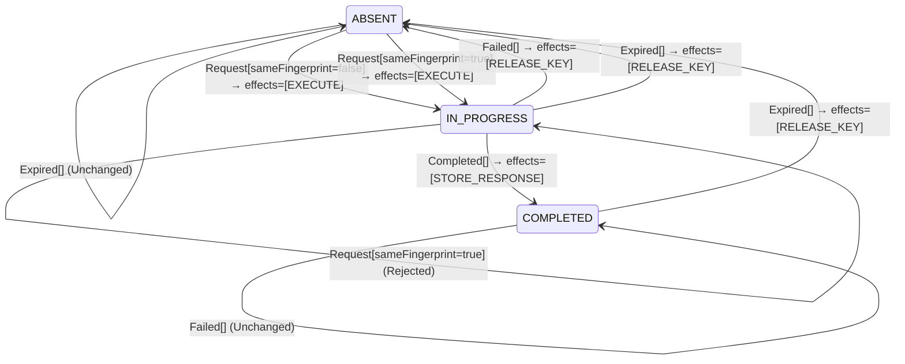

<!-- Generated by examples/tools/build.py from example.json and the verifier's output. Edit example.json. -->
# 078 · An in-progress record that expires by age lets a retry run beside the first attempt

[← All examples](../README.md)

| Verdict | Categories | Severity if shipped | Change | Verified unit | Approach |
|---|---|---|---|---|---|
| **✗ Violation: OneExecutionAtATime, 6-step trace (expiring record)** | functional | critical | bug-fix, behaviour change intended | [`IdempotentReceiver#decide`](../../examples/apps/crosscut/src/main/java/net/terminalvalue/crosscut/idempotency/IdempotentReceiver.java) | [D1: Protocol model checking](../../examples/apps/crosscut/spec/README.md) |

> An `Idempotency-Key` receiver's sweeper releases a key once its record's time to live has passed, but only a completed record: a record in progress never expires. Support still reports clients stuck in 409 loops after a worker died mid-request, and a developer makes the sweeper release records in progress too, on the reasoning that a record in progress for a whole time to live belongs to a worker that is gone. The contract diff is one row, and the model checker has never exercised it: the model's record did not expire. Under a second configuration in which it can, TLC finds a six-step run in which the record expires under a worker that is alive, and the client's retry executes beside it.

Tags: [idempotency](../README.md#tag-idempotency), [race-condition](../README.md#tag-race-condition), [duplicate-delivery](../README.md#tag-duplicate-delivery), [tla-fault-configuration](../README.md#tag-tla-fault-configuration), [generated-operator](../README.md#tag-generated-operator), [multiple-configurations](../README.md#tag-multiple-configurations)

## The change

On `Expired`, release a record in progress as a completed one is released, instead of leaving it alone. The reasoning: the sweeper only sends `Expired` for records older than the time to live, and no request takes that long, so a record still in progress at that age is one whose worker died without reporting `Failed`, and the key it holds is what keeps the client's retries in 409 loops. The contract diff is the case `decide(IN_PROGRESS, Expired[])`, from unchanged to a release; the test of the expiry rule gains the case.

**Before** ([`IdempotentReceiver.java`](../../examples/apps/crosscut/src/main/java/net/terminalvalue/crosscut/idempotency/IdempotentReceiver.java), line 22):

```java
* a key the server has not seen executes; a retry of a completed request gets the stored response; a retry of a
* request still in progress is refused (409), because executing it again would do the work twice; a key reused with
* a different request is refused (422). An attempt that dies without a response releases the key, so that the
* client's retry can run.
*
* <p>The filter that owns the receiver looks the key up and applies the decision in one transaction, so that two
* retries arriving together cannot both see ABSENT.
   // ...
               case IN_PROGRESS -> transition(ABSENT, RELEASE_KEY);
               case ABSENT, COMPLETED -> unchanged("no attempt is in progress");
           };
           case Expired _ -> switch (state) {
               case COMPLETED -> transition(ABSENT, RELEASE_KEY);
               case ABSENT -> unchanged("nothing to expire");
               case IN_PROGRESS -> unchanged("a key in progress does not expire");
           };
       };
   }
```

**After:**

```java
* a key the server has not seen executes; a retry of a completed request gets the stored response; a retry of a
* request still in progress is refused (409), because executing it again would do the work twice; a key reused with
* a different request is refused (422). An attempt that dies without a response releases the key, so that the
* client's retry can run, and so does the sweeper when a record's time to live passes, whatever state the record
* is in.
*
* <p>The filter that owns the receiver looks the key up and applies the decision in one transaction, so that two
* retries arriving together cannot both see ABSENT.
   // ...
               case IN_PROGRESS -> transition(ABSENT, RELEASE_KEY);
               case ABSENT, COMPLETED -> unchanged("no attempt is in progress");
           };
           // The sweeper releases every record whose time to live has passed, in progress or not: a record in
           // progress for that long belongs to a worker that died without reporting, and holding the key keeps the
           // client's retries in 409 loops.
           case Expired _ -> switch (state) {
               case COMPLETED, IN_PROGRESS -> transition(ABSENT, RELEASE_KEY);
               case ABSENT -> unchanged("nothing to expire");
           };
       };
   }
```

<details><summary>Patch</summary>

```diff
--- a/examples/apps/crosscut/src/main/java/net/terminalvalue/crosscut/idempotency/IdempotentReceiver.java
+++ b/examples/apps/crosscut/src/main/java/net/terminalvalue/crosscut/idempotency/IdempotentReceiver.java
@@ -22,7 +22,8 @@
  * a key the server has not seen executes; a retry of a completed request gets the stored response; a retry of a
  * request still in progress is refused (409), because executing it again would do the work twice; a key reused with
  * a different request is refused (422). An attempt that dies without a response releases the key, so that the
- * client's retry can run.
+ * client's retry can run, and so does the sweeper when a record's time to live passes, whatever state the record
+ * is in.
  *
  * <p>The filter that owns the receiver looks the key up and applies the decision in one transaction, so that two
  * retries arriving together cannot both see ABSENT.
@@ -50,10 +51,12 @@
                 case IN_PROGRESS -> transition(ABSENT, RELEASE_KEY);
                 case ABSENT, COMPLETED -> unchanged("no attempt is in progress");
             };
+            // The sweeper releases every record whose time to live has passed, in progress or not: a record in
+            // progress for that long belongs to a worker that died without reporting, and holding the key keeps the
+            // client's retries in 409 loops.
             case Expired _ -> switch (state) {
-                case COMPLETED -> transition(ABSENT, RELEASE_KEY);
+                case COMPLETED, IN_PROGRESS -> transition(ABSENT, RELEASE_KEY);
                 case ABSENT -> unchanged("nothing to expire");
-                case IN_PROGRESS -> unchanged("a key in progress does not expire");
             };
         };
     }
--- a/examples/apps/crosscut/src/test/java/net/terminalvalue/crosscut/idempotency/IdempotentReceiverTest.java
+++ b/examples/apps/crosscut/src/test/java/net/terminalvalue/crosscut/idempotency/IdempotentReceiverTest.java
@@ -37,5 +37,6 @@
 
     public static void anExpiredKeyIsReleased() {
         equal(new Transition<>(ABSENT, List.of(ReceiverEffect.RELEASE_KEY)), IdempotentReceiver.decide(COMPLETED, new Expired()));
+        equal(new Transition<>(ABSENT, List.of(ReceiverEffect.RELEASE_KEY)), IdempotentReceiver.decide(IN_PROGRESS, new Expired()));
     }
 }
```

</details>

## What the verifier found

The model is checked under 2 configurations, and the verdict is the first that fails:

| Configuration | What it checks | Model | Result |
|---|---|---|---|
| the record never expires (`spec/IdempotentReceiver.cfg`) | every run from the initial state, every interleaving within the configuration's bounds | Attempts = {a1, a2, a3}, Expires = FALSE | ✓ Verified: all invariants hold in 168 states |
| expiring record (`spec/IdempotentReceiverExpiring.cfg`) | the same invariants, with the record's time to live allowed to pass at any point: the sweeper asks the receiver what to do with the record and applies the decision, and a release ends the record's lifetime, so `AtMostOnce` counts the results since the last release. The model has no clock, so the sweeper's clock has measured the record's age and nothing else, in particular not whether an execution is still running | Attempts = {a1, a2, a3}, Expires = TRUE | ✗ Violation: OneExecutionAtATime, 6-step trace |

TLC found a run of the system under expiring record, 6 steps long, that violates the invariant **OneExecutionAtATime** (no two attempts under one key execute at the same time). Each step is one action of one part of the system:

1. **Initial state**: no record for the key, nothing sent, nothing executing, no response.
2. **Send**, `IdempotentClient.send`: the client sends the request, or retries it without waiting for an answer. `inbox = {a1}`, `sent = {a1}`
3. **Receive**, `IdempotencyFilter.doFilter`: the receiver looks the key up, decides, and applies the decision in one transaction. `executing = {a1}`, `inbox = {}`, `key = "IN_PROGRESS"`
4. **Send**, `IdempotentClient.send`: the client sends the request, or retries it without waiting for an answer. `inbox = {a2}`, `sent = {a1, a2}`
5. **Expire**, `IdempotencySweeper.sweep`: the record's time to live passed; the sweeper asks the receiver what to do with the record and applies the decision. `key = "ABSENT"`
6. **Receive**, `IdempotencyFilter.doFilter`: the receiver looks the key up, decides, and applies the decision in one transaction. `executing = {a1, a2}`, `inbox = {}`, `key = "IN_PROGRESS"`

The model is small (Attempts = {a1, a2, a3}, Expires = TRUE), which is what keeps the trace readable. TLC explored every interleaving of the client's attempts, the receiver, and the attempts in flight and executing within those bounds.

**What the verdict rests on.** TLC counted how often a step of the model took each row of the generated operators. A row no step takes is one the model says nothing about, whatever the verdict.

| Configuration | Rows of `IdempotentReceiver#decide` taken |
|---|---|
| the record never expires | 5 of 15 |
| expiring record | stopped at the counterexample |

The change alters 1 row of the contract:

- `decide(IN_PROGRESS, Expired[])`: `Unchanged[reason="a key in progress does not expire"]` → `Transition[next=ABSENT, effects=[RELEASE_KEY]]`, taken by no run that finished

The run under expiring record stopped at its counterexample, the steps above, and its counts are left out: the verdict rests on the counterexample.

<details><summary>Rows no step takes under the record never expires</summary>

`net.terminalvalue.crosscut.idempotency.IdempotentReceiver#decide`:

```
decide(ABSENT, Request[sameFingerprint=false]) => Transition[next=IN_PROGRESS, effects=[EXECUTE]]
decide(ABSENT, Completed[]) => Unchanged
decide(ABSENT, Failed[]) => Unchanged
decide(ABSENT, Expired[]) => Unchanged
decide(IN_PROGRESS, Request[sameFingerprint=false]) => Rejected
decide(IN_PROGRESS, Expired[]) => Transition[next=ABSENT, effects=[RELEASE_KEY]]
decide(COMPLETED, Request[sameFingerprint=false]) => Rejected
decide(COMPLETED, Completed[]) => Unchanged
decide(COMPLETED, Failed[]) => Unchanged
decide(COMPLETED, Expired[]) => Transition[next=ABSENT, effects=[RELEASE_KEY]]
```

</details>

The state machine the patched code implements, drawn from its derived contract (`jvmcontract statemachine`); a state with no way in or no way out is marked:



## Would the existing tests have caught it?

No: every existing unit test passes (`java -ea net.terminalvalue.crosscut.Tests`, run against the patched code).

## Why it matters

The receiver's record of a request in progress is the lock that keeps a retry from running beside the first attempt, and the sweeper's clock measures the record's age, not whether its worker is alive. A worker paused by garbage collection, waiting on a lock, or blocked on a slow payment provider is alive and will finish; the age of its record says nothing about it. With this change the sweeper releases the key under that worker, the retry finds no record and executes, and the customer is charged twice. This is the lease-expiry failure of distributed locks, inside the idempotency layer. The contract diff could not catch it: the row changed is the one the developer meant to change. Nor could the model as it was: its record never expired, so the row had never been taken by any run, and a verdict on this change would have rested on nothing. The question is what happens in every interleaving of a client that retries, a receiver still working, and a sweeper whose clock runs on its own, and only a model in which the record expires answers it.

## Why the verdict is right

The receiver's rule in the model is generated from the regenerated contract, so the model runs the new rule. The model is now checked under two configurations: one in which the record never expires, which is the model as it was, and one in which the sweeper may end the record's time to live at any point, with no clock to say how old the record is or whether an execution is running, because the sweeper's clock knows neither. Under the first, every invariant holds in 168 states and the coverage shows the changed row taken by no step: that configuration cannot judge this change. Under the second, TLC reports the shortest run that breaks the invariant that no two attempts under one key execute at once: the client sends, the receiver executes, the client retries, the record expires under the running execution, and the receiver executes the retry. Six steps, the initial state and five actions, and the step the developer's reasoning left out is the expiry falling on a record whose worker is alive, which the model allows because a time to live is a duration and an execution's length is not bounded by it.

## What to do

Revert. A record in progress needs a lease its worker renews while it runs, and a sweeper that releases a lease is releasing one the worker stopped renewing, which is the signal the age of the record is not; or the worker's death is reported as `Failed` by whatever supervises it. The second configuration stays with the model, so the next change to how records expire is checked against a sweeper that can fire at any point.

## Notes

- The idempotency model (`apps/crosscut/spec`) has a client retrying against an `Idempotency-Key` receiver whose state machine is generated from its contract.
- The model's second configuration lets the record's time to live pass at any point (the `Expires` constant), which exercises the kernel's `Expired` rows the first configuration never takes. At-most-once is counted per lifetime of the record, and the replay invariant is stated at the moment of the reply.
- The sweeper releases a record in progress under a worker that is alive, so the retry executes beside the first attempt.

## Evidence

How the verdict was reached: the record never expires: TLC 2.19 explored 168 distinct states to depth 10 in 0 s, for the model Attempts = {a1, a2, a3}, Expires = FALSE; expiring record: TLC 2.19 explored 75 distinct states to depth 6 in 0 s, for the model Attempts = {a1, a2, a3}, Expires = TRUE.

This result was recorded before runs fingerprinted their inputs, so whether it still matches the current patch and sources is not known.

<details><summary>Verifier output</summary>

```text
== the record never expires: spec/IdempotentReceiver.cfg ==
TLC2 Version 2.19 of 08 August 2024 (rev: 5a47802)
Running breadth-first search Model-Checking with fp 1 and seed 1 with 1 worker on 2 cores with 2185MB heap and 64MB offheap memory [pid: 1099621] (Linux 6.6.87.2-microsoft-standard-WSL2 aarch64, Eclipse Adoptium 25.0.4.1 x86_64, MSBDiskFPSet, DiskStateQueue).
Parsing file examples/apps/crosscut/spec/IdempotentReceiver.tla
Parsing file examples/tools/tla/standard-modules/Naturals.tla
Parsing file examples/tools/tla/standard-modules/Sequences.tla
Parsing file examples/tools/tla/standard-modules/FiniteSets.tla
Parsing file examples/apps/crosscut/spec/IdempotentReceiverContract.tla
Semantic processing of module Naturals
Semantic processing of module Sequences
Semantic processing of module FiniteSets
Semantic processing of module IdempotentReceiverContract
Semantic processing of module IdempotentReceiver
Starting... (2026-11-03 23:55:26)
Computing initial states...
Finished computing initial states: 1 distinct state generated at 2026-11-03 23:55:26.
Model checking completed. No error has been found.
  Estimates of the probability that TLC did not check all reachable states
  because two distinct states had the same fingerprint:
  calculated (optimistic):  val = 9.4E-16
Rows of net.terminalvalue.crosscut.idempotency.IdempotentReceiver#decide a step of the model takes: 5 of 15; never taken (10):
  decide(ABSENT, Request[sameFingerprint=false]) => Transition[next=IN_PROGRESS, effects=[EXECUTE]]
  decide(ABSENT, Completed[]) => Unchanged
  decide(ABSENT, Failed[]) => Unchanged
  decide(ABSENT, Expired[]) => Unchanged
  decide(IN_PROGRESS, Request[sameFingerprint=false]) => Rejected
  decide(IN_PROGRESS, Expired[]) => Transition[next=ABSENT, effects=[RELEASE_KEY]]
  decide(COMPLETED, Request[sameFingerprint=false]) => Rejected
  decide(COMPLETED, Completed[]) => Unchanged
  decide(COMPLETED, Failed[]) => Unchanged
  decide(COMPLETED, Expired[]) => Transition[next=ABSENT, effects=[RELEASE_KEY]]
271 states generated, 168 distinct states found, 0 states left on queue.
The depth of the complete state graph search is 10.
The average outdegree of the complete state graph is 1 (minimum is 0, the maximum 4 and the 95th percentile is 3).
Finished in 00s at (2026-11-03 23:55:26)

== expiring record: spec/IdempotentReceiverExpiring.cfg ==
TLC2 Version 2.19 of 08 August 2024 (rev: 5a47802)
Running breadth-first search Model-Checking with fp 1 and seed 1 with 1 worker on 2 cores with 2185MB heap and 64MB offheap memory [pid: 1099668] (Linux 6.6.87.2-microsoft-standard-WSL2 aarch64, Eclipse Adoptium 25.0.4.1 x86_64, MSBDiskFPSet, DiskStateQueue).
Parsing file examples/apps/crosscut/spec/IdempotentReceiver.tla
Parsing file examples/tools/tla/standard-modules/Naturals.tla
Parsing file examples/tools/tla/standard-modules/Sequences.tla
Parsing file examples/tools/tla/standard-modules/FiniteSets.tla
Parsing file examples/apps/crosscut/spec/IdempotentReceiverContract.tla
Semantic processing of module Naturals
Semantic processing of module Sequences
Semantic processing of module FiniteSets
Semantic processing of module IdempotentReceiverContract
Semantic processing of module IdempotentReceiver
Starting... (2026-11-03 23:55:27)
Computing initial states...
Finished computing initial states: 1 distinct state generated at 2026-11-03 23:55:27.
Error: Invariant OneExecutionAtATime is violated.
Error: The behavior up to this point is:
State 1: <Initial predicate>
/\ completed = 0
/\ responses = (a1 :> "NONE" @@ a2 :> "NONE" @@ a3 :> "NONE")
/\ key = "ABSENT"
/\ stored = FALSE
/\ sent = {}
/\ inbox = {}
/\ executing = {}

State 2: <Send line 53, col 5 to line 56, col 65 of module IdempotentReceiver>
/\ completed = 0
/\ responses = (a1 :> "NONE" @@ a2 :> "NONE" @@ a3 :> "NONE")
/\ key = "ABSENT"
/\ stored = FALSE
/\ sent = {a1}
/\ inbox = {a1}
/\ executing = {}

State 3: <Receive line 65, col 5 to line 74, col 44 of module IdempotentReceiver>
/\ completed = 0
/\ responses = (a1 :> "NONE" @@ a2 :> "NONE" @@ a3 :> "NONE")
/\ key = "IN_PROGRESS"
/\ stored = FALSE
/\ sent = {a1}
/\ inbox = {}
/\ executing = {a1}

State 4: <Send line 53, col 5 to line 56, col 65 of module IdempotentReceiver>
/\ completed = 0
/\ responses = (a1 :> "NONE" @@ a2 :> "NONE" @@ a3 :> "NONE")
/\ key = "IN_PROGRESS"
/\ stored = FALSE
/\ sent = {a1, a2}
/\ inbox = {a2}
/\ executing = {a1}

State 5: <Expire line 107, col 5 to line 113, col 54 of module IdempotentReceiver>
/\ completed = 0
/\ responses = (a1 :> "NONE" @@ a2 :> "NONE" @@ a3 :> "NONE")
/\ key = "ABSENT"
/\ stored = FALSE
/\ sent = {a1, a2}
/\ inbox = {a2}
/\ executing = {a1}

State 6: <Receive line 65, col 5 to line 74, col 44 of module IdempotentReceiver>
/\ completed = 0
/\ responses = (a1 :> "NONE" @@ a2 :> "NONE" @@ a3 :> "NONE")
/\ key = "IN_PROGRESS"
/\ stored = FALSE
/\ sent = {a1, a2}
/\ inbox = {}
/\ executing = {a1, a2}

Rows of net.terminalvalue.crosscut.idempotency.IdempotentReceiver#decide a step of the model takes: 9 of 15; never taken (6):
  decide(ABSENT, Request[sameFingerprint=false]) => Transition[next=IN_PROGRESS, effects=[EXECUTE]]
  decide(ABSENT, Expired[]) => Unchanged
  decide(IN_PROGRESS, Request[sameFingerprint=false]) => Rejected
  decide(COMPLETED, Request[sameFingerprint=false]) => Rejected
  decide(COMPLETED, Completed[]) => Unchanged
  decide(COMPLETED, Failed[]) => Unchanged
121 states generated, 75 distinct states found, 40 states left on queue.
The depth of the complete state graph search is 6.
The average outdegree of the complete state graph is 2 (minimum is 0, the maximum 5 and the 95th percentile is 5).
Finished in 00s at (2026-11-03 23:55:27)
```

</details>

<details><summary>SARIF report (as uploaded to GitHub code scanning or SonarQube)</summary>

```json
{
  "version": "2.1.0",
  "$schema": "https://json.schemastore.org/sarif-2.1.0.json",
  "runs": [
    {
      "tool": {
        "driver": {
          "name": "jvmcontract tlc",
          "rules": [
            {
              "id": "invariant-violated",
              "shortDescription": {
                "text": "TLC found a behaviour of the model that violates an invariant or a temporal property, or ends in a deadlock."
              }
            },
            {
              "id": "unverifiable",
              "shortDescription": {
                "text": "TLC could not check the model."
              }
            }
          ]
        }
      },
      "results": [
        {
          "ruleId": "invariant-violated",
          "level": "error",
          "message": {
            "text": "Invariant OneExecutionAtATime of spec/IdempotentReceiver.tla (expiring record) is violated after 6 steps"
          },
          "locations": [
            {
              "physicalLocation": {
                "artifactLocation": {
                  "uri": "examples/apps/crosscut/src/main/java/net/terminalvalue/crosscut/idempotency/IdempotentReceiver.java"
                },
                "region": {
                  "startLine": 22
                }
              }
            }
          ]
        }
      ]
    }
  ]
}
```

</details>

**Provenance:** Constructed from the resolution of example 029, which asks for a sweeper that releases keys held in progress for too long, implemented the way a lease timeout is usually implemented first: by age alone.

- [Stripe, Idempotent requests (keys are eligible to be removed after 24 hours; a request in progress under the key is answered 409)](https://docs.stripe.com/api/idempotent_requests)
- [Kleppmann, How to do distributed locking (2016): a lease that expires while its holder is paused lets a second holder in](https://martin.kleppmann.com/2016/02/08/how-to-do-distributed-locking.html)
- [IETF httpapi, The Idempotency-Key HTTP Header Field (draft): the retention period is the server's; 409 while a request is in progress, 422 on a key reused for another request](https://datatracker.ietf.org/doc/draft-ietf-httpapi-idempotency-key-header/)
## Reproduce

```bash
python3 examples/tools/build.py 078
```

This applies `change.patch` to a temporary copy of the repo, runs the verifier on it, and rewrites this page.
