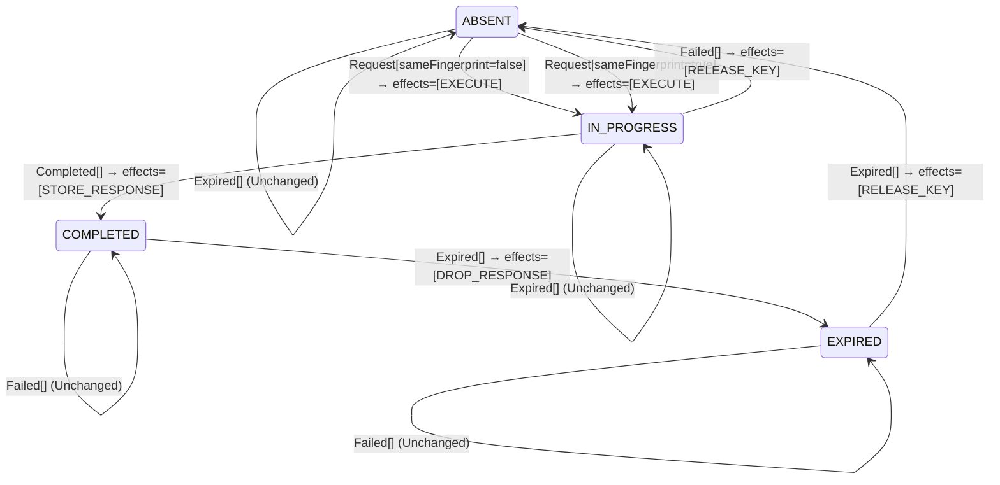

<!-- Generated by examples/tools/build.py from example.json and the verifier's output. Edit example.json. -->
# 079 · An expired key kept as a tombstone refuses late retries, proved at most once

[← All examples](../README.md)

| Verdict | Categories | Severity if shipped | Change | Verified unit | Approach |
|---|---|---|---|---|---|
| **✓ Verified: all invariants hold in 168 states, and under 1 more configuration** | functional, no-false-positive | none | feature, behaviour change intended | [`IdempotentReceiver#decide`](../../examples/apps/crosscut/src/main/java/net/terminalvalue/crosscut/idempotency/IdempotentReceiver.java) | [D1: Protocol model checking](../../examples/apps/crosscut/spec/README.md) |

> An `Idempotency-Key` receiver releases a key when its record's time to live passes, so a retry that arrives after that is a new request and executes again. The developer makes the record expire in two steps instead: the response goes and the key stays as a tombstone that refuses a late retry, then the tombstone goes too. A new key state, a new effect, six new or changed rows in the contract, and a model whose type invariant has to learn the state. TLC checks every interleaving of three attempts under both configurations of the model, and every invariant holds in every state. The change is merged on a proof, with the coverage saying which of the new rows the runs exercised.

Tags: [idempotency](../README.md#tag-idempotency), [duplicate-delivery](../README.md#tag-duplicate-delivery), [tla-fault-configuration](../README.md#tag-tla-fault-configuration), [generated-operator](../README.md#tag-generated-operator), [multiple-configurations](../README.md#tag-multiple-configurations)

## The change

Add `EXPIRED` to `KeyState` and `DROP_RESPONSE` to `ReceiverEffect`. On `Expired`, a completed record moves to `EXPIRED` and drops its response instead of being released; an expired record is released. A `Request` on an expired key is refused; `Completed` and `Failed` on one are unchanged, as on any record with no attempt in progress. The model's `TypeOK` admits the new state and its sweeper action treats the new effect as the end of the stored response. The contract's domain grows from 24 to 30 cases; the test of the expiry rule is rewritten.

**Before** ([`IdempotentReceiver.java`](../../examples/apps/crosscut/src/main/java/net/terminalvalue/crosscut/idempotency/IdempotentReceiver.java), line 5):

```java
import static net.terminalvalue.crosscut.Decision.unchanged;
import static net.terminalvalue.crosscut.idempotency.KeyState.ABSENT;
import static net.terminalvalue.crosscut.idempotency.KeyState.COMPLETED;
import static net.terminalvalue.crosscut.idempotency.KeyState.IN_PROGRESS;
import static net.terminalvalue.crosscut.idempotency.ReceiverEffect.EXECUTE;
import static net.terminalvalue.crosscut.idempotency.ReceiverEffect.RELEASE_KEY;
import static net.terminalvalue.crosscut.idempotency.ReceiverEffect.REPLAY_RESPONSE;
    // ...
 * a key the server has not seen executes; a retry of a completed request gets the stored response; a retry of a
 * request still in progress is refused (409), because executing it again would do the work twice; a key reused with
 * a different request is refused (422). An attempt that dies without a response releases the key, so that the
 * client's retry can run.
 *
 * <p>The filter that owns the receiver looks the key up and applies the decision in one transaction, so that two
 * retries arriving together cannot both see ABSENT.
    // ...
                case COMPLETED -> request.sameFingerprint()
                        ? transition(COMPLETED, REPLAY_RESPONSE)
                        : rejected("the key was reused for a different request");
            };
            case Completed _ -> switch (state) {
                case IN_PROGRESS -> transition(COMPLETED, STORE_RESPONSE);
                case ABSENT, COMPLETED -> unchanged("no attempt is in progress");
            };
            case Failed _ -> switch (state) {
                case IN_PROGRESS -> transition(ABSENT, RELEASE_KEY);
                case ABSENT, COMPLETED -> unchanged("no attempt is in progress");
            };
            case Expired _ -> switch (state) {
                case COMPLETED -> transition(ABSENT, RELEASE_KEY);
                case ABSENT -> unchanged("nothing to expire");
                case IN_PROGRESS -> unchanged("a key in progress does not expire");
            };
```

**After:**

```java
import static net.terminalvalue.crosscut.Decision.unchanged;
import static net.terminalvalue.crosscut.idempotency.KeyState.ABSENT;
import static net.terminalvalue.crosscut.idempotency.KeyState.COMPLETED;
import static net.terminalvalue.crosscut.idempotency.KeyState.EXPIRED;
import static net.terminalvalue.crosscut.idempotency.KeyState.IN_PROGRESS;
import static net.terminalvalue.crosscut.idempotency.ReceiverEffect.DROP_RESPONSE;
import static net.terminalvalue.crosscut.idempotency.ReceiverEffect.EXECUTE;
import static net.terminalvalue.crosscut.idempotency.ReceiverEffect.RELEASE_KEY;
import static net.terminalvalue.crosscut.idempotency.ReceiverEffect.REPLAY_RESPONSE;
    // ...
 * a key the server has not seen executes; a retry of a completed request gets the stored response; a retry of a
 * request still in progress is refused (409), because executing it again would do the work twice; a key reused with
 * a different request is refused (422). An attempt that dies without a response releases the key, so that the
 * client's retry can run. A stored response expires in two steps: first the response goes and the key stays as a
 * tombstone, which refuses a retry (410) rather than running the request again, then the tombstone goes too.
 *
 * <p>The filter that owns the receiver looks the key up and applies the decision in one transaction, so that two
 * retries arriving together cannot both see ABSENT.
    // ...
                case COMPLETED -> request.sameFingerprint()
                        ? transition(COMPLETED, REPLAY_RESPONSE)
                        : rejected("the key was reused for a different request");
                case EXPIRED -> rejected("the key has expired");
            };
            case Completed _ -> switch (state) {
                case IN_PROGRESS -> transition(COMPLETED, STORE_RESPONSE);
                case ABSENT, COMPLETED, EXPIRED -> unchanged("no attempt is in progress");
            };
            case Failed _ -> switch (state) {
                case IN_PROGRESS -> transition(ABSENT, RELEASE_KEY);
                case ABSENT, COMPLETED, EXPIRED -> unchanged("no attempt is in progress");
            };
            case Expired _ -> switch (state) {
                case COMPLETED -> transition(EXPIRED, DROP_RESPONSE);
                case EXPIRED -> transition(ABSENT, RELEASE_KEY);
                case ABSENT -> unchanged("nothing to expire");
                case IN_PROGRESS -> unchanged("a key in progress does not expire");
            };
```

<details><summary>Patch</summary>

```diff
--- a/examples/apps/crosscut/src/main/java/net/terminalvalue/crosscut/idempotency/KeyState.java
+++ b/examples/apps/crosscut/src/main/java/net/terminalvalue/crosscut/idempotency/KeyState.java
@@ -7,5 +7,7 @@
     /** An attempt with this key is executing. */
     IN_PROGRESS,
     /** An attempt with this key finished and its response is stored. */
-    COMPLETED
+    COMPLETED,
+    /** The stored response expired; the key is remembered for a while longer, so that a late retry is refused. */
+    EXPIRED
 }
--- a/examples/apps/crosscut/src/main/java/net/terminalvalue/crosscut/idempotency/ReceiverEffect.java
+++ b/examples/apps/crosscut/src/main/java/net/terminalvalue/crosscut/idempotency/ReceiverEffect.java
@@ -9,5 +9,7 @@
     /** Answer with the stored response. */
     REPLAY_RESPONSE,
     /** Delete the record. */
-    RELEASE_KEY
+    RELEASE_KEY,
+    /** Delete the stored response and keep the record. */
+    DROP_RESPONSE
 }
--- a/examples/apps/crosscut/src/main/java/net/terminalvalue/crosscut/idempotency/IdempotentReceiver.java
+++ b/examples/apps/crosscut/src/main/java/net/terminalvalue/crosscut/idempotency/IdempotentReceiver.java
@@ -5,7 +5,9 @@
 import static net.terminalvalue.crosscut.Decision.unchanged;
 import static net.terminalvalue.crosscut.idempotency.KeyState.ABSENT;
 import static net.terminalvalue.crosscut.idempotency.KeyState.COMPLETED;
+import static net.terminalvalue.crosscut.idempotency.KeyState.EXPIRED;
 import static net.terminalvalue.crosscut.idempotency.KeyState.IN_PROGRESS;
+import static net.terminalvalue.crosscut.idempotency.ReceiverEffect.DROP_RESPONSE;
 import static net.terminalvalue.crosscut.idempotency.ReceiverEffect.EXECUTE;
 import static net.terminalvalue.crosscut.idempotency.ReceiverEffect.RELEASE_KEY;
 import static net.terminalvalue.crosscut.idempotency.ReceiverEffect.REPLAY_RESPONSE;
@@ -22,7 +24,8 @@
  * a key the server has not seen executes; a retry of a completed request gets the stored response; a retry of a
  * request still in progress is refused (409), because executing it again would do the work twice; a key reused with
  * a different request is refused (422). An attempt that dies without a response releases the key, so that the
- * client's retry can run.
+ * client's retry can run. A stored response expires in two steps: first the response goes and the key stays as a
+ * tombstone, which refuses a retry (410) rather than running the request again, then the tombstone goes too.
  *
  * <p>The filter that owns the receiver looks the key up and applies the decision in one transaction, so that two
  * retries arriving together cannot both see ABSENT.
@@ -41,17 +44,19 @@
                 case COMPLETED -> request.sameFingerprint()
                         ? transition(COMPLETED, REPLAY_RESPONSE)
                         : rejected("the key was reused for a different request");
+                case EXPIRED -> rejected("the key has expired");
             };
             case Completed _ -> switch (state) {
                 case IN_PROGRESS -> transition(COMPLETED, STORE_RESPONSE);
-                case ABSENT, COMPLETED -> unchanged("no attempt is in progress");
+                case ABSENT, COMPLETED, EXPIRED -> unchanged("no attempt is in progress");
             };
             case Failed _ -> switch (state) {
                 case IN_PROGRESS -> transition(ABSENT, RELEASE_KEY);
-                case ABSENT, COMPLETED -> unchanged("no attempt is in progress");
+                case ABSENT, COMPLETED, EXPIRED -> unchanged("no attempt is in progress");
             };
             case Expired _ -> switch (state) {
-                case COMPLETED -> transition(ABSENT, RELEASE_KEY);
+                case COMPLETED -> transition(EXPIRED, DROP_RESPONSE);
+                case EXPIRED -> transition(ABSENT, RELEASE_KEY);
                 case ABSENT -> unchanged("nothing to expire");
                 case IN_PROGRESS -> unchanged("a key in progress does not expire");
             };
--- a/examples/apps/crosscut/src/test/java/net/terminalvalue/crosscut/idempotency/IdempotentReceiverTest.java
+++ b/examples/apps/crosscut/src/test/java/net/terminalvalue/crosscut/idempotency/IdempotentReceiverTest.java
@@ -4,6 +4,7 @@
 import static net.terminalvalue.crosscut.Tests.equal;
 import static net.terminalvalue.crosscut.idempotency.KeyState.ABSENT;
 import static net.terminalvalue.crosscut.idempotency.KeyState.COMPLETED;
+import static net.terminalvalue.crosscut.idempotency.KeyState.EXPIRED;
 import static net.terminalvalue.crosscut.idempotency.KeyState.IN_PROGRESS;
 
 import java.util.List;
@@ -35,7 +36,9 @@
         equal(new Transition<>(ABSENT, List.of(ReceiverEffect.RELEASE_KEY)), IdempotentReceiver.decide(IN_PROGRESS, new Failed()));
     }
 
-    public static void anExpiredKeyIsReleased() {
-        equal(new Transition<>(ABSENT, List.of(ReceiverEffect.RELEASE_KEY)), IdempotentReceiver.decide(COMPLETED, new Expired()));
+    public static void anExpiredKeyIsATombstoneBeforeItGoes() {
+        equal(new Transition<>(EXPIRED, List.of(ReceiverEffect.DROP_RESPONSE)), IdempotentReceiver.decide(COMPLETED, new Expired()));
+        check(IdempotentReceiver.decide(EXPIRED, new Request(true)) instanceof Decision.Rejected, "410");
+        equal(new Transition<>(ABSENT, List.of(ReceiverEffect.RELEASE_KEY)), IdempotentReceiver.decide(EXPIRED, new Expired()));
     }
 }
--- a/examples/apps/crosscut/spec/IdempotentReceiver.tla
+++ b/examples/apps/crosscut/spec/IdempotentReceiver.tla
@@ -108,7 +108,7 @@
     /\ key # "ABSENT"
     /\ LET d == Decide(key, [kind |-> "Expired"])
        IN /\ key' = IF d.kind = "Transition" THEN d.next ELSE key
-          /\ stored' = IF Has(d, "RELEASE_KEY") THEN FALSE ELSE stored
+          /\ stored' = IF Has(d, "RELEASE_KEY") \/ Has(d, "DROP_RESPONSE") THEN FALSE ELSE stored
           /\ completed' = IF Has(d, "RELEASE_KEY") THEN 0 ELSE completed
     /\ UNCHANGED <<sent, inbox, executing, responses>>
 
@@ -136,7 +136,7 @@
 (***************************************************************************)
 
 TypeOK ==
-    /\ key \in {"ABSENT", "IN_PROGRESS", "COMPLETED"}
+    /\ key \in {"ABSENT", "IN_PROGRESS", "COMPLETED", "EXPIRED"}
     /\ sent \subseteq Attempts
     /\ inbox \subseteq sent
     /\ executing \subseteq sent
```

</details>

## What the verifier found

The model is checked under 2 configurations, and the verdict is the first that fails:

| Configuration | What it checks | Model | Result |
|---|---|---|---|
| the record never expires (`spec/IdempotentReceiver.cfg`) | every run from the initial state, every interleaving within the configuration's bounds | Attempts = {a1, a2, a3}, Expires = FALSE | ✓ Verified: all invariants hold in 168 states |
| expiring record (`spec/IdempotentReceiverExpiring.cfg`) | the same invariants, with the record's time to live allowed to pass at any point: the sweeper asks the receiver what to do with the record and applies the decision, and a release ends the record's lifetime, so `AtMostOnce` counts the results since the last release. The model has no clock, so the sweeper's clock has measured the record's age and nothing else, in particular not whether an execution is still running | Attempts = {a1, a2, a3}, Expires = TRUE | ✓ Verified: all invariants hold in 399 states |

Every invariant holds in every reachable state of the model under the record never expires: 168 distinct states, which is every interleaving of the client's attempts, the receiver, and the attempts in flight and executing within the model's bounds (Attempts = {a1, a2, a3}, Expires = FALSE).

The receiver's decision rule inside the model is generated from the behavioural contract of the patched code, so the model checks the decisions the receiver really makes.

The other configurations hold too, as the table says: expiring record, 399 states.

**What the verdict rests on.** TLC counted how often a step of the model took each row of the generated operators. A row no step takes is one the model says nothing about, whatever the verdict.

| Configuration | Rows of `IdempotentReceiver#decide` taken |
|---|---|
| the record never expires | 5 of 20 |
| expiring record | 9 of 20 |

The change alters 6 rows of the contract, and 1 with a null argument, which the model leaves out:

- `decide(COMPLETED, Expired[])`: `Transition[next=ABSENT, effects=[RELEASE_KEY]]` → `Transition[next=EXPIRED, effects=[DROP_RESPONSE]]`, taken under expiring record
- `decide(EXPIRED, Request[sameFingerprint=false])`: a new row → `Rejected[reason="the key has expired"]`, taken by no run
- `decide(EXPIRED, Request[sameFingerprint=true])`: a new row → `Rejected[reason="the key has expired"]`, taken under expiring record
- `decide(EXPIRED, Completed[])`: a new row → `Unchanged[reason="no attempt is in progress"]`, taken by no run
- `decide(EXPIRED, Failed[])`: a new row → `Unchanged[reason="no attempt is in progress"]`, taken by no run
- `decide(EXPIRED, Expired[])`: a new row → `Transition[next=ABSENT, effects=[RELEASE_KEY]]`, taken under expiring record

Runs of the model take 3 of the 6 rows the change alters; the verdict rests on those, and says nothing about the others.

<details><summary>Rows no step takes under the record never expires</summary>

`net.terminalvalue.crosscut.idempotency.IdempotentReceiver#decide`:

```
decide(ABSENT, Request[sameFingerprint=false]) => Transition[next=IN_PROGRESS, effects=[EXECUTE]]
decide(ABSENT, Completed[]) => Unchanged
decide(ABSENT, Failed[]) => Unchanged
decide(ABSENT, Expired[]) => Unchanged
decide(IN_PROGRESS, Request[sameFingerprint=false]) => Rejected
decide(IN_PROGRESS, Expired[]) => Unchanged
decide(COMPLETED, Request[sameFingerprint=false]) => Rejected
decide(COMPLETED, Completed[]) => Unchanged
decide(COMPLETED, Failed[]) => Unchanged
decide(COMPLETED, Expired[]) => Transition[next=EXPIRED, effects=[DROP_RESPONSE]]
decide(EXPIRED, Request[sameFingerprint=false]) => Rejected
decide(EXPIRED, Request[sameFingerprint=true]) => Rejected
decide(EXPIRED, Completed[]) => Unchanged
decide(EXPIRED, Failed[]) => Unchanged
decide(EXPIRED, Expired[]) => Transition[next=ABSENT, effects=[RELEASE_KEY]]
```

</details>

The state machine the patched code implements, drawn from its derived contract (`jvmcontract statemachine`); a state with no way in or no way out is marked:



## Would the existing tests have caught it?

Every existing unit test passes, as it should (`java -ea net.terminalvalue.crosscut.Tests`, run against the patched code).

## Why it matters

None, and that is the point. A new state in a kernel of this kind is reviewed for the rows it adds, and the question that matters is not any row but their interleaving with the client and the sweeper: whether a retry can execute beside an attempt, run after a result within the record's lifetime, or be answered from a response that is no longer there, now that there is a state in which the key exists and the response does not. Example 080 is a change of the same intent, one row and one effect, that fails exactly that last question. Answering by inspection is how idempotency layers get their bugs; answering by model checking takes a second.

## Why the verdict is right

The receiver's rule in the model is generated from the regenerated contract, so the model runs the new rule, tombstone and all. Under the configuration in which the record never expires, nothing changes: 168 states, every invariant holds, and the coverage shows none of the new rows taken, because none can be. Under the configuration in which the sweeper may act at any point, TLC explores 399 states, and in every one no two attempts execute at once, at most one result is produced per lifetime of the record, and no client is answered with a stored response that does not exist: a retry that finds the tombstone is refused, and the response is only ever replayed while it is stored. The coverage lists which of the six rows the runs took, three: the completed record's `Expired`, and the tombstone's `Request` and `Expired`; and which no run can reach: `Completed` and `Failed` on a tombstone, since no attempt executes while the key is one, and a retry with another fingerprint, which the model's one request never sends.

## What to do

Merge. The second configuration and the coverage report are part of the build, so a later change to the tombstone's rows is checked against a sweeper that can fire at any point, and a change the runs never exercise is reported as such.

## Notes

- The idempotency model (`apps/crosscut/spec`) has a client retrying against an `Idempotency-Key` receiver whose state machine is generated from its contract.
- The model's second configuration lets the record's time to live pass at any point (the `Expires` constant), which exercises the kernel's `Expired` rows the first configuration never takes. At-most-once is counted per lifetime of the record, and the replay invariant is stated at the moment of the reply.
- A record that expires into a tombstone refusing late retries is proved safe under both configurations.

## Evidence

How the verdict was reached: the record never expires: TLC 2.19 explored 168 distinct states to depth 10 in 0 s, for the model Attempts = {a1, a2, a3}, Expires = FALSE; expiring record: TLC 2.19 explored 399 distinct states to depth 16 in 0 s, for the model Attempts = {a1, a2, a3}, Expires = TRUE.

This result was recorded before runs fingerprinted their inputs, so whether it still matches the current patch and sources is not known.

<details><summary>Verifier output</summary>

```text
== the record never expires: spec/IdempotentReceiver.cfg ==
TLC2 Version 2.19 of 08 August 2024 (rev: 5a47802)
Running breadth-first search Model-Checking with fp 1 and seed 1 with 1 worker on 2 cores with 2185MB heap and 64MB offheap memory [pid: 1099943] (Linux 6.6.87.2-microsoft-standard-WSL2 aarch64, Eclipse Adoptium 25.0.4.1 x86_64, MSBDiskFPSet, DiskStateQueue).
Parsing file examples/apps/crosscut/spec/IdempotentReceiver.tla
Parsing file examples/tools/tla/standard-modules/Naturals.tla
Parsing file examples/tools/tla/standard-modules/Sequences.tla
Parsing file examples/tools/tla/standard-modules/FiniteSets.tla
Parsing file examples/apps/crosscut/spec/IdempotentReceiverContract.tla
Semantic processing of module Naturals
Semantic processing of module Sequences
Semantic processing of module FiniteSets
Semantic processing of module IdempotentReceiverContract
Semantic processing of module IdempotentReceiver
Starting... (2026-11-03 23:55:30)
Computing initial states...
Finished computing initial states: 1 distinct state generated at 2026-11-03 23:55:30.
Model checking completed. No error has been found.
  Estimates of the probability that TLC did not check all reachable states
  because two distinct states had the same fingerprint:
  calculated (optimistic):  val = 9.4E-16
Rows of net.terminalvalue.crosscut.idempotency.IdempotentReceiver#decide a step of the model takes: 5 of 20; never taken (15):
  decide(ABSENT, Request[sameFingerprint=false]) => Transition[next=IN_PROGRESS, effects=[EXECUTE]]
  decide(ABSENT, Completed[]) => Unchanged
  decide(ABSENT, Failed[]) => Unchanged
  decide(ABSENT, Expired[]) => Unchanged
  decide(IN_PROGRESS, Request[sameFingerprint=false]) => Rejected
  decide(IN_PROGRESS, Expired[]) => Unchanged
  decide(COMPLETED, Request[sameFingerprint=false]) => Rejected
  decide(COMPLETED, Completed[]) => Unchanged
  decide(COMPLETED, Failed[]) => Unchanged
  decide(COMPLETED, Expired[]) => Transition[next=EXPIRED, effects=[DROP_RESPONSE]]
  decide(EXPIRED, Request[sameFingerprint=false]) => Rejected
  decide(EXPIRED, Request[sameFingerprint=true]) => Rejected
  decide(EXPIRED, Completed[]) => Unchanged
  decide(EXPIRED, Failed[]) => Unchanged
  decide(EXPIRED, Expired[]) => Transition[next=ABSENT, effects=[RELEASE_KEY]]
271 states generated, 168 distinct states found, 0 states left on queue.
The depth of the complete state graph search is 10.
The average outdegree of the complete state graph is 1 (minimum is 0, the maximum 4 and the 95th percentile is 3).
Finished in 00s at (2026-11-03 23:55:30)

== expiring record: spec/IdempotentReceiverExpiring.cfg ==
TLC2 Version 2.19 of 08 August 2024 (rev: 5a47802)
Running breadth-first search Model-Checking with fp 1 and seed 1 with 1 worker on 2 cores with 2185MB heap and 64MB offheap memory [pid: 1100019] (Linux 6.6.87.2-microsoft-standard-WSL2 aarch64, Eclipse Adoptium 25.0.4.1 x86_64, MSBDiskFPSet, DiskStateQueue).
Parsing file examples/apps/crosscut/spec/IdempotentReceiver.tla
Parsing file examples/tools/tla/standard-modules/Naturals.tla
Parsing file examples/tools/tla/standard-modules/Sequences.tla
Parsing file examples/tools/tla/standard-modules/FiniteSets.tla
Parsing file examples/apps/crosscut/spec/IdempotentReceiverContract.tla
Semantic processing of module Naturals
Semantic processing of module Sequences
Semantic processing of module FiniteSets
Semantic processing of module IdempotentReceiverContract
Semantic processing of module IdempotentReceiver
Starting... (2026-11-03 23:55:31)
Computing initial states...
Finished computing initial states: 1 distinct state generated at 2026-11-03 23:55:31.
Model checking completed. No error has been found.
  Estimates of the probability that TLC did not check all reachable states
  because two distinct states had the same fingerprint:
  calculated (optimistic):  val = 7.6E-15
Rows of net.terminalvalue.crosscut.idempotency.IdempotentReceiver#decide a step of the model takes: 9 of 20; never taken (11):
  decide(ABSENT, Request[sameFingerprint=false]) => Transition[next=IN_PROGRESS, effects=[EXECUTE]]
  decide(ABSENT, Completed[]) => Unchanged
  decide(ABSENT, Failed[]) => Unchanged
  decide(ABSENT, Expired[]) => Unchanged
  decide(IN_PROGRESS, Request[sameFingerprint=false]) => Rejected
  decide(COMPLETED, Request[sameFingerprint=false]) => Rejected
  decide(COMPLETED, Completed[]) => Unchanged
  decide(COMPLETED, Failed[]) => Unchanged
  decide(EXPIRED, Request[sameFingerprint=false]) => Rejected
  decide(EXPIRED, Completed[]) => Unchanged
  decide(EXPIRED, Failed[]) => Unchanged
750 states generated, 399 distinct states found, 0 states left on queue.
The depth of the complete state graph search is 16.
The average outdegree of the complete state graph is 1 (minimum is 0, the maximum 4 and the 95th percentile is 2).
Finished in 00s at (2026-11-03 23:55:31)
```

</details>

<details><summary>SARIF report (as uploaded to GitHub code scanning or SonarQube)</summary>

```json
{
  "version": "2.1.0",
  "$schema": "https://json.schemastore.org/sarif-2.1.0.json",
  "runs": [
    {
      "tool": {
        "driver": {
          "name": "jvmcontract tlc",
          "rules": [
            {
              "id": "invariant-violated",
              "shortDescription": {
                "text": "TLC found a behaviour of the model that violates an invariant or a temporal property, or ends in a deadlock."
              }
            },
            {
              "id": "unverifiable",
              "shortDescription": {
                "text": "TLC could not check the model."
              }
            }
          ]
        }
      },
      "results": []
    }
  ]
}
```

</details>

**Provenance:** Constructed to show an intended change that adds a state to a protocol's decision rule accepted on the strength of the model, to pair with example 080; the refusal of a late retry is one of the two things a server can do when a key's retention period has passed, the other being what the receiver did before.

- [Stripe, Idempotent requests (keys are eligible to be removed after 24 hours; a request in progress under the key is answered 409)](https://docs.stripe.com/api/idempotent_requests)
- [IETF httpapi, The Idempotency-Key HTTP Header Field (draft): the retention period is the server's; 409 while a request is in progress, 422 on a key reused for another request](https://datatracker.ietf.org/doc/draft-ietf-httpapi-idempotency-key-header/)
- [Lamport, Specifying Systems, chapter 14: the TLC model checker, configuration files and constants](https://lamport.azurewebsites.net/tla/book.html)
## Reproduce

```bash
python3 examples/tools/build.py 079
```

This applies `change.patch` to a temporary copy of the repo, runs the verifier on it, and rewrites this page.
