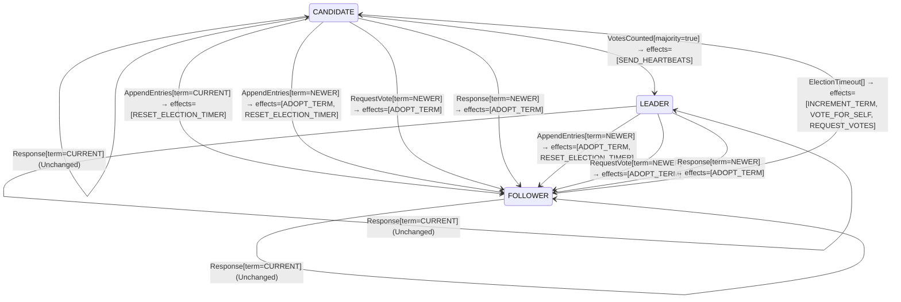

<!-- Generated by examples/tools/build.py from example.json and the verifier's output. Edit example.json. -->
# 082 · A role machine that treats a stale reply as impossible crashes on a late reply

[← All examples](../README.md)

| Verdict | Categories | Severity if shipped | Change | Verified unit | Approach |
|---|---|---|---|---|---|
| **✗ Violation: KernelNeverThrows, 4-step trace (delayed replies)** | functional | critical | cleanup, behaviour change intended | [`RoleMachine#decide`](../../examples/apps/quorum/src/main/java/net/terminalvalue/quorum/raft/RoleMachine.java) | [D1: Protocol model checking](../../examples/apps/quorum/spec/README.md) |

> A Raft server's role machine leaves its role alone on a reply from the current term or an older one. A developer makes a reply from an older term throw `IllegalStateException`, the exception the kernel already reserves for an input it holds impossible, on the reasoning that a server answers with the term it has now and the asking server's term only grows while it waits, so a reply cannot carry a term older than the server's own. That reasoning is the model's own simplification written into the Java: an RPC in the model was one step, so no run had ever handed the role machine such a reply, and the three rows that now throw had never been taken. Under the sixth configuration, in which a vote reply waits on the wire, the invariant that no reachable state lets the kernel throw fails in four steps: a candidate asks for a vote, times out into the next term, and the reply of the old term is waiting for it.

Tags: [consensus](../README.md#tag-consensus), [leader-election](../README.md#tag-leader-election), [stale-messages](../README.md#tag-stale-messages), [exceptions](../README.md#tag-exceptions), [tla-fault-configuration](../README.md#tag-tla-fault-configuration), [generated-operator](../README.md#tag-generated-operator), [multiple-configurations](../README.md#tag-multiple-configurations)

## The change

In `RoleMachine.decide`, the `Response` case becomes a switch over the reply's term: `NEWER` adopts it as before, `CURRENT` changes no role as before, and `OLDER` throws `IllegalStateException`, with the comment that a server answers with the term it has now and ours only grows while we wait, so such a reply answers an RPC we never sent. The contract diff is three rows, `decide(FOLLOWER, Response[term=OLDER])`, `decide(CANDIDATE, Response[term=OLDER])` and `decide(LEADER, Response[term=OLDER])`, from unchanged to `throws IllegalStateException`; a test asserts the exception.

**Before** ([`RoleMachine.java`](../../examples/apps/quorum/src/main/java/net/terminalvalue/quorum/raft/RoleMachine.java), line 55):

```java
            case RequestVote vote -> vote.term() == NEWER
                    ? transition(FOLLOWER, ADOPT_TERM)
                    : unchanged("the vote itself is decided by the vote rule");
            case Response response -> response.term() == NEWER
                    ? transition(FOLLOWER, ADOPT_TERM)
                    : unchanged("a reply from the current or an older term changes no role");
        };
    }
}
```

**After:**

```java
            case RequestVote vote -> vote.term() == NEWER
                    ? transition(FOLLOWER, ADOPT_TERM)
                    : unchanged("the vote itself is decided by the vote rule");
            case Response response -> switch (response.term()) {
                case NEWER -> transition(FOLLOWER, ADOPT_TERM);
                case CURRENT -> unchanged("a reply from the current term changes no role");
                // A server answers with the term it has now, and ours only grows while we wait for it: a reply from
                // an older term than our own is a reply to an RPC we never sent.
                case OLDER -> throw new IllegalStateException("a reply from an older term than our own");
            };
        };
    }
}
```

<details><summary>Patch</summary>

```diff
--- a/examples/apps/quorum/src/main/java/net/terminalvalue/quorum/raft/RoleMachine.java
+++ b/examples/apps/quorum/src/main/java/net/terminalvalue/quorum/raft/RoleMachine.java
@@ -55,9 +55,13 @@
             case RequestVote vote -> vote.term() == NEWER
                     ? transition(FOLLOWER, ADOPT_TERM)
                     : unchanged("the vote itself is decided by the vote rule");
-            case Response response -> response.term() == NEWER
-                    ? transition(FOLLOWER, ADOPT_TERM)
-                    : unchanged("a reply from the current or an older term changes no role");
+            case Response response -> switch (response.term()) {
+                case NEWER -> transition(FOLLOWER, ADOPT_TERM);
+                case CURRENT -> unchanged("a reply from the current term changes no role");
+                // A server answers with the term it has now, and ours only grows while we wait for it: a reply from
+                // an older term than our own is a reply to an RPC we never sent.
+                case OLDER -> throw new IllegalStateException("a reply from an older term than our own");
+            };
         };
     }
 }
--- a/examples/apps/quorum/src/test/java/net/terminalvalue/quorum/raft/RoleMachineTest.java
+++ b/examples/apps/quorum/src/test/java/net/terminalvalue/quorum/raft/RoleMachineTest.java
@@ -35,4 +35,13 @@
     public static void staleLeaderIsRejected() {
         check(RoleMachine.decide(Role.FOLLOWER, new RoleEvent.AppendEntries(TermOrder.OLDER)) instanceof Decision.Rejected, "stale");
     }
+
+    public static void aReplyFromAnOlderTermIsImpossible() {
+        try {
+            RoleMachine.decide(Role.CANDIDATE, new RoleEvent.Response(TermOrder.OLDER));
+        } catch (IllegalStateException expected) {
+            return;
+        }
+        throw new AssertionError("expected an IllegalStateException");
+    }
 }
```

</details>

## What the verifier found

The model is checked under 6 configurations, and the verdict is the first that fails:

| Configuration | What it checks | Model | Result |
|---|---|---|---|
| three servers (`spec/RaftElection.cfg`) | every run from the initial state, every interleaving within the configuration's bounds | Servers = {s1, s2, s3}, MaxTerm = 3, LeftBehind = {}, DelayedReplies = FALSE | ✓ Verified: all invariants and properties hold in 610 states |
| the inductive step (`spec/RaftElectionInductive.cfg`) | that the invariant `Inductive` is inductive: TLC starts from every state the invariant admits, reachable or not, rather than from the initial state, takes one step, and checks the invariant again, conjunct by conjunct. No counterexample is a proof of election safety by induction, for any run of the cluster however long; a counterexample is one step from a state that need not be reachable | Servers = {s1, s2, s3}, MaxTerm = 3, LeftBehind = {}, DelayedReplies = FALSE | ✓ Verified: all invariants and properties hold in 17,470 states |
| four servers (`spec/RaftElectionFour.cfg`) | every run with four servers, a cluster in which a candidate can hold a vote besides its own and still be short of a majority, which three servers never show; under a symmetry set, so that of the states that differ only by the servers' names TLC explores one | Servers = {s1, s2, s3, s4}, MaxTerm = 3, LeftBehind = {}, DelayedReplies = FALSE | ✓ Verified: all invariants and properties hold in 829 states |
| fairness (`spec/RaftElectionLive.cfg`) | the two liveness properties, under the fairness conditions `Fairness`: a server whose timer nothing resets times out, a candidate asks for the votes it lacks, a leader sends its heartbeats. A counterexample is a run that goes on forever without satisfying a property: a prefix, then a state or a cycle the system never leaves | Servers = {s1, s2, s3}, MaxTerm = 3, LeftBehind = {}, DelayedReplies = FALSE | ✓ Verified: all invariants and properties hold in 610 states |
| a server left behind (`spec/RaftElectionLogs.cfg`) | the election restriction: one server holds the log a deposed leader of term 1 left behind, three entries of its term, while the other two hold an entry of term 2 that a majority holds and is therefore committed, so that the longer log is the one behind; every run with these logs, which nothing changes, under the invariant `LeaderCompleteness` besides the usual ones | Servers = {s1, s2, s3}, MaxTerm = 3, LeftBehind = {s1}, DelayedReplies = FALSE | ✓ Verified: all invariants and properties hold in 461 states |
| delayed replies (`spec/RaftElectionDelayed.cfg`) | every run of three servers and two terms in which the reply to a vote request is a step of its own, which the candidate may take after it has timed out into a newer term, stepped down, or won; the one-step RPC of the other configurations never hands the role machine a reply from an older term than the server's own, and this one does, under the usual invariants and action properties | Servers = {s1, s2, s3}, MaxTerm = 2, LeftBehind = {}, DelayedReplies = TRUE | ✗ Violation: KernelNeverThrows, 4-step trace |

TLC found a run of the system under delayed replies, 4 steps long, that violates the invariant **KernelNeverThrows** (no timeout or RPC any reachable state allows makes the role machine or the vote rule throw: the IllegalStateException the Java reserves for an input it holds impossible never fires). Each step is one action of one part of the system:

1. **Initial state**: every server a follower in term 0, no vote cast, no vote held.
2. **Timeout**, `Server.onElectionTimeout`: a server's election timer fires, and the server acts on the role machine's decision. `currentTerm = (s1 :> 1 @@ s2 :> 0 @@ s3 :> 0)`, `role = (s1 :> "CANDIDATE" @@ s2 :> "FOLLOWER" @@ s3 :> "FOLLOWER")`, `votedFor = (s1 :> s1 @@ s2 :> "none" @@ s3 :> "none")`, `votes = (s1 :> {s1} @@ s2 :> {} @@ s3 :> {})`
3. **Ask**, `Server.requestVote`, the request alone: a candidate asks one server for its vote, which the voter decides as in `Canvass`, and the reply waits on the wire with the term the voter answered in. `currentTerm = (s1 :> 1 @@ s2 :> 1 @@ s3 :> 0)`, `replies = {[term |-> 1, granted |-> TRUE, to |-> s1, from |-> s2]}`, `votedFor = (s1 :> s1 @@ s2 :> s1 @@ s3 :> "none")`
4. **Timeout**, `Server.onElectionTimeout`: a server's election timer fires, and the server acts on the role machine's decision. `currentTerm = (s1 :> 2 @@ s2 :> 1 @@ s3 :> 0)`

The model is small (Servers = {s1, s2, s3}, MaxTerm = 2, LeftBehind = {}, DelayedReplies = TRUE), which is what keeps the trace readable. TLC explored every interleaving of the servers, their terms and votes, and the RPCs between them within those bounds.

**What the verdict rests on.** TLC counted how often a step of the model took each row of the generated operators. A row no step takes is one the model says nothing about, whatever the verdict.

| Configuration | Rows of `RoleMachine#decide` taken | Rows of `VoteRule#decide` taken |
|---|---|---|
| three servers | 27 of 36 | 4 of 27 |
| the inductive step (from the states the invariant admits, not from a run) | 27 of 36 | 6 of 27 |
| four servers | 27 of 36 | 4 of 27 |
| fairness | 27 of 36 | 4 of 27 |
| a server left behind | 27 of 36 | 12 of 27 |
| delayed replies | stopped at the counterexample | stopped at the counterexample |

The change alters 3 rows of the contract, and 1 with a null argument, which the model leaves out:

- `decide(FOLLOWER, Response[term=OLDER])`: `Unchanged[reason="a reply from the current or an older term changes no role"]` → `throws IllegalStateException("a reply from an older term than our own")`, taken by no run that finished
- `decide(CANDIDATE, Response[term=OLDER])`: `Unchanged[reason="a reply from the current or an older term changes no role"]` → `throws IllegalStateException("a reply from an older term than our own")`, taken by no run that finished
- `decide(LEADER, Response[term=OLDER])`: `Unchanged[reason="a reply from the current or an older term changes no role"]` → `throws IllegalStateException("a reply from an older term than our own")`, taken by no run that finished

The run under delayed replies stopped at its counterexample, the steps above, and its counts are left out: the verdict rests on the counterexample.

<details><summary>Rows no step takes under three servers</summary>

`net.terminalvalue.quorum.raft.RoleMachine#decide`:

```
decide(FOLLOWER, VotesCounted[majority=true]) => Unchanged
decide(FOLLOWER, Response[term=OLDER]) => throws IllegalStateException
decide(FOLLOWER, Response[term=CURRENT]) => Unchanged
decide(FOLLOWER, Response[term=NEWER]) => Transition[next=FOLLOWER, effects=[ADOPT_TERM]]
decide(CANDIDATE, Response[term=OLDER]) => throws IllegalStateException
decide(LEADER, VotesCounted[majority=false]) => Unchanged
decide(LEADER, VotesCounted[majority=true]) => Unchanged
decide(LEADER, AppendEntries[term=CURRENT]) => throws IllegalStateException
decide(LEADER, Response[term=OLDER]) => throws IllegalStateException
```

`net.terminalvalue.quorum.raft.VoteRule#decide`:

```
decide(OPEN, VoteRequest[term=OLDER, log=BEHIND]) => Rejected
decide(OPEN, VoteRequest[term=OLDER, log=AHEAD]) => Rejected
decide(OPEN, VoteRequest[term=CURRENT, log=BEHIND]) => Rejected
decide(OPEN, VoteRequest[term=CURRENT, log=AHEAD]) => Transition[next=FOR_THE_CANDIDATE, effects=[GRANT]]
decide(OPEN, VoteRequest[term=NEWER, log=BEHIND]) => Rejected
decide(OPEN, VoteRequest[term=NEWER, log=EVEN]) => Transition[next=FOR_THE_CANDIDATE, effects=[GRANT]]
decide(OPEN, VoteRequest[term=NEWER, log=AHEAD]) => Transition[next=FOR_THE_CANDIDATE, effects=[GRANT]]
decide(FOR_THE_CANDIDATE, VoteRequest[term=OLDER, log=BEHIND]) => Rejected
decide(FOR_THE_CANDIDATE, VoteRequest[term=OLDER, log=EVEN]) => Rejected
decide(FOR_THE_CANDIDATE, VoteRequest[term=OLDER, log=AHEAD]) => Rejected
decide(FOR_THE_CANDIDATE, VoteRequest[term=CURRENT, log=BEHIND]) => Rejected
decide(FOR_THE_CANDIDATE, VoteRequest[term=CURRENT, log=EVEN]) => Transition[next=FOR_THE_CANDIDATE, effects=[GRANT]]
decide(FOR_THE_CANDIDATE, VoteRequest[term=CURRENT, log=AHEAD]) => Transition[next=FOR_THE_CANDIDATE, effects=[GRANT]]
decide(FOR_THE_CANDIDATE, VoteRequest[term=NEWER, log=BEHIND]) => Rejected
decide(FOR_THE_CANDIDATE, VoteRequest[term=NEWER, log=EVEN]) => Transition[next=FOR_THE_CANDIDATE, effects=[GRANT]]
decide(FOR_THE_CANDIDATE, VoteRequest[term=NEWER, log=AHEAD]) => Transition[next=FOR_THE_CANDIDATE, effects=[GRANT]]
decide(FOR_ANOTHER, VoteRequest[term=OLDER, log=BEHIND]) => Rejected
decide(FOR_ANOTHER, VoteRequest[term=OLDER, log=AHEAD]) => Rejected
decide(FOR_ANOTHER, VoteRequest[term=CURRENT, log=BEHIND]) => Rejected
decide(FOR_ANOTHER, VoteRequest[term=CURRENT, log=AHEAD]) => Rejected
decide(FOR_ANOTHER, VoteRequest[term=NEWER, log=BEHIND]) => Rejected
decide(FOR_ANOTHER, VoteRequest[term=NEWER, log=EVEN]) => Transition[next=FOR_THE_CANDIDATE, effects=[GRANT]]
decide(FOR_ANOTHER, VoteRequest[term=NEWER, log=AHEAD]) => Transition[next=FOR_THE_CANDIDATE, effects=[GRANT]]
```

</details>

The state machine the patched code implements, drawn from its derived contract (`jvmcontract statemachine`); a state with no way in or no way out is marked:



## Would the existing tests have caught it?

No: every existing unit test passes (`java -ea net.terminalvalue.quorum.Tests`, run against the patched code).

## Why it matters

A reply from an older term is routine: a candidate's election timer fires while its requests are out, it starts the next term, and the replies to the old term's requests arrive afterwards, each with the term the voter answered in. Raft's rules say to drop such a reply. With this change the server throws instead, in the handler of every late reply, and a cluster whose timeouts are short against its round trips crashes its candidates exactly when it is trying to elect one. The contract diff shows the three rows and the exception, and a reviewer who shares the premise, that a reply's term is never older than the server's own, approves it as the kernel's existing habit of naming the inputs it holds impossible, which examples 066 and 073 show working. The invariant `KernelNeverThrows` is what checks that habit, in every configuration, and under the five configurations the model had, the premise was true: an RPC was one step, the request and its reply together, so a server always answered with the term it had now and the asking server took the answer in the same step. The model's simplification and the change's premise were the same sentence.

## Why the verdict is right

The role machine in the model is generated from the regenerated contract, so the model runs the new rule, and every action's next state says whether a decision it goes through throws; `KernelNeverThrows` says that no reachable state allows a step that would. Under the five configurations as before, it holds, and the coverage shows the three throwing rows taken by no step, which is not a vacuous verdict: `KernelNeverThrows` is the statement that no run reaches them, and under those configurations none does. Under the sixth, `RaftElectionDelayed.cfg`, the vote RPC is two steps with the reply on the wire between them, and TLC reports the shortest run to a state the invariant fails in: s1 times out into term 1, asks s2 for its vote and s2 grants it, the reply waiting on the wire; s1 times out into term 2. Four steps, the initial state and three actions, and in the last state the step s1 would take next, taking the reply of term 1, makes the role machine throw. The run is the one the change's comment rules out, with the second timeout as the step it did not consider.

## What to do

Revert: a reply from an older term changes no role, and `Server.onVote` drops the vote in it. The exception the kernel reserves for impossible inputs is for inputs the protocol cannot deliver, such as a leader hearing a leader of its own term, which `KernelNeverThrows` proves under every configuration including this one; a late reply is an input the network delivers. The sixth configuration stays with the model, so that the next claim of impossibility about a reply is checked against a reply that can arrive late.

## Notes

- The Raft election model (`apps/quorum/spec/RaftElection.tla`) is built around the role machine, generated from its contract, with election safety as an invariant and two action properties, `[][A]_v` formulas that constrain each step: terms never decrease, a leader never campaigns. An example is checked under all of the model's configurations, and its verdict is the first that fails.
- `RaftElectionDelayed.cfg` lets the reply to a vote request wait on the wire as a step of its own. The model's simplification that an RPC is one step had kept the role machine's rows for a reply from a term the candidate has left dead under the other configurations, which therefore verify such changes vacuously.
- Crashes on a routine late reply, found by the delayed configuration in four steps.

## Evidence

How the verdict was reached: three servers: TLC 2.19 explored 610 distinct states to depth 10 in 1 s, for the model Servers = {s1, s2, s3}, MaxTerm = 3, LeftBehind = {}, DelayedReplies = FALSE; the inductive step: TLC 2.19 explored 17,470 distinct states to depth 1 in 7 s, for the model Servers = {s1, s2, s3}, MaxTerm = 3, LeftBehind = {}, DelayedReplies = FALSE; four servers: TLC 2.19 explored 829 distinct states to depth 12 in 1 s, for the model Servers = {s1, s2, s3, s4}, MaxTerm = 3, LeftBehind = {}, DelayedReplies = FALSE; fairness: TLC 2.19 explored 610 distinct states to depth 10 in 3 s, for the model Servers = {s1, s2, s3}, MaxTerm = 3, LeftBehind = {}, DelayedReplies = FALSE; a server left behind: TLC 2.19 explored 461 distinct states to depth 9 in 1 s, for the model Servers = {s1, s2, s3}, MaxTerm = 3, LeftBehind = {s1}, DelayedReplies = FALSE; delayed replies: TLC 2.19 explored 32 distinct states to depth 4 in 0 s, for the model Servers = {s1, s2, s3}, MaxTerm = 2, LeftBehind = {}, DelayedReplies = TRUE.

<details><summary>Verifier output</summary>

```text
== three servers: spec/RaftElection.cfg ==
TLC2 Version 2.19 of 08 August 2024 (rev: 5a47802)
Running breadth-first search Model-Checking with fp 1 and seed 1 with 1 worker on 8 cores with 910MB heap and 64MB offheap memory [pid: 2517262] (Linux 6.6.87.2-microsoft-standard-WSL2 aarch64, Eclipse Adoptium 25.0.4.1 x86_64, MSBDiskFPSet, DiskStateQueue).
Parsing file examples/apps/quorum/spec/RaftElection.tla
Parsing file examples/tools/tla/standard-modules/Naturals.tla
Parsing file examples/tools/tla/standard-modules/FiniteSets.tla
Parsing file examples/tools/tla/standard-modules/Sequences.tla
Parsing file examples/tools/tla/standard-modules/TLC.tla
Parsing file examples/apps/quorum/spec/RoleMachineContract.tla
Parsing file examples/apps/quorum/spec/VoteRuleContract.tla
Semantic processing of module Naturals
Semantic processing of module Sequences
Semantic processing of module FiniteSets
Semantic processing of module TLC
Semantic processing of module RoleMachineContract
Semantic processing of module VoteRuleContract
Semantic processing of module RaftElection
Starting... (2026-11-02 03:01:51)
Computing initial states...
Finished computing initial states: 1 distinct state generated at 2026-11-02 03:01:51.
Model checking completed. No error has been found.
  Estimates of the probability that TLC did not check all reachable states
  because two distinct states had the same fingerprint:
  calculated (optimistic):  val = 9.0E-14
Rows of net.terminalvalue.quorum.raft.RoleMachine#decide a step of the model takes: 27 of 36; never taken (9):
  decide(FOLLOWER, VotesCounted[majority=true]) => Unchanged
  decide(FOLLOWER, Response[term=OLDER]) => throws IllegalStateException
  decide(FOLLOWER, Response[term=CURRENT]) => Unchanged
  decide(FOLLOWER, Response[term=NEWER]) => Transition[next=FOLLOWER, effects=[ADOPT_TERM]]
  decide(CANDIDATE, Response[term=OLDER]) => throws IllegalStateException
  decide(LEADER, VotesCounted[majority=false]) => Unchanged
  decide(LEADER, VotesCounted[majority=true]) => Unchanged
  decide(LEADER, AppendEntries[term=CURRENT]) => throws IllegalStateException
  decide(LEADER, Response[term=OLDER]) => throws IllegalStateException
Rows of net.terminalvalue.quorum.raft.VoteRule#decide a step of the model takes: 4 of 27; never taken (23):
  decide(OPEN, VoteRequest[term=OLDER, log=BEHIND]) => Rejected
  decide(OPEN, VoteRequest[term=OLDER, log=AHEAD]) => Rejected
  decide(OPEN, VoteRequest[term=CURRENT, log=BEHIND]) => Rejected
  decide(OPEN, VoteRequest[term=CURRENT, log=AHEAD]) => Transition[next=FOR_THE_CANDIDATE, effects=[GRANT]]
  decide(OPEN, VoteRequest[term=NEWER, log=BEHIND]) => Rejected
  decide(OPEN, VoteRequest[term=NEWER, log=EVEN]) => Transition[next=FOR_THE_CANDIDATE, effects=[GRANT]]
  decide(OPEN, VoteRequest[term=NEWER, log=AHEAD]) => Transition[next=FOR_THE_CANDIDATE, effects=[GRANT]]
  decide(FOR_THE_CANDIDATE, VoteRequest[term=OLDER, log=BEHIND]) => Rejected
  decide(FOR_THE_CANDIDATE, VoteRequest[term=OLDER, log=EVEN]) => Rejected
  decide(FOR_THE_CANDIDATE, VoteRequest[term=OLDER, log=AHEAD]) => Rejected
  decide(FOR_THE_CANDIDATE, VoteRequest[term=CURRENT, log=BEHIND]) => Rejected
  decide(FOR_THE_CANDIDATE, VoteRequest[term=CURRENT, log=EVEN]) => Transition[next=FOR_THE_CANDIDATE, effects=[GRANT]]
  decide(FOR_THE_CANDIDATE, VoteRequest[term=CURRENT, log=AHEAD]) => Transition[next=FOR_THE_CANDIDATE, effects=[GRANT]]
  decide(FOR_THE_CANDIDATE, VoteRequest[term=NEWER, log=BEHIND]) => Rejected
  decide(FOR_THE_CANDIDATE, VoteRequest[term=NEWER, log=EVEN]) => Transition[next=FOR_THE_CANDIDATE, effects=[GRANT]]
  decide(FOR_THE_CANDIDATE, VoteRequest[term=NEWER, log=AHEAD]) => Transition[next=FOR_THE_CANDIDATE, effects=[GRANT]]
  decide(FOR_ANOTHER, VoteRequest[term=OLDER, log=BEHIND]) => Rejected
  decide(FOR_ANOTHER, VoteRequest[term=OLDER, log=AHEAD]) => Rejected
  decide(FOR_ANOTHER, VoteRequest[term=CURRENT, log=BEHIND]) => Rejected
  decide(FOR_ANOTHER, VoteRequest[term=CURRENT, log=AHEAD]) => Rejected
  decide(FOR_ANOTHER, VoteRequest[term=NEWER, log=BEHIND]) => Rejected
  decide(FOR_ANOTHER, VoteRequest[term=NEWER, log=EVEN]) => Transition[next=FOR_THE_CANDIDATE, effects=[GRANT]]
  decide(FOR_ANOTHER, VoteRequest[term=NEWER, log=AHEAD]) => Transition[next=FOR_THE_CANDIDATE, effects=[GRANT]]
3328 states generated, 610 distinct states found, 0 states left on queue.
The depth of the complete state graph search is 10.
The average outdegree of the complete state graph is 1 (minimum is 0, the maximum 5 and the 95th percentile is 3).
Finished in 01s at (2026-11-02 03:01:51)

== the inductive step: spec/RaftElectionInductive.cfg ==
TLC2 Version 2.19 of 08 August 2024 (rev: 5a47802)
Running breadth-first search Model-Checking with fp 1 and seed 1 with 1 worker on 8 cores with 910MB heap and 64MB offheap memory [pid: 2517354] (Linux 6.6.87.2-microsoft-standard-WSL2 aarch64, Eclipse Adoptium 25.0.4.1 x86_64, MSBDiskFPSet, DiskStateQueue).
Parsing file examples/apps/quorum/spec/RaftElection.tla
Parsing file examples/tools/tla/standard-modules/Naturals.tla
Parsing file examples/tools/tla/standard-modules/FiniteSets.tla
Parsing file examples/tools/tla/standard-modules/Sequences.tla
Parsing file examples/tools/tla/standard-modules/TLC.tla
Parsing file examples/apps/quorum/spec/RoleMachineContract.tla
Parsing file examples/apps/quorum/spec/VoteRuleContract.tla
Semantic processing of module Naturals
Semantic processing of module Sequences
Semantic processing of module FiniteSets
Semantic processing of module TLC
Semantic processing of module RoleMachineContract
Semantic processing of module VoteRuleContract
Semantic processing of module RaftElection
Starting... (2026-11-02 03:01:52)
Computing initial states...
Computed 2 initial states...
Computed 4 initial states...
Computed 8 initial states...
Computed 16 initial states...
Computed 32 initial states...
Computed 64 initial states...
Computed 128 initial states...
Computed 256 initial states...
Computed 512 initial states...
Computed 1024 initial states...
Computed 2048 initial states...
Computed 4096 initial states...
Computed 8192 initial states...
Computed 16384 initial states...
Finished computing initial states: 17470 distinct states generated at 2026-11-02 03:01:57.
Model checking completed. No error has been found.
  Estimates of the probability that TLC did not check all reachable states
  because two distinct states had the same fingerprint:
  calculated (optimistic):  val = 5.6E-11
Rows of net.terminalvalue.quorum.raft.RoleMachine#decide a step of the model takes: 27 of 36; never taken (9):
  decide(FOLLOWER, VotesCounted[majority=true]) => Unchanged
  decide(FOLLOWER, Response[term=OLDER]) => throws IllegalStateException
  decide(FOLLOWER, Response[term=CURRENT]) => Unchanged
  decide(FOLLOWER, Response[term=NEWER]) => Transition[next=FOLLOWER, effects=[ADOPT_TERM]]
  decide(CANDIDATE, Response[term=OLDER]) => throws IllegalStateException
  decide(LEADER, VotesCounted[majority=false]) => Unchanged
  decide(LEADER, VotesCounted[majority=true]) => Unchanged
  decide(LEADER, AppendEntries[term=CURRENT]) => throws IllegalStateException
  decide(LEADER, Response[term=OLDER]) => throws IllegalStateException
Rows of net.terminalvalue.quorum.raft.VoteRule#decide a step of the model takes: 6 of 27; never taken (21):
  decide(OPEN, VoteRequest[term=OLDER, log=BEHIND]) => Rejected
  decide(OPEN, VoteRequest[term=OLDER, log=AHEAD]) => Rejected
  decide(OPEN, VoteRequest[term=CURRENT, log=BEHIND]) => Rejected
  decide(OPEN, VoteRequest[term=CURRENT, log=AHEAD]) => Transition[next=FOR_THE_CANDIDATE, effects=[GRANT]]
  decide(OPEN, VoteRequest[term=NEWER, log=BEHIND]) => Rejected
  decide(OPEN, VoteRequest[term=NEWER, log=EVEN]) => Transition[next=FOR_THE_CANDIDATE, effects=[GRANT]]
  decide(OPEN, VoteRequest[term=NEWER, log=AHEAD]) => Transition[next=FOR_THE_CANDIDATE, effects=[GRANT]]
  decide(FOR_THE_CANDIDATE, VoteRequest[term=OLDER, log=BEHIND]) => Rejected
  decide(FOR_THE_CANDIDATE, VoteRequest[term=OLDER, log=AHEAD]) => Rejected
  decide(FOR_THE_CANDIDATE, VoteRequest[term=CURRENT, log=BEHIND]) => Rejected
  decide(FOR_THE_CANDIDATE, VoteRequest[term=CURRENT, log=AHEAD]) => Transition[next=FOR_THE_CANDIDATE, effects=[GRANT]]
  decide(FOR_THE_CANDIDATE, VoteRequest[term=NEWER, log=BEHIND]) => Rejected
  decide(FOR_THE_CANDIDATE, VoteRequest[term=NEWER, log=EVEN]) => Transition[next=FOR_THE_CANDIDATE, effects=[GRANT]]
  decide(FOR_THE_CANDIDATE, VoteRequest[term=NEWER, log=AHEAD]) => Transition[next=FOR_THE_CANDIDATE, effects=[GRANT]]
  decide(FOR_ANOTHER, VoteRequest[term=OLDER, log=BEHIND]) => Rejected
  decide(FOR_ANOTHER, VoteRequest[term=OLDER, log=AHEAD]) => Rejected
  decide(FOR_ANOTHER, VoteRequest[term=CURRENT, log=BEHIND]) => Rejected
  decide(FOR_ANOTHER, VoteRequest[term=CURRENT, log=AHEAD]) => Rejected
  decide(FOR_ANOTHER, VoteRequest[term=NEWER, log=BEHIND]) => Rejected
  decide(FOR_ANOTHER, VoteRequest[term=NEWER, log=EVEN]) => Transition[next=FOR_THE_CANDIDATE, effects=[GRANT]]
  decide(FOR_ANOTHER, VoteRequest[term=NEWER, log=AHEAD]) => Transition[next=FOR_THE_CANDIDATE, effects=[GRANT]]
76099 states generated, 17470 distinct states found, 0 states left on queue.
The depth of the complete state graph search is 1.
The average outdegree of the complete state graph is 0 (minimum is 0, the maximum 0 and the 95th percentile is 0).
Finished in 07s at (2026-11-02 03:01:59)

== four servers: spec/RaftElectionFour.cfg ==
TLC2 Version 2.19 of 08 August 2024 (rev: 5a47802)
Running breadth-first search Model-Checking with fp 1 and seed 1 with 1 worker on 8 cores with 910MB heap and 64MB offheap memory [pid: 2517753] (Linux 6.6.87.2-microsoft-standard-WSL2 aarch64, Eclipse Adoptium 25.0.4.1 x86_64, MSBDiskFPSet, DiskStateQueue).
Parsing file examples/apps/quorum/spec/RaftElection.tla
Parsing file examples/tools/tla/standard-modules/Naturals.tla
Parsing file examples/tools/tla/standard-modules/FiniteSets.tla
Parsing file examples/tools/tla/standard-modules/Sequences.tla
Parsing file examples/tools/tla/standard-modules/TLC.tla
Parsing file examples/apps/quorum/spec/RoleMachineContract.tla
Parsing file examples/apps/quorum/spec/VoteRuleContract.tla
Semantic processing of module Naturals
Semantic processing of module Sequences
Semantic processing of module FiniteSets
Semantic processing of module TLC
Semantic processing of module RoleMachineContract
Semantic processing of module VoteRuleContract
Semantic processing of module RaftElection
Starting... (2026-11-02 03:02:00)
Computing initial states...
Finished computing initial states: 1 distinct state generated at 2026-11-02 03:02:00.
Model checking completed. No error has been found.
  Estimates of the probability that TLC did not check all reachable states
  because two distinct states had the same fingerprint:
  calculated (optimistic):  val = 2.8E-13
Rows of net.terminalvalue.quorum.raft.RoleMachine#decide a step of the model takes: 27 of 36; never taken (9):
  decide(FOLLOWER, VotesCounted[majority=true]) => Unchanged
  decide(FOLLOWER, Response[term=OLDER]) => throws IllegalStateException
  decide(FOLLOWER, Response[term=CURRENT]) => Unchanged
  decide(FOLLOWER, Response[term=NEWER]) => Transition[next=FOLLOWER, effects=[ADOPT_TERM]]
  decide(CANDIDATE, Response[term=OLDER]) => throws IllegalStateException
  decide(LEADER, VotesCounted[majority=false]) => Unchanged
  decide(LEADER, VotesCounted[majority=true]) => Unchanged
  decide(LEADER, AppendEntries[term=CURRENT]) => throws IllegalStateException
  decide(LEADER, Response[term=OLDER]) => throws IllegalStateException
Rows of net.terminalvalue.quorum.raft.VoteRule#decide a step of the model takes: 4 of 27; never taken (23):
  decide(OPEN, VoteRequest[term=OLDER, log=BEHIND]) => Rejected
  decide(OPEN, VoteRequest[term=OLDER, log=AHEAD]) => Rejected
  decide(OPEN, VoteRequest[term=CURRENT, log=BEHIND]) => Rejected
  decide(OPEN, VoteRequest[term=CURRENT, log=AHEAD]) => Transition[next=FOR_THE_CANDIDATE, effects=[GRANT]]
  decide(OPEN, VoteRequest[term=NEWER, log=BEHIND]) => Rejected
  decide(OPEN, VoteRequest[term=NEWER, log=EVEN]) => Transition[next=FOR_THE_CANDIDATE, effects=[GRANT]]
  decide(OPEN, VoteRequest[term=NEWER, log=AHEAD]) => Transition[next=FOR_THE_CANDIDATE, effects=[GRANT]]
  decide(FOR_THE_CANDIDATE, VoteRequest[term=OLDER, log=BEHIND]) => Rejected
  decide(FOR_THE_CANDIDATE, VoteRequest[term=OLDER, log=EVEN]) => Rejected
  decide(FOR_THE_CANDIDATE, VoteRequest[term=OLDER, log=AHEAD]) => Rejected
  decide(FOR_THE_CANDIDATE, VoteRequest[term=CURRENT, log=BEHIND]) => Rejected
  decide(FOR_THE_CANDIDATE, VoteRequest[term=CURRENT, log=EVEN]) => Transition[next=FOR_THE_CANDIDATE, effects=[GRANT]]
  decide(FOR_THE_CANDIDATE, VoteRequest[term=CURRENT, log=AHEAD]) => Transition[next=FOR_THE_CANDIDATE, effects=[GRANT]]
  decide(FOR_THE_CANDIDATE, VoteRequest[term=NEWER, log=BEHIND]) => Rejected
  decide(FOR_THE_CANDIDATE, VoteRequest[term=NEWER, log=EVEN]) => Transition[next=FOR_THE_CANDIDATE, effects=[GRANT]]
  decide(FOR_THE_CANDIDATE, VoteRequest[term=NEWER, log=AHEAD]) => Transition[next=FOR_THE_CANDIDATE, effects=[GRANT]]
  decide(FOR_ANOTHER, VoteRequest[term=OLDER, log=BEHIND]) => Rejected
  decide(FOR_ANOTHER, VoteRequest[term=OLDER, log=AHEAD]) => Rejected
  decide(FOR_ANOTHER, VoteRequest[term=CURRENT, log=BEHIND]) => Rejected
  decide(FOR_ANOTHER, VoteRequest[term=CURRENT, log=AHEAD]) => Rejected
  decide(FOR_ANOTHER, VoteRequest[term=NEWER, log=BEHIND]) => Rejected
  decide(FOR_ANOTHER, VoteRequest[term=NEWER, log=EVEN]) => Transition[next=FOR_THE_CANDIDATE, effects=[GRANT]]
  decide(FOR_ANOTHER, VoteRequest[term=NEWER, log=AHEAD]) => Transition[next=FOR_THE_CANDIDATE, effects=[GRANT]]
7125 states generated, 829 distinct states found, 0 states left on queue.
The depth of the complete state graph search is 12.
The average outdegree of the complete state graph is 1 (minimum is 0, the maximum 8 and the 95th percentile is 4).
Finished in 01s at (2026-11-02 03:02:01)

== fairness: spec/RaftElectionLive.cfg ==
TLC2 Version 2.19 of 08 August 2024 (rev: 5a47802)
Running breadth-first search Model-Checking with fp 1 and seed 1 with 1 worker on 8 cores with 910MB heap and 64MB offheap memory [pid: 2517883] (Linux 6.6.87.2-microsoft-standard-WSL2 aarch64, Eclipse Adoptium 25.0.4.1 x86_64, MSBDiskFPSet, DiskStateQueue).
Parsing file examples/apps/quorum/spec/RaftElection.tla
Parsing file examples/tools/tla/standard-modules/Naturals.tla
Parsing file examples/tools/tla/standard-modules/FiniteSets.tla
Parsing file examples/tools/tla/standard-modules/Sequences.tla
Parsing file examples/tools/tla/standard-modules/TLC.tla
Parsing file examples/apps/quorum/spec/RoleMachineContract.tla
Parsing file examples/apps/quorum/spec/VoteRuleContract.tla
Semantic processing of module Naturals
Semantic processing of module Sequences
Semantic processing of module FiniteSets
Semantic processing of module TLC
Semantic processing of module RoleMachineContract
Semantic processing of module VoteRuleContract
Semantic processing of module RaftElection
Starting... (2026-11-02 03:02:02)
Implied-temporal checking--satisfiability problem has 4 branches.
Computing initial states...
Finished computing initial states: 1 distinct state generated at 2026-11-02 03:02:02.
Checking 4 branches of temporal properties for the complete state space with 2440 total distinct states at (2026-11-02 03:02:05)
Finished checking temporal properties in 00s at 2026-11-02 03:02:05
Model checking completed. No error has been found.
  Estimates of the probability that TLC did not check all reachable states
  because two distinct states had the same fingerprint:
  calculated (optimistic):  val = 9.0E-14
Rows of net.terminalvalue.quorum.raft.RoleMachine#decide a step of the model takes: 27 of 36; never taken (9):
  decide(FOLLOWER, VotesCounted[majority=true]) => Unchanged
  decide(FOLLOWER, Response[term=OLDER]) => throws IllegalStateException
  decide(FOLLOWER, Response[term=CURRENT]) => Unchanged
  decide(FOLLOWER, Response[term=NEWER]) => Transition[next=FOLLOWER, effects=[ADOPT_TERM]]
  decide(CANDIDATE, Response[term=OLDER]) => throws IllegalStateException
  decide(LEADER, VotesCounted[majority=false]) => Unchanged
  decide(LEADER, VotesCounted[majority=true]) => Unchanged
  decide(LEADER, AppendEntries[term=CURRENT]) => throws IllegalStateException
  decide(LEADER, Response[term=OLDER]) => throws IllegalStateException
Rows of net.terminalvalue.quorum.raft.VoteRule#decide a step of the model takes: 4 of 27; never taken (23):
  decide(OPEN, VoteRequest[term=OLDER, log=BEHIND]) => Rejected
  decide(OPEN, VoteRequest[term=OLDER, log=AHEAD]) => Rejected
  decide(OPEN, VoteRequest[term=CURRENT, log=BEHIND]) => Rejected
  decide(OPEN, VoteRequest[term=CURRENT, log=AHEAD]) => Transition[next=FOR_THE_CANDIDATE, effects=[GRANT]]
  decide(OPEN, VoteRequest[term=NEWER, log=BEHIND]) => Rejected
  decide(OPEN, VoteRequest[term=NEWER, log=EVEN]) => Transition[next=FOR_THE_CANDIDATE, effects=[GRANT]]
  decide(OPEN, VoteRequest[term=NEWER, log=AHEAD]) => Transition[next=FOR_THE_CANDIDATE, effects=[GRANT]]
  decide(FOR_THE_CANDIDATE, VoteRequest[term=OLDER, log=BEHIND]) => Rejected
  decide(FOR_THE_CANDIDATE, VoteRequest[term=OLDER, log=EVEN]) => Rejected
  decide(FOR_THE_CANDIDATE, VoteRequest[term=OLDER, log=AHEAD]) => Rejected
  decide(FOR_THE_CANDIDATE, VoteRequest[term=CURRENT, log=BEHIND]) => Rejected
  decide(FOR_THE_CANDIDATE, VoteRequest[term=CURRENT, log=EVEN]) => Transition[next=FOR_THE_CANDIDATE, effects=[GRANT]]
  decide(FOR_THE_CANDIDATE, VoteRequest[term=CURRENT, log=AHEAD]) => Transition[next=FOR_THE_CANDIDATE, effects=[GRANT]]
  decide(FOR_THE_CANDIDATE, VoteRequest[term=NEWER, log=BEHIND]) => Rejected
  decide(FOR_THE_CANDIDATE, VoteRequest[term=NEWER, log=EVEN]) => Transition[next=FOR_THE_CANDIDATE, effects=[GRANT]]
  decide(FOR_THE_CANDIDATE, VoteRequest[term=NEWER, log=AHEAD]) => Transition[next=FOR_THE_CANDIDATE, effects=[GRANT]]
  decide(FOR_ANOTHER, VoteRequest[term=OLDER, log=BEHIND]) => Rejected
  decide(FOR_ANOTHER, VoteRequest[term=OLDER, log=AHEAD]) => Rejected
  decide(FOR_ANOTHER, VoteRequest[term=CURRENT, log=BEHIND]) => Rejected
  decide(FOR_ANOTHER, VoteRequest[term=CURRENT, log=AHEAD]) => Rejected
  decide(FOR_ANOTHER, VoteRequest[term=NEWER, log=BEHIND]) => Rejected
  decide(FOR_ANOTHER, VoteRequest[term=NEWER, log=EVEN]) => Transition[next=FOR_THE_CANDIDATE, effects=[GRANT]]
  decide(FOR_ANOTHER, VoteRequest[term=NEWER, log=AHEAD]) => Transition[next=FOR_THE_CANDIDATE, effects=[GRANT]]
3328 states generated, 610 distinct states found, 0 states left on queue.
The depth of the complete state graph search is 10.
The average outdegree of the complete state graph is 1 (minimum is 0, the maximum 5 and the 95th percentile is 3).
Finished in 03s at (2026-11-02 03:02:05)

== a server left behind: spec/RaftElectionLogs.cfg ==
TLC2 Version 2.19 of 08 August 2024 (rev: 5a47802)
Running breadth-first search Model-Checking with fp 1 and seed 1 with 1 worker on 8 cores with 910MB heap and 64MB offheap memory [pid: 2518070] (Linux 6.6.87.2-microsoft-standard-WSL2 aarch64, Eclipse Adoptium 25.0.4.1 x86_64, MSBDiskFPSet, DiskStateQueue).
Parsing file examples/apps/quorum/spec/RaftElection.tla
Parsing file examples/tools/tla/standard-modules/Naturals.tla
Parsing file examples/tools/tla/standard-modules/FiniteSets.tla
Parsing file examples/tools/tla/standard-modules/Sequences.tla
Parsing file examples/tools/tla/standard-modules/TLC.tla
Parsing file examples/apps/quorum/spec/RoleMachineContract.tla
Parsing file examples/apps/quorum/spec/VoteRuleContract.tla
Semantic processing of module Naturals
Semantic processing of module Sequences
Semantic processing of module FiniteSets
Semantic processing of module TLC
Semantic processing of module RoleMachineContract
Semantic processing of module VoteRuleContract
Semantic processing of module RaftElection
Starting... (2026-11-02 03:02:06)
Computing initial states...
Finished computing initial states: 1 distinct state generated at 2026-11-02 03:02:06.
Model checking completed. No error has been found.
  Estimates of the probability that TLC did not check all reachable states
  because two distinct states had the same fingerprint:
  calculated (optimistic):  val = 5.2E-14
Rows of net.terminalvalue.quorum.raft.RoleMachine#decide a step of the model takes: 27 of 36; never taken (9):
  decide(FOLLOWER, VotesCounted[majority=true]) => Unchanged
  decide(FOLLOWER, Response[term=OLDER]) => throws IllegalStateException
  decide(FOLLOWER, Response[term=CURRENT]) => Unchanged
  decide(FOLLOWER, Response[term=NEWER]) => Transition[next=FOLLOWER, effects=[ADOPT_TERM]]
  decide(CANDIDATE, Response[term=OLDER]) => throws IllegalStateException
  decide(LEADER, VotesCounted[majority=false]) => Unchanged
  decide(LEADER, VotesCounted[majority=true]) => Unchanged
  decide(LEADER, AppendEntries[term=CURRENT]) => throws IllegalStateException
  decide(LEADER, Response[term=OLDER]) => throws IllegalStateException
Rows of net.terminalvalue.quorum.raft.VoteRule#decide a step of the model takes: 12 of 27; never taken (15):
  decide(OPEN, VoteRequest[term=NEWER, log=BEHIND]) => Rejected
  decide(OPEN, VoteRequest[term=NEWER, log=EVEN]) => Transition[next=FOR_THE_CANDIDATE, effects=[GRANT]]
  decide(OPEN, VoteRequest[term=NEWER, log=AHEAD]) => Transition[next=FOR_THE_CANDIDATE, effects=[GRANT]]
  decide(FOR_THE_CANDIDATE, VoteRequest[term=OLDER, log=BEHIND]) => Rejected
  decide(FOR_THE_CANDIDATE, VoteRequest[term=OLDER, log=EVEN]) => Rejected
  decide(FOR_THE_CANDIDATE, VoteRequest[term=OLDER, log=AHEAD]) => Rejected
  decide(FOR_THE_CANDIDATE, VoteRequest[term=CURRENT, log=BEHIND]) => Rejected
  decide(FOR_THE_CANDIDATE, VoteRequest[term=CURRENT, log=EVEN]) => Transition[next=FOR_THE_CANDIDATE, effects=[GRANT]]
  decide(FOR_THE_CANDIDATE, VoteRequest[term=CURRENT, log=AHEAD]) => Transition[next=FOR_THE_CANDIDATE, effects=[GRANT]]
  decide(FOR_THE_CANDIDATE, VoteRequest[term=NEWER, log=BEHIND]) => Rejected
  decide(FOR_THE_CANDIDATE, VoteRequest[term=NEWER, log=EVEN]) => Transition[next=FOR_THE_CANDIDATE, effects=[GRANT]]
  decide(FOR_THE_CANDIDATE, VoteRequest[term=NEWER, log=AHEAD]) => Transition[next=FOR_THE_CANDIDATE, effects=[GRANT]]
  decide(FOR_ANOTHER, VoteRequest[term=NEWER, log=BEHIND]) => Rejected
  decide(FOR_ANOTHER, VoteRequest[term=NEWER, log=EVEN]) => Transition[next=FOR_THE_CANDIDATE, effects=[GRANT]]
  decide(FOR_ANOTHER, VoteRequest[term=NEWER, log=AHEAD]) => Transition[next=FOR_THE_CANDIDATE, effects=[GRANT]]
2526 states generated, 461 distinct states found, 0 states left on queue.
The depth of the complete state graph search is 9.
The average outdegree of the complete state graph is 1 (minimum is 0, the maximum 5 and the 95th percentile is 3).
Finished in 01s at (2026-11-02 03:02:07)

== delayed replies: spec/RaftElectionDelayed.cfg ==
TLC2 Version 2.19 of 08 August 2024 (rev: 5a47802)
Running breadth-first search Model-Checking with fp 1 and seed 1 with 1 worker on 8 cores with 910MB heap and 64MB offheap memory [pid: 2518181] (Linux 6.6.87.2-microsoft-standard-WSL2 aarch64, Eclipse Adoptium 25.0.4.1 x86_64, MSBDiskFPSet, DiskStateQueue).
Parsing file examples/apps/quorum/spec/RaftElection.tla
Parsing file examples/tools/tla/standard-modules/Naturals.tla
Parsing file examples/tools/tla/standard-modules/FiniteSets.tla
Parsing file examples/tools/tla/standard-modules/Sequences.tla
Parsing file examples/tools/tla/standard-modules/TLC.tla
Parsing file examples/apps/quorum/spec/RoleMachineContract.tla
Parsing file examples/apps/quorum/spec/VoteRuleContract.tla
Semantic processing of module Naturals
Semantic processing of module Sequences
Semantic processing of module FiniteSets
Semantic processing of module TLC
Semantic processing of module RoleMachineContract
Semantic processing of module VoteRuleContract
Semantic processing of module RaftElection
Starting... (2026-11-02 03:02:07)
Computing initial states...
Finished computing initial states: 1 distinct state generated at 2026-11-02 03:02:08.
Error: Invariant KernelNeverThrows is violated.
Error: The behavior up to this point is:
State 1: <Initial predicate>
/\ replies = {}
/\ currentTerm = (s1 :> 0 @@ s2 :> 0 @@ s3 :> 0)
/\ votes = (s1 :> {} @@ s2 :> {} @@ s3 :> {})
/\ role = (s1 :> "FOLLOWER" @@ s2 :> "FOLLOWER" @@ s3 :> "FOLLOWER")
/\ votedFor = (s1 :> "none" @@ s2 :> "none" @@ s3 :> "none")

State 2: <Timeout line 129, col 15 to line 129, col 88 of module RaftElection>
/\ replies = {}
/\ currentTerm = (s1 :> 1 @@ s2 :> 0 @@ s3 :> 0)
/\ votes = (s1 :> {s1} @@ s2 :> {} @@ s3 :> {})
/\ role = (s1 :> "CANDIDATE" @@ s2 :> "FOLLOWER" @@ s3 :> "FOLLOWER")
/\ votedFor = (s1 :> s1 @@ s2 :> "none" @@ s3 :> "none")

State 3: <Ask line 186, col 5 to line 191, col 26 of module RaftElection>
/\ replies = {[term |-> 1, granted |-> TRUE, to |-> s1, from |-> s2]}
/\ currentTerm = (s1 :> 1 @@ s2 :> 1 @@ s3 :> 0)
/\ votes = (s1 :> {s1} @@ s2 :> {} @@ s3 :> {})
/\ role = (s1 :> "CANDIDATE" @@ s2 :> "FOLLOWER" @@ s3 :> "FOLLOWER")
/\ votedFor = (s1 :> s1 @@ s2 :> s1 @@ s3 :> "none")

State 4: <Timeout line 129, col 15 to line 129, col 88 of module RaftElection>
/\ replies = {[term |-> 1, granted |-> TRUE, to |-> s1, from |-> s2]}
/\ currentTerm = (s1 :> 2 @@ s2 :> 1 @@ s3 :> 0)
/\ votes = (s1 :> {s1} @@ s2 :> {} @@ s3 :> {})
/\ role = (s1 :> "CANDIDATE" @@ s2 :> "FOLLOWER" @@ s3 :> "FOLLOWER")
/\ votedFor = (s1 :> s1 @@ s2 :> s1 @@ s3 :> "none")

Rows of net.terminalvalue.quorum.raft.RoleMachine#decide a step of the model takes: 4 of 36; never taken (32):
  decide(FOLLOWER, VotesCounted[majority=false]) => Unchanged
  decide(FOLLOWER, VotesCounted[majority=true]) => Unchanged
  decide(FOLLOWER, AppendEntries[term=OLDER]) => Rejected
  decide(FOLLOWER, AppendEntries[term=CURRENT]) => Transition[next=FOLLOWER, effects=[RESET_ELECTION_TIMER]]
  decide(FOLLOWER, AppendEntries[term=NEWER]) => Transition[next=FOLLOWER, effects=[ADOPT_TERM, RESET_ELECTION_TIMER]]
  decide(FOLLOWER, RequestVote[term=OLDER]) => Unchanged
  decide(FOLLOWER, RequestVote[term=CURRENT]) => Unchanged
  decide(FOLLOWER, Response[term=OLDER]) => throws IllegalStateException
  decide(FOLLOWER, Response[term=CURRENT]) => Unchanged
  decide(FOLLOWER, Response[term=NEWER]) => Transition[next=FOLLOWER, effects=[ADOPT_TERM]]
  decide(CANDIDATE, VotesCounted[majority=false]) => Unchanged
  decide(CANDIDATE, VotesCounted[majority=true]) => Transition[next=LEADER, effects=[SEND_HEARTBEATS]]
  decide(CANDIDATE, AppendEntries[term=OLDER]) => Rejected
  decide(CANDIDATE, AppendEntries[term=CURRENT]) => Transition[next=FOLLOWER, effects=[RESET_ELECTION_TIMER]]
  decide(CANDIDATE, AppendEntries[term=NEWER]) => Transition[next=FOLLOWER, effects=[ADOPT_TERM, RESET_ELECTION_TIMER]]
  decide(CANDIDATE, RequestVote[term=OLDER]) => Unchanged
  decide(CANDIDATE, RequestVote[term=NEWER]) => Transition[next=FOLLOWER, effects=[ADOPT_TERM]]
  decide(CANDIDATE, Response[term=OLDER]) => throws IllegalStateException
  decide(CANDIDATE, Response[term=CURRENT]) => Unchanged
  decide(CANDIDATE, Response[term=NEWER]) => Transition[next=FOLLOWER, effects=[ADOPT_TERM]]
  decide(LEADER, ElectionTimeout[]) => Unchanged
  decide(LEADER, VotesCounted[majority=false]) => Unchanged
  decide(LEADER, VotesCounted[majority=true]) => Unchanged
  decide(LEADER, AppendEntries[term=OLDER]) => Rejected
  decide(LEADER, AppendEntries[term=CURRENT]) => throws IllegalStateException
  decide(LEADER, AppendEntries[term=NEWER]) => Transition[next=FOLLOWER, effects=[ADOPT_TERM, RESET_ELECTION_TIMER]]
  decide(LEADER, RequestVote[term=OLDER]) => Unchanged
  decide(LEADER, RequestVote[term=CURRENT]) => Unchanged
  decide(LEADER, RequestVote[term=NEWER]) => Transition[next=FOLLOWER, effects=[ADOPT_TERM]]
  decide(LEADER, Response[term=OLDER]) => throws IllegalStateException
  decide(LEADER, Response[term=CURRENT]) => Unchanged
  decide(LEADER, Response[term=NEWER]) => Transition[next=FOLLOWER, effects=[ADOPT_TERM]]
Rows of net.terminalvalue.quorum.raft.VoteRule#decide a step of the model takes: 2 of 27; never taken (25):
  decide(OPEN, VoteRequest[term=OLDER, log=BEHIND]) => Rejected
  decide(OPEN, VoteRequest[term=OLDER, log=EVEN]) => Rejected
  decide(OPEN, VoteRequest[term=OLDER, log=AHEAD]) => Rejected
  decide(OPEN, VoteRequest[term=CURRENT, log=BEHIND]) => Rejected
  decide(OPEN, VoteRequest[term=CURRENT, log=AHEAD]) => Transition[next=FOR_THE_CANDIDATE, effects=[GRANT]]
  decide(OPEN, VoteRequest[term=NEWER, log=BEHIND]) => Rejected
  decide(OPEN, VoteRequest[term=NEWER, log=EVEN]) => Transition[next=FOR_THE_CANDIDATE, effects=[GRANT]]
  decide(OPEN, VoteRequest[term=NEWER, log=AHEAD]) => Transition[next=FOR_THE_CANDIDATE, effects=[GRANT]]
  decide(FOR_THE_CANDIDATE, VoteRequest[term=OLDER, log=BEHIND]) => Rejected
  decide(FOR_THE_CANDIDATE, VoteRequest[term=OLDER, log=EVEN]) => Rejected
  decide(FOR_THE_CANDIDATE, VoteRequest[term=OLDER, log=AHEAD]) => Rejected
  decide(FOR_THE_CANDIDATE, VoteRequest[term=CURRENT, log=BEHIND]) => Rejected
  decide(FOR_THE_CANDIDATE, VoteRequest[term=CURRENT, log=EVEN]) => Transition[next=FOR_THE_CANDIDATE, effects=[GRANT]]
  decide(FOR_THE_CANDIDATE, VoteRequest[term=CURRENT, log=AHEAD]) => Transition[next=FOR_THE_CANDIDATE, effects=[GRANT]]
  decide(FOR_THE_CANDIDATE, VoteRequest[term=NEWER, log=BEHIND]) => Rejected
  decide(FOR_THE_CANDIDATE, VoteRequest[term=NEWER, log=EVEN]) => Transition[next=FOR_THE_CANDIDATE, effects=[GRANT]]
  decide(FOR_THE_CANDIDATE, VoteRequest[term=NEWER, log=AHEAD]) => Transition[next=FOR_THE_CANDIDATE, effects=[GRANT]]
  decide(FOR_ANOTHER, VoteRequest[term=OLDER, log=BEHIND]) => Rejected
  decide(FOR_ANOTHER, VoteRequest[term=OLDER, log=EVEN]) => Rejected
  decide(FOR_ANOTHER, VoteRequest[term=OLDER, log=AHEAD]) => Rejected
  decide(FOR_ANOTHER, VoteRequest[term=CURRENT, log=BEHIND]) => Rejected
  decide(FOR_ANOTHER, VoteRequest[term=CURRENT, log=AHEAD]) => Rejected
  decide(FOR_ANOTHER, VoteRequest[term=NEWER, log=BEHIND]) => Rejected
  decide(FOR_ANOTHER, VoteRequest[term=NEWER, log=EVEN]) => Transition[next=FOR_THE_CANDIDATE, effects=[GRANT]]
  decide(FOR_ANOTHER, VoteRequest[term=NEWER, log=AHEAD]) => Transition[next=FOR_THE_CANDIDATE, effects=[GRANT]]
38 states generated, 32 distinct states found, 23 states left on queue.
The depth of the complete state graph search is 4.
The average outdegree of the complete state graph is 4 (minimum is 3, the maximum 6 and the 95th percentile is 6).
Finished in 00s at (2026-11-02 03:02:08)
```

</details>

<details><summary>SARIF report (as uploaded to GitHub code scanning or SonarQube)</summary>

```json
{
  "version": "2.1.0",
  "$schema": "https://json.schemastore.org/sarif-2.1.0.json",
  "runs": [
    {
      "tool": {
        "driver": {
          "name": "jvmcontract tlc",
          "rules": [
            {
              "id": "invariant-violated",
              "shortDescription": {
                "text": "TLC found a behaviour of the model that violates an invariant or a temporal property, or ends in a deadlock."
              }
            },
            {
              "id": "unverifiable",
              "shortDescription": {
                "text": "TLC could not check the model."
              }
            }
          ]
        }
      },
      "results": [
        {
          "ruleId": "invariant-violated",
          "level": "error",
          "message": {
            "text": "Invariant KernelNeverThrows of spec/RaftElection.tla (delayed replies) is violated after 4 steps"
          },
          "locations": [
            {
              "physicalLocation": {
                "artifactLocation": {
                  "uri": "examples/apps/quorum/src/main/java/net/terminalvalue/quorum/raft/RoleMachine.java"
                },
                "region": {
                  "startLine": 55
                }
              }
            }
          ]
        }
      ]
    }
  ]
}
```

</details>

**Provenance:** Constructed from the model's own simplification, that an RPC is one step so that a server always answers with the term it has now, written into the Java as the exception the kernel reserves for an input it holds impossible, the way example 073 wrote the vote rule's precondition.

- [Ongaro and Ousterhout, In Search of an Understandable Consensus Algorithm (2014): section 5.1, the rules for terms (a stale term is rejected, a newer one adopted), and figure 2, the rule for all servers on the term of a request or response](https://raft.github.io/raft.pdf)
- [Ongaro, Consensus: Bridging Theory and Practice (2014), section 3.4: leader election, and the note that a server discards an RPC response from a term it has left](https://web.stanford.edu/~ouster/cgi-bin/papers/OngaroPhD.pdf)
- [Lamport, Specifying Systems, chapter 14: the TLC model checker, configuration files and constants](https://lamport.azurewebsites.net/tla/book.html)
## Reproduce

```bash
python3 examples/tools/build.py 082
```

This applies `change.patch` to a temporary copy of the repo, runs the verifier on it, and rewrites this page.
