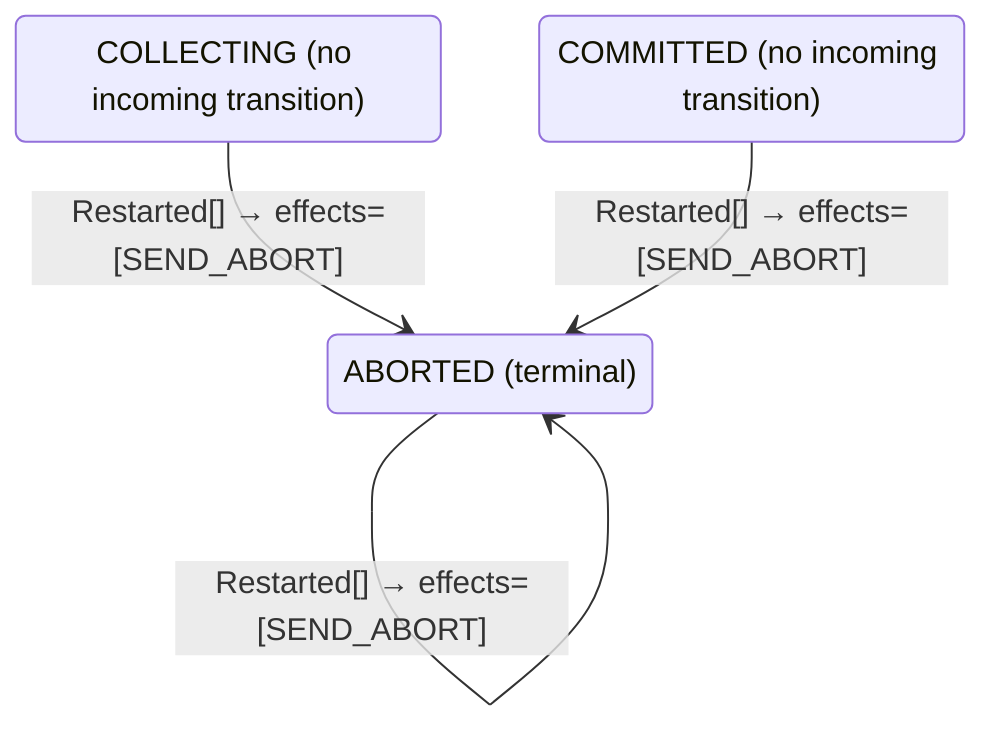

<!-- Generated by examples/tools/build.py from example.json and the verifier's output. Edit example.json. -->
# 087 · A coordinator that aborts the transaction on restart reverses a commit it had sent

[← All examples](../README.md)

| Verdict | Categories | Severity if shipped | Change | Verified unit | Approach |
|---|---|---|---|---|---|
| **✗ Violation: CommitFollowsTheCoordinator, 10-step trace (crashes)** | functional | critical | cleanup, behaviour change intended | [`Recovery#decide`](../../examples/apps/quorum/src/main/java/net/terminalvalue/quorum/twopc/Recovery.java) | [D1: Protocol model checking](../../examples/apps/quorum/spec/README.md) |

> A two-phase-commit coordinator logs each phase change before it acts on it, and a restart after a crash reads the log: a logged decision is sent again, since the crash may have come before the broadcast, and no logged decision means abort. A developer collapses the three cases of the recovery rule into one, abort: whatever the coordinator was doing, an abort releases the participants' locks, and a transaction that was about to commit can be retried. The contract diff is one row, a restart in `COMMITTED`, from sending the commit again to aborting. The two-phase-commit model is now checked under two more configurations, in which the coordinator may crash between steps or between logging a decision and sending it, and restarts on the recovery rule, generated from the contract like the decision rule. Under the two the model had, nothing crashes and the row is never taken. Under the third, TLC finds in ten steps a commit that is sent, applied by one participant, and then reversed by the restarted coordinator, which tells the other two to abort; the fourth finds the same step from a state its inductive invariant admits.

Tags: [distributed-transactions](../README.md#tag-distributed-transactions), [agreement](../README.md#tag-agreement), [crash-recovery](../README.md#tag-crash-recovery), [tla-fault-configuration](../README.md#tag-tla-fault-configuration), [generated-operator](../README.md#tag-generated-operator), [multiple-configurations](../README.md#tag-multiple-configurations)

## The change

In `Recovery.decide`, the switch over the logged phase becomes one arm: a restart is a transition to `ABORTED` with `SEND_ABORT`, whatever was logged, with the comment that abort is the safe way out, since the participants hold their locks until they hear from the coordinator and an abort releases them, and that a transaction about to commit is lost and can be retried. The contract diff is one row, `decide(COMMITTED, Restarted[])`, from a transition to `COMMITTED` with `SEND_COMMIT` to one to `ABORTED` with `SEND_ABORT`; the restarts in `COLLECTING` and `ABORTED` already aborted. The two tests for the decided phases become one.

**Before** ([`Recovery.java`](../../examples/apps/quorum/src/main/java/net/terminalvalue/quorum/twopc/Recovery.java), line 23):

```java

    public static Decision<Phase, CoordinatorEffect> decide(Phase logged, RecoveryEvent event) {
        return switch (event) {
            case Restarted _ -> switch (logged) {
                case COLLECTING -> transition(ABORTED, SEND_ABORT); // presumed abort
                case COMMITTED -> transition(COMMITTED, SEND_COMMIT);
                case ABORTED -> transition(ABORTED, SEND_ABORT);
            };
        };
    }
}
```

**After:**

```java

    public static Decision<Phase, CoordinatorEffect> decide(Phase logged, RecoveryEvent event) {
        return switch (event) {
            // Whatever the coordinator was doing when it crashed, abort is the safe way out: the participants hold
            // their locks until they hear from it, and an abort releases them without the coordinator having to
            // work out how far it had got. A transaction that was about to commit is lost, which a retry repairs.
            case Restarted _ -> transition(ABORTED, SEND_ABORT);
        };
    }
}
```

<details><summary>Patch</summary>

```diff
--- a/examples/apps/quorum/src/main/java/net/terminalvalue/quorum/twopc/Recovery.java
+++ b/examples/apps/quorum/src/main/java/net/terminalvalue/quorum/twopc/Recovery.java
@@ -23,11 +23,10 @@
 
     public static Decision<Phase, CoordinatorEffect> decide(Phase logged, RecoveryEvent event) {
         return switch (event) {
-            case Restarted _ -> switch (logged) {
-                case COLLECTING -> transition(ABORTED, SEND_ABORT); // presumed abort
-                case COMMITTED -> transition(COMMITTED, SEND_COMMIT);
-                case ABORTED -> transition(ABORTED, SEND_ABORT);
-            };
+            // Whatever the coordinator was doing when it crashed, abort is the safe way out: the participants hold
+            // their locks until they hear from it, and an abort releases them without the coordinator having to
+            // work out how far it had got. A transaction that was about to commit is lost, which a retry repairs.
+            case Restarted _ -> transition(ABORTED, SEND_ABORT);
         };
     }
 }
--- a/examples/apps/quorum/src/test/java/net/terminalvalue/quorum/twopc/RecoveryTest.java
+++ b/examples/apps/quorum/src/test/java/net/terminalvalue/quorum/twopc/RecoveryTest.java
@@ -10,12 +10,9 @@
 
     private RecoveryTest() {}
 
-    public static void sendsALoggedCommitAgain() {
-        equal(new Transition<>(Phase.COMMITTED, List.of(CoordinatorEffect.SEND_COMMIT)),
+    public static void abortsWhateverItWasDoing() {
+        equal(new Transition<>(Phase.ABORTED, List.of(CoordinatorEffect.SEND_ABORT)),
                 Recovery.decide(Phase.COMMITTED, new Restarted()));
-    }
-
-    public static void sendsALoggedAbortAgain() {
         equal(new Transition<>(Phase.ABORTED, List.of(CoordinatorEffect.SEND_ABORT)),
                 Recovery.decide(Phase.ABORTED, new Restarted()));
     }
```

</details>

## What the verifier found

The model is checked under 7 configurations, and the verdict is the first that fails:

| Configuration | What it checks | Model | Result |
|---|---|---|---|
| three participants (`spec/TwoPhaseCommit.cfg`) | every run from the initial state, every interleaving within the configuration's bounds | Participants = {p1, p2, p3}, MaxCrashes = 0, MaxParticipantCrashes = 0 | ✓ Verified: all invariants and properties hold in 728 states |
| the inductive step (`spec/TwoPhaseCommitInductive.cfg`) | that the invariant `Inductive` is inductive: TLC starts from every state the invariant admits, reachable or not, rather than from the initial state, takes one step, and checks the invariant again, conjunct by conjunct. No counterexample is a proof of atomicity by induction, for any run of the protocol however long; a counterexample is one step from a state that need not be reachable | Participants = {p1, p2, p3}, MaxCrashes = 0, MaxParticipantCrashes = 0 | ✓ Verified: all invariants hold in 736 states |
| crashes (`spec/TwoPhaseCommitCrash.cfg`) | every run from the initial state in which the coordinator may crash, twice at most: between steps, or after logging a phase change and before the broadcast goes out, and restart on the recovery rule, generated from `Recovery#decide`; the same invariants and temporal properties, under the added fairness condition that a crashed coordinator restarts | Participants = {p1, p2, p3}, MaxCrashes = 2, MaxParticipantCrashes = 0 | ✗ Violation: CommitFollowsTheCoordinator, 10-step trace |
| the inductive step with crashes (`spec/TwoPhaseCommitCrashInductive.cfg`) | that the invariant `Inductive` is closed under a crash and a restart as well: TLC starts from every state the invariant admits, the coordinator up or down, takes one step, and checks the invariant again | Participants = {p1, p2, p3}, MaxCrashes = 1, MaxParticipantCrashes = 0 | ✗ Violation: CommitFollowsTheCoordinator, 2-step trace |
| participant crashes (`spec/TwoPhaseCommitParticipantCrash.cfg`) | every run from the initial state in which a participant may crash, once, between steps or after logging a vote and before sending it, and restart on the participant's rule, generated from `Participant#decide`, while the coordinator may crash once as well; the same invariants and temporal properties, under the added fairness condition that a crashed participant restarts | Participants = {p1, p2, p3}, MaxCrashes = 1, MaxParticipantCrashes = 1 | ✗ Violation: CommitFollowsTheCoordinator, 10-step trace |
| the inductive step with participant crashes (`spec/TwoPhaseCommitParticipantCrashInductive.cfg`) | that the invariant `Inductive` is closed under a participant's crash and restart as well: TLC starts from every state the invariant admits, each process up or down, takes one step, and checks the invariant again | Participants = {p1, p2, p3}, MaxCrashes = 1, MaxParticipantCrashes = 1 | ✗ Violation: CommitFollowsTheCoordinator, 2-step trace |
| the recorded runs (`spec/TwoPhaseCommitTrace.cfg`) | the Java nodes against the model: the coordinator node, its log and its broadcast, and the participant nodes, their logs and their votes, run through eleven scripted scenarios with crashes of either process injected after a given I/O operation, the state after each step recorded in the model's variables (`TwoPhaseCommitTraces.tla`, regenerated from the patched classes); TLC walks each recorded run and checks that it starts in the model's initial state and that every step is a step of the model's next-state relation. A step the model has no action for is one the glue took that the model's verdicts do not cover | Participants = {"p1", "p2", "p3"}, MaxCrashes = 2, MaxParticipantCrashes = 2 | ✓ Verified: all invariants and properties hold in 103 states |

TLC found a run of the system under crashes, 10 steps long, that violates the invariant **CommitFollowsTheCoordinator** (a participant commits only on the coordinator's decision, and only after voting yes). Each step is one action of one part of the system:

1. **Initial state**: every participant working, no vote counted, no decision, every process up.
2. **Vote**, `Participant.prepare`: a participant votes yes (and holds its locks) or no (and aborts), as its rule decides; it logs the state before it sends the vote, and a crash can fall between the two. `inbox = {[from |-> p1, vote |-> "YES"]}`, `pstate = (p1 :> "PREPARED" @@ p2 :> "WORKING" @@ p3 :> "WORKING")`
3. **Vote**, `Participant.prepare`: a participant votes yes (and holds its locks) or no (and aborts), as its rule decides; it logs the state before it sends the vote, and a crash can fall between the two. `inbox = {[from |-> p1, vote |-> "YES"], [from |-> p2, vote |-> "YES"]}`, `pstate = (p1 :> "PREPARED" @@ p2 :> "PREPARED" @@ p3 :> "WORKING")`
4. **Vote**, `Participant.prepare`: a participant votes yes (and holds its locks) or no (and aborts), as its rule decides; it logs the state before it sends the vote, and a crash can fall between the two. `inbox = { [from |-> p1, vote |-> "YES"], [from |-> p2, vote |-> "YES"], [from |-> p3, vote |-> "YES"] }`, `pstate = (p1 :> "PREPARED" @@ p2 :> "PREPARED" @@ p3 :> "PREPARED")`
5. **ReceiveVote**, `Coordinator.onVote`: the coordinator counts a vote and decides on the tally. `inbox = {[from |-> p2, vote |-> "YES"], [from |-> p3, vote |-> "YES"]}`, `votes = (p1 :> "YES" @@ p2 :> "NONE" @@ p3 :> "NONE")`
6. **ReceiveVote**, `Coordinator.onVote`: the coordinator counts a vote and decides on the tally. `inbox = {[from |-> p3, vote |-> "YES"]}`, `votes = (p1 :> "YES" @@ p2 :> "YES" @@ p3 :> "NONE")`
7. **ReceiveVote**, `Coordinator.onVote`: the coordinator counts a vote and decides on the tally. `decision = "COMMIT"`, `inbox = {}`, `phase = "COMMITTED"`, `votes = (p1 :> "YES" @@ p2 :> "YES" @@ p3 :> "YES")`
8. **Learn**, `Participant.learn`: a participant applies the coordinator's decision. `pstate = (p1 :> "COMMITTED" @@ p2 :> "PREPARED" @@ p3 :> "PREPARED")`
9. **Crash**, the coordinator crashes between steps: it loses nothing it logged, and takes no step until it restarts. `crashes = 1`, `up = FALSE`
10. **Recover**, `Recovery.decide`: the coordinator restarts with the phase it logged and acts on the recovery rule's decision, which a crash can cut short like any other. `decision = "ABORT"`, `phase = "ABORTED"`, `up = TRUE`

The model is small (Participants = {p1, p2, p3}, MaxCrashes = 2, MaxParticipantCrashes = 0), which is what keeps the trace readable. TLC explored every interleaving of the participants, the coordinator and the votes in flight within those bounds.

<details><summary>The counterexample under the inductive step with crashes: invariant <b>CommitFollowsTheCoordinator</b>, 2 steps</summary>

Invariant **CommitFollowsTheCoordinator**: a participant commits only on the coordinator's decision, and only after voting yes.

1. **Starting state**, a state the invariant `Inductive` admits, the coordinator up or down, which need not be reachable: `crashes = 1`, `decision = "NONE"`, `inbox = {}`, `pcrashes = 0`, `phase = "COMMITTED"`, `pstate = (p1 :> "COMMITTED" @@ p2 :> "COMMITTED" @@ p3 :> "COMMITTED")`, `pup = (p1 :> TRUE @@ p2 :> TRUE @@ p3 :> TRUE)`, `up = FALSE`, `votes = (p1 :> "YES" @@ p2 :> "YES" @@ p3 :> "YES")`
2. **Recover**, `Recovery.decide`: the coordinator restarts with the phase it logged and acts on the recovery rule's decision, which a crash can cut short like any other. `decision = "ABORT"`, `phase = "ABORTED"`, `up = TRUE`

</details>

Under participant crashes TLC found the same run, and reported it the same way.

<details><summary>The counterexample under the inductive step with participant crashes: invariant <b>CommitFollowsTheCoordinator</b>, 2 steps</summary>

Invariant **CommitFollowsTheCoordinator**: a participant commits only on the coordinator's decision, and only after voting yes.

1. **Starting state**, a state the invariant `Inductive` admits, each process up or down, which need not be reachable: `crashes = 1`, `decision = "NONE"`, `inbox = {}`, `pcrashes = 0`, `phase = "COMMITTED"`, `pstate = (p1 :> "COMMITTED" @@ p2 :> "COMMITTED" @@ p3 :> "COMMITTED")`, `pup = (p1 :> TRUE @@ p2 :> TRUE @@ p3 :> TRUE)`, `up = FALSE`, `votes = (p1 :> "YES" @@ p2 :> "YES" @@ p3 :> "YES")`
2. **Recover**, `Recovery.decide`: the coordinator restarts with the phase it logged and acts on the recovery rule's decision, which a crash can cut short like any other. `decision = "ABORT"`, `phase = "ABORTED"`, `up = TRUE`

</details>

**What the verdict rests on.** TLC counted how often a step of the model took each row of the generated operators. A row no step takes is one the model says nothing about, whatever the verdict.

| Configuration | Rows of `Coordinator#decide` taken | Rows of `Recovery#decide` taken | Rows of `Participant#decide` taken |
|---|---|---|---|
| three participants | 10 of 18 | 0 of 3 | 6 of 28 |
| the inductive step (from the states the invariant admits, not from a run) | 10 of 18 | 0 of 3 | 6 of 28 |
| crashes | stopped at the counterexample | stopped at the counterexample | stopped at the counterexample |
| the inductive step with crashes (from the states the invariant admits, not from a run) | stopped at the counterexample | stopped at the counterexample | stopped at the counterexample |
| participant crashes | stopped at the counterexample | stopped at the counterexample | stopped at the counterexample |
| the inductive step with participant crashes (from the states the invariant admits, not from a run) | stopped at the counterexample | stopped at the counterexample | stopped at the counterexample |

The change alters 1 row of the contract, and 1 with a null argument, which the model leaves out:

- `decide(COMMITTED, Restarted[])`: `Transition[next=COMMITTED, effects=[SEND_COMMIT]]` → `Transition[next=ABORTED, effects=[SEND_ABORT]]`, taken by no run that finished

The run under crashes, the inductive step with crashes, participant crashes, the inductive step with participant crashes stopped at its counterexample, the steps above, and its counts are left out: the verdict rests on the counterexample.

<details><summary>Rows no step takes under three participants</summary>

`net.terminalvalue.quorum.twopc.Coordinator#decide`:

```
decide(COMMITTED, Tally[complete=false, unanimous=false]) => Unchanged
decide(COMMITTED, Tally[complete=false, unanimous=true]) => Unchanged
decide(COMMITTED, Tally[complete=true, unanimous=false]) => Unchanged
decide(COMMITTED, Tally[complete=true, unanimous=true]) => Unchanged
decide(COMMITTED, Timeout[unanimousSoFar=false]) => Unchanged
decide(COMMITTED, Timeout[unanimousSoFar=true]) => Unchanged
decide(ABORTED, Timeout[unanimousSoFar=false]) => Unchanged
decide(ABORTED, Timeout[unanimousSoFar=true]) => Unchanged
```

`net.terminalvalue.quorum.twopc.Recovery#decide`:

```
decide(COLLECTING, Restarted[]) => Transition[next=ABORTED, effects=[SEND_ABORT]]
decide(COMMITTED, Restarted[]) => Transition[next=ABORTED, effects=[SEND_ABORT]]
decide(ABORTED, Restarted[]) => Transition[next=ABORTED, effects=[SEND_ABORT]]
```

`net.terminalvalue.quorum.twopc.Participant#decide`:

```
decide(WORKING, Learned[outcome=NONE]) => Unchanged
decide(WORKING, Learned[outcome=COMMIT]) => Transition[next=COMMITTED, effects=[]]
decide(WORKING, Restarted[]) => Transition[next=ABORTED, effects=[]]
decide(PREPARED, Prepare[able=false]) => Rejected
decide(PREPARED, Prepare[able=true]) => Rejected
decide(PREPARED, GiveUp[]) => Rejected
decide(PREPARED, Learned[outcome=NONE]) => Unchanged
decide(PREPARED, Restarted[]) => Unchanged
decide(COMMITTED, Prepare[able=false]) => Rejected
decide(COMMITTED, Prepare[able=true]) => Rejected
decide(COMMITTED, GiveUp[]) => Rejected
decide(COMMITTED, Learned[outcome=NONE]) => Unchanged
decide(COMMITTED, Learned[outcome=COMMIT]) => Unchanged
decide(COMMITTED, Learned[outcome=ABORT]) => Unchanged
decide(COMMITTED, Restarted[]) => Unchanged
decide(ABORTED, Prepare[able=false]) => Rejected
decide(ABORTED, Prepare[able=true]) => Rejected
decide(ABORTED, GiveUp[]) => Rejected
decide(ABORTED, Learned[outcome=NONE]) => Unchanged
decide(ABORTED, Learned[outcome=COMMIT]) => Unchanged
decide(ABORTED, Learned[outcome=ABORT]) => Unchanged
decide(ABORTED, Restarted[]) => Unchanged
```

</details>

The state machine the patched code implements, drawn from its derived contract (`jvmcontract statemachine`); a state with no way in or no way out is marked:



## Would the existing tests have caught it?

Yes, in this repo: `NodesTest.aCrashAfterTheLogLosesTheBroadcastAndTheRestartSendsItAgain` fails (`java -ea net.terminalvalue.quorum.Tests`). That test was written for this property. The contract needed no one to anticipate it.

## Why it matters

Abort is the safe way out of a transaction that has not committed. The coordinator logs its decision before it sends it, and once the commit is logged the transaction has committed, whether or not the broadcast went out: a participant may already have applied it and released its locks, and the decision cannot be taken back. The change takes it back. A reviewer who takes the change's framing, that a crashed coordinator has lost track and should start over, approves a rule that is right in two phases of three, and the one it is wrong in is the one whose consequences a participant has already acted on. Nothing in the decision rule's contract, the coordinator's tests, or the model as it was can see it: the model had no crashes, so a restart never happened, and the inductive invariant, which ties what the coordinator has broadcast to its phase, said nothing about a step that changes the phase after the broadcast.

## Why the verdict is right

The recovery rule in the model is generated from the regenerated contract, like the decision rule, so the model runs the new rule. The model is now checked under two more configurations. `TwoPhaseCommitCrash.cfg` lets the coordinator crash, twice at most in a run: between steps, or in the middle of one, after it has logged the phase change and before the broadcast goes out; it restarts on the recovery rule, and the restart can be cut short the same way. The invariants and the two temporal properties are those of the first configuration, under the added fairness condition that a crashed coordinator restarts. `TwoPhaseCommitCrashInductive.cfg` checks the inductive invariant with a crash and a restart among the steps. Under the two configurations the model had, nothing changes: the coordinator never crashes, so the changed row is never taken, 728 states and 736 as before, and the page says so. Under the third, TLC reports the shortest run that breaks `CommitFollowsTheCoordinator`, a participant commits only on the coordinator's say-so: the three participants vote yes; the coordinator counts the three votes, and on the last one logs the commit and broadcasts it; p1 applies it and commits; the coordinator crashes; it restarts, and the new rule logs an abort and broadcasts it. Ten steps, the initial state and nine actions, and in the last state p1 is committed while the coordinator's phase is `ABORTED`, with the abort on its way to the two participants still holding their locks, which is the split that `Atomicity` would report two steps later. The fourth configuration reports the same step on its own, from a state the invariant admits, the coordinator down in `COMMITTED` with a participant committed, which is the shape of the proof: a recovery rule under which the inductive invariant is closed can be shown correct for every run, and this one is one step from leaving it.

## What to do

Revert: a restart in a decided phase sends the decision again, and only a restart without a logged decision aborts. The rule is presumed abort as the R* paper states it, and the asymmetry in it is the point: the log is the decision, and what a crash can lose is the broadcast, never the decision. The two configurations stay with the model, so the next change to what a coordinator does after a crash is checked over every order of votes, crashes and restarts, and by induction.

## Notes

- The two-phase-commit model (`apps/quorum/spec/TwoPhaseCommit.tla`) is built like Box Office's: the coordinator's state machine is generated from its B8 contract. An example of this model is checked under every configuration the model lists, and its verdict is the first that fails.
- `TwoPhaseCommitCrash.cfg` and `TwoPhaseCommitCrashInductive.cfg` let the coordinator crash between steps, or after logging a decision and before sending it, and restart on a recovery rule, the model's second generated operator (`Recovery#decide`).
- Reverses a commit a participant has already applied: only a model that lets the coordinator crash can see it.

## Evidence

How the verdict was reached: three participants: TLC 2.19 explored 728 distinct states to depth 11 in 1 s, for the model Participants = {p1, p2, p3}, MaxCrashes = 0, MaxParticipantCrashes = 0; the inductive step: TLC 2.19 explored 736 distinct states to depth 1 in 1 s, for the model Participants = {p1, p2, p3}, MaxCrashes = 0, MaxParticipantCrashes = 0; crashes: TLC 2.19 explored 3,336 distinct states to depth 10 in 2 s, for the model Participants = {p1, p2, p3}, MaxCrashes = 2, MaxParticipantCrashes = 0; the inductive step with crashes: TLC 2.19 explored 2,729 distinct states to depth 2 in 1 s, for the model Participants = {p1, p2, p3}, MaxCrashes = 1, MaxParticipantCrashes = 0; participant crashes: TLC 2.19 explored 12,445 distinct states to depth 10 in 9 s, for the model Participants = {p1, p2, p3}, MaxCrashes = 1, MaxParticipantCrashes = 1; the inductive step with participant crashes: TLC 2.19 explored 18,637 distinct states to depth 2 in 2 s, for the model Participants = {p1, p2, p3}, MaxCrashes = 1, MaxParticipantCrashes = 1; the recorded runs: TLC 2.19 explored 103 distinct states to depth 12 in 0 s, for the model Participants = {"p1", "p2", "p3"}, MaxCrashes = 2, MaxParticipantCrashes = 2.

This result was recorded before runs fingerprinted their inputs, so whether it still matches the current patch and sources is not known.

<details><summary>Verifier output</summary>

```text
== three participants: spec/TwoPhaseCommit.cfg ==
TLC2 Version 2.19 of 08 August 2024 (rev: 5a47802)
Running breadth-first search Model-Checking with fp 1 and seed 1 with 1 worker on 2 cores with 2185MB heap and 64MB offheap memory [pid: 1110399] (Linux 6.6.87.2-microsoft-standard-WSL2 aarch64, Eclipse Adoptium 25.0.4.1 x86_64, MSBDiskFPSet, DiskStateQueue).
Parsing file examples/apps/quorum/spec/TwoPhaseCommit.tla
Parsing file examples/tools/tla/standard-modules/Naturals.tla
Parsing file examples/tools/tla/standard-modules/Sequences.tla
Parsing file examples/tools/tla/standard-modules/FiniteSets.tla
Parsing file examples/apps/quorum/spec/CoordinatorContract.tla
Parsing file examples/apps/quorum/spec/RecoveryContract.tla
Parsing file examples/apps/quorum/spec/ParticipantContract.tla
Parsing file examples/apps/quorum/spec/TCommit.tla
Semantic processing of module Naturals
Semantic processing of module Sequences
Semantic processing of module FiniteSets
Semantic processing of module CoordinatorContract
Semantic processing of module RecoveryContract
Semantic processing of module ParticipantContract
Semantic processing of module TCommit
Semantic processing of module TwoPhaseCommit
Starting... (2026-11-03 23:58:43)
Implied-temporal checking--satisfiability problem has 3 branches.
Computing initial states...
Finished computing initial states: 1 distinct state generated at 2026-11-03 23:58:43.
Checking 3 branches of temporal properties for the complete state space with 2184 total distinct states at (2026-11-03 23:58:44)
Finished checking temporal properties in 00s at 2026-11-03 23:58:44
Model checking completed. No error has been found.
  Estimates of the probability that TLC did not check all reachable states
  because two distinct states had the same fingerprint:
  calculated (optimistic):  val = 6.9E-14
Rows of net.terminalvalue.quorum.twopc.Coordinator#decide a step of the model takes: 10 of 18; never taken (8):
  decide(COMMITTED, Tally[complete=false, unanimous=false]) => Unchanged
  decide(COMMITTED, Tally[complete=false, unanimous=true]) => Unchanged
  decide(COMMITTED, Tally[complete=true, unanimous=false]) => Unchanged
  decide(COMMITTED, Tally[complete=true, unanimous=true]) => Unchanged
  decide(COMMITTED, Timeout[unanimousSoFar=false]) => Unchanged
  decide(COMMITTED, Timeout[unanimousSoFar=true]) => Unchanged
  decide(ABORTED, Timeout[unanimousSoFar=false]) => Unchanged
  decide(ABORTED, Timeout[unanimousSoFar=true]) => Unchanged
Rows of net.terminalvalue.quorum.twopc.Recovery#decide a step of the model takes: 0 of 3; never taken (3):
  decide(COLLECTING, Restarted[]) => Transition[next=ABORTED, effects=[SEND_ABORT]]
  decide(COMMITTED, Restarted[]) => Transition[next=ABORTED, effects=[SEND_ABORT]]
  decide(ABORTED, Restarted[]) => Transition[next=ABORTED, effects=[SEND_ABORT]]
Rows of net.terminalvalue.quorum.twopc.Participant#decide a step of the model takes: 6 of 28; never taken (22):
  decide(WORKING, Learned[outcome=NONE]) => Unchanged
  decide(WORKING, Learned[outcome=COMMIT]) => Transition[next=COMMITTED, effects=[]]
  decide(WORKING, Restarted[]) => Transition[next=ABORTED, effects=[]]
  decide(PREPARED, Prepare[able=false]) => Rejected
  decide(PREPARED, Prepare[able=true]) => Rejected
  decide(PREPARED, GiveUp[]) => Rejected
  decide(PREPARED, Learned[outcome=NONE]) => Unchanged
  decide(PREPARED, Restarted[]) => Unchanged
  decide(COMMITTED, Prepare[able=false]) => Rejected
  decide(COMMITTED, Prepare[able=true]) => Rejected
  decide(COMMITTED, GiveUp[]) => Rejected
  decide(COMMITTED, Learned[outcome=NONE]) => Unchanged
  decide(COMMITTED, Learned[outcome=COMMIT]) => Unchanged
  decide(COMMITTED, Learned[outcome=ABORT]) => Unchanged
  decide(COMMITTED, Restarted[]) => Unchanged
  decide(ABORTED, Prepare[able=false]) => Rejected
  decide(ABORTED, Prepare[able=true]) => Rejected
  decide(ABORTED, GiveUp[]) => Rejected
  decide(ABORTED, Learned[outcome=NONE]) => Unchanged
  decide(ABORTED, Learned[outcome=COMMIT]) => Unchanged
  decide(ABORTED, Learned[outcome=ABORT]) => Unchanged
  decide(ABORTED, Restarted[]) => Unchanged
2489 states generated, 728 distinct states found, 0 states left on queue.
The depth of the complete state graph search is 11.
The average outdegree of the complete state graph is 1 (minimum is 0, the maximum 10 and the 95th percentile is 3).
Finished in 01s at (2026-11-03 23:58:44)

== the inductive step: spec/TwoPhaseCommitInductive.cfg ==
TLC2 Version 2.19 of 08 August 2024 (rev: 5a47802)
Running breadth-first search Model-Checking with fp 1 and seed 1 with 1 worker on 2 cores with 2185MB heap and 64MB offheap memory [pid: 1110514] (Linux 6.6.87.2-microsoft-standard-WSL2 aarch64, Eclipse Adoptium 25.0.4.1 x86_64, MSBDiskFPSet, DiskStateQueue).
Parsing file examples/apps/quorum/spec/TwoPhaseCommit.tla
Parsing file examples/tools/tla/standard-modules/Naturals.tla
Parsing file examples/tools/tla/standard-modules/Sequences.tla
Parsing file examples/tools/tla/standard-modules/FiniteSets.tla
Parsing file examples/apps/quorum/spec/CoordinatorContract.tla
Parsing file examples/apps/quorum/spec/RecoveryContract.tla
Parsing file examples/apps/quorum/spec/ParticipantContract.tla
Parsing file examples/apps/quorum/spec/TCommit.tla
Semantic processing of module Naturals
Semantic processing of module Sequences
Semantic processing of module FiniteSets
Semantic processing of module CoordinatorContract
Semantic processing of module RecoveryContract
Semantic processing of module ParticipantContract
Semantic processing of module TCommit
Semantic processing of module TwoPhaseCommit
Starting... (2026-11-03 23:58:45)
Computing initial states...
Computed 2 initial states...
Computed 4 initial states...
Computed 8 initial states...
Computed 16 initial states...
Computed 32 initial states...
Computed 64 initial states...
Computed 128 initial states...
Computed 256 initial states...
Computed 512 initial states...
Finished computing initial states: 736 distinct states generated at 2026-11-03 23:58:45.
Model checking completed. No error has been found.
  Estimates of the probability that TLC did not check all reachable states
  because two distinct states had the same fingerprint:
  calculated (optimistic):  val = 9.9E-14
Rows of net.terminalvalue.quorum.twopc.Coordinator#decide a step of the model takes: 10 of 18; never taken (8):
  decide(COMMITTED, Tally[complete=false, unanimous=false]) => Unchanged
  decide(COMMITTED, Tally[complete=false, unanimous=true]) => Unchanged
  decide(COMMITTED, Tally[complete=true, unanimous=false]) => Unchanged
  decide(COMMITTED, Tally[complete=true, unanimous=true]) => Unchanged
  decide(COMMITTED, Timeout[unanimousSoFar=false]) => Unchanged
  decide(COMMITTED, Timeout[unanimousSoFar=true]) => Unchanged
  decide(ABORTED, Timeout[unanimousSoFar=false]) => Unchanged
  decide(ABORTED, Timeout[unanimousSoFar=true]) => Unchanged
Rows of net.terminalvalue.quorum.twopc.Recovery#decide a step of the model takes: 0 of 3; never taken (3):
  decide(COLLECTING, Restarted[]) => Transition[next=ABORTED, effects=[SEND_ABORT]]
  decide(COMMITTED, Restarted[]) => Transition[next=ABORTED, effects=[SEND_ABORT]]
  decide(ABORTED, Restarted[]) => Transition[next=ABORTED, effects=[SEND_ABORT]]
Rows of net.terminalvalue.quorum.twopc.Participant#decide a step of the model takes: 6 of 28; never taken (22):
  decide(WORKING, Learned[outcome=NONE]) => Unchanged
  decide(WORKING, Learned[outcome=COMMIT]) => Transition[next=COMMITTED, effects=[]]
  decide(WORKING, Restarted[]) => Transition[next=ABORTED, effects=[]]
  decide(PREPARED, Prepare[able=false]) => Rejected
  decide(PREPARED, Prepare[able=true]) => Rejected
  decide(PREPARED, GiveUp[]) => Rejected
  decide(PREPARED, Learned[outcome=NONE]) => Unchanged
  decide(PREPARED, Restarted[]) => Unchanged
  decide(COMMITTED, Prepare[able=false]) => Rejected
  decide(COMMITTED, Prepare[able=true]) => Rejected
  decide(COMMITTED, GiveUp[]) => Rejected
  decide(COMMITTED, Learned[outcome=NONE]) => Unchanged
  decide(COMMITTED, Learned[outcome=COMMIT]) => Unchanged
  decide(COMMITTED, Learned[outcome=ABORT]) => Unchanged
  decide(COMMITTED, Restarted[]) => Unchanged
  decide(ABORTED, Prepare[able=false]) => Rejected
  decide(ABORTED, Prepare[able=true]) => Rejected
  decide(ABORTED, GiveUp[]) => Rejected
  decide(ABORTED, Learned[outcome=NONE]) => Unchanged
  decide(ABORTED, Learned[outcome=COMMIT]) => Unchanged
  decide(ABORTED, Learned[outcome=ABORT]) => Unchanged
  decide(ABORTED, Restarted[]) => Unchanged
3224 states generated, 736 distinct states found, 0 states left on queue.
The depth of the complete state graph search is 1.
The average outdegree of the complete state graph is 0 (minimum is 0, the maximum 0 and the 95th percentile is 0).
Finished in 01s at (2026-11-03 23:58:45)

== crashes: spec/TwoPhaseCommitCrash.cfg ==
TLC2 Version 2.19 of 08 August 2024 (rev: 5a47802)
Running breadth-first search Model-Checking with fp 1 and seed 1 with 1 worker on 2 cores with 2185MB heap and 64MB offheap memory [pid: 1110640] (Linux 6.6.87.2-microsoft-standard-WSL2 aarch64, Eclipse Adoptium 25.0.4.1 x86_64, MSBDiskFPSet, DiskStateQueue).
Parsing file examples/apps/quorum/spec/TwoPhaseCommit.tla
Parsing file examples/tools/tla/standard-modules/Naturals.tla
Parsing file examples/tools/tla/standard-modules/Sequences.tla
Parsing file examples/tools/tla/standard-modules/FiniteSets.tla
Parsing file examples/apps/quorum/spec/CoordinatorContract.tla
Parsing file examples/apps/quorum/spec/RecoveryContract.tla
Parsing file examples/apps/quorum/spec/ParticipantContract.tla
Parsing file examples/apps/quorum/spec/TCommit.tla
Semantic processing of module Naturals
Semantic processing of module Sequences
Semantic processing of module FiniteSets
Semantic processing of module CoordinatorContract
Semantic processing of module RecoveryContract
Semantic processing of module ParticipantContract
Semantic processing of module TCommit
Semantic processing of module TwoPhaseCommit
Starting... (2026-11-03 23:58:46)
Implied-temporal checking--satisfiability problem has 3 branches.
Computing initial states...
Finished computing initial states: 1 distinct state generated at 2026-11-03 23:58:46.
Error: Invariant CommitFollowsTheCoordinator is violated.
Error: The behavior up to this point is:
State 1: <Initial predicate>
/\ phase = "COLLECTING"
/\ pcrashes = 0
/\ decision = "NONE"
/\ pstate = (p1 :> "WORKING" @@ p2 :> "WORKING" @@ p3 :> "WORKING")
/\ crashes = 0
/\ votes = (p1 :> "NONE" @@ p2 :> "NONE" @@ p3 :> "NONE")
/\ up = TRUE
/\ pup = (p1 :> TRUE @@ p2 :> TRUE @@ p3 :> TRUE)
/\ inbox = {}

State 2: <Vote line 98, col 5 to line 99, col 111 of module TwoPhaseCommit>
/\ phase = "COLLECTING"
/\ pcrashes = 0
/\ decision = "NONE"
/\ pstate = (p1 :> "PREPARED" @@ p2 :> "WORKING" @@ p3 :> "WORKING")
/\ crashes = 0
/\ votes = (p1 :> "NONE" @@ p2 :> "NONE" @@ p3 :> "NONE")
/\ up = TRUE
/\ pup = (p1 :> TRUE @@ p2 :> TRUE @@ p3 :> TRUE)
/\ inbox = {[from |-> p1, vote |-> "YES"]}

State 3: <Vote line 98, col 5 to line 99, col 111 of module TwoPhaseCommit>
/\ phase = "COLLECTING"
/\ pcrashes = 0
/\ decision = "NONE"
/\ pstate = (p1 :> "PREPARED" @@ p2 :> "PREPARED" @@ p3 :> "WORKING")
/\ crashes = 0
/\ votes = (p1 :> "NONE" @@ p2 :> "NONE" @@ p3 :> "NONE")
/\ up = TRUE
/\ pup = (p1 :> TRUE @@ p2 :> TRUE @@ p3 :> TRUE)
/\ inbox = {[from |-> p1, vote |-> "YES"], [from |-> p2, vote |-> "YES"]}

State 4: <Vote line 98, col 5 to line 99, col 111 of module TwoPhaseCommit>
/\ phase = "COLLECTING"
/\ pcrashes = 0
/\ decision = "NONE"
/\ pstate = (p1 :> "PREPARED" @@ p2 :> "PREPARED" @@ p3 :> "PREPARED")
/\ crashes = 0
/\ votes = (p1 :> "NONE" @@ p2 :> "NONE" @@ p3 :> "NONE")
/\ up = TRUE
/\ pup = (p1 :> TRUE @@ p2 :> TRUE @@ p3 :> TRUE)
/\ inbox = { [from |-> p1, vote |-> "YES"],
  [from |-> p2, vote |-> "YES"],
  [from |-> p3, vote |-> "YES"] }

State 5: <ReceiveVote line 159, col 5 to line 167, col 42 of module TwoPhaseCommit>
/\ phase = "COLLECTING"
/\ pcrashes = 0
/\ decision = "NONE"
/\ pstate = (p1 :> "PREPARED" @@ p2 :> "PREPARED" @@ p3 :> "PREPARED")
/\ crashes = 0
/\ votes = (p1 :> "YES" @@ p2 :> "NONE" @@ p3 :> "NONE")
/\ up = TRUE
/\ pup = (p1 :> TRUE @@ p2 :> TRUE @@ p3 :> TRUE)
/\ inbox = {[from |-> p2, vote |-> "YES"], [from |-> p3, vote |-> "YES"]}

State 6: <ReceiveVote line 159, col 5 to line 167, col 42 of module TwoPhaseCommit>
/\ phase = "COLLECTING"
/\ pcrashes = 0
/\ decision = "NONE"
/\ pstate = (p1 :> "PREPARED" @@ p2 :> "PREPARED" @@ p3 :> "PREPARED")
/\ crashes = 0
/\ votes = (p1 :> "YES" @@ p2 :> "YES" @@ p3 :> "NONE")
/\ up = TRUE
/\ pup = (p1 :> TRUE @@ p2 :> TRUE @@ p3 :> TRUE)
/\ inbox = {[from |-> p3, vote |-> "YES"]}

State 7: <ReceiveVote line 159, col 5 to line 167, col 42 of module TwoPhaseCommit>
/\ phase = "COMMITTED"
/\ pcrashes = 0
/\ decision = "COMMIT"
/\ pstate = (p1 :> "PREPARED" @@ p2 :> "PREPARED" @@ p3 :> "PREPARED")
/\ crashes = 0
/\ votes = (p1 :> "YES" @@ p2 :> "YES" @@ p3 :> "YES")
/\ up = TRUE
/\ pup = (p1 :> TRUE @@ p2 :> TRUE @@ p3 :> TRUE)
/\ inbox = {}

State 8: <Learn line 109, col 5 to line 111, col 88 of module TwoPhaseCommit>
/\ phase = "COMMITTED"
/\ pcrashes = 0
/\ decision = "COMMIT"
/\ pstate = (p1 :> "COMMITTED" @@ p2 :> "PREPARED" @@ p3 :> "PREPARED")
/\ crashes = 0
/\ votes = (p1 :> "YES" @@ p2 :> "YES" @@ p3 :> "YES")
/\ up = TRUE
/\ pup = (p1 :> TRUE @@ p2 :> TRUE @@ p3 :> TRUE)
/\ inbox = {}

State 9: <Crash line 178, col 5 to line 180, col 73 of module TwoPhaseCommit>
/\ phase = "COMMITTED"
/\ pcrashes = 0
/\ decision = "COMMIT"
/\ pstate = (p1 :> "COMMITTED" @@ p2 :> "PREPARED" @@ p3 :> "PREPARED")
/\ crashes = 1
/\ votes = (p1 :> "YES" @@ p2 :> "YES" @@ p3 :> "YES")
/\ up = FALSE
/\ pup = (p1 :> TRUE @@ p2 :> TRUE @@ p3 :> TRUE)
/\ inbox = {}

State 10: <Recover line 187, col 5 to line 189, col 56 of module TwoPhaseCommit>
/\ phase = "ABORTED"
/\ pcrashes = 0
/\ decision = "ABORT"
/\ pstate = (p1 :> "COMMITTED" @@ p2 :> "PREPARED" @@ p3 :> "PREPARED")
/\ crashes = 1
/\ votes = (p1 :> "YES" @@ p2 :> "YES" @@ p3 :> "YES")
/\ up = TRUE
/\ pup = (p1 :> TRUE @@ p2 :> TRUE @@ p3 :> TRUE)
/\ inbox = {}

Rows of net.terminalvalue.quorum.twopc.Coordinator#decide a step of the model takes: 10 of 18; never taken (8):
  decide(COMMITTED, Tally[complete=false, unanimous=false]) => Unchanged
  decide(COMMITTED, Tally[complete=false, unanimous=true]) => Unchanged
  decide(COMMITTED, Tally[complete=true, unanimous=false]) => Unchanged
  decide(COMMITTED, Tally[complete=true, unanimous=true]) => Unchanged
  decide(COMMITTED, Timeout[unanimousSoFar=false]) => Unchanged
  decide(COMMITTED, Timeout[unanimousSoFar=true]) => Unchanged
  decide(ABORTED, Timeout[unanimousSoFar=false]) => Unchanged
  decide(ABORTED, Timeout[unanimousSoFar=true]) => Unchanged
Rows of net.terminalvalue.quorum.twopc.Recovery#decide a step of the model takes: 3 of 3.
Rows of net.terminalvalue.quorum.twopc.Participant#decide a step of the model takes: 6 of 28; never taken (22):
  decide(WORKING, Learned[outcome=NONE]) => Unchanged
  decide(WORKING, Learned[outcome=COMMIT]) => Transition[next=COMMITTED, effects=[]]
  decide(WORKING, Restarted[]) => Transition[next=ABORTED, effects=[]]
  decide(PREPARED, Prepare[able=false]) => Rejected
  decide(PREPARED, Prepare[able=true]) => Rejected
  decide(PREPARED, GiveUp[]) => Rejected
  decide(PREPARED, Learned[outcome=NONE]) => Unchanged
  decide(PREPARED, Restarted[]) => Unchanged
  decide(COMMITTED, Prepare[able=false]) => Rejected
  decide(COMMITTED, Prepare[able=true]) => Rejected
  decide(COMMITTED, GiveUp[]) => Rejected
  decide(COMMITTED, Learned[outcome=NONE]) => Unchanged
  decide(COMMITTED, Learned[outcome=COMMIT]) => Unchanged
  decide(COMMITTED, Learned[outcome=ABORT]) => Unchanged
  decide(COMMITTED, Restarted[]) => Unchanged
  decide(ABORTED, Prepare[able=false]) => Rejected
  decide(ABORTED, Prepare[able=true]) => Rejected
  decide(ABORTED, GiveUp[]) => Rejected
  decide(ABORTED, Learned[outcome=NONE]) => Unchanged
  decide(ABORTED, Learned[outcome=COMMIT]) => Unchanged
  decide(ABORTED, Learned[outcome=ABORT]) => Unchanged
  decide(ABORTED, Restarted[]) => Unchanged
13934 states generated, 3336 distinct states found, 269 states left on queue.
The depth of the complete state graph search is 10.
The average outdegree of the complete state graph is 1 (minimum is 0, the maximum 12 and the 95th percentile is 4).
Finished in 02s at (2026-11-03 23:58:49)

== the inductive step with crashes: spec/TwoPhaseCommitCrashInductive.cfg ==
TLC2 Version 2.19 of 08 August 2024 (rev: 5a47802)
Running breadth-first search Model-Checking with fp 1 and seed 1 with 1 worker on 2 cores with 2185MB heap and 64MB offheap memory [pid: 1110822] (Linux 6.6.87.2-microsoft-standard-WSL2 aarch64, Eclipse Adoptium 25.0.4.1 x86_64, MSBDiskFPSet, DiskStateQueue).
Parsing file examples/apps/quorum/spec/TwoPhaseCommit.tla
Parsing file examples/tools/tla/standard-modules/Naturals.tla
Parsing file examples/tools/tla/standard-modules/Sequences.tla
Parsing file examples/tools/tla/standard-modules/FiniteSets.tla
Parsing file examples/apps/quorum/spec/CoordinatorContract.tla
Parsing file examples/apps/quorum/spec/RecoveryContract.tla
Parsing file examples/apps/quorum/spec/ParticipantContract.tla
Parsing file examples/apps/quorum/spec/TCommit.tla
Semantic processing of module Naturals
Semantic processing of module Sequences
Semantic processing of module FiniteSets
Semantic processing of module CoordinatorContract
Semantic processing of module RecoveryContract
Semantic processing of module ParticipantContract
Semantic processing of module TCommit
Semantic processing of module TwoPhaseCommit
Starting... (2026-11-03 23:58:50)
Computing initial states...
Computed 2 initial states...
Computed 4 initial states...
Computed 8 initial states...
Computed 16 initial states...
Computed 32 initial states...
Computed 64 initial states...
Computed 128 initial states...
Computed 256 initial states...
Computed 512 initial states...
Computed 1024 initial states...
Computed 2048 initial states...
Finished computing initial states: 2728 distinct states generated at 2026-11-03 23:58:50.
Error: Invariant CommitFollowsTheCoordinator is violated.
Error: The behavior up to this point is:
State 1: <Initial predicate>
/\ phase = "COMMITTED"
/\ pcrashes = 0
/\ decision = "NONE"
/\ pstate = (p1 :> "COMMITTED" @@ p2 :> "COMMITTED" @@ p3 :> "COMMITTED")
/\ crashes = 1
/\ votes = (p1 :> "YES" @@ p2 :> "YES" @@ p3 :> "YES")
/\ up = FALSE
/\ pup = (p1 :> TRUE @@ p2 :> TRUE @@ p3 :> TRUE)
/\ inbox = {}

State 2: <Recover line 187, col 5 to line 189, col 56 of module TwoPhaseCommit>
/\ phase = "ABORTED"
/\ pcrashes = 0
/\ decision = "ABORT"
/\ pstate = (p1 :> "COMMITTED" @@ p2 :> "COMMITTED" @@ p3 :> "COMMITTED")
/\ crashes = 1
/\ votes = (p1 :> "YES" @@ p2 :> "YES" @@ p3 :> "YES")
/\ up = TRUE
/\ pup = (p1 :> TRUE @@ p2 :> TRUE @@ p3 :> TRUE)
/\ inbox = {}

Rows of net.terminalvalue.quorum.twopc.Coordinator#decide a step of the model takes: 10 of 18; never taken (8):
  decide(COMMITTED, Tally[complete=false, unanimous=false]) => Unchanged
  decide(COMMITTED, Tally[complete=false, unanimous=true]) => Unchanged
  decide(COMMITTED, Tally[complete=true, unanimous=false]) => Unchanged
  decide(COMMITTED, Tally[complete=true, unanimous=true]) => Unchanged
  decide(COMMITTED, Timeout[unanimousSoFar=false]) => Unchanged
  decide(COMMITTED, Timeout[unanimousSoFar=true]) => Unchanged
  decide(ABORTED, Timeout[unanimousSoFar=false]) => Unchanged
  decide(ABORTED, Timeout[unanimousSoFar=true]) => Unchanged
Rows of net.terminalvalue.quorum.twopc.Recovery#decide a step of the model takes: 3 of 3.
Rows of net.terminalvalue.quorum.twopc.Participant#decide a step of the model takes: 5 of 28; never taken (23):
  decide(WORKING, Learned[outcome=NONE]) => Unchanged
  decide(WORKING, Learned[outcome=COMMIT]) => Transition[next=COMMITTED, effects=[]]
  decide(WORKING, Restarted[]) => Transition[next=ABORTED, effects=[]]
  decide(PREPARED, Prepare[able=false]) => Rejected
  decide(PREPARED, Prepare[able=true]) => Rejected
  decide(PREPARED, GiveUp[]) => Rejected
  decide(PREPARED, Learned[outcome=NONE]) => Unchanged
  decide(PREPARED, Learned[outcome=COMMIT]) => Transition[next=COMMITTED, effects=[]]
  decide(PREPARED, Restarted[]) => Unchanged
  decide(COMMITTED, Prepare[able=false]) => Rejected
  decide(COMMITTED, Prepare[able=true]) => Rejected
  decide(COMMITTED, GiveUp[]) => Rejected
  decide(COMMITTED, Learned[outcome=NONE]) => Unchanged
  decide(COMMITTED, Learned[outcome=COMMIT]) => Unchanged
  decide(COMMITTED, Learned[outcome=ABORT]) => Unchanged
  decide(COMMITTED, Restarted[]) => Unchanged
  decide(ABORTED, Prepare[able=false]) => Rejected
  decide(ABORTED, Prepare[able=true]) => Rejected
  decide(ABORTED, GiveUp[]) => Rejected
  decide(ABORTED, Learned[outcome=NONE]) => Unchanged
  decide(ABORTED, Learned[outcome=COMMIT]) => Unchanged
  decide(ABORTED, Learned[outcome=ABORT]) => Unchanged
  decide(ABORTED, Restarted[]) => Unchanged
12701 states generated, 2729 distinct states found, 31 states left on queue.
The depth of the complete state graph search is 2.
The average outdegree of the complete state graph is 0 (minimum is 0, the maximum 0 and the 95th percentile is 0).
Finished in 01s at (2026-11-03 23:58:51)

== participant crashes: spec/TwoPhaseCommitParticipantCrash.cfg ==
TLC2 Version 2.19 of 08 August 2024 (rev: 5a47802)
Running breadth-first search Model-Checking with fp 1 and seed 1 with 1 worker on 2 cores with 2185MB heap and 64MB offheap memory [pid: 1110879] (Linux 6.6.87.2-microsoft-standard-WSL2 aarch64, Eclipse Adoptium 25.0.4.1 x86_64, MSBDiskFPSet, DiskStateQueue).
Parsing file examples/apps/quorum/spec/TwoPhaseCommit.tla
Parsing file examples/tools/tla/standard-modules/Naturals.tla
Parsing file examples/tools/tla/standard-modules/Sequences.tla
Parsing file examples/tools/tla/standard-modules/FiniteSets.tla
Parsing file examples/apps/quorum/spec/CoordinatorContract.tla
Parsing file examples/apps/quorum/spec/RecoveryContract.tla
Parsing file examples/apps/quorum/spec/ParticipantContract.tla
Parsing file examples/apps/quorum/spec/TCommit.tla
Semantic processing of module Naturals
Semantic processing of module Sequences
Semantic processing of module FiniteSets
Semantic processing of module CoordinatorContract
Semantic processing of module RecoveryContract
Semantic processing of module ParticipantContract
Semantic processing of module TCommit
Semantic processing of module TwoPhaseCommit
Starting... (2026-11-03 23:58:51)
Implied-temporal checking--satisfiability problem has 3 branches.
Computing initial states...
Finished computing initial states: 1 distinct state generated at 2026-11-03 23:58:52.
Checking 3 branches of temporal properties for the current state space with 11273 total distinct states at (2026-11-03 23:58:55)
Finished checking temporal properties in 00s at 2026-11-03 23:58:55
Error: Invariant CommitFollowsTheCoordinator is violated.
Error: The behavior up to this point is:
State 1: <Initial predicate>
/\ phase = "COLLECTING"
/\ pcrashes = 0
/\ decision = "NONE"
/\ pstate = (p1 :> "WORKING" @@ p2 :> "WORKING" @@ p3 :> "WORKING")
/\ crashes = 0
/\ votes = (p1 :> "NONE" @@ p2 :> "NONE" @@ p3 :> "NONE")
/\ up = TRUE
/\ pup = (p1 :> TRUE @@ p2 :> TRUE @@ p3 :> TRUE)
/\ inbox = {}

State 2: <Vote line 98, col 5 to line 99, col 111 of module TwoPhaseCommit>
/\ phase = "COLLECTING"
/\ pcrashes = 0
/\ decision = "NONE"
/\ pstate = (p1 :> "PREPARED" @@ p2 :> "WORKING" @@ p3 :> "WORKING")
/\ crashes = 0
/\ votes = (p1 :> "NONE" @@ p2 :> "NONE" @@ p3 :> "NONE")
/\ up = TRUE
/\ pup = (p1 :> TRUE @@ p2 :> TRUE @@ p3 :> TRUE)
/\ inbox = {[from |-> p1, vote |-> "YES"]}

State 3: <Vote line 98, col 5 to line 99, col 111 of module TwoPhaseCommit>
/\ phase = "COLLECTING"
/\ pcrashes = 0
/\ decision = "NONE"
/\ pstate = (p1 :> "PREPARED" @@ p2 :> "PREPARED" @@ p3 :> "WORKING")
/\ crashes = 0
/\ votes = (p1 :> "NONE" @@ p2 :> "NONE" @@ p3 :> "NONE")
/\ up = TRUE
/\ pup = (p1 :> TRUE @@ p2 :> TRUE @@ p3 :> TRUE)
/\ inbox = {[from |-> p1, vote |-> "YES"], [from |-> p2, vote |-> "YES"]}

State 4: <Vote line 98, col 5 to line 99, col 111 of module TwoPhaseCommit>
/\ phase = "COLLECTING"
/\ pcrashes = 0
/\ decision = "NONE"
/\ pstate = (p1 :> "PREPARED" @@ p2 :> "PREPARED" @@ p3 :> "PREPARED")
/\ crashes = 0
/\ votes = (p1 :> "NONE" @@ p2 :> "NONE" @@ p3 :> "NONE")
/\ up = TRUE
/\ pup = (p1 :> TRUE @@ p2 :> TRUE @@ p3 :> TRUE)
/\ inbox = { [from |-> p1, vote |-> "YES"],
  [from |-> p2, vote |-> "YES"],
  [from |-> p3, vote |-> "YES"] }

State 5: <ReceiveVote line 159, col 5 to line 167, col 42 of module TwoPhaseCommit>
/\ phase = "COLLECTING"
/\ pcrashes = 0
/\ decision = "NONE"
/\ pstate = (p1 :> "PREPARED" @@ p2 :> "PREPARED" @@ p3 :> "PREPARED")
/\ crashes = 0
/\ votes = (p1 :> "YES" @@ p2 :> "NONE" @@ p3 :> "NONE")
/\ up = TRUE
/\ pup = (p1 :> TRUE @@ p2 :> TRUE @@ p3 :> TRUE)
/\ inbox = {[from |-> p2, vote |-> "YES"], [from |-> p3, vote |-> "YES"]}

State 6: <ReceiveVote line 159, col 5 to line 167, col 42 of module TwoPhaseCommit>
/\ phase = "COLLECTING"
/\ pcrashes = 0
/\ decision = "NONE"
/\ pstate = (p1 :> "PREPARED" @@ p2 :> "PREPARED" @@ p3 :> "PREPARED")
/\ crashes = 0
/\ votes = (p1 :> "YES" @@ p2 :> "YES" @@ p3 :> "NONE")
/\ up = TRUE
/\ pup = (p1 :> TRUE @@ p2 :> TRUE @@ p3 :> TRUE)
/\ inbox = {[from |-> p3, vote |-> "YES"]}

State 7: <ReceiveVote line 159, col 5 to line 167, col 42 of module TwoPhaseCommit>
/\ phase = "COMMITTED"
/\ pcrashes = 0
/\ decision = "COMMIT"
/\ pstate = (p1 :> "PREPARED" @@ p2 :> "PREPARED" @@ p3 :> "PREPARED")
/\ crashes = 0
/\ votes = (p1 :> "YES" @@ p2 :> "YES" @@ p3 :> "YES")
/\ up = TRUE
/\ pup = (p1 :> TRUE @@ p2 :> TRUE @@ p3 :> TRUE)
/\ inbox = {}

State 8: <Learn line 109, col 5 to line 111, col 88 of module TwoPhaseCommit>
/\ phase = "COMMITTED"
/\ pcrashes = 0
/\ decision = "COMMIT"
/\ pstate = (p1 :> "COMMITTED" @@ p2 :> "PREPARED" @@ p3 :> "PREPARED")
/\ crashes = 0
/\ votes = (p1 :> "YES" @@ p2 :> "YES" @@ p3 :> "YES")
/\ up = TRUE
/\ pup = (p1 :> TRUE @@ p2 :> TRUE @@ p3 :> TRUE)
/\ inbox = {}

State 9: <Crash line 178, col 5 to line 180, col 73 of module TwoPhaseCommit>
/\ phase = "COMMITTED"
/\ pcrashes = 0
/\ decision = "COMMIT"
/\ pstate = (p1 :> "COMMITTED" @@ p2 :> "PREPARED" @@ p3 :> "PREPARED")
/\ crashes = 1
/\ votes = (p1 :> "YES" @@ p2 :> "YES" @@ p3 :> "YES")
/\ up = FALSE
/\ pup = (p1 :> TRUE @@ p2 :> TRUE @@ p3 :> TRUE)
/\ inbox = {}

State 10: <Recover line 187, col 5 to line 189, col 56 of module TwoPhaseCommit>
/\ phase = "ABORTED"
/\ pcrashes = 0
/\ decision = "ABORT"
/\ pstate = (p1 :> "COMMITTED" @@ p2 :> "PREPARED" @@ p3 :> "PREPARED")
/\ crashes = 1
/\ votes = (p1 :> "YES" @@ p2 :> "YES" @@ p3 :> "YES")
/\ up = TRUE
/\ pup = (p1 :> TRUE @@ p2 :> TRUE @@ p3 :> TRUE)
/\ inbox = {}

Rows of net.terminalvalue.quorum.twopc.Coordinator#decide a step of the model takes: 10 of 18; never taken (8):
  decide(COMMITTED, Tally[complete=false, unanimous=false]) => Unchanged
  decide(COMMITTED, Tally[complete=false, unanimous=true]) => Unchanged
  decide(COMMITTED, Tally[complete=true, unanimous=false]) => Unchanged
  decide(COMMITTED, Tally[complete=true, unanimous=true]) => Unchanged
  decide(COMMITTED, Timeout[unanimousSoFar=false]) => Unchanged
  decide(COMMITTED, Timeout[unanimousSoFar=true]) => Unchanged
  decide(ABORTED, Timeout[unanimousSoFar=false]) => Unchanged
  decide(ABORTED, Timeout[unanimousSoFar=true]) => Unchanged
Rows of net.terminalvalue.quorum.twopc.Recovery#decide a step of the model takes: 3 of 3.
Rows of net.terminalvalue.quorum.twopc.Participant#decide a step of the model takes: 10 of 28; never taken (18):
  decide(WORKING, Learned[outcome=NONE]) => Unchanged
  decide(WORKING, Learned[outcome=COMMIT]) => Transition[next=COMMITTED, effects=[]]
  decide(PREPARED, Prepare[able=false]) => Rejected
  decide(PREPARED, Prepare[able=true]) => Rejected
  decide(PREPARED, GiveUp[]) => Rejected
  decide(PREPARED, Learned[outcome=NONE]) => Unchanged
  decide(COMMITTED, Prepare[able=false]) => Rejected
  decide(COMMITTED, Prepare[able=true]) => Rejected
  decide(COMMITTED, GiveUp[]) => Rejected
  decide(COMMITTED, Learned[outcome=NONE]) => Unchanged
  decide(COMMITTED, Learned[outcome=COMMIT]) => Unchanged
  decide(COMMITTED, Learned[outcome=ABORT]) => Unchanged
  decide(ABORTED, Prepare[able=false]) => Rejected
  decide(ABORTED, Prepare[able=true]) => Rejected
  decide(ABORTED, GiveUp[]) => Rejected
  decide(ABORTED, Learned[outcome=NONE]) => Unchanged
  decide(ABORTED, Learned[outcome=COMMIT]) => Unchanged
  decide(ABORTED, Learned[outcome=ABORT]) => Unchanged
62204 states generated, 12445 distinct states found, 796 states left on queue.
The depth of the complete state graph search is 10.
The average outdegree of the complete state graph is 1 (minimum is 0, the maximum 27 and the 95th percentile is 4).
Finished in 09s at (2026-11-03 23:59:01)

== the inductive step with participant crashes: spec/TwoPhaseCommitParticipantCrashInductive.cfg ==
TLC2 Version 2.19 of 08 August 2024 (rev: 5a47802)
Running breadth-first search Model-Checking with fp 1 and seed 1 with 1 worker on 2 cores with 2185MB heap and 64MB offheap memory [pid: 1111397] (Linux 6.6.87.2-microsoft-standard-WSL2 aarch64, Eclipse Adoptium 25.0.4.1 x86_64, MSBDiskFPSet, DiskStateQueue).
Parsing file examples/apps/quorum/spec/TwoPhaseCommit.tla
Parsing file examples/tools/tla/standard-modules/Naturals.tla
Parsing file examples/tools/tla/standard-modules/Sequences.tla
Parsing file examples/tools/tla/standard-modules/FiniteSets.tla
Parsing file examples/apps/quorum/spec/CoordinatorContract.tla
Parsing file examples/apps/quorum/spec/RecoveryContract.tla
Parsing file examples/apps/quorum/spec/ParticipantContract.tla
Parsing file examples/apps/quorum/spec/TCommit.tla
Semantic processing of module Naturals
Semantic processing of module Sequences
Semantic processing of module FiniteSets
Semantic processing of module CoordinatorContract
Semantic processing of module RecoveryContract
Semantic processing of module ParticipantContract
Semantic processing of module TCommit
Semantic processing of module TwoPhaseCommit
Starting... (2026-11-03 23:59:02)
Computing initial states...
Computed 2 initial states...
Computed 4 initial states...
Computed 8 initial states...
Computed 16 initial states...
Computed 32 initial states...
Computed 64 initial states...
Computed 128 initial states...
Computed 256 initial states...
Computed 512 initial states...
Computed 1024 initial states...
Computed 2048 initial states...
Computed 4096 initial states...
Computed 8192 initial states...
Computed 16384 initial states...
Computed 32768 initial states...
Finished computing initial states: 33204 states generated, with 18636 of them distinct at 2026-11-03 23:59:03.
Error: Invariant CommitFollowsTheCoordinator is violated.
Error: The behavior up to this point is:
State 1: <Initial predicate>
/\ phase = "COMMITTED"
/\ pcrashes = 0
/\ decision = "NONE"
/\ pstate = (p1 :> "COMMITTED" @@ p2 :> "COMMITTED" @@ p3 :> "COMMITTED")
/\ crashes = 1
/\ votes = (p1 :> "YES" @@ p2 :> "YES" @@ p3 :> "YES")
/\ up = FALSE
/\ pup = (p1 :> TRUE @@ p2 :> TRUE @@ p3 :> TRUE)
/\ inbox = {}

State 2: <Recover line 187, col 5 to line 189, col 56 of module TwoPhaseCommit>
/\ phase = "ABORTED"
/\ pcrashes = 0
/\ decision = "ABORT"
/\ pstate = (p1 :> "COMMITTED" @@ p2 :> "COMMITTED" @@ p3 :> "COMMITTED")
/\ crashes = 1
/\ votes = (p1 :> "YES" @@ p2 :> "YES" @@ p3 :> "YES")
/\ up = TRUE
/\ pup = (p1 :> TRUE @@ p2 :> TRUE @@ p3 :> TRUE)
/\ inbox = {}

Rows of net.terminalvalue.quorum.twopc.Coordinator#decide a step of the model takes: 10 of 18; never taken (8):
  decide(COMMITTED, Tally[complete=false, unanimous=false]) => Unchanged
  decide(COMMITTED, Tally[complete=false, unanimous=true]) => Unchanged
  decide(COMMITTED, Tally[complete=true, unanimous=false]) => Unchanged
  decide(COMMITTED, Tally[complete=true, unanimous=true]) => Unchanged
  decide(COMMITTED, Timeout[unanimousSoFar=false]) => Unchanged
  decide(COMMITTED, Timeout[unanimousSoFar=true]) => Unchanged
  decide(ABORTED, Timeout[unanimousSoFar=false]) => Unchanged
  decide(ABORTED, Timeout[unanimousSoFar=true]) => Unchanged
Rows of net.terminalvalue.quorum.twopc.Recovery#decide a step of the model takes: 3 of 3.
Rows of net.terminalvalue.quorum.twopc.Participant#decide a step of the model takes: 8 of 28; never taken (20):
  decide(WORKING, Learned[outcome=NONE]) => Unchanged
  decide(WORKING, Learned[outcome=COMMIT]) => Transition[next=COMMITTED, effects=[]]
  decide(PREPARED, Prepare[able=false]) => Rejected
  decide(PREPARED, Prepare[able=true]) => Rejected
  decide(PREPARED, GiveUp[]) => Rejected
  decide(PREPARED, Learned[outcome=NONE]) => Unchanged
  decide(PREPARED, Learned[outcome=COMMIT]) => Transition[next=COMMITTED, effects=[]]
  decide(COMMITTED, Prepare[able=false]) => Rejected
  decide(COMMITTED, Prepare[able=true]) => Rejected
  decide(COMMITTED, GiveUp[]) => Rejected
  decide(COMMITTED, Learned[outcome=NONE]) => Unchanged
  decide(COMMITTED, Learned[outcome=COMMIT]) => Unchanged
  decide(COMMITTED, Learned[outcome=ABORT]) => Unchanged
  decide(COMMITTED, Restarted[]) => Unchanged
  decide(ABORTED, Prepare[able=false]) => Rejected
  decide(ABORTED, Prepare[able=true]) => Rejected
  decide(ABORTED, GiveUp[]) => Rejected
  decide(ABORTED, Learned[outcome=NONE]) => Unchanged
  decide(ABORTED, Learned[outcome=COMMIT]) => Unchanged
  decide(ABORTED, Learned[outcome=ABORT]) => Unchanged
119541 states generated, 18637 distinct states found, 159 states left on queue.
The depth of the complete state graph search is 2.
The average outdegree of the complete state graph is 0 (minimum is 0, the maximum 0 and the 95th percentile is 0).
Finished in 02s at (2026-11-03 23:59:04)

== the recorded runs: spec/TwoPhaseCommitTrace.cfg ==
TLC2 Version 2.19 of 08 August 2024 (rev: 5a47802)
Running breadth-first search Model-Checking with fp 1 and seed 1 with 1 worker on 2 cores with 2185MB heap and 64MB offheap memory [pid: 1111575] (Linux 6.6.87.2-microsoft-standard-WSL2 aarch64, Eclipse Adoptium 25.0.4.1 x86_64, MSBDiskFPSet, DiskStateQueue).
Parsing file examples/apps/quorum/spec/TwoPhaseCommitTrace.tla
Parsing file examples/apps/quorum/spec/TwoPhaseCommit.tla
Parsing file examples/apps/quorum/spec/TwoPhaseCommitTraces.tla
Parsing file examples/tools/tla/standard-modules/Naturals.tla
Parsing file examples/tools/tla/standard-modules/Sequences.tla
Parsing file examples/tools/tla/standard-modules/FiniteSets.tla
Parsing file examples/apps/quorum/spec/CoordinatorContract.tla
Parsing file examples/apps/quorum/spec/RecoveryContract.tla
Parsing file examples/apps/quorum/spec/ParticipantContract.tla
Parsing file examples/apps/quorum/spec/TCommit.tla
Semantic processing of module Naturals
Semantic processing of module Sequences
Semantic processing of module FiniteSets
Semantic processing of module CoordinatorContract
Semantic processing of module RecoveryContract
Semantic processing of module ParticipantContract
Semantic processing of module TCommit
Semantic processing of module TwoPhaseCommit
Semantic processing of module TwoPhaseCommitTraces
Semantic processing of module TwoPhaseCommitTrace
Starting... (2026-11-03 23:59:04)
Computing initial states...
Computed 2 initial states...
Computed 4 initial states...
Computed 8 initial states...
Finished computing initial states: 11 distinct states generated at 2026-11-03 23:59:05.
Model checking completed. No error has been found.
  Estimates of the probability that TLC did not check all reachable states
  because two distinct states had the same fingerprint:
  calculated (optimistic):  val = 0.0
103 states generated, 103 distinct states found, 0 states left on queue.
The depth of the complete state graph search is 12.
The average outdegree of the complete state graph is 1 (minimum is 0, the maximum 1 and the 95th percentile is 1).
Finished in 00s at (2026-11-03 23:59:05)
```

</details>

<details><summary>SARIF report (as uploaded to GitHub code scanning or SonarQube)</summary>

```json
{
  "version": "2.1.0",
  "$schema": "https://json.schemastore.org/sarif-2.1.0.json",
  "runs": [
    {
      "tool": {
        "driver": {
          "name": "jvmcontract tlc",
          "rules": [
            {
              "id": "invariant-violated",
              "shortDescription": {
                "text": "TLC found a behaviour of the model that violates an invariant or a temporal property, or ends in a deadlock."
              }
            },
            {
              "id": "unverifiable",
              "shortDescription": {
                "text": "TLC could not check the model."
              }
            }
          ]
        }
      },
      "results": [
        {
          "ruleId": "invariant-violated",
          "level": "error",
          "message": {
            "text": "Invariant CommitFollowsTheCoordinator of spec/TwoPhaseCommit.tla (crashes) is violated after 10 steps"
          },
          "locations": [
            {
              "physicalLocation": {
                "artifactLocation": {
                  "uri": "examples/apps/quorum/src/main/java/net/terminalvalue/quorum/twopc/Recovery.java"
                },
                "region": {
                  "startLine": 23
                }
              }
            }
          ]
        },
        {
          "ruleId": "invariant-violated",
          "level": "error",
          "message": {
            "text": "Invariant CommitFollowsTheCoordinator of spec/TwoPhaseCommit.tla (the inductive step with crashes) is violated after 2 steps"
          },
          "locations": [
            {
              "physicalLocation": {
                "artifactLocation": {
                  "uri": "examples/apps/quorum/src/main/java/net/terminalvalue/quorum/twopc/Recovery.java"
                },
                "region": {
                  "startLine": 23
                }
              }
            }
          ]
        },
        {
          "ruleId": "invariant-violated",
          "level": "error",
          "message": {
            "text": "Invariant CommitFollowsTheCoordinator of spec/TwoPhaseCommit.tla (participant crashes) is violated after 10 steps"
          },
          "locations": [
            {
              "physicalLocation": {
                "artifactLocation": {
                  "uri": "examples/apps/quorum/src/main/java/net/terminalvalue/quorum/twopc/Recovery.java"
                },
                "region": {
                  "startLine": 23
                }
              }
            }
          ]
        },
        {
          "ruleId": "invariant-violated",
          "level": "error",
          "message": {
            "text": "Invariant CommitFollowsTheCoordinator of spec/TwoPhaseCommit.tla (the inductive step with participant crashes) is violated after 2 steps"
          },
          "locations": [
            {
              "physicalLocation": {
                "artifactLocation": {
                  "uri": "examples/apps/quorum/src/main/java/net/terminalvalue/quorum/twopc/Recovery.java"
                },
                "region": {
                  "startLine": 23
                }
              }
            }
          ]
        }
      ]
    }
  ]
}
```

</details>

**Provenance:** Constructed as the simplification a developer makes of a three-arm rule two of whose arms look alike, with the framing that abort is always safe; the point of the example is that the model needed a crash before any of the recovery rule's rows could be exercised at all, and that the existing inductive invariant could not have caught the change without it.

- [Gray, Notes on Data Base Operating Systems (1978): two-phase commit, the coordinator's log, and restart](https://jimgray.azurewebsites.net/papers/dbos.pdf)
- [Mohan, Lindsay and Obermarck, Transaction Management in the R* Distributed Database Management System (1986): presumed abort, what a coordinator does on restart with and without a logged decision](https://dl.acm.org/doi/10.1145/7239.7266)
- [Bernstein, Hadzilacos and Goodman, Concurrency Control and Recovery in Database Systems (1987), chapter 7: the coordinator's and participants' recovery procedures in two-phase commit](https://www.microsoft.com/en-us/research/people/philbe/book/)
- [Lamport and Gray, Consensus on Transaction Commit: the TCommit and TwoPhase specifications](https://lamport.azurewebsites.net/video/consensus-on-transaction-commit.pdf)
## Reproduce

```bash
python3 examples/tools/build.py 087
```

This applies `change.patch` to a temporary copy of the repo, runs the verifier on it, and rewrites this page.
