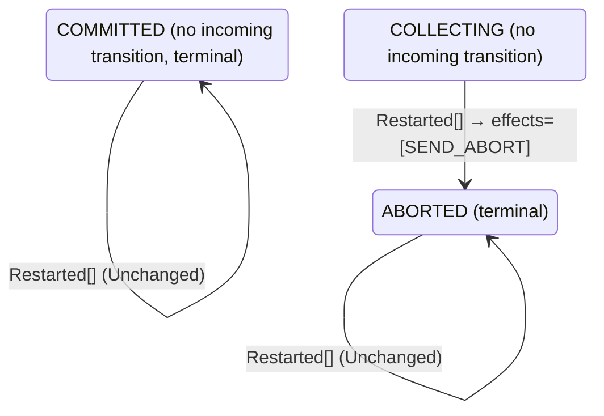

<!-- Generated by examples/tools/build.py from example.json and the verifier's output. Edit example.json. -->
# 088 · A coordinator with nothing to redo on restart leaves a logged decision unsent forever

[← All examples](../README.md)

| Verdict | Categories | Severity if shipped | Change | Verified unit | Approach |
|---|---|---|---|---|---|
| **✗ Violation: EveryParticipantDecides, 8-step trace then forever (crashes)** | functional | high | bug-fix, behaviour change intended | [`Recovery#decide`](../../examples/apps/quorum/src/main/java/net/terminalvalue/quorum/twopc/Recovery.java) | [D1: Protocol model checking](../../examples/apps/quorum/spec/README.md) |

> A restarted two-phase-commit coordinator sends a logged decision again, because the crash may have come between logging it and sending it. A developer sees only duplicate broadcasts come of it, since the coordinator cannot tell whether the first copy went out and so always sends a second, and makes a restart in a decided phase change nothing, as the decision rule does for any event in a decided phase. The contract diff is two rows, and the change mirrors the rule beside it. Under the two configurations the model had, nothing crashes and the rows are never taken; the inductive invariant is closed under the new rule as well, since every state the run passes through is one it admits. The third configuration, in which the coordinator may crash twice, finds the run in eight steps: two participants vote yes, the coordinator crashes as it counts the first of them, the third participant gives up, and the coordinator restarts, logs the abort that presumed abort calls for, and crashes again before sending it; the second restart finds a logged abort and the new rule has nothing to redo. The two prepared participants hold their locks forever, a liveness failure, reported as a run that stays in its last state. The fourth configuration finds the step that makes it possible, a coordinator up and decided with nothing out.

Tags: [distributed-transactions](../README.md#tag-distributed-transactions), [liveness](../README.md#tag-liveness), [crash-recovery](../README.md#tag-crash-recovery), [tla-liveness](../README.md#tag-tla-liveness), [tla-fault-configuration](../README.md#tag-tla-fault-configuration), [generated-operator](../README.md#tag-generated-operator), [multiple-configurations](../README.md#tag-multiple-configurations)

## The change

In `Recovery.decide`, a restart in `COMMITTED` or `ABORTED` is unchanged, with the reason `already decided` and the comment that the decision was broadcast when it was made, that a decided coordinator has nothing to redo, and that sending again would hand every participant a second copy. The restart in `COLLECTING` presumes abort as before. The contract diff is two rows, `decide(COMMITTED, Restarted[])` and `decide(ABORTED, Restarted[])`, from a transition that stays in the phase and sends the decision to unchanged; the two tests for them become one.

**Before** ([`Recovery.java`](../../examples/apps/quorum/src/main/java/net/terminalvalue/quorum/twopc/Recovery.java), line 1):

```java
package net.terminalvalue.quorum.twopc;

import static net.terminalvalue.quorum.Decision.transition;
import static net.terminalvalue.quorum.twopc.CoordinatorEffect.SEND_ABORT;
import static net.terminalvalue.quorum.twopc.CoordinatorEffect.SEND_COMMIT;
import static net.terminalvalue.quorum.twopc.Phase.ABORTED;
    // ...
        return switch (event) {
            case Restarted _ -> switch (logged) {
                case COLLECTING -> transition(ABORTED, SEND_ABORT); // presumed abort
                case COMMITTED -> transition(COMMITTED, SEND_COMMIT);
                case ABORTED -> transition(ABORTED, SEND_ABORT);
            };
        };
    }
```

**After:**

```java
package net.terminalvalue.quorum.twopc;

import static net.terminalvalue.quorum.Decision.transition;
import static net.terminalvalue.quorum.Decision.unchanged;
import static net.terminalvalue.quorum.twopc.CoordinatorEffect.SEND_ABORT;
import static net.terminalvalue.quorum.twopc.CoordinatorEffect.SEND_COMMIT;
import static net.terminalvalue.quorum.twopc.Phase.ABORTED;
    // ...
        return switch (event) {
            case Restarted _ -> switch (logged) {
                case COLLECTING -> transition(ABORTED, SEND_ABORT); // presumed abort
                // The decision was broadcast when it was made, and the participants have applied it or will: a
                // decided coordinator has nothing to redo, and sending again would hand every participant a second
                // copy of a message it has already acted on.
                case COMMITTED, ABORTED -> unchanged("already decided");
            };
        };
    }
```

<details><summary>Patch</summary>

```diff
--- a/examples/apps/quorum/src/main/java/net/terminalvalue/quorum/twopc/Recovery.java
+++ b/examples/apps/quorum/src/main/java/net/terminalvalue/quorum/twopc/Recovery.java
@@ -1,6 +1,7 @@
 package net.terminalvalue.quorum.twopc;
 
 import static net.terminalvalue.quorum.Decision.transition;
+import static net.terminalvalue.quorum.Decision.unchanged;
 import static net.terminalvalue.quorum.twopc.CoordinatorEffect.SEND_ABORT;
 import static net.terminalvalue.quorum.twopc.CoordinatorEffect.SEND_COMMIT;
 import static net.terminalvalue.quorum.twopc.Phase.ABORTED;
@@ -25,8 +26,10 @@
         return switch (event) {
             case Restarted _ -> switch (logged) {
                 case COLLECTING -> transition(ABORTED, SEND_ABORT); // presumed abort
-                case COMMITTED -> transition(COMMITTED, SEND_COMMIT);
-                case ABORTED -> transition(ABORTED, SEND_ABORT);
+                // The decision was broadcast when it was made, and the participants have applied it or will: a
+                // decided coordinator has nothing to redo, and sending again would hand every participant a second
+                // copy of a message it has already acted on.
+                case COMMITTED, ABORTED -> unchanged("already decided");
             };
         };
     }
--- a/examples/apps/quorum/src/test/java/net/terminalvalue/quorum/twopc/RecoveryTest.java
+++ b/examples/apps/quorum/src/test/java/net/terminalvalue/quorum/twopc/RecoveryTest.java
@@ -1,8 +1,10 @@
 package net.terminalvalue.quorum.twopc;
 
+import static net.terminalvalue.quorum.Tests.check;
 import static net.terminalvalue.quorum.Tests.equal;
 
 import java.util.List;
+import net.terminalvalue.quorum.Decision;
 import net.terminalvalue.quorum.Decision.Transition;
 import net.terminalvalue.quorum.twopc.RecoveryEvent.Restarted;
 
@@ -10,14 +12,9 @@
 
     private RecoveryTest() {}
 
-    public static void sendsALoggedCommitAgain() {
-        equal(new Transition<>(Phase.COMMITTED, List.of(CoordinatorEffect.SEND_COMMIT)),
-                Recovery.decide(Phase.COMMITTED, new Restarted()));
-    }
-
-    public static void sendsALoggedAbortAgain() {
-        equal(new Transition<>(Phase.ABORTED, List.of(CoordinatorEffect.SEND_ABORT)),
-                Recovery.decide(Phase.ABORTED, new Restarted()));
+    public static void aDecidedCoordinatorHasNothingToRedo() {
+        check(Recovery.decide(Phase.COMMITTED, new Restarted()) instanceof Decision.Unchanged, "committed stays");
+        check(Recovery.decide(Phase.ABORTED, new Restarted()) instanceof Decision.Unchanged, "aborted stays");
     }
 
     public static void presumesAbortWithoutALoggedDecision() {
```

</details>

## What the verifier found

The model is checked under 7 configurations, and the verdict is the first that fails:

| Configuration | What it checks | Model | Result |
|---|---|---|---|
| three participants (`spec/TwoPhaseCommit.cfg`) | every run from the initial state, every interleaving within the configuration's bounds | Participants = {p1, p2, p3}, MaxCrashes = 0, MaxParticipantCrashes = 0 | ✓ Verified: all invariants and properties hold in 728 states |
| the inductive step (`spec/TwoPhaseCommitInductive.cfg`) | that the invariant `Inductive` is inductive: TLC starts from every state the invariant admits, reachable or not, rather than from the initial state, takes one step, and checks the invariant again, conjunct by conjunct. No counterexample is a proof of atomicity by induction, for any run of the protocol however long; a counterexample is one step from a state that need not be reachable | Participants = {p1, p2, p3}, MaxCrashes = 0, MaxParticipantCrashes = 0 | ✓ Verified: all invariants hold in 736 states |
| crashes (`spec/TwoPhaseCommitCrash.cfg`) | every run from the initial state in which the coordinator may crash, twice at most: between steps, or after logging a phase change and before the broadcast goes out, and restart on the recovery rule, generated from `Recovery#decide`; the same invariants and temporal properties, under the added fairness condition that a crashed coordinator restarts | Participants = {p1, p2, p3}, MaxCrashes = 2, MaxParticipantCrashes = 0 | ✗ Violation: EveryParticipantDecides, 8-step trace then forever |
| the inductive step with crashes (`spec/TwoPhaseCommitCrashInductive.cfg`) | that the invariant `Inductive` is closed under a crash and a restart as well: TLC starts from every state the invariant admits, the coordinator up or down, takes one step, and checks the invariant again | Participants = {p1, p2, p3}, MaxCrashes = 1, MaxParticipantCrashes = 0 | ✗ Violation: BroadcastOnceUp, 2-step trace |
| participant crashes (`spec/TwoPhaseCommitParticipantCrash.cfg`) | every run from the initial state in which a participant may crash, once, between steps or after logging a vote and before sending it, and restart on the participant's rule, generated from `Participant#decide`, while the coordinator may crash once as well; the same invariants and temporal properties, under the added fairness condition that a crashed participant restarts | Participants = {p1, p2, p3}, MaxCrashes = 1, MaxParticipantCrashes = 1 | ✗ Violation: EveryParticipantDecides, 9-step trace then forever |
| the inductive step with participant crashes (`spec/TwoPhaseCommitParticipantCrashInductive.cfg`) | that the invariant `Inductive` is closed under a participant's crash and restart as well: TLC starts from every state the invariant admits, each process up or down, takes one step, and checks the invariant again | Participants = {p1, p2, p3}, MaxCrashes = 1, MaxParticipantCrashes = 1 | ✗ Violation: BroadcastOnceUp, 2-step trace |
| the recorded runs (`spec/TwoPhaseCommitTrace.cfg`) | the Java nodes against the model: the coordinator node, its log and its broadcast, and the participant nodes, their logs and their votes, run through eleven scripted scenarios with crashes of either process injected after a given I/O operation, the state after each step recorded in the model's variables (`TwoPhaseCommitTraces.tla`, regenerated from the patched classes); TLC walks each recorded run and checks that it starts in the model's initial state and that every step is a step of the model's next-state relation. A step the model has no action for is one the glue took that the model's verdicts do not cover | Participants = {"p1", "p2", "p3"}, MaxCrashes = 2, MaxParticipantCrashes = 2 | ✓ Verified: all invariants and properties hold in 103 states |

TLC found a run of the system under crashes that violates the temporal property **EveryParticipantDecides** (every participant eventually commits or aborts, under the fairness the model assumes: participants vote or give up, the coordinator counts every vote and fires its timer while votes are missing, participants apply a decision once made, and a crashed process restarts): after the 8 steps below, the system stays in that state forever, and the property never comes true. The run respects every fairness condition the model assumes; the parts that could act, do. Each step is one action of one part of the system:

1. **Initial state**: every participant working, no vote counted, no decision, every process up.
2. **Vote**, `Participant.prepare`: a participant votes yes (and holds its locks) or no (and aborts), as its rule decides; it logs the state before it sends the vote, and a crash can fall between the two. `inbox = {[from |-> p1, vote |-> "YES"]}`, `pstate = (p1 :> "PREPARED" @@ p2 :> "WORKING" @@ p3 :> "WORKING")`
3. **Vote**, `Participant.prepare`: a participant votes yes (and holds its locks) or no (and aborts), as its rule decides; it logs the state before it sends the vote, and a crash can fall between the two. `inbox = {[from |-> p1, vote |-> "YES"], [from |-> p2, vote |-> "YES"]}`, `pstate = (p1 :> "PREPARED" @@ p2 :> "PREPARED" @@ p3 :> "WORKING")`
4. **ReceiveVote**, `Coordinator.onVote`: the coordinator counts a vote and decides on the tally. `crashes = 1`, `inbox = {[from |-> p2, vote |-> "YES"]}`, `up = FALSE`, `votes = (p1 :> "YES" @@ p2 :> "NONE" @@ p3 :> "NONE")`
5. **ParticipantTimeout**, `Participant.timeout`: a participant that has not voted gives up on its own. `pstate = (p1 :> "PREPARED" @@ p2 :> "PREPARED" @@ p3 :> "ABORTED")`
6. **Recover**, `Recovery.decide`: the coordinator restarts with the phase it logged and acts on the recovery rule's decision, which a crash can cut short like any other. `crashes = 2`, `phase = "ABORTED"`
7. **Recover**, `Recovery.decide`: the coordinator restarts with the phase it logged and acts on the recovery rule's decision, which a crash can cut short like any other. `up = TRUE`
8. **ReceiveVote**, `Coordinator.onVote`: the coordinator counts a vote and decides on the tally. `inbox = {}`, `votes = (p1 :> "YES" @@ p2 :> "YES" @@ p3 :> "NONE")`

The model is small (Participants = {p1, p2, p3}, MaxCrashes = 2, MaxParticipantCrashes = 0), which is what keeps the trace readable. TLC explored every interleaving of the participants, the coordinator and the votes in flight within those bounds.

<details><summary>The counterexample under the inductive step with crashes: invariant <b>BroadcastOnceUp</b>, 2 steps</summary>

Invariant **BroadcastOnceUp**: a coordinator that is up and decided has its decision out, broadcast when it decided or on restarting.

1. **Starting state**, a state the invariant `Inductive` admits, the coordinator up or down, which need not be reachable: `crashes = 1`, `decision = "NONE"`, `inbox = {}`, `pcrashes = 0`, `phase = "ABORTED"`, `pstate = (p1 :> "ABORTED" @@ p2 :> "ABORTED" @@ p3 :> "ABORTED")`, `pup = (p1 :> TRUE @@ p2 :> TRUE @@ p3 :> TRUE)`, `up = FALSE`, `votes = (p1 :> "NONE" @@ p2 :> "NONE" @@ p3 :> "NONE")`
2. **Recover**, `Recovery.decide`: the coordinator restarts with the phase it logged and acts on the recovery rule's decision, which a crash can cut short like any other. `up = TRUE`

</details>

<details><summary>The counterexample under participant crashes: temporal property <b>EveryParticipantDecides</b>, 9 steps</summary>

Temporal property **EveryParticipantDecides**: every participant eventually commits or aborts, under the fairness the model assumes: participants vote or give up, the coordinator counts every vote and fires its timer while votes are missing, participants apply a decision once made, and a crashed process restarts. After the last step the system stays in that state forever.

1. **Initial state**: every participant working, no vote counted, no decision, every process up.
2. **CoordinatorTimeout**, `Coordinator.onTimeout`: the collection timer fires with votes missing. `crashes = 1`, `phase = "ABORTED"`, `up = FALSE`
3. **Recover**, `Recovery.decide`: the coordinator restarts with the phase it logged and acts on the recovery rule's decision, which a crash can cut short like any other. `up = TRUE`
4. **ParticipantCrash**, a participant crashes between steps: it loses nothing it logged, and takes no step until it restarts. `pcrashes = 1`, `pup = (p1 :> TRUE @@ p2 :> TRUE @@ p3 :> FALSE)`
5. **Vote**, `Participant.prepare`: a participant votes yes (and holds its locks) or no (and aborts), as its rule decides; it logs the state before it sends the vote, and a crash can fall between the two. `inbox = {[from |-> p1, vote |-> "YES"]}`, `pstate = (p1 :> "PREPARED" @@ p2 :> "WORKING" @@ p3 :> "WORKING")`
6. **Vote**, `Participant.prepare`: a participant votes yes (and holds its locks) or no (and aborts), as its rule decides; it logs the state before it sends the vote, and a crash can fall between the two. `inbox = {[from |-> p1, vote |-> "YES"], [from |-> p2, vote |-> "NO"]}`, `pstate = (p1 :> "PREPARED" @@ p2 :> "ABORTED" @@ p3 :> "WORKING")`
7. **ReceiveVote**, `Coordinator.onVote`: the coordinator counts a vote and decides on the tally. `inbox = {[from |-> p2, vote |-> "NO"]}`, `votes = (p1 :> "YES" @@ p2 :> "NONE" @@ p3 :> "NONE")`
8. **ReceiveVote**, `Coordinator.onVote`: the coordinator counts a vote and decides on the tally. `inbox = {}`, `votes = (p1 :> "YES" @@ p2 :> "NO" @@ p3 :> "NONE")`
9. **ParticipantRecover**, `Participant.recover`: a participant restarts with the state it logged and acts on its rule's decision: on the committed rule, a prepared one holds its locks and waits, one that had not voted aborts. `pstate = (p1 :> "PREPARED" @@ p2 :> "ABORTED" @@ p3 :> "ABORTED")`, `pup = (p1 :> TRUE @@ p2 :> TRUE @@ p3 :> TRUE)`

</details>

<details><summary>The counterexample under the inductive step with participant crashes: invariant <b>BroadcastOnceUp</b>, 2 steps</summary>

Invariant **BroadcastOnceUp**: a coordinator that is up and decided has its decision out, broadcast when it decided or on restarting.

1. **Starting state**, a state the invariant `Inductive` admits, each process up or down, which need not be reachable: `crashes = 1`, `decision = "NONE"`, `inbox = {}`, `pcrashes = 0`, `phase = "ABORTED"`, `pstate = (p1 :> "ABORTED" @@ p2 :> "ABORTED" @@ p3 :> "ABORTED")`, `pup = (p1 :> TRUE @@ p2 :> TRUE @@ p3 :> TRUE)`, `up = FALSE`, `votes = (p1 :> "NONE" @@ p2 :> "NONE" @@ p3 :> "NONE")`
2. **Recover**, `Recovery.decide`: the coordinator restarts with the phase it logged and acts on the recovery rule's decision, which a crash can cut short like any other. `up = TRUE`

</details>

**What the verdict rests on.** TLC counted how often a step of the model took each row of the generated operators. A row no step takes is one the model says nothing about, whatever the verdict.

| Configuration | Rows of `Coordinator#decide` taken | Rows of `Recovery#decide` taken | Rows of `Participant#decide` taken |
|---|---|---|---|
| three participants | 10 of 18 | 0 of 3 | 6 of 28 |
| the inductive step (from the states the invariant admits, not from a run) | 10 of 18 | 0 of 3 | 6 of 28 |
| crashes | stopped at the counterexample | stopped at the counterexample | stopped at the counterexample |
| the inductive step with crashes (from the states the invariant admits, not from a run) | stopped at the counterexample | stopped at the counterexample | stopped at the counterexample |
| participant crashes | stopped at the counterexample | stopped at the counterexample | stopped at the counterexample |
| the inductive step with participant crashes (from the states the invariant admits, not from a run) | stopped at the counterexample | stopped at the counterexample | stopped at the counterexample |

The change alters 2 rows of the contract:

- `decide(COMMITTED, Restarted[])`: `Transition[next=COMMITTED, effects=[SEND_COMMIT]]` → `Unchanged[reason="already decided"]`, taken by no run that finished
- `decide(ABORTED, Restarted[])`: `Transition[next=ABORTED, effects=[SEND_ABORT]]` → `Unchanged[reason="already decided"]`, taken by no run that finished

The run under crashes, the inductive step with crashes, participant crashes, the inductive step with participant crashes stopped at its counterexample, the steps above, and its counts are left out: the verdict rests on the counterexample.

<details><summary>Rows no step takes under three participants</summary>

`net.terminalvalue.quorum.twopc.Coordinator#decide`:

```
decide(COMMITTED, Tally[complete=false, unanimous=false]) => Unchanged
decide(COMMITTED, Tally[complete=false, unanimous=true]) => Unchanged
decide(COMMITTED, Tally[complete=true, unanimous=false]) => Unchanged
decide(COMMITTED, Tally[complete=true, unanimous=true]) => Unchanged
decide(COMMITTED, Timeout[unanimousSoFar=false]) => Unchanged
decide(COMMITTED, Timeout[unanimousSoFar=true]) => Unchanged
decide(ABORTED, Timeout[unanimousSoFar=false]) => Unchanged
decide(ABORTED, Timeout[unanimousSoFar=true]) => Unchanged
```

`net.terminalvalue.quorum.twopc.Recovery#decide`:

```
decide(COLLECTING, Restarted[]) => Transition[next=ABORTED, effects=[SEND_ABORT]]
decide(COMMITTED, Restarted[]) => Unchanged
decide(ABORTED, Restarted[]) => Unchanged
```

`net.terminalvalue.quorum.twopc.Participant#decide`:

```
decide(WORKING, Learned[outcome=NONE]) => Unchanged
decide(WORKING, Learned[outcome=COMMIT]) => Transition[next=COMMITTED, effects=[]]
decide(WORKING, Restarted[]) => Transition[next=ABORTED, effects=[]]
decide(PREPARED, Prepare[able=false]) => Rejected
decide(PREPARED, Prepare[able=true]) => Rejected
decide(PREPARED, GiveUp[]) => Rejected
decide(PREPARED, Learned[outcome=NONE]) => Unchanged
decide(PREPARED, Restarted[]) => Unchanged
decide(COMMITTED, Prepare[able=false]) => Rejected
decide(COMMITTED, Prepare[able=true]) => Rejected
decide(COMMITTED, GiveUp[]) => Rejected
decide(COMMITTED, Learned[outcome=NONE]) => Unchanged
decide(COMMITTED, Learned[outcome=COMMIT]) => Unchanged
decide(COMMITTED, Learned[outcome=ABORT]) => Unchanged
decide(COMMITTED, Restarted[]) => Unchanged
decide(ABORTED, Prepare[able=false]) => Rejected
decide(ABORTED, Prepare[able=true]) => Rejected
decide(ABORTED, GiveUp[]) => Rejected
decide(ABORTED, Learned[outcome=NONE]) => Unchanged
decide(ABORTED, Learned[outcome=COMMIT]) => Unchanged
decide(ABORTED, Learned[outcome=ABORT]) => Unchanged
decide(ABORTED, Restarted[]) => Unchanged
```

</details>

The state machine the patched code implements, drawn from its derived contract (`jvmcontract statemachine`); a state with no way in or no way out is marked:



## Would the existing tests have caught it?

Yes, in this repo: `NodesTest.aCrashAfterTheLogLosesTheBroadcastAndTheRestartSendsItAgain` fails (`java -ea net.terminalvalue.quorum.Tests`). That test was written for this property. The contract needed no one to anticipate it.

## Why it matters

The resend looks redundant from inside the coordinator, where the decision is made and sent in one step, and the change is written to match the decision rule's own `already decided` arms, which are correct. What it forgets is the one case the recovery rule exists for: the step was logged and not finished, and the broadcast never went out. A participant that voted yes holds its locks until it hears the decision, and after this change it hears nothing, ever; a restart that crashes before sending what it decided, which the change's framing never considers, is enough. No invariant can report it: every state of the run is one the protocol allows, the participant is prepared and waiting, as a prepared participant is allowed to be. The question is whether it waits forever, which is a question about infinite behaviours, and the model's fairness conditions and liveness property are what answer it.

## Why the verdict is right

The recovery rule in the model is generated from the regenerated contract, so the model runs the new rule. Under `TwoPhaseCommit.cfg` and `TwoPhaseCommitInductive.cfg` nothing changes: the coordinator never crashes, so the changed rows are never taken, and the page says so. Under `TwoPhaseCommitCrash.cfg`, where the coordinator may crash twice in a run, between steps or after logging a phase change and before sending, and restarts on the recovery rule under the fairness condition that it does, every invariant holds in every state and the refinement of transaction commit holds in every behaviour, and the liveness property `EveryParticipantDecides` does not. TLC reports the run: p1 and p2 vote yes and hold their locks; the coordinator counts p1's vote, which decides nothing with two votes missing, and crashes right after logging it; p3 gives up without voting; the coordinator restarts, finds no logged decision, and presumed abort has it log the abort, but the restart is cut short by the second crash before the abort is sent; the coordinator restarts again, finds the logged abort, and the new rule has nothing to redo, so it comes up with nothing out. It then counts p2's vote, still on its way, which the decision rule answers with `already decided`. Eight steps, after which nothing is enabled that changes the state: the coordinator is up and decided, no decision has been broadcast, and p1 and p2 are prepared, waiting for one, forever. TLC shows the behaviour as the eight steps and then stuttering in the last state. `TwoPhaseCommitCrashInductive.cfg` names the step: the conjunct `BroadcastOnceUp`, a coordinator that is up and decided has its decision out, fails one step after a state the invariant admits, the coordinator down with an unsent decision and the new rule bringing it up as it is.

## What to do

Revert: a restart in a decided phase sends the decision again. The duplicate broadcast is the cost of not knowing whether the first went out, and it is harmless, since a participant that has applied a decision ignores a second copy (the decision rule's own `already decided` arms are the same idea on the coordinator's side). A coordinator that wants to avoid it logs a completion record after the broadcast and skips the resend when it finds one, which is a rule the model can check the same way.

## Notes

- The two-phase-commit model (`apps/quorum/spec/TwoPhaseCommit.tla`) is built like Box Office's: the coordinator's state machine is generated from its B8 contract. An example of this model is checked under every configuration the model lists, and its verdict is the first that fails.
- `TwoPhaseCommitCrash.cfg` and `TwoPhaseCommitCrashInductive.cfg` let the coordinator crash between steps, or after logging a decision and before sending it, and restart on a recovery rule, the model's second generated operator (`Recovery#decide`).
- The restart that logged the decision is cut short by a second crash, and the decision is never sent: a prepared participant waits forever.

## Evidence

How the verdict was reached: three participants: TLC 2.19 explored 728 distinct states to depth 11 in 1 s, for the model Participants = {p1, p2, p3}, MaxCrashes = 0, MaxParticipantCrashes = 0; the inductive step: TLC 2.19 explored 736 distinct states to depth 1 in 0 s, for the model Participants = {p1, p2, p3}, MaxCrashes = 0, MaxParticipantCrashes = 0; crashes: TLC 2.19 explored 3,883 distinct states in 2 s, for the model Participants = {p1, p2, p3}, MaxCrashes = 2, MaxParticipantCrashes = 0; the inductive step with crashes: TLC 2.19 explored 2,729 distinct states to depth 2 in 0 s, for the model Participants = {p1, p2, p3}, MaxCrashes = 1, MaxParticipantCrashes = 0; participant crashes: TLC 2.19 explored 14,054 distinct states in 9 s, for the model Participants = {p1, p2, p3}, MaxCrashes = 1, MaxParticipantCrashes = 1; the inductive step with participant crashes: TLC 2.19 explored 18,637 distinct states to depth 2 in 1 s, for the model Participants = {p1, p2, p3}, MaxCrashes = 1, MaxParticipantCrashes = 1; the recorded runs: TLC 2.19 explored 103 distinct states to depth 12 in 0 s, for the model Participants = {"p1", "p2", "p3"}, MaxCrashes = 2, MaxParticipantCrashes = 2.

<details><summary>Verifier output</summary>

```text
== three participants: spec/TwoPhaseCommit.cfg ==
TLC2 Version 2.19 of 08 August 2024 (rev: 5a47802)
Running breadth-first search Model-Checking with fp 1 and seed 1 with 1 worker on 8 cores with 910MB heap and 64MB offheap memory [pid: 2948100] (Linux 6.6.87.2-microsoft-standard-WSL2 aarch64, Eclipse Adoptium 25.0.4.1 x86_64, MSBDiskFPSet, DiskStateQueue).
Parsing file examples/apps/quorum/spec/TwoPhaseCommit.tla
Parsing file examples/tools/tla/standard-modules/Naturals.tla
Parsing file examples/tools/tla/standard-modules/Sequences.tla
Parsing file examples/tools/tla/standard-modules/FiniteSets.tla
Parsing file examples/apps/quorum/spec/CoordinatorContract.tla
Parsing file examples/apps/quorum/spec/RecoveryContract.tla
Parsing file examples/apps/quorum/spec/ParticipantContract.tla
Parsing file examples/apps/quorum/spec/TCommit.tla
Semantic processing of module Naturals
Semantic processing of module Sequences
Semantic processing of module FiniteSets
Semantic processing of module CoordinatorContract
Semantic processing of module RecoveryContract
Semantic processing of module ParticipantContract
Semantic processing of module TCommit
Semantic processing of module TwoPhaseCommit
Starting... (2026-11-02 05:32:10)
Implied-temporal checking--satisfiability problem has 3 branches.
Computing initial states...
Finished computing initial states: 1 distinct state generated at 2026-11-02 05:32:10.
Checking 3 branches of temporal properties for the complete state space with 2184 total distinct states at (2026-11-02 05:32:11)
Finished checking temporal properties in 00s at 2026-11-02 05:32:11
Model checking completed. No error has been found.
  Estimates of the probability that TLC did not check all reachable states
  because two distinct states had the same fingerprint:
  calculated (optimistic):  val = 6.9E-14
Rows of net.terminalvalue.quorum.twopc.Coordinator#decide a step of the model takes: 10 of 18; never taken (8):
  decide(COMMITTED, Tally[complete=false, unanimous=false]) => Unchanged
  decide(COMMITTED, Tally[complete=false, unanimous=true]) => Unchanged
  decide(COMMITTED, Tally[complete=true, unanimous=false]) => Unchanged
  decide(COMMITTED, Tally[complete=true, unanimous=true]) => Unchanged
  decide(COMMITTED, Timeout[unanimousSoFar=false]) => Unchanged
  decide(COMMITTED, Timeout[unanimousSoFar=true]) => Unchanged
  decide(ABORTED, Timeout[unanimousSoFar=false]) => Unchanged
  decide(ABORTED, Timeout[unanimousSoFar=true]) => Unchanged
Rows of net.terminalvalue.quorum.twopc.Recovery#decide a step of the model takes: 0 of 3; never taken (3):
  decide(COLLECTING, Restarted[]) => Transition[next=ABORTED, effects=[SEND_ABORT]]
  decide(COMMITTED, Restarted[]) => Unchanged
  decide(ABORTED, Restarted[]) => Unchanged
Rows of net.terminalvalue.quorum.twopc.Participant#decide a step of the model takes: 6 of 28; never taken (22):
  decide(WORKING, Learned[outcome=NONE]) => Unchanged
  decide(WORKING, Learned[outcome=COMMIT]) => Transition[next=COMMITTED, effects=[]]
  decide(WORKING, Restarted[]) => Transition[next=ABORTED, effects=[]]
  decide(PREPARED, Prepare[able=false]) => Rejected
  decide(PREPARED, Prepare[able=true]) => Rejected
  decide(PREPARED, GiveUp[]) => Rejected
  decide(PREPARED, Learned[outcome=NONE]) => Unchanged
  decide(PREPARED, Restarted[]) => Unchanged
  decide(COMMITTED, Prepare[able=false]) => Rejected
  decide(COMMITTED, Prepare[able=true]) => Rejected
  decide(COMMITTED, GiveUp[]) => Rejected
  decide(COMMITTED, Learned[outcome=NONE]) => Unchanged
  decide(COMMITTED, Learned[outcome=COMMIT]) => Unchanged
  decide(COMMITTED, Learned[outcome=ABORT]) => Unchanged
  decide(COMMITTED, Restarted[]) => Unchanged
  decide(ABORTED, Prepare[able=false]) => Rejected
  decide(ABORTED, Prepare[able=true]) => Rejected
  decide(ABORTED, GiveUp[]) => Rejected
  decide(ABORTED, Learned[outcome=NONE]) => Unchanged
  decide(ABORTED, Learned[outcome=COMMIT]) => Unchanged
  decide(ABORTED, Learned[outcome=ABORT]) => Unchanged
  decide(ABORTED, Restarted[]) => Unchanged
2489 states generated, 728 distinct states found, 0 states left on queue.
The depth of the complete state graph search is 11.
The average outdegree of the complete state graph is 1 (minimum is 0, the maximum 10 and the 95th percentile is 3).
Finished in 01s at (2026-11-02 05:32:11)

== the inductive step: spec/TwoPhaseCommitInductive.cfg ==
TLC2 Version 2.19 of 08 August 2024 (rev: 5a47802)
Running breadth-first search Model-Checking with fp 1 and seed 1 with 1 worker on 8 cores with 910MB heap and 64MB offheap memory [pid: 2948211] (Linux 6.6.87.2-microsoft-standard-WSL2 aarch64, Eclipse Adoptium 25.0.4.1 x86_64, MSBDiskFPSet, DiskStateQueue).
Parsing file examples/apps/quorum/spec/TwoPhaseCommit.tla
Parsing file examples/tools/tla/standard-modules/Naturals.tla
Parsing file examples/tools/tla/standard-modules/Sequences.tla
Parsing file examples/tools/tla/standard-modules/FiniteSets.tla
Parsing file examples/apps/quorum/spec/CoordinatorContract.tla
Parsing file examples/apps/quorum/spec/RecoveryContract.tla
Parsing file examples/apps/quorum/spec/ParticipantContract.tla
Parsing file examples/apps/quorum/spec/TCommit.tla
Semantic processing of module Naturals
Semantic processing of module Sequences
Semantic processing of module FiniteSets
Semantic processing of module CoordinatorContract
Semantic processing of module RecoveryContract
Semantic processing of module ParticipantContract
Semantic processing of module TCommit
Semantic processing of module TwoPhaseCommit
Starting... (2026-11-02 05:32:12)
Computing initial states...
Computed 2 initial states...
Computed 4 initial states...
Computed 8 initial states...
Computed 16 initial states...
Computed 32 initial states...
Computed 64 initial states...
Computed 128 initial states...
Computed 256 initial states...
Computed 512 initial states...
Finished computing initial states: 736 distinct states generated at 2026-11-02 05:32:12.
Model checking completed. No error has been found.
  Estimates of the probability that TLC did not check all reachable states
  because two distinct states had the same fingerprint:
  calculated (optimistic):  val = 9.9E-14
Rows of net.terminalvalue.quorum.twopc.Coordinator#decide a step of the model takes: 10 of 18; never taken (8):
  decide(COMMITTED, Tally[complete=false, unanimous=false]) => Unchanged
  decide(COMMITTED, Tally[complete=false, unanimous=true]) => Unchanged
  decide(COMMITTED, Tally[complete=true, unanimous=false]) => Unchanged
  decide(COMMITTED, Tally[complete=true, unanimous=true]) => Unchanged
  decide(COMMITTED, Timeout[unanimousSoFar=false]) => Unchanged
  decide(COMMITTED, Timeout[unanimousSoFar=true]) => Unchanged
  decide(ABORTED, Timeout[unanimousSoFar=false]) => Unchanged
  decide(ABORTED, Timeout[unanimousSoFar=true]) => Unchanged
Rows of net.terminalvalue.quorum.twopc.Recovery#decide a step of the model takes: 0 of 3; never taken (3):
  decide(COLLECTING, Restarted[]) => Transition[next=ABORTED, effects=[SEND_ABORT]]
  decide(COMMITTED, Restarted[]) => Unchanged
  decide(ABORTED, Restarted[]) => Unchanged
Rows of net.terminalvalue.quorum.twopc.Participant#decide a step of the model takes: 6 of 28; never taken (22):
  decide(WORKING, Learned[outcome=NONE]) => Unchanged
  decide(WORKING, Learned[outcome=COMMIT]) => Transition[next=COMMITTED, effects=[]]
  decide(WORKING, Restarted[]) => Transition[next=ABORTED, effects=[]]
  decide(PREPARED, Prepare[able=false]) => Rejected
  decide(PREPARED, Prepare[able=true]) => Rejected
  decide(PREPARED, GiveUp[]) => Rejected
  decide(PREPARED, Learned[outcome=NONE]) => Unchanged
  decide(PREPARED, Restarted[]) => Unchanged
  decide(COMMITTED, Prepare[able=false]) => Rejected
  decide(COMMITTED, Prepare[able=true]) => Rejected
  decide(COMMITTED, GiveUp[]) => Rejected
  decide(COMMITTED, Learned[outcome=NONE]) => Unchanged
  decide(COMMITTED, Learned[outcome=COMMIT]) => Unchanged
  decide(COMMITTED, Learned[outcome=ABORT]) => Unchanged
  decide(COMMITTED, Restarted[]) => Unchanged
  decide(ABORTED, Prepare[able=false]) => Rejected
  decide(ABORTED, Prepare[able=true]) => Rejected
  decide(ABORTED, GiveUp[]) => Rejected
  decide(ABORTED, Learned[outcome=NONE]) => Unchanged
  decide(ABORTED, Learned[outcome=COMMIT]) => Unchanged
  decide(ABORTED, Learned[outcome=ABORT]) => Unchanged
  decide(ABORTED, Restarted[]) => Unchanged
3224 states generated, 736 distinct states found, 0 states left on queue.
The depth of the complete state graph search is 1.
The average outdegree of the complete state graph is 0 (minimum is 0, the maximum 0 and the 95th percentile is 0).
Finished in 00s at (2026-11-02 05:32:12)

== crashes: spec/TwoPhaseCommitCrash.cfg ==
TLC2 Version 2.19 of 08 August 2024 (rev: 5a47802)
Running breadth-first search Model-Checking with fp 1 and seed 1 with 1 worker on 8 cores with 910MB heap and 64MB offheap memory [pid: 2948486] (Linux 6.6.87.2-microsoft-standard-WSL2 aarch64, Eclipse Adoptium 25.0.4.1 x86_64, MSBDiskFPSet, DiskStateQueue).
Parsing file examples/apps/quorum/spec/TwoPhaseCommit.tla
Parsing file examples/tools/tla/standard-modules/Naturals.tla
Parsing file examples/tools/tla/standard-modules/Sequences.tla
Parsing file examples/tools/tla/standard-modules/FiniteSets.tla
Parsing file examples/apps/quorum/spec/CoordinatorContract.tla
Parsing file examples/apps/quorum/spec/RecoveryContract.tla
Parsing file examples/apps/quorum/spec/ParticipantContract.tla
Parsing file examples/apps/quorum/spec/TCommit.tla
Semantic processing of module Naturals
Semantic processing of module Sequences
Semantic processing of module FiniteSets
Semantic processing of module CoordinatorContract
Semantic processing of module RecoveryContract
Semantic processing of module ParticipantContract
Semantic processing of module TCommit
Semantic processing of module TwoPhaseCommit
Starting... (2026-11-02 05:32:16)
Implied-temporal checking--satisfiability problem has 3 branches.
Computing initial states...
Finished computing initial states: 1 distinct state generated at 2026-11-02 05:32:16.
Checking 3 branches of temporal properties for the complete state space with 11649 total distinct states at (2026-11-02 05:32:18)
Error: Temporal properties were violated.

Error: The following behavior constitutes a counter-example:

State 1: <Initial predicate>
/\ phase = "COLLECTING"
/\ pcrashes = 0
/\ decision = "NONE"
/\ pstate = (p1 :> "WORKING" @@ p2 :> "WORKING" @@ p3 :> "WORKING")
/\ crashes = 0
/\ votes = (p1 :> "NONE" @@ p2 :> "NONE" @@ p3 :> "NONE")
/\ up = TRUE
/\ pup = (p1 :> TRUE @@ p2 :> TRUE @@ p3 :> TRUE)
/\ inbox = {}

State 2: <Vote line 98, col 5 to line 99, col 111 of module TwoPhaseCommit>
/\ phase = "COLLECTING"
/\ pcrashes = 0
/\ decision = "NONE"
/\ pstate = (p1 :> "PREPARED" @@ p2 :> "WORKING" @@ p3 :> "WORKING")
/\ crashes = 0
/\ votes = (p1 :> "NONE" @@ p2 :> "NONE" @@ p3 :> "NONE")
/\ up = TRUE
/\ pup = (p1 :> TRUE @@ p2 :> TRUE @@ p3 :> TRUE)
/\ inbox = {[from |-> p1, vote |-> "YES"]}

State 3: <Vote line 98, col 5 to line 99, col 111 of module TwoPhaseCommit>
/\ phase = "COLLECTING"
/\ pcrashes = 0
/\ decision = "NONE"
/\ pstate = (p1 :> "PREPARED" @@ p2 :> "PREPARED" @@ p3 :> "WORKING")
/\ crashes = 0
/\ votes = (p1 :> "NONE" @@ p2 :> "NONE" @@ p3 :> "NONE")
/\ up = TRUE
/\ pup = (p1 :> TRUE @@ p2 :> TRUE @@ p3 :> TRUE)
/\ inbox = {[from |-> p1, vote |-> "YES"], [from |-> p2, vote |-> "YES"]}

State 4: <ReceiveVote line 159, col 5 to line 167, col 42 of module TwoPhaseCommit>
/\ phase = "COLLECTING"
/\ pcrashes = 0
/\ decision = "NONE"
/\ pstate = (p1 :> "PREPARED" @@ p2 :> "PREPARED" @@ p3 :> "WORKING")
/\ crashes = 1
/\ votes = (p1 :> "YES" @@ p2 :> "NONE" @@ p3 :> "NONE")
/\ up = FALSE
/\ pup = (p1 :> TRUE @@ p2 :> TRUE @@ p3 :> TRUE)
/\ inbox = {[from |-> p2, vote |-> "YES"]}

State 5: <ParticipantTimeout line 104, col 5 to line 105, col 65 of module TwoPhaseCommit>
/\ phase = "COLLECTING"
/\ pcrashes = 0
/\ decision = "NONE"
/\ pstate = (p1 :> "PREPARED" @@ p2 :> "PREPARED" @@ p3 :> "ABORTED")
/\ crashes = 1
/\ votes = (p1 :> "YES" @@ p2 :> "NONE" @@ p3 :> "NONE")
/\ up = FALSE
/\ pup = (p1 :> TRUE @@ p2 :> TRUE @@ p3 :> TRUE)
/\ inbox = {[from |-> p2, vote |-> "YES"]}

State 6: <Recover line 187, col 5 to line 189, col 56 of module TwoPhaseCommit>
/\ phase = "ABORTED"
/\ pcrashes = 0
/\ decision = "NONE"
/\ pstate = (p1 :> "PREPARED" @@ p2 :> "PREPARED" @@ p3 :> "ABORTED")
/\ crashes = 2
/\ votes = (p1 :> "YES" @@ p2 :> "NONE" @@ p3 :> "NONE")
/\ up = FALSE
/\ pup = (p1 :> TRUE @@ p2 :> TRUE @@ p3 :> TRUE)
/\ inbox = {[from |-> p2, vote |-> "YES"]}

State 7: <Recover line 187, col 5 to line 189, col 56 of module TwoPhaseCommit>
/\ phase = "ABORTED"
/\ pcrashes = 0
/\ decision = "NONE"
/\ pstate = (p1 :> "PREPARED" @@ p2 :> "PREPARED" @@ p3 :> "ABORTED")
/\ crashes = 2
/\ votes = (p1 :> "YES" @@ p2 :> "NONE" @@ p3 :> "NONE")
/\ up = TRUE
/\ pup = (p1 :> TRUE @@ p2 :> TRUE @@ p3 :> TRUE)
/\ inbox = {[from |-> p2, vote |-> "YES"]}

State 8: <ReceiveVote line 159, col 5 to line 167, col 42 of module TwoPhaseCommit>
/\ phase = "ABORTED"
/\ pcrashes = 0
/\ decision = "NONE"
/\ pstate = (p1 :> "PREPARED" @@ p2 :> "PREPARED" @@ p3 :> "ABORTED")
/\ crashes = 2
/\ votes = (p1 :> "YES" @@ p2 :> "YES" @@ p3 :> "NONE")
/\ up = TRUE
/\ pup = (p1 :> TRUE @@ p2 :> TRUE @@ p3 :> TRUE)
/\ inbox = {}

State 9: Stuttering
Finished checking temporal properties in 00s at 2026-11-02 05:32:18
The coverage statistics at 2026-11-02 05:32:18
<Init line 195, col 1 to line 195, col 4 of module TwoPhaseCommit>: 2:2
  line 196, col 5 to line 204, col 19 of module TwoPhaseCommit: 2
<Vote line 97, col 1 to line 97, col 7 of module TwoPhaseCommit>: 42:3224
  line 98, col 8 to line 98, col 28 of module TwoPhaseCommit: 13279
  |line 98, col 8 to line 98, col 16 of module TwoPhaseCommit: 11667
  line 88, col 8 to line 88, col 13 of module TwoPhaseCommit: 3224
  line 89, col 8 to line 89, col 28 of module TwoPhaseCommit: 6448
  |line 89, col 8 to line 89, col 13 of module TwoPhaseCommit: 3224
  line 90, col 8 to line 90, col 46 of module TwoPhaseCommit: 3224
  line 91, col 11 to line 91, col 41 of module TwoPhaseCommit: 3224
  |line 91, col 20 to line 91, col 41 of module TwoPhaseCommit: 3224
  ||line 91, col 20 to line 91, col 24 of module TwoPhaseCommit: 3224
  ||line 91, col 31 to line 91, col 41 of module TwoPhaseCommit: 3224
  |||line 79, col 5 to line 79, col 130 of module TwoPhaseCommit: 3224
  ||||line 79, col 8 to line 79, col 25 of module TwoPhaseCommit: 3224
  ||||line 79, col 32 to line 79, col 61 of module TwoPhaseCommit: 1612:1896
  ||||line 79, col 68 to line 79, col 130 of module TwoPhaseCommit: 1612
  line 91, col 46 to line 91, col 72 of module TwoPhaseCommit: 3224
  line 82, col 26 to line 82, col 57 of module TwoPhaseCommit: 3224
  line 82, col 62 to line 82, col 93 of module TwoPhaseCommit: 0
  line 82, col 98 to line 82, col 121 of module TwoPhaseCommit: 0
  line 92, col 36 to line 92, col 77 of module TwoPhaseCommit: 0
  line 93, col 8 to line 93, col 56 of module TwoPhaseCommit: 3224
  line 99, col 37 to line 99, col 37 of module TwoPhaseCommit: 3224
  line 99, col 40 to line 99, col 110 of module TwoPhaseCommit: 3224
  |line 13, col 3 to line 40, col 72 of module ParticipantContract: 3224
  ||line 13, col 8 to line 13, col 102 of module ParticipantContract: 3224
  |||line 13, col 8 to line 13, col 54 of module ParticipantContract: 3224
  ||||line 13, col 9 to line 13, col 31 of module ParticipantContract: 3224
  |||||line 13, col 27 to line 13, col 31 of module ParticipantContract: 6448
  |||||line 13, col 18 to line 13, col 23 of module ParticipantContract: 3224:9672
  ||||line 13, col 37 to line 13, col 54 of module ParticipantContract: 3224
  |||line 13, col 59 to line 13, col 102 of module ParticipantContract: 3224
  ||line 13, col 107 to line 13, col 142 of module ParticipantContract: 1612
  ||line 14, col 8 to line 14, col 114 of module ParticipantContract: 1612
  |line 99, col 59 to line 99, col 67 of module TwoPhaseCommit: 3224
  |line 99, col 70 to line 99, col 109 of module TwoPhaseCommit: 3224
  line 99, col 17 to line 99, col 29 of module TwoPhaseCommit: 1612:4836
<ParticipantTimeout line 103, col 1 to line 103, col 21 of module TwoPhaseCommit>: 21:1610
  line 104, col 8 to line 104, col 28 of module TwoPhaseCommit: 13275
  |line 104, col 8 to line 104, col 16 of module TwoPhaseCommit: 11665
  line 88, col 8 to line 88, col 13 of module TwoPhaseCommit: 1610
  line 89, col 8 to line 89, col 28 of module TwoPhaseCommit: 3220
  |line 89, col 8 to line 89, col 13 of module TwoPhaseCommit: 1610
  line 90, col 8 to line 90, col 46 of module TwoPhaseCommit: 1610
  line 91, col 11 to line 91, col 41 of module TwoPhaseCommit: 1610
  line 91, col 46 to line 91, col 72 of module TwoPhaseCommit: 1610
  line 82, col 26 to line 82, col 57 of module TwoPhaseCommit: 1610
  line 82, col 62 to line 82, col 93 of module TwoPhaseCommit: 0
  line 82, col 98 to line 82, col 121 of module TwoPhaseCommit: 0
  line 92, col 36 to line 92, col 77 of module TwoPhaseCommit: 0
  line 93, col 8 to line 93, col 56 of module TwoPhaseCommit: 1610
  line 105, col 12 to line 105, col 12 of module TwoPhaseCommit: 1610
  line 105, col 15 to line 105, col 64 of module TwoPhaseCommit: 1610
  |line 13, col 3 to line 40, col 72 of module ParticipantContract: 1610
  ||line 13, col 8 to line 13, col 102 of module ParticipantContract: 1610
  |||line 13, col 8 to line 13, col 54 of module ParticipantContract: 1610
  ||||line 13, col 9 to line 13, col 31 of module ParticipantContract: 1610
  |||||line 13, col 27 to line 13, col 31 of module ParticipantContract: 3220
  |||||line 13, col 18 to line 13, col 23 of module ParticipantContract: 1610:4830
  ||||line 13, col 37 to line 13, col 54 of module ParticipantContract: 1610
  |||line 13, col 59 to line 13, col 102 of module ParticipantContract: 1610
  ||line 14, col 8 to line 14, col 114 of module ParticipantContract: 1610
  ||line 15, col 8 to line 15, col 87 of module ParticipantContract: 1610
  |line 105, col 34 to line 105, col 42 of module TwoPhaseCommit: 1610
  |line 105, col 45 to line 105, col 63 of module TwoPhaseCommit: 1610
<Learn line 108, col 1 to line 108, col 8 of module TwoPhaseCommit>: 573:2940
  line 109, col 8 to line 109, col 24 of module TwoPhaseCommit: 14604
  |line 109, col 8 to line 109, col 15 of module TwoPhaseCommit: 11664
  line 110, col 8 to line 110, col 44 of module TwoPhaseCommit: 10740
  |line 110, col 8 to line 110, col 16 of module TwoPhaseCommit: 7800
  |line 110, col 22 to line 110, col 44 of module TwoPhaseCommit: 7800
  line 88, col 8 to line 88, col 13 of module TwoPhaseCommit: 2940
  line 89, col 8 to line 89, col 28 of module TwoPhaseCommit: 5880
  |line 89, col 8 to line 89, col 13 of module TwoPhaseCommit: 2940
  line 90, col 8 to line 90, col 46 of module TwoPhaseCommit: 2940
  line 91, col 11 to line 91, col 41 of module TwoPhaseCommit: 2940
  line 91, col 46 to line 91, col 72 of module TwoPhaseCommit: 2940
  line 82, col 26 to line 82, col 57 of module TwoPhaseCommit: 2940
  line 82, col 62 to line 82, col 93 of module TwoPhaseCommit: 0
  line 82, col 98 to line 82, col 121 of module TwoPhaseCommit: 0
  line 92, col 36 to line 92, col 77 of module TwoPhaseCommit: 0
  line 93, col 8 to line 93, col 56 of module TwoPhaseCommit: 2940
  line 111, col 12 to line 111, col 12 of module TwoPhaseCommit: 2940
  line 111, col 15 to line 111, col 87 of module TwoPhaseCommit: 2940
  |line 13, col 3 to line 40, col 72 of module ParticipantContract: 2940
  ||line 13, col 8 to line 13, col 102 of module ParticipantContract: 2940
  |||line 13, col 8 to line 13, col 54 of module ParticipantContract: 2940
  ||||line 13, col 9 to line 13, col 31 of module ParticipantContract: 2940
  |||||line 13, col 27 to line 13, col 31 of module ParticipantContract: 5880
  |||||line 13, col 18 to line 13, col 23 of module ParticipantContract: 2940:8820
  ||||line 13, col 37 to line 13, col 54 of module ParticipantContract: 2940
  |||line 13, col 59 to line 13, col 102 of module ParticipantContract: 960
  ||line 14, col 8 to line 14, col 72 of module ParticipantContract: 2940
  |||line 14, col 8 to line 14, col 25 of module ParticipantContract: 2940
  |||line 14, col 30 to line 14, col 72 of module ParticipantContract: 960
  ||line 15, col 8 to line 15, col 56 of module ParticipantContract: 2940
  |||line 15, col 8 to line 15, col 25 of module ParticipantContract: 2940
  |||line 15, col 30 to line 15, col 56 of module ParticipantContract: 960
  ||line 16, col 8 to line 16, col 77 of module ParticipantContract: 2940
  |||line 16, col 8 to line 16, col 25 of module ParticipantContract: 2940
  |||line 16, col 30 to line 16, col 77 of module ParticipantContract: 960
  ||line 17, col 8 to line 17, col 79 of module ParticipantContract: 2940
  |||line 17, col 8 to line 17, col 25 of module ParticipantContract: 2940
  |||line 17, col 30 to line 17, col 79 of module ParticipantContract: 960
  ||line 18, col 8 to line 18, col 78 of module ParticipantContract: 2940
  |||line 18, col 8 to line 18, col 25 of module ParticipantContract: 2940
  |||line 18, col 30 to line 18, col 78 of module ParticipantContract: 960
  ||line 18, col 83 to line 18, col 109 of module ParticipantContract: 960
  ||line 19, col 8 to line 19, col 90 of module ParticipantContract: 1980
  ||line 20, col 8 to line 20, col 86 of module ParticipantContract: 1980
  ||line 21, col 8 to line 21, col 85 of module ParticipantContract: 1980
  ||line 22, col 8 to line 22, col 69 of module ParticipantContract: 1980
  ||line 23, col 8 to line 23, col 91 of module ParticipantContract: 1980
  ||line 24, col 8 to line 24, col 80 of module ParticipantContract: 1980
  ||line 24, col 85 to line 24, col 113 of module ParticipantContract: 60
  ||line 25, col 8 to line 25, col 110 of module ParticipantContract: 1920
  |line 111, col 34 to line 111, col 42 of module TwoPhaseCommit: 2940
  |line 111, col 45 to line 111, col 86 of module TwoPhaseCommit: 2940
<ParticipantCrash line 114, col 1 to line 114, col 19 of module TwoPhaseCommit>: 0:0
  line 115, col 8 to line 115, col 13 of module TwoPhaseCommit: 11649
  line 82, col 26 to line 82, col 57 of module TwoPhaseCommit: 11649
  line 82, col 62 to line 82, col 93 of module TwoPhaseCommit: 0
  line 82, col 98 to line 82, col 121 of module TwoPhaseCommit: 0
  line 117, col 8 to line 117, col 71 of module TwoPhaseCommit: 0
<ParticipantRecover line 122, col 1 to line 122, col 21 of module TwoPhaseCommit>: 0:0
  line 123, col 8 to line 123, col 14 of module TwoPhaseCommit: 11649
  line 125, col 14 to line 125, col 97 of module TwoPhaseCommit: 0
  line 126, col 14 to line 126, col 44 of module TwoPhaseCommit: 0
  line 127, col 8 to line 127, col 38 of module TwoPhaseCommit: 0
  line 128, col 8 to line 128, col 66 of module TwoPhaseCommit: 0
<ReceiveVote line 158, col 1 to line 158, col 14 of module TwoPhaseCommit>: 872:3963
  line 159, col 8 to line 159, col 18 of module TwoPhaseCommit: 25692
  |line 159, col 8 to line 159, col 8 of module TwoPhaseCommit: 23314
  |line 159, col 14 to line 159, col 18 of module TwoPhaseCommit: 23314
  line 160, col 8 to line 160, col 27 of module TwoPhaseCommit: 2378
  |line 160, col 17 to line 160, col 27 of module TwoPhaseCommit: 4180
  line 161, col 8 to line 161, col 49 of module TwoPhaseCommit: 2378
  |line 161, col 17 to line 161, col 49 of module TwoPhaseCommit: 4180
  line 154, col 13 to line 154, col 14 of module TwoPhaseCommit: 2378
  line 145, col 8 to line 145, col 28 of module TwoPhaseCommit: 2378
  line 146, col 13 to line 146, col 27 of module TwoPhaseCommit: 24
  line 147, col 16 to line 147, col 39 of module TwoPhaseCommit: 24
  |line 147, col 28 to line 147, col 39 of module TwoPhaseCommit: 24
  ||line 134, col 17 to line 134, col 110 of module TwoPhaseCommit: 24
  |||line 134, col 20 to line 134, col 40 of module TwoPhaseCommit: 24
  |||line 134, col 61 to line 134, col 110 of module TwoPhaseCommit: 21
  line 147, col 44 to line 147, col 53 of module TwoPhaseCommit: 24
  line 147, col 58 to line 147, col 74 of module TwoPhaseCommit: 24
  line 148, col 16 to line 148, col 22 of module TwoPhaseCommit: 24
  line 148, col 27 to line 148, col 44 of module TwoPhaseCommit: 24
  line 149, col 13 to line 149, col 41 of module TwoPhaseCommit: 2354
  line 150, col 16 to line 150, col 25 of module TwoPhaseCommit: 2354
  line 150, col 30 to line 150, col 46 of module TwoPhaseCommit: 2354
  line 138, col 12 to line 138, col 31 of module TwoPhaseCommit: 1561
  |line 138, col 12 to line 138, col 18 of module TwoPhaseCommit: 2354
  |line 138, col 22 to line 138, col 31 of module TwoPhaseCommit: 2354
  line 138, col 36 to line 138, col 46 of module TwoPhaseCommit: 1561
  line 138, col 51 to line 138, col 72 of module TwoPhaseCommit: 1561
  line 166, col 17 to line 166, col 36 of module TwoPhaseCommit: 2492
  |line 13, col 3 to line 30, col 95 of module CoordinatorContract: 2492
  ||line 13, col 8 to line 13, col 128 of module CoordinatorContract: 2492
  |||line 13, col 8 to line 13, col 57 of module CoordinatorContract: 2492
  ||||line 13, col 9 to line 13, col 31 of module CoordinatorContract: 2492
  |||||line 13, col 27 to line 13, col 31 of module CoordinatorContract: 4984
  |||||line 13, col 18 to line 13, col 23 of module CoordinatorContract: 2492:7476
  ||||line 13, col 37 to line 13, col 57 of module CoordinatorContract: 2492
  |||line 13, col 62 to line 13, col 128 of module CoordinatorContract: 331
  ||line 13, col 133 to line 13, col 141 of module CoordinatorContract: 120
  ||line 14, col 8 to line 14, col 98 of module CoordinatorContract: 2372
  |||line 14, col 8 to line 14, col 28 of module CoordinatorContract: 2372
  |||line 14, col 33 to line 14, col 98 of module CoordinatorContract: 211
  ||line 14, col 103 to line 14, col 111 of module CoordinatorContract: 73
  ||line 15, col 8 to line 15, col 98 of module CoordinatorContract: 2299
  |||line 15, col 8 to line 15, col 28 of module CoordinatorContract: 2299
  |||line 15, col 33 to line 15, col 98 of module CoordinatorContract: 138
  ||line 15, col 103 to line 15, col 141 of module CoordinatorContract: 126
  ||line 16, col 8 to line 16, col 97 of module CoordinatorContract: 2173
  |||line 16, col 8 to line 16, col 28 of module CoordinatorContract: 2173
  |||line 16, col 33 to line 16, col 97 of module CoordinatorContract: 12
  ||line 16, col 102 to line 16, col 143 of module CoordinatorContract: 12
  ||line 17, col 8 to line 17, col 129 of module CoordinatorContract: 2161
  ||line 18, col 8 to line 18, col 128 of module CoordinatorContract: 2161
  ||line 19, col 8 to line 19, col 111 of module CoordinatorContract: 2161
  ||line 20, col 8 to line 20, col 110 of module CoordinatorContract: 2161
  ||line 21, col 8 to line 21, col 110 of module CoordinatorContract: 2161
  ||line 22, col 8 to line 22, col 109 of module CoordinatorContract: 2161
  ||line 23, col 8 to line 23, col 98 of module CoordinatorContract: 2161
  ||line 24, col 8 to line 24, col 97 of module CoordinatorContract: 2161
  ||line 25, col 8 to line 25, col 96 of module CoordinatorContract: 2161
  ||line 25, col 101 to line 25, col 109 of module CoordinatorContract: 915
  ||line 26, col 8 to line 26, col 95 of module CoordinatorContract: 1246
  ||line 26, col 100 to line 26, col 108 of module CoordinatorContract: 955
  ||line 27, col 8 to line 27, col 95 of module CoordinatorContract: 291
  ||line 27, col 100 to line 27, col 108 of module CoordinatorContract: 213
  ||line 28, col 8 to line 28, col 107 of module CoordinatorContract: 78
  |line 166, col 24 to line 166, col 28 of module TwoPhaseCommit: 2492
  |line 166, col 31 to line 166, col 35 of module TwoPhaseCommit: 4468
  ||line 163, col 21 to line 165, col 72 of module TwoPhaseCommit: 4468
  |||line 164, col 35 to line 164, col 56 of module TwoPhaseCommit: 4468
  ||||line 164, col 35 to line 164, col 41 of module TwoPhaseCommit: 4468
  |||||line 162, col 23 to line 162, col 63 of module TwoPhaseCommit: 4468
  ||||||line 162, col 45 to line 162, col 62 of module TwoPhaseCommit: 13404
  ||||||line 162, col 30 to line 162, col 41 of module TwoPhaseCommit: 4468
  ||||line 164, col 45 to line 164, col 56 of module TwoPhaseCommit: 4468
  |||line 165, col 36 to line 165, col 71 of module TwoPhaseCommit: 4468
  ||||line 165, col 55 to line 165, col 71 of module TwoPhaseCommit: 6972
  ||||line 165, col 45 to line 165, col 51 of module TwoPhaseCommit: 4468
  |||||line 162, col 23 to line 162, col 63 of module TwoPhaseCommit: 4468:11440
  ||||||line 162, col 45 to line 162, col 62 of module TwoPhaseCommit: 13404
  ||||||line 162, col 30 to line 162, col 41 of module TwoPhaseCommit: 4468
  line 167, col 8 to line 167, col 42 of module TwoPhaseCommit: 3963
<CoordinatorTimeout line 170, col 1 to line 170, col 18 of module TwoPhaseCommit>: 416:416
  line 171, col 8 to line 171, col 27 of module TwoPhaseCommit: 4093
  |line 171, col 8 to line 171, col 12 of module TwoPhaseCommit: 3885
  line 172, col 8 to line 172, col 29 of module TwoPhaseCommit: 625
  |line 172, col 8 to line 172, col 14 of module TwoPhaseCommit: 417
  ||line 69, col 12 to line 69, col 51 of module TwoPhaseCommit: 417
  |||line 69, col 34 to line 69, col 50 of module TwoPhaseCommit: 1251
  |||line 69, col 19 to line 69, col 30 of module TwoPhaseCommit: 417
  |line 172, col 18 to line 172, col 29 of module TwoPhaseCommit: 417
  line 154, col 13 to line 154, col 14 of module TwoPhaseCommit: 208
  line 145, col 8 to line 145, col 28 of module TwoPhaseCommit: 208
  line 146, col 13 to line 146, col 27 of module TwoPhaseCommit: 208
  line 147, col 16 to line 147, col 53 of module TwoPhaseCommit: 208
  line 147, col 58 to line 147, col 74 of module TwoPhaseCommit: 208
  line 148, col 16 to line 148, col 22 of module TwoPhaseCommit: 208
  line 148, col 27 to line 148, col 44 of module TwoPhaseCommit: 208
  line 149, col 13 to line 149, col 41 of module TwoPhaseCommit: 0
  line 150, col 16 to line 150, col 25 of module TwoPhaseCommit: 0
  line 150, col 30 to line 150, col 46 of module TwoPhaseCommit: 0
  line 138, col 36 to line 138, col 46 of module TwoPhaseCommit: 0
  line 138, col 51 to line 138, col 72 of module TwoPhaseCommit: 0
  line 173, col 14 to line 173, col 104 of module TwoPhaseCommit: 208
  |line 13, col 3 to line 30, col 95 of module CoordinatorContract: 208
  ||line 13, col 8 to line 13, col 128 of module CoordinatorContract: 208
  |||line 13, col 8 to line 13, col 57 of module CoordinatorContract: 208
  ||||line 13, col 9 to line 13, col 31 of module CoordinatorContract: 208
  |||||line 13, col 27 to line 13, col 31 of module CoordinatorContract: 416
  |||||line 13, col 18 to line 13, col 23 of module CoordinatorContract: 208:624
  ||||line 13, col 37 to line 13, col 57 of module CoordinatorContract: 208
  |||line 13, col 62 to line 13, col 128 of module CoordinatorContract: 208
  ||line 14, col 8 to line 14, col 111 of module CoordinatorContract: 208
  ||line 15, col 8 to line 15, col 141 of module CoordinatorContract: 208
  ||line 16, col 8 to line 16, col 143 of module CoordinatorContract: 208
  ||line 17, col 8 to line 17, col 86 of module CoordinatorContract: 208
  ||line 17, col 91 to line 17, col 129 of module CoordinatorContract: 84
  ||line 18, col 8 to line 18, col 128 of module CoordinatorContract: 124
  |line 173, col 21 to line 173, col 25 of module TwoPhaseCommit: 208
  |line 173, col 28 to line 173, col 103 of module TwoPhaseCommit: 208
  ||line 173, col 68 to line 173, col 102 of module TwoPhaseCommit: 208
  |||line 173, col 87 to line 173, col 102 of module TwoPhaseCommit: 168
  |||line 173, col 77 to line 173, col 83 of module TwoPhaseCommit: 208
  ||||line 69, col 12 to line 69, col 51 of module TwoPhaseCommit: 208:376
  |||||line 69, col 34 to line 69, col 50 of module TwoPhaseCommit: 624
  |||||line 69, col 19 to line 69, col 30 of module TwoPhaseCommit: 208
  line 174, col 8 to line 174, col 56 of module TwoPhaseCommit: 416
<Crash line 177, col 1 to line 177, col 5 of module TwoPhaseCommit>: 441:1465
  line 178, col 8 to line 178, col 9 of module TwoPhaseCommit: 1465
  line 138, col 12 to line 138, col 31 of module TwoPhaseCommit: 1465
  |line 138, col 12 to line 138, col 18 of module TwoPhaseCommit: 2202
  |line 138, col 22 to line 138, col 31 of module TwoPhaseCommit: 2202
  line 138, col 36 to line 138, col 46 of module TwoPhaseCommit: 1465
  line 138, col 51 to line 138, col 72 of module TwoPhaseCommit: 1465
  line 180, col 8 to line 180, col 73 of module TwoPhaseCommit: 1465
<Recover line 186, col 1 to line 186, col 7 of module TwoPhaseCommit>: 1517:2628
  line 187, col 8 to line 187, col 10 of module TwoPhaseCommit: 5568
  |line 187, col 9 to line 187, col 10 of module TwoPhaseCommit: 3885
  line 145, col 8 to line 145, col 28 of module TwoPhaseCommit: 1683
  line 146, col 13 to line 146, col 27 of module TwoPhaseCommit: 209
  line 147, col 16 to line 147, col 53 of module TwoPhaseCommit: 209
  line 147, col 58 to line 147, col 74 of module TwoPhaseCommit: 209
  line 148, col 16 to line 148, col 22 of module TwoPhaseCommit: 209
  line 148, col 27 to line 148, col 44 of module TwoPhaseCommit: 209
  line 149, col 13 to line 149, col 41 of module TwoPhaseCommit: 1474
  line 150, col 16 to line 150, col 25 of module TwoPhaseCommit: 1474
  line 150, col 30 to line 150, col 46 of module TwoPhaseCommit: 1474
  line 138, col 12 to line 138, col 31 of module TwoPhaseCommit: 736
  |line 138, col 12 to line 138, col 18 of module TwoPhaseCommit: 1474
  |line 138, col 22 to line 138, col 31 of module TwoPhaseCommit: 1474
  line 138, col 36 to line 138, col 46 of module TwoPhaseCommit: 736
  line 138, col 51 to line 138, col 72 of module TwoPhaseCommit: 736
  line 188, col 16 to line 188, col 61 of module TwoPhaseCommit: 1683
  |line 13, col 3 to line 15, col 72 of module RecoveryContract: 1683
  ||line 13, col 8 to line 13, col 91 of module RecoveryContract: 1683
  |||line 13, col 8 to line 13, col 57 of module RecoveryContract: 1683
  ||||line 13, col 9 to line 13, col 31 of module RecoveryContract: 1683
  |||||line 13, col 27 to line 13, col 31 of module RecoveryContract: 3366
  |||||line 13, col 18 to line 13, col 23 of module RecoveryContract: 1683:5049
  ||||line 13, col 37 to line 13, col 57 of module RecoveryContract: 1683
  |||line 13, col 62 to line 13, col 91 of module RecoveryContract: 209
  ||line 13, col 96 to line 13, col 134 of module RecoveryContract: 209
  ||line 14, col 8 to line 14, col 61 of module RecoveryContract: 1474
  |||line 14, col 8 to line 14, col 27 of module RecoveryContract: 1474
  |||line 14, col 32 to line 14, col 61 of module RecoveryContract: 18
  ||line 14, col 66 to line 14, col 74 of module RecoveryContract: 18
  ||line 15, col 8 to line 15, col 72 of module RecoveryContract: 1456
  |line 188, col 32 to line 188, col 36 of module TwoPhaseCommit: 1683
  |line 188, col 39 to line 188, col 60 of module TwoPhaseCommit: 1683
  line 189, col 8 to line 189, col 56 of module TwoPhaseCommit: 2628
<TypeOK line 236, col 1 to line 236, col 6 of module TwoPhaseCommit>
  line 237, col 5 to line 244, col 44 of module TwoPhaseCommit: 3883
  |line 237, col 8 to line 237, col 55 of module TwoPhaseCommit: 3883
  |line 238, col 8 to line 238, col 92 of module TwoPhaseCommit: 3883
  ||line 238, col 32 to line 238, col 92 of module TwoPhaseCommit: 11649
  ||line 238, col 17 to line 238, col 28 of module TwoPhaseCommit: 3883
  |line 239, col 8 to line 239, col 65 of module TwoPhaseCommit: 3883
  ||line 239, col 32 to line 239, col 65 of module TwoPhaseCommit: 11649
  ||line 239, col 17 to line 239, col 28 of module TwoPhaseCommit: 3883
  |line 240, col 8 to line 240, col 47 of module TwoPhaseCommit: 3883
  |line 241, col 8 to line 241, col 21 of module TwoPhaseCommit: 3883
  |line 242, col 8 to line 242, col 32 of module TwoPhaseCommit: 3883
  |line 243, col 8 to line 243, col 40 of module TwoPhaseCommit: 3883
  |line 244, col 8 to line 244, col 44 of module TwoPhaseCommit: 3883
<Atomicity line 248, col 1 to line 248, col 9 of module TwoPhaseCommit>
  line 249, col 5 to line 250, col 56 of module TwoPhaseCommit: 3883
  |line 249, col 6 to line 249, col 75 of module TwoPhaseCommit: 3883
  ||line 249, col 6 to line 249, col 24 of module TwoPhaseCommit: 3883
  ||line 249, col 29 to line 249, col 75 of module TwoPhaseCommit: 3839
  |||line 249, col 53 to line 249, col 75 of module TwoPhaseCommit: 11517
  |||line 249, col 38 to line 249, col 49 of module TwoPhaseCommit: 3839
  |line 250, col 12 to line 250, col 56 of module TwoPhaseCommit: 44
  ||line 250, col 36 to line 250, col 56 of module TwoPhaseCommit: 132
  ||line 250, col 21 to line 250, col 32 of module TwoPhaseCommit: 44
<CommitFollowsTheCoordinator line 253, col 1 to line 253, col 27 of module TwoPhaseCommit>
  line 254, col 5 to line 254, col 94 of module TwoPhaseCommit: 3883
  |line 254, col 29 to line 254, col 94 of module TwoPhaseCommit: 11649
  ||line 254, col 29 to line 254, col 51 of module TwoPhaseCommit: 11649
  ||line 254, col 56 to line 254, col 94 of module TwoPhaseCommit: 60
  |line 254, col 14 to line 254, col 25 of module TwoPhaseCommit: 3883
End of statistics.
16231 states generated, 3883 distinct states found, 0 states left on queue.
Finished in 02s at (2026-11-02 05:32:18)
(jvmcontract checked the temporal properties one at a time to name the violated one: EveryParticipantDecides)

== the inductive step with crashes: spec/TwoPhaseCommitCrashInductive.cfg ==
TLC2 Version 2.19 of 08 August 2024 (rev: 5a47802)
Running breadth-first search Model-Checking with fp 1 and seed 1 with 1 worker on 8 cores with 910MB heap and 64MB offheap memory [pid: 2948668] (Linux 6.6.87.2-microsoft-standard-WSL2 aarch64, Eclipse Adoptium 25.0.4.1 x86_64, MSBDiskFPSet, DiskStateQueue).
Parsing file examples/apps/quorum/spec/TwoPhaseCommit.tla
Parsing file examples/tools/tla/standard-modules/Naturals.tla
Parsing file examples/tools/tla/standard-modules/Sequences.tla
Parsing file examples/tools/tla/standard-modules/FiniteSets.tla
Parsing file examples/apps/quorum/spec/CoordinatorContract.tla
Parsing file examples/apps/quorum/spec/RecoveryContract.tla
Parsing file examples/apps/quorum/spec/ParticipantContract.tla
Parsing file examples/apps/quorum/spec/TCommit.tla
Semantic processing of module Naturals
Semantic processing of module Sequences
Semantic processing of module FiniteSets
Semantic processing of module CoordinatorContract
Semantic processing of module RecoveryContract
Semantic processing of module ParticipantContract
Semantic processing of module TCommit
Semantic processing of module TwoPhaseCommit
Starting... (2026-11-02 05:32:19)
Computing initial states...
Computed 2 initial states...
Computed 4 initial states...
Computed 8 initial states...
Computed 16 initial states...
Computed 32 initial states...
Computed 64 initial states...
Computed 128 initial states...
Computed 256 initial states...
Computed 512 initial states...
Computed 1024 initial states...
Computed 2048 initial states...
Finished computing initial states: 2728 distinct states generated at 2026-11-02 05:32:20.
Error: Invariant BroadcastOnceUp is violated.
Error: The behavior up to this point is:
State 1: <Initial predicate>
/\ phase = "ABORTED"
/\ pcrashes = 0
/\ decision = "NONE"
/\ pstate = (p1 :> "ABORTED" @@ p2 :> "ABORTED" @@ p3 :> "ABORTED")
/\ crashes = 1
/\ votes = (p1 :> "NONE" @@ p2 :> "NONE" @@ p3 :> "NONE")
/\ up = FALSE
/\ pup = (p1 :> TRUE @@ p2 :> TRUE @@ p3 :> TRUE)
/\ inbox = {}

State 2: <Recover line 187, col 5 to line 189, col 56 of module TwoPhaseCommit>
/\ phase = "ABORTED"
/\ pcrashes = 0
/\ decision = "NONE"
/\ pstate = (p1 :> "ABORTED" @@ p2 :> "ABORTED" @@ p3 :> "ABORTED")
/\ crashes = 1
/\ votes = (p1 :> "NONE" @@ p2 :> "NONE" @@ p3 :> "NONE")
/\ up = TRUE
/\ pup = (p1 :> TRUE @@ p2 :> TRUE @@ p3 :> TRUE)
/\ inbox = {}

Rows of net.terminalvalue.quorum.twopc.Coordinator#decide a step of the model takes: 6 of 18; never taken (12):
  decide(COMMITTED, Tally[complete=false, unanimous=false]) => Unchanged
  decide(COMMITTED, Tally[complete=false, unanimous=true]) => Unchanged
  decide(COMMITTED, Tally[complete=true, unanimous=false]) => Unchanged
  decide(COMMITTED, Tally[complete=true, unanimous=true]) => Unchanged
  decide(COMMITTED, Timeout[unanimousSoFar=false]) => Unchanged
  decide(COMMITTED, Timeout[unanimousSoFar=true]) => Unchanged
  decide(ABORTED, Tally[complete=false, unanimous=false]) => Unchanged
  decide(ABORTED, Tally[complete=false, unanimous=true]) => Unchanged
  decide(ABORTED, Tally[complete=true, unanimous=false]) => Unchanged
  decide(ABORTED, Tally[complete=true, unanimous=true]) => Unchanged
  decide(ABORTED, Timeout[unanimousSoFar=false]) => Unchanged
  decide(ABORTED, Timeout[unanimousSoFar=true]) => Unchanged
Rows of net.terminalvalue.quorum.twopc.Recovery#decide a step of the model takes: 2 of 3; never taken (1):
  decide(COMMITTED, Restarted[]) => Unchanged
Rows of net.terminalvalue.quorum.twopc.Participant#decide a step of the model takes: 3 of 28; never taken (25):
  decide(WORKING, Learned[outcome=NONE]) => Unchanged
  decide(WORKING, Learned[outcome=COMMIT]) => Transition[next=COMMITTED, effects=[]]
  decide(WORKING, Learned[outcome=ABORT]) => Transition[next=ABORTED, effects=[]]
  decide(WORKING, Restarted[]) => Transition[next=ABORTED, effects=[]]
  decide(PREPARED, Prepare[able=false]) => Rejected
  decide(PREPARED, Prepare[able=true]) => Rejected
  decide(PREPARED, GiveUp[]) => Rejected
  decide(PREPARED, Learned[outcome=NONE]) => Unchanged
  decide(PREPARED, Learned[outcome=COMMIT]) => Transition[next=COMMITTED, effects=[]]
  decide(PREPARED, Learned[outcome=ABORT]) => Transition[next=ABORTED, effects=[]]
  decide(PREPARED, Restarted[]) => Unchanged
  decide(COMMITTED, Prepare[able=false]) => Rejected
  decide(COMMITTED, Prepare[able=true]) => Rejected
  decide(COMMITTED, GiveUp[]) => Rejected
  decide(COMMITTED, Learned[outcome=NONE]) => Unchanged
  decide(COMMITTED, Learned[outcome=COMMIT]) => Unchanged
  decide(COMMITTED, Learned[outcome=ABORT]) => Unchanged
  decide(COMMITTED, Restarted[]) => Unchanged
  decide(ABORTED, Prepare[able=false]) => Rejected
  decide(ABORTED, Prepare[able=true]) => Rejected
  decide(ABORTED, GiveUp[]) => Rejected
  decide(ABORTED, Learned[outcome=NONE]) => Unchanged
  decide(ABORTED, Learned[outcome=COMMIT]) => Unchanged
  decide(ABORTED, Learned[outcome=ABORT]) => Unchanged
  decide(ABORTED, Restarted[]) => Unchanged
5405 states generated, 2729 distinct states found, 2079 states left on queue.
The depth of the complete state graph search is 2.
The average outdegree of the complete state graph is 0 (minimum is 0, the maximum 0 and the 95th percentile is 0).
Finished in 00s at (2026-11-02 05:32:20)

== participant crashes: spec/TwoPhaseCommitParticipantCrash.cfg ==
TLC2 Version 2.19 of 08 August 2024 (rev: 5a47802)
Running breadth-first search Model-Checking with fp 1 and seed 1 with 1 worker on 8 cores with 910MB heap and 64MB offheap memory [pid: 2949214] (Linux 6.6.87.2-microsoft-standard-WSL2 aarch64, Eclipse Adoptium 25.0.4.1 x86_64, MSBDiskFPSet, DiskStateQueue).
Parsing file examples/apps/quorum/spec/TwoPhaseCommit.tla
Parsing file examples/tools/tla/standard-modules/Naturals.tla
Parsing file examples/tools/tla/standard-modules/Sequences.tla
Parsing file examples/tools/tla/standard-modules/FiniteSets.tla
Parsing file examples/apps/quorum/spec/CoordinatorContract.tla
Parsing file examples/apps/quorum/spec/RecoveryContract.tla
Parsing file examples/apps/quorum/spec/ParticipantContract.tla
Parsing file examples/apps/quorum/spec/TCommit.tla
Semantic processing of module Naturals
Semantic processing of module Sequences
Semantic processing of module FiniteSets
Semantic processing of module CoordinatorContract
Semantic processing of module RecoveryContract
Semantic processing of module ParticipantContract
Semantic processing of module TCommit
Semantic processing of module TwoPhaseCommit
Starting... (2026-11-02 05:32:30)
Implied-temporal checking--satisfiability problem has 3 branches.
Computing initial states...
Finished computing initial states: 1 distinct state generated at 2026-11-02 05:32:30.
Checking 3 branches of temporal properties for the current state space with 13629 total distinct states at (2026-11-02 05:32:33)
Finished checking temporal properties in 00s at 2026-11-02 05:32:33
Checking 3 branches of temporal properties for the complete state space with 42162 total distinct states at (2026-11-02 05:32:39)
Error: Temporal properties were violated.

Error: The following behavior constitutes a counter-example:

State 1: <Initial predicate>
/\ phase = "COLLECTING"
/\ pcrashes = 0
/\ decision = "NONE"
/\ pstate = (p1 :> "WORKING" @@ p2 :> "WORKING" @@ p3 :> "WORKING")
/\ crashes = 0
/\ votes = (p1 :> "NONE" @@ p2 :> "NONE" @@ p3 :> "NONE")
/\ up = TRUE
/\ pup = (p1 :> TRUE @@ p2 :> TRUE @@ p3 :> TRUE)
/\ inbox = {}

State 2: <CoordinatorTimeout line 171, col 5 to line 174, col 56 of module TwoPhaseCommit>
/\ phase = "ABORTED"
/\ pcrashes = 0
/\ decision = "NONE"
/\ pstate = (p1 :> "WORKING" @@ p2 :> "WORKING" @@ p3 :> "WORKING")
/\ crashes = 1
/\ votes = (p1 :> "NONE" @@ p2 :> "NONE" @@ p3 :> "NONE")
/\ up = FALSE
/\ pup = (p1 :> TRUE @@ p2 :> TRUE @@ p3 :> TRUE)
/\ inbox = {}

State 3: <Recover line 187, col 5 to line 189, col 56 of module TwoPhaseCommit>
/\ phase = "ABORTED"
/\ pcrashes = 0
/\ decision = "NONE"
/\ pstate = (p1 :> "WORKING" @@ p2 :> "WORKING" @@ p3 :> "WORKING")
/\ crashes = 1
/\ votes = (p1 :> "NONE" @@ p2 :> "NONE" @@ p3 :> "NONE")
/\ up = TRUE
/\ pup = (p1 :> TRUE @@ p2 :> TRUE @@ p3 :> TRUE)
/\ inbox = {}

State 4: <ParticipantCrash line 115, col 5 to line 117, col 71 of module TwoPhaseCommit>
/\ phase = "ABORTED"
/\ pcrashes = 1
/\ decision = "NONE"
/\ pstate = (p1 :> "WORKING" @@ p2 :> "WORKING" @@ p3 :> "WORKING")
/\ crashes = 1
/\ votes = (p1 :> "NONE" @@ p2 :> "NONE" @@ p3 :> "NONE")
/\ up = TRUE
/\ pup = (p1 :> TRUE @@ p2 :> TRUE @@ p3 :> FALSE)
/\ inbox = {}

State 5: <Vote line 98, col 5 to line 99, col 111 of module TwoPhaseCommit>
/\ phase = "ABORTED"
/\ pcrashes = 1
/\ decision = "NONE"
/\ pstate = (p1 :> "PREPARED" @@ p2 :> "WORKING" @@ p3 :> "WORKING")
/\ crashes = 1
/\ votes = (p1 :> "NONE" @@ p2 :> "NONE" @@ p3 :> "NONE")
/\ up = TRUE
/\ pup = (p1 :> TRUE @@ p2 :> TRUE @@ p3 :> FALSE)
/\ inbox = {[from |-> p1, vote |-> "YES"]}

State 6: <Vote line 98, col 5 to line 99, col 111 of module TwoPhaseCommit>
/\ phase = "ABORTED"
/\ pcrashes = 1
/\ decision = "NONE"
/\ pstate = (p1 :> "PREPARED" @@ p2 :> "ABORTED" @@ p3 :> "WORKING")
/\ crashes = 1
/\ votes = (p1 :> "NONE" @@ p2 :> "NONE" @@ p3 :> "NONE")
/\ up = TRUE
/\ pup = (p1 :> TRUE @@ p2 :> TRUE @@ p3 :> FALSE)
/\ inbox = {[from |-> p1, vote |-> "YES"], [from |-> p2, vote |-> "NO"]}

State 7: <ReceiveVote line 159, col 5 to line 167, col 42 of module TwoPhaseCommit>
/\ phase = "ABORTED"
/\ pcrashes = 1
/\ decision = "NONE"
/\ pstate = (p1 :> "PREPARED" @@ p2 :> "ABORTED" @@ p3 :> "WORKING")
/\ crashes = 1
/\ votes = (p1 :> "YES" @@ p2 :> "NONE" @@ p3 :> "NONE")
/\ up = TRUE
/\ pup = (p1 :> TRUE @@ p2 :> TRUE @@ p3 :> FALSE)
/\ inbox = {[from |-> p2, vote |-> "NO"]}

State 8: <ReceiveVote line 159, col 5 to line 167, col 42 of module TwoPhaseCommit>
/\ phase = "ABORTED"
/\ pcrashes = 1
/\ decision = "NONE"
/\ pstate = (p1 :> "PREPARED" @@ p2 :> "ABORTED" @@ p3 :> "WORKING")
/\ crashes = 1
/\ votes = (p1 :> "YES" @@ p2 :> "NO" @@ p3 :> "NONE")
/\ up = TRUE
/\ pup = (p1 :> TRUE @@ p2 :> TRUE @@ p3 :> FALSE)
/\ inbox = {}

State 9: <ParticipantRecover line 123, col 5 to line 128, col 66 of module TwoPhaseCommit>
/\ phase = "ABORTED"
/\ pcrashes = 1
/\ decision = "NONE"
/\ pstate = (p1 :> "PREPARED" @@ p2 :> "ABORTED" @@ p3 :> "ABORTED")
/\ crashes = 1
/\ votes = (p1 :> "YES" @@ p2 :> "NO" @@ p3 :> "NONE")
/\ up = TRUE
/\ pup = (p1 :> TRUE @@ p2 :> TRUE @@ p3 :> TRUE)
/\ inbox = {}

State 10: Stuttering
Finished checking temporal properties in 00s at 2026-11-02 05:32:39
The coverage statistics at 2026-11-02 05:32:39
<Init line 195, col 1 to line 195, col 4 of module TwoPhaseCommit>: 2:2
  line 196, col 5 to line 204, col 19 of module TwoPhaseCommit: 2
<Vote line 97, col 1 to line 97, col 7 of module TwoPhaseCommit>: 198:13264
  line 98, col 8 to line 98, col 28 of module TwoPhaseCommit: 46781
  |line 98, col 8 to line 98, col 16 of module TwoPhaseCommit: 42183
  line 88, col 8 to line 88, col 13 of module TwoPhaseCommit: 9196
  |line 88, col 8 to line 88, col 10 of module TwoPhaseCommit: 11218
  |line 88, col 12 to line 88, col 12 of module TwoPhaseCommit: 11218
  line 89, col 8 to line 89, col 28 of module TwoPhaseCommit: 18392
  |line 89, col 8 to line 89, col 13 of module TwoPhaseCommit: 9196
  line 90, col 8 to line 90, col 46 of module TwoPhaseCommit: 9196
  line 91, col 11 to line 91, col 41 of module TwoPhaseCommit: 9196
  |line 91, col 20 to line 91, col 41 of module TwoPhaseCommit: 9196
  ||line 91, col 20 to line 91, col 24 of module TwoPhaseCommit: 9196
  ||line 91, col 31 to line 91, col 41 of module TwoPhaseCommit: 9196
  |||line 79, col 5 to line 79, col 130 of module TwoPhaseCommit: 9196
  ||||line 79, col 8 to line 79, col 25 of module TwoPhaseCommit: 9196
  ||||line 79, col 32 to line 79, col 61 of module TwoPhaseCommit: 4598:5138
  ||||line 79, col 68 to line 79, col 130 of module TwoPhaseCommit: 4598
  line 91, col 46 to line 91, col 72 of module TwoPhaseCommit: 9196
  line 82, col 26 to line 82, col 57 of module TwoPhaseCommit: 2034
  |line 82, col 26 to line 82, col 33 of module TwoPhaseCommit: 9196
  |line 82, col 37 to line 82, col 57 of module TwoPhaseCommit: 9196
  line 82, col 62 to line 82, col 93 of module TwoPhaseCommit: 2034
  line 82, col 98 to line 82, col 121 of module TwoPhaseCommit: 2034
  line 92, col 36 to line 92, col 77 of module TwoPhaseCommit: 4068
  |line 92, col 47 to line 92, col 77 of module TwoPhaseCommit: 2034:6102
  ||line 92, col 48 to line 92, col 52 of module TwoPhaseCommit: 2034
  ||line 92, col 55 to line 92, col 76 of module TwoPhaseCommit: 2034
  |||line 92, col 55 to line 92, col 59 of module TwoPhaseCommit: 2034
  |||line 92, col 66 to line 92, col 76 of module TwoPhaseCommit: 2034
  ||||line 79, col 5 to line 79, col 130 of module TwoPhaseCommit: 2034
  |||||line 79, col 8 to line 79, col 25 of module TwoPhaseCommit: 2034
  |||||line 79, col 32 to line 79, col 61 of module TwoPhaseCommit: 1017:1182
  |||||line 79, col 68 to line 79, col 130 of module TwoPhaseCommit: 1017
  line 93, col 8 to line 93, col 56 of module TwoPhaseCommit: 13264
  line 99, col 37 to line 99, col 37 of module TwoPhaseCommit: 11218
  line 99, col 40 to line 99, col 110 of module TwoPhaseCommit: 9196
  |line 13, col 3 to line 40, col 72 of module ParticipantContract: 9196
  ||line 13, col 8 to line 13, col 102 of module ParticipantContract: 9196
  |||line 13, col 8 to line 13, col 54 of module ParticipantContract: 9196
  ||||line 13, col 9 to line 13, col 31 of module ParticipantContract: 9196
  |||||line 13, col 27 to line 13, col 31 of module ParticipantContract: 18392
  |||||line 13, col 18 to line 13, col 23 of module ParticipantContract: 9196:27588
  ||||line 13, col 37 to line 13, col 54 of module ParticipantContract: 9196
  |||line 13, col 59 to line 13, col 102 of module ParticipantContract: 9196
  ||line 13, col 107 to line 13, col 142 of module ParticipantContract: 4598
  ||line 14, col 8 to line 14, col 114 of module ParticipantContract: 4598
  |line 99, col 59 to line 99, col 67 of module TwoPhaseCommit: 9196
  |line 99, col 70 to line 99, col 109 of module TwoPhaseCommit: 9196
  line 99, col 17 to line 99, col 29 of module TwoPhaseCommit: 5609:16827
<ParticipantTimeout line 103, col 1 to line 103, col 21 of module TwoPhaseCommit>: 57:5613
  line 104, col 8 to line 104, col 28 of module TwoPhaseCommit: 46777
  |line 104, col 8 to line 104, col 16 of module TwoPhaseCommit: 42181
  line 88, col 8 to line 88, col 13 of module TwoPhaseCommit: 4596
  |line 88, col 8 to line 88, col 10 of module TwoPhaseCommit: 5607
  |line 88, col 12 to line 88, col 12 of module TwoPhaseCommit: 5607
  line 89, col 8 to line 89, col 28 of module TwoPhaseCommit: 9192
  |line 89, col 8 to line 89, col 13 of module TwoPhaseCommit: 4596
  line 90, col 8 to line 90, col 46 of module TwoPhaseCommit: 4596
  line 91, col 11 to line 91, col 41 of module TwoPhaseCommit: 4596
  line 91, col 46 to line 91, col 72 of module TwoPhaseCommit: 4596
  line 82, col 26 to line 82, col 57 of module TwoPhaseCommit: 1017
  |line 82, col 26 to line 82, col 33 of module TwoPhaseCommit: 4596
  |line 82, col 37 to line 82, col 57 of module TwoPhaseCommit: 4596
  line 82, col 62 to line 82, col 93 of module TwoPhaseCommit: 1017
  line 82, col 98 to line 82, col 121 of module TwoPhaseCommit: 1017
  line 92, col 36 to line 92, col 77 of module TwoPhaseCommit: 1017
  line 93, col 8 to line 93, col 56 of module TwoPhaseCommit: 5613
  line 105, col 12 to line 105, col 12 of module TwoPhaseCommit: 5607
  line 105, col 15 to line 105, col 64 of module TwoPhaseCommit: 4596
  |line 13, col 3 to line 40, col 72 of module ParticipantContract: 4596
  ||line 13, col 8 to line 13, col 102 of module ParticipantContract: 4596
  |||line 13, col 8 to line 13, col 54 of module ParticipantContract: 4596
  ||||line 13, col 9 to line 13, col 31 of module ParticipantContract: 4596
  |||||line 13, col 27 to line 13, col 31 of module ParticipantContract: 9192
  |||||line 13, col 18 to line 13, col 23 of module ParticipantContract: 4596:13788
  ||||line 13, col 37 to line 13, col 54 of module ParticipantContract: 4596
  |||line 13, col 59 to line 13, col 102 of module ParticipantContract: 4596
  ||line 14, col 8 to line 14, col 114 of module ParticipantContract: 4596
  ||line 15, col 8 to line 15, col 87 of module ParticipantContract: 4596
  |line 105, col 34 to line 105, col 42 of module TwoPhaseCommit: 4596
  |line 105, col 45 to line 105, col 63 of module TwoPhaseCommit: 4596
<Learn line 108, col 1 to line 108, col 8 of module TwoPhaseCommit>: 2292:10251
  line 109, col 8 to line 109, col 24 of module TwoPhaseCommit: 50668
  |line 109, col 8 to line 109, col 15 of module TwoPhaseCommit: 42181
  line 110, col 8 to line 110, col 44 of module TwoPhaseCommit: 35334
  |line 110, col 8 to line 110, col 16 of module TwoPhaseCommit: 26847
  |line 110, col 22 to line 110, col 44 of module TwoPhaseCommit: 26847
  line 88, col 8 to line 88, col 13 of module TwoPhaseCommit: 8487
  |line 88, col 8 to line 88, col 10 of module TwoPhaseCommit: 10827
  |line 88, col 12 to line 88, col 12 of module TwoPhaseCommit: 10827
  line 89, col 8 to line 89, col 28 of module TwoPhaseCommit: 16974
  |line 89, col 8 to line 89, col 13 of module TwoPhaseCommit: 8487
  line 90, col 8 to line 90, col 46 of module TwoPhaseCommit: 8487
  line 91, col 11 to line 91, col 41 of module TwoPhaseCommit: 8487
  line 91, col 46 to line 91, col 72 of module TwoPhaseCommit: 8487
  line 82, col 26 to line 82, col 57 of module TwoPhaseCommit: 1764
  |line 82, col 26 to line 82, col 33 of module TwoPhaseCommit: 8487
  |line 82, col 37 to line 82, col 57 of module TwoPhaseCommit: 8487
  line 82, col 62 to line 82, col 93 of module TwoPhaseCommit: 1764
  line 82, col 98 to line 82, col 121 of module TwoPhaseCommit: 1764
  line 92, col 36 to line 92, col 77 of module TwoPhaseCommit: 1764
  line 93, col 8 to line 93, col 56 of module TwoPhaseCommit: 10251
  line 111, col 12 to line 111, col 12 of module TwoPhaseCommit: 10827
  line 111, col 15 to line 111, col 87 of module TwoPhaseCommit: 8487
  |line 13, col 3 to line 40, col 72 of module ParticipantContract: 8487
  ||line 13, col 8 to line 13, col 102 of module ParticipantContract: 8487
  |||line 13, col 8 to line 13, col 54 of module ParticipantContract: 8487
  ||||line 13, col 9 to line 13, col 31 of module ParticipantContract: 8487
  |||||line 13, col 27 to line 13, col 31 of module ParticipantContract: 16974
  |||||line 13, col 18 to line 13, col 23 of module ParticipantContract: 8487:25461
  ||||line 13, col 37 to line 13, col 54 of module ParticipantContract: 8487
  |||line 13, col 59 to line 13, col 102 of module ParticipantContract: 2583
  ||line 14, col 8 to line 14, col 72 of module ParticipantContract: 8487
  |||line 14, col 8 to line 14, col 25 of module ParticipantContract: 8487
  |||line 14, col 30 to line 14, col 72 of module ParticipantContract: 2583
  ||line 15, col 8 to line 15, col 56 of module ParticipantContract: 8487
  |||line 15, col 8 to line 15, col 25 of module ParticipantContract: 8487
  |||line 15, col 30 to line 15, col 56 of module ParticipantContract: 2583
  ||line 16, col 8 to line 16, col 77 of module ParticipantContract: 8487
  |||line 16, col 8 to line 16, col 25 of module ParticipantContract: 8487
  |||line 16, col 30 to line 16, col 77 of module ParticipantContract: 2583
  ||line 17, col 8 to line 17, col 79 of module ParticipantContract: 8487
  |||line 17, col 8 to line 17, col 25 of module ParticipantContract: 8487
  |||line 17, col 30 to line 17, col 79 of module ParticipantContract: 2583
  ||line 18, col 8 to line 18, col 78 of module ParticipantContract: 8487
  |||line 18, col 8 to line 18, col 25 of module ParticipantContract: 8487
  |||line 18, col 30 to line 18, col 78 of module ParticipantContract: 2583
  ||line 18, col 83 to line 18, col 109 of module ParticipantContract: 2583
  ||line 19, col 8 to line 19, col 90 of module ParticipantContract: 5904
  ||line 20, col 8 to line 20, col 86 of module ParticipantContract: 5904
  ||line 21, col 8 to line 21, col 85 of module ParticipantContract: 5904
  ||line 22, col 8 to line 22, col 69 of module ParticipantContract: 5904
  ||line 23, col 8 to line 23, col 91 of module ParticipantContract: 5904
  ||line 24, col 8 to line 24, col 80 of module ParticipantContract: 5904
  ||line 24, col 85 to line 24, col 113 of module ParticipantContract: 144
  ||line 25, col 8 to line 25, col 110 of module ParticipantContract: 5760
  |line 111, col 34 to line 111, col 42 of module TwoPhaseCommit: 8487
  |line 111, col 45 to line 111, col 86 of module TwoPhaseCommit: 8487
<ParticipantCrash line 114, col 1 to line 114, col 19 of module TwoPhaseCommit>: 1008:7230
  line 115, col 8 to line 115, col 13 of module TwoPhaseCommit: 7230
  |line 115, col 8 to line 115, col 10 of module TwoPhaseCommit: 42168
  |line 115, col 12 to line 115, col 12 of module TwoPhaseCommit: 42168
  line 82, col 26 to line 82, col 57 of module TwoPhaseCommit: 7230
  |line 82, col 26 to line 82, col 33 of module TwoPhaseCommit: 33932
  |line 82, col 37 to line 82, col 57 of module TwoPhaseCommit: 33932
  line 82, col 62 to line 82, col 93 of module TwoPhaseCommit: 7230
  line 82, col 98 to line 82, col 121 of module TwoPhaseCommit: 7230
  line 116, col 27 to line 116, col 27 of module TwoPhaseCommit: 7230
  line 117, col 8 to line 117, col 71 of module TwoPhaseCommit: 7230
<ParticipantRecover line 122, col 1 to line 122, col 21 of module TwoPhaseCommit>: 3410:8236
  line 123, col 8 to line 123, col 14 of module TwoPhaseCommit: 50403
  |line 123, col 9 to line 123, col 14 of module TwoPhaseCommit: 42167
  line 125, col 14 to line 125, col 97 of module TwoPhaseCommit: 8236
  |line 125, col 24 to line 125, col 97 of module TwoPhaseCommit: 8236
  ||line 125, col 25 to line 125, col 30 of module TwoPhaseCommit: 8236
  ||line 125, col 39 to line 125, col 96 of module TwoPhaseCommit: 8236
  ||line 125, col 46 to line 125, col 96 of module TwoPhaseCommit: 8236
  |||line 125, col 49 to line 125, col 69 of module TwoPhaseCommit: 8236
  ||||line 125, col 49 to line 125, col 54 of module TwoPhaseCommit: 8236
  |||||line 125, col 49 to line 125, col 49 of module TwoPhaseCommit: 8236
  ||||||line 124, col 17 to line 124, col 69 of module TwoPhaseCommit: 8236
  |||||||line 13, col 3 to line 40, col 72 of module ParticipantContract: 8236
  ||||||||line 13, col 8 to line 13, col 102 of module ParticipantContract: 8236
  |||||||||line 13, col 8 to line 13, col 54 of module ParticipantContract: 8236
  ||||||||||line 13, col 9 to line 13, col 31 of module ParticipantContract: 8236
  |||||||||||line 13, col 27 to line 13, col 31 of module ParticipantContract: 16472
  |||||||||||line 13, col 18 to line 13, col 23 of module ParticipantContract: 8236:24708
  ||||||||||line 13, col 37 to line 13, col 54 of module ParticipantContract: 8236
  |||||||||line 13, col 59 to line 13, col 102 of module ParticipantContract: 1009
  ||||||||line 14, col 8 to line 14, col 72 of module ParticipantContract: 8236
  |||||||||line 14, col 8 to line 14, col 25 of module ParticipantContract: 8236
  |||||||||line 14, col 30 to line 14, col 72 of module ParticipantContract: 1009
  ||||||||line 15, col 8 to line 15, col 56 of module ParticipantContract: 8236
  |||||||||line 15, col 8 to line 15, col 25 of module ParticipantContract: 8236
  |||||||||line 15, col 30 to line 15, col 56 of module ParticipantContract: 1009
  ||||||||line 16, col 8 to line 16, col 77 of module ParticipantContract: 8236
  |||||||||line 16, col 8 to line 16, col 25 of module ParticipantContract: 8236
  |||||||||line 16, col 30 to line 16, col 77 of module ParticipantContract: 1009
  ||||||||line 17, col 8 to line 17, col 79 of module ParticipantContract: 8236
  |||||||||line 17, col 8 to line 17, col 25 of module ParticipantContract: 8236
  |||||||||line 17, col 30 to line 17, col 79 of module ParticipantContract: 1009
  ||||||||line 18, col 8 to line 18, col 78 of module ParticipantContract: 8236
  |||||||||line 18, col 8 to line 18, col 25 of module ParticipantContract: 8236
  |||||||||line 18, col 30 to line 18, col 78 of module ParticipantContract: 1009
  ||||||||line 19, col 8 to line 19, col 59 of module ParticipantContract: 8236
  |||||||||line 19, col 8 to line 19, col 25 of module ParticipantContract: 8236
  |||||||||line 19, col 30 to line 19, col 59 of module ParticipantContract: 1009
  ||||||||line 19, col 64 to line 19, col 90 of module ParticipantContract: 1009
  ||||||||line 20, col 8 to line 20, col 74 of module ParticipantContract: 7227
  |||||||||line 20, col 8 to line 20, col 26 of module ParticipantContract: 7227
  |||||||||line 20, col 31 to line 20, col 74 of module ParticipantContract: 3039
  ||||||||line 21, col 8 to line 21, col 73 of module ParticipantContract: 7227
  |||||||||line 21, col 8 to line 21, col 26 of module ParticipantContract: 7227
  |||||||||line 21, col 31 to line 21, col 73 of module ParticipantContract: 3039
  ||||||||line 22, col 8 to line 22, col 57 of module ParticipantContract: 7227
  |||||||||line 22, col 8 to line 22, col 26 of module ParticipantContract: 7227
  |||||||||line 22, col 31 to line 22, col 57 of module ParticipantContract: 3039
  ||||||||line 23, col 8 to line 23, col 78 of module ParticipantContract: 7227
  |||||||||line 23, col 8 to line 23, col 26 of module ParticipantContract: 7227
  |||||||||line 23, col 31 to line 23, col 78 of module ParticipantContract: 3039
  ||||||||line 24, col 8 to line 24, col 80 of module ParticipantContract: 7227
  |||||||||line 24, col 8 to line 24, col 26 of module ParticipantContract: 7227
  |||||||||line 24, col 31 to line 24, col 80 of module ParticipantContract: 3039
  ||||||||line 25, col 8 to line 25, col 79 of module ParticipantContract: 7227
  |||||||||line 25, col 8 to line 25, col 26 of module ParticipantContract: 7227
  |||||||||line 25, col 31 to line 25, col 79 of module ParticipantContract: 3039
  ||||||||line 26, col 8 to line 26, col 60 of module ParticipantContract: 7227
  |||||||||line 26, col 8 to line 26, col 26 of module ParticipantContract: 7227
  |||||||||line 26, col 31 to line 26, col 60 of module ParticipantContract: 3039
  ||||||||line 26, col 65 to line 26, col 73 of module ParticipantContract: 3039
  ||||||||line 27, col 8 to line 27, col 75 of module ParticipantContract: 4188
  |||||||||line 27, col 8 to line 27, col 27 of module ParticipantContract: 4188
  |||||||||line 27, col 32 to line 27, col 75 of module ParticipantContract: 36
  ||||||||line 28, col 8 to line 28, col 74 of module ParticipantContract: 4188
  |||||||||line 28, col 8 to line 28, col 27 of module ParticipantContract: 4188
  |||||||||line 28, col 32 to line 28, col 74 of module ParticipantContract: 36
  ||||||||line 29, col 8 to line 29, col 58 of module ParticipantContract: 4188
  |||||||||line 29, col 8 to line 29, col 27 of module ParticipantContract: 4188
  |||||||||line 29, col 32 to line 29, col 58 of module ParticipantContract: 36
  ||||||||line 30, col 8 to line 30, col 79 of module ParticipantContract: 4188
  |||||||||line 30, col 8 to line 30, col 27 of module ParticipantContract: 4188
  |||||||||line 30, col 32 to line 30, col 79 of module ParticipantContract: 36
  ||||||||line 31, col 8 to line 31, col 81 of module ParticipantContract: 4188
  |||||||||line 31, col 8 to line 31, col 27 of module ParticipantContract: 4188
  |||||||||line 31, col 32 to line 31, col 81 of module ParticipantContract: 36
  ||||||||line 32, col 8 to line 32, col 80 of module ParticipantContract: 4188
  |||||||||line 32, col 8 to line 32, col 27 of module ParticipantContract: 4188
  |||||||||line 32, col 32 to line 32, col 80 of module ParticipantContract: 36
  ||||||||line 33, col 8 to line 33, col 61 of module ParticipantContract: 4188
  |||||||||line 33, col 8 to line 33, col 27 of module ParticipantContract: 4188
  |||||||||line 33, col 32 to line 33, col 61 of module ParticipantContract: 36
  ||||||||line 33, col 66 to line 33, col 74 of module ParticipantContract: 36
  ||||||||line 34, col 8 to line 34, col 85 of module ParticipantContract: 4152
  ||||||||line 35, col 8 to line 35, col 84 of module ParticipantContract: 4152
  ||||||||line 36, col 8 to line 36, col 68 of module ParticipantContract: 4152
  ||||||||line 37, col 8 to line 37, col 90 of module ParticipantContract: 4152
  ||||||||line 38, col 8 to line 38, col 92 of module ParticipantContract: 4152
  ||||||||line 39, col 8 to line 39, col 91 of module ParticipantContract: 4152
  ||||||||line 40, col 8 to line 40, col 72 of module ParticipantContract: 4152
  |||||||line 124, col 36 to line 124, col 44 of module TwoPhaseCommit: 8236
  |||||||line 124, col 47 to line 124, col 68 of module TwoPhaseCommit: 8236
  |||line 125, col 76 to line 125, col 81 of module TwoPhaseCommit: 1009
  ||||line 125, col 76 to line 125, col 76 of module TwoPhaseCommit: 1009
  |||||line 124, col 17 to line 124, col 69 of module TwoPhaseCommit: 1009
  ||||||line 13, col 3 to line 40, col 72 of module ParticipantContract: 1009
  |||||||line 13, col 8 to line 13, col 102 of module ParticipantContract: 1009
  ||||||||line 13, col 8 to line 13, col 54 of module ParticipantContract: 1009
  |||||||||line 13, col 9 to line 13, col 31 of module ParticipantContract: 1009
  ||||||||||line 13, col 27 to line 13, col 31 of module ParticipantContract: 2018
  ||||||||||line 13, col 18 to line 13, col 23 of module ParticipantContract: 1009:3027
  |||||||||line 13, col 37 to line 13, col 54 of module ParticipantContract: 1009
  ||||||||line 13, col 59 to line 13, col 102 of module ParticipantContract: 1009
  |||||||line 14, col 8 to line 14, col 114 of module ParticipantContract: 1009
  |||||||line 15, col 8 to line 15, col 87 of module ParticipantContract: 1009
  |||||||line 16, col 8 to line 16, col 90 of module ParticipantContract: 1009
  |||||||line 17, col 8 to line 17, col 112 of module ParticipantContract: 1009
  |||||||line 18, col 8 to line 18, col 109 of module ParticipantContract: 1009
  |||||||line 19, col 8 to line 19, col 90 of module ParticipantContract: 1009
  ||||||line 124, col 36 to line 124, col 44 of module TwoPhaseCommit: 1009
  ||||||line 124, col 47 to line 124, col 68 of module TwoPhaseCommit: 1009
  |||line 125, col 88 to line 125, col 96 of module TwoPhaseCommit: 7227
  line 126, col 14 to line 126, col 44 of module TwoPhaseCommit: 8236
  |line 126, col 23 to line 126, col 44 of module TwoPhaseCommit: 8236
  ||line 126, col 23 to line 126, col 27 of module TwoPhaseCommit: 8236
  ||line 126, col 34 to line 126, col 44 of module TwoPhaseCommit: 8236
  |||line 79, col 5 to line 79, col 130 of module TwoPhaseCommit: 8236
  |||line 126, col 43 to line 126, col 43 of module TwoPhaseCommit: 8236
  ||||line 124, col 17 to line 124, col 69 of module TwoPhaseCommit: 8236
  |||||line 13, col 3 to line 40, col 72 of module ParticipantContract: 8236
  ||||||line 13, col 8 to line 13, col 102 of module ParticipantContract: 8236
  |||||||line 13, col 8 to line 13, col 54 of module ParticipantContract: 8236
  ||||||||line 13, col 9 to line 13, col 31 of module ParticipantContract: 8236
  |||||||||line 13, col 27 to line 13, col 31 of module ParticipantContract: 16472
  |||||||||line 13, col 18 to line 13, col 23 of module ParticipantContract: 8236:24708
  ||||||||line 13, col 37 to line 13, col 54 of module ParticipantContract: 8236
  |||||||line 13, col 59 to line 13, col 102 of module ParticipantContract: 1009
  ||||||line 14, col 8 to line 14, col 72 of module ParticipantContract: 8236
  |||||||line 14, col 8 to line 14, col 25 of module ParticipantContract: 8236
  |||||||line 14, col 30 to line 14, col 72 of module ParticipantContract: 1009
  ||||||line 15, col 8 to line 15, col 56 of module ParticipantContract: 8236
  |||||||line 15, col 8 to line 15, col 25 of module ParticipantContract: 8236
  |||||||line 15, col 30 to line 15, col 56 of module ParticipantContract: 1009
  ||||||line 16, col 8 to line 16, col 77 of module ParticipantContract: 8236
  |||||||line 16, col 8 to line 16, col 25 of module ParticipantContract: 8236
  |||||||line 16, col 30 to line 16, col 77 of module ParticipantContract: 1009
  ||||||line 17, col 8 to line 17, col 79 of module ParticipantContract: 8236
  |||||||line 17, col 8 to line 17, col 25 of module ParticipantContract: 8236
  |||||||line 17, col 30 to line 17, col 79 of module ParticipantContract: 1009
  ||||||line 18, col 8 to line 18, col 78 of module ParticipantContract: 8236
  |||||||line 18, col 8 to line 18, col 25 of module ParticipantContract: 8236
  |||||||line 18, col 30 to line 18, col 78 of module ParticipantContract: 1009
  ||||||line 19, col 8 to line 19, col 59 of module ParticipantContract: 8236
  |||||||line 19, col 8 to line 19, col 25 of module ParticipantContract: 8236
  |||||||line 19, col 30 to line 19, col 59 of module ParticipantContract: 1009
  ||||||line 19, col 64 to line 19, col 90 of module ParticipantContract: 1009
  ||||||line 20, col 8 to line 20, col 74 of module ParticipantContract: 7227
  |||||||line 20, col 8 to line 20, col 26 of module ParticipantContract: 7227
  |||||||line 20, col 31 to line 20, col 74 of module ParticipantContract: 3039
  ||||||line 21, col 8 to line 21, col 73 of module ParticipantContract: 7227
  |||||||line 21, col 8 to line 21, col 26 of module ParticipantContract: 7227
  |||||||line 21, col 31 to line 21, col 73 of module ParticipantContract: 3039
  ||||||line 22, col 8 to line 22, col 57 of module ParticipantContract: 7227
  |||||||line 22, col 8 to line 22, col 26 of module ParticipantContract: 7227
  |||||||line 22, col 31 to line 22, col 57 of module ParticipantContract: 3039
  ||||||line 23, col 8 to line 23, col 78 of module ParticipantContract: 7227
  |||||||line 23, col 8 to line 23, col 26 of module ParticipantContract: 7227
  |||||||line 23, col 31 to line 23, col 78 of module ParticipantContract: 3039
  ||||||line 24, col 8 to line 24, col 80 of module ParticipantContract: 7227
  |||||||line 24, col 8 to line 24, col 26 of module ParticipantContract: 7227
  |||||||line 24, col 31 to line 24, col 80 of module ParticipantContract: 3039
  ||||||line 25, col 8 to line 25, col 79 of module ParticipantContract: 7227
  |||||||line 25, col 8 to line 25, col 26 of module ParticipantContract: 7227
  |||||||line 25, col 31 to line 25, col 79 of module ParticipantContract: 3039
  ||||||line 26, col 8 to line 26, col 60 of module ParticipantContract: 7227
  |||||||line 26, col 8 to line 26, col 26 of module ParticipantContract: 7227
  |||||||line 26, col 31 to line 26, col 60 of module ParticipantContract: 3039
  ||||||line 26, col 65 to line 26, col 73 of module ParticipantContract: 3039
  ||||||line 27, col 8 to line 27, col 75 of module ParticipantContract: 4188
  |||||||line 27, col 8 to line 27, col 27 of module ParticipantContract: 4188
  |||||||line 27, col 32 to line 27, col 75 of module ParticipantContract: 36
  ||||||line 28, col 8 to line 28, col 74 of module ParticipantContract: 4188
  |||||||line 28, col 8 to line 28, col 27 of module ParticipantContract: 4188
  |||||||line 28, col 32 to line 28, col 74 of module ParticipantContract: 36
  ||||||line 29, col 8 to line 29, col 58 of module ParticipantContract: 4188
  |||||||line 29, col 8 to line 29, col 27 of module ParticipantContract: 4188
  |||||||line 29, col 32 to line 29, col 58 of module ParticipantContract: 36
  ||||||line 30, col 8 to line 30, col 79 of module ParticipantContract: 4188
  |||||||line 30, col 8 to line 30, col 27 of module ParticipantContract: 4188
  |||||||line 30, col 32 to line 30, col 79 of module ParticipantContract: 36
  ||||||line 31, col 8 to line 31, col 81 of module ParticipantContract: 4188
  |||||||line 31, col 8 to line 31, col 27 of module ParticipantContract: 4188
  |||||||line 31, col 32 to line 31, col 81 of module ParticipantContract: 36
  ||||||line 32, col 8 to line 32, col 80 of module ParticipantContract: 4188
  |||||||line 32, col 8 to line 32, col 27 of module ParticipantContract: 4188
  |||||||line 32, col 32 to line 32, col 80 of module ParticipantContract: 36
  ||||||line 33, col 8 to line 33, col 61 of module ParticipantContract: 4188
  |||||||line 33, col 8 to line 33, col 27 of module ParticipantContract: 4188
  |||||||line 33, col 32 to line 33, col 61 of module ParticipantContract: 36
  ||||||line 33, col 66 to line 33, col 74 of module ParticipantContract: 36
  ||||||line 34, col 8 to line 34, col 85 of module ParticipantContract: 4152
  ||||||line 35, col 8 to line 35, col 84 of module ParticipantContract: 4152
  ||||||line 36, col 8 to line 36, col 68 of module ParticipantContract: 4152
  ||||||line 37, col 8 to line 37, col 90 of module ParticipantContract: 4152
  ||||||line 38, col 8 to line 38, col 92 of module ParticipantContract: 4152
  ||||||line 39, col 8 to line 39, col 91 of module ParticipantContract: 4152
  ||||||line 40, col 8 to line 40, col 72 of module ParticipantContract: 4152
  |||||line 124, col 36 to line 124, col 44 of module TwoPhaseCommit: 8236
  |||||line 124, col 47 to line 124, col 68 of module TwoPhaseCommit: 8236
  line 127, col 8 to line 127, col 38 of module TwoPhaseCommit: 8236
  line 128, col 8 to line 128, col 66 of module TwoPhaseCommit: 8236
<ReceiveVote line 158, col 1 to line 158, col 14 of module TwoPhaseCommit>: 2832:13178
  line 159, col 8 to line 159, col 18 of module TwoPhaseCommit: 93139
  |line 159, col 8 to line 159, col 8 of module TwoPhaseCommit: 84353
  |line 159, col 14 to line 159, col 18 of module TwoPhaseCommit: 84353
  line 160, col 8 to line 160, col 27 of module TwoPhaseCommit: 8786
  |line 160, col 17 to line 160, col 27 of module TwoPhaseCommit: 14402
  line 161, col 8 to line 161, col 49 of module TwoPhaseCommit: 8786
  |line 161, col 17 to line 161, col 49 of module TwoPhaseCommit: 14402
  line 154, col 13 to line 154, col 14 of module TwoPhaseCommit: 8786
  line 145, col 8 to line 145, col 28 of module TwoPhaseCommit: 8786
  line 146, col 13 to line 146, col 27 of module TwoPhaseCommit: 120
  line 147, col 16 to line 147, col 39 of module TwoPhaseCommit: 120
  |line 147, col 28 to line 147, col 39 of module TwoPhaseCommit: 120
  ||line 134, col 17 to line 134, col 110 of module TwoPhaseCommit: 120
  |||line 134, col 20 to line 134, col 40 of module TwoPhaseCommit: 120
  |||line 134, col 61 to line 134, col 110 of module TwoPhaseCommit: 105
  line 147, col 44 to line 147, col 53 of module TwoPhaseCommit: 120
  line 147, col 58 to line 147, col 74 of module TwoPhaseCommit: 120
  line 148, col 16 to line 148, col 22 of module TwoPhaseCommit: 120
  line 148, col 27 to line 148, col 44 of module TwoPhaseCommit: 120
  line 149, col 13 to line 149, col 41 of module TwoPhaseCommit: 8666
  line 150, col 16 to line 150, col 25 of module TwoPhaseCommit: 8666
  line 150, col 30 to line 150, col 46 of module TwoPhaseCommit: 8666
  line 138, col 12 to line 138, col 31 of module TwoPhaseCommit: 4272
  |line 138, col 12 to line 138, col 18 of module TwoPhaseCommit: 8666
  |line 138, col 22 to line 138, col 31 of module TwoPhaseCommit: 8666
  line 138, col 36 to line 138, col 46 of module TwoPhaseCommit: 4272
  line 138, col 51 to line 138, col 72 of module TwoPhaseCommit: 4272
  line 166, col 17 to line 166, col 36 of module TwoPhaseCommit: 9356
  |line 13, col 3 to line 30, col 95 of module CoordinatorContract: 9356
  ||line 13, col 8 to line 13, col 128 of module CoordinatorContract: 9356
  |||line 13, col 8 to line 13, col 57 of module CoordinatorContract: 9356
  ||||line 13, col 9 to line 13, col 31 of module CoordinatorContract: 9356
  |||||line 13, col 27 to line 13, col 31 of module CoordinatorContract: 18712
  |||||line 13, col 18 to line 13, col 23 of module CoordinatorContract: 9356:28068
  ||||line 13, col 37 to line 13, col 57 of module CoordinatorContract: 9356
  |||line 13, col 62 to line 13, col 128 of module CoordinatorContract: 1794
  ||line 13, col 133 to line 13, col 141 of module CoordinatorContract: 684
  ||line 14, col 8 to line 14, col 98 of module CoordinatorContract: 8672
  |||line 14, col 8 to line 14, col 28 of module CoordinatorContract: 8672
  |||line 14, col 33 to line 14, col 98 of module CoordinatorContract: 1110
  ||line 14, col 103 to line 14, col 111 of module CoordinatorContract: 420
  ||line 15, col 8 to line 15, col 98 of module CoordinatorContract: 8252
  |||line 15, col 8 to line 15, col 28 of module CoordinatorContract: 8252
  |||line 15, col 33 to line 15, col 98 of module CoordinatorContract: 690
  ||line 15, col 103 to line 15, col 141 of module CoordinatorContract: 630
  ||line 16, col 8 to line 16, col 97 of module CoordinatorContract: 7622
  |||line 16, col 8 to line 16, col 28 of module CoordinatorContract: 7622
  |||line 16, col 33 to line 16, col 97 of module CoordinatorContract: 60
  ||line 16, col 102 to line 16, col 143 of module CoordinatorContract: 60
  ||line 17, col 8 to line 17, col 129 of module CoordinatorContract: 7562
  ||line 18, col 8 to line 18, col 128 of module CoordinatorContract: 7562
  ||line 19, col 8 to line 19, col 111 of module CoordinatorContract: 7562
  ||line 20, col 8 to line 20, col 110 of module CoordinatorContract: 7562
  ||line 21, col 8 to line 21, col 110 of module CoordinatorContract: 7562
  ||line 22, col 8 to line 22, col 109 of module CoordinatorContract: 7562
  ||line 23, col 8 to line 23, col 98 of module CoordinatorContract: 7562
  ||line 24, col 8 to line 24, col 97 of module CoordinatorContract: 7562
  ||line 25, col 8 to line 25, col 96 of module CoordinatorContract: 7562
  ||line 25, col 101 to line 25, col 109 of module CoordinatorContract: 3175
  ||line 26, col 8 to line 26, col 95 of module CoordinatorContract: 4387
  ||line 26, col 100 to line 26, col 108 of module CoordinatorContract: 3457
  ||line 27, col 8 to line 27, col 95 of module CoordinatorContract: 930
  ||line 27, col 100 to line 27, col 108 of module CoordinatorContract: 675
  ||line 28, col 8 to line 28, col 107 of module CoordinatorContract: 255
  |line 166, col 24 to line 166, col 28 of module TwoPhaseCommit: 9356
  |line 166, col 31 to line 166, col 35 of module TwoPhaseCommit: 16788
  ||line 163, col 21 to line 165, col 72 of module TwoPhaseCommit: 16788
  |||line 164, col 35 to line 164, col 56 of module TwoPhaseCommit: 16788
  ||||line 164, col 35 to line 164, col 41 of module TwoPhaseCommit: 16788
  |||||line 162, col 23 to line 162, col 63 of module TwoPhaseCommit: 16788
  ||||||line 162, col 45 to line 162, col 62 of module TwoPhaseCommit: 50364
  ||||||line 162, col 30 to line 162, col 41 of module TwoPhaseCommit: 16788
  ||||line 164, col 45 to line 164, col 56 of module TwoPhaseCommit: 16788
  |||line 165, col 36 to line 165, col 71 of module TwoPhaseCommit: 16788
  ||||line 165, col 55 to line 165, col 71 of module TwoPhaseCommit: 25861
  ||||line 165, col 45 to line 165, col 51 of module TwoPhaseCommit: 16788
  |||||line 162, col 23 to line 162, col 63 of module TwoPhaseCommit: 16788:42649
  ||||||line 162, col 45 to line 162, col 62 of module TwoPhaseCommit: 50364
  ||||||line 162, col 30 to line 162, col 41 of module TwoPhaseCommit: 16788
  line 167, col 8 to line 167, col 42 of module TwoPhaseCommit: 13178
<CoordinatorTimeout line 170, col 1 to line 170, col 18 of module TwoPhaseCommit>: 1664:2512
  line 171, col 8 to line 171, col 27 of module TwoPhaseCommit: 15314
  |line 171, col 8 to line 171, col 12 of module TwoPhaseCommit: 14058
  line 172, col 8 to line 172, col 29 of module TwoPhaseCommit: 3767
  |line 172, col 8 to line 172, col 14 of module TwoPhaseCommit: 2511
  ||line 69, col 12 to line 69, col 51 of module TwoPhaseCommit: 2511
  |||line 69, col 34 to line 69, col 50 of module TwoPhaseCommit: 7533
  |||line 69, col 19 to line 69, col 30 of module TwoPhaseCommit: 2511
  |line 172, col 18 to line 172, col 29 of module TwoPhaseCommit: 2511
  line 154, col 13 to line 154, col 14 of module TwoPhaseCommit: 1256
  line 145, col 8 to line 145, col 28 of module TwoPhaseCommit: 1256
  line 146, col 13 to line 146, col 27 of module TwoPhaseCommit: 1256
  line 147, col 16 to line 147, col 53 of module TwoPhaseCommit: 1256
  line 147, col 58 to line 147, col 74 of module TwoPhaseCommit: 1256
  line 148, col 16 to line 148, col 22 of module TwoPhaseCommit: 1256
  line 148, col 27 to line 148, col 44 of module TwoPhaseCommit: 1256
  line 149, col 13 to line 149, col 41 of module TwoPhaseCommit: 0
  line 150, col 16 to line 150, col 25 of module TwoPhaseCommit: 0
  line 150, col 30 to line 150, col 46 of module TwoPhaseCommit: 0
  line 138, col 36 to line 138, col 46 of module TwoPhaseCommit: 0
  line 138, col 51 to line 138, col 72 of module TwoPhaseCommit: 0
  line 173, col 14 to line 173, col 104 of module TwoPhaseCommit: 1256
  |line 13, col 3 to line 30, col 95 of module CoordinatorContract: 1256
  ||line 13, col 8 to line 13, col 128 of module CoordinatorContract: 1256
  |||line 13, col 8 to line 13, col 57 of module CoordinatorContract: 1256
  ||||line 13, col 9 to line 13, col 31 of module CoordinatorContract: 1256
  |||||line 13, col 27 to line 13, col 31 of module CoordinatorContract: 2512
  |||||line 13, col 18 to line 13, col 23 of module CoordinatorContract: 1256:3768
  ||||line 13, col 37 to line 13, col 57 of module CoordinatorContract: 1256
  |||line 13, col 62 to line 13, col 128 of module CoordinatorContract: 1256
  ||line 14, col 8 to line 14, col 111 of module CoordinatorContract: 1256
  ||line 15, col 8 to line 15, col 141 of module CoordinatorContract: 1256
  ||line 16, col 8 to line 16, col 143 of module CoordinatorContract: 1256
  ||line 17, col 8 to line 17, col 86 of module CoordinatorContract: 1256
  ||line 17, col 91 to line 17, col 129 of module CoordinatorContract: 486
  ||line 18, col 8 to line 18, col 128 of module CoordinatorContract: 770
  |line 173, col 21 to line 173, col 25 of module TwoPhaseCommit: 1256
  |line 173, col 28 to line 173, col 103 of module TwoPhaseCommit: 1256
  ||line 173, col 68 to line 173, col 102 of module TwoPhaseCommit: 1256
  |||line 173, col 87 to line 173, col 102 of module TwoPhaseCommit: 972
  |||line 173, col 77 to line 173, col 83 of module TwoPhaseCommit: 1256
  ||||line 69, col 12 to line 69, col 51 of module TwoPhaseCommit: 1256:2228
  |||||line 69, col 34 to line 69, col 50 of module TwoPhaseCommit: 3768
  |||||line 69, col 19 to line 69, col 30 of module TwoPhaseCommit: 1256
  line 174, col 8 to line 174, col 56 of module TwoPhaseCommit: 2512
<Crash line 177, col 1 to line 177, col 5 of module TwoPhaseCommit>: 864:4238
  line 178, col 8 to line 178, col 9 of module TwoPhaseCommit: 4238
  line 138, col 12 to line 138, col 31 of module TwoPhaseCommit: 4238
  |line 138, col 12 to line 138, col 18 of module TwoPhaseCommit: 8523
  |line 138, col 22 to line 138, col 31 of module TwoPhaseCommit: 8523
  line 138, col 36 to line 138, col 46 of module TwoPhaseCommit: 4238
  line 138, col 51 to line 138, col 72 of module TwoPhaseCommit: 4238
  line 180, col 8 to line 180, col 73 of module TwoPhaseCommit: 4238
<Recover line 186, col 1 to line 186, col 7 of module TwoPhaseCommit>: 1728:5534
  line 187, col 8 to line 187, col 10 of module TwoPhaseCommit: 19591
  |line 187, col 9 to line 187, col 10 of module TwoPhaseCommit: 14057
  line 145, col 8 to line 145, col 28 of module TwoPhaseCommit: 5534
  line 146, col 13 to line 146, col 27 of module TwoPhaseCommit: 1255
  line 147, col 16 to line 147, col 53 of module TwoPhaseCommit: 1255
  line 147, col 58 to line 147, col 74 of module TwoPhaseCommit: 1255
  line 138, col 12 to line 138, col 31 of module TwoPhaseCommit: 1255
  line 138, col 36 to line 138, col 46 of module TwoPhaseCommit: 0
  line 138, col 51 to line 138, col 72 of module TwoPhaseCommit: 0
  line 148, col 27 to line 148, col 44 of module TwoPhaseCommit: 0
  line 149, col 13 to line 149, col 41 of module TwoPhaseCommit: 4279
  line 150, col 16 to line 150, col 25 of module TwoPhaseCommit: 4279
  line 150, col 30 to line 150, col 46 of module TwoPhaseCommit: 4279
  line 138, col 12 to line 138, col 31 of module TwoPhaseCommit: 4279
  line 138, col 36 to line 138, col 46 of module TwoPhaseCommit: 0
  line 138, col 51 to line 138, col 72 of module TwoPhaseCommit: 0
  line 188, col 16 to line 188, col 61 of module TwoPhaseCommit: 5534
  |line 13, col 3 to line 15, col 72 of module RecoveryContract: 5534
  ||line 13, col 8 to line 13, col 91 of module RecoveryContract: 5534
  |||line 13, col 8 to line 13, col 57 of module RecoveryContract: 5534
  ||||line 13, col 9 to line 13, col 31 of module RecoveryContract: 5534
  |||||line 13, col 27 to line 13, col 31 of module RecoveryContract: 11068
  |||||line 13, col 18 to line 13, col 23 of module RecoveryContract: 5534:16602
  ||||line 13, col 37 to line 13, col 57 of module RecoveryContract: 5534
  |||line 13, col 62 to line 13, col 91 of module RecoveryContract: 1255
  ||line 13, col 96 to line 13, col 134 of module RecoveryContract: 1255
  ||line 14, col 8 to line 14, col 61 of module RecoveryContract: 4279
  |||line 14, col 8 to line 14, col 27 of module RecoveryContract: 4279
  |||line 14, col 32 to line 14, col 61 of module RecoveryContract: 45
  ||line 14, col 66 to line 14, col 74 of module RecoveryContract: 45
  ||line 15, col 8 to line 15, col 72 of module RecoveryContract: 4234
  |line 188, col 32 to line 188, col 36 of module TwoPhaseCommit: 5534
  |line 188, col 39 to line 188, col 60 of module TwoPhaseCommit: 5534
  line 189, col 8 to line 189, col 56 of module TwoPhaseCommit: 5534
<TypeOK line 236, col 1 to line 236, col 6 of module TwoPhaseCommit>
  line 237, col 5 to line 244, col 44 of module TwoPhaseCommit: 14054
  |line 237, col 8 to line 237, col 55 of module TwoPhaseCommit: 14054
  |line 238, col 8 to line 238, col 92 of module TwoPhaseCommit: 14054
  ||line 238, col 32 to line 238, col 92 of module TwoPhaseCommit: 42162
  ||line 238, col 17 to line 238, col 28 of module TwoPhaseCommit: 14054
  |line 239, col 8 to line 239, col 65 of module TwoPhaseCommit: 14054
  ||line 239, col 32 to line 239, col 65 of module TwoPhaseCommit: 42162
  ||line 239, col 17 to line 239, col 28 of module TwoPhaseCommit: 14054
  |line 240, col 8 to line 240, col 47 of module TwoPhaseCommit: 14054
  |line 241, col 8 to line 241, col 21 of module TwoPhaseCommit: 14054
  |line 242, col 8 to line 242, col 32 of module TwoPhaseCommit: 14054
  |line 243, col 8 to line 243, col 40 of module TwoPhaseCommit: 14054
  |line 244, col 8 to line 244, col 44 of module TwoPhaseCommit: 14054
<Atomicity line 248, col 1 to line 248, col 9 of module TwoPhaseCommit>
  line 249, col 5 to line 250, col 56 of module TwoPhaseCommit: 14054
  |line 249, col 6 to line 249, col 75 of module TwoPhaseCommit: 14054
  ||line 249, col 6 to line 249, col 24 of module TwoPhaseCommit: 14054
  ||line 249, col 29 to line 249, col 75 of module TwoPhaseCommit: 13924
  |||line 249, col 53 to line 249, col 75 of module TwoPhaseCommit: 41772
  |||line 249, col 38 to line 249, col 49 of module TwoPhaseCommit: 13924
  |line 250, col 12 to line 250, col 56 of module TwoPhaseCommit: 130
  ||line 250, col 36 to line 250, col 56 of module TwoPhaseCommit: 390
  ||line 250, col 21 to line 250, col 32 of module TwoPhaseCommit: 130
<CommitFollowsTheCoordinator line 253, col 1 to line 253, col 27 of module TwoPhaseCommit>
  line 254, col 5 to line 254, col 94 of module TwoPhaseCommit: 14054
  |line 254, col 29 to line 254, col 94 of module TwoPhaseCommit: 42162
  ||line 254, col 29 to line 254, col 51 of module TwoPhaseCommit: 42162
  ||line 254, col 56 to line 254, col 94 of module TwoPhaseCommit: 180
  |line 254, col 14 to line 254, col 25 of module TwoPhaseCommit: 14054
End of statistics.
69972 states generated, 14054 distinct states found, 0 states left on queue.
Finished in 09s at (2026-11-02 05:32:39)
(jvmcontract checked the temporal properties one at a time to name the violated one: EveryParticipantDecides)

== the inductive step with participant crashes: spec/TwoPhaseCommitParticipantCrashInductive.cfg ==
TLC2 Version 2.19 of 08 August 2024 (rev: 5a47802)
Running breadth-first search Model-Checking with fp 1 and seed 1 with 1 worker on 8 cores with 910MB heap and 64MB offheap memory [pid: 2949695] (Linux 6.6.87.2-microsoft-standard-WSL2 aarch64, Eclipse Adoptium 25.0.4.1 x86_64, MSBDiskFPSet, DiskStateQueue).
Parsing file examples/apps/quorum/spec/TwoPhaseCommit.tla
Parsing file examples/tools/tla/standard-modules/Naturals.tla
Parsing file examples/tools/tla/standard-modules/Sequences.tla
Parsing file examples/tools/tla/standard-modules/FiniteSets.tla
Parsing file examples/apps/quorum/spec/CoordinatorContract.tla
Parsing file examples/apps/quorum/spec/RecoveryContract.tla
Parsing file examples/apps/quorum/spec/ParticipantContract.tla
Parsing file examples/apps/quorum/spec/TCommit.tla
Semantic processing of module Naturals
Semantic processing of module Sequences
Semantic processing of module FiniteSets
Semantic processing of module CoordinatorContract
Semantic processing of module RecoveryContract
Semantic processing of module ParticipantContract
Semantic processing of module TCommit
Semantic processing of module TwoPhaseCommit
Starting... (2026-11-02 05:32:40)
Computing initial states...
Computed 2 initial states...
Computed 4 initial states...
Computed 8 initial states...
Computed 16 initial states...
Computed 32 initial states...
Computed 64 initial states...
Computed 128 initial states...
Computed 256 initial states...
Computed 512 initial states...
Computed 1024 initial states...
Computed 2048 initial states...
Computed 4096 initial states...
Computed 8192 initial states...
Computed 16384 initial states...
Computed 32768 initial states...
Finished computing initial states: 33204 states generated, with 18636 of them distinct at 2026-11-02 05:32:40.
Error: Invariant BroadcastOnceUp is violated.
Error: The behavior up to this point is:
State 1: <Initial predicate>
/\ phase = "ABORTED"
/\ pcrashes = 0
/\ decision = "NONE"
/\ pstate = (p1 :> "ABORTED" @@ p2 :> "ABORTED" @@ p3 :> "ABORTED")
/\ crashes = 1
/\ votes = (p1 :> "NONE" @@ p2 :> "NONE" @@ p3 :> "NONE")
/\ up = FALSE
/\ pup = (p1 :> TRUE @@ p2 :> TRUE @@ p3 :> TRUE)
/\ inbox = {}

State 2: <Recover line 187, col 5 to line 189, col 56 of module TwoPhaseCommit>
/\ phase = "ABORTED"
/\ pcrashes = 0
/\ decision = "NONE"
/\ pstate = (p1 :> "ABORTED" @@ p2 :> "ABORTED" @@ p3 :> "ABORTED")
/\ crashes = 1
/\ votes = (p1 :> "NONE" @@ p2 :> "NONE" @@ p3 :> "NONE")
/\ up = TRUE
/\ pup = (p1 :> TRUE @@ p2 :> TRUE @@ p3 :> TRUE)
/\ inbox = {}

Rows of net.terminalvalue.quorum.twopc.Coordinator#decide a step of the model takes: 6 of 18; never taken (12):
  decide(COMMITTED, Tally[complete=false, unanimous=false]) => Unchanged
  decide(COMMITTED, Tally[complete=false, unanimous=true]) => Unchanged
  decide(COMMITTED, Tally[complete=true, unanimous=false]) => Unchanged
  decide(COMMITTED, Tally[complete=true, unanimous=true]) => Unchanged
  decide(COMMITTED, Timeout[unanimousSoFar=false]) => Unchanged
  decide(COMMITTED, Timeout[unanimousSoFar=true]) => Unchanged
  decide(ABORTED, Tally[complete=false, unanimous=false]) => Unchanged
  decide(ABORTED, Tally[complete=false, unanimous=true]) => Unchanged
  decide(ABORTED, Tally[complete=true, unanimous=false]) => Unchanged
  decide(ABORTED, Tally[complete=true, unanimous=true]) => Unchanged
  decide(ABORTED, Timeout[unanimousSoFar=false]) => Unchanged
  decide(ABORTED, Timeout[unanimousSoFar=true]) => Unchanged
Rows of net.terminalvalue.quorum.twopc.Recovery#decide a step of the model takes: 2 of 3; never taken (1):
  decide(COMMITTED, Restarted[]) => Unchanged
Rows of net.terminalvalue.quorum.twopc.Participant#decide a step of the model takes: 6 of 28; never taken (22):
  decide(WORKING, Learned[outcome=NONE]) => Unchanged
  decide(WORKING, Learned[outcome=COMMIT]) => Transition[next=COMMITTED, effects=[]]
  decide(WORKING, Learned[outcome=ABORT]) => Transition[next=ABORTED, effects=[]]
  decide(PREPARED, Prepare[able=false]) => Rejected
  decide(PREPARED, Prepare[able=true]) => Rejected
  decide(PREPARED, GiveUp[]) => Rejected
  decide(PREPARED, Learned[outcome=NONE]) => Unchanged
  decide(PREPARED, Learned[outcome=COMMIT]) => Transition[next=COMMITTED, effects=[]]
  decide(PREPARED, Learned[outcome=ABORT]) => Transition[next=ABORTED, effects=[]]
  decide(COMMITTED, Prepare[able=false]) => Rejected
  decide(COMMITTED, Prepare[able=true]) => Rejected
  decide(COMMITTED, GiveUp[]) => Rejected
  decide(COMMITTED, Learned[outcome=NONE]) => Unchanged
  decide(COMMITTED, Learned[outcome=COMMIT]) => Unchanged
  decide(COMMITTED, Learned[outcome=ABORT]) => Unchanged
  decide(COMMITTED, Restarted[]) => Unchanged
  decide(ABORTED, Prepare[able=false]) => Rejected
  decide(ABORTED, Prepare[able=true]) => Rejected
  decide(ABORTED, GiveUp[]) => Rejected
  decide(ABORTED, Learned[outcome=NONE]) => Unchanged
  decide(ABORTED, Learned[outcome=COMMIT]) => Unchanged
  decide(ABORTED, Learned[outcome=ABORT]) => Unchanged
56793 states generated, 18637 distinct states found, 13871 states left on queue.
The depth of the complete state graph search is 2.
The average outdegree of the complete state graph is 0 (minimum is 0, the maximum 0 and the 95th percentile is 0).
Finished in 01s at (2026-11-02 05:32:40)

== the recorded runs: spec/TwoPhaseCommitTrace.cfg ==
TLC2 Version 2.19 of 08 August 2024 (rev: 5a47802)
Running breadth-first search Model-Checking with fp 1 and seed 1 with 1 worker on 8 cores with 910MB heap and 64MB offheap memory [pid: 2949764] (Linux 6.6.87.2-microsoft-standard-WSL2 aarch64, Eclipse Adoptium 25.0.4.1 x86_64, MSBDiskFPSet, DiskStateQueue).
Parsing file examples/apps/quorum/spec/TwoPhaseCommitTrace.tla
Parsing file examples/apps/quorum/spec/TwoPhaseCommit.tla
Parsing file examples/apps/quorum/spec/TwoPhaseCommitTraces.tla
Parsing file examples/tools/tla/standard-modules/Naturals.tla
Parsing file examples/tools/tla/standard-modules/Sequences.tla
Parsing file examples/tools/tla/standard-modules/FiniteSets.tla
Parsing file examples/apps/quorum/spec/CoordinatorContract.tla
Parsing file examples/apps/quorum/spec/RecoveryContract.tla
Parsing file examples/apps/quorum/spec/ParticipantContract.tla
Parsing file examples/apps/quorum/spec/TCommit.tla
Semantic processing of module Naturals
Semantic processing of module Sequences
Semantic processing of module FiniteSets
Semantic processing of module CoordinatorContract
Semantic processing of module RecoveryContract
Semantic processing of module ParticipantContract
Semantic processing of module TCommit
Semantic processing of module TwoPhaseCommit
Semantic processing of module TwoPhaseCommitTraces
Semantic processing of module TwoPhaseCommitTrace
Starting... (2026-11-02 05:32:41)
Computing initial states...
Computed 2 initial states...
Computed 4 initial states...
Computed 8 initial states...
Finished computing initial states: 11 distinct states generated at 2026-11-02 05:32:41.
Model checking completed. No error has been found.
  Estimates of the probability that TLC did not check all reachable states
  because two distinct states had the same fingerprint:
  calculated (optimistic):  val = 0.0
103 states generated, 103 distinct states found, 0 states left on queue.
The depth of the complete state graph search is 12.
The average outdegree of the complete state graph is 1 (minimum is 0, the maximum 1 and the 95th percentile is 1).
Finished in 00s at (2026-11-02 05:32:41)
```

</details>

<details><summary>SARIF report (as uploaded to GitHub code scanning or SonarQube)</summary>

```json
{
  "version": "2.1.0",
  "$schema": "https://json.schemastore.org/sarif-2.1.0.json",
  "runs": [
    {
      "tool": {
        "driver": {
          "name": "jvmcontract tlc",
          "rules": [
            {
              "id": "invariant-violated",
              "shortDescription": {
                "text": "TLC found a behaviour of the model that violates an invariant or a temporal property, or ends in a deadlock."
              }
            },
            {
              "id": "unverifiable",
              "shortDescription": {
                "text": "TLC could not check the model."
              }
            }
          ]
        }
      },
      "results": [
        {
          "ruleId": "invariant-violated",
          "level": "error",
          "message": {
            "text": "Temporal property EveryParticipantDecides of spec/TwoPhaseCommit.tla (crashes) is violated: after 8 steps the system stays in that state forever"
          },
          "locations": [
            {
              "physicalLocation": {
                "artifactLocation": {
                  "uri": "examples/apps/quorum/src/main/java/net/terminalvalue/quorum/twopc/Recovery.java"
                },
                "region": {
                  "startLine": 1
                }
              }
            }
          ]
        },
        {
          "ruleId": "invariant-violated",
          "level": "error",
          "message": {
            "text": "Invariant BroadcastOnceUp of spec/TwoPhaseCommit.tla (the inductive step with crashes) is violated after 2 steps"
          },
          "locations": [
            {
              "physicalLocation": {
                "artifactLocation": {
                  "uri": "examples/apps/quorum/src/main/java/net/terminalvalue/quorum/twopc/Recovery.java"
                },
                "region": {
                  "startLine": 1
                }
              }
            }
          ]
        },
        {
          "ruleId": "invariant-violated",
          "level": "error",
          "message": {
            "text": "Temporal property EveryParticipantDecides of spec/TwoPhaseCommit.tla (participant crashes) is violated: after 9 steps the system stays in that state forever"
          },
          "locations": [
            {
              "physicalLocation": {
                "artifactLocation": {
                  "uri": "examples/apps/quorum/src/main/java/net/terminalvalue/quorum/twopc/Recovery.java"
                },
                "region": {
                  "startLine": 1
                }
              }
            }
          ]
        },
        {
          "ruleId": "invariant-violated",
          "level": "error",
          "message": {
            "text": "Invariant BroadcastOnceUp of spec/TwoPhaseCommit.tla (the inductive step with participant crashes) is violated after 2 steps"
          },
          "locations": [
            {
              "physicalLocation": {
                "artifactLocation": {
                  "uri": "examples/apps/quorum/src/main/java/net/terminalvalue/quorum/twopc/Recovery.java"
                },
                "region": {
                  "startLine": 1
                }
              }
            }
          ]
        }
      ]
    }
  ]
}
```

</details>

**Provenance:** Constructed from the recovery rule's one asymmetry with the decision rule beside it, a decided coordinator that still has something to do, removed for symmetry; the trace TLC finds, a restart that crashes before sending the abort it logged, is the second crash the configuration allows, and the reason it allows two.

- [Mohan, Lindsay and Obermarck, Transaction Management in the R* Distributed Database Management System (1986): presumed abort, what a coordinator does on restart with and without a logged decision](https://dl.acm.org/doi/10.1145/7239.7266)
- [Bernstein, Hadzilacos and Goodman, Concurrency Control and Recovery in Database Systems (1987), chapter 7: the coordinator's and participants' recovery procedures in two-phase commit](https://www.microsoft.com/en-us/research/people/philbe/book/)
- [Gray, Notes on Data Base Operating Systems (1978): two-phase commit, the coordinator's log, and restart](https://jimgray.azurewebsites.net/papers/dbos.pdf)
- [Lamport and Gray, Consensus on Transaction Commit: the TCommit and TwoPhase specifications](https://lamport.azurewebsites.net/video/consensus-on-transaction-commit.pdf)
## Reproduce

```bash
python3 examples/tools/build.py 088
```

This applies `change.patch` to a temporary copy of the repo, runs the verifier on it, and rewrites this page.
