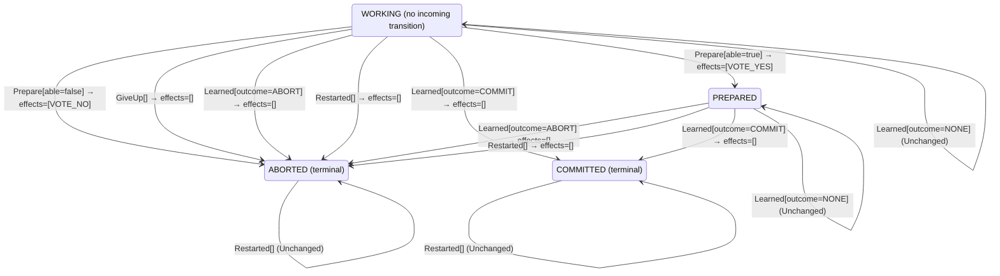

<!-- Generated by examples/tools/build.py from example.json and the verifier's output. Edit example.json. -->
# 093 · A restarted participant that releases its locks aborts what the coordinator committed

[← All examples](../README.md)

| Verdict | Categories | Severity if shipped | Change | Verified unit | Approach |
|---|---|---|---|---|---|
| **✗ Violation: Atomicity, 8-step trace (participant crashes)** | functional | critical | feature, behaviour change intended | [`Participant#decide`](../../examples/apps/quorum/src/main/java/net/terminalvalue/quorum/twopc/Participant.java) | [D1: Protocol model checking](../../examples/apps/quorum/spec/README.md) |

> A two-phase-commit participant that voted yes holds its locks until it hears the decision, through a crash and a restart: it cannot decide alone, which is the blocking property of the protocol. A developer has a restarted participant release its locks and abort, so that a crash does not leave the data locked while the coordinator is slow; the coordinator's timer, the comment says, covers the rest. The contract gains the row, the tests pass, and the model's first four configurations are as green as before, since no participant crashes in them. The sixth, in which they do, finds in eight steps a transaction the coordinator commits on three yes votes and a participant that voted yes, crashed in the same step, and restarts aborted. The inductive step with participant crashes refuses the restart too.

Tags: [distributed-transactions](../README.md#tag-distributed-transactions), [agreement](../README.md#tag-agreement), [crash-recovery](../README.md#tag-crash-recovery), [tla-fault-configuration](../README.md#tag-tla-fault-configuration), [generated-operator](../README.md#tag-generated-operator), [multiple-configurations](../README.md#tag-multiple-configurations)

## The change

In `Participant.decide`, the `Restarted` row for `PREPARED` changes from `unchanged` (hold the locks until the decision) to `transition(ABORTED)`, with the comment that a restart releases the locks and the coordinator's timer covers the rest. The kernel test that a restart holds a logged yes becomes one that a restart aborts whatever was logged, and the node test that a participant which crashed after logging its yes restarts prepared becomes one that it restarts aborted. `Coordinator.decide` and `Recovery.decide` are untouched.

**Before** ([`Participant.java`](../../examples/apps/quorum/src/main/java/net/terminalvalue/quorum/twopc/Participant.java), line 49):

```java
    };
    case Restarted _ -> switch (state) {
        case WORKING -> transition(ABORTED); // no vote went out: the coordinator will presume abort
        case PREPARED -> unchanged("holds its locks until the decision");
        case COMMITTED, ABORTED -> unchanged("already decided");
    };
};
```

**After:**

```java
    };
    case Restarted _ -> switch (state) {
        case WORKING -> transition(ABORTED); // no vote went out: the coordinator will presume abort
        case PREPARED -> transition(ABORTED); // a restart releases the locks; the coordinator's timer covers the rest
        case COMMITTED, ABORTED -> unchanged("already decided");
    };
};
```

<details><summary>Patch</summary>

```diff
--- a/examples/apps/quorum/src/main/java/net/terminalvalue/quorum/twopc/Participant.java
+++ b/examples/apps/quorum/src/main/java/net/terminalvalue/quorum/twopc/Participant.java
@@ -49,7 +49,7 @@
             };
             case Restarted _ -> switch (state) {
                 case WORKING -> transition(ABORTED); // no vote went out: the coordinator will presume abort
-                case PREPARED -> unchanged("holds its locks until the decision");
+                case PREPARED -> transition(ABORTED); // a restart releases the locks; the coordinator's timer covers the rest
                 case COMMITTED, ABORTED -> unchanged("already decided");
             };
         };
--- a/examples/apps/quorum/src/test/java/net/terminalvalue/quorum/twopc/ParticipantTest.java
+++ b/examples/apps/quorum/src/test/java/net/terminalvalue/quorum/twopc/ParticipantTest.java
@@ -41,8 +41,8 @@
                 Participant.decide(ParticipantState.COMMITTED, new Learned(Outcome.COMMIT)));
     }
 
-    public static void aRestartHoldsALoggedYesAndAbortsWithoutOne() {
-        equal(new Unchanged<>("holds its locks until the decision"),
+    public static void aRestartAbortsWhateverWasLogged() {
+        equal(new Transition<ParticipantState, ParticipantEffect>(ParticipantState.ABORTED, List.of()),
                 Participant.decide(ParticipantState.PREPARED, new Restarted()));
         equal(new Transition<ParticipantState, ParticipantEffect>(ParticipantState.ABORTED, List.of()),
                 Participant.decide(ParticipantState.WORKING, new Restarted()));
--- a/examples/apps/quorum/src/test/java/net/terminalvalue/quorum/twopc/NodesTest.java
+++ b/examples/apps/quorum/src/test/java/net/terminalvalue/quorum/twopc/NodesTest.java
@@ -83,7 +83,7 @@
         check(!p1.learn(), "nothing to learn without a decision");
     }
 
-    public static void aParticipantThatCrashesAfterLoggingItsYesLosesTheVoteAndRestartsPrepared() {
+    public static void aParticipantThatCrashesAfterLoggingItsYesLosesTheVoteAndRestartsAborted() {
         Network network = new Network(new Faults());
         Faults faults = new Faults("p1");
         ParticipantLog log = new ParticipantLog(faults);
@@ -100,7 +100,7 @@
         check(network.inFlight().isEmpty(), "the vote was lost with the crash");
         ParticipantNode restarted = new ParticipantNode("p1", log, network, faults);
         restarted.recover();
-        equal(ParticipantState.PREPARED, restarted.state()); // holds its locks until the coordinator decides
+        equal(ParticipantState.ABORTED, restarted.state()); // the locks are released
         check(network.inFlight().isEmpty(), "a restart sends nothing");
     }
 
```

</details>

## What the verifier found

The model is checked under 7 configurations, and the verdict is the first that fails:

| Configuration | What it checks | Model | Result |
|---|---|---|---|
| three participants (`spec/TwoPhaseCommit.cfg`) | every run from the initial state, every interleaving within the configuration's bounds | Participants = {p1, p2, p3}, MaxCrashes = 0, MaxParticipantCrashes = 0 | ✓ Verified: all invariants and properties hold in 728 states |
| the inductive step (`spec/TwoPhaseCommitInductive.cfg`) | that the invariant `Inductive` is inductive: TLC starts from every state the invariant admits, reachable or not, rather than from the initial state, takes one step, and checks the invariant again, conjunct by conjunct. No counterexample is a proof of atomicity by induction, for any run of the protocol however long; a counterexample is one step from a state that need not be reachable | Participants = {p1, p2, p3}, MaxCrashes = 0, MaxParticipantCrashes = 0 | ✓ Verified: all invariants hold in 736 states |
| crashes (`spec/TwoPhaseCommitCrash.cfg`) | every run from the initial state in which the coordinator may crash, twice at most: between steps, or after logging a phase change and before the broadcast goes out, and restart on the recovery rule, generated from `Recovery#decide`; the same invariants and temporal properties, under the added fairness condition that a crashed coordinator restarts | Participants = {p1, p2, p3}, MaxCrashes = 2, MaxParticipantCrashes = 0 | ✓ Verified: all invariants and properties hold in 3,448 states |
| the inductive step with crashes (`spec/TwoPhaseCommitCrashInductive.cfg`) | that the invariant `Inductive` is closed under a crash and a restart as well: TLC starts from every state the invariant admits, the coordinator up or down, takes one step, and checks the invariant again | Participants = {p1, p2, p3}, MaxCrashes = 1, MaxParticipantCrashes = 0 | ✓ Verified: all invariants hold in 2,728 states |
| participant crashes (`spec/TwoPhaseCommitParticipantCrash.cfg`) | every run from the initial state in which a participant may crash, once, between steps or after logging a vote and before sending it, and restart on the participant's rule, generated from `Participant#decide`, while the coordinator may crash once as well; the same invariants and temporal properties, under the added fairness condition that a crashed participant restarts | Participants = {p1, p2, p3}, MaxCrashes = 1, MaxParticipantCrashes = 1 | ✗ Violation: Atomicity, 8-step trace |
| the inductive step with participant crashes (`spec/TwoPhaseCommitParticipantCrashInductive.cfg`) | that the invariant `Inductive` is closed under a participant's crash and restart as well: TLC starts from every state the invariant admits, each process up or down, takes one step, and checks the invariant again | Participants = {p1, p2, p3}, MaxCrashes = 1, MaxParticipantCrashes = 1 | ✗ Violation: ParticipantsAgreeWithTheirVotes, 2-step trace |
| the recorded runs (`spec/TwoPhaseCommitTrace.cfg`) | the Java nodes against the model: the coordinator node, its log and its broadcast, and the participant nodes, their logs and their votes, run through eleven scripted scenarios with crashes of either process injected after a given I/O operation, the state after each step recorded in the model's variables (`TwoPhaseCommitTraces.tla`, regenerated from the patched classes); TLC walks each recorded run and checks that it starts in the model's initial state and that every step is a step of the model's next-state relation. A step the model has no action for is one the glue took that the model's verdicts do not cover | Participants = {"p1", "p2", "p3"}, MaxCrashes = 2, MaxParticipantCrashes = 2 | ✓ Verified: all invariants and properties hold in 103 states |

TLC found a run of the system under participant crashes, 8 steps long, that violates the invariant **Atomicity** (once the coordinator or any participant has committed, no participant has aborted). Each step is one action of one part of the system:

1. **Initial state**: every participant working, no vote counted, no decision, every process up.
2. **Vote**, `Participant.prepare`: a participant votes yes (and holds its locks) or no (and aborts), as its rule decides; it logs the state before it sends the vote, and a crash can fall between the two. `inbox = {[from |-> p1, vote |-> "YES"]}`, `pstate = (p1 :> "PREPARED" @@ p2 :> "WORKING" @@ p3 :> "WORKING")`
3. **Vote**, `Participant.prepare`: a participant votes yes (and holds its locks) or no (and aborts), as its rule decides; it logs the state before it sends the vote, and a crash can fall between the two. `inbox = {[from |-> p1, vote |-> "YES"], [from |-> p2, vote |-> "YES"]}`, `pstate = (p1 :> "PREPARED" @@ p2 :> "PREPARED" @@ p3 :> "WORKING")`
4. **Vote**, `Participant.prepare`: a participant votes yes (and holds its locks) or no (and aborts), as its rule decides; it logs the state before it sends the vote, and a crash can fall between the two. `inbox = { [from |-> p1, vote |-> "YES"], [from |-> p2, vote |-> "YES"], [from |-> p3, vote |-> "YES"] }`, `pcrashes = 1`, `pstate = (p1 :> "PREPARED" @@ p2 :> "PREPARED" @@ p3 :> "PREPARED")`, `pup = (p1 :> TRUE @@ p2 :> TRUE @@ p3 :> FALSE)`
5. **ReceiveVote**, `Coordinator.onVote`: the coordinator counts a vote and decides on the tally. `inbox = {[from |-> p2, vote |-> "YES"], [from |-> p3, vote |-> "YES"]}`, `votes = (p1 :> "YES" @@ p2 :> "NONE" @@ p3 :> "NONE")`
6. **ReceiveVote**, `Coordinator.onVote`: the coordinator counts a vote and decides on the tally. `inbox = {[from |-> p3, vote |-> "YES"]}`, `votes = (p1 :> "YES" @@ p2 :> "YES" @@ p3 :> "NONE")`
7. **ReceiveVote**, `Coordinator.onVote`: the coordinator counts a vote and decides on the tally. `decision = "COMMIT"`, `inbox = {}`, `phase = "COMMITTED"`, `votes = (p1 :> "YES" @@ p2 :> "YES" @@ p3 :> "YES")`
8. **ParticipantRecover**, `Participant.recover`: a participant restarts with the state it logged and acts on its rule's decision: on the committed rule, a prepared one holds its locks and waits, one that had not voted aborts. `pstate = (p1 :> "PREPARED" @@ p2 :> "PREPARED" @@ p3 :> "ABORTED")`, `pup = (p1 :> TRUE @@ p2 :> TRUE @@ p3 :> TRUE)`

The model is small (Participants = {p1, p2, p3}, MaxCrashes = 1, MaxParticipantCrashes = 1), which is what keeps the trace readable. TLC explored every interleaving of the participants, the coordinator and the votes in flight within those bounds.

<details><summary>The counterexample under the inductive step with participant crashes: invariant <b>ParticipantsAgreeWithTheirVotes</b>, 2 steps</summary>

Invariant **ParticipantsAgreeWithTheirVotes**: a working participant has not voted, a prepared one voted yes unless a crash took the vote after the state was logged, a no voter has aborted, and a yes voter that aborted did so on the coordinator's say-so.

1. **Starting state**, a state the invariant `Inductive` admits, each process up or down, which need not be reachable: `crashes = 0`, `decision = "NONE"`, `inbox = {[from |-> p3, vote |-> "YES"]}`, `pcrashes = 1`, `phase = "COLLECTING"`, `pstate = (p1 :> "ABORTED" @@ p2 :> "ABORTED" @@ p3 :> "PREPARED")`, `pup = (p1 :> TRUE @@ p2 :> TRUE @@ p3 :> FALSE)`, `up = TRUE`, `votes = (p1 :> "NONE" @@ p2 :> "NONE" @@ p3 :> "NONE")`
2. **ParticipantRecover**, `Participant.recover`: a participant restarts with the state it logged and acts on its rule's decision: on the committed rule, a prepared one holds its locks and waits, one that had not voted aborts. `pstate = (p1 :> "ABORTED" @@ p2 :> "ABORTED" @@ p3 :> "ABORTED")`, `pup = (p1 :> TRUE @@ p2 :> TRUE @@ p3 :> TRUE)`

</details>

**What the verdict rests on.** TLC counted how often a step of the model took each row of the generated operators. A row no step takes is one the model says nothing about, whatever the verdict.

| Configuration | Rows of `Coordinator#decide` taken | Rows of `Recovery#decide` taken | Rows of `Participant#decide` taken |
|---|---|---|---|
| three participants | 10 of 18 | 0 of 3 | 6 of 28 |
| the inductive step (from the states the invariant admits, not from a run) | 10 of 18 | 0 of 3 | 6 of 28 |
| crashes | 10 of 18 | 3 of 3 | 6 of 28 |
| the inductive step with crashes (from the states the invariant admits, not from a run) | 10 of 18 | 3 of 3 | 6 of 28 |
| participant crashes | stopped at the counterexample | stopped at the counterexample | stopped at the counterexample |
| the inductive step with participant crashes (from the states the invariant admits, not from a run) | stopped at the counterexample | stopped at the counterexample | stopped at the counterexample |

The change alters 1 row of the contract:

- `decide(PREPARED, Restarted[])`: `Unchanged[reason="holds its locks until the decision"]` → `Transition[next=ABORTED, effects=[]]`, taken by no run that finished

The run under participant crashes, the inductive step with participant crashes stopped at its counterexample, the steps above, and its counts are left out: the verdict rests on the counterexample.

<details><summary>Rows no step takes under three participants</summary>

`net.terminalvalue.quorum.twopc.Coordinator#decide`:

```
decide(COMMITTED, Tally[complete=false, unanimous=false]) => Unchanged
decide(COMMITTED, Tally[complete=false, unanimous=true]) => Unchanged
decide(COMMITTED, Tally[complete=true, unanimous=false]) => Unchanged
decide(COMMITTED, Tally[complete=true, unanimous=true]) => Unchanged
decide(COMMITTED, Timeout[unanimousSoFar=false]) => Unchanged
decide(COMMITTED, Timeout[unanimousSoFar=true]) => Unchanged
decide(ABORTED, Timeout[unanimousSoFar=false]) => Unchanged
decide(ABORTED, Timeout[unanimousSoFar=true]) => Unchanged
```

`net.terminalvalue.quorum.twopc.Recovery#decide`:

```
decide(COLLECTING, Restarted[]) => Transition[next=ABORTED, effects=[SEND_ABORT]]
decide(COMMITTED, Restarted[]) => Transition[next=COMMITTED, effects=[SEND_COMMIT]]
decide(ABORTED, Restarted[]) => Transition[next=ABORTED, effects=[SEND_ABORT]]
```

`net.terminalvalue.quorum.twopc.Participant#decide`:

```
decide(WORKING, Learned[outcome=NONE]) => Unchanged
decide(WORKING, Learned[outcome=COMMIT]) => Transition[next=COMMITTED, effects=[]]
decide(WORKING, Restarted[]) => Transition[next=ABORTED, effects=[]]
decide(PREPARED, Prepare[able=false]) => Rejected
decide(PREPARED, Prepare[able=true]) => Rejected
decide(PREPARED, GiveUp[]) => Rejected
decide(PREPARED, Learned[outcome=NONE]) => Unchanged
decide(PREPARED, Restarted[]) => Transition[next=ABORTED, effects=[]]
decide(COMMITTED, Prepare[able=false]) => Rejected
decide(COMMITTED, Prepare[able=true]) => Rejected
decide(COMMITTED, GiveUp[]) => Rejected
decide(COMMITTED, Learned[outcome=NONE]) => Unchanged
decide(COMMITTED, Learned[outcome=COMMIT]) => Unchanged
decide(COMMITTED, Learned[outcome=ABORT]) => Unchanged
decide(COMMITTED, Restarted[]) => Unchanged
decide(ABORTED, Prepare[able=false]) => Rejected
decide(ABORTED, Prepare[able=true]) => Rejected
decide(ABORTED, GiveUp[]) => Rejected
decide(ABORTED, Learned[outcome=NONE]) => Unchanged
decide(ABORTED, Learned[outcome=COMMIT]) => Unchanged
decide(ABORTED, Learned[outcome=ABORT]) => Unchanged
decide(ABORTED, Restarted[]) => Unchanged
```

</details>

The state machine the patched code implements, drawn from its derived contract (`jvmcontract statemachine`); a state with no way in or no way out is marked:



## Would the existing tests have caught it?

No: every existing unit test passes (`java -ea net.terminalvalue.quorum.Tests`, run against the patched code).

## Why it matters

High. The row reads as a robustness improvement: a participant that comes back from a crash should not sit on its locks while the coordinator makes up its mind, and every other restart in the module aborts. The protocol's answer, that a participant which voted yes has given up the right to decide, is a line in the textbook and not in the code; the glue, the tests and the contract diff all show a restart that aborts, and the contract diff is one row.

## Why the verdict is right

The participant's rule in the model is generated from the regenerated contract, so `ParticipantRecover` does what the patched row says. The sixth configuration, `TwoPhaseCommitParticipantCrash.cfg`, lets a participant crash once and the coordinator once, and TLC reports `Atomicity` violated after eight steps: the three participants vote yes, the third crashing right after its vote went out, so that `pup[p3]` is `FALSE` with the yes in the inbox; the coordinator counts the three votes and commits, since every vote is yes, with `decision = "COMMIT"` out; and the third participant restarts, reads `PREPARED` from its log, and aborts on the new row, with the coordinator's phase `COMMITTED` and the other two about to commit when they read the broadcast. The transaction ends committed on two participants and aborted on one, which is what atomicity forbids and what the yes vote promised: a prepared participant waits. The timer the comment relies on is the coordinator's, and it fires only while votes are missing; here none is. The seventh configuration, the inductive step with participant crashes, refuses the restart on its own, from an admitted state in which a prepared participant is down while the coordinator is still collecting: `ParticipantsAgreeWithTheirVotes` says a yes voter that aborted did so on the coordinator's say-so, and this one did not. The first four configurations keep their 728, 736, 3,448 and 2,728 states, since no participant crashes in them, and the recorded runs are regenerated from the patched classes and are all steps of the patched model: the trace check holds the nodes to the rule, not the rule to the protocol.

## What to do

Reject. A prepared participant holds its locks through a restart and waits for the decision; that wait is the blocking property of two-phase commit (Skeen, 1981), the price of a protocol with one coordinator, and what the developer wants is a different protocol: three-phase commit, or a replicated coordinator such as Lamport and Gray's Paxos commit. The sixth and seventh configurations check this row on every build.

## Notes

- The two-phase-commit model (`apps/quorum/spec/TwoPhaseCommit.tla`) is built like Box Office's: the coordinator's state machine is generated from its B8 contract. An example of this model is checked under every configuration the model lists, and its verdict is the first that fails.
- Two configurations let the participants crash, between steps or between logging a vote and sending it, and restart on the participant's rule, a third generated operator (`Participant#decide`).
- Releasing locks on restart breaks the blocking property of two-phase commit: the participant aborts what the coordinator committed on its yes vote.

## Evidence

How the verdict was reached: three participants: TLC 2.19 explored 728 distinct states to depth 11 in 1 s, for the model Participants = {p1, p2, p3}, MaxCrashes = 0, MaxParticipantCrashes = 0; the inductive step: TLC 2.19 explored 736 distinct states to depth 1 in 1 s, for the model Participants = {p1, p2, p3}, MaxCrashes = 0, MaxParticipantCrashes = 0; crashes: TLC 2.19 explored 3,448 distinct states to depth 12 in 3 s, for the model Participants = {p1, p2, p3}, MaxCrashes = 2, MaxParticipantCrashes = 0; the inductive step with crashes: TLC 2.19 explored 2,728 distinct states to depth 1 in 1 s, for the model Participants = {p1, p2, p3}, MaxCrashes = 1, MaxParticipantCrashes = 0; participant crashes: TLC 2.19 explored 10,061 distinct states to depth 8 in 7 s, for the model Participants = {p1, p2, p3}, MaxCrashes = 1, MaxParticipantCrashes = 1; the inductive step with participant crashes: TLC 2.19 explored 18,637 distinct states to depth 2 in 1 s, for the model Participants = {p1, p2, p3}, MaxCrashes = 1, MaxParticipantCrashes = 1; the recorded runs: TLC 2.19 explored 103 distinct states to depth 12 in 0 s, for the model Participants = {"p1", "p2", "p3"}, MaxCrashes = 2, MaxParticipantCrashes = 2.

<details><summary>Verifier output</summary>

```text
== three participants: spec/TwoPhaseCommit.cfg ==
TLC2 Version 2.19 of 08 August 2024 (rev: 5a47802)
Running breadth-first search Model-Checking with fp 1 and seed 1 with 1 worker on 2 cores with 2185MB heap and 64MB offheap memory [pid: 1120084] (Linux 6.6.87.2-microsoft-standard-WSL2 aarch64, Eclipse Adoptium 25.0.4.1 x86_64, MSBDiskFPSet, DiskStateQueue).
Parsing file examples/apps/quorum/spec/TwoPhaseCommit.tla
Parsing file examples/tools/tla/standard-modules/Naturals.tla
Parsing file examples/tools/tla/standard-modules/Sequences.tla
Parsing file examples/tools/tla/standard-modules/FiniteSets.tla
Parsing file examples/apps/quorum/spec/CoordinatorContract.tla
Parsing file examples/apps/quorum/spec/RecoveryContract.tla
Parsing file examples/apps/quorum/spec/ParticipantContract.tla
Parsing file examples/apps/quorum/spec/TCommit.tla
Semantic processing of module Naturals
Semantic processing of module Sequences
Semantic processing of module FiniteSets
Semantic processing of module CoordinatorContract
Semantic processing of module RecoveryContract
Semantic processing of module ParticipantContract
Semantic processing of module TCommit
Semantic processing of module TwoPhaseCommit
Starting... (2026-11-04 00:01:40)
Implied-temporal checking--satisfiability problem has 3 branches.
Computing initial states...
Finished computing initial states: 1 distinct state generated at 2026-11-04 00:01:40.
Checking 3 branches of temporal properties for the complete state space with 2184 total distinct states at (2026-11-04 00:01:41)
Finished checking temporal properties in 00s at 2026-11-04 00:01:41
Model checking completed. No error has been found.
  Estimates of the probability that TLC did not check all reachable states
  because two distinct states had the same fingerprint:
  calculated (optimistic):  val = 6.9E-14
Rows of net.terminalvalue.quorum.twopc.Coordinator#decide a step of the model takes: 10 of 18; never taken (8):
  decide(COMMITTED, Tally[complete=false, unanimous=false]) => Unchanged
  decide(COMMITTED, Tally[complete=false, unanimous=true]) => Unchanged
  decide(COMMITTED, Tally[complete=true, unanimous=false]) => Unchanged
  decide(COMMITTED, Tally[complete=true, unanimous=true]) => Unchanged
  decide(COMMITTED, Timeout[unanimousSoFar=false]) => Unchanged
  decide(COMMITTED, Timeout[unanimousSoFar=true]) => Unchanged
  decide(ABORTED, Timeout[unanimousSoFar=false]) => Unchanged
  decide(ABORTED, Timeout[unanimousSoFar=true]) => Unchanged
Rows of net.terminalvalue.quorum.twopc.Recovery#decide a step of the model takes: 0 of 3; never taken (3):
  decide(COLLECTING, Restarted[]) => Transition[next=ABORTED, effects=[SEND_ABORT]]
  decide(COMMITTED, Restarted[]) => Transition[next=COMMITTED, effects=[SEND_COMMIT]]
  decide(ABORTED, Restarted[]) => Transition[next=ABORTED, effects=[SEND_ABORT]]
Rows of net.terminalvalue.quorum.twopc.Participant#decide a step of the model takes: 6 of 28; never taken (22):
  decide(WORKING, Learned[outcome=NONE]) => Unchanged
  decide(WORKING, Learned[outcome=COMMIT]) => Transition[next=COMMITTED, effects=[]]
  decide(WORKING, Restarted[]) => Transition[next=ABORTED, effects=[]]
  decide(PREPARED, Prepare[able=false]) => Rejected
  decide(PREPARED, Prepare[able=true]) => Rejected
  decide(PREPARED, GiveUp[]) => Rejected
  decide(PREPARED, Learned[outcome=NONE]) => Unchanged
  decide(PREPARED, Restarted[]) => Transition[next=ABORTED, effects=[]]
  decide(COMMITTED, Prepare[able=false]) => Rejected
  decide(COMMITTED, Prepare[able=true]) => Rejected
  decide(COMMITTED, GiveUp[]) => Rejected
  decide(COMMITTED, Learned[outcome=NONE]) => Unchanged
  decide(COMMITTED, Learned[outcome=COMMIT]) => Unchanged
  decide(COMMITTED, Learned[outcome=ABORT]) => Unchanged
  decide(COMMITTED, Restarted[]) => Unchanged
  decide(ABORTED, Prepare[able=false]) => Rejected
  decide(ABORTED, Prepare[able=true]) => Rejected
  decide(ABORTED, GiveUp[]) => Rejected
  decide(ABORTED, Learned[outcome=NONE]) => Unchanged
  decide(ABORTED, Learned[outcome=COMMIT]) => Unchanged
  decide(ABORTED, Learned[outcome=ABORT]) => Unchanged
  decide(ABORTED, Restarted[]) => Unchanged
2489 states generated, 728 distinct states found, 0 states left on queue.
The depth of the complete state graph search is 11.
The average outdegree of the complete state graph is 1 (minimum is 0, the maximum 10 and the 95th percentile is 3).
Finished in 01s at (2026-11-04 00:01:41)

== the inductive step: spec/TwoPhaseCommitInductive.cfg ==
TLC2 Version 2.19 of 08 August 2024 (rev: 5a47802)
Running breadth-first search Model-Checking with fp 1 and seed 1 with 1 worker on 2 cores with 2185MB heap and 64MB offheap memory [pid: 1120211] (Linux 6.6.87.2-microsoft-standard-WSL2 aarch64, Eclipse Adoptium 25.0.4.1 x86_64, MSBDiskFPSet, DiskStateQueue).
Parsing file examples/apps/quorum/spec/TwoPhaseCommit.tla
Parsing file examples/tools/tla/standard-modules/Naturals.tla
Parsing file examples/tools/tla/standard-modules/Sequences.tla
Parsing file examples/tools/tla/standard-modules/FiniteSets.tla
Parsing file examples/apps/quorum/spec/CoordinatorContract.tla
Parsing file examples/apps/quorum/spec/RecoveryContract.tla
Parsing file examples/apps/quorum/spec/ParticipantContract.tla
Parsing file examples/apps/quorum/spec/TCommit.tla
Semantic processing of module Naturals
Semantic processing of module Sequences
Semantic processing of module FiniteSets
Semantic processing of module CoordinatorContract
Semantic processing of module RecoveryContract
Semantic processing of module ParticipantContract
Semantic processing of module TCommit
Semantic processing of module TwoPhaseCommit
Starting... (2026-11-04 00:01:42)
Computing initial states...
Computed 2 initial states...
Computed 4 initial states...
Computed 8 initial states...
Computed 16 initial states...
Computed 32 initial states...
Computed 64 initial states...
Computed 128 initial states...
Computed 256 initial states...
Computed 512 initial states...
Finished computing initial states: 736 distinct states generated at 2026-11-04 00:01:43.
Model checking completed. No error has been found.
  Estimates of the probability that TLC did not check all reachable states
  because two distinct states had the same fingerprint:
  calculated (optimistic):  val = 9.9E-14
Rows of net.terminalvalue.quorum.twopc.Coordinator#decide a step of the model takes: 10 of 18; never taken (8):
  decide(COMMITTED, Tally[complete=false, unanimous=false]) => Unchanged
  decide(COMMITTED, Tally[complete=false, unanimous=true]) => Unchanged
  decide(COMMITTED, Tally[complete=true, unanimous=false]) => Unchanged
  decide(COMMITTED, Tally[complete=true, unanimous=true]) => Unchanged
  decide(COMMITTED, Timeout[unanimousSoFar=false]) => Unchanged
  decide(COMMITTED, Timeout[unanimousSoFar=true]) => Unchanged
  decide(ABORTED, Timeout[unanimousSoFar=false]) => Unchanged
  decide(ABORTED, Timeout[unanimousSoFar=true]) => Unchanged
Rows of net.terminalvalue.quorum.twopc.Recovery#decide a step of the model takes: 0 of 3; never taken (3):
  decide(COLLECTING, Restarted[]) => Transition[next=ABORTED, effects=[SEND_ABORT]]
  decide(COMMITTED, Restarted[]) => Transition[next=COMMITTED, effects=[SEND_COMMIT]]
  decide(ABORTED, Restarted[]) => Transition[next=ABORTED, effects=[SEND_ABORT]]
Rows of net.terminalvalue.quorum.twopc.Participant#decide a step of the model takes: 6 of 28; never taken (22):
  decide(WORKING, Learned[outcome=NONE]) => Unchanged
  decide(WORKING, Learned[outcome=COMMIT]) => Transition[next=COMMITTED, effects=[]]
  decide(WORKING, Restarted[]) => Transition[next=ABORTED, effects=[]]
  decide(PREPARED, Prepare[able=false]) => Rejected
  decide(PREPARED, Prepare[able=true]) => Rejected
  decide(PREPARED, GiveUp[]) => Rejected
  decide(PREPARED, Learned[outcome=NONE]) => Unchanged
  decide(PREPARED, Restarted[]) => Transition[next=ABORTED, effects=[]]
  decide(COMMITTED, Prepare[able=false]) => Rejected
  decide(COMMITTED, Prepare[able=true]) => Rejected
  decide(COMMITTED, GiveUp[]) => Rejected
  decide(COMMITTED, Learned[outcome=NONE]) => Unchanged
  decide(COMMITTED, Learned[outcome=COMMIT]) => Unchanged
  decide(COMMITTED, Learned[outcome=ABORT]) => Unchanged
  decide(COMMITTED, Restarted[]) => Unchanged
  decide(ABORTED, Prepare[able=false]) => Rejected
  decide(ABORTED, Prepare[able=true]) => Rejected
  decide(ABORTED, GiveUp[]) => Rejected
  decide(ABORTED, Learned[outcome=NONE]) => Unchanged
  decide(ABORTED, Learned[outcome=COMMIT]) => Unchanged
  decide(ABORTED, Learned[outcome=ABORT]) => Unchanged
  decide(ABORTED, Restarted[]) => Unchanged
3224 states generated, 736 distinct states found, 0 states left on queue.
The depth of the complete state graph search is 1.
The average outdegree of the complete state graph is 0 (minimum is 0, the maximum 0 and the 95th percentile is 0).
Finished in 01s at (2026-11-04 00:01:43)

== crashes: spec/TwoPhaseCommitCrash.cfg ==
TLC2 Version 2.19 of 08 August 2024 (rev: 5a47802)
Running breadth-first search Model-Checking with fp 1 and seed 1 with 1 worker on 2 cores with 2185MB heap and 64MB offheap memory [pid: 1120284] (Linux 6.6.87.2-microsoft-standard-WSL2 aarch64, Eclipse Adoptium 25.0.4.1 x86_64, MSBDiskFPSet, DiskStateQueue).
Parsing file examples/apps/quorum/spec/TwoPhaseCommit.tla
Parsing file examples/tools/tla/standard-modules/Naturals.tla
Parsing file examples/tools/tla/standard-modules/Sequences.tla
Parsing file examples/tools/tla/standard-modules/FiniteSets.tla
Parsing file examples/apps/quorum/spec/CoordinatorContract.tla
Parsing file examples/apps/quorum/spec/RecoveryContract.tla
Parsing file examples/apps/quorum/spec/ParticipantContract.tla
Parsing file examples/apps/quorum/spec/TCommit.tla
Semantic processing of module Naturals
Semantic processing of module Sequences
Semantic processing of module FiniteSets
Semantic processing of module CoordinatorContract
Semantic processing of module RecoveryContract
Semantic processing of module ParticipantContract
Semantic processing of module TCommit
Semantic processing of module TwoPhaseCommit
Starting... (2026-11-04 00:01:44)
Implied-temporal checking--satisfiability problem has 3 branches.
Computing initial states...
Finished computing initial states: 1 distinct state generated at 2026-11-04 00:01:44.
Checking 3 branches of temporal properties for the complete state space with 10344 total distinct states at (2026-11-04 00:01:47)
Finished checking temporal properties in 00s at 2026-11-04 00:01:47
Model checking completed. No error has been found.
  Estimates of the probability that TLC did not check all reachable states
  because two distinct states had the same fingerprint:
  calculated (optimistic):  val = 2.1E-12
Rows of net.terminalvalue.quorum.twopc.Coordinator#decide a step of the model takes: 10 of 18; never taken (8):
  decide(COMMITTED, Tally[complete=false, unanimous=false]) => Unchanged
  decide(COMMITTED, Tally[complete=false, unanimous=true]) => Unchanged
  decide(COMMITTED, Tally[complete=true, unanimous=false]) => Unchanged
  decide(COMMITTED, Tally[complete=true, unanimous=true]) => Unchanged
  decide(COMMITTED, Timeout[unanimousSoFar=false]) => Unchanged
  decide(COMMITTED, Timeout[unanimousSoFar=true]) => Unchanged
  decide(ABORTED, Timeout[unanimousSoFar=false]) => Unchanged
  decide(ABORTED, Timeout[unanimousSoFar=true]) => Unchanged
Rows of net.terminalvalue.quorum.twopc.Recovery#decide a step of the model takes: 3 of 3.
Rows of net.terminalvalue.quorum.twopc.Participant#decide a step of the model takes: 6 of 28; never taken (22):
  decide(WORKING, Learned[outcome=NONE]) => Unchanged
  decide(WORKING, Learned[outcome=COMMIT]) => Transition[next=COMMITTED, effects=[]]
  decide(WORKING, Restarted[]) => Transition[next=ABORTED, effects=[]]
  decide(PREPARED, Prepare[able=false]) => Rejected
  decide(PREPARED, Prepare[able=true]) => Rejected
  decide(PREPARED, GiveUp[]) => Rejected
  decide(PREPARED, Learned[outcome=NONE]) => Unchanged
  decide(PREPARED, Restarted[]) => Transition[next=ABORTED, effects=[]]
  decide(COMMITTED, Prepare[able=false]) => Rejected
  decide(COMMITTED, Prepare[able=true]) => Rejected
  decide(COMMITTED, GiveUp[]) => Rejected
  decide(COMMITTED, Learned[outcome=NONE]) => Unchanged
  decide(COMMITTED, Learned[outcome=COMMIT]) => Unchanged
  decide(COMMITTED, Learned[outcome=ABORT]) => Unchanged
  decide(COMMITTED, Restarted[]) => Unchanged
  decide(ABORTED, Prepare[able=false]) => Rejected
  decide(ABORTED, Prepare[able=true]) => Rejected
  decide(ABORTED, GiveUp[]) => Rejected
  decide(ABORTED, Learned[outcome=NONE]) => Unchanged
  decide(ABORTED, Learned[outcome=COMMIT]) => Unchanged
  decide(ABORTED, Learned[outcome=ABORT]) => Unchanged
  decide(ABORTED, Restarted[]) => Unchanged
14717 states generated, 3448 distinct states found, 0 states left on queue.
The depth of the complete state graph search is 12.
The average outdegree of the complete state graph is 1 (minimum is 0, the maximum 12 and the 95th percentile is 4).
Finished in 03s at (2026-11-04 00:01:47)

== the inductive step with crashes: spec/TwoPhaseCommitCrashInductive.cfg ==
TLC2 Version 2.19 of 08 August 2024 (rev: 5a47802)
Running breadth-first search Model-Checking with fp 1 and seed 1 with 1 worker on 2 cores with 2185MB heap and 64MB offheap memory [pid: 1120516] (Linux 6.6.87.2-microsoft-standard-WSL2 aarch64, Eclipse Adoptium 25.0.4.1 x86_64, MSBDiskFPSet, DiskStateQueue).
Parsing file examples/apps/quorum/spec/TwoPhaseCommit.tla
Parsing file examples/tools/tla/standard-modules/Naturals.tla
Parsing file examples/tools/tla/standard-modules/Sequences.tla
Parsing file examples/tools/tla/standard-modules/FiniteSets.tla
Parsing file examples/apps/quorum/spec/CoordinatorContract.tla
Parsing file examples/apps/quorum/spec/RecoveryContract.tla
Parsing file examples/apps/quorum/spec/ParticipantContract.tla
Parsing file examples/apps/quorum/spec/TCommit.tla
Semantic processing of module Naturals
Semantic processing of module Sequences
Semantic processing of module FiniteSets
Semantic processing of module CoordinatorContract
Semantic processing of module RecoveryContract
Semantic processing of module ParticipantContract
Semantic processing of module TCommit
Semantic processing of module TwoPhaseCommit
Starting... (2026-11-04 00:01:47)
Computing initial states...
Computed 2 initial states...
Computed 4 initial states...
Computed 8 initial states...
Computed 16 initial states...
Computed 32 initial states...
Computed 64 initial states...
Computed 128 initial states...
Computed 256 initial states...
Computed 512 initial states...
Computed 1024 initial states...
Computed 2048 initial states...
Finished computing initial states: 2728 distinct states generated at 2026-11-04 00:01:48.
Model checking completed. No error has been found.
  Estimates of the probability that TLC did not check all reachable states
  because two distinct states had the same fingerprint:
  calculated (optimistic):  val = 1.5E-12
Rows of net.terminalvalue.quorum.twopc.Coordinator#decide a step of the model takes: 10 of 18; never taken (8):
  decide(COMMITTED, Tally[complete=false, unanimous=false]) => Unchanged
  decide(COMMITTED, Tally[complete=false, unanimous=true]) => Unchanged
  decide(COMMITTED, Tally[complete=true, unanimous=false]) => Unchanged
  decide(COMMITTED, Tally[complete=true, unanimous=true]) => Unchanged
  decide(COMMITTED, Timeout[unanimousSoFar=false]) => Unchanged
  decide(COMMITTED, Timeout[unanimousSoFar=true]) => Unchanged
  decide(ABORTED, Timeout[unanimousSoFar=false]) => Unchanged
  decide(ABORTED, Timeout[unanimousSoFar=true]) => Unchanged
Rows of net.terminalvalue.quorum.twopc.Recovery#decide a step of the model takes: 3 of 3.
Rows of net.terminalvalue.quorum.twopc.Participant#decide a step of the model takes: 6 of 28; never taken (22):
  decide(WORKING, Learned[outcome=NONE]) => Unchanged
  decide(WORKING, Learned[outcome=COMMIT]) => Transition[next=COMMITTED, effects=[]]
  decide(WORKING, Restarted[]) => Transition[next=ABORTED, effects=[]]
  decide(PREPARED, Prepare[able=false]) => Rejected
  decide(PREPARED, Prepare[able=true]) => Rejected
  decide(PREPARED, GiveUp[]) => Rejected
  decide(PREPARED, Learned[outcome=NONE]) => Unchanged
  decide(PREPARED, Restarted[]) => Transition[next=ABORTED, effects=[]]
  decide(COMMITTED, Prepare[able=false]) => Rejected
  decide(COMMITTED, Prepare[able=true]) => Rejected
  decide(COMMITTED, GiveUp[]) => Rejected
  decide(COMMITTED, Learned[outcome=NONE]) => Unchanged
  decide(COMMITTED, Learned[outcome=COMMIT]) => Unchanged
  decide(COMMITTED, Learned[outcome=ABORT]) => Unchanged
  decide(COMMITTED, Restarted[]) => Unchanged
  decide(ABORTED, Prepare[able=false]) => Rejected
  decide(ABORTED, Prepare[able=true]) => Rejected
  decide(ABORTED, GiveUp[]) => Rejected
  decide(ABORTED, Learned[outcome=NONE]) => Unchanged
  decide(ABORTED, Learned[outcome=COMMIT]) => Unchanged
  decide(ABORTED, Learned[outcome=ABORT]) => Unchanged
  decide(ABORTED, Restarted[]) => Unchanged
12760 states generated, 2728 distinct states found, 0 states left on queue.
The depth of the complete state graph search is 1.
The average outdegree of the complete state graph is 0 (minimum is 0, the maximum 0 and the 95th percentile is 0).
Finished in 01s at (2026-11-04 00:01:48)

== participant crashes: spec/TwoPhaseCommitParticipantCrash.cfg ==
TLC2 Version 2.19 of 08 August 2024 (rev: 5a47802)
Running breadth-first search Model-Checking with fp 1 and seed 1 with 1 worker on 2 cores with 2185MB heap and 64MB offheap memory [pid: 1120590] (Linux 6.6.87.2-microsoft-standard-WSL2 aarch64, Eclipse Adoptium 25.0.4.1 x86_64, MSBDiskFPSet, DiskStateQueue).
Parsing file examples/apps/quorum/spec/TwoPhaseCommit.tla
Parsing file examples/tools/tla/standard-modules/Naturals.tla
Parsing file examples/tools/tla/standard-modules/Sequences.tla
Parsing file examples/tools/tla/standard-modules/FiniteSets.tla
Parsing file examples/apps/quorum/spec/CoordinatorContract.tla
Parsing file examples/apps/quorum/spec/RecoveryContract.tla
Parsing file examples/apps/quorum/spec/ParticipantContract.tla
Parsing file examples/apps/quorum/spec/TCommit.tla
Semantic processing of module Naturals
Semantic processing of module Sequences
Semantic processing of module FiniteSets
Semantic processing of module CoordinatorContract
Semantic processing of module RecoveryContract
Semantic processing of module ParticipantContract
Semantic processing of module TCommit
Semantic processing of module TwoPhaseCommit
Starting... (2026-11-04 00:01:49)
Implied-temporal checking--satisfiability problem has 3 branches.
Computing initial states...
Finished computing initial states: 1 distinct state generated at 2026-11-04 00:01:49.
Checking 3 branches of temporal properties for the current state space with 10426 total distinct states at (2026-11-04 00:01:52)
Finished checking temporal properties in 00s at 2026-11-04 00:01:52
Error: Invariant Atomicity is violated.
Error: The behavior up to this point is:
State 1: <Initial predicate>
/\ phase = "COLLECTING"
/\ pcrashes = 0
/\ decision = "NONE"
/\ pstate = (p1 :> "WORKING" @@ p2 :> "WORKING" @@ p3 :> "WORKING")
/\ crashes = 0
/\ votes = (p1 :> "NONE" @@ p2 :> "NONE" @@ p3 :> "NONE")
/\ up = TRUE
/\ pup = (p1 :> TRUE @@ p2 :> TRUE @@ p3 :> TRUE)
/\ inbox = {}

State 2: <Vote line 98, col 5 to line 99, col 111 of module TwoPhaseCommit>
/\ phase = "COLLECTING"
/\ pcrashes = 0
/\ decision = "NONE"
/\ pstate = (p1 :> "PREPARED" @@ p2 :> "WORKING" @@ p3 :> "WORKING")
/\ crashes = 0
/\ votes = (p1 :> "NONE" @@ p2 :> "NONE" @@ p3 :> "NONE")
/\ up = TRUE
/\ pup = (p1 :> TRUE @@ p2 :> TRUE @@ p3 :> TRUE)
/\ inbox = {[from |-> p1, vote |-> "YES"]}

State 3: <Vote line 98, col 5 to line 99, col 111 of module TwoPhaseCommit>
/\ phase = "COLLECTING"
/\ pcrashes = 0
/\ decision = "NONE"
/\ pstate = (p1 :> "PREPARED" @@ p2 :> "PREPARED" @@ p3 :> "WORKING")
/\ crashes = 0
/\ votes = (p1 :> "NONE" @@ p2 :> "NONE" @@ p3 :> "NONE")
/\ up = TRUE
/\ pup = (p1 :> TRUE @@ p2 :> TRUE @@ p3 :> TRUE)
/\ inbox = {[from |-> p1, vote |-> "YES"], [from |-> p2, vote |-> "YES"]}

State 4: <Vote line 98, col 5 to line 99, col 111 of module TwoPhaseCommit>
/\ phase = "COLLECTING"
/\ pcrashes = 1
/\ decision = "NONE"
/\ pstate = (p1 :> "PREPARED" @@ p2 :> "PREPARED" @@ p3 :> "PREPARED")
/\ crashes = 0
/\ votes = (p1 :> "NONE" @@ p2 :> "NONE" @@ p3 :> "NONE")
/\ up = TRUE
/\ pup = (p1 :> TRUE @@ p2 :> TRUE @@ p3 :> FALSE)
/\ inbox = { [from |-> p1, vote |-> "YES"],
  [from |-> p2, vote |-> "YES"],
  [from |-> p3, vote |-> "YES"] }

State 5: <ReceiveVote line 159, col 5 to line 167, col 42 of module TwoPhaseCommit>
/\ phase = "COLLECTING"
/\ pcrashes = 1
/\ decision = "NONE"
/\ pstate = (p1 :> "PREPARED" @@ p2 :> "PREPARED" @@ p3 :> "PREPARED")
/\ crashes = 0
/\ votes = (p1 :> "YES" @@ p2 :> "NONE" @@ p3 :> "NONE")
/\ up = TRUE
/\ pup = (p1 :> TRUE @@ p2 :> TRUE @@ p3 :> FALSE)
/\ inbox = {[from |-> p2, vote |-> "YES"], [from |-> p3, vote |-> "YES"]}

State 6: <ReceiveVote line 159, col 5 to line 167, col 42 of module TwoPhaseCommit>
/\ phase = "COLLECTING"
/\ pcrashes = 1
/\ decision = "NONE"
/\ pstate = (p1 :> "PREPARED" @@ p2 :> "PREPARED" @@ p3 :> "PREPARED")
/\ crashes = 0
/\ votes = (p1 :> "YES" @@ p2 :> "YES" @@ p3 :> "NONE")
/\ up = TRUE
/\ pup = (p1 :> TRUE @@ p2 :> TRUE @@ p3 :> FALSE)
/\ inbox = {[from |-> p3, vote |-> "YES"]}

State 7: <ReceiveVote line 159, col 5 to line 167, col 42 of module TwoPhaseCommit>
/\ phase = "COMMITTED"
/\ pcrashes = 1
/\ decision = "COMMIT"
/\ pstate = (p1 :> "PREPARED" @@ p2 :> "PREPARED" @@ p3 :> "PREPARED")
/\ crashes = 0
/\ votes = (p1 :> "YES" @@ p2 :> "YES" @@ p3 :> "YES")
/\ up = TRUE
/\ pup = (p1 :> TRUE @@ p2 :> TRUE @@ p3 :> FALSE)
/\ inbox = {}

State 8: <ParticipantRecover line 123, col 5 to line 128, col 66 of module TwoPhaseCommit>
/\ phase = "COMMITTED"
/\ pcrashes = 1
/\ decision = "COMMIT"
/\ pstate = (p1 :> "PREPARED" @@ p2 :> "PREPARED" @@ p3 :> "ABORTED")
/\ crashes = 0
/\ votes = (p1 :> "YES" @@ p2 :> "YES" @@ p3 :> "YES")
/\ up = TRUE
/\ pup = (p1 :> TRUE @@ p2 :> TRUE @@ p3 :> TRUE)
/\ inbox = {}

Rows of net.terminalvalue.quorum.twopc.Coordinator#decide a step of the model takes: 9 of 18; never taken (9):
  decide(COMMITTED, Tally[complete=false, unanimous=false]) => Unchanged
  decide(COMMITTED, Tally[complete=false, unanimous=true]) => Unchanged
  decide(COMMITTED, Tally[complete=true, unanimous=false]) => Unchanged
  decide(COMMITTED, Tally[complete=true, unanimous=true]) => Unchanged
  decide(COMMITTED, Timeout[unanimousSoFar=false]) => Unchanged
  decide(COMMITTED, Timeout[unanimousSoFar=true]) => Unchanged
  decide(ABORTED, Tally[complete=true, unanimous=false]) => Unchanged
  decide(ABORTED, Timeout[unanimousSoFar=false]) => Unchanged
  decide(ABORTED, Timeout[unanimousSoFar=true]) => Unchanged
Rows of net.terminalvalue.quorum.twopc.Recovery#decide a step of the model takes: 3 of 3.
Rows of net.terminalvalue.quorum.twopc.Participant#decide a step of the model takes: 9 of 28; never taken (19):
  decide(WORKING, Learned[outcome=NONE]) => Unchanged
  decide(WORKING, Learned[outcome=COMMIT]) => Transition[next=COMMITTED, effects=[]]
  decide(PREPARED, Prepare[able=false]) => Rejected
  decide(PREPARED, Prepare[able=true]) => Rejected
  decide(PREPARED, GiveUp[]) => Rejected
  decide(PREPARED, Learned[outcome=NONE]) => Unchanged
  decide(COMMITTED, Prepare[able=false]) => Rejected
  decide(COMMITTED, Prepare[able=true]) => Rejected
  decide(COMMITTED, GiveUp[]) => Rejected
  decide(COMMITTED, Learned[outcome=NONE]) => Unchanged
  decide(COMMITTED, Learned[outcome=COMMIT]) => Unchanged
  decide(COMMITTED, Learned[outcome=ABORT]) => Unchanged
  decide(COMMITTED, Restarted[]) => Unchanged
  decide(ABORTED, Prepare[able=false]) => Rejected
  decide(ABORTED, Prepare[able=true]) => Rejected
  decide(ABORTED, GiveUp[]) => Rejected
  decide(ABORTED, Learned[outcome=NONE]) => Unchanged
  decide(ABORTED, Learned[outcome=COMMIT]) => Unchanged
  decide(ABORTED, Learned[outcome=ABORT]) => Unchanged
44193 states generated, 10061 distinct states found, 3089 states left on queue.
The depth of the complete state graph search is 8.
The average outdegree of the complete state graph is 1 (minimum is 0, the maximum 27 and the 95th percentile is 5).
Finished in 07s at (2026-11-04 00:01:57)

== the inductive step with participant crashes: spec/TwoPhaseCommitParticipantCrashInductive.cfg ==
TLC2 Version 2.19 of 08 August 2024 (rev: 5a47802)
Running breadth-first search Model-Checking with fp 1 and seed 1 with 1 worker on 2 cores with 2185MB heap and 64MB offheap memory [pid: 1120998] (Linux 6.6.87.2-microsoft-standard-WSL2 aarch64, Eclipse Adoptium 25.0.4.1 x86_64, MSBDiskFPSet, DiskStateQueue).
Parsing file examples/apps/quorum/spec/TwoPhaseCommit.tla
Parsing file examples/tools/tla/standard-modules/Naturals.tla
Parsing file examples/tools/tla/standard-modules/Sequences.tla
Parsing file examples/tools/tla/standard-modules/FiniteSets.tla
Parsing file examples/apps/quorum/spec/CoordinatorContract.tla
Parsing file examples/apps/quorum/spec/RecoveryContract.tla
Parsing file examples/apps/quorum/spec/ParticipantContract.tla
Parsing file examples/apps/quorum/spec/TCommit.tla
Semantic processing of module Naturals
Semantic processing of module Sequences
Semantic processing of module FiniteSets
Semantic processing of module CoordinatorContract
Semantic processing of module RecoveryContract
Semantic processing of module ParticipantContract
Semantic processing of module TCommit
Semantic processing of module TwoPhaseCommit
Starting... (2026-11-04 00:01:57)
Computing initial states...
Computed 2 initial states...
Computed 4 initial states...
Computed 8 initial states...
Computed 16 initial states...
Computed 32 initial states...
Computed 64 initial states...
Computed 128 initial states...
Computed 256 initial states...
Computed 512 initial states...
Computed 1024 initial states...
Computed 2048 initial states...
Computed 4096 initial states...
Computed 8192 initial states...
Computed 16384 initial states...
Computed 32768 initial states...
Finished computing initial states: 33204 states generated, with 18636 of them distinct at 2026-11-04 00:01:59.
Error: Invariant ParticipantsAgreeWithTheirVotes is violated.
Error: The behavior up to this point is:
State 1: <Initial predicate>
/\ phase = "COLLECTING"
/\ pcrashes = 1
/\ decision = "NONE"
/\ pstate = (p1 :> "ABORTED" @@ p2 :> "ABORTED" @@ p3 :> "PREPARED")
/\ crashes = 0
/\ votes = (p1 :> "NONE" @@ p2 :> "NONE" @@ p3 :> "NONE")
/\ up = TRUE
/\ pup = (p1 :> TRUE @@ p2 :> TRUE @@ p3 :> FALSE)
/\ inbox = {[from |-> p3, vote |-> "YES"]}

State 2: <ParticipantRecover line 123, col 5 to line 128, col 66 of module TwoPhaseCommit>
/\ phase = "COLLECTING"
/\ pcrashes = 1
/\ decision = "NONE"
/\ pstate = (p1 :> "ABORTED" @@ p2 :> "ABORTED" @@ p3 :> "ABORTED")
/\ crashes = 0
/\ votes = (p1 :> "NONE" @@ p2 :> "NONE" @@ p3 :> "NONE")
/\ up = TRUE
/\ pup = (p1 :> TRUE @@ p2 :> TRUE @@ p3 :> TRUE)
/\ inbox = {[from |-> p3, vote |-> "YES"]}

Rows of net.terminalvalue.quorum.twopc.Coordinator#decide a step of the model takes: 5 of 18; never taken (13):
  decide(COLLECTING, Tally[complete=true, unanimous=true]) => Transition[next=COMMITTED, effects=[SEND_COMMIT]]
  decide(COMMITTED, Tally[complete=false, unanimous=false]) => Unchanged
  decide(COMMITTED, Tally[complete=false, unanimous=true]) => Unchanged
  decide(COMMITTED, Tally[complete=true, unanimous=false]) => Unchanged
  decide(COMMITTED, Tally[complete=true, unanimous=true]) => Unchanged
  decide(COMMITTED, Timeout[unanimousSoFar=false]) => Unchanged
  decide(COMMITTED, Timeout[unanimousSoFar=true]) => Unchanged
  decide(ABORTED, Tally[complete=false, unanimous=false]) => Unchanged
  decide(ABORTED, Tally[complete=false, unanimous=true]) => Unchanged
  decide(ABORTED, Tally[complete=true, unanimous=false]) => Unchanged
  decide(ABORTED, Tally[complete=true, unanimous=true]) => Unchanged
  decide(ABORTED, Timeout[unanimousSoFar=false]) => Unchanged
  decide(ABORTED, Timeout[unanimousSoFar=true]) => Unchanged
Rows of net.terminalvalue.quorum.twopc.Recovery#decide a step of the model takes: 1 of 3; never taken (2):
  decide(COMMITTED, Restarted[]) => Transition[next=COMMITTED, effects=[SEND_COMMIT]]
  decide(ABORTED, Restarted[]) => Transition[next=ABORTED, effects=[SEND_ABORT]]
Rows of net.terminalvalue.quorum.twopc.Participant#decide a step of the model takes: 6 of 28; never taken (22):
  decide(WORKING, Learned[outcome=NONE]) => Unchanged
  decide(WORKING, Learned[outcome=COMMIT]) => Transition[next=COMMITTED, effects=[]]
  decide(WORKING, Learned[outcome=ABORT]) => Transition[next=ABORTED, effects=[]]
  decide(PREPARED, Prepare[able=false]) => Rejected
  decide(PREPARED, Prepare[able=true]) => Rejected
  decide(PREPARED, GiveUp[]) => Rejected
  decide(PREPARED, Learned[outcome=NONE]) => Unchanged
  decide(PREPARED, Learned[outcome=COMMIT]) => Transition[next=COMMITTED, effects=[]]
  decide(PREPARED, Learned[outcome=ABORT]) => Transition[next=ABORTED, effects=[]]
  decide(COMMITTED, Prepare[able=false]) => Rejected
  decide(COMMITTED, Prepare[able=true]) => Rejected
  decide(COMMITTED, GiveUp[]) => Rejected
  decide(COMMITTED, Learned[outcome=NONE]) => Unchanged
  decide(COMMITTED, Learned[outcome=COMMIT]) => Unchanged
  decide(COMMITTED, Learned[outcome=ABORT]) => Unchanged
  decide(COMMITTED, Restarted[]) => Unchanged
  decide(ABORTED, Prepare[able=false]) => Rejected
  decide(ABORTED, Prepare[able=true]) => Rejected
  decide(ABORTED, GiveUp[]) => Rejected
  decide(ABORTED, Learned[outcome=NONE]) => Unchanged
  decide(ABORTED, Learned[outcome=COMMIT]) => Unchanged
  decide(ABORTED, Learned[outcome=ABORT]) => Unchanged
35847 states generated, 18637 distinct states found, 18050 states left on queue.
The depth of the complete state graph search is 2.
The average outdegree of the complete state graph is 0 (minimum is 0, the maximum 0 and the 95th percentile is 0).
Finished in 01s at (2026-11-04 00:01:59)

== the recorded runs: spec/TwoPhaseCommitTrace.cfg ==
TLC2 Version 2.19 of 08 August 2024 (rev: 5a47802)
Running breadth-first search Model-Checking with fp 1 and seed 1 with 1 worker on 2 cores with 2185MB heap and 64MB offheap memory [pid: 1121122] (Linux 6.6.87.2-microsoft-standard-WSL2 aarch64, Eclipse Adoptium 25.0.4.1 x86_64, MSBDiskFPSet, DiskStateQueue).
Parsing file examples/apps/quorum/spec/TwoPhaseCommitTrace.tla
Parsing file examples/apps/quorum/spec/TwoPhaseCommit.tla
Parsing file examples/apps/quorum/spec/TwoPhaseCommitTraces.tla
Parsing file examples/tools/tla/standard-modules/Naturals.tla
Parsing file examples/tools/tla/standard-modules/Sequences.tla
Parsing file examples/tools/tla/standard-modules/FiniteSets.tla
Parsing file examples/apps/quorum/spec/CoordinatorContract.tla
Parsing file examples/apps/quorum/spec/RecoveryContract.tla
Parsing file examples/apps/quorum/spec/ParticipantContract.tla
Parsing file examples/apps/quorum/spec/TCommit.tla
Semantic processing of module Naturals
Semantic processing of module Sequences
Semantic processing of module FiniteSets
Semantic processing of module CoordinatorContract
Semantic processing of module RecoveryContract
Semantic processing of module ParticipantContract
Semantic processing of module TCommit
Semantic processing of module TwoPhaseCommit
Semantic processing of module TwoPhaseCommitTraces
Semantic processing of module TwoPhaseCommitTrace
Starting... (2026-11-04 00:02:00)
Computing initial states...
Computed 2 initial states...
Computed 4 initial states...
Computed 8 initial states...
Finished computing initial states: 11 distinct states generated at 2026-11-04 00:02:00.
Model checking completed. No error has been found.
  Estimates of the probability that TLC did not check all reachable states
  because two distinct states had the same fingerprint:
  calculated (optimistic):  val = 0.0
103 states generated, 103 distinct states found, 0 states left on queue.
The depth of the complete state graph search is 12.
The average outdegree of the complete state graph is 1 (minimum is 0, the maximum 1 and the 95th percentile is 1).
Finished in 00s at (2026-11-04 00:02:00)
```

</details>

<details><summary>SARIF report (as uploaded to GitHub code scanning or SonarQube)</summary>

```json
{
  "version": "2.1.0",
  "$schema": "https://json.schemastore.org/sarif-2.1.0.json",
  "runs": [
    {
      "tool": {
        "driver": {
          "name": "jvmcontract tlc",
          "rules": [
            {
              "id": "invariant-violated",
              "shortDescription": {
                "text": "TLC found a behaviour of the model that violates an invariant or a temporal property, or ends in a deadlock."
              }
            },
            {
              "id": "unverifiable",
              "shortDescription": {
                "text": "TLC could not check the model."
              }
            }
          ]
        }
      },
      "results": [
        {
          "ruleId": "invariant-violated",
          "level": "error",
          "message": {
            "text": "Invariant Atomicity of spec/TwoPhaseCommit.tla (participant crashes) is violated after 8 steps"
          },
          "locations": [
            {
              "physicalLocation": {
                "artifactLocation": {
                  "uri": "examples/apps/quorum/src/main/java/net/terminalvalue/quorum/twopc/Participant.java"
                },
                "region": {
                  "startLine": 49
                }
              }
            }
          ]
        },
        {
          "ruleId": "invariant-violated",
          "level": "error",
          "message": {
            "text": "Invariant ParticipantsAgreeWithTheirVotes of spec/TwoPhaseCommit.tla (the inductive step with participant crashes) is violated after 2 steps"
          },
          "locations": [
            {
              "physicalLocation": {
                "artifactLocation": {
                  "uri": "examples/apps/quorum/src/main/java/net/terminalvalue/quorum/twopc/Participant.java"
                },
                "region": {
                  "startLine": 49
                }
              }
            }
          ]
        }
      ]
    }
  ]
}
```

</details>

**Provenance:** Constructed as the first example of participant crashes in the two-phase-commit model, to pair with 094 and 095: the textbook mistake on the participant's side, the one the blocking property exists to name, found as a run and as one step from an admitted state.

- [Skeen, Nonblocking Commit Protocols (1981): why a participant that voted yes cannot decide alone in two-phase commit, and what it takes to lift that](https://dl.acm.org/doi/10.1145/582318.582339)
- [Bernstein, Hadzilacos and Goodman, Concurrency Control and Recovery in Database Systems (1987), chapter 7: the participant's recovery procedure in two-phase commit, and the blocking property](https://www.microsoft.com/en-us/research/people/philbe/book/)
- [Gray, Notes on Data Base Operating Systems (1978): two-phase commit, the participants' and the coordinator's logs, and the write-ahead rule, log before act](https://jimgray.azurewebsites.net/papers/dbos.pdf)
- [Lamport and Gray, Consensus on Transaction Commit: the TCommit and TwoPhase specifications, and Paxos commit, the non-blocking alternative](https://lamport.azurewebsites.net/video/consensus-on-transaction-commit.pdf)
- [Lamport, Using TLC to Check Inductive Invariance (2018): checking that an invariant is inductive by starting TLC from every state it admits](https://lamport.azurewebsites.net/tla/inductive-invariant.pdf)
## Reproduce

```bash
python3 examples/tools/build.py 093
```

This applies `change.patch` to a temporary copy of the repo, runs the verifier on it, and rewrites this page.
