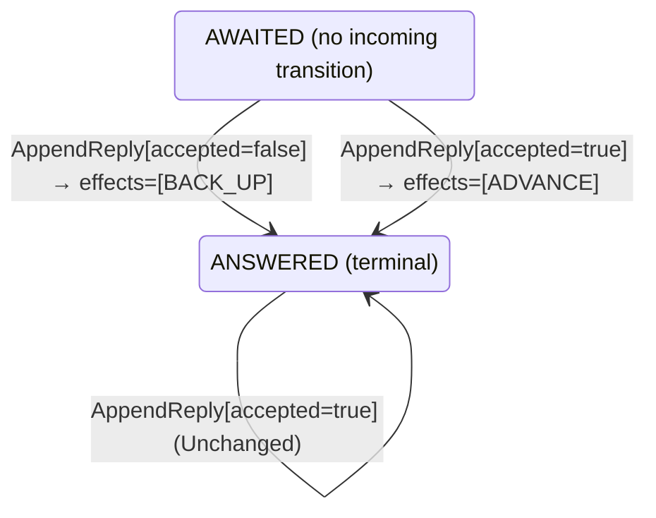

<!-- Generated by examples/tools/build.py from example.json and the verifier's output. Edit example.json. -->
# 103 · A leader that backs up on a refusal it has moved on from sends the follower what it holds

[← All examples](../README.md)

| Verdict | Categories | Severity if shipped | Change | Verified unit | Approach |
|---|---|---|---|---|---|
| **✗ Violation: NextIndexPastMatch, 12-step trace (delayed replies)** | functional | high | bug-fix, behaviour change intended | [`ReplyRule#decide`](../../examples/apps/quorum/src/main/java/net/terminalvalue/quorum/raft/ReplyRule.java) | [D1: Protocol model checking](../../examples/apps/quorum/spec/README.md) |

> A Raft leader backs a follower's next index up by one when the follower refuses the request at it, and ignores a refusal it has already moved on from: a reply that arrives late, or arrives twice, about a request the follower has since accepted. A developer has every refusal back the follower up, with the argument that the follower lacked the entry when it answered and a round trip more is the most it can cost. The tests pass, the contract diff is one row, and the three configurations in which an RPC is one step verify the change: the rule is never handed a refusal it has moved on from, which TLC's coverage says. The replication model's fourth configuration, in which a reply waits on the wire and may be handed to the leader twice, finds the consequence in twelve steps: a leader of term 2 holding one entry sends a follower without it a heartbeat, which the follower refuses, backs up, sends the entry, which the follower takes, and then is handed the refusal again; it backs up again, below the entry it has just recorded the follower as holding, and from there sends that entry forever, since each acceptance of it tells the leader nothing its record does not hold. The invariant that the next index is past the match index is violated.

Tags: [consensus](../README.md#tag-consensus), [log-replication](../README.md#tag-log-replication), [stale-messages](../README.md#tag-stale-messages), [duplicate-delivery](../README.md#tag-duplicate-delivery), [tla-fault-configuration](../README.md#tag-tla-fault-configuration), [generated-operator](../README.md#tag-generated-operator), [multiple-configurations](../README.md#tag-multiple-configurations)

## The change

In `ReplyRule.decide`, the `ANSWERED` arm returns `transition(ANSWERED, BACK_UP)` for a refusal instead of `unchanged`, with the comment that a refusal is news whenever it comes and costs one round trip more at most; an acceptance answered already still changes nothing. The javadoc is reworded to match, and the test that a late or repeated reply changes nothing is split: a late acceptance changes nothing, a refusal backs up whenever it comes.

**Before** ([`ReplyRule.java`](../../examples/apps/quorum/src/main/java/net/terminalvalue/quorum/raft/ReplyRule.java), line 14):

```java
 * sent and its next index past them; on a refusal, the next index moves back by one, and the next request tries from
 * one entry earlier, until the consistency check passes.
 *
 * <p>A reply the leader's record reflects already, a late or repeated one, changes nothing: an acceptance of entries
 * the leader knows the follower holds moves nothing backwards, and a refusal of a request the leader has moved on
 * from, or at an entry it knows the follower holds, does not back it up again. The term check comes before this
 * rule, in {@link RoleMachine}: a reply from a newer term deposes the leader, and one from an older term, to a
 * request of an earlier term of its own, is dropped.
 */
    // ...
            case AWAITED -> reply.accepted() ? transition(ANSWERED, ADVANCE) : transition(ANSWERED, BACK_UP);
            case ANSWERED -> reply.accepted()
                    ? unchanged("holds what the leader has recorded already")
                    : unchanged("a refusal the leader has moved on from");
        };
    }
}
```

**After:**

```java
 * sent and its next index past them; on a refusal, the next index moves back by one, and the next request tries from
 * one entry earlier, until the consistency check passes.
 *
 * <p>An acceptance the leader's record reflects already, a late or repeated one, changes nothing: it moves nothing
 * backwards. A refusal is acted on whenever it comes: the follower lacked the entry when it answered, and backing up
 * once more costs a round trip at most, which is cheaper than a request the follower refuses. The term check comes before this
 * rule, in {@link RoleMachine}: a reply from a newer term deposes the leader, and one from an older term, to a
 * request of an earlier term of its own, is dropped.
 */
    // ...
            case AWAITED -> reply.accepted() ? transition(ANSWERED, ADVANCE) : transition(ANSWERED, BACK_UP);
            case ANSWERED -> reply.accepted()
                    ? unchanged("holds what the leader has recorded already")
                    : transition(ANSWERED, BACK_UP); // a refusal is news whenever it comes: one round trip more at most
        };
    }
}
```

<details><summary>Patch</summary>

```diff
--- a/examples/apps/quorum/src/main/java/net/terminalvalue/quorum/raft/ReplyRule.java
+++ b/examples/apps/quorum/src/main/java/net/terminalvalue/quorum/raft/ReplyRule.java
@@ -14,9 +14,9 @@
  * sent and its next index past them; on a refusal, the next index moves back by one, and the next request tries from
  * one entry earlier, until the consistency check passes.
  *
- * <p>A reply the leader's record reflects already, a late or repeated one, changes nothing: an acceptance of entries
- * the leader knows the follower holds moves nothing backwards, and a refusal of a request the leader has moved on
- * from, or at an entry it knows the follower holds, does not back it up again. The term check comes before this
+ * <p>An acceptance the leader's record reflects already, a late or repeated one, changes nothing: it moves nothing
+ * backwards. A refusal is acted on whenever it comes: the follower lacked the entry when it answered, and backing up
+ * once more costs a round trip at most, which is cheaper than a request the follower refuses. The term check comes before this
  * rule, in {@link RoleMachine}: a reply from a newer term deposes the leader, and one from an older term, to a
  * request of an earlier term of its own, is dropped.
  */
@@ -29,7 +29,7 @@
             case AWAITED -> reply.accepted() ? transition(ANSWERED, ADVANCE) : transition(ANSWERED, BACK_UP);
             case ANSWERED -> reply.accepted()
                     ? unchanged("holds what the leader has recorded already")
-                    : unchanged("a refusal the leader has moved on from");
+                    : transition(ANSWERED, BACK_UP); // a refusal is news whenever it comes: one round trip more at most
         };
     }
 }
--- a/examples/apps/quorum/src/test/java/net/terminalvalue/quorum/raft/ReplyRuleTest.java
+++ b/examples/apps/quorum/src/test/java/net/terminalvalue/quorum/raft/ReplyRuleTest.java
@@ -23,8 +23,11 @@
         equal(new Transition<>(ANSWERED, List.of(BACK_UP)), ReplyRule.decide(AWAITED, new AppendReply(false)));
     }
 
-    public static void aLateOrRepeatedReplyChangesNothing() {
+    public static void aLateOrRepeatedAcceptanceChangesNothing() {
         check(ReplyRule.decide(ANSWERED, new AppendReply(true)) instanceof Decision.Unchanged, "late acceptance");
-        check(ReplyRule.decide(ANSWERED, new AppendReply(false)) instanceof Decision.Unchanged, "late refusal");
+    }
+
+    public static void aRefusalBacksUpWheneverItComes() {
+        equal(new Transition<>(ANSWERED, List.of(BACK_UP)), ReplyRule.decide(ANSWERED, new AppendReply(false)));
     }
 }
```

</details>

## What the verifier found

The model is checked under 4 configurations, and the verdict is the first that fails:

| Configuration | What it checks | Model | Result |
|---|---|---|---|
| three terms, two entries (`spec/RaftReplication.cfg`) | every run from the initial state, every interleaving within the configuration's bounds | Servers = {s1, s2, s3}, MaxTerm = 3, MaxEntries = 2, DelayedReplies = FALSE | ✓ Verified: all invariants and properties hold in 20,253 states |
| figure 8 (`spec/RaftReplicationFigureEight.cfg`) | every run of three servers over four terms with one entry per leader's log, the budget of figure 8 of the paper: a leader of term 1 appends an entry it never gets to replicate, a leader of term 2 appends its own at the same index, the first comes back as the leader of term 3 and replicates its entry of term 1 to a majority, and the second, whose last entry is from the later term, can still be elected in term 4 without it; three terms cannot show this, and the same invariants and action properties are checked | Servers = {s1, s2, s3}, MaxTerm = 4, MaxEntries = 1, DelayedReplies = FALSE | ✓ Verified: all invariants and properties hold in 8,838 states |
| fairness (`spec/RaftReplicationLive.cfg`) | the three liveness properties, under the fairness conditions `Fairness`: a server whose timer nothing resets times out, a candidate asks for the votes it lacks, a leader sends every follower its next entry or a heartbeat and marks committed what the commit rule lets it; nothing is assumed of the clients, so the properties hold whether or not a request comes. Three servers, three terms and one entry per leader, without the symmetry set, since TLC's liveness checking is unsound under one. A counterexample is a run that goes on forever without satisfying a property: a prefix, then a state or a cycle the system never leaves | Servers = {s1, s2, s3}, MaxTerm = 3, MaxEntries = 1, DelayedReplies = FALSE | ✓ Verified: all invariants and properties hold in 14,388 states |
| delayed replies (`spec/RaftReplicationDelayed.cfg`) | every run of three servers over two terms with logs of up to two entries in which the reply to an AppendEntries request is a step of its own (`DelayedReplies = TRUE`): the leader may take it after it has sent the follower another request and taken its reply, been deposed, or been elected again in a later term, and the network may hand it the same reply twice, or never. The one-step RPC of the other configurations hands the reply rule nothing but the request just sent; this one hands it late and repeated replies, and checks the leader's record of its followers against what they hold, under the same invariants and action properties | Servers = {s1, s2, s3}, MaxTerm = 2, MaxEntries = 1, DelayedReplies = TRUE | ✗ Violation: NextIndexPastMatch, 12-step trace |

TLC found a run of the system under delayed replies, 12 steps long, that violates the invariant **NextIndexPastMatch** (a leader's next index for a follower is past every entry it has recorded the follower as holding: the leader never sends a follower an entry it knows it holds). Each step is one action of one part of the system:

1. **Initial state**: every server a follower in term 0 with an empty log, no vote cast, nothing committed.
2. **Timeout**, `Server.onElectionTimeout`: a server's election timer fires, and the server acts on the role machine's decision. `currentTerm = (s1 :> 1 @@ s2 :> 0 @@ s3 :> 0)`, `role = (s1 :> "CANDIDATE" @@ s2 :> "FOLLOWER" @@ s3 :> "FOLLOWER")`, `votedFor = (s1 :> s1 @@ s2 :> "none" @@ s3 :> "none")`, `votes = (s1 :> {s1} @@ s2 :> {} @@ s3 :> {})`
3. **Canvass**, `Server.requestVote`: a candidate asks one server for its vote and gets the answer; the request and the reply each go through the role machine, then the vote rule on the voter, given its ballot and the candidate's term and log against its own, and the tally on the candidate. `currentTerm = (s1 :> 1 @@ s2 :> 1 @@ s3 :> 0)`, `nextIndex = ( s1 :> (s1 :> 1 @@ s2 :> 1 @@ s3 :> 1) @@ s2 :> (s1 :> 0 @@ s2 :> 0 @@ s3 :> 0) @@ s3 :> (s1 :> 0 @@ s2 :> 0 @@ s3 :> 0) )`, `role = (s1 :> "LEADER" @@ s2 :> "FOLLOWER" @@ s3 :> "FOLLOWER")`, `votedFor = (s1 :> s1 @@ s2 :> s1 @@ s3 :> "none")`, `votes = (s1 :> {s1, s2} @@ s2 :> {} @@ s3 :> {})`
4. **ClientRequest**, `Server.onClientRequest`: a leader appends an entry of its term to its own log. `log = (s1 :> <<1>> @@ s2 :> <<>> @@ s3 :> <<>>)`
5. **Ask**, `Server.appendEntries`, the request alone, under `RaftReplicationDelayed.cfg`: a leader sends one server the entry at its next index or a heartbeat, the server decides as in `Replicate`, and its reply waits on the wire; a leader asks whether or not a reply is outstanding, which is a request sent again. `log = (s1 :> <<1>> @@ s2 :> <<1>> @@ s3 :> <<>>)`, `replies = { [ term |-> 1, prev |-> 0, last |-> 1, to |-> s1, from |-> s2, accepted |-> TRUE ] }`
6. **Timeout**, `Server.onElectionTimeout`: a server's election timer fires, and the server acts on the role machine's decision. `currentTerm = (s1 :> 1 @@ s2 :> 2 @@ s3 :> 0)`, `role = (s1 :> "LEADER" @@ s2 :> "CANDIDATE" @@ s3 :> "FOLLOWER")`, `votedFor = (s1 :> s1 @@ s2 :> s2 @@ s3 :> "none")`, `votes = (s1 :> {s1, s2} @@ s2 :> {s2} @@ s3 :> {})`
7. **Canvass**, `Server.requestVote`: a candidate asks one server for its vote and gets the answer; the request and the reply each go through the role machine, then the vote rule on the voter, given its ballot and the candidate's term and log against its own, and the tally on the candidate. `currentTerm = (s1 :> 2 @@ s2 :> 2 @@ s3 :> 0)`, `nextIndex = ( s1 :> (s1 :> 0 @@ s2 :> 0 @@ s3 :> 0) @@ s2 :> (s1 :> 2 @@ s2 :> 2 @@ s3 :> 2) @@ s3 :> (s1 :> 0 @@ s2 :> 0 @@ s3 :> 0) )`, `role = (s1 :> "FOLLOWER" @@ s2 :> "LEADER" @@ s3 :> "FOLLOWER")`, `votedFor = (s1 :> s2 @@ s2 :> s2 @@ s3 :> "none")`, `votes = (s1 :> {} @@ s2 :> {s1, s2} @@ s3 :> {})`
8. **Ask**, `Server.appendEntries`, the request alone, under `RaftReplicationDelayed.cfg`: a leader sends one server the entry at its next index or a heartbeat, the server decides as in `Replicate`, and its reply waits on the wire; a leader asks whether or not a reply is outstanding, which is a request sent again. `currentTerm = (s1 :> 2 @@ s2 :> 2 @@ s3 :> 2)`, `replies = { [ term |-> 1, prev |-> 0, last |-> 1, to |-> s1, from |-> s2, accepted |-> TRUE ], [ term |-> 2, prev |-> 1, last |-> 1, to |-> s2, from |-> s3, accepted |-> FALSE ] }`
9. **Answer**, `Server.onAppendReply`, under `RaftReplicationDelayed.cfg`: a leader takes a reply that waited, through the role machine and then, if the reply is from its own term, the reply rule; the network may hand it the same reply again later, or never. `nextIndex = ( s1 :> (s1 :> 0 @@ s2 :> 0 @@ s3 :> 0) @@ s2 :> (s1 :> 2 @@ s2 :> 2 @@ s3 :> 1) @@ s3 :> (s1 :> 0 @@ s2 :> 0 @@ s3 :> 0) )`
10. **Ask**, `Server.appendEntries`, the request alone, under `RaftReplicationDelayed.cfg`: a leader sends one server the entry at its next index or a heartbeat, the server decides as in `Replicate`, and its reply waits on the wire; a leader asks whether or not a reply is outstanding, which is a request sent again. `log = (s1 :> <<1>> @@ s2 :> <<1>> @@ s3 :> <<1>>)`, `replies = { [ term |-> 1, prev |-> 0, last |-> 1, to |-> s1, from |-> s2, accepted |-> TRUE ], [ term |-> 2, prev |-> 0, last |-> 1, to |-> s2, from |-> s3, accepted |-> TRUE ], [ term |-> 2, prev |-> 1, last |-> 1, to |-> s2, from |-> s3, accepted |-> FALSE ] }`
11. **Answer**, `Server.onAppendReply`, under `RaftReplicationDelayed.cfg`: a leader takes a reply that waited, through the role machine and then, if the reply is from its own term, the reply rule; the network may hand it the same reply again later, or never. `matchIndex = ( s1 :> (s1 :> 0 @@ s2 :> 0 @@ s3 :> 0) @@ s2 :> (s1 :> 0 @@ s2 :> 0 @@ s3 :> 1) @@ s3 :> (s1 :> 0 @@ s2 :> 0 @@ s3 :> 0) )`, `nextIndex = ( s1 :> (s1 :> 0 @@ s2 :> 0 @@ s3 :> 0) @@ s2 :> (s1 :> 2 @@ s2 :> 2 @@ s3 :> 2) @@ s3 :> (s1 :> 0 @@ s2 :> 0 @@ s3 :> 0) )`, `replies = { [ term |-> 1, prev |-> 0, last |-> 1, to |-> s1, from |-> s2, accepted |-> TRUE ], [ term |-> 2, prev |-> 1, last |-> 1, to |-> s2, from |-> s3, accepted |-> FALSE ] }`
12. **Answer**, `Server.onAppendReply`, under `RaftReplicationDelayed.cfg`: a leader takes a reply that waited, through the role machine and then, if the reply is from its own term, the reply rule; the network may hand it the same reply again later, or never. `nextIndex = ( s1 :> (s1 :> 0 @@ s2 :> 0 @@ s3 :> 0) @@ s2 :> (s1 :> 2 @@ s2 :> 2 @@ s3 :> 1) @@ s3 :> (s1 :> 0 @@ s2 :> 0 @@ s3 :> 0) )`, `replies = { [ term |-> 1, prev |-> 0, last |-> 1, to |-> s1, from |-> s2, accepted |-> TRUE ] }`

The model is small (Servers = {s1, s2, s3}, MaxTerm = 2, MaxEntries = 1, DelayedReplies = TRUE), which is what keeps the trace readable. TLC explored every interleaving of the servers, their terms, votes and logs, and the AppendEntries RPCs between them within those bounds.

**What the verdict rests on.** TLC counted how often a step of the model took each row of the generated operators. A row no step takes is one the model says nothing about, whatever the verdict.

| Configuration | Rows of `RoleMachine#decide` taken | Rows of `VoteRule#decide` taken | Rows of `AppendRule#decide` taken | Rows of `ReplyRule#decide` taken | Rows of `CommitRule#decide` taken |
|---|---|---|---|---|---|
| three terms, two entries | 27 of 36 | 12 of 27 | 16 of 24 | 3 of 4 | 4 of 12 |
| figure 8 | 27 of 36 | 12 of 27 | 10 of 24 | 3 of 4 | 4 of 12 |
| fairness | 27 of 36 | 12 of 27 | 10 of 24 | 3 of 4 | 4 of 12 |
| delayed replies | stopped at the counterexample | stopped at the counterexample | stopped at the counterexample | stopped at the counterexample | stopped at the counterexample |

The change alters 1 row of the contract:

- `decide(ANSWERED, AppendReply[accepted=false])`: `Unchanged[reason="a refusal the leader has moved on from"]` → `Transition[next=ANSWERED, effects=[BACK_UP]]`, taken by no run that finished

The run under delayed replies stopped at its counterexample, the steps above, and its counts are left out: the verdict rests on the counterexample.

<details><summary>Rows no step takes under three terms, two entries</summary>

`net.terminalvalue.quorum.raft.RoleMachine#decide`:

```
decide(FOLLOWER, VotesCounted[majority=true]) => Unchanged
decide(FOLLOWER, Response[term=OLDER]) => Unchanged
decide(FOLLOWER, Response[term=CURRENT]) => Unchanged
decide(FOLLOWER, Response[term=NEWER]) => Transition[next=FOLLOWER, effects=[ADOPT_TERM]]
decide(CANDIDATE, Response[term=OLDER]) => Unchanged
decide(LEADER, VotesCounted[majority=false]) => Unchanged
decide(LEADER, VotesCounted[majority=true]) => Unchanged
decide(LEADER, AppendEntries[term=CURRENT]) => throws IllegalStateException
decide(LEADER, Response[term=OLDER]) => Unchanged
```

`net.terminalvalue.quorum.raft.VoteRule#decide`:

```
decide(OPEN, VoteRequest[term=NEWER, log=BEHIND]) => Rejected
decide(OPEN, VoteRequest[term=NEWER, log=EVEN]) => Transition[next=FOR_THE_CANDIDATE, effects=[GRANT]]
decide(OPEN, VoteRequest[term=NEWER, log=AHEAD]) => Transition[next=FOR_THE_CANDIDATE, effects=[GRANT]]
decide(FOR_THE_CANDIDATE, VoteRequest[term=OLDER, log=BEHIND]) => Rejected
decide(FOR_THE_CANDIDATE, VoteRequest[term=OLDER, log=EVEN]) => Rejected
decide(FOR_THE_CANDIDATE, VoteRequest[term=OLDER, log=AHEAD]) => Rejected
decide(FOR_THE_CANDIDATE, VoteRequest[term=CURRENT, log=BEHIND]) => Rejected
decide(FOR_THE_CANDIDATE, VoteRequest[term=CURRENT, log=EVEN]) => Transition[next=FOR_THE_CANDIDATE, effects=[GRANT]]
decide(FOR_THE_CANDIDATE, VoteRequest[term=CURRENT, log=AHEAD]) => Transition[next=FOR_THE_CANDIDATE, effects=[GRANT]]
decide(FOR_THE_CANDIDATE, VoteRequest[term=NEWER, log=BEHIND]) => Rejected
decide(FOR_THE_CANDIDATE, VoteRequest[term=NEWER, log=EVEN]) => Transition[next=FOR_THE_CANDIDATE, effects=[GRANT]]
decide(FOR_THE_CANDIDATE, VoteRequest[term=NEWER, log=AHEAD]) => Transition[next=FOR_THE_CANDIDATE, effects=[GRANT]]
decide(FOR_ANOTHER, VoteRequest[term=NEWER, log=BEHIND]) => Rejected
decide(FOR_ANOTHER, VoteRequest[term=NEWER, log=EVEN]) => Transition[next=FOR_THE_CANDIDATE, effects=[GRANT]]
decide(FOR_ANOTHER, VoteRequest[term=NEWER, log=AHEAD]) => Transition[next=FOR_THE_CANDIDATE, effects=[GRANT]]
```

`net.terminalvalue.quorum.raft.AppendRule#decide`:

```
decide(MISSING, AppendRequest[entry=SAME, commitAhead=false]) => Rejected
decide(MISSING, AppendRequest[entry=SAME, commitAhead=true]) => Rejected
decide(MISSING, AppendRequest[entry=CONFLICTING, commitAhead=false]) => Rejected
decide(MISSING, AppendRequest[entry=CONFLICTING, commitAhead=true]) => Rejected
decide(CONFLICTING, AppendRequest[entry=SAME, commitAhead=false]) => Rejected
decide(CONFLICTING, AppendRequest[entry=SAME, commitAhead=true]) => Rejected
decide(MATCHING, AppendRequest[entry=SAME, commitAhead=false]) => Unchanged
decide(MATCHING, AppendRequest[entry=SAME, commitAhead=true]) => Transition[next=MATCHING, effects=[ADVANCE_COMMIT]]
```

`net.terminalvalue.quorum.raft.ReplyRule#decide`:

```
decide(ANSWERED, AppendReply[accepted=false]) => Transition[next=ANSWERED, effects=[BACK_UP]]
```

`net.terminalvalue.quorum.raft.CommitRule#decide`:

```
decide(PENDING, Replication[term=NEWER, majority=false]) => throws IllegalStateException
decide(PENDING, Replication[term=NEWER, majority=true]) => throws IllegalStateException
decide(COMMITTED, Replication[term=OLDER, majority=false]) => Unchanged
decide(COMMITTED, Replication[term=OLDER, majority=true]) => Unchanged
decide(COMMITTED, Replication[term=CURRENT, majority=false]) => Unchanged
decide(COMMITTED, Replication[term=CURRENT, majority=true]) => Unchanged
decide(COMMITTED, Replication[term=NEWER, majority=false]) => Unchanged
decide(COMMITTED, Replication[term=NEWER, majority=true]) => Unchanged
```

</details>

The state machine the patched code implements, drawn from its derived contract (`jvmcontract statemachine`); a state with no way in or no way out is marked:



## Would the existing tests have caught it?

No: every existing unit test passes (`java -ea net.terminalvalue.quorum.Tests`, run against the patched code).

## Why it matters

Medium. A round trip more is what the comment promises, and in a network that delivers every reply once and in order that is what it costs, which is why three of the four configurations verify the change: the one-step RPC never hands the rule a refusal of a request the leader has moved on from, so the changed row is never taken, which the coverage table shows. The question is what happens when a refusal is delivered after the follower has caught up, and the answer is not a round trip: the next index drops below the match index, the leader sends the entry the follower holds, and the acceptance of an entry the record already holds moves nothing, so the leader is stuck at that entry for as long as it leads.

## Why the verdict is right

The reply rule in the model is generated from the regenerated contract, so `Answer` backs up on a refusal the leader's record has answered already. The three one-step configurations verify the change (20,253, 8,838 and 14,388 states, the same as the committed rule's), with the changed row untaken under each, since `Replicate` hands the rule the reply to the request it has just sent and nothing else. `RaftReplicationDelayed.cfg` is the one that hands the rule such a refusal, and its run ends at the violation the row causes, so the coverage table, which counts finished runs, shows the row taken nowhere: after twelve steps, s1, leader of term 1, appends an entry and sends it to s2, whose acceptance waits on the wire; s2 times out, wins term 2 with s1's vote, and sends s3, whose log is empty, a heartbeat after the entry, which s3 refuses; s2 takes the refusal, the network keeping a copy, backs up and sends the entry, which s3 takes, and s2 records s3 as holding index 1 with index 2 next; then s2 takes the refusal again, and the patched row backs the next index up to 1, the entry s2 has just recorded s3 as holding. `NextIndexPastMatch` is violated in that state. From it, every request to s3 carries the entry s3 holds, and its acceptance, through an index the record holds already, is one the rule answers with nothing.

## What to do

Reject. A refusal answers one request, the one at the follower's next index at the time, and backs the leader up from it once; a refusal of a request the leader has since backed up from, or at an entry the leader has since recorded the follower as holding, is stale and changes nothing (etcd's MaybeDecrTo makes the same check: a rejection that does not answer the request at Next - 1 is ignored). The invariant that the next index is past the match index is what the fix keeps, and the delayed replies configuration is where it is tested.

## Notes

- The Raft replication model (`apps/quorum/spec/RaftReplication.tla`) has the logs live, around the follower's append rule and the leader's commit rule as generated operators beside the role machine and the vote rule, and checks log matching, leader completeness and state machine safety, with an action property that no committed entry is ever overwritten. Its configurations are three terms with two entries, and the four terms of the paper's figure 8.
- The leader's side of the RPC, `ReplyRule#decide`, is the replication model's third generated operator. `RaftReplicationDelayed.cfg` lets the reply wait on the wire, arrive after the leader has sent again or been deposed, arrive twice, or never, and checks the leader's record of its followers (`MatchIndexIsRight`, `NextIndexPastMatch`), which a one-step RPC cannot break.
- Verified by every one-step configuration, which never hands the rule such a refusal, and found by the delayed one, where the record contradicts itself and the follower is sent the entry it holds forever. Pairs with 104.

## Evidence

How the verdict was reached: three terms, two entries: TLC 2.19 explored 20,253 distinct states to depth 20 in 13 s, for the model Servers = {s1, s2, s3}, MaxTerm = 3, MaxEntries = 2, DelayedReplies = FALSE; figure 8: TLC 2.19 explored 8,838 distinct states to depth 18 in 7 s, for the model Servers = {s1, s2, s3}, MaxTerm = 4, MaxEntries = 1, DelayedReplies = FALSE; fairness: TLC 2.19 explored 14,388 distinct states to depth 16, for the model Servers = {s1, s2, s3}, MaxTerm = 3, MaxEntries = 1, DelayedReplies = FALSE; delayed replies: TLC 2.19 explored 15,228 distinct states to depth 12 in 9 s, for the model Servers = {s1, s2, s3}, MaxTerm = 2, MaxEntries = 1, DelayedReplies = TRUE.

<details><summary>Verifier output</summary>

```text
== three terms, two entries: spec/RaftReplication.cfg ==
TLC2 Version 2.19 of 08 August 2024 (rev: 5a47802)
Running breadth-first search Model-Checking with fp 1 and seed 1 with 1 worker on 2 cores with 2185MB heap and 64MB offheap memory [pid: 1234096] (Linux 6.6.87.2-microsoft-standard-WSL2 aarch64, Eclipse Adoptium 25.0.4.1 x86_64, MSBDiskFPSet, DiskStateQueue).
Parsing file examples/apps/quorum/spec/RaftReplication.tla
Parsing file examples/tools/tla/standard-modules/Naturals.tla
Parsing file examples/tools/tla/standard-modules/FiniteSets.tla
Parsing file examples/tools/tla/standard-modules/Sequences.tla
Parsing file examples/tools/tla/standard-modules/TLC.tla
Parsing file examples/apps/quorum/spec/RoleMachineContract.tla
Parsing file examples/apps/quorum/spec/VoteRuleContract.tla
Parsing file examples/apps/quorum/spec/AppendRuleContract.tla
Parsing file examples/apps/quorum/spec/ReplyRuleContract.tla
Parsing file examples/apps/quorum/spec/CommitRuleContract.tla
Semantic processing of module Naturals
Semantic processing of module Sequences
Semantic processing of module FiniteSets
Semantic processing of module TLC
Semantic processing of module RoleMachineContract
Semantic processing of module VoteRuleContract
Semantic processing of module AppendRuleContract
Semantic processing of module ReplyRuleContract
Semantic processing of module CommitRuleContract
Semantic processing of module RaftReplication
Starting... (2026-11-04 00:38:13)
Computing initial states...
Finished computing initial states: 1 distinct state generated at 2026-11-04 00:38:16.
Model checking completed. No error has been found.
  Estimates of the probability that TLC did not check all reachable states
  because two distinct states had the same fingerprint:
  calculated (optimistic):  val = 8.8E-11
Rows of net.terminalvalue.quorum.raft.RoleMachine#decide a step of the model takes: 27 of 36; never taken (9):
  decide(FOLLOWER, VotesCounted[majority=true]) => Unchanged
  decide(FOLLOWER, Response[term=OLDER]) => Unchanged
  decide(FOLLOWER, Response[term=CURRENT]) => Unchanged
  decide(FOLLOWER, Response[term=NEWER]) => Transition[next=FOLLOWER, effects=[ADOPT_TERM]]
  decide(CANDIDATE, Response[term=OLDER]) => Unchanged
  decide(LEADER, VotesCounted[majority=false]) => Unchanged
  decide(LEADER, VotesCounted[majority=true]) => Unchanged
  decide(LEADER, AppendEntries[term=CURRENT]) => throws IllegalStateException
  decide(LEADER, Response[term=OLDER]) => Unchanged
Rows of net.terminalvalue.quorum.raft.VoteRule#decide a step of the model takes: 12 of 27; never taken (15):
  decide(OPEN, VoteRequest[term=NEWER, log=BEHIND]) => Rejected
  decide(OPEN, VoteRequest[term=NEWER, log=EVEN]) => Transition[next=FOR_THE_CANDIDATE, effects=[GRANT]]
  decide(OPEN, VoteRequest[term=NEWER, log=AHEAD]) => Transition[next=FOR_THE_CANDIDATE, effects=[GRANT]]
  decide(FOR_THE_CANDIDATE, VoteRequest[term=OLDER, log=BEHIND]) => Rejected
  decide(FOR_THE_CANDIDATE, VoteRequest[term=OLDER, log=EVEN]) => Rejected
  decide(FOR_THE_CANDIDATE, VoteRequest[term=OLDER, log=AHEAD]) => Rejected
  decide(FOR_THE_CANDIDATE, VoteRequest[term=CURRENT, log=BEHIND]) => Rejected
  decide(FOR_THE_CANDIDATE, VoteRequest[term=CURRENT, log=EVEN]) => Transition[next=FOR_THE_CANDIDATE, effects=[GRANT]]
  decide(FOR_THE_CANDIDATE, VoteRequest[term=CURRENT, log=AHEAD]) => Transition[next=FOR_THE_CANDIDATE, effects=[GRANT]]
  decide(FOR_THE_CANDIDATE, VoteRequest[term=NEWER, log=BEHIND]) => Rejected
  decide(FOR_THE_CANDIDATE, VoteRequest[term=NEWER, log=EVEN]) => Transition[next=FOR_THE_CANDIDATE, effects=[GRANT]]
  decide(FOR_THE_CANDIDATE, VoteRequest[term=NEWER, log=AHEAD]) => Transition[next=FOR_THE_CANDIDATE, effects=[GRANT]]
  decide(FOR_ANOTHER, VoteRequest[term=NEWER, log=BEHIND]) => Rejected
  decide(FOR_ANOTHER, VoteRequest[term=NEWER, log=EVEN]) => Transition[next=FOR_THE_CANDIDATE, effects=[GRANT]]
  decide(FOR_ANOTHER, VoteRequest[term=NEWER, log=AHEAD]) => Transition[next=FOR_THE_CANDIDATE, effects=[GRANT]]
Rows of net.terminalvalue.quorum.raft.AppendRule#decide a step of the model takes: 16 of 24; never taken (8):
  decide(MISSING, AppendRequest[entry=SAME, commitAhead=false]) => Rejected
  decide(MISSING, AppendRequest[entry=SAME, commitAhead=true]) => Rejected
  decide(MISSING, AppendRequest[entry=CONFLICTING, commitAhead=false]) => Rejected
  decide(MISSING, AppendRequest[entry=CONFLICTING, commitAhead=true]) => Rejected
  decide(CONFLICTING, AppendRequest[entry=SAME, commitAhead=false]) => Rejected
  decide(CONFLICTING, AppendRequest[entry=SAME, commitAhead=true]) => Rejected
  decide(MATCHING, AppendRequest[entry=SAME, commitAhead=false]) => Unchanged
  decide(MATCHING, AppendRequest[entry=SAME, commitAhead=true]) => Transition[next=MATCHING, effects=[ADVANCE_COMMIT]]
Rows of net.terminalvalue.quorum.raft.ReplyRule#decide a step of the model takes: 3 of 4; never taken (1):
  decide(ANSWERED, AppendReply[accepted=false]) => Transition[next=ANSWERED, effects=[BACK_UP]]
Rows of net.terminalvalue.quorum.raft.CommitRule#decide a step of the model takes: 4 of 12; never taken (8):
  decide(PENDING, Replication[term=NEWER, majority=false]) => throws IllegalStateException
  decide(PENDING, Replication[term=NEWER, majority=true]) => throws IllegalStateException
  decide(COMMITTED, Replication[term=OLDER, majority=false]) => Unchanged
  decide(COMMITTED, Replication[term=OLDER, majority=true]) => Unchanged
  decide(COMMITTED, Replication[term=CURRENT, majority=false]) => Unchanged
  decide(COMMITTED, Replication[term=CURRENT, majority=true]) => Unchanged
  decide(COMMITTED, Replication[term=NEWER, majority=false]) => Unchanged
  decide(COMMITTED, Replication[term=NEWER, majority=true]) => Unchanged
100137 states generated, 20253 distinct states found, 0 states left on queue.
The depth of the complete state graph search is 20.
The average outdegree of the complete state graph is 1 (minimum is 0, the maximum 8 and the 95th percentile is 3).
Finished in 13s at (2026-11-04 00:38:27)

== figure 8: spec/RaftReplicationFigureEight.cfg ==
TLC2 Version 2.19 of 08 August 2024 (rev: 5a47802)
Running breadth-first search Model-Checking with fp 1 and seed 1 with 1 worker on 2 cores with 2185MB heap and 64MB offheap memory [pid: 1234793] (Linux 6.6.87.2-microsoft-standard-WSL2 aarch64, Eclipse Adoptium 25.0.4.1 x86_64, MSBDiskFPSet, DiskStateQueue).
Parsing file examples/apps/quorum/spec/RaftReplication.tla
Parsing file examples/tools/tla/standard-modules/Naturals.tla
Parsing file examples/tools/tla/standard-modules/FiniteSets.tla
Parsing file examples/tools/tla/standard-modules/Sequences.tla
Parsing file examples/tools/tla/standard-modules/TLC.tla
Parsing file examples/apps/quorum/spec/RoleMachineContract.tla
Parsing file examples/apps/quorum/spec/VoteRuleContract.tla
Parsing file examples/apps/quorum/spec/AppendRuleContract.tla
Parsing file examples/apps/quorum/spec/ReplyRuleContract.tla
Parsing file examples/apps/quorum/spec/CommitRuleContract.tla
Semantic processing of module Naturals
Semantic processing of module Sequences
Semantic processing of module FiniteSets
Semantic processing of module TLC
Semantic processing of module RoleMachineContract
Semantic processing of module VoteRuleContract
Semantic processing of module AppendRuleContract
Semantic processing of module ReplyRuleContract
Semantic processing of module CommitRuleContract
Semantic processing of module RaftReplication
Starting... (2026-11-04 00:38:28)
Computing initial states...
Finished computing initial states: 1 distinct state generated at 2026-11-04 00:38:30.
Model checking completed. No error has been found.
  Estimates of the probability that TLC did not check all reachable states
  because two distinct states had the same fingerprint:
  calculated (optimistic):  val = 1.9E-11
Rows of net.terminalvalue.quorum.raft.RoleMachine#decide a step of the model takes: 27 of 36; never taken (9):
  decide(FOLLOWER, VotesCounted[majority=true]) => Unchanged
  decide(FOLLOWER, Response[term=OLDER]) => Unchanged
  decide(FOLLOWER, Response[term=CURRENT]) => Unchanged
  decide(FOLLOWER, Response[term=NEWER]) => Transition[next=FOLLOWER, effects=[ADOPT_TERM]]
  decide(CANDIDATE, Response[term=OLDER]) => Unchanged
  decide(LEADER, VotesCounted[majority=false]) => Unchanged
  decide(LEADER, VotesCounted[majority=true]) => Unchanged
  decide(LEADER, AppendEntries[term=CURRENT]) => throws IllegalStateException
  decide(LEADER, Response[term=OLDER]) => Unchanged
Rows of net.terminalvalue.quorum.raft.VoteRule#decide a step of the model takes: 12 of 27; never taken (15):
  decide(OPEN, VoteRequest[term=NEWER, log=BEHIND]) => Rejected
  decide(OPEN, VoteRequest[term=NEWER, log=EVEN]) => Transition[next=FOR_THE_CANDIDATE, effects=[GRANT]]
  decide(OPEN, VoteRequest[term=NEWER, log=AHEAD]) => Transition[next=FOR_THE_CANDIDATE, effects=[GRANT]]
  decide(FOR_THE_CANDIDATE, VoteRequest[term=OLDER, log=BEHIND]) => Rejected
  decide(FOR_THE_CANDIDATE, VoteRequest[term=OLDER, log=EVEN]) => Rejected
  decide(FOR_THE_CANDIDATE, VoteRequest[term=OLDER, log=AHEAD]) => Rejected
  decide(FOR_THE_CANDIDATE, VoteRequest[term=CURRENT, log=BEHIND]) => Rejected
  decide(FOR_THE_CANDIDATE, VoteRequest[term=CURRENT, log=EVEN]) => Transition[next=FOR_THE_CANDIDATE, effects=[GRANT]]
  decide(FOR_THE_CANDIDATE, VoteRequest[term=CURRENT, log=AHEAD]) => Transition[next=FOR_THE_CANDIDATE, effects=[GRANT]]
  decide(FOR_THE_CANDIDATE, VoteRequest[term=NEWER, log=BEHIND]) => Rejected
  decide(FOR_THE_CANDIDATE, VoteRequest[term=NEWER, log=EVEN]) => Transition[next=FOR_THE_CANDIDATE, effects=[GRANT]]
  decide(FOR_THE_CANDIDATE, VoteRequest[term=NEWER, log=AHEAD]) => Transition[next=FOR_THE_CANDIDATE, effects=[GRANT]]
  decide(FOR_ANOTHER, VoteRequest[term=NEWER, log=BEHIND]) => Rejected
  decide(FOR_ANOTHER, VoteRequest[term=NEWER, log=EVEN]) => Transition[next=FOR_THE_CANDIDATE, effects=[GRANT]]
  decide(FOR_ANOTHER, VoteRequest[term=NEWER, log=AHEAD]) => Transition[next=FOR_THE_CANDIDATE, effects=[GRANT]]
Rows of net.terminalvalue.quorum.raft.AppendRule#decide a step of the model takes: 10 of 24; never taken (14):
  decide(MISSING, AppendRequest[entry=ABSENT, commitAhead=false]) => Rejected
  decide(MISSING, AppendRequest[entry=ABSENT, commitAhead=true]) => Rejected
  decide(MISSING, AppendRequest[entry=SAME, commitAhead=false]) => Rejected
  decide(MISSING, AppendRequest[entry=SAME, commitAhead=true]) => Rejected
  decide(MISSING, AppendRequest[entry=CONFLICTING, commitAhead=false]) => Rejected
  decide(MISSING, AppendRequest[entry=CONFLICTING, commitAhead=true]) => Rejected
  decide(CONFLICTING, AppendRequest[entry=ABSENT, commitAhead=false]) => Rejected
  decide(CONFLICTING, AppendRequest[entry=ABSENT, commitAhead=true]) => Rejected
  decide(CONFLICTING, AppendRequest[entry=SAME, commitAhead=false]) => Rejected
  decide(CONFLICTING, AppendRequest[entry=SAME, commitAhead=true]) => Rejected
  decide(CONFLICTING, AppendRequest[entry=CONFLICTING, commitAhead=false]) => Rejected
  decide(CONFLICTING, AppendRequest[entry=CONFLICTING, commitAhead=true]) => Rejected
  decide(MATCHING, AppendRequest[entry=SAME, commitAhead=false]) => Unchanged
  decide(MATCHING, AppendRequest[entry=SAME, commitAhead=true]) => Transition[next=MATCHING, effects=[ADVANCE_COMMIT]]
Rows of net.terminalvalue.quorum.raft.ReplyRule#decide a step of the model takes: 3 of 4; never taken (1):
  decide(ANSWERED, AppendReply[accepted=false]) => Transition[next=ANSWERED, effects=[BACK_UP]]
Rows of net.terminalvalue.quorum.raft.CommitRule#decide a step of the model takes: 4 of 12; never taken (8):
  decide(PENDING, Replication[term=NEWER, majority=false]) => throws IllegalStateException
  decide(PENDING, Replication[term=NEWER, majority=true]) => throws IllegalStateException
  decide(COMMITTED, Replication[term=OLDER, majority=false]) => Unchanged
  decide(COMMITTED, Replication[term=OLDER, majority=true]) => Unchanged
  decide(COMMITTED, Replication[term=CURRENT, majority=false]) => Unchanged
  decide(COMMITTED, Replication[term=CURRENT, majority=true]) => Unchanged
  decide(COMMITTED, Replication[term=NEWER, majority=false]) => Unchanged
  decide(COMMITTED, Replication[term=NEWER, majority=true]) => Unchanged
48709 states generated, 8838 distinct states found, 0 states left on queue.
The depth of the complete state graph search is 18.
The average outdegree of the complete state graph is 1 (minimum is 0, the maximum 7 and the 95th percentile is 3).
Finished in 07s at (2026-11-04 00:38:35)

== fairness: spec/RaftReplicationLive.cfg ==
TLC2 Version 2.19 of 08 August 2024 (rev: 5a47802)
Running breadth-first search Model-Checking with fp 1 and seed 1 with 1 worker on 2 cores with 2185MB heap and 64MB offheap memory [pid: 1235187] (Linux 6.6.87.2-microsoft-standard-WSL2 aarch64, Eclipse Adoptium 25.0.4.1 x86_64, MSBDiskFPSet, DiskStateQueue).
Parsing file examples/apps/quorum/spec/RaftReplication.tla
Parsing file examples/tools/tla/standard-modules/Naturals.tla
Parsing file examples/tools/tla/standard-modules/FiniteSets.tla
Parsing file examples/tools/tla/standard-modules/Sequences.tla
Parsing file examples/tools/tla/standard-modules/TLC.tla
Parsing file examples/apps/quorum/spec/RoleMachineContract.tla
Parsing file examples/apps/quorum/spec/VoteRuleContract.tla
Parsing file examples/apps/quorum/spec/AppendRuleContract.tla
Parsing file examples/apps/quorum/spec/ReplyRuleContract.tla
Parsing file examples/apps/quorum/spec/CommitRuleContract.tla
Semantic processing of module Naturals
Semantic processing of module Sequences
Semantic processing of module FiniteSets
Semantic processing of module TLC
Semantic processing of module RoleMachineContract
Semantic processing of module VoteRuleContract
Semantic processing of module AppendRuleContract
Semantic processing of module ReplyRuleContract
Semantic processing of module CommitRuleContract
Semantic processing of module RaftReplication
Starting... (2026-11-04 00:38:36)
Implied-temporal checking--satisfiability problem has 5 branches.
Computing initial states...
Finished computing initial states: 1 distinct state generated at 2026-11-04 00:38:39.
Checking 5 branches of temporal properties for the current state space with 2405 total distinct states at (2026-11-04 00:38:42)
Finished checking temporal properties in 00s at 2026-11-04 00:38:42
Checking 5 branches of temporal properties for the current state space with 51165 total distinct states at (2026-11-04 00:39:42)
Finished checking temporal properties in 00s at 2026-11-04 00:39:42
Checking 5 branches of temporal properties for the complete state space with 71940 total distinct states at (2026-11-04 00:40:01)
Finished checking temporal properties in 00s at 2026-11-04 00:40:01
Model checking completed. No error has been found.
  Estimates of the probability that TLC did not check all reachable states
  because two distinct states had the same fingerprint:
  calculated (optimistic):  val = 4.4E-11
Rows of net.terminalvalue.quorum.raft.RoleMachine#decide a step of the model takes: 27 of 36; never taken (9):
  decide(FOLLOWER, VotesCounted[majority=true]) => Unchanged
  decide(FOLLOWER, Response[term=OLDER]) => Unchanged
  decide(FOLLOWER, Response[term=CURRENT]) => Unchanged
  decide(FOLLOWER, Response[term=NEWER]) => Transition[next=FOLLOWER, effects=[ADOPT_TERM]]
  decide(CANDIDATE, Response[term=OLDER]) => Unchanged
  decide(LEADER, VotesCounted[majority=false]) => Unchanged
  decide(LEADER, VotesCounted[majority=true]) => Unchanged
  decide(LEADER, AppendEntries[term=CURRENT]) => throws IllegalStateException
  decide(LEADER, Response[term=OLDER]) => Unchanged
Rows of net.terminalvalue.quorum.raft.VoteRule#decide a step of the model takes: 12 of 27; never taken (15):
  decide(OPEN, VoteRequest[term=NEWER, log=BEHIND]) => Rejected
  decide(OPEN, VoteRequest[term=NEWER, log=EVEN]) => Transition[next=FOR_THE_CANDIDATE, effects=[GRANT]]
  decide(OPEN, VoteRequest[term=NEWER, log=AHEAD]) => Transition[next=FOR_THE_CANDIDATE, effects=[GRANT]]
  decide(FOR_THE_CANDIDATE, VoteRequest[term=OLDER, log=BEHIND]) => Rejected
  decide(FOR_THE_CANDIDATE, VoteRequest[term=OLDER, log=EVEN]) => Rejected
  decide(FOR_THE_CANDIDATE, VoteRequest[term=OLDER, log=AHEAD]) => Rejected
  decide(FOR_THE_CANDIDATE, VoteRequest[term=CURRENT, log=BEHIND]) => Rejected
  decide(FOR_THE_CANDIDATE, VoteRequest[term=CURRENT, log=EVEN]) => Transition[next=FOR_THE_CANDIDATE, effects=[GRANT]]
  decide(FOR_THE_CANDIDATE, VoteRequest[term=CURRENT, log=AHEAD]) => Transition[next=FOR_THE_CANDIDATE, effects=[GRANT]]
  decide(FOR_THE_CANDIDATE, VoteRequest[term=NEWER, log=BEHIND]) => Rejected
  decide(FOR_THE_CANDIDATE, VoteRequest[term=NEWER, log=EVEN]) => Transition[next=FOR_THE_CANDIDATE, effects=[GRANT]]
  decide(FOR_THE_CANDIDATE, VoteRequest[term=NEWER, log=AHEAD]) => Transition[next=FOR_THE_CANDIDATE, effects=[GRANT]]
  decide(FOR_ANOTHER, VoteRequest[term=NEWER, log=BEHIND]) => Rejected
  decide(FOR_ANOTHER, VoteRequest[term=NEWER, log=EVEN]) => Transition[next=FOR_THE_CANDIDATE, effects=[GRANT]]
  decide(FOR_ANOTHER, VoteRequest[term=NEWER, log=AHEAD]) => Transition[next=FOR_THE_CANDIDATE, effects=[GRANT]]
Rows of net.terminalvalue.quorum.raft.AppendRule#decide a step of the model takes: 10 of 24; never taken (14):
  decide(MISSING, AppendRequest[entry=ABSENT, commitAhead=false]) => Rejected
  decide(MISSING, AppendRequest[entry=ABSENT, commitAhead=true]) => Rejected
  decide(MISSING, AppendRequest[entry=SAME, commitAhead=false]) => Rejected
  decide(MISSING, AppendRequest[entry=SAME, commitAhead=true]) => Rejected
  decide(MISSING, AppendRequest[entry=CONFLICTING, commitAhead=false]) => Rejected
  decide(MISSING, AppendRequest[entry=CONFLICTING, commitAhead=true]) => Rejected
  decide(CONFLICTING, AppendRequest[entry=ABSENT, commitAhead=false]) => Rejected
  decide(CONFLICTING, AppendRequest[entry=ABSENT, commitAhead=true]) => Rejected
  decide(CONFLICTING, AppendRequest[entry=SAME, commitAhead=false]) => Rejected
  decide(CONFLICTING, AppendRequest[entry=SAME, commitAhead=true]) => Rejected
  decide(CONFLICTING, AppendRequest[entry=CONFLICTING, commitAhead=false]) => Rejected
  decide(CONFLICTING, AppendRequest[entry=CONFLICTING, commitAhead=true]) => Rejected
  decide(MATCHING, AppendRequest[entry=SAME, commitAhead=false]) => Unchanged
  decide(MATCHING, AppendRequest[entry=SAME, commitAhead=true]) => Transition[next=MATCHING, effects=[ADVANCE_COMMIT]]
Rows of net.terminalvalue.quorum.raft.ReplyRule#decide a step of the model takes: 3 of 4; never taken (1):
  decide(ANSWERED, AppendReply[accepted=false]) => Transition[next=ANSWERED, effects=[BACK_UP]]
Rows of net.terminalvalue.quorum.raft.CommitRule#decide a step of the model takes: 4 of 12; never taken (8):
  decide(PENDING, Replication[term=NEWER, majority=false]) => throws IllegalStateException
  decide(PENDING, Replication[term=NEWER, majority=true]) => throws IllegalStateException
  decide(COMMITTED, Replication[term=OLDER, majority=false]) => Unchanged
  decide(COMMITTED, Replication[term=OLDER, majority=true]) => Unchanged
  decide(COMMITTED, Replication[term=CURRENT, majority=false]) => Unchanged
  decide(COMMITTED, Replication[term=CURRENT, majority=true]) => Unchanged
  decide(COMMITTED, Replication[term=NEWER, majority=false]) => Unchanged
  decide(COMMITTED, Replication[term=NEWER, majority=true]) => Unchanged
71185 states generated, 14388 distinct states found, 0 states left on queue.
The depth of the complete state graph search is 16.
The average outdegree of the complete state graph is 1 (minimum is 0, the maximum 7 and the 95th percentile is 3).
Finished in 01min 25s at (2026-11-04 00:40:02)

== delayed replies: spec/RaftReplicationDelayed.cfg ==
TLC2 Version 2.19 of 08 August 2024 (rev: 5a47802)
Running breadth-first search Model-Checking with fp 1 and seed 1 with 1 worker on 2 cores with 2185MB heap and 64MB offheap memory [pid: 1239489] (Linux 6.6.87.2-microsoft-standard-WSL2 aarch64, Eclipse Adoptium 25.0.4.1 x86_64, MSBDiskFPSet, DiskStateQueue).
Parsing file examples/apps/quorum/spec/RaftReplication.tla
Parsing file examples/tools/tla/standard-modules/Naturals.tla
Parsing file examples/tools/tla/standard-modules/FiniteSets.tla
Parsing file examples/tools/tla/standard-modules/Sequences.tla
Parsing file examples/tools/tla/standard-modules/TLC.tla
Parsing file examples/apps/quorum/spec/RoleMachineContract.tla
Parsing file examples/apps/quorum/spec/VoteRuleContract.tla
Parsing file examples/apps/quorum/spec/AppendRuleContract.tla
Parsing file examples/apps/quorum/spec/ReplyRuleContract.tla
Parsing file examples/apps/quorum/spec/CommitRuleContract.tla
Semantic processing of module Naturals
Semantic processing of module Sequences
Semantic processing of module FiniteSets
Semantic processing of module TLC
Semantic processing of module RoleMachineContract
Semantic processing of module VoteRuleContract
Semantic processing of module AppendRuleContract
Semantic processing of module ReplyRuleContract
Semantic processing of module CommitRuleContract
Semantic processing of module RaftReplication
Starting... (2026-11-04 00:40:03)
Computing initial states...
Finished computing initial states: 1 distinct state generated at 2026-11-04 00:40:05.
Error: Invariant NextIndexPastMatch is violated.
Error: The behavior up to this point is:
State 1: <Initial predicate>
/\ matchIndex = ( s1 :> (s1 :> 0 @@ s2 :> 0 @@ s3 :> 0) @@
  s2 :> (s1 :> 0 @@ s2 :> 0 @@ s3 :> 0) @@
  s3 :> (s1 :> 0 @@ s2 :> 0 @@ s3 :> 0) )
/\ log = (s1 :> <<>> @@ s2 :> <<>> @@ s3 :> <<>>)
/\ commitIndex = (s1 :> 0 @@ s2 :> 0 @@ s3 :> 0)
/\ replies = {}
/\ currentTerm = (s1 :> 0 @@ s2 :> 0 @@ s3 :> 0)
/\ nextIndex = ( s1 :> (s1 :> 0 @@ s2 :> 0 @@ s3 :> 0) @@
  s2 :> (s1 :> 0 @@ s2 :> 0 @@ s3 :> 0) @@
  s3 :> (s1 :> 0 @@ s2 :> 0 @@ s3 :> 0) )
/\ votes = (s1 :> {} @@ s2 :> {} @@ s3 :> {})
/\ role = (s1 :> "FOLLOWER" @@ s2 :> "FOLLOWER" @@ s3 :> "FOLLOWER")
/\ votedFor = (s1 :> "none" @@ s2 :> "none" @@ s3 :> "none")

State 2: <Timeout line 150, col 15 to line 150, col 79 of module RaftReplication>
/\ matchIndex = ( s1 :> (s1 :> 0 @@ s2 :> 0 @@ s3 :> 0) @@
  s2 :> (s1 :> 0 @@ s2 :> 0 @@ s3 :> 0) @@
  s3 :> (s1 :> 0 @@ s2 :> 0 @@ s3 :> 0) )
/\ log = (s1 :> <<>> @@ s2 :> <<>> @@ s3 :> <<>>)
/\ commitIndex = (s1 :> 0 @@ s2 :> 0 @@ s3 :> 0)
/\ replies = {}
/\ currentTerm = (s1 :> 1 @@ s2 :> 0 @@ s3 :> 0)
/\ nextIndex = ( s1 :> (s1 :> 0 @@ s2 :> 0 @@ s3 :> 0) @@
  s2 :> (s1 :> 0 @@ s2 :> 0 @@ s3 :> 0) @@
  s3 :> (s1 :> 0 @@ s2 :> 0 @@ s3 :> 0) )
/\ votes = (s1 :> {s1} @@ s2 :> {} @@ s3 :> {})
/\ role = (s1 :> "CANDIDATE" @@ s2 :> "FOLLOWER" @@ s3 :> "FOLLOWER")
/\ votedFor = (s1 :> s1 @@ s2 :> "none" @@ s3 :> "none")

State 3: <Canvass line 178, col 5 to line 180, col 30 of module RaftReplication>
/\ matchIndex = ( s1 :> (s1 :> 0 @@ s2 :> 0 @@ s3 :> 0) @@
  s2 :> (s1 :> 0 @@ s2 :> 0 @@ s3 :> 0) @@
  s3 :> (s1 :> 0 @@ s2 :> 0 @@ s3 :> 0) )
/\ log = (s1 :> <<>> @@ s2 :> <<>> @@ s3 :> <<>>)
/\ commitIndex = (s1 :> 0 @@ s2 :> 0 @@ s3 :> 0)
/\ replies = {}
/\ currentTerm = (s1 :> 1 @@ s2 :> 1 @@ s3 :> 0)
/\ nextIndex = ( s1 :> (s1 :> 1 @@ s2 :> 1 @@ s3 :> 1) @@
  s2 :> (s1 :> 0 @@ s2 :> 0 @@ s3 :> 0) @@
  s3 :> (s1 :> 0 @@ s2 :> 0 @@ s3 :> 0) )
/\ votes = (s1 :> {s1, s2} @@ s2 :> {} @@ s3 :> {})
/\ role = (s1 :> "LEADER" @@ s2 :> "FOLLOWER" @@ s3 :> "FOLLOWER")
/\ votedFor = (s1 :> s1 @@ s2 :> s1 @@ s3 :> "none")

State 4: <ClientRequest line 189, col 5 to line 192, col 100 of module RaftReplication>
/\ matchIndex = ( s1 :> (s1 :> 0 @@ s2 :> 0 @@ s3 :> 0) @@
  s2 :> (s1 :> 0 @@ s2 :> 0 @@ s3 :> 0) @@
  s3 :> (s1 :> 0 @@ s2 :> 0 @@ s3 :> 0) )
/\ log = (s1 :> <<1>> @@ s2 :> <<>> @@ s3 :> <<>>)
/\ commitIndex = (s1 :> 0 @@ s2 :> 0 @@ s3 :> 0)
/\ replies = {}
/\ currentTerm = (s1 :> 1 @@ s2 :> 1 @@ s3 :> 0)
/\ nextIndex = ( s1 :> (s1 :> 1 @@ s2 :> 1 @@ s3 :> 1) @@
  s2 :> (s1 :> 0 @@ s2 :> 0 @@ s3 :> 0) @@
  s3 :> (s1 :> 0 @@ s2 :> 0 @@ s3 :> 0) )
/\ votes = (s1 :> {s1, s2} @@ s2 :> {} @@ s3 :> {})
/\ role = (s1 :> "LEADER" @@ s2 :> "FOLLOWER" @@ s3 :> "FOLLOWER")
/\ votedFor = (s1 :> s1 @@ s2 :> s1 @@ s3 :> "none")

State 5: <Ask line 299, col 5 to line 301, col 26 of module RaftReplication>
/\ matchIndex = ( s1 :> (s1 :> 0 @@ s2 :> 0 @@ s3 :> 0) @@
  s2 :> (s1 :> 0 @@ s2 :> 0 @@ s3 :> 0) @@
  s3 :> (s1 :> 0 @@ s2 :> 0 @@ s3 :> 0) )
/\ log = (s1 :> <<1>> @@ s2 :> <<1>> @@ s3 :> <<>>)
/\ commitIndex = (s1 :> 0 @@ s2 :> 0 @@ s3 :> 0)
/\ replies = { [ term |-> 1,
    prev |-> 0,
    last |-> 1,
    to |-> s1,
    from |-> s2,
    accepted |-> TRUE ] }
/\ currentTerm = (s1 :> 1 @@ s2 :> 1 @@ s3 :> 0)
/\ nextIndex = ( s1 :> (s1 :> 1 @@ s2 :> 1 @@ s3 :> 1) @@
  s2 :> (s1 :> 0 @@ s2 :> 0 @@ s3 :> 0) @@
  s3 :> (s1 :> 0 @@ s2 :> 0 @@ s3 :> 0) )
/\ votes = (s1 :> {s1, s2} @@ s2 :> {} @@ s3 :> {})
/\ role = (s1 :> "LEADER" @@ s2 :> "FOLLOWER" @@ s3 :> "FOLLOWER")
/\ votedFor = (s1 :> s1 @@ s2 :> s1 @@ s3 :> "none")

State 6: <Timeout line 150, col 15 to line 150, col 79 of module RaftReplication>
/\ matchIndex = ( s1 :> (s1 :> 0 @@ s2 :> 0 @@ s3 :> 0) @@
  s2 :> (s1 :> 0 @@ s2 :> 0 @@ s3 :> 0) @@
  s3 :> (s1 :> 0 @@ s2 :> 0 @@ s3 :> 0) )
/\ log = (s1 :> <<1>> @@ s2 :> <<1>> @@ s3 :> <<>>)
/\ commitIndex = (s1 :> 0 @@ s2 :> 0 @@ s3 :> 0)
/\ replies = { [ term |-> 1,
    prev |-> 0,
    last |-> 1,
    to |-> s1,
    from |-> s2,
    accepted |-> TRUE ] }
/\ currentTerm = (s1 :> 1 @@ s2 :> 2 @@ s3 :> 0)
/\ nextIndex = ( s1 :> (s1 :> 1 @@ s2 :> 1 @@ s3 :> 1) @@
  s2 :> (s1 :> 0 @@ s2 :> 0 @@ s3 :> 0) @@
  s3 :> (s1 :> 0 @@ s2 :> 0 @@ s3 :> 0) )
/\ votes = (s1 :> {s1, s2} @@ s2 :> {s2} @@ s3 :> {})
/\ role = (s1 :> "LEADER" @@ s2 :> "CANDIDATE" @@ s3 :> "FOLLOWER")
/\ votedFor = (s1 :> s1 @@ s2 :> s2 @@ s3 :> "none")

State 7: <Canvass line 178, col 5 to line 180, col 30 of module RaftReplication>
/\ matchIndex = ( s1 :> (s1 :> 0 @@ s2 :> 0 @@ s3 :> 0) @@
  s2 :> (s1 :> 0 @@ s2 :> 0 @@ s3 :> 0) @@
  s3 :> (s1 :> 0 @@ s2 :> 0 @@ s3 :> 0) )
/\ log = (s1 :> <<1>> @@ s2 :> <<1>> @@ s3 :> <<>>)
/\ commitIndex = (s1 :> 0 @@ s2 :> 0 @@ s3 :> 0)
/\ replies = { [ term |-> 1,
    prev |-> 0,
    last |-> 1,
    to |-> s1,
    from |-> s2,
    accepted |-> TRUE ] }
/\ currentTerm = (s1 :> 2 @@ s2 :> 2 @@ s3 :> 0)
/\ nextIndex = ( s1 :> (s1 :> 0 @@ s2 :> 0 @@ s3 :> 0) @@
  s2 :> (s1 :> 2 @@ s2 :> 2 @@ s3 :> 2) @@
  s3 :> (s1 :> 0 @@ s2 :> 0 @@ s3 :> 0) )
/\ votes = (s1 :> {} @@ s2 :> {s1, s2} @@ s3 :> {})
/\ role = (s1 :> "FOLLOWER" @@ s2 :> "LEADER" @@ s3 :> "FOLLOWER")
/\ votedFor = (s1 :> s2 @@ s2 :> s2 @@ s3 :> "none")

State 8: <Ask line 299, col 5 to line 301, col 26 of module RaftReplication>
/\ matchIndex = ( s1 :> (s1 :> 0 @@ s2 :> 0 @@ s3 :> 0) @@
  s2 :> (s1 :> 0 @@ s2 :> 0 @@ s3 :> 0) @@
  s3 :> (s1 :> 0 @@ s2 :> 0 @@ s3 :> 0) )
/\ log = (s1 :> <<1>> @@ s2 :> <<1>> @@ s3 :> <<>>)
/\ commitIndex = (s1 :> 0 @@ s2 :> 0 @@ s3 :> 0)
/\ replies = { [ term |-> 1,
    prev |-> 0,
    last |-> 1,
    to |-> s1,
    from |-> s2,
    accepted |-> TRUE ],
  [ term |-> 2,
    prev |-> 1,
    last |-> 1,
    to |-> s2,
    from |-> s3,
    accepted |-> FALSE ] }
/\ currentTerm = (s1 :> 2 @@ s2 :> 2 @@ s3 :> 2)
/\ nextIndex = ( s1 :> (s1 :> 0 @@ s2 :> 0 @@ s3 :> 0) @@
  s2 :> (s1 :> 2 @@ s2 :> 2 @@ s3 :> 2) @@
  s3 :> (s1 :> 0 @@ s2 :> 0 @@ s3 :> 0) )
/\ votes = (s1 :> {} @@ s2 :> {s1, s2} @@ s3 :> {})
/\ role = (s1 :> "FOLLOWER" @@ s2 :> "LEADER" @@ s3 :> "FOLLOWER")
/\ votedFor = (s1 :> s2 @@ s2 :> s2 @@ s3 :> "none")

State 9: <Answer line 320, col 5 to line 323, col 36 of module RaftReplication>
/\ matchIndex = ( s1 :> (s1 :> 0 @@ s2 :> 0 @@ s3 :> 0) @@
  s2 :> (s1 :> 0 @@ s2 :> 0 @@ s3 :> 0) @@
  s3 :> (s1 :> 0 @@ s2 :> 0 @@ s3 :> 0) )
/\ log = (s1 :> <<1>> @@ s2 :> <<1>> @@ s3 :> <<>>)
/\ commitIndex = (s1 :> 0 @@ s2 :> 0 @@ s3 :> 0)
/\ replies = { [ term |-> 1,
    prev |-> 0,
    last |-> 1,
    to |-> s1,
    from |-> s2,
    accepted |-> TRUE ],
  [ term |-> 2,
    prev |-> 1,
    last |-> 1,
    to |-> s2,
    from |-> s3,
    accepted |-> FALSE ] }
/\ currentTerm = (s1 :> 2 @@ s2 :> 2 @@ s3 :> 2)
/\ nextIndex = ( s1 :> (s1 :> 0 @@ s2 :> 0 @@ s3 :> 0) @@
  s2 :> (s1 :> 2 @@ s2 :> 2 @@ s3 :> 1) @@
  s3 :> (s1 :> 0 @@ s2 :> 0 @@ s3 :> 0) )
/\ votes = (s1 :> {} @@ s2 :> {s1, s2} @@ s3 :> {})
/\ role = (s1 :> "FOLLOWER" @@ s2 :> "LEADER" @@ s3 :> "FOLLOWER")
/\ votedFor = (s1 :> s2 @@ s2 :> s2 @@ s3 :> "none")

State 10: <Ask line 299, col 5 to line 301, col 26 of module RaftReplication>
/\ matchIndex = ( s1 :> (s1 :> 0 @@ s2 :> 0 @@ s3 :> 0) @@
  s2 :> (s1 :> 0 @@ s2 :> 0 @@ s3 :> 0) @@
  s3 :> (s1 :> 0 @@ s2 :> 0 @@ s3 :> 0) )
/\ log = (s1 :> <<1>> @@ s2 :> <<1>> @@ s3 :> <<1>>)
/\ commitIndex = (s1 :> 0 @@ s2 :> 0 @@ s3 :> 0)
/\ replies = { [ term |-> 1,
    prev |-> 0,
    last |-> 1,
    to |-> s1,
    from |-> s2,
    accepted |-> TRUE ],
  [ term |-> 2,
    prev |-> 0,
    last |-> 1,
    to |-> s2,
    from |-> s3,
    accepted |-> TRUE ],
  [ term |-> 2,
    prev |-> 1,
    last |-> 1,
    to |-> s2,
    from |-> s3,
    accepted |-> FALSE ] }
/\ currentTerm = (s1 :> 2 @@ s2 :> 2 @@ s3 :> 2)
/\ nextIndex = ( s1 :> (s1 :> 0 @@ s2 :> 0 @@ s3 :> 0) @@
  s2 :> (s1 :> 2 @@ s2 :> 2 @@ s3 :> 1) @@
  s3 :> (s1 :> 0 @@ s2 :> 0 @@ s3 :> 0) )
/\ votes = (s1 :> {} @@ s2 :> {s1, s2} @@ s3 :> {})
/\ role = (s1 :> "FOLLOWER" @@ s2 :> "LEADER" @@ s3 :> "FOLLOWER")
/\ votedFor = (s1 :> s2 @@ s2 :> s2 @@ s3 :> "none")

State 11: <Answer line 320, col 5 to line 323, col 36 of module RaftReplication>
/\ matchIndex = ( s1 :> (s1 :> 0 @@ s2 :> 0 @@ s3 :> 0) @@
  s2 :> (s1 :> 0 @@ s2 :> 0 @@ s3 :> 1) @@
  s3 :> (s1 :> 0 @@ s2 :> 0 @@ s3 :> 0) )
/\ log = (s1 :> <<1>> @@ s2 :> <<1>> @@ s3 :> <<1>>)
/\ commitIndex = (s1 :> 0 @@ s2 :> 0 @@ s3 :> 0)
/\ replies = { [ term |-> 1,
    prev |-> 0,
    last |-> 1,
    to |-> s1,
    from |-> s2,
    accepted |-> TRUE ],
  [ term |-> 2,
    prev |-> 1,
    last |-> 1,
    to |-> s2,
    from |-> s3,
    accepted |-> FALSE ] }
/\ currentTerm = (s1 :> 2 @@ s2 :> 2 @@ s3 :> 2)
/\ nextIndex = ( s1 :> (s1 :> 0 @@ s2 :> 0 @@ s3 :> 0) @@
  s2 :> (s1 :> 2 @@ s2 :> 2 @@ s3 :> 2) @@
  s3 :> (s1 :> 0 @@ s2 :> 0 @@ s3 :> 0) )
/\ votes = (s1 :> {} @@ s2 :> {s1, s2} @@ s3 :> {})
/\ role = (s1 :> "FOLLOWER" @@ s2 :> "LEADER" @@ s3 :> "FOLLOWER")
/\ votedFor = (s1 :> s2 @@ s2 :> s2 @@ s3 :> "none")

State 12: <Answer line 320, col 5 to line 323, col 36 of module RaftReplication>
/\ matchIndex = ( s1 :> (s1 :> 0 @@ s2 :> 0 @@ s3 :> 0) @@
  s2 :> (s1 :> 0 @@ s2 :> 0 @@ s3 :> 1) @@
  s3 :> (s1 :> 0 @@ s2 :> 0 @@ s3 :> 0) )
/\ log = (s1 :> <<1>> @@ s2 :> <<1>> @@ s3 :> <<1>>)
/\ commitIndex = (s1 :> 0 @@ s2 :> 0 @@ s3 :> 0)
/\ replies = { [ term |-> 1,
    prev |-> 0,
    last |-> 1,
    to |-> s1,
    from |-> s2,
    accepted |-> TRUE ] }
/\ currentTerm = (s1 :> 2 @@ s2 :> 2 @@ s3 :> 2)
/\ nextIndex = ( s1 :> (s1 :> 0 @@ s2 :> 0 @@ s3 :> 0) @@
  s2 :> (s1 :> 2 @@ s2 :> 2 @@ s3 :> 1) @@
  s3 :> (s1 :> 0 @@ s2 :> 0 @@ s3 :> 0) )
/\ votes = (s1 :> {} @@ s2 :> {s1, s2} @@ s3 :> {})
/\ role = (s1 :> "FOLLOWER" @@ s2 :> "LEADER" @@ s3 :> "FOLLOWER")
/\ votedFor = (s1 :> s2 @@ s2 :> s2 @@ s3 :> "none")

Rows of net.terminalvalue.quorum.raft.RoleMachine#decide a step of the model takes: 29 of 36; never taken (7):
  decide(FOLLOWER, VotesCounted[majority=true]) => Unchanged
  decide(FOLLOWER, Response[term=NEWER]) => Transition[next=FOLLOWER, effects=[ADOPT_TERM]]
  decide(CANDIDATE, Response[term=OLDER]) => Unchanged
  decide(LEADER, VotesCounted[majority=false]) => Unchanged
  decide(LEADER, VotesCounted[majority=true]) => Unchanged
  decide(LEADER, AppendEntries[term=CURRENT]) => throws IllegalStateException
  decide(LEADER, Response[term=OLDER]) => Unchanged
Rows of net.terminalvalue.quorum.raft.VoteRule#decide a step of the model takes: 10 of 27; never taken (17):
  decide(OPEN, VoteRequest[term=OLDER, log=AHEAD]) => Rejected
  decide(OPEN, VoteRequest[term=NEWER, log=BEHIND]) => Rejected
  decide(OPEN, VoteRequest[term=NEWER, log=EVEN]) => Transition[next=FOR_THE_CANDIDATE, effects=[GRANT]]
  decide(OPEN, VoteRequest[term=NEWER, log=AHEAD]) => Transition[next=FOR_THE_CANDIDATE, effects=[GRANT]]
  decide(FOR_THE_CANDIDATE, VoteRequest[term=OLDER, log=BEHIND]) => Rejected
  decide(FOR_THE_CANDIDATE, VoteRequest[term=OLDER, log=EVEN]) => Rejected
  decide(FOR_THE_CANDIDATE, VoteRequest[term=OLDER, log=AHEAD]) => Rejected
  decide(FOR_THE_CANDIDATE, VoteRequest[term=CURRENT, log=BEHIND]) => Rejected
  decide(FOR_THE_CANDIDATE, VoteRequest[term=CURRENT, log=EVEN]) => Transition[next=FOR_THE_CANDIDATE, effects=[GRANT]]
  decide(FOR_THE_CANDIDATE, VoteRequest[term=CURRENT, log=AHEAD]) => Transition[next=FOR_THE_CANDIDATE, effects=[GRANT]]
  decide(FOR_THE_CANDIDATE, VoteRequest[term=NEWER, log=BEHIND]) => Rejected
  decide(FOR_THE_CANDIDATE, VoteRequest[term=NEWER, log=EVEN]) => Transition[next=FOR_THE_CANDIDATE, effects=[GRANT]]
  decide(FOR_THE_CANDIDATE, VoteRequest[term=NEWER, log=AHEAD]) => Transition[next=FOR_THE_CANDIDATE, effects=[GRANT]]
  decide(FOR_ANOTHER, VoteRequest[term=OLDER, log=AHEAD]) => Rejected
  decide(FOR_ANOTHER, VoteRequest[term=NEWER, log=BEHIND]) => Rejected
  decide(FOR_ANOTHER, VoteRequest[term=NEWER, log=EVEN]) => Transition[next=FOR_THE_CANDIDATE, effects=[GRANT]]
  decide(FOR_ANOTHER, VoteRequest[term=NEWER, log=AHEAD]) => Transition[next=FOR_THE_CANDIDATE, effects=[GRANT]]
Rows of net.terminalvalue.quorum.raft.AppendRule#decide a step of the model takes: 10 of 24; never taken (14):
  decide(MISSING, AppendRequest[entry=ABSENT, commitAhead=false]) => Rejected
  decide(MISSING, AppendRequest[entry=ABSENT, commitAhead=true]) => Rejected
  decide(MISSING, AppendRequest[entry=SAME, commitAhead=false]) => Rejected
  decide(MISSING, AppendRequest[entry=SAME, commitAhead=true]) => Rejected
  decide(MISSING, AppendRequest[entry=CONFLICTING, commitAhead=false]) => Rejected
  decide(MISSING, AppendRequest[entry=CONFLICTING, commitAhead=true]) => Rejected
  decide(CONFLICTING, AppendRequest[entry=NONE, commitAhead=false]) => Rejected
  decide(CONFLICTING, AppendRequest[entry=NONE, commitAhead=true]) => Rejected
  decide(CONFLICTING, AppendRequest[entry=ABSENT, commitAhead=false]) => Rejected
  decide(CONFLICTING, AppendRequest[entry=ABSENT, commitAhead=true]) => Rejected
  decide(CONFLICTING, AppendRequest[entry=SAME, commitAhead=false]) => Rejected
  decide(CONFLICTING, AppendRequest[entry=SAME, commitAhead=true]) => Rejected
  decide(CONFLICTING, AppendRequest[entry=CONFLICTING, commitAhead=false]) => Rejected
  decide(CONFLICTING, AppendRequest[entry=CONFLICTING, commitAhead=true]) => Rejected
Rows of net.terminalvalue.quorum.raft.ReplyRule#decide a step of the model takes: 4 of 4.
Rows of net.terminalvalue.quorum.raft.CommitRule#decide a step of the model takes: 4 of 12; never taken (8):
  decide(PENDING, Replication[term=NEWER, majority=false]) => throws IllegalStateException
  decide(PENDING, Replication[term=NEWER, majority=true]) => throws IllegalStateException
  decide(COMMITTED, Replication[term=OLDER, majority=false]) => Unchanged
  decide(COMMITTED, Replication[term=OLDER, majority=true]) => Unchanged
  decide(COMMITTED, Replication[term=CURRENT, majority=false]) => Unchanged
  decide(COMMITTED, Replication[term=CURRENT, majority=true]) => Unchanged
  decide(COMMITTED, Replication[term=NEWER, majority=false]) => Unchanged
  decide(COMMITTED, Replication[term=NEWER, majority=true]) => Unchanged
70922 states generated, 15228 distinct states found, 7680 states left on queue.
The depth of the complete state graph search is 12.
The average outdegree of the complete state graph is 2 (minimum is 0, the maximum 9 and the 95th percentile is 5).
Finished in 09s at (2026-11-04 00:40:12)
```

</details>

<details><summary>SARIF report (as uploaded to GitHub code scanning or SonarQube)</summary>

```json
{
  "version": "2.1.0",
  "$schema": "https://json.schemastore.org/sarif-2.1.0.json",
  "runs": [
    {
      "tool": {
        "driver": {
          "name": "jvmcontract tlc",
          "rules": [
            {
              "id": "invariant-violated",
              "shortDescription": {
                "text": "TLC found a behaviour of the model that violates an invariant or a temporal property, or ends in a deadlock."
              }
            },
            {
              "id": "unverifiable",
              "shortDescription": {
                "text": "TLC could not check the model."
              }
            }
          ]
        }
      },
      "results": [
        {
          "ruleId": "invariant-violated",
          "level": "error",
          "message": {
            "text": "Invariant NextIndexPastMatch of spec/RaftReplication.tla (delayed replies) is violated after 12 steps"
          },
          "locations": [
            {
              "physicalLocation": {
                "artifactLocation": {
                  "uri": "examples/apps/quorum/src/main/java/net/terminalvalue/quorum/raft/ReplyRule.java"
                },
                "region": {
                  "startLine": 14
                }
              }
            }
          ]
        }
      ]
    }
  ]
}
```

</details>

**Provenance:** Constructed as the second example of the reply rule, and the one the delayed replies configuration exists for: a change on the row that only a late or repeated reply reaches, which the three one-step configurations verify with the row untaken and the fourth finds.

- [Ongaro and Ousterhout, In Search of an Understandable Consensus Algorithm (extended version, 2014): section 5.3, log replication, the consistency check, and the nextIndex and matchIndex a leader keeps per follower; figure 2, the rules for leaders on an AppendEntries reply](https://raft.github.io/raft.pdf)
- [Ongaro, the TLA+ specification of Raft (raft.tla): HandleAppendEntriesResponse, which moves nextIndex and matchIndex on success and decrements nextIndex on failure, and messages as a bag, so that a reply may be delivered after another](https://github.com/ongardie/raft.tla)
- [etcd raft, tracker/progress.go: MaybeUpdate and MaybeDecrTo, which ignore a stale acceptance (an index at or below Match) and a stale rejection (one that does not answer the request at Next - 1)](https://github.com/etcd-io/raft/blob/main/tracker/progress.go)
## Reproduce

```bash
python3 examples/tools/build.py 103
```

This applies `change.patch` to a temporary copy of the repo, runs the verifier on it, and rewrites this page.
