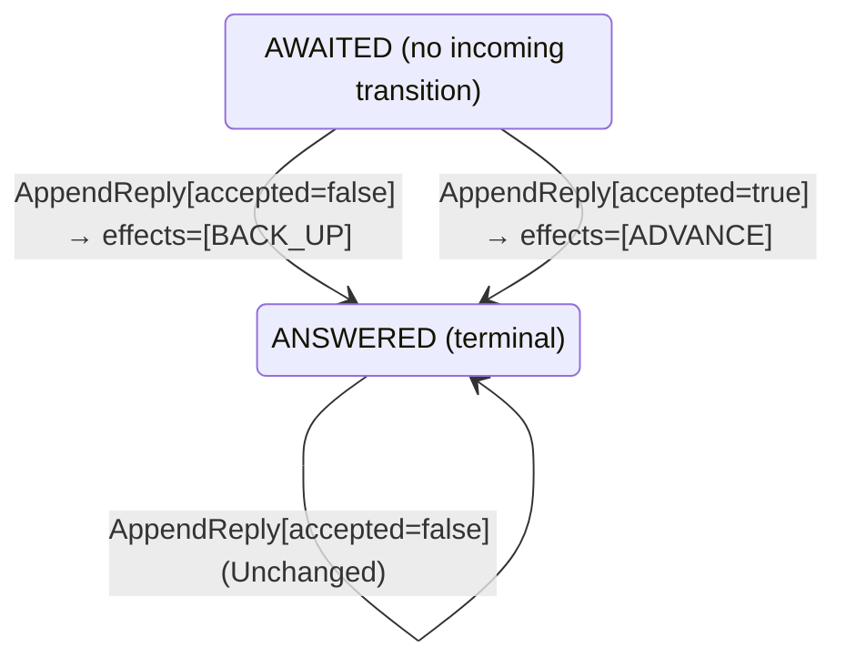

<!-- Generated by examples/tools/build.py from example.json and the verifier's output. Edit example.json. -->
# 104 · A leader that takes a late acceptance as news moves a follower back, proved safe

[← All examples](../README.md)

| Verdict | Categories | Severity if shipped | Change | Verified unit | Approach |
|---|---|---|---|---|---|
| **✓ Verified: all invariants and properties hold in 20,253 states, and under 3 more configurations** | functional, no-false-positive | none | refactor, behaviour change intended | [`ReplyRule#decide`](../../examples/apps/quorum/src/main/java/net/terminalvalue/quorum/raft/ReplyRule.java) | [D1: Protocol model checking](../../examples/apps/quorum/spec/README.md) |

> A Raft leader ignores an acceptance of entries it has already recorded the follower as holding: a late or repeated reply moves nothing backwards. A developer has the leader take the follower's word whenever it comes, late or not: an acceptance says what the follower held when it answered, the record follows it, and the next request carries what the follower has already, which it accepts again. The tests pass, the contract diff is one row, and the change is verified under all four configurations, the three in which an RPC is one step and the one in which a reply waits on the wire and may be handed to the leader twice, which is the one in which the changed row does anything: a leader with an empty log whose heartbeat a follower accepts, which then appends an entry and replicates it, and is handed the heartbeat's acceptance again, records the follower as holding nothing and sends the entry again, which the follower accepts a second time. The record says less than the follower holds, never more, and the commit rule, which counts the record, counts fewer servers than hold the entry, never more.

Tags: [consensus](../README.md#tag-consensus), [log-replication](../README.md#tag-log-replication), [stale-messages](../README.md#tag-stale-messages), [duplicate-delivery](../README.md#tag-duplicate-delivery), [tla-fault-configuration](../README.md#tag-tla-fault-configuration), [generated-operator](../README.md#tag-generated-operator), [multiple-configurations](../README.md#tag-multiple-configurations)

## The change

In `ReplyRule.decide`, the `ANSWERED` arm returns `transition(ANSWERED, ADVANCE)` for an acceptance instead of `unchanged`, with the comment that an acceptance is the follower's own word on what it holds, late or not; a refusal answered already still changes nothing. The javadoc is reworded to match, and the test that a late or repeated reply changes nothing is split: an acceptance is followed whenever it comes, a late refusal changes nothing.

**Before** ([`ReplyRule.java`](../../examples/apps/quorum/src/main/java/net/terminalvalue/quorum/raft/ReplyRule.java), line 14):

```java
* sent and its next index past them; on a refusal, the next index moves back by one, and the next request tries from
* one entry earlier, until the consistency check passes.
*
* <p>A reply the leader's record reflects already, a late or repeated one, changes nothing: an acceptance of entries
* the leader knows the follower holds moves nothing backwards, and a refusal of a request the leader has moved on
* from, or at an entry it knows the follower holds, does not back it up again. The term check comes before this
* rule, in {@link RoleMachine}: a reply from a newer term deposes the leader, and one from an older term, to a
* request of an earlier term of its own, is dropped.
*/
   // ...
       return switch (status) {
           case AWAITED -> reply.accepted() ? transition(ANSWERED, ADVANCE) : transition(ANSWERED, BACK_UP);
           case ANSWERED -> reply.accepted()
                   ? unchanged("holds what the leader has recorded already")
                   : unchanged("a refusal the leader has moved on from");
       };
   }
```

**After:**

```java
* sent and its next index past them; on a refusal, the next index moves back by one, and the next request tries from
* one entry earlier, until the consistency check passes.
*
* <p>An acceptance is the follower's own word on what it holds, and the record follows it whenever it comes, a late
* or repeated one included: the next request then carries what the follower has already, which it accepts again. A
* refusal of a request the leader has moved on from, or at an entry it knows the follower holds, does not back it up
* again. The term check comes before this
* rule, in {@link RoleMachine}: a reply from a newer term deposes the leader, and one from an older term, to a
* request of an earlier term of its own, is dropped.
*/
   // ...
       return switch (status) {
           case AWAITED -> reply.accepted() ? transition(ANSWERED, ADVANCE) : transition(ANSWERED, BACK_UP);
           case ANSWERED -> reply.accepted()
                   ? transition(ANSWERED, ADVANCE) // the follower's own word on what it holds, late or not
                   : unchanged("a refusal the leader has moved on from");
       };
   }
```

<details><summary>Patch</summary>

```diff
--- a/examples/apps/quorum/src/main/java/net/terminalvalue/quorum/raft/ReplyRule.java
+++ b/examples/apps/quorum/src/main/java/net/terminalvalue/quorum/raft/ReplyRule.java
@@ -14,9 +14,10 @@
  * sent and its next index past them; on a refusal, the next index moves back by one, and the next request tries from
  * one entry earlier, until the consistency check passes.
  *
- * <p>A reply the leader's record reflects already, a late or repeated one, changes nothing: an acceptance of entries
- * the leader knows the follower holds moves nothing backwards, and a refusal of a request the leader has moved on
- * from, or at an entry it knows the follower holds, does not back it up again. The term check comes before this
+ * <p>An acceptance is the follower's own word on what it holds, and the record follows it whenever it comes, a late
+ * or repeated one included: the next request then carries what the follower has already, which it accepts again. A
+ * refusal of a request the leader has moved on from, or at an entry it knows the follower holds, does not back it up
+ * again. The term check comes before this
  * rule, in {@link RoleMachine}: a reply from a newer term deposes the leader, and one from an older term, to a
  * request of an earlier term of its own, is dropped.
  */
@@ -28,7 +29,7 @@
         return switch (status) {
             case AWAITED -> reply.accepted() ? transition(ANSWERED, ADVANCE) : transition(ANSWERED, BACK_UP);
             case ANSWERED -> reply.accepted()
-                    ? unchanged("holds what the leader has recorded already")
+                    ? transition(ANSWERED, ADVANCE) // the follower's own word on what it holds, late or not
                     : unchanged("a refusal the leader has moved on from");
         };
     }
--- a/examples/apps/quorum/src/test/java/net/terminalvalue/quorum/raft/ReplyRuleTest.java
+++ b/examples/apps/quorum/src/test/java/net/terminalvalue/quorum/raft/ReplyRuleTest.java
@@ -23,8 +23,11 @@
         equal(new Transition<>(ANSWERED, List.of(BACK_UP)), ReplyRule.decide(AWAITED, new AppendReply(false)));
     }
 
-    public static void aLateOrRepeatedReplyChangesNothing() {
-        check(ReplyRule.decide(ANSWERED, new AppendReply(true)) instanceof Decision.Unchanged, "late acceptance");
+    public static void anAcceptanceIsFollowedWheneverItComes() {
+        equal(new Transition<>(ANSWERED, List.of(ADVANCE)), ReplyRule.decide(ANSWERED, new AppendReply(true)));
+    }
+
+    public static void aLateOrRepeatedRefusalChangesNothing() {
         check(ReplyRule.decide(ANSWERED, new AppendReply(false)) instanceof Decision.Unchanged, "late refusal");
     }
 }
```

</details>

## What the verifier found

The model is checked under 4 configurations, and the verdict is the first that fails:

| Configuration | What it checks | Model | Result |
|---|---|---|---|
| three terms, two entries (`spec/RaftReplication.cfg`) | every run from the initial state, every interleaving within the configuration's bounds | Servers = {s1, s2, s3}, MaxTerm = 3, MaxEntries = 2, DelayedReplies = FALSE | ✓ Verified: all invariants and properties hold in 20,253 states |
| figure 8 (`spec/RaftReplicationFigureEight.cfg`) | every run of three servers over four terms with one entry per leader's log, the budget of figure 8 of the paper: a leader of term 1 appends an entry it never gets to replicate, a leader of term 2 appends its own at the same index, the first comes back as the leader of term 3 and replicates its entry of term 1 to a majority, and the second, whose last entry is from the later term, can still be elected in term 4 without it; three terms cannot show this, and the same invariants and action properties are checked | Servers = {s1, s2, s3}, MaxTerm = 4, MaxEntries = 1, DelayedReplies = FALSE | ✓ Verified: all invariants and properties hold in 8,838 states |
| fairness (`spec/RaftReplicationLive.cfg`) | the three liveness properties, under the fairness conditions `Fairness`: a server whose timer nothing resets times out, a candidate asks for the votes it lacks, a leader sends every follower its next entry or a heartbeat and marks committed what the commit rule lets it; nothing is assumed of the clients, so the properties hold whether or not a request comes. Three servers, three terms and one entry per leader, without the symmetry set, since TLC's liveness checking is unsound under one. A counterexample is a run that goes on forever without satisfying a property: a prefix, then a state or a cycle the system never leaves | Servers = {s1, s2, s3}, MaxTerm = 3, MaxEntries = 1, DelayedReplies = FALSE | ✓ Verified: all invariants and properties hold in 14,388 states |
| delayed replies (`spec/RaftReplicationDelayed.cfg`) | every run of three servers over two terms with logs of up to two entries in which the reply to an AppendEntries request is a step of its own (`DelayedReplies = TRUE`): the leader may take it after it has sent the follower another request and taken its reply, been deposed, or been elected again in a later term, and the network may hand it the same reply twice, or never. The one-step RPC of the other configurations hands the reply rule nothing but the request just sent; this one hands it late and repeated replies, and checks the leader's record of its followers against what they hold, under the same invariants and action properties | Servers = {s1, s2, s3}, MaxTerm = 2, MaxEntries = 1, DelayedReplies = TRUE | ✓ Verified: all invariants and properties hold in 605,428 states |

Every invariant holds in every reachable state of the model, and every temporal property holds of every behaviour, the infinite ones included under three terms, two entries: 20,253 distinct states, which is every interleaving of the servers, their terms, votes and logs, and the AppendEntries RPCs between them within the model's bounds (Servers = {s1, s2, s3}, MaxTerm = 3, MaxEntries = 2, DelayedReplies = FALSE).

The follower's append rule, the leader's reply rule and commit rule, the role machine and the vote rule inside the model are generated from the behavioural contracts of the patched code, so the model checks the entries the followers really take, the record the leaders really keep of them, the commits the leaders really make, and the roles and votes behind them.

The other configurations hold too, as the table says: figure 8, 8,838 states; fairness, 14,388 states; delayed replies, 605,428 states.

**What the verdict rests on.** TLC counted how often a step of the model took each row of the generated operators. A row no step takes is one the model says nothing about, whatever the verdict.

| Configuration | Rows of `RoleMachine#decide` taken | Rows of `VoteRule#decide` taken | Rows of `AppendRule#decide` taken | Rows of `ReplyRule#decide` taken | Rows of `CommitRule#decide` taken |
|---|---|---|---|---|---|
| three terms, two entries | 27 of 36 | 12 of 27 | 16 of 24 | 3 of 4 | 4 of 12 |
| figure 8 | 27 of 36 | 12 of 27 | 10 of 24 | 3 of 4 | 4 of 12 |
| fairness | 27 of 36 | 12 of 27 | 10 of 24 | 3 of 4 | 4 of 12 |
| delayed replies | 29 of 36 | 10 of 27 | 10 of 24 | 4 of 4 | 4 of 12 |

The change alters 1 row of the contract:

- `decide(ANSWERED, AppendReply[accepted=true])`: `Unchanged[reason="holds what the leader has recorded already"]` → `Transition[next=ANSWERED, effects=[ADVANCE]]`, taken under three terms, two entries, figure 8, fairness, delayed replies

Runs of the model take every row the change alters: the verdict rests on the change.

<details><summary>Rows no step takes under three terms, two entries</summary>

`net.terminalvalue.quorum.raft.RoleMachine#decide`:

```
decide(FOLLOWER, VotesCounted[majority=true]) => Unchanged
decide(FOLLOWER, Response[term=OLDER]) => Unchanged
decide(FOLLOWER, Response[term=CURRENT]) => Unchanged
decide(FOLLOWER, Response[term=NEWER]) => Transition[next=FOLLOWER, effects=[ADOPT_TERM]]
decide(CANDIDATE, Response[term=OLDER]) => Unchanged
decide(LEADER, VotesCounted[majority=false]) => Unchanged
decide(LEADER, VotesCounted[majority=true]) => Unchanged
decide(LEADER, AppendEntries[term=CURRENT]) => throws IllegalStateException
decide(LEADER, Response[term=OLDER]) => Unchanged
```

`net.terminalvalue.quorum.raft.VoteRule#decide`:

```
decide(OPEN, VoteRequest[term=NEWER, log=BEHIND]) => Rejected
decide(OPEN, VoteRequest[term=NEWER, log=EVEN]) => Transition[next=FOR_THE_CANDIDATE, effects=[GRANT]]
decide(OPEN, VoteRequest[term=NEWER, log=AHEAD]) => Transition[next=FOR_THE_CANDIDATE, effects=[GRANT]]
decide(FOR_THE_CANDIDATE, VoteRequest[term=OLDER, log=BEHIND]) => Rejected
decide(FOR_THE_CANDIDATE, VoteRequest[term=OLDER, log=EVEN]) => Rejected
decide(FOR_THE_CANDIDATE, VoteRequest[term=OLDER, log=AHEAD]) => Rejected
decide(FOR_THE_CANDIDATE, VoteRequest[term=CURRENT, log=BEHIND]) => Rejected
decide(FOR_THE_CANDIDATE, VoteRequest[term=CURRENT, log=EVEN]) => Transition[next=FOR_THE_CANDIDATE, effects=[GRANT]]
decide(FOR_THE_CANDIDATE, VoteRequest[term=CURRENT, log=AHEAD]) => Transition[next=FOR_THE_CANDIDATE, effects=[GRANT]]
decide(FOR_THE_CANDIDATE, VoteRequest[term=NEWER, log=BEHIND]) => Rejected
decide(FOR_THE_CANDIDATE, VoteRequest[term=NEWER, log=EVEN]) => Transition[next=FOR_THE_CANDIDATE, effects=[GRANT]]
decide(FOR_THE_CANDIDATE, VoteRequest[term=NEWER, log=AHEAD]) => Transition[next=FOR_THE_CANDIDATE, effects=[GRANT]]
decide(FOR_ANOTHER, VoteRequest[term=NEWER, log=BEHIND]) => Rejected
decide(FOR_ANOTHER, VoteRequest[term=NEWER, log=EVEN]) => Transition[next=FOR_THE_CANDIDATE, effects=[GRANT]]
decide(FOR_ANOTHER, VoteRequest[term=NEWER, log=AHEAD]) => Transition[next=FOR_THE_CANDIDATE, effects=[GRANT]]
```

`net.terminalvalue.quorum.raft.AppendRule#decide`:

```
decide(MISSING, AppendRequest[entry=SAME, commitAhead=false]) => Rejected
decide(MISSING, AppendRequest[entry=SAME, commitAhead=true]) => Rejected
decide(MISSING, AppendRequest[entry=CONFLICTING, commitAhead=false]) => Rejected
decide(MISSING, AppendRequest[entry=CONFLICTING, commitAhead=true]) => Rejected
decide(CONFLICTING, AppendRequest[entry=SAME, commitAhead=false]) => Rejected
decide(CONFLICTING, AppendRequest[entry=SAME, commitAhead=true]) => Rejected
decide(MATCHING, AppendRequest[entry=SAME, commitAhead=false]) => Unchanged
decide(MATCHING, AppendRequest[entry=SAME, commitAhead=true]) => Transition[next=MATCHING, effects=[ADVANCE_COMMIT]]
```

`net.terminalvalue.quorum.raft.ReplyRule#decide`:

```
decide(ANSWERED, AppendReply[accepted=false]) => Unchanged
```

`net.terminalvalue.quorum.raft.CommitRule#decide`:

```
decide(PENDING, Replication[term=NEWER, majority=false]) => throws IllegalStateException
decide(PENDING, Replication[term=NEWER, majority=true]) => throws IllegalStateException
decide(COMMITTED, Replication[term=OLDER, majority=false]) => Unchanged
decide(COMMITTED, Replication[term=OLDER, majority=true]) => Unchanged
decide(COMMITTED, Replication[term=CURRENT, majority=false]) => Unchanged
decide(COMMITTED, Replication[term=CURRENT, majority=true]) => Unchanged
decide(COMMITTED, Replication[term=NEWER, majority=false]) => Unchanged
decide(COMMITTED, Replication[term=NEWER, majority=true]) => Unchanged
```

</details>

The state machine the patched code implements, drawn from its derived contract (`jvmcontract statemachine`); a state with no way in or no way out is marked:



## Would the existing tests have caught it?

Every existing unit test passes, as it should (`java -ea net.terminalvalue.quorum.Tests`, run against the patched code).

## Why it matters

Low, and the question a reviewer asks is the one example 103 answers in the other direction: whether a reply the record has answered already can be taken as news without the record going wrong. For a refusal it cannot; for an acceptance the record goes down, to what the follower held when it answered, which it still holds, since within a term only this leader writes the follower's log and only appends to it. The one-step configurations cannot tell this change from the committed rule, since the only answered acceptance they hand the rule is a heartbeat's, through the index the record holds already, which the patched row moves to where it is. The delayed replies configuration is the one in which a late acceptance reaches below the record.

## Why the verdict is right

The reply rule in the model is generated from the regenerated contract, so an acceptance answered already moves the follower's match index to the last entry it accepted and its next index past it. TLC verifies the change under all four configurations: 20,253, 8,838 and 14,388 states under the three one-step configurations, the same as the committed rule's, since the changed row is taken there only by the heartbeat a caught-up follower accepts, which moves the record to where it is; and 605,428 states under `RaftReplicationDelayed.cfg`, more than the committed rule's 261,060, since the record now goes back on a late acceptance and the leader sends again. Every invariant holds, `MatchIndexIsRight` and `NextIndexPastMatch` among them: the record never says more than the follower holds, and the next index stays past the match index, since the two move together.

## What to do

Merge, if the round trips are acceptable. Taking a late acceptance as the follower's current state is wrong in general and safe here: the record understates what the follower holds, which costs the leader a request the follower accepts again and the commit rule a server it could have counted, and overstates nothing. A reviewer who wants the record monotonic has etcd's MaybeUpdate to point to, which takes the maximum; a reviewer who wants the cheapest rule has this one. What the verification settles is that neither choice can commit an entry a majority does not hold.

## Notes

- The Raft replication model (`apps/quorum/spec/RaftReplication.tla`) has the logs live, around the follower's append rule and the leader's commit rule as generated operators beside the role machine and the vote rule, and checks log matching, leader completeness and state machine safety, with an action property that no committed entry is ever overwritten. Its configurations are three terms with two entries, and the four terms of the paper's figure 8.
- The leader's side of the RPC, `ReplyRule#decide`, is the replication model's third generated operator. `RaftReplicationDelayed.cfg` lets the reply wait on the wire, arrive after the leader has sent again or been deposed, arrive twice, or never, and checks the leader's record of its followers (`MatchIndexIsRight`, `NextIndexPastMatch`), which a one-step RPC cannot break.
- The same row's neighbour as 103, changed the same way and safe this time: the one-step configurations cannot tell 103 and 104 apart, and the delayed configuration does. A reviewer who wants the record monotonic has etcd's `MaybeUpdate` to point to.

## Evidence

How the verdict was reached: three terms, two entries: TLC 2.19 explored 20,253 distinct states to depth 20 in 13 s, for the model Servers = {s1, s2, s3}, MaxTerm = 3, MaxEntries = 2, DelayedReplies = FALSE; figure 8: TLC 2.19 explored 8,838 distinct states to depth 18 in 8 s, for the model Servers = {s1, s2, s3}, MaxTerm = 4, MaxEntries = 1, DelayedReplies = FALSE; fairness: TLC 2.19 explored 14,388 distinct states to depth 16, for the model Servers = {s1, s2, s3}, MaxTerm = 3, MaxEntries = 1, DelayedReplies = FALSE; delayed replies: TLC 2.19 explored 605,428 distinct states to depth 26, for the model Servers = {s1, s2, s3}, MaxTerm = 2, MaxEntries = 1, DelayedReplies = TRUE.

<details><summary>Verifier output</summary>

```text
== three terms, two entries: spec/RaftReplication.cfg ==
TLC2 Version 2.19 of 08 August 2024 (rev: 5a47802)
Running breadth-first search Model-Checking with fp 1 and seed 1 with 1 worker on 2 cores with 2185MB heap and 64MB offheap memory [pid: 1240176] (Linux 6.6.87.2-microsoft-standard-WSL2 aarch64, Eclipse Adoptium 25.0.4.1 x86_64, MSBDiskFPSet, DiskStateQueue).
Parsing file examples/apps/quorum/spec/RaftReplication.tla
Parsing file examples/tools/tla/standard-modules/Naturals.tla
Parsing file examples/tools/tla/standard-modules/FiniteSets.tla
Parsing file examples/tools/tla/standard-modules/Sequences.tla
Parsing file examples/tools/tla/standard-modules/TLC.tla
Parsing file examples/apps/quorum/spec/RoleMachineContract.tla
Parsing file examples/apps/quorum/spec/VoteRuleContract.tla
Parsing file examples/apps/quorum/spec/AppendRuleContract.tla
Parsing file examples/apps/quorum/spec/ReplyRuleContract.tla
Parsing file examples/apps/quorum/spec/CommitRuleContract.tla
Semantic processing of module Naturals
Semantic processing of module Sequences
Semantic processing of module FiniteSets
Semantic processing of module TLC
Semantic processing of module RoleMachineContract
Semantic processing of module VoteRuleContract
Semantic processing of module AppendRuleContract
Semantic processing of module ReplyRuleContract
Semantic processing of module CommitRuleContract
Semantic processing of module RaftReplication
Starting... (2026-11-04 00:40:16)
Computing initial states...
Finished computing initial states: 1 distinct state generated at 2026-11-04 00:40:19.
Model checking completed. No error has been found.
  Estimates of the probability that TLC did not check all reachable states
  because two distinct states had the same fingerprint:
  calculated (optimistic):  val = 8.8E-11
Rows of net.terminalvalue.quorum.raft.RoleMachine#decide a step of the model takes: 27 of 36; never taken (9):
  decide(FOLLOWER, VotesCounted[majority=true]) => Unchanged
  decide(FOLLOWER, Response[term=OLDER]) => Unchanged
  decide(FOLLOWER, Response[term=CURRENT]) => Unchanged
  decide(FOLLOWER, Response[term=NEWER]) => Transition[next=FOLLOWER, effects=[ADOPT_TERM]]
  decide(CANDIDATE, Response[term=OLDER]) => Unchanged
  decide(LEADER, VotesCounted[majority=false]) => Unchanged
  decide(LEADER, VotesCounted[majority=true]) => Unchanged
  decide(LEADER, AppendEntries[term=CURRENT]) => throws IllegalStateException
  decide(LEADER, Response[term=OLDER]) => Unchanged
Rows of net.terminalvalue.quorum.raft.VoteRule#decide a step of the model takes: 12 of 27; never taken (15):
  decide(OPEN, VoteRequest[term=NEWER, log=BEHIND]) => Rejected
  decide(OPEN, VoteRequest[term=NEWER, log=EVEN]) => Transition[next=FOR_THE_CANDIDATE, effects=[GRANT]]
  decide(OPEN, VoteRequest[term=NEWER, log=AHEAD]) => Transition[next=FOR_THE_CANDIDATE, effects=[GRANT]]
  decide(FOR_THE_CANDIDATE, VoteRequest[term=OLDER, log=BEHIND]) => Rejected
  decide(FOR_THE_CANDIDATE, VoteRequest[term=OLDER, log=EVEN]) => Rejected
  decide(FOR_THE_CANDIDATE, VoteRequest[term=OLDER, log=AHEAD]) => Rejected
  decide(FOR_THE_CANDIDATE, VoteRequest[term=CURRENT, log=BEHIND]) => Rejected
  decide(FOR_THE_CANDIDATE, VoteRequest[term=CURRENT, log=EVEN]) => Transition[next=FOR_THE_CANDIDATE, effects=[GRANT]]
  decide(FOR_THE_CANDIDATE, VoteRequest[term=CURRENT, log=AHEAD]) => Transition[next=FOR_THE_CANDIDATE, effects=[GRANT]]
  decide(FOR_THE_CANDIDATE, VoteRequest[term=NEWER, log=BEHIND]) => Rejected
  decide(FOR_THE_CANDIDATE, VoteRequest[term=NEWER, log=EVEN]) => Transition[next=FOR_THE_CANDIDATE, effects=[GRANT]]
  decide(FOR_THE_CANDIDATE, VoteRequest[term=NEWER, log=AHEAD]) => Transition[next=FOR_THE_CANDIDATE, effects=[GRANT]]
  decide(FOR_ANOTHER, VoteRequest[term=NEWER, log=BEHIND]) => Rejected
  decide(FOR_ANOTHER, VoteRequest[term=NEWER, log=EVEN]) => Transition[next=FOR_THE_CANDIDATE, effects=[GRANT]]
  decide(FOR_ANOTHER, VoteRequest[term=NEWER, log=AHEAD]) => Transition[next=FOR_THE_CANDIDATE, effects=[GRANT]]
Rows of net.terminalvalue.quorum.raft.AppendRule#decide a step of the model takes: 16 of 24; never taken (8):
  decide(MISSING, AppendRequest[entry=SAME, commitAhead=false]) => Rejected
  decide(MISSING, AppendRequest[entry=SAME, commitAhead=true]) => Rejected
  decide(MISSING, AppendRequest[entry=CONFLICTING, commitAhead=false]) => Rejected
  decide(MISSING, AppendRequest[entry=CONFLICTING, commitAhead=true]) => Rejected
  decide(CONFLICTING, AppendRequest[entry=SAME, commitAhead=false]) => Rejected
  decide(CONFLICTING, AppendRequest[entry=SAME, commitAhead=true]) => Rejected
  decide(MATCHING, AppendRequest[entry=SAME, commitAhead=false]) => Unchanged
  decide(MATCHING, AppendRequest[entry=SAME, commitAhead=true]) => Transition[next=MATCHING, effects=[ADVANCE_COMMIT]]
Rows of net.terminalvalue.quorum.raft.ReplyRule#decide a step of the model takes: 3 of 4; never taken (1):
  decide(ANSWERED, AppendReply[accepted=false]) => Unchanged
Rows of net.terminalvalue.quorum.raft.CommitRule#decide a step of the model takes: 4 of 12; never taken (8):
  decide(PENDING, Replication[term=NEWER, majority=false]) => throws IllegalStateException
  decide(PENDING, Replication[term=NEWER, majority=true]) => throws IllegalStateException
  decide(COMMITTED, Replication[term=OLDER, majority=false]) => Unchanged
  decide(COMMITTED, Replication[term=OLDER, majority=true]) => Unchanged
  decide(COMMITTED, Replication[term=CURRENT, majority=false]) => Unchanged
  decide(COMMITTED, Replication[term=CURRENT, majority=true]) => Unchanged
  decide(COMMITTED, Replication[term=NEWER, majority=false]) => Unchanged
  decide(COMMITTED, Replication[term=NEWER, majority=true]) => Unchanged
100137 states generated, 20253 distinct states found, 0 states left on queue.
The depth of the complete state graph search is 20.
The average outdegree of the complete state graph is 1 (minimum is 0, the maximum 8 and the 95th percentile is 3).
Finished in 13s at (2026-11-04 00:40:29)

== figure 8: spec/RaftReplicationFigureEight.cfg ==
TLC2 Version 2.19 of 08 August 2024 (rev: 5a47802)
Running breadth-first search Model-Checking with fp 1 and seed 1 with 1 worker on 2 cores with 2185MB heap and 64MB offheap memory [pid: 1240800] (Linux 6.6.87.2-microsoft-standard-WSL2 aarch64, Eclipse Adoptium 25.0.4.1 x86_64, MSBDiskFPSet, DiskStateQueue).
Parsing file examples/apps/quorum/spec/RaftReplication.tla
Parsing file examples/tools/tla/standard-modules/Naturals.tla
Parsing file examples/tools/tla/standard-modules/FiniteSets.tla
Parsing file examples/tools/tla/standard-modules/Sequences.tla
Parsing file examples/tools/tla/standard-modules/TLC.tla
Parsing file examples/apps/quorum/spec/RoleMachineContract.tla
Parsing file examples/apps/quorum/spec/VoteRuleContract.tla
Parsing file examples/apps/quorum/spec/AppendRuleContract.tla
Parsing file examples/apps/quorum/spec/ReplyRuleContract.tla
Parsing file examples/apps/quorum/spec/CommitRuleContract.tla
Semantic processing of module Naturals
Semantic processing of module Sequences
Semantic processing of module FiniteSets
Semantic processing of module TLC
Semantic processing of module RoleMachineContract
Semantic processing of module VoteRuleContract
Semantic processing of module AppendRuleContract
Semantic processing of module ReplyRuleContract
Semantic processing of module CommitRuleContract
Semantic processing of module RaftReplication
Starting... (2026-11-04 00:40:30)
Computing initial states...
Finished computing initial states: 1 distinct state generated at 2026-11-04 00:40:33.
Model checking completed. No error has been found.
  Estimates of the probability that TLC did not check all reachable states
  because two distinct states had the same fingerprint:
  calculated (optimistic):  val = 1.9E-11
Rows of net.terminalvalue.quorum.raft.RoleMachine#decide a step of the model takes: 27 of 36; never taken (9):
  decide(FOLLOWER, VotesCounted[majority=true]) => Unchanged
  decide(FOLLOWER, Response[term=OLDER]) => Unchanged
  decide(FOLLOWER, Response[term=CURRENT]) => Unchanged
  decide(FOLLOWER, Response[term=NEWER]) => Transition[next=FOLLOWER, effects=[ADOPT_TERM]]
  decide(CANDIDATE, Response[term=OLDER]) => Unchanged
  decide(LEADER, VotesCounted[majority=false]) => Unchanged
  decide(LEADER, VotesCounted[majority=true]) => Unchanged
  decide(LEADER, AppendEntries[term=CURRENT]) => throws IllegalStateException
  decide(LEADER, Response[term=OLDER]) => Unchanged
Rows of net.terminalvalue.quorum.raft.VoteRule#decide a step of the model takes: 12 of 27; never taken (15):
  decide(OPEN, VoteRequest[term=NEWER, log=BEHIND]) => Rejected
  decide(OPEN, VoteRequest[term=NEWER, log=EVEN]) => Transition[next=FOR_THE_CANDIDATE, effects=[GRANT]]
  decide(OPEN, VoteRequest[term=NEWER, log=AHEAD]) => Transition[next=FOR_THE_CANDIDATE, effects=[GRANT]]
  decide(FOR_THE_CANDIDATE, VoteRequest[term=OLDER, log=BEHIND]) => Rejected
  decide(FOR_THE_CANDIDATE, VoteRequest[term=OLDER, log=EVEN]) => Rejected
  decide(FOR_THE_CANDIDATE, VoteRequest[term=OLDER, log=AHEAD]) => Rejected
  decide(FOR_THE_CANDIDATE, VoteRequest[term=CURRENT, log=BEHIND]) => Rejected
  decide(FOR_THE_CANDIDATE, VoteRequest[term=CURRENT, log=EVEN]) => Transition[next=FOR_THE_CANDIDATE, effects=[GRANT]]
  decide(FOR_THE_CANDIDATE, VoteRequest[term=CURRENT, log=AHEAD]) => Transition[next=FOR_THE_CANDIDATE, effects=[GRANT]]
  decide(FOR_THE_CANDIDATE, VoteRequest[term=NEWER, log=BEHIND]) => Rejected
  decide(FOR_THE_CANDIDATE, VoteRequest[term=NEWER, log=EVEN]) => Transition[next=FOR_THE_CANDIDATE, effects=[GRANT]]
  decide(FOR_THE_CANDIDATE, VoteRequest[term=NEWER, log=AHEAD]) => Transition[next=FOR_THE_CANDIDATE, effects=[GRANT]]
  decide(FOR_ANOTHER, VoteRequest[term=NEWER, log=BEHIND]) => Rejected
  decide(FOR_ANOTHER, VoteRequest[term=NEWER, log=EVEN]) => Transition[next=FOR_THE_CANDIDATE, effects=[GRANT]]
  decide(FOR_ANOTHER, VoteRequest[term=NEWER, log=AHEAD]) => Transition[next=FOR_THE_CANDIDATE, effects=[GRANT]]
Rows of net.terminalvalue.quorum.raft.AppendRule#decide a step of the model takes: 10 of 24; never taken (14):
  decide(MISSING, AppendRequest[entry=ABSENT, commitAhead=false]) => Rejected
  decide(MISSING, AppendRequest[entry=ABSENT, commitAhead=true]) => Rejected
  decide(MISSING, AppendRequest[entry=SAME, commitAhead=false]) => Rejected
  decide(MISSING, AppendRequest[entry=SAME, commitAhead=true]) => Rejected
  decide(MISSING, AppendRequest[entry=CONFLICTING, commitAhead=false]) => Rejected
  decide(MISSING, AppendRequest[entry=CONFLICTING, commitAhead=true]) => Rejected
  decide(CONFLICTING, AppendRequest[entry=ABSENT, commitAhead=false]) => Rejected
  decide(CONFLICTING, AppendRequest[entry=ABSENT, commitAhead=true]) => Rejected
  decide(CONFLICTING, AppendRequest[entry=SAME, commitAhead=false]) => Rejected
  decide(CONFLICTING, AppendRequest[entry=SAME, commitAhead=true]) => Rejected
  decide(CONFLICTING, AppendRequest[entry=CONFLICTING, commitAhead=false]) => Rejected
  decide(CONFLICTING, AppendRequest[entry=CONFLICTING, commitAhead=true]) => Rejected
  decide(MATCHING, AppendRequest[entry=SAME, commitAhead=false]) => Unchanged
  decide(MATCHING, AppendRequest[entry=SAME, commitAhead=true]) => Transition[next=MATCHING, effects=[ADVANCE_COMMIT]]
Rows of net.terminalvalue.quorum.raft.ReplyRule#decide a step of the model takes: 3 of 4; never taken (1):
  decide(ANSWERED, AppendReply[accepted=false]) => Unchanged
Rows of net.terminalvalue.quorum.raft.CommitRule#decide a step of the model takes: 4 of 12; never taken (8):
  decide(PENDING, Replication[term=NEWER, majority=false]) => throws IllegalStateException
  decide(PENDING, Replication[term=NEWER, majority=true]) => throws IllegalStateException
  decide(COMMITTED, Replication[term=OLDER, majority=false]) => Unchanged
  decide(COMMITTED, Replication[term=OLDER, majority=true]) => Unchanged
  decide(COMMITTED, Replication[term=CURRENT, majority=false]) => Unchanged
  decide(COMMITTED, Replication[term=CURRENT, majority=true]) => Unchanged
  decide(COMMITTED, Replication[term=NEWER, majority=false]) => Unchanged
  decide(COMMITTED, Replication[term=NEWER, majority=true]) => Unchanged
48709 states generated, 8838 distinct states found, 0 states left on queue.
The depth of the complete state graph search is 18.
The average outdegree of the complete state graph is 1 (minimum is 0, the maximum 7 and the 95th percentile is 3).
Finished in 08s at (2026-11-04 00:40:38)

== fairness: spec/RaftReplicationLive.cfg ==
TLC2 Version 2.19 of 08 August 2024 (rev: 5a47802)
Running breadth-first search Model-Checking with fp 1 and seed 1 with 1 worker on 2 cores with 2185MB heap and 64MB offheap memory [pid: 1241263] (Linux 6.6.87.2-microsoft-standard-WSL2 aarch64, Eclipse Adoptium 25.0.4.1 x86_64, MSBDiskFPSet, DiskStateQueue).
Parsing file examples/apps/quorum/spec/RaftReplication.tla
Parsing file examples/tools/tla/standard-modules/Naturals.tla
Parsing file examples/tools/tla/standard-modules/FiniteSets.tla
Parsing file examples/tools/tla/standard-modules/Sequences.tla
Parsing file examples/tools/tla/standard-modules/TLC.tla
Parsing file examples/apps/quorum/spec/RoleMachineContract.tla
Parsing file examples/apps/quorum/spec/VoteRuleContract.tla
Parsing file examples/apps/quorum/spec/AppendRuleContract.tla
Parsing file examples/apps/quorum/spec/ReplyRuleContract.tla
Parsing file examples/apps/quorum/spec/CommitRuleContract.tla
Semantic processing of module Naturals
Semantic processing of module Sequences
Semantic processing of module FiniteSets
Semantic processing of module TLC
Semantic processing of module RoleMachineContract
Semantic processing of module VoteRuleContract
Semantic processing of module AppendRuleContract
Semantic processing of module ReplyRuleContract
Semantic processing of module CommitRuleContract
Semantic processing of module RaftReplication
Starting... (2026-11-04 00:40:39)
Implied-temporal checking--satisfiability problem has 5 branches.
Computing initial states...
Finished computing initial states: 1 distinct state generated at 2026-11-04 00:40:42.
Checking 5 branches of temporal properties for the current state space with 2615 total distinct states at (2026-11-04 00:40:45)
Finished checking temporal properties in 00s at 2026-11-04 00:40:45
Checking 5 branches of temporal properties for the current state space with 50460 total distinct states at (2026-11-04 00:41:45)
Finished checking temporal properties in 00s at 2026-11-04 00:41:45
Checking 5 branches of temporal properties for the complete state space with 71940 total distinct states at (2026-11-04 00:42:05)
Finished checking temporal properties in 00s at 2026-11-04 00:42:05
Model checking completed. No error has been found.
  Estimates of the probability that TLC did not check all reachable states
  because two distinct states had the same fingerprint:
  calculated (optimistic):  val = 4.4E-11
Rows of net.terminalvalue.quorum.raft.RoleMachine#decide a step of the model takes: 27 of 36; never taken (9):
  decide(FOLLOWER, VotesCounted[majority=true]) => Unchanged
  decide(FOLLOWER, Response[term=OLDER]) => Unchanged
  decide(FOLLOWER, Response[term=CURRENT]) => Unchanged
  decide(FOLLOWER, Response[term=NEWER]) => Transition[next=FOLLOWER, effects=[ADOPT_TERM]]
  decide(CANDIDATE, Response[term=OLDER]) => Unchanged
  decide(LEADER, VotesCounted[majority=false]) => Unchanged
  decide(LEADER, VotesCounted[majority=true]) => Unchanged
  decide(LEADER, AppendEntries[term=CURRENT]) => throws IllegalStateException
  decide(LEADER, Response[term=OLDER]) => Unchanged
Rows of net.terminalvalue.quorum.raft.VoteRule#decide a step of the model takes: 12 of 27; never taken (15):
  decide(OPEN, VoteRequest[term=NEWER, log=BEHIND]) => Rejected
  decide(OPEN, VoteRequest[term=NEWER, log=EVEN]) => Transition[next=FOR_THE_CANDIDATE, effects=[GRANT]]
  decide(OPEN, VoteRequest[term=NEWER, log=AHEAD]) => Transition[next=FOR_THE_CANDIDATE, effects=[GRANT]]
  decide(FOR_THE_CANDIDATE, VoteRequest[term=OLDER, log=BEHIND]) => Rejected
  decide(FOR_THE_CANDIDATE, VoteRequest[term=OLDER, log=EVEN]) => Rejected
  decide(FOR_THE_CANDIDATE, VoteRequest[term=OLDER, log=AHEAD]) => Rejected
  decide(FOR_THE_CANDIDATE, VoteRequest[term=CURRENT, log=BEHIND]) => Rejected
  decide(FOR_THE_CANDIDATE, VoteRequest[term=CURRENT, log=EVEN]) => Transition[next=FOR_THE_CANDIDATE, effects=[GRANT]]
  decide(FOR_THE_CANDIDATE, VoteRequest[term=CURRENT, log=AHEAD]) => Transition[next=FOR_THE_CANDIDATE, effects=[GRANT]]
  decide(FOR_THE_CANDIDATE, VoteRequest[term=NEWER, log=BEHIND]) => Rejected
  decide(FOR_THE_CANDIDATE, VoteRequest[term=NEWER, log=EVEN]) => Transition[next=FOR_THE_CANDIDATE, effects=[GRANT]]
  decide(FOR_THE_CANDIDATE, VoteRequest[term=NEWER, log=AHEAD]) => Transition[next=FOR_THE_CANDIDATE, effects=[GRANT]]
  decide(FOR_ANOTHER, VoteRequest[term=NEWER, log=BEHIND]) => Rejected
  decide(FOR_ANOTHER, VoteRequest[term=NEWER, log=EVEN]) => Transition[next=FOR_THE_CANDIDATE, effects=[GRANT]]
  decide(FOR_ANOTHER, VoteRequest[term=NEWER, log=AHEAD]) => Transition[next=FOR_THE_CANDIDATE, effects=[GRANT]]
Rows of net.terminalvalue.quorum.raft.AppendRule#decide a step of the model takes: 10 of 24; never taken (14):
  decide(MISSING, AppendRequest[entry=ABSENT, commitAhead=false]) => Rejected
  decide(MISSING, AppendRequest[entry=ABSENT, commitAhead=true]) => Rejected
  decide(MISSING, AppendRequest[entry=SAME, commitAhead=false]) => Rejected
  decide(MISSING, AppendRequest[entry=SAME, commitAhead=true]) => Rejected
  decide(MISSING, AppendRequest[entry=CONFLICTING, commitAhead=false]) => Rejected
  decide(MISSING, AppendRequest[entry=CONFLICTING, commitAhead=true]) => Rejected
  decide(CONFLICTING, AppendRequest[entry=ABSENT, commitAhead=false]) => Rejected
  decide(CONFLICTING, AppendRequest[entry=ABSENT, commitAhead=true]) => Rejected
  decide(CONFLICTING, AppendRequest[entry=SAME, commitAhead=false]) => Rejected
  decide(CONFLICTING, AppendRequest[entry=SAME, commitAhead=true]) => Rejected
  decide(CONFLICTING, AppendRequest[entry=CONFLICTING, commitAhead=false]) => Rejected
  decide(CONFLICTING, AppendRequest[entry=CONFLICTING, commitAhead=true]) => Rejected
  decide(MATCHING, AppendRequest[entry=SAME, commitAhead=false]) => Unchanged
  decide(MATCHING, AppendRequest[entry=SAME, commitAhead=true]) => Transition[next=MATCHING, effects=[ADVANCE_COMMIT]]
Rows of net.terminalvalue.quorum.raft.ReplyRule#decide a step of the model takes: 3 of 4; never taken (1):
  decide(ANSWERED, AppendReply[accepted=false]) => Unchanged
Rows of net.terminalvalue.quorum.raft.CommitRule#decide a step of the model takes: 4 of 12; never taken (8):
  decide(PENDING, Replication[term=NEWER, majority=false]) => throws IllegalStateException
  decide(PENDING, Replication[term=NEWER, majority=true]) => throws IllegalStateException
  decide(COMMITTED, Replication[term=OLDER, majority=false]) => Unchanged
  decide(COMMITTED, Replication[term=OLDER, majority=true]) => Unchanged
  decide(COMMITTED, Replication[term=CURRENT, majority=false]) => Unchanged
  decide(COMMITTED, Replication[term=CURRENT, majority=true]) => Unchanged
  decide(COMMITTED, Replication[term=NEWER, majority=false]) => Unchanged
  decide(COMMITTED, Replication[term=NEWER, majority=true]) => Unchanged
71185 states generated, 14388 distinct states found, 0 states left on queue.
The depth of the complete state graph search is 16.
The average outdegree of the complete state graph is 1 (minimum is 0, the maximum 7 and the 95th percentile is 3).
Finished in 01min 26s at (2026-11-04 00:42:06)

== delayed replies: spec/RaftReplicationDelayed.cfg ==
TLC2 Version 2.19 of 08 August 2024 (rev: 5a47802)
Running breadth-first search Model-Checking with fp 1 and seed 1 with 1 worker on 2 cores with 2185MB heap and 64MB offheap memory [pid: 1246297] (Linux 6.6.87.2-microsoft-standard-WSL2 aarch64, Eclipse Adoptium 25.0.4.1 x86_64, MSBDiskFPSet, DiskStateQueue).
Parsing file examples/apps/quorum/spec/RaftReplication.tla
Parsing file examples/tools/tla/standard-modules/Naturals.tla
Parsing file examples/tools/tla/standard-modules/FiniteSets.tla
Parsing file examples/tools/tla/standard-modules/Sequences.tla
Parsing file examples/tools/tla/standard-modules/TLC.tla
Parsing file examples/apps/quorum/spec/RoleMachineContract.tla
Parsing file examples/apps/quorum/spec/VoteRuleContract.tla
Parsing file examples/apps/quorum/spec/AppendRuleContract.tla
Parsing file examples/apps/quorum/spec/ReplyRuleContract.tla
Parsing file examples/apps/quorum/spec/CommitRuleContract.tla
Semantic processing of module Naturals
Semantic processing of module Sequences
Semantic processing of module FiniteSets
Semantic processing of module TLC
Semantic processing of module RoleMachineContract
Semantic processing of module VoteRuleContract
Semantic processing of module AppendRuleContract
Semantic processing of module ReplyRuleContract
Semantic processing of module CommitRuleContract
Semantic processing of module RaftReplication
Starting... (2026-11-04 00:42:07)
Computing initial states...
Finished computing initial states: 1 distinct state generated at 2026-11-04 00:42:09.
Model checking completed. No error has been found.
  Estimates of the probability that TLC did not check all reachable states
  because two distinct states had the same fingerprint:
  calculated (optimistic):  val = 2.6E-7
  based on the actual fingerprints:  val = 8.5E-8
Rows of net.terminalvalue.quorum.raft.RoleMachine#decide a step of the model takes: 29 of 36; never taken (7):
  decide(FOLLOWER, VotesCounted[majority=true]) => Unchanged
  decide(FOLLOWER, Response[term=NEWER]) => Transition[next=FOLLOWER, effects=[ADOPT_TERM]]
  decide(CANDIDATE, Response[term=OLDER]) => Unchanged
  decide(LEADER, VotesCounted[majority=false]) => Unchanged
  decide(LEADER, VotesCounted[majority=true]) => Unchanged
  decide(LEADER, AppendEntries[term=CURRENT]) => throws IllegalStateException
  decide(LEADER, Response[term=OLDER]) => Unchanged
Rows of net.terminalvalue.quorum.raft.VoteRule#decide a step of the model takes: 10 of 27; never taken (17):
  decide(OPEN, VoteRequest[term=OLDER, log=AHEAD]) => Rejected
  decide(OPEN, VoteRequest[term=NEWER, log=BEHIND]) => Rejected
  decide(OPEN, VoteRequest[term=NEWER, log=EVEN]) => Transition[next=FOR_THE_CANDIDATE, effects=[GRANT]]
  decide(OPEN, VoteRequest[term=NEWER, log=AHEAD]) => Transition[next=FOR_THE_CANDIDATE, effects=[GRANT]]
  decide(FOR_THE_CANDIDATE, VoteRequest[term=OLDER, log=BEHIND]) => Rejected
  decide(FOR_THE_CANDIDATE, VoteRequest[term=OLDER, log=EVEN]) => Rejected
  decide(FOR_THE_CANDIDATE, VoteRequest[term=OLDER, log=AHEAD]) => Rejected
  decide(FOR_THE_CANDIDATE, VoteRequest[term=CURRENT, log=BEHIND]) => Rejected
  decide(FOR_THE_CANDIDATE, VoteRequest[term=CURRENT, log=EVEN]) => Transition[next=FOR_THE_CANDIDATE, effects=[GRANT]]
  decide(FOR_THE_CANDIDATE, VoteRequest[term=CURRENT, log=AHEAD]) => Transition[next=FOR_THE_CANDIDATE, effects=[GRANT]]
  decide(FOR_THE_CANDIDATE, VoteRequest[term=NEWER, log=BEHIND]) => Rejected
  decide(FOR_THE_CANDIDATE, VoteRequest[term=NEWER, log=EVEN]) => Transition[next=FOR_THE_CANDIDATE, effects=[GRANT]]
  decide(FOR_THE_CANDIDATE, VoteRequest[term=NEWER, log=AHEAD]) => Transition[next=FOR_THE_CANDIDATE, effects=[GRANT]]
  decide(FOR_ANOTHER, VoteRequest[term=OLDER, log=AHEAD]) => Rejected
  decide(FOR_ANOTHER, VoteRequest[term=NEWER, log=BEHIND]) => Rejected
  decide(FOR_ANOTHER, VoteRequest[term=NEWER, log=EVEN]) => Transition[next=FOR_THE_CANDIDATE, effects=[GRANT]]
  decide(FOR_ANOTHER, VoteRequest[term=NEWER, log=AHEAD]) => Transition[next=FOR_THE_CANDIDATE, effects=[GRANT]]
Rows of net.terminalvalue.quorum.raft.AppendRule#decide a step of the model takes: 10 of 24; never taken (14):
  decide(MISSING, AppendRequest[entry=ABSENT, commitAhead=false]) => Rejected
  decide(MISSING, AppendRequest[entry=ABSENT, commitAhead=true]) => Rejected
  decide(MISSING, AppendRequest[entry=SAME, commitAhead=false]) => Rejected
  decide(MISSING, AppendRequest[entry=SAME, commitAhead=true]) => Rejected
  decide(MISSING, AppendRequest[entry=CONFLICTING, commitAhead=false]) => Rejected
  decide(MISSING, AppendRequest[entry=CONFLICTING, commitAhead=true]) => Rejected
  decide(CONFLICTING, AppendRequest[entry=NONE, commitAhead=false]) => Rejected
  decide(CONFLICTING, AppendRequest[entry=NONE, commitAhead=true]) => Rejected
  decide(CONFLICTING, AppendRequest[entry=ABSENT, commitAhead=false]) => Rejected
  decide(CONFLICTING, AppendRequest[entry=ABSENT, commitAhead=true]) => Rejected
  decide(CONFLICTING, AppendRequest[entry=SAME, commitAhead=false]) => Rejected
  decide(CONFLICTING, AppendRequest[entry=SAME, commitAhead=true]) => Rejected
  decide(CONFLICTING, AppendRequest[entry=CONFLICTING, commitAhead=false]) => Rejected
  decide(CONFLICTING, AppendRequest[entry=CONFLICTING, commitAhead=true]) => Rejected
Rows of net.terminalvalue.quorum.raft.ReplyRule#decide a step of the model takes: 4 of 4.
Rows of net.terminalvalue.quorum.raft.CommitRule#decide a step of the model takes: 4 of 12; never taken (8):
  decide(PENDING, Replication[term=NEWER, majority=false]) => throws IllegalStateException
  decide(PENDING, Replication[term=NEWER, majority=true]) => throws IllegalStateException
  decide(COMMITTED, Replication[term=OLDER, majority=false]) => Unchanged
  decide(COMMITTED, Replication[term=OLDER, majority=true]) => Unchanged
  decide(COMMITTED, Replication[term=CURRENT, majority=false]) => Unchanged
  decide(COMMITTED, Replication[term=CURRENT, majority=true]) => Unchanged
  decide(COMMITTED, Replication[term=NEWER, majority=false]) => Unchanged
  decide(COMMITTED, Replication[term=NEWER, majority=true]) => Unchanged
```

</details>

<details><summary>SARIF report (as uploaded to GitHub code scanning or SonarQube)</summary>

```json
{
  "version": "2.1.0",
  "$schema": "https://json.schemastore.org/sarif-2.1.0.json",
  "runs": [
    {
      "tool": {
        "driver": {
          "name": "jvmcontract tlc",
          "rules": [
            {
              "id": "invariant-violated",
              "shortDescription": {
                "text": "TLC found a behaviour of the model that violates an invariant or a temporal property, or ends in a deadlock."
              }
            },
            {
              "id": "unverifiable",
              "shortDescription": {
                "text": "TLC could not check the model."
              }
            }
          ]
        }
      },
      "results": []
    }
  ]
}
```

</details>

**Provenance:** Constructed as the third example of the reply rule, to pair with 103: the same row's neighbour changed the same way, safe this time, which the one-step configurations cannot tell from 103 and the delayed replies configuration tells apart.

- [Ongaro and Ousterhout, In Search of an Understandable Consensus Algorithm (extended version, 2014): section 5.3, log replication, the consistency check, and the nextIndex and matchIndex a leader keeps per follower; figure 2, the rules for leaders on an AppendEntries reply](https://raft.github.io/raft.pdf)
- [Ongaro, the TLA+ specification of Raft (raft.tla): HandleAppendEntriesResponse, which moves nextIndex and matchIndex on success and decrements nextIndex on failure, and messages as a bag, so that a reply may be delivered after another](https://github.com/ongardie/raft.tla)
- [etcd raft, tracker/progress.go: MaybeUpdate and MaybeDecrTo, which ignore a stale acceptance (an index at or below Match) and a stale rejection (one that does not answer the request at Next - 1)](https://github.com/etcd-io/raft/blob/main/tracker/progress.go)
## Reproduce

```bash
python3 examples/tools/build.py 104
```

This applies `change.patch` to a temporary copy of the repo, runs the verifier on it, and rewrites this page.
