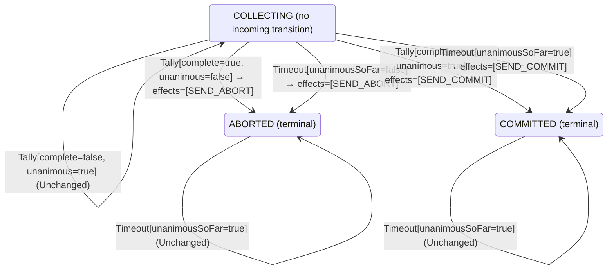

<!-- Generated by examples/demo/tools/build.py from example.json and the verifier's output. Edit example.json. -->
# 020 · A 2PC coordinator that presumes commit on timeout splits the participants

[← All examples](../README.md)

| Verdict | Categories | Severity if shipped | Change | Verified unit | Approach |
|---|---|---|---|---|---|
| **✗ Violation: Atomicity, 3-step trace** | functional | critical | feature, behaviour change intended | [`Coordinator#decide`](../../../examples/demo/apps/quorum/src/main/java/net/terminalvalue/quorum/twopc/Coordinator.java) | [D1: Protocol model checking](../../../examples/demo/apps/quorum/spec/README.md) |

> When the vote collection times out, the coordinator aborts: a participant that has not answered may have given up. A developer softens this: if every vote that did arrive was yes, the missing ones are slow, not opposed, so commit. The one-line contract diff is reviewed and approved. The model checker finds a three-step run in which a participant votes no, its vote is still in flight when the timer fires, "everyone who answered said yes" is true of nobody, and the coordinator commits a transaction that participant has already aborted.

## The change

On timeout, commit if the votes counted so far are unanimous, else abort. The behavioural contract of the coordinator is regenerated and its diff is one line, the case `decide(COLLECTING, Timeout[unanimousSoFar=true])`, which is exactly what the developer meant to change. The reviewer approves the diff.

**Before** ([`Coordinator.java`](../../../examples/demo/apps/quorum/src/main/java/net/terminalvalue/quorum/twopc/Coordinator.java), line 28):

```java
                : tally.unanimous() ? transition(COMMITTED, SEND_COMMIT) : transition(ABORTED, SEND_ABORT);
        case COMMITTED, ABORTED -> unchanged("already decided");
    };
    case Timeout _ -> switch (phase) {
        case COLLECTING -> transition(ABORTED, SEND_ABORT); // presumed abort
        case COMMITTED, ABORTED -> unchanged("already decided");
    };
};
```

**After:**

```java
                : tally.unanimous() ? transition(COMMITTED, SEND_COMMIT) : transition(ABORTED, SEND_ABORT);
        case COMMITTED, ABORTED -> unchanged("already decided");
    };
    case Timeout timeout -> switch (phase) {
        // The votes that did arrive were all yes: the missing participants are slow, not opposed, and
        // aborting would throw away work that every voter was ready to commit.
        case COLLECTING -> timeout.unanimousSoFar()
                ? transition(COMMITTED, SEND_COMMIT)
                : transition(ABORTED, SEND_ABORT);
        case COMMITTED, ABORTED -> unchanged("already decided");
    };
};
```

<details><summary>Patch</summary>

```diff
--- a/examples/demo/apps/quorum/src/main/java/net/terminalvalue/quorum/twopc/Coordinator.java
+++ b/examples/demo/apps/quorum/src/main/java/net/terminalvalue/quorum/twopc/Coordinator.java
@@ -28,8 +28,12 @@ public final class Coordinator {
                         : tally.unanimous() ? transition(COMMITTED, SEND_COMMIT) : transition(ABORTED, SEND_ABORT);
                 case COMMITTED, ABORTED -> unchanged("already decided");
             };
-            case Timeout _ -> switch (phase) {
-                case COLLECTING -> transition(ABORTED, SEND_ABORT); // presumed abort
+            case Timeout timeout -> switch (phase) {
+                // The votes that did arrive were all yes: the missing participants are slow, not opposed, and
+                // aborting would throw away work that every voter was ready to commit.
+                case COLLECTING -> timeout.unanimousSoFar()
+                        ? transition(COMMITTED, SEND_COMMIT)
+                        : transition(ABORTED, SEND_ABORT);
                 case COMMITTED, ABORTED -> unchanged("already decided");
             };
         };
```

</details>

## What the verifier found

TLC found a run of the system, 3 steps long, that violates the invariant **Atomicity** (once the coordinator or any participant has committed, no participant has aborted). Each step is one action of one part of the system:

1. **Initial state**: every participant working, no vote counted, no decision.
2. **Vote**, `Participant.prepare`: a participant votes yes (and holds its locks) or no (and aborts). `inbox = {[from |-> p1, vote |-> "NO"]}`, `pstate = (p1 :> "ABORTED" @@ p2 :> "WORKING" @@ p3 :> "WORKING")`
3. **CoordinatorTimeout**, `Coordinator.onTimeout`: the collection timer fires with votes missing. `decision = "COMMIT"`, `phase = "COMMITTED"`

The model is small (Participants = {p1, p2, p3}), which is what keeps the trace readable. TLC explored every interleaving of the participants, the coordinator and the votes in flight within those bounds.

The state machine the patched code implements, drawn from its derived contract (`jvmcontract statemachine`); a state with no way in or no way out is marked:



## Would the existing tests have caught it?

No: every existing unit test passes (`java -ea net.terminalvalue.quorum.Tests`, run against the patched code).

## Why it matters

Two-phase commit's only promise is atomicity: every participant that decides, decides the same way. A coordinator that commits without a yes from every participant breaks it the first time a participant is slow to vote no, or aborts on its own after a timeout of its own. One participant commits and releases its locks, another has rolled back, and the transaction is half applied across two databases with nothing left to reconcile it. The contract diff did not help here, and could not: it shows that the coordinator's rule changed in one case, which is precisely what was intended. Whether the new rule is safe is a question about every interleaving of the participants, the network and two timers, and only the model answers it.

## Why the verdict is right

The TLA+ model has one action per operation of each part: a participant votes, a participant that has not voted gives up, a participant applies the decision, the coordinator counts a vote, the coordinator's timer fires. The coordinator's decision rule inside the model is not hand-written: it is generated from the behavioural contract of `Coordinator#decide`, which the tool proves the bytecode satisfies on all 28 inputs, so the model decides exactly as the Java does. TLC explores every interleaving for three participants and reports the shortest run that violates atomicity. It is three steps long, and the step that matters is the timer firing with the one vote cast still in flight: "all votes counted so far are yes" is vacuously true of an empty tally. A case the developer, the reviewer and the test suite all read as "the slow participant was going to say yes" is, for the model, also the case where nobody has said anything.

## What to do

Revert to presumed abort. The timeout exists because an unanswered prepare means the participant may have aborted unilaterally; no amount of optimism about the votes that did arrive changes that. Any change to the coordinator's rule reaches the model through its contract, so the next idea of this kind is checked the same way before it is merged.

## Evidence

How the verdict was reached: TLC 2.19 explored 27 distinct states to depth 3 in 0 s, for the model Participants = {p1, p2, p3}.

<details><summary>Verifier output</summary>

```text
TLC2 Version 2.19 of 08 August 2024 (rev: 5a47802)
Running breadth-first search Model-Checking with fp 1 and seed 1 with 1 worker on 8 cores with 910MB heap and 64MB offheap memory [pid: 1707173] (Linux 6.6.87.2-microsoft-standard-WSL2 aarch64, Eclipse Adoptium 25.0.4.1 x86_64, MSBDiskFPSet, DiskStateQueue).
Parsing file examples/demo/apps/quorum/spec/TwoPhaseCommit.tla
Parsing file examples/demo/tools/tla/standard-modules/Naturals.tla
Parsing file examples/demo/tools/tla/standard-modules/Sequences.tla
Parsing file examples/demo/tools/tla/standard-modules/FiniteSets.tla
Parsing file examples/demo/apps/quorum/spec/CoordinatorContract.tla
Parsing file examples/demo/apps/quorum/spec/TCommit.tla
Semantic processing of module Naturals
Semantic processing of module Sequences
Semantic processing of module FiniteSets
Semantic processing of module CoordinatorContract
Semantic processing of module TCommit
Semantic processing of module TwoPhaseCommit
Starting... (2026-11-01 22:09:48)
Implied-temporal checking--satisfiability problem has 3 branches.
Computing initial states...
Finished computing initial states: 1 distinct state generated at 2026-11-01 22:09:48.
Error: Invariant Atomicity is violated.
Error: The behavior up to this point is:
State 1: <Initial predicate>
/\ pstate = (p1 :> "WORKING" @@ p2 :> "WORKING" @@ p3 :> "WORKING")
/\ decision = "NONE"
/\ phase = "COLLECTING"
/\ inbox = {}
/\ votes = (p1 :> "NONE" @@ p2 :> "NONE" @@ p3 :> "NONE")

State 2: <Vote line 44, col 5 to line 48, col 43 of module TwoPhaseCommit>
/\ pstate = (p1 :> "ABORTED" @@ p2 :> "WORKING" @@ p3 :> "WORKING")
/\ decision = "NONE"
/\ phase = "COLLECTING"
/\ inbox = {[from |-> p1, vote |-> "NO"]}
/\ votes = (p1 :> "NONE" @@ p2 :> "NONE" @@ p3 :> "NONE")

State 3: <CoordinatorTimeout line 92, col 5 to line 95, col 41 of module TwoPhaseCommit>
/\ pstate = (p1 :> "ABORTED" @@ p2 :> "WORKING" @@ p3 :> "WORKING")
/\ decision = "COMMIT"
/\ phase = "COMMITTED"
/\ inbox = {[from |-> p1, vote |-> "NO"]}
/\ votes = (p1 :> "NONE" @@ p2 :> "NONE" @@ p3 :> "NONE")

27 states generated, 27 distinct states found, 23 states left on queue.
The depth of the complete state graph search is 3.
The average outdegree of the complete state graph is 9 (minimum is 8, the maximum 10 and the 95th percentile is 10).
Finished in 00s at (2026-11-01 22:09:49)
```

</details>

<details><summary>SARIF report (as uploaded to GitHub code scanning or SonarQube)</summary>

```json
{
  "version": "2.1.0",
  "$schema": "https://json.schemastore.org/sarif-2.1.0.json",
  "runs": [
    {
      "tool": {
        "driver": {
          "name": "jvmcontract tlc",
          "rules": [
            {
              "id": "invariant-violated",
              "shortDescription": {
                "text": "TLC found a behaviour of the model that violates an invariant or a temporal property, or ends in a deadlock."
              }
            },
            {
              "id": "unverifiable",
              "shortDescription": {
                "text": "TLC could not check the model."
              }
            }
          ]
        }
      },
      "results": [
        {
          "ruleId": "invariant-violated",
          "level": "error",
          "message": {
            "text": "Invariant Atomicity of spec/TwoPhaseCommit.tla is violated after 3 steps"
          },
          "locations": [
            {
              "physicalLocation": {
                "artifactLocation": {
                  "uri": "examples/demo/apps/quorum/src/main/java/net/terminalvalue/quorum/twopc/Coordinator.java"
                },
                "region": {
                  "startLine": 28
                }
              }
            }
          ]
        }
      ]
    }
  ]
}
```

</details>

**Provenance:** Constructed from the presumed-abort rule of two-phase commit, by replacing it with the optimistic variant that a reviewer would plausibly accept.

- [Gray, Notes on Data Base Operating Systems (the two-phase commit protocol)](https://jimgray.azurewebsites.net/papers/dbos.pdf)
- [Lamport and Gray, Consensus on Transaction Commit (the TLA+ specification of 2PC this model follows)](https://lamport.azurewebsites.net/video/consensus-on-transaction-commit.pdf)
## Reproduce

```bash
python3 examples/demo/tools/build.py 020
```

This applies `change.patch` to a temporary copy of the repo, runs the verifier on it, and rewrites this page.
