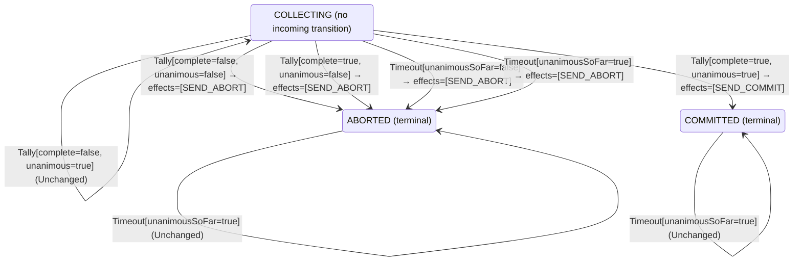

<!-- Generated by examples/demo/tools/build.py from example.json and the verifier's output. Edit example.json. -->
# 021 · Aborting on the first no vote, proved safe for every interleaving of three participants

[← All examples](../README.md)

| Verdict | Categories | Severity if shipped | Change | Verified unit | Approach |
|---|---|---|---|---|---|
| **✓ Verified: all invariants and properties hold in 644 states** | functional, no-false-positive | none | feature, behaviour change intended | [`Coordinator#decide`](../../../examples/demo/apps/quorum/src/main/java/net/terminalvalue/quorum/twopc/Coordinator.java) | [D1: Protocol model checking](../../../examples/demo/apps/quorum/spec/README.md) |

> The coordinator used to wait for every vote before deciding, holding every participant's locks until the last straggler or the timeout. The developer makes it abort as soon as one no arrives. The regenerated contract changes in one case, the model checker runs every interleaving of three participants, the coordinator, the votes in flight and both timeouts, and every invariant holds in every state. The change is merged on a proof, not on a reviewer's mental model of the protocol.

## The change

When a tally is not unanimous, abort at once instead of waiting for the remaining votes. One no decides the outcome, so waiting only keeps the other participants' locks for longer. The contract diff is the case `decide(COLLECTING, Tally[complete=false, unanimous=false])`, from unchanged to a transition to ABORTED.

**Before** ([`Coordinator.java`](../../../examples/demo/apps/quorum/src/main/java/net/terminalvalue/quorum/twopc/Coordinator.java), line 23):

```java
public static Decision<Phase, CoordinatorEffect> decide(Phase phase, CoordinatorEvent event) {
    return switch (event) {
        case Tally tally -> switch (phase) {
            case COLLECTING -> !tally.complete()
                    ? unchanged("waiting for the remaining votes")
                    : tally.unanimous() ? transition(COMMITTED, SEND_COMMIT) : transition(ABORTED, SEND_ABORT);
            case COMMITTED, ABORTED -> unchanged("already decided");
        };
        case Timeout _ -> switch (phase) {
```

**After:**

```java
public static Decision<Phase, CoordinatorEffect> decide(Phase phase, CoordinatorEvent event) {
    return switch (event) {
        case Tally tally -> switch (phase) {
            // One no decides the outcome: abort at once instead of keeping the other participants' locks
            // until the last vote or the timeout.
            case COLLECTING -> !tally.unanimous()
                    ? transition(ABORTED, SEND_ABORT)
                    : tally.complete() ? transition(COMMITTED, SEND_COMMIT) : unchanged("waiting for the remaining votes");
            case COMMITTED, ABORTED -> unchanged("already decided");
        };
        case Timeout _ -> switch (phase) {
```

<details><summary>Patch</summary>

```diff
--- a/examples/demo/apps/quorum/src/main/java/net/terminalvalue/quorum/twopc/Coordinator.java
+++ b/examples/demo/apps/quorum/src/main/java/net/terminalvalue/quorum/twopc/Coordinator.java
@@ -23,9 +23,11 @@ public final class Coordinator {
     public static Decision<Phase, CoordinatorEffect> decide(Phase phase, CoordinatorEvent event) {
         return switch (event) {
             case Tally tally -> switch (phase) {
-                case COLLECTING -> !tally.complete()
-                        ? unchanged("waiting for the remaining votes")
-                        : tally.unanimous() ? transition(COMMITTED, SEND_COMMIT) : transition(ABORTED, SEND_ABORT);
+                // One no decides the outcome: abort at once instead of keeping the other participants' locks
+                // until the last vote or the timeout.
+                case COLLECTING -> !tally.unanimous()
+                        ? transition(ABORTED, SEND_ABORT)
+                        : tally.complete() ? transition(COMMITTED, SEND_COMMIT) : unchanged("waiting for the remaining votes");
                 case COMMITTED, ABORTED -> unchanged("already decided");
             };
             case Timeout _ -> switch (phase) {
```

</details>

## What the verifier found

Every invariant holds in every reachable state of the model, and every temporal property holds of every behaviour, the infinite ones included: 644 distinct states, which is every interleaving of the participants, the coordinator and the votes in flight within the model's bounds (Participants = {p1, p2, p3}).

The coordinator's decision rule inside the model is generated from the behavioural contract of the patched code, so the model checks the decisions the coordinator really makes.

The state machine the patched code implements, drawn from its derived contract (`jvmcontract statemachine`); a state with no way in or no way out is marked:



## Would the existing tests have caught it?

Every existing unit test passes, as it should (`java -ea net.terminalvalue.quorum.Tests`, run against the patched code).

## Why it matters

None, and that is the point. The question a reviewer has to answer for this change is not about the line; it is whether a participant can still be told to commit after another was told to abort, with votes arriving in any order, votes still in flight when the coordinator decides, and participants giving up on their own. That is a question about interleavings, and example 020 shows a one-line change of the same shape that fails it. Answering it by inspection is how two-phase commit implementations get their bugs; answering it by model checking takes a second.

## Why the verdict is right

The coordinator's rule in the model is generated from the regenerated contract, so the model runs the new rule. TLC explores every reachable state for three participants: every order of votes, every vote still in flight at every decision, participants that time out before voting, and the coordinator's timeout at every point where votes are missing. In every state, no participant has aborted once the coordinator or any participant committed, and a participant that committed voted yes and did so on the coordinator's decision. The early abort can only ever turn a transaction that would have aborted anyway into one that aborts sooner: a late yes vote reaches a coordinator that has already decided, whose contract says it is unchanged, and a late no vote reaches the same.

## What to do

Merge. The contract diff is committed with the change, and the model is checked on every build, so the next change to the coordinator is held to the same invariants.

## Evidence

How the verdict was reached: TLC 2.19 explored 644 distinct states to depth 11 in 0 s, for the model Participants = {p1, p2, p3}.

<details><summary>Verifier output</summary>

```text
TLC2 Version 2.19 of 08 August 2024 (rev: 5a47802)
Running breadth-first search Model-Checking with fp 1 and seed 1 with 1 worker on 8 cores with 910MB heap and 64MB offheap memory [pid: 1707391] (Linux 6.6.87.2-microsoft-standard-WSL2 aarch64, Eclipse Adoptium 25.0.4.1 x86_64, MSBDiskFPSet, DiskStateQueue).
Parsing file examples/demo/apps/quorum/spec/TwoPhaseCommit.tla
Parsing file examples/demo/tools/tla/standard-modules/Naturals.tla
Parsing file examples/demo/tools/tla/standard-modules/Sequences.tla
Parsing file examples/demo/tools/tla/standard-modules/FiniteSets.tla
Parsing file examples/demo/apps/quorum/spec/CoordinatorContract.tla
Parsing file examples/demo/apps/quorum/spec/TCommit.tla
Semantic processing of module Naturals
Semantic processing of module Sequences
Semantic processing of module FiniteSets
Semantic processing of module CoordinatorContract
Semantic processing of module TCommit
Semantic processing of module TwoPhaseCommit
Starting... (2026-11-01 22:09:51)
Implied-temporal checking--satisfiability problem has 3 branches.
Computing initial states...
Finished computing initial states: 1 distinct state generated at 2026-11-01 22:09:51.
Checking 3 branches of temporal properties for the complete state space with 1932 total distinct states at (2026-11-01 22:09:51)
Finished checking temporal properties in 00s at 2026-11-01 22:09:51
Model checking completed. No error has been found.
  Estimates of the probability that TLC did not check all reachable states
  because two distinct states had the same fingerprint:
  calculated (optimistic):  val = 5.6E-14
2240 states generated, 644 distinct states found, 0 states left on queue.
The depth of the complete state graph search is 11.
The average outdegree of the complete state graph is 1 (minimum is 0, the maximum 10 and the 95th percentile is 3).
Finished in 00s at (2026-11-01 22:09:51)
```

</details>

<details><summary>SARIF report (as uploaded to GitHub code scanning or SonarQube)</summary>

```json
{
  "version": "2.1.0",
  "$schema": "https://json.schemastore.org/sarif-2.1.0.json",
  "runs": [
    {
      "tool": {
        "driver": {
          "name": "jvmcontract tlc",
          "rules": [
            {
              "id": "invariant-violated",
              "shortDescription": {
                "text": "TLC found a behaviour of the model that violates an invariant or a temporal property, or ends in a deadlock."
              }
            },
            {
              "id": "unverifiable",
              "shortDescription": {
                "text": "TLC could not check the model."
              }
            }
          ]
        }
      },
      "results": []
    }
  ]
}
```

</details>

**Provenance:** Constructed to show an intended change to a protocol's decision rule accepted on the strength of the model, to pair with example 020.

- [Lamport and Gray, Consensus on Transaction Commit (the TLA+ specification of 2PC this model follows)](https://lamport.azurewebsites.net/video/consensus-on-transaction-commit.pdf)
## Reproduce

```bash
python3 examples/demo/tools/build.py 021
```

This applies `change.patch` to a temporary copy of the repo, runs the verifier on it, and rewrites this page.
