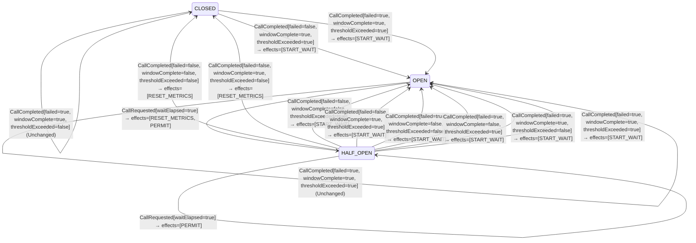

<!-- Generated by examples/demo/tools/build.py from example.json and the verifier's output. Edit example.json. -->
# 026 · A half-open circuit breaker that closes on the first good probe flaps through an outage

[← All examples](../README.md)

| Verdict | Categories | Severity if shipped | Change | Verified unit | Approach |
|---|---|---|---|---|---|
| **✗ Violation: 2 of 44 cases changed** | functional, performance | high | feature, behaviour change not intended | [`CircuitBreaker#decide`](../../../examples/demo/apps/crosscut/src/main/java/net/terminalvalue/crosscut/resilience/CircuitBreaker.java) | [B8: Behavioural contracts](../../../lib/README.md) |

> A half-open breaker lets a few probe calls through and closes only once all of them are back with the failure rate under the threshold. A developer, chasing the latency of the calls that queue behind the probes, makes the first successful probe enough to close. The behavioural contract of the breaker, 44 cases derived from the bytecode, changes in two of them, and the state-machine view drawn from the patched code shows HALF_OPEN with its waiting state gone.

## The change

Remove the "more probes to go" branch: a probe that came back is proof enough that the backend is up again, so close at once instead of holding the callers back for the remaining probes. The tests for opening, rejecting, probing, a failed probe and closing after a complete window all pass.

**Before** ([`CircuitBreaker.java`](../../../examples/demo/apps/crosscut/src/main/java/net/terminalvalue/crosscut/resilience/CircuitBreaker.java), line 44):

```java
        if (call.failed()) {
            yield transition(OPEN, START_WAIT);
        }
        if (!call.windowComplete()) {
            yield unchanged("more probes to go");
        }
        yield call.thresholdExceeded() ? transition(OPEN, START_WAIT) : transition(CLOSED, RESET_METRICS);
    }
};
```

**After:**

```java
        if (call.failed()) {
            yield transition(OPEN, START_WAIT);
        }
        // A probe that came back is proof enough that the backend is up again: close without holding
        // the callers back for the remaining probes.
        yield call.thresholdExceeded() ? transition(OPEN, START_WAIT) : transition(CLOSED, RESET_METRICS);
    }
};
```

<details><summary>Patch</summary>

```diff
--- a/examples/demo/apps/crosscut/src/main/java/net/terminalvalue/crosscut/resilience/CircuitBreaker.java
+++ b/examples/demo/apps/crosscut/src/main/java/net/terminalvalue/crosscut/resilience/CircuitBreaker.java
@@ -44,9 +44,8 @@ public final class CircuitBreaker {
                     if (call.failed()) {
                         yield transition(OPEN, START_WAIT);
                     }
-                    if (!call.windowComplete()) {
-                        yield unchanged("more probes to go");
-                    }
+                    // A probe that came back is proof enough that the backend is up again: close without holding
+                    // the callers back for the remaining probes.
                     yield call.thresholdExceeded() ? transition(OPEN, START_WAIT) : transition(CLOSED, RESET_METRICS);
                 }
             };
```

</details>

## What the verifier found

The behaviour changed for 2 of the 44 possible inputs. Each row is a concrete input that shows the difference:

| Input | The contract says | The code now does |
|---|---|---|
| `decide(HALF_OPEN, CallCompleted[failed=false, windowComplete=false, thresholdExceeded=false])` | `Unchanged[reason="more probes to go"]` | `Transition[next=CLOSED, effects=[RESET_METRICS]]` |
| `decide(HALF_OPEN, CallCompleted[failed=false, windowComplete=false, thresholdExceeded=true])` | `Unchanged[reason="more probes to go"]` | `Transition[next=OPEN, effects=[START_WAIT]]` |

The state machine the patched code implements, drawn from its derived contract (`jvmcontract statemachine`); a state with no way in or no way out is marked:



## Would the existing tests have caught it?

No: every existing unit test passes (`java -ea net.terminalvalue.crosscut.Tests`, run against the patched code).

## Why it matters

A backend that is recovering answers some calls and times out on others, which is the state a breaker exists for. With this change one lucky probe closes the breaker, the full load of callers lands on the backend, the next window fails the threshold, the breaker opens, waits, half-opens, one probe succeeds, and the cycle repeats every wait duration for as long as the backend is struggling. From the backend's side it is a periodic stampede that keeps it from recovering; from the callers' side it is a latency and error pattern that comes and goes on the breaker's timer, which nobody correlates with a change to the breaker. The permitted number of probes in Resilience4j's half-open state is the sample size of a decision, and a sample of one decides nothing.

## Why the verdict is right

The breaker is a pure function of (state, event), and both types are finite: three states, and two event kinds carrying one and three booleans. The tool proves purity from the bytecode, executes all 44 inputs in its interpreter, and compares the outcomes with the committed contract. Two cases differ, both in HALF_OPEN with a successful probe and an incomplete window: with the failure rate under the threshold the breaker now closes instead of waiting, and with it over the threshold it now reopens instead of waiting. The first is the change the developer meant to make, and it is the bug; the second is a side effect of the same deleted line. The state-machine view on this page is drawn from the patched code, and HALF_OPEN has lost the `Unchanged` self-loop that stood for waiting.

## What to do

Revert. If the latency of the queued callers is the problem, lower the permitted number of probes or shorten the wait duration, both of which are configuration; the decision rule should keep requiring the window to complete. The contract keeps it that way: any further change to the breaker's 44 cases is a diff a reviewer sees.

## Evidence

The proof trusted these JDK APIs to be pure: `java.lang.Enum.ordinal`, `java.lang.MatchException.<init>`, `java.lang.Record.<init>`, `java.lang.runtime.SwitchBootstraps.typeSwitch`, `java.util.List.copyOf`, `java.util.List.of`, `java.util.Objects.requireNonNull`.

<details><summary>Verifier output</summary>

```text
✓ module crosscut matches its capability contract (36 classes, 127 methods, 0 capability uses, 0 libraries)
✓ module crosscut matches its API contract (33 public types, 124 members)
✓ net.terminalvalue.crosscut.idempotency.IdempotentReceiver#decide matches its contract (24 cases, 8 methods proven pure, trusting java.lang.Enum.ordinal, java.lang.MatchException.<init>, java.lang.Record.<init>, java.lang.runtime.SwitchBootstraps.typeSwitch, java.util.List.copyOf, java.util.List.of, java.util.Objects.requireNonNull)
✗ Behaviour of net.terminalvalue.crosscut.resilience.CircuitBreaker#decide differs from its contract in 2 of 44 cases:
  decide(HALF_OPEN, CallCompleted[failed=false, windowComplete=false, thresholdExceeded=false])
    contract: Unchanged[reason="more probes to go"]
    actual:   Transition[next=CLOSED, effects=[RESET_METRICS]]
  decide(HALF_OPEN, CallCompleted[failed=false, windowComplete=false, thresholdExceeded=true])
    contract: Unchanged[reason="more probes to go"]
    actual:   Transition[next=OPEN, effects=[START_WAIT]]
  (44 cases, 11 methods proven pure, trusting java.lang.Enum.ordinal, java.lang.MatchException.<init>, java.lang.Record.<init>, java.lang.runtime.SwitchBootstraps.typeSwitch, java.util.List.copyOf, java.util.List.of, java.util.Objects.requireNonNull)
✓ net.terminalvalue.crosscut.tx.TransactionBoundary#enter matches its contract (16 cases, 1 methods proven pure, trusting java.lang.Enum.ordinal, java.lang.IllegalStateException.<init>, java.lang.MatchException.<init>)
✓ net.terminalvalue.crosscut.tx.TransactionBoundary#exit matches its contract (22 cases, 4 methods proven pure, trusting java.lang.Enum.ordinal, java.lang.MatchException.<init>, java.lang.runtime.SwitchBootstraps.typeSwitch, java.util.Objects.requireNonNull)

If a change is intended, run `jvmcontract update` and commit the contract with the code. The contract diff then shows reviewers exactly which behaviour changed.
```

</details>

<details><summary>SARIF report (as uploaded to GitHub code scanning or SonarQube)</summary>

```json
{
  "version": "2.1.0",
  "$schema": "https://json.schemastore.org/sarif-2.1.0.json",
  "runs": [
    {
      "tool": {
        "driver": {
          "name": "jvmcontract",
          "version": "0.1.0",
          "rules": [
            {
              "id": "behaviour-changed",
              "shortDescription": {
                "text": "The code no longer matches its behavioural contract."
              }
            },
            {
              "id": "unverifiable",
              "shortDescription": {
                "text": "The method cannot be verified: it is not pure, or its inputs are not finite."
              }
            },
            {
              "id": "capability-changed",
              "shortDescription": {
                "text": "The module's bytecode reaches a capability, or a library, that its contract does not list."
              }
            },
            {
              "id": "api-changed",
              "shortDescription": {
                "text": "The module's public API differs from its contract."
              }
            },
            {
              "id": "property-violated",
              "shortDescription": {
                "text": "An input exists on which the method violates its stated property."
              }
            },
            {
              "id": "invariant-violated",
              "shortDescription": {
                "text": "The model checker found a behaviour of the model that violates an invariant."
              }
            }
          ]
        }
      },
      "results": [
        {
          "ruleId": "behaviour-changed",
          "level": "error",
          "message": {
            "text": "Behaviour of net.terminalvalue.crosscut.resilience.CircuitBreaker#decide differs from its contract in 2 of 44 cases:\n  decide(HALF_OPEN, CallCompleted[failed=false, windowComplete=false, thresholdExceeded=false])\n    contract: Unchanged[reason=\"more probes to go\"]\n    actual:   Transition[next=CLOSED, effects=[RESET_METRICS]]\n  decide(HALF_OPEN, CallCompleted[failed=false, windowComplete=false, thresholdExceeded=true])\n    contract: Unchanged[reason=\"more probes to go\"]\n    actual:   Transition[next=OPEN, effects=[START_WAIT]]"
          },
          "locations": [
            {
              "physicalLocation": {
                "artifactLocation": {
                  "uri": "examples/demo/apps/crosscut/src/main/java/net/terminalvalue/crosscut/resilience/CircuitBreaker.java"
                },
                "region": {
                  "startLine": 31
                }
              }
            }
          ]
        }
      ]
    }
  ]
}
```

</details>

**Provenance:** Constructed from the half-open semantics of Resilience4j's `CircuitBreakerStateMachine`, by replacing the wait for all permitted calls with the first success.

- [Resilience4j, CircuitBreaker: the HALF_OPEN state and permittedNumberOfCallsInHalfOpenState](https://resilience4j.readme.io/docs/circuitbreaker)
- [Nygard, Release It! (the circuit breaker pattern)](https://pragprog.com/titles/mnee2/release-it-second-edition/)
## Reproduce

```bash
python3 examples/demo/tools/build.py 026
```

This applies `change.patch` to a temporary copy of the repo, runs the verifier on it, and rewrites this page.
