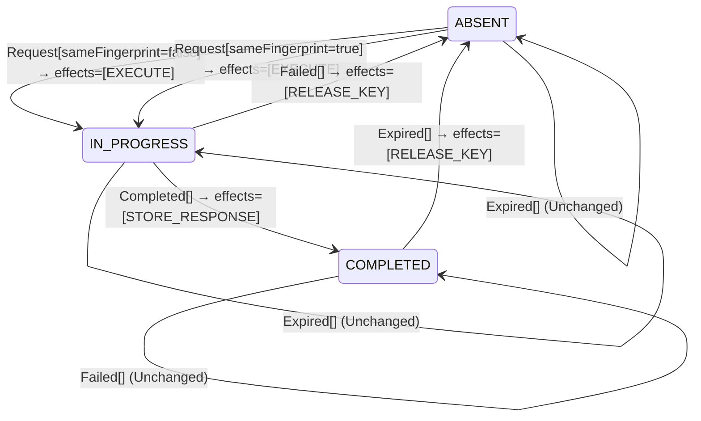

<!-- Generated by examples/demo/tools/build.py from example.json and the verifier's output. Edit example.json. -->
# 029 · An idempotency key that executes a retry while the first attempt is in flight pays twice

[← All examples](../README.md)

| Verdict | Categories | Severity if shipped | Change | Verified unit | Approach |
|---|---|---|---|---|---|
| **✗ Violation: OneExecutionAtATime, 5-step trace** | functional | critical | bug-fix, behaviour change intended | [`IdempotentReceiver#decide`](../../../examples/demo/apps/crosscut/src/main/java/net/terminalvalue/crosscut/idempotency/IdempotentReceiver.java) | [D1: Protocol model checking](../../../examples/demo/apps/crosscut/spec/README.md) |

> An `Idempotency-Key` receiver refuses a retry while the first attempt with that key is still in progress, with a 409. Support reports clients stuck in 409 loops after a worker died mid-request, and a developer makes the receiver run the retry instead: if a retry arrives, the first attempt is gone. The one-line contract diff is reviewed and approved. The model checker finds a five-step run in which the first attempt is not gone at all, and the request is executed twice.

## The change

On a retry with a matching fingerprint while the key is in progress, execute the request instead of answering 409. The reasoning: a client retries only after its timeout, by which point the first attempt's worker has given up too, so the record is stale and the client is stuck behind it. The behavioural contract of the receiver is regenerated and its diff is one line, the case `decide(IN_PROGRESS, Request[sameFingerprint=true])`, which is exactly what the developer meant to change. The reviewer approves the diff.

**Before** ([`IdempotentReceiver.java`](../../../examples/demo/apps/crosscut/src/main/java/net/terminalvalue/crosscut/idempotency/IdempotentReceiver.java), line 35):

```java
return switch (event) {
    case Request request -> switch (state) {
        case ABSENT -> transition(IN_PROGRESS, EXECUTE);
        case IN_PROGRESS -> request.sameFingerprint()
                ? rejected("a request with this key is in progress")
                : rejected("the key was reused for a different request");
        case COMPLETED -> request.sameFingerprint()
                ? transition(COMPLETED, REPLAY_RESPONSE)
```

**After:**

```java
return switch (event) {
    case Request request -> switch (state) {
        case ABSENT -> transition(IN_PROGRESS, EXECUTE);
        // A retry that arrives while the key is still in progress means the first attempt is gone: the client
        // timed out on it and its worker will not answer. Run the retry instead of sending the client round
        // another loop of 409s.
        case IN_PROGRESS -> request.sameFingerprint()
                ? transition(IN_PROGRESS, EXECUTE)
                : rejected("the key was reused for a different request");
        case COMPLETED -> request.sameFingerprint()
                ? transition(COMPLETED, REPLAY_RESPONSE)
```

<details><summary>Patch</summary>

```diff
--- a/examples/demo/apps/crosscut/src/main/java/net/terminalvalue/crosscut/idempotency/IdempotentReceiver.java
+++ b/examples/demo/apps/crosscut/src/main/java/net/terminalvalue/crosscut/idempotency/IdempotentReceiver.java
@@ -35,8 +35,11 @@ public final class IdempotentReceiver {
         return switch (event) {
             case Request request -> switch (state) {
                 case ABSENT -> transition(IN_PROGRESS, EXECUTE);
+                // A retry that arrives while the key is still in progress means the first attempt is gone: the client
+                // timed out on it and its worker will not answer. Run the retry instead of sending the client round
+                // another loop of 409s.
                 case IN_PROGRESS -> request.sameFingerprint()
-                        ? rejected("a request with this key is in progress")
+                        ? transition(IN_PROGRESS, EXECUTE)
                         : rejected("the key was reused for a different request");
                 case COMPLETED -> request.sameFingerprint()
                         ? transition(COMPLETED, REPLAY_RESPONSE)
```

</details>

## What the verifier found

TLC found a run of the system, 5 steps long, that violates the invariant **OneExecutionAtATime** (no two attempts under one key execute at the same time). Each step is one action of one part of the system:

1. **Initial state**: no record for the key, nothing sent, nothing executing, no response.
2. **Send**, `IdempotentClient.send`: the client sends the request, or retries it without waiting for an answer. `inbox = {a1}`, `sent = {a1}`
3. **Receive**, `IdempotencyFilter.doFilter`: the receiver looks the key up, decides, and applies the decision in one transaction. `executing = {a1}`, `inbox = {}`, `key = "IN_PROGRESS"`
4. **Send**, `IdempotentClient.send`: the client sends the request, or retries it without waiting for an answer. `inbox = {a2}`, `sent = {a1, a2}`
5. **Receive**, `IdempotencyFilter.doFilter`: the receiver looks the key up, decides, and applies the decision in one transaction. `executing = {a1, a2}`, `inbox = {}`

The model is small (Attempts = {a1, a2, a3}), which is what keeps the trace readable. TLC explored every interleaving of the client's attempts, the receiver, and the attempts in flight and executing within those bounds.

The state machine the patched code implements, drawn from its derived contract (`jvmcontract statemachine`); a state with no way in or no way out is marked:



## Would the existing tests have caught it?

No: every existing unit test passes (`java -ea net.terminalvalue.crosscut.Tests`, run against the patched code).

## Why it matters

The one thing an idempotency key promises is that the request's effect happens at most once, however many times the client sends it. A client timeout says nothing about the server: the first attempt may be waiting on a lock, on a slow payment provider, or on garbage collection, and will complete. With this change the retry runs alongside it, and the customer is charged twice, the order is placed twice, the email goes out twice. The stuck-client report was real, but its cause was workers that die without releasing the key, which is what the `Failed` event is for; the fix removed the guarantee instead of fixing the cleanup. The contract diff could not catch this: the diff was precisely the intended change. Whether the new rule is safe is a question about every interleaving of a client that retries and a receiver that is still working, and only the model answers it.

## Why the verdict is right

The TLA+ model has one action per operation of each part: the client sends an attempt or retries, the receiver decides on an arriving attempt, an execution finishes with a result, an execution dies. The receiver's decision rule inside the model is not hand-written: it is generated from the behavioural contract of `IdempotentReceiver#decide`, which the tool proves the bytecode satisfies on all 24 inputs, so the model decides exactly as the Java does. TLC explores every interleaving for three attempts and reports the shortest run that breaks the invariant that no two attempts under one key execute at once: the client sends, the receiver executes, the client retries before the first execution has finished, and the receiver executes again. The run is five steps long, the initial state and four actions, and the step the developer's reasoning left out is the second send, which the model allows at any time because a client's timeout is the client's business.

## What to do

Revert, and fix the cause: a worker that dies must release the key, which is the `Failed` transition, and a key held in progress for longer than any request can take should be released by a sweeper. A retry that arrives while the key is legitimately in progress should get the 409 with a `Retry-After`, or be parked until the first attempt's response is stored and then be answered with it. Any change to the receiver's rule reaches the model through its contract, so the next idea of this kind is checked the same way before it is merged.

## Evidence

How the verdict was reached: TLC 2.19 explored 28 distinct states to depth 5 in 0 s, for the model Attempts = {a1, a2, a3}.

<details><summary>Verifier output</summary>

```text
TLC2 Version 2.19 of 08 August 2024 (rev: 5a47802)
Running breadth-first search Model-Checking with fp 117 and seed 8186873393731221441 with 1 worker on 8 cores with 1719MB heap and 64MB offheap memory [pid: 1753902] (Linux 6.6.87.2-microsoft-standard-WSL2 aarch64, Eclipse Adoptium 25.0.4.1 x86_64, MSBDiskFPSet, DiskStateQueue).
Parsing file examples/demo/apps/crosscut/spec/IdempotentReceiver.tla
Parsing file examples/demo/tools/tla/standard-modules/Naturals.tla
Parsing file examples/demo/tools/tla/standard-modules/Sequences.tla
Parsing file examples/demo/tools/tla/standard-modules/FiniteSets.tla
Parsing file examples/demo/apps/crosscut/spec/IdempotentReceiverContract.tla
Semantic processing of module Naturals
Semantic processing of module Sequences
Semantic processing of module FiniteSets
Semantic processing of module IdempotentReceiverContract
Semantic processing of module IdempotentReceiver
Starting... (2026-10-31 21:22:20)
Computing initial states...
Finished computing initial states: 1 distinct state generated at 2026-10-31 21:22:20.
Error: Invariant OneExecutionAtATime is violated.
Error: The behavior up to this point is:
State 1: <Initial predicate>
/\ completed = 0
/\ responses = (a1 :> "NONE" @@ a2 :> "NONE" @@ a3 :> "NONE")
/\ key = "ABSENT"
/\ stored = FALSE
/\ sent = {}
/\ inbox = {}
/\ executing = {}

State 2: <Send line 45, col 5 to line 48, col 65 of module IdempotentReceiver>
/\ completed = 0
/\ responses = (a1 :> "NONE" @@ a2 :> "NONE" @@ a3 :> "NONE")
/\ key = "ABSENT"
/\ stored = FALSE
/\ sent = {a1}
/\ inbox = {a1}
/\ executing = {}

State 3: <Receive line 56, col 5 to line 65, col 44 of module IdempotentReceiver>
/\ completed = 0
/\ responses = (a1 :> "NONE" @@ a2 :> "NONE" @@ a3 :> "NONE")
/\ key = "IN_PROGRESS"
/\ stored = FALSE
/\ sent = {a1}
/\ inbox = {}
/\ executing = {a1}

State 4: <Send line 45, col 5 to line 48, col 65 of module IdempotentReceiver>
/\ completed = 0
/\ responses = (a1 :> "NONE" @@ a2 :> "NONE" @@ a3 :> "NONE")
/\ key = "IN_PROGRESS"
/\ stored = FALSE
/\ sent = {a1, a2}
/\ inbox = {a2}
/\ executing = {a1}

State 5: <Receive line 56, col 5 to line 65, col 44 of module IdempotentReceiver>
/\ completed = 0
/\ responses = (a1 :> "NONE" @@ a2 :> "NONE" @@ a3 :> "NONE")
/\ key = "IN_PROGRESS"
/\ stored = FALSE
/\ sent = {a1, a2}
/\ inbox = {}
/\ executing = {a1, a2}

41 states generated, 28 distinct states found, 14 states left on queue.
The depth of the complete state graph search is 5.
The average outdegree of the complete state graph is 2 (minimum is 1, the maximum 4 and the 95th percentile is 4).
Finished in 00s at (2026-10-31 21:22:20)
```

</details>

<details><summary>SARIF report (as uploaded to GitHub code scanning or SonarQube)</summary>

```json
{
  "version": "2.1.0",
  "$schema": "https://json.schemastore.org/sarif-2.1.0.json",
  "runs": [
    {
      "tool": {
        "driver": {
          "name": "jvmcontract tlc",
          "rules": [
            {
              "id": "invariant-violated",
              "shortDescription": {
                "text": "TLC found a behaviour of the model that violates an invariant, or ends in a deadlock."
              }
            },
            {
              "id": "unverifiable",
              "shortDescription": {
                "text": "TLC could not check the model."
              }
            }
          ]
        }
      },
      "results": [
        {
          "ruleId": "invariant-violated",
          "level": "error",
          "message": {
            "text": "Invariant OneExecutionAtATime of spec/IdempotentReceiver.tla is violated after 5 steps"
          },
          "locations": [
            {
              "physicalLocation": {
                "artifactLocation": {
                  "uri": "examples/demo/apps/crosscut/src/main/java/net/terminalvalue/crosscut/idempotency/IdempotentReceiver.java"
                },
                "region": {
                  "startLine": 35
                }
              }
            }
          ]
        }
      ]
    }
  ]
}
```

</details>

**Provenance:** Constructed from the in-progress case of Stripe's idempotency-key semantics and the IETF draft of the header, by replacing the 409 with the shortcut a stuck-client report invites.

- [IETF draft, The Idempotency-Key HTTP Header Field (section on concurrent requests with the same key: 409 Conflict)](https://datatracker.ietf.org/doc/draft-ietf-httpapi-idempotency-key-header/)
- [Stripe, Idempotent requests](https://docs.stripe.com/api/idempotent_requests)
## Reproduce

```bash
python3 examples/demo/tools/build.py 029
```

This applies `change.patch` to a temporary copy of the repo, runs the verifier on it, and rewrites this page.
