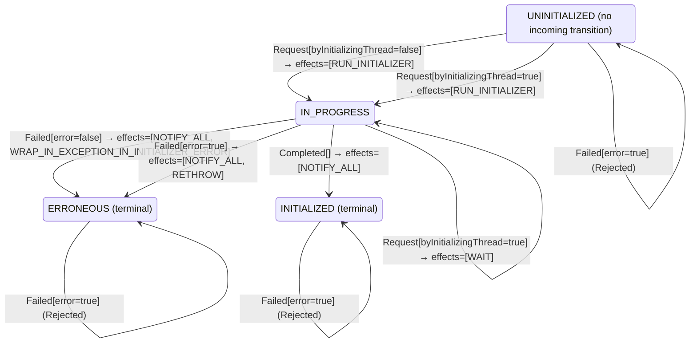

<!-- Generated by examples/demo/tools/build.py from example.json and the verifier's output. Edit example.json. -->
# 043 · One rule for every class-init request waits on its own thread, and TLC finds the deadlock

[← All examples](../README.md)

| Verdict | Categories | Severity if shipped | Change | Verified unit | Approach |
|---|---|---|---|---|---|
| **✗ Violation: deadlock, 5-step trace** | functional | critical | cleanup, behaviour change intended | [`ClassInitialization#decide`](../../../examples/demo/apps/mica/src/main/java/net/terminalvalue/mica/init/ClassInitialization.java) | [D1: Protocol model checking](../../../examples/demo/apps/mica/spec/README.md) |

> A request for a class being initialized waits, unless it comes from the initializing thread itself, which is a recursive request and completes normally (step 3 of JVMS §5.5). A developer removes the exception: every request during initialization waits, one rule, and the lock serializes everything. The contract diff is one line and is approved. The model checker, with deadlock detection on, finds a five-step run after which no thread can move: the initializer touched its own class, waited for itself, and every other thread waits for it.

## The change

In state `IN_PROGRESS`, answer `WAIT` to every request, the initializing thread's included. The reasoning: a class is not usable until its initializer has returned, and the special case for the initializing thread was a way of not holding the lock across `<clinit>`, which the lock release already provides. The behavioural contract is regenerated and its diff is one line, the case `decide(IN_PROGRESS, Request[byInitializingThread=true])`, `PROCEED` to `WAIT`; the test for that case is updated. The reviewer approves the diff.

**Before** ([`ClassInitialization.java`](../../../examples/demo/apps/mica/src/main/java/net/terminalvalue/mica/init/ClassInitialization.java), line 33):

```java
case Request request -> switch (state) {
    // Step 6: record the current thread as the initializer and run the initialization (steps 7 to 9).
    case UNINITIALIZED -> transition(IN_PROGRESS, RUN_INITIALIZER);
    case IN_PROGRESS -> request.byInitializingThread()
            // Step 3: a recursive request by the initializing thread completes normally.
            ? transition(IN_PROGRESS, PROCEED)
            // Step 2: another thread is initializing; wait on LC, then repeat the procedure.
            : transition(IN_PROGRESS, WAIT);
    // Step 4: already initialized.
    case INITIALIZED -> transition(INITIALIZED, PROCEED);
    // Step 5: initialization failed once; it is not retried.
```

**After:**

```java
case Request request -> switch (state) {
    // Step 6: record the current thread as the initializer and run the initialization (steps 7 to 9).
    case UNINITIALIZED -> transition(IN_PROGRESS, RUN_INITIALIZER);
    // Step 2: the class is being initialized; wait on LC until it is done, then repeat the procedure.
    // One rule for every requester: the lock is what serializes initialization, and a class is not
    // usable until its initializer has returned.
    case IN_PROGRESS -> transition(IN_PROGRESS, WAIT);
    // Step 4: already initialized.
    case INITIALIZED -> transition(INITIALIZED, PROCEED);
    // Step 5: initialization failed once; it is not retried.
```

<details><summary>Patch</summary>

```diff
--- a/examples/demo/apps/mica/src/main/java/net/terminalvalue/mica/init/ClassInitialization.java
+++ b/examples/demo/apps/mica/src/main/java/net/terminalvalue/mica/init/ClassInitialization.java
@@ -33,11 +33,10 @@ public final class ClassInitialization {
             case Request request -> switch (state) {
                 // Step 6: record the current thread as the initializer and run the initialization (steps 7 to 9).
                 case UNINITIALIZED -> transition(IN_PROGRESS, RUN_INITIALIZER);
-                case IN_PROGRESS -> request.byInitializingThread()
-                        // Step 3: a recursive request by the initializing thread completes normally.
-                        ? transition(IN_PROGRESS, PROCEED)
-                        // Step 2: another thread is initializing; wait on LC, then repeat the procedure.
-                        : transition(IN_PROGRESS, WAIT);
+                // Step 2: the class is being initialized; wait on LC until it is done, then repeat the procedure.
+                // One rule for every requester: the lock is what serializes initialization, and a class is not
+                // usable until its initializer has returned.
+                case IN_PROGRESS -> transition(IN_PROGRESS, WAIT);
                 // Step 4: already initialized.
                 case INITIALIZED -> transition(INITIALIZED, PROCEED);
                 // Step 5: initialization failed once; it is not retried.
--- a/examples/demo/apps/mica/src/test/java/net/terminalvalue/mica/init/ClassInitializationTest.java
+++ b/examples/demo/apps/mica/src/test/java/net/terminalvalue/mica/init/ClassInitializationTest.java
@@ -33,8 +33,8 @@ public final class ClassInitializationTest {
         equal(new Transition<>(IN_PROGRESS, List.of(WAIT)), ClassInitialization.decide(IN_PROGRESS, new Request(false)));
     }
 
-    public static void theInitializingThreadProceedsOnARecursiveRequest() {
-        equal(new Transition<>(IN_PROGRESS, List.of(PROCEED)), ClassInitialization.decide(IN_PROGRESS, new Request(true)));
+    public static void everyRequestWaitsForTheInitializer() {
+        equal(new Transition<>(IN_PROGRESS, List.of(WAIT)), ClassInitialization.decide(IN_PROGRESS, new Request(true)));
     }
 
     public static void anInitializedClassProceeds() {
```

</details>

## What the verifier found

TLC found a run of the system, 5 steps long, after which no action of any part is enabled: a **deadlock**, a state in which no thread can move. Each step is one action of one part of the system:

1. **Initial state**: the class uninitialized, no initializer recorded, every thread idle.
2. **Request**, `Runtime.initialize`: a thread needs the class, takes the initialization lock and acts on the decision. `initializer = t1`, `pc = (t1 :> "running" @@ t2 :> "idle" @@ t3 :> "idle")`, `runs = 1`, `state = "IN_PROGRESS"`
3. **Recurse**, `Runtime.initialize` from inside `<clinit>`: the initializer touches its own class. `pc = (t1 :> "waiting" @@ t2 :> "idle" @@ t3 :> "idle")`
4. **Request**, `Runtime.initialize`: a thread needs the class, takes the initialization lock and acts on the decision. `pc = (t1 :> "waiting" @@ t2 :> "waiting" @@ t3 :> "idle")`
5. **Request**, `Runtime.initialize`: a thread needs the class, takes the initialization lock and acts on the decision. `pc = (t1 :> "waiting" @@ t2 :> "waiting" @@ t3 :> "waiting")`

The model is small (Threads = {t1, t2, t3}), which is what keeps the trace readable. TLC explored every interleaving of the threads, the class's initialization state and its recorded initializer within those bounds.

The state machine the patched code implements, drawn from its derived contract (`jvmcontract statemachine`); a state with no way in or no way out is marked:



## Would the existing tests have caught it?

No: every existing unit test passes (`java -ea net.terminalvalue.mica.Tests`, run against the patched code).

## Why it matters

A class initializer that refers to its own class is ordinary Java: a static field initialized by a static method of the same class, an enum whose constants are built in `<clinit>` and call a static helper, a singleton whose constructor reads a static. Each of these is a request for the class by the thread that is initializing it, and step 3 exists so that it completes. With this change the thread waits for an initialization only it can finish, and every thread that needs the class afterwards waits behind it: a JVM that hangs on the first enum it loads, with no exception and a thread dump that shows every thread waiting in class initialization. The invariants of the model all hold, because nothing wrong is ever observed; the failure is that nothing is observed at all, which is what deadlock detection is for. The contract diff could not catch this: the diff was precisely the intended change.

## Why the verdict is right

The TLA+ model has one action per operation of a thread, with the runtime's decision rule generated from the behavioural contract of `ClassInitialization#decide`, which the tool proves the bytecode satisfies on all 30 inputs. TLC is run with deadlock checking: a reachable state in which no action is enabled is reported, except the one in which every thread is done, which the model marks as its end. It reports the shortest run: one thread requests the class and starts the initializer; the initializer touches its own class and the thread is told to wait; the two other threads request the class and are told to wait. Five steps, the initial state and four actions, and then no thread can move: the initializer is waiting for a completion that only it could produce. The unpatched rule passes the same check in 37 states, which is the proof that step 3 is what prevents it.

## What to do

Revert. Step 3 is not an optimisation of the locking; it is the definition of a recursive request, and the JLS makes the same exception in §12.4.2 for the same reason. If the developer wants one rule, it is "a request by the initializing thread proceeds, any other waits", which is the two cases of the contract as they were. Deadlock checking stays on in the model's build so that the next change to the rule is checked for it.

## Evidence

How the verdict was reached: TLC 2.19 explored 49 distinct states to depth 5 in 0 s, for the model Threads = {t1, t2, t3}.

<details><summary>Verifier output</summary>

```text
TLC2 Version 2.19 of 08 August 2024 (rev: 5a47802)
Running breadth-first search Model-Checking with fp 59 and seed 8625523281161899909 with 1 worker on 8 cores with 1719MB heap and 64MB offheap memory [pid: 1365414] (Linux 6.6.87.2-microsoft-standard-WSL2 aarch64, Eclipse Adoptium 25.0.4.1 x86_64, MSBDiskFPSet, DiskStateQueue).
Parsing file examples/demo/apps/mica/spec/ClassInit.tla
Parsing file examples/demo/tools/tla/standard-modules/Naturals.tla
Parsing file examples/demo/tools/tla/standard-modules/Sequences.tla
Parsing file examples/demo/tools/tla/standard-modules/FiniteSets.tla
Parsing file examples/demo/apps/mica/spec/ClassInitContract.tla
Semantic processing of module Naturals
Semantic processing of module Sequences
Semantic processing of module FiniteSets
Semantic processing of module ClassInitContract
Semantic processing of module ClassInit
Starting... (2026-10-31 18:27:44)
Computing initial states...
Finished computing initial states: 1 distinct state generated at 2026-10-31 18:27:44.
Error: Deadlock reached.
Error: The behavior up to this point is:
State 1: <Initial predicate>
/\ state = "UNINITIALIZED"
/\ initializer = "none"
/\ runs = 0
/\ pc = (t1 :> "idle" @@ t2 :> "idle" @@ t3 :> "idle")

State 2: <Request line 49, col 5 to line 54, col 55 of module ClassInit>
/\ state = "IN_PROGRESS"
/\ initializer = t1
/\ runs = 1
/\ pc = (t1 :> "running" @@ t2 :> "idle" @@ t3 :> "idle")

State 3: <Recurse line 59, col 5 to line 63, col 38 of module ClassInit>
/\ state = "IN_PROGRESS"
/\ initializer = t1
/\ runs = 1
/\ pc = (t1 :> "waiting" @@ t2 :> "idle" @@ t3 :> "idle")

State 4: <Request line 49, col 5 to line 54, col 55 of module ClassInit>
/\ state = "IN_PROGRESS"
/\ initializer = t1
/\ runs = 1
/\ pc = (t1 :> "waiting" @@ t2 :> "waiting" @@ t3 :> "idle")

State 5: <Request line 49, col 5 to line 54, col 55 of module ClassInit>
/\ state = "IN_PROGRESS"
/\ initializer = t1
/\ runs = 1
/\ pc = (t1 :> "waiting" @@ t2 :> "waiting" @@ t3 :> "waiting")

88 states generated, 49 distinct states found, 8 states left on queue.
The depth of the complete state graph search is 5.
The average outdegree of the complete state graph is 1 (minimum is 0, the maximum 5 and the 95th percentile is 5).
Finished in 00s at (2026-10-31 18:27:44)
```

</details>

<details><summary>SARIF report (as uploaded to GitHub code scanning or SonarQube)</summary>

```json
{
  "version": "2.1.0",
  "$schema": "https://json.schemastore.org/sarif-2.1.0.json",
  "runs": [
    {
      "tool": {
        "driver": {
          "name": "jvmcontract tlc",
          "rules": [
            {
              "id": "invariant-violated",
              "shortDescription": {
                "text": "TLC found a behaviour of the model that violates an invariant, or ends in a deadlock."
              }
            },
            {
              "id": "unverifiable",
              "shortDescription": {
                "text": "TLC could not check the model."
              }
            }
          ]
        }
      },
      "results": [
        {
          "ruleId": "invariant-violated",
          "level": "error",
          "message": {
            "text": "spec/ClassInit.tla deadlocks after 5 steps: no action is enabled"
          },
          "locations": [
            {
              "physicalLocation": {
                "artifactLocation": {
                  "uri": "examples/demo/apps/mica/src/main/java/net/terminalvalue/mica/init/ClassInitialization.java"
                },
                "region": {
                  "startLine": 33
                }
              }
            }
          ]
        }
      ]
    }
  ]
}
```

</details>

**Provenance:** Constructed from step 3 of the initialization procedure of JVMS §5.5, by removing it.

- [JVMS §5.5, Initialization: step 3, the recursive request](https://docs.oracle.com/javase/specs/jvms/se21/html/jvms-5.html#jvms-5.5)
- [JLS §12.4.2, Detailed Initialization Procedure: step 3](https://docs.oracle.com/javase/specs/jls/se21/html/jls-12.html#jls-12.4.2)
## Reproduce

```bash
python3 examples/demo/tools/build.py 043
```

This applies `change.patch` to a temporary copy of the repo, runs the verifier on it, and rewrites this page.
