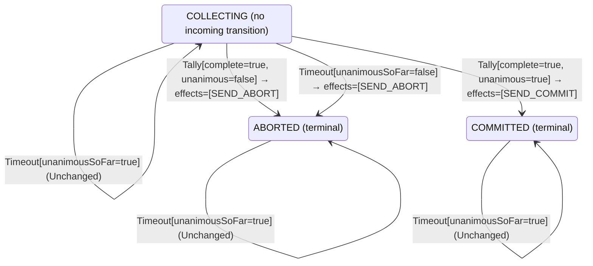

<!-- Generated by examples/demo/tools/build.py from example.json and the verifier's output. Edit example.json. -->
# 057 · A coordinator that waits for the last vote when every vote so far is yes blocks forever

[← All examples](../README.md)

| Verdict | Categories | Severity if shipped | Change | Verified unit | Approach |
|---|---|---|---|---|---|
| **✗ Violation: EveryParticipantDecides, 5-step trace then forever** | functional | critical | feature, behaviour change intended | [`Coordinator#decide`](../../../examples/demo/apps/quorum/src/main/java/net/terminalvalue/quorum/twopc/Coordinator.java) | [D1: Protocol model checking](../../../examples/demo/apps/quorum/spec/README.md) |

> When the vote collection times out, the two-phase-commit coordinator aborts: a participant that has not answered may have given up. A developer makes it keep collecting instead when every vote that did arrive was yes, so as not to throw away a transaction every responder approved. Every safety invariant of the protocol model still holds, and so does the contract diff the reviewer approves. The model's liveness property, that every participant eventually decides, does not: TLC shows a five-step run after which the prepared participant holds its locks forever.

## The change

On a `Timeout` in `COLLECTING`, answer `unchanged` when `unanimousSoFar` is true, and abort as before when it is false. The reasoning in the comment: the missing participants may only be slow, and the next vote completes the tally, so a yes commits and a no aborts, as always. The contract diff is one case, `decide(COLLECTING, Timeout[unanimousSoFar=true])`, from a transition to `ABORTED` to unchanged, and a test for it is added. The reviewer approves the diff.

**Before** ([`Coordinator.java`](../../../examples/demo/apps/quorum/src/main/java/net/terminalvalue/quorum/twopc/Coordinator.java), line 28):

```java
                : tally.unanimous() ? transition(COMMITTED, SEND_COMMIT) : transition(ABORTED, SEND_ABORT);
        case COMMITTED, ABORTED -> unchanged("already decided");
    };
    case Timeout _ -> switch (phase) {
        case COLLECTING -> transition(ABORTED, SEND_ABORT); // presumed abort
        case COMMITTED, ABORTED -> unchanged("already decided");
    };
};
```

**After:**

```java
                : tally.unanimous() ? transition(COMMITTED, SEND_COMMIT) : transition(ABORTED, SEND_ABORT);
        case COMMITTED, ABORTED -> unchanged("already decided");
    };
    case Timeout timeout -> switch (phase) {
        // Every vote so far is yes: the missing participants may only be slow, and aborting throws away
        // work every responder approved. Keep collecting; the next vote completes the tally.
        case COLLECTING -> timeout.unanimousSoFar()
                ? unchanged("every vote so far is yes; waiting for the rest")
                : transition(ABORTED, SEND_ABORT); // presumed abort
        case COMMITTED, ABORTED -> unchanged("already decided");
    };
};
```

<details><summary>Patch</summary>

```diff
--- a/examples/demo/apps/quorum/src/main/java/net/terminalvalue/quorum/twopc/Coordinator.java
+++ b/examples/demo/apps/quorum/src/main/java/net/terminalvalue/quorum/twopc/Coordinator.java
@@ -28,8 +28,12 @@
                         : tally.unanimous() ? transition(COMMITTED, SEND_COMMIT) : transition(ABORTED, SEND_ABORT);
                 case COMMITTED, ABORTED -> unchanged("already decided");
             };
-            case Timeout _ -> switch (phase) {
-                case COLLECTING -> transition(ABORTED, SEND_ABORT); // presumed abort
+            case Timeout timeout -> switch (phase) {
+                // Every vote so far is yes: the missing participants may only be slow, and aborting throws away
+                // work every responder approved. Keep collecting; the next vote completes the tally.
+                case COLLECTING -> timeout.unanimousSoFar()
+                        ? unchanged("every vote so far is yes; waiting for the rest")
+                        : transition(ABORTED, SEND_ABORT); // presumed abort
                 case COMMITTED, ABORTED -> unchanged("already decided");
             };
         };
--- a/examples/demo/apps/quorum/src/test/java/net/terminalvalue/quorum/twopc/CoordinatorTest.java
+++ b/examples/demo/apps/quorum/src/test/java/net/terminalvalue/quorum/twopc/CoordinatorTest.java
@@ -32,6 +32,10 @@
                 Coordinator.decide(Phase.COLLECTING, new Timeout(false)));
     }
 
+    public static void keepsCollectingOnTimeoutWhenEveryVoteSoFarIsYes() {
+        check(Coordinator.decide(Phase.COLLECTING, new Timeout(true)) instanceof Decision.Unchanged, "wait for the rest");
+    }
+
     public static void aDecisionIsFinal() {
         check(Coordinator.decide(Phase.COMMITTED, new Timeout(true)) instanceof Decision.Unchanged, "committed stays");
         check(Coordinator.decide(Phase.ABORTED, new Tally(true, true)) instanceof Decision.Unchanged, "aborted stays");
```

</details>

## What the verifier found

The model is checked under 2 configurations, and the verdict is the first that fails:

| Configuration | What it checks | Model | Result |
|---|---|---|---|
| three participants (`spec/TwoPhaseCommit.cfg`) | every run from the initial state, every interleaving within the configuration's bounds | Participants = {p1, p2, p3} | ✗ Violation: EveryParticipantDecides, 5-step trace then forever |
| the inductive step (`spec/TwoPhaseCommitInductive.cfg`) | that the invariant `Inductive` is inductive: TLC starts from every state the invariant admits, reachable or not, rather than from the initial state, takes one step, and checks the invariant again, conjunct by conjunct. No counterexample is a proof of atomicity by induction, for any run of the protocol however long; a counterexample is one step from a state that need not be reachable | Participants = {p1, p2, p3} | ✓ Verified: all invariants hold in 736 states |

TLC found a run of the system under three participants that violates the temporal property **EveryParticipantDecides** (every participant eventually commits or aborts, under the fairness the model assumes: participants vote or give up, the coordinator counts every vote and fires its timer while votes are missing, and participants apply a decision once made): after the 5 steps below, the system stays in that state forever, and the property never comes true. The run respects every fairness condition the model assumes; the parts that could act, do. Each step is one action of one part of the system:

1. **Initial state**: every participant working, no vote counted, no decision.
2. **Vote**, `Participant.prepare`: a participant votes yes (and holds its locks) or no (and aborts). `inbox = {[from |-> p1, vote |-> "YES"]}`, `pstate = (p1 :> "PREPARED" @@ p2 :> "WORKING" @@ p3 :> "WORKING")`
3. **ReceiveVote**, `Coordinator.onVote`: the coordinator counts a vote and decides on the tally. `inbox = {}`, `votes = (p1 :> "YES" @@ p2 :> "NONE" @@ p3 :> "NONE")`
4. **ParticipantTimeout**, `Participant.timeout`: a participant that has not voted gives up on its own. `pstate = (p1 :> "PREPARED" @@ p2 :> "ABORTED" @@ p3 :> "WORKING")`
5. **ParticipantTimeout**, `Participant.timeout`: a participant that has not voted gives up on its own. `pstate = (p1 :> "PREPARED" @@ p2 :> "ABORTED" @@ p3 :> "ABORTED")`

The model is small (Participants = {p1, p2, p3}), which is what keeps the trace readable. TLC explored every interleaving of the participants, the coordinator and the votes in flight within those bounds.

**What the verdict rests on.** TLC counted how often a step of the model took each row of the generated operators. A row no step takes is one the model says nothing about, whatever the verdict.

| Configuration | Rows of `Coordinator#decide` taken |
|---|---|
| three participants | stopped at the counterexample |
| the inductive step (from the states the invariant admits, not from a run) | 10 of 18 |

The change alters 1 row of the contract:

- `decide(COLLECTING, Timeout[unanimousSoFar=true])`: `Transition[next=ABORTED, effects=[SEND_ABORT]]` → `Unchanged[reason="every vote so far is yes; waiting for the rest"]`, taken under the inductive step

The run under three participants stopped at its counterexample, the steps above, and its counts are left out: the verdict rests on the counterexample.

<details><summary>Rows no step takes under the inductive step</summary>

`net.terminalvalue.quorum.twopc.Coordinator#decide`:

```
decide(COMMITTED, Tally[complete=false, unanimous=false]) => Unchanged
decide(COMMITTED, Tally[complete=false, unanimous=true]) => Unchanged
decide(COMMITTED, Tally[complete=true, unanimous=false]) => Unchanged
decide(COMMITTED, Tally[complete=true, unanimous=true]) => Unchanged
decide(COMMITTED, Timeout[unanimousSoFar=false]) => Unchanged
decide(COMMITTED, Timeout[unanimousSoFar=true]) => Unchanged
decide(ABORTED, Timeout[unanimousSoFar=false]) => Unchanged
decide(ABORTED, Timeout[unanimousSoFar=true]) => Unchanged
```

</details>

The state machine the patched code implements, drawn from its derived contract (`jvmcontract statemachine`); a state with no way in or no way out is marked:



## Would the existing tests have caught it?

No: every existing unit test passes (`java -ea net.terminalvalue.quorum.Tests`, run against the patched code).

## Why it matters

A participant that voted yes is prepared: it holds its locks and cannot abort on its own, because the coordinator may still commit. That is the blocking property of two-phase commit, and the protocol lives with it because the coordinator is bound to decide: the timeout is what turns a participant that never answers into an abort. With this change, one participant that gives up before voting, a crash, a network partition, a client that went away, leaves a coordinator that waits for a vote that will never come, and every participant that voted yes waits with it, holding its locks, for as long as the system runs. No invariant is ever false: nothing wrong is observed, because nothing is observed at all. The unit tests check the decision on each input, and each decision is the intended one.

## Why the verdict is right

The model gained two things in this cycle, both temporal: fairness conditions, which say what each part of the system is assumed to get round to (participants vote or give up, the coordinator counts every vote that reaches it and fires its timer while votes are missing, participants apply a decision once made), and the property `EveryParticipantDecides`, `\A p \in Participants : <>(pstate[p] \in {"COMMITTED", "ABORTED"})`, which TLC checks over every infinite behaviour that respects the fairness conditions. On the committed coordinator it holds in all 728 states. On the patched one TLC finds a counterexample: p1 votes yes and is counted; p2 and then p3 give up before voting. The coordinator's timer fires, and fires again, and each time the rule says to keep collecting; p1 is prepared, and stays prepared. TLC reports the five steps and that the system stays in that state forever, which is what a liveness counterexample is: a finite prefix and an infinite rest. The tool checks the model's two temporal properties one at a time to name the violated one, since TLC does not. Deadlock detection would not have found this: the coordinator's timer is always enabled, so some action can always be taken; it is just that none of them helps. That is the difference between a deadlock and a liveness failure, and why the model states both.

## What to do

Revert. Gray's presumed-abort rule is the timeout's whole job: a participant that did not answer in time is treated as having voted no, so that the ones that voted yes are released. If slow participants are the concern, lengthen the timer, or give them one more period and abort after it, which example 058 does and proves live. The liveness property stays in the model's build, so that the next change to the timeout rule is checked against it.

## Evidence

How the verdict was reached: three participants: TLC 2.19 explored 385 distinct states in 0 s, for the model Participants = {p1, p2, p3}; the inductive step: TLC 2.19 explored 736 distinct states to depth 1 in 0 s, for the model Participants = {p1, p2, p3}.

<details><summary>Verifier output</summary>

```text
== three participants: spec/TwoPhaseCommit.cfg ==
TLC2 Version 2.19 of 08 August 2024 (rev: 5a47802)
Running breadth-first search Model-Checking with fp 1 and seed 1 with 1 worker on 8 cores with 910MB heap and 64MB offheap memory [pid: 2305171] (Linux 6.6.87.2-microsoft-standard-WSL2 aarch64, Eclipse Adoptium 25.0.4.1 x86_64, MSBDiskFPSet, DiskStateQueue).
Parsing file examples/demo/apps/quorum/spec/TwoPhaseCommit.tla
Parsing file examples/demo/tools/tla/standard-modules/Naturals.tla
Parsing file examples/demo/tools/tla/standard-modules/Sequences.tla
Parsing file examples/demo/tools/tla/standard-modules/FiniteSets.tla
Parsing file examples/demo/apps/quorum/spec/CoordinatorContract.tla
Parsing file examples/demo/apps/quorum/spec/TCommit.tla
Semantic processing of module Naturals
Semantic processing of module Sequences
Semantic processing of module FiniteSets
Semantic processing of module CoordinatorContract
Semantic processing of module TCommit
Semantic processing of module TwoPhaseCommit
Starting... (2026-11-02 01:45:37)
Implied-temporal checking--satisfiability problem has 3 branches.
Computing initial states...
Finished computing initial states: 1 distinct state generated at 2026-11-02 01:45:37.
Checking 3 branches of temporal properties for the complete state space with 1155 total distinct states at (2026-11-02 01:45:38)
Error: Temporal properties were violated.

Error: The following behavior constitutes a counter-example:

State 1: <Initial predicate>
/\ pstate = (p1 :> "WORKING" @@ p2 :> "WORKING" @@ p3 :> "WORKING")
/\ decision = "NONE"
/\ phase = "COLLECTING"
/\ inbox = {}
/\ votes = (p1 :> "NONE" @@ p2 :> "NONE" @@ p3 :> "NONE")

State 2: <Vote line 46, col 5 to line 50, col 43 of module TwoPhaseCommit>
/\ pstate = (p1 :> "PREPARED" @@ p2 :> "WORKING" @@ p3 :> "WORKING")
/\ decision = "NONE"
/\ phase = "COLLECTING"
/\ inbox = {[from |-> p1, vote |-> "YES"]}
/\ votes = (p1 :> "NONE" @@ p2 :> "NONE" @@ p3 :> "NONE")

State 3: <ReceiveVote line 82, col 5 to line 90, col 23 of module TwoPhaseCommit>
/\ pstate = (p1 :> "PREPARED" @@ p2 :> "WORKING" @@ p3 :> "WORKING")
/\ decision = "NONE"
/\ phase = "COLLECTING"
/\ inbox = {}
/\ votes = (p1 :> "YES" @@ p2 :> "NONE" @@ p3 :> "NONE")

State 4: <ParticipantTimeout line 55, col 5 to line 57, col 50 of module TwoPhaseCommit>
/\ pstate = (p1 :> "PREPARED" @@ p2 :> "ABORTED" @@ p3 :> "WORKING")
/\ decision = "NONE"
/\ phase = "COLLECTING"
/\ inbox = {}
/\ votes = (p1 :> "YES" @@ p2 :> "NONE" @@ p3 :> "NONE")

State 5: <ParticipantTimeout line 55, col 5 to line 57, col 50 of module TwoPhaseCommit>
/\ pstate = (p1 :> "PREPARED" @@ p2 :> "ABORTED" @@ p3 :> "ABORTED")
/\ decision = "NONE"
/\ phase = "COLLECTING"
/\ inbox = {}
/\ votes = (p1 :> "YES" @@ p2 :> "NONE" @@ p3 :> "NONE")

State 6: Stuttering
Finished checking temporal properties in 00s at 2026-11-02 01:45:38
The coverage statistics at 2026-11-02 01:45:38
<Init line 103, col 1 to line 103, col 4 of module TwoPhaseCommit>: 2:2
  line 104, col 5 to line 108, col 24 of module TwoPhaseCommit: 2
<Vote line 45, col 1 to line 45, col 7 of module TwoPhaseCommit>: 42:316
  line 46, col 8 to line 46, col 28 of module TwoPhaseCommit: 1322
  |line 46, col 8 to line 46, col 16 of module TwoPhaseCommit: 1164
  line 48, col 9 to line 49, col 57 of module TwoPhaseCommit: 316
  line 47, col 17 to line 47, col 29 of module TwoPhaseCommit: 158:474
  line 50, col 8 to line 50, col 43 of module TwoPhaseCommit: 316
<ParticipantTimeout line 54, col 1 to line 54, col 21 of module TwoPhaseCommit>: 21:157
  line 55, col 8 to line 55, col 28 of module TwoPhaseCommit: 1320
  |line 55, col 8 to line 55, col 16 of module TwoPhaseCommit: 1163
  line 56, col 8 to line 56, col 49 of module TwoPhaseCommit: 157
  line 57, col 8 to line 57, col 50 of module TwoPhaseCommit: 157
<Learn line 60, col 1 to line 60, col 8 of module TwoPhaseCommit>: 85:147
  line 61, col 8 to line 61, col 24 of module TwoPhaseCommit: 1308
  |line 61, col 8 to line 61, col 15 of module TwoPhaseCommit: 1161
  line 62, col 8 to line 62, col 44 of module TwoPhaseCommit: 678
  |line 62, col 8 to line 62, col 16 of module TwoPhaseCommit: 531
  |line 62, col 22 to line 62, col 44 of module TwoPhaseCommit: 531
  line 63, col 8 to line 63, col 94 of module TwoPhaseCommit: 147
  line 64, col 8 to line 64, col 50 of module TwoPhaseCommit: 147
<ReceiveVote line 81, col 1 to line 81, col 14 of module TwoPhaseCommit>: 152:352
  line 82, col 8 to line 82, col 18 of module TwoPhaseCommit: 2663
  |line 82, col 8 to line 82, col 8 of module TwoPhaseCommit: 2311
  |line 82, col 14 to line 82, col 18 of module TwoPhaseCommit: 2311
  line 83, col 8 to line 83, col 27 of module TwoPhaseCommit: 352
  line 84, col 8 to line 84, col 49 of module TwoPhaseCommit: 352
  line 74, col 8 to line 74, col 28 of module TwoPhaseCommit: 352
  line 75, col 13 to line 75, col 27 of module TwoPhaseCommit: 24
  line 76, col 13 to line 76, col 118 of module TwoPhaseCommit: 24
  |line 76, col 25 to line 76, col 118 of module TwoPhaseCommit: 24
  ||line 76, col 28 to line 76, col 48 of module TwoPhaseCommit: 24
  ||line 76, col 69 to line 76, col 118 of module TwoPhaseCommit: 21
  line 77, col 10 to line 77, col 38 of module TwoPhaseCommit: 328
  line 89, col 17 to line 89, col 36 of module TwoPhaseCommit: 466
  |line 13, col 3 to line 30, col 95 of module CoordinatorContract: 466
  ||line 13, col 8 to line 13, col 128 of module CoordinatorContract: 466
  |||line 13, col 8 to line 13, col 57 of module CoordinatorContract: 466
  ||||line 13, col 9 to line 13, col 31 of module CoordinatorContract: 466
  |||||line 13, col 27 to line 13, col 31 of module CoordinatorContract: 932
  |||||line 13, col 18 to line 13, col 23 of module CoordinatorContract: 466:1398
  ||||line 13, col 37 to line 13, col 57 of module CoordinatorContract: 466
  |||line 13, col 62 to line 13, col 128 of module CoordinatorContract: 331
  ||line 13, col 133 to line 13, col 141 of module CoordinatorContract: 120
  ||line 14, col 8 to line 14, col 98 of module CoordinatorContract: 346
  |||line 14, col 8 to line 14, col 28 of module CoordinatorContract: 346
  |||line 14, col 33 to line 14, col 98 of module CoordinatorContract: 211
  ||line 14, col 103 to line 14, col 111 of module CoordinatorContract: 73
  ||line 15, col 8 to line 15, col 98 of module CoordinatorContract: 273
  |||line 15, col 8 to line 15, col 28 of module CoordinatorContract: 273
  |||line 15, col 33 to line 15, col 98 of module CoordinatorContract: 138
  ||line 15, col 103 to line 15, col 141 of module CoordinatorContract: 126
  ||line 16, col 8 to line 16, col 97 of module CoordinatorContract: 147
  |||line 16, col 8 to line 16, col 28 of module CoordinatorContract: 147
  |||line 16, col 33 to line 16, col 97 of module CoordinatorContract: 12
  ||line 16, col 102 to line 16, col 143 of module CoordinatorContract: 12
  ||line 17, col 8 to line 17, col 129 of module CoordinatorContract: 135
  ||line 18, col 8 to line 18, col 98 of module CoordinatorContract: 135
  ||line 19, col 8 to line 19, col 111 of module CoordinatorContract: 135
  ||line 20, col 8 to line 20, col 110 of module CoordinatorContract: 135
  ||line 21, col 8 to line 21, col 110 of module CoordinatorContract: 135
  ||line 22, col 8 to line 22, col 109 of module CoordinatorContract: 135
  ||line 23, col 8 to line 23, col 98 of module CoordinatorContract: 135
  ||line 24, col 8 to line 24, col 97 of module CoordinatorContract: 135
  ||line 25, col 8 to line 25, col 96 of module CoordinatorContract: 135
  ||line 25, col 101 to line 25, col 109 of module CoordinatorContract: 90
  ||line 26, col 8 to line 26, col 108 of module CoordinatorContract: 45
  ||line 27, col 8 to line 27, col 108 of module CoordinatorContract: 45
  |line 89, col 24 to line 89, col 28 of module TwoPhaseCommit: 466
  |line 89, col 31 to line 89, col 35 of module TwoPhaseCommit: 917
  ||line 86, col 21 to line 88, col 72 of module TwoPhaseCommit: 917
  |||line 87, col 35 to line 87, col 56 of module TwoPhaseCommit: 917
  ||||line 87, col 35 to line 87, col 41 of module TwoPhaseCommit: 917
  |||||line 85, col 23 to line 85, col 63 of module TwoPhaseCommit: 917
  ||||||line 85, col 45 to line 85, col 62 of module TwoPhaseCommit: 2751
  ||||||line 85, col 30 to line 85, col 41 of module TwoPhaseCommit: 917
  ||||line 87, col 45 to line 87, col 56 of module TwoPhaseCommit: 917
  |||line 88, col 36 to line 88, col 71 of module TwoPhaseCommit: 917
  ||||line 88, col 55 to line 88, col 71 of module TwoPhaseCommit: 1421
  ||||line 88, col 45 to line 88, col 51 of module TwoPhaseCommit: 917
  |||||line 85, col 23 to line 85, col 63 of module TwoPhaseCommit: 917:2338
  ||||||line 85, col 45 to line 85, col 62 of module TwoPhaseCommit: 2751
  ||||||line 85, col 30 to line 85, col 41 of module TwoPhaseCommit: 917
  line 90, col 8 to line 90, col 23 of module TwoPhaseCommit: 352
<CoordinatorTimeout line 93, col 1 to line 93, col 18 of module TwoPhaseCommit>: 84:208
  line 94, col 8 to line 94, col 27 of module TwoPhaseCommit: 593
  |line 94, col 8 to line 94, col 12 of module TwoPhaseCommit: 385
  line 95, col 8 to line 95, col 29 of module TwoPhaseCommit: 416
  |line 95, col 8 to line 95, col 14 of module TwoPhaseCommit: 208
  ||line 37, col 12 to line 37, col 51 of module TwoPhaseCommit: 208
  |||line 37, col 34 to line 37, col 50 of module TwoPhaseCommit: 624
  |||line 37, col 19 to line 37, col 30 of module TwoPhaseCommit: 208
  |line 95, col 18 to line 95, col 29 of module TwoPhaseCommit: 208
  line 74, col 8 to line 74, col 28 of module TwoPhaseCommit: 208
  line 75, col 10 to line 76, col 118 of module TwoPhaseCommit: 84
  line 77, col 10 to line 77, col 38 of module TwoPhaseCommit: 124
  line 96, col 14 to line 96, col 104 of module TwoPhaseCommit: 208
  |line 13, col 3 to line 30, col 95 of module CoordinatorContract: 208
  ||line 13, col 8 to line 13, col 128 of module CoordinatorContract: 208
  |||line 13, col 8 to line 13, col 57 of module CoordinatorContract: 208
  ||||line 13, col 9 to line 13, col 31 of module CoordinatorContract: 208
  |||||line 13, col 27 to line 13, col 31 of module CoordinatorContract: 416
  |||||line 13, col 18 to line 13, col 23 of module CoordinatorContract: 208:624
  ||||line 13, col 37 to line 13, col 57 of module CoordinatorContract: 208
  |||line 13, col 62 to line 13, col 128 of module CoordinatorContract: 208
  ||line 14, col 8 to line 14, col 111 of module CoordinatorContract: 208
  ||line 15, col 8 to line 15, col 141 of module CoordinatorContract: 208
  ||line 16, col 8 to line 16, col 143 of module CoordinatorContract: 208
  ||line 17, col 8 to line 17, col 86 of module CoordinatorContract: 208
  ||line 17, col 91 to line 17, col 129 of module CoordinatorContract: 84
  ||line 18, col 8 to line 18, col 98 of module CoordinatorContract: 124
  |line 96, col 21 to line 96, col 25 of module TwoPhaseCommit: 208
  |line 96, col 28 to line 96, col 103 of module TwoPhaseCommit: 208
  ||line 96, col 68 to line 96, col 102 of module TwoPhaseCommit: 208
  |||line 96, col 87 to line 96, col 102 of module TwoPhaseCommit: 168
  |||line 96, col 77 to line 96, col 83 of module TwoPhaseCommit: 208
  ||||line 37, col 12 to line 37, col 51 of module TwoPhaseCommit: 208:376
  |||||line 37, col 34 to line 37, col 50 of module TwoPhaseCommit: 624
  |||||line 37, col 19 to line 37, col 30 of module TwoPhaseCommit: 208
  line 97, col 8 to line 97, col 41 of module TwoPhaseCommit: 208
<TypeOK line 132, col 1 to line 132, col 6 of module TwoPhaseCommit>
  line 133, col 5 to line 136, col 47 of module TwoPhaseCommit: 385
  |line 133, col 8 to line 133, col 55 of module TwoPhaseCommit: 385
  |line 134, col 8 to line 134, col 92 of module TwoPhaseCommit: 385
  ||line 134, col 32 to line 134, col 92 of module TwoPhaseCommit: 1155
  ||line 134, col 17 to line 134, col 28 of module TwoPhaseCommit: 385
  |line 135, col 8 to line 135, col 65 of module TwoPhaseCommit: 385
  ||line 135, col 32 to line 135, col 65 of module TwoPhaseCommit: 1155
  ||line 135, col 17 to line 135, col 28 of module TwoPhaseCommit: 385
  |line 136, col 8 to line 136, col 47 of module TwoPhaseCommit: 385
<Atomicity line 140, col 1 to line 140, col 9 of module TwoPhaseCommit>
  line 141, col 5 to line 142, col 56 of module TwoPhaseCommit: 385
  |line 141, col 6 to line 141, col 75 of module TwoPhaseCommit: 385
  ||line 141, col 6 to line 141, col 24 of module TwoPhaseCommit: 385
  ||line 141, col 29 to line 141, col 75 of module TwoPhaseCommit: 377
  |||line 141, col 53 to line 141, col 75 of module TwoPhaseCommit: 1131
  |||line 141, col 38 to line 141, col 49 of module TwoPhaseCommit: 377
  |line 142, col 12 to line 142, col 56 of module TwoPhaseCommit: 8
  ||line 142, col 36 to line 142, col 56 of module TwoPhaseCommit: 24
  ||line 142, col 21 to line 142, col 32 of module TwoPhaseCommit: 8
<CommitFollowsTheCoordinator line 145, col 1 to line 145, col 27 of module TwoPhaseCommit>
  line 146, col 5 to line 146, col 94 of module TwoPhaseCommit: 385
  |line 146, col 29 to line 146, col 94 of module TwoPhaseCommit: 1155
  ||line 146, col 29 to line 146, col 51 of module TwoPhaseCommit: 1155
  ||line 146, col 56 to line 146, col 94 of module TwoPhaseCommit: 12
  |line 146, col 14 to line 146, col 25 of module TwoPhaseCommit: 385
End of statistics.
1166 states generated, 385 distinct states found, 0 states left on queue.
Finished in 00s at (2026-11-02 01:45:38)
(jvmcontract checked the temporal properties one at a time to name the violated one: EveryParticipantDecides)

== the inductive step: spec/TwoPhaseCommitInductive.cfg ==
TLC2 Version 2.19 of 08 August 2024 (rev: 5a47802)
Running breadth-first search Model-Checking with fp 1 and seed 1 with 1 worker on 8 cores with 910MB heap and 64MB offheap memory [pid: 2305275] (Linux 6.6.87.2-microsoft-standard-WSL2 aarch64, Eclipse Adoptium 25.0.4.1 x86_64, MSBDiskFPSet, DiskStateQueue).
Parsing file examples/demo/apps/quorum/spec/TwoPhaseCommit.tla
Parsing file examples/demo/tools/tla/standard-modules/Naturals.tla
Parsing file examples/demo/tools/tla/standard-modules/Sequences.tla
Parsing file examples/demo/tools/tla/standard-modules/FiniteSets.tla
Parsing file examples/demo/apps/quorum/spec/CoordinatorContract.tla
Parsing file examples/demo/apps/quorum/spec/TCommit.tla
Semantic processing of module Naturals
Semantic processing of module Sequences
Semantic processing of module FiniteSets
Semantic processing of module CoordinatorContract
Semantic processing of module TCommit
Semantic processing of module TwoPhaseCommit
Starting... (2026-11-02 01:45:38)
Computing initial states...
Computed 2 initial states...
Computed 4 initial states...
Computed 8 initial states...
Computed 16 initial states...
Computed 32 initial states...
Computed 64 initial states...
Computed 128 initial states...
Computed 256 initial states...
Computed 512 initial states...
Finished computing initial states: 736 distinct states generated at 2026-11-02 01:45:39.
Model checking completed. No error has been found.
  Estimates of the probability that TLC did not check all reachable states
  because two distinct states had the same fingerprint:
  calculated (optimistic):  val = 9.9E-14
Rows of net.terminalvalue.quorum.twopc.Coordinator#decide a step of the model takes: 10 of 18; never taken (8):
  decide(COMMITTED, Tally[complete=false, unanimous=false]) => Unchanged
  decide(COMMITTED, Tally[complete=false, unanimous=true]) => Unchanged
  decide(COMMITTED, Tally[complete=true, unanimous=false]) => Unchanged
  decide(COMMITTED, Tally[complete=true, unanimous=true]) => Unchanged
  decide(COMMITTED, Timeout[unanimousSoFar=false]) => Unchanged
  decide(COMMITTED, Timeout[unanimousSoFar=true]) => Unchanged
  decide(ABORTED, Timeout[unanimousSoFar=false]) => Unchanged
  decide(ABORTED, Timeout[unanimousSoFar=true]) => Unchanged
3224 states generated, 736 distinct states found, 0 states left on queue.
The depth of the complete state graph search is 1.
The average outdegree of the complete state graph is 0 (minimum is 0, the maximum 0 and the 95th percentile is 0).
Finished in 00s at (2026-11-02 01:45:39)
```

</details>

<details><summary>SARIF report (as uploaded to GitHub code scanning or SonarQube)</summary>

```json
{
  "version": "2.1.0",
  "$schema": "https://json.schemastore.org/sarif-2.1.0.json",
  "runs": [
    {
      "tool": {
        "driver": {
          "name": "jvmcontract tlc",
          "rules": [
            {
              "id": "invariant-violated",
              "shortDescription": {
                "text": "TLC found a behaviour of the model that violates an invariant or a temporal property, or ends in a deadlock."
              }
            },
            {
              "id": "unverifiable",
              "shortDescription": {
                "text": "TLC could not check the model."
              }
            }
          ]
        }
      },
      "results": [
        {
          "ruleId": "invariant-violated",
          "level": "error",
          "message": {
            "text": "Temporal property EveryParticipantDecides of spec/TwoPhaseCommit.tla (three participants) is violated: after 5 steps the system stays in that state forever"
          },
          "locations": [
            {
              "physicalLocation": {
                "artifactLocation": {
                  "uri": "examples/demo/apps/quorum/src/main/java/net/terminalvalue/quorum/twopc/Coordinator.java"
                },
                "region": {
                  "startLine": 28
                }
              }
            }
          ]
        }
      ]
    }
  ]
}
```

</details>

**Provenance:** Constructed from the blocking property of two-phase commit (Gray, 1978; Lamport and Gray, 2004), by removing the timeout that bounds it.

- [Gray, Notes on Data Base Operating Systems (1978): two-phase commit and the blocking of a prepared participant](https://jimgray.azurewebsites.net/papers/dbos.pdf)
- [Lamport and Gray, Consensus on Transaction Commit: the TCommit and TwoPhase specifications](https://lamport.azurewebsites.net/video/consensus-on-transaction-commit.pdf)
- [Lamport, Specifying Systems, chapter 8: liveness and fairness](https://lamport.azurewebsites.net/tla/book.html)
## Reproduce

```bash
python3 examples/demo/tools/build.py 057
```

This applies `change.patch` to a temporary copy of the repo, runs the verifier on it, and rewrites this page.
