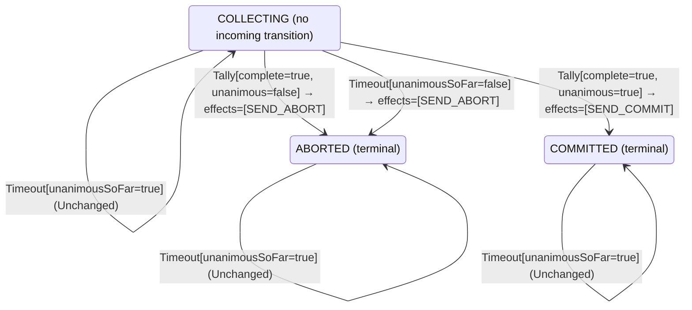

<!-- Generated by examples/demo/tools/build.py from example.json and the verifier's output. Edit example.json. -->
# 057 · A coordinator that waits for the last vote when every vote so far is yes blocks forever

[← All examples](../README.md)

| Verdict | Categories | Severity if shipped | Change | Verified unit | Approach |
|---|---|---|---|---|---|
| **✗ Violation: EveryParticipantDecides, 5-step trace then forever** | functional | critical | feature, behaviour change intended | [`Coordinator#decide`](../../../examples/demo/apps/quorum/src/main/java/net/terminalvalue/quorum/twopc/Coordinator.java) | [D1: Protocol model checking](../../../examples/demo/apps/quorum/spec/README.md) |

> When the vote collection times out, the two-phase-commit coordinator aborts: a participant that has not answered may have given up. A developer makes it keep collecting instead when every vote that did arrive was yes, so as not to throw away a transaction every responder approved. Every safety invariant of the protocol model still holds, and so does the contract diff the reviewer approves. The model's liveness property, that every participant eventually decides, does not: TLC shows a five-step run after which the prepared participant holds its locks forever.

## The change

On a `Timeout` in `COLLECTING`, answer `unchanged` when `unanimousSoFar` is true, and abort as before when it is false. The reasoning in the comment: the missing participants may only be slow, and the next vote completes the tally, so a yes commits and a no aborts, as always. The contract diff is one case, `decide(COLLECTING, Timeout[unanimousSoFar=true])`, from a transition to `ABORTED` to unchanged, and a test for it is added. The reviewer approves the diff.

**Before** ([`Coordinator.java`](../../../examples/demo/apps/quorum/src/main/java/net/terminalvalue/quorum/twopc/Coordinator.java), line 28):

```java
                : tally.unanimous() ? transition(COMMITTED, SEND_COMMIT) : transition(ABORTED, SEND_ABORT);
        case COMMITTED, ABORTED -> unchanged("already decided");
    };
    case Timeout _ -> switch (phase) {
        case COLLECTING -> transition(ABORTED, SEND_ABORT); // presumed abort
        case COMMITTED, ABORTED -> unchanged("already decided");
    };
};
```

**After:**

```java
                : tally.unanimous() ? transition(COMMITTED, SEND_COMMIT) : transition(ABORTED, SEND_ABORT);
        case COMMITTED, ABORTED -> unchanged("already decided");
    };
    case Timeout timeout -> switch (phase) {
        // Every vote so far is yes: the missing participants may only be slow, and aborting throws away
        // work every responder approved. Keep collecting; the next vote completes the tally.
        case COLLECTING -> timeout.unanimousSoFar()
                ? unchanged("every vote so far is yes; waiting for the rest")
                : transition(ABORTED, SEND_ABORT); // presumed abort
        case COMMITTED, ABORTED -> unchanged("already decided");
    };
};
```

<details><summary>Patch</summary>

```diff
--- a/examples/demo/apps/quorum/src/main/java/net/terminalvalue/quorum/twopc/Coordinator.java
+++ b/examples/demo/apps/quorum/src/main/java/net/terminalvalue/quorum/twopc/Coordinator.java
@@ -28,8 +28,12 @@
                         : tally.unanimous() ? transition(COMMITTED, SEND_COMMIT) : transition(ABORTED, SEND_ABORT);
                 case COMMITTED, ABORTED -> unchanged("already decided");
             };
-            case Timeout _ -> switch (phase) {
-                case COLLECTING -> transition(ABORTED, SEND_ABORT); // presumed abort
+            case Timeout timeout -> switch (phase) {
+                // Every vote so far is yes: the missing participants may only be slow, and aborting throws away
+                // work every responder approved. Keep collecting; the next vote completes the tally.
+                case COLLECTING -> timeout.unanimousSoFar()
+                        ? unchanged("every vote so far is yes; waiting for the rest")
+                        : transition(ABORTED, SEND_ABORT); // presumed abort
                 case COMMITTED, ABORTED -> unchanged("already decided");
             };
         };
--- a/examples/demo/apps/quorum/src/test/java/net/terminalvalue/quorum/twopc/CoordinatorTest.java
+++ b/examples/demo/apps/quorum/src/test/java/net/terminalvalue/quorum/twopc/CoordinatorTest.java
@@ -32,6 +32,10 @@
                 Coordinator.decide(Phase.COLLECTING, new Timeout(false)));
     }
 
+    public static void keepsCollectingOnTimeoutWhenEveryVoteSoFarIsYes() {
+        check(Coordinator.decide(Phase.COLLECTING, new Timeout(true)) instanceof Decision.Unchanged, "wait for the rest");
+    }
+
     public static void aDecisionIsFinal() {
         check(Coordinator.decide(Phase.COMMITTED, new Timeout(true)) instanceof Decision.Unchanged, "committed stays");
         check(Coordinator.decide(Phase.ABORTED, new Tally(true, true)) instanceof Decision.Unchanged, "aborted stays");
```

</details>

## What the verifier found

The model is checked under 2 configurations, and the verdict is the first that fails:

| Configuration | What it checks | Model | Result |
|---|---|---|---|
| three participants (`spec/TwoPhaseCommit.cfg`) | every run from the initial state, every interleaving within the configuration's bounds | Participants = {p1, p2, p3} | ✗ Violation: EveryParticipantDecides, 5-step trace then forever |
| the inductive step (`spec/TwoPhaseCommitInductive.cfg`) | that the invariant `Inductive` is inductive: TLC starts from every state the invariant admits, reachable or not, rather than from the initial state, takes one step, and checks the invariant again, conjunct by conjunct. No counterexample is a proof of atomicity by induction, for any run of the protocol however long; a counterexample is one step from a state that need not be reachable | Participants = {p1, p2, p3} | ✓ Verified: all invariants hold in 736 states |

TLC found a run of the system under three participants that violates the temporal property **EveryParticipantDecides** (every participant eventually commits or aborts, under the fairness the model assumes: participants vote or give up, the coordinator counts every vote and fires its timer while votes are missing, and participants apply a decision once made): after the 5 steps below, the system stays in that state forever, and the property never comes true. The run respects every fairness condition the model assumes; the parts that could act, do. Each step is one action of one part of the system:

1. **Initial state**: every participant working, no vote counted, no decision.
2. **Vote**, `Participant.prepare`: a participant votes yes (and holds its locks) or no (and aborts). `inbox = {[from |-> p1, vote |-> "YES"]}`, `pstate = (p1 :> "PREPARED" @@ p2 :> "WORKING" @@ p3 :> "WORKING")`
3. **ReceiveVote**, `Coordinator.onVote`: the coordinator counts a vote and decides on the tally. `inbox = {}`, `votes = (p1 :> "YES" @@ p2 :> "NONE" @@ p3 :> "NONE")`
4. **ParticipantTimeout**, `Participant.timeout`: a participant that has not voted gives up on its own. `pstate = (p1 :> "PREPARED" @@ p2 :> "ABORTED" @@ p3 :> "WORKING")`
5. **ParticipantTimeout**, `Participant.timeout`: a participant that has not voted gives up on its own. `pstate = (p1 :> "PREPARED" @@ p2 :> "ABORTED" @@ p3 :> "ABORTED")`

The model is small (Participants = {p1, p2, p3}), which is what keeps the trace readable. TLC explored every interleaving of the participants, the coordinator and the votes in flight within those bounds.

The state machine the patched code implements, drawn from its derived contract (`jvmcontract statemachine`); a state with no way in or no way out is marked:



## Would the existing tests have caught it?

No: every existing unit test passes (`java -ea net.terminalvalue.quorum.Tests`, run against the patched code).

## Why it matters

A participant that voted yes is prepared: it holds its locks and cannot abort on its own, because the coordinator may still commit. That is the blocking property of two-phase commit, and the protocol lives with it because the coordinator is bound to decide: the timeout is what turns a participant that never answers into an abort. With this change, one participant that gives up before voting, a crash, a network partition, a client that went away, leaves a coordinator that waits for a vote that will never come, and every participant that voted yes waits with it, holding its locks, for as long as the system runs. No invariant is ever false: nothing wrong is observed, because nothing is observed at all. The unit tests check the decision on each input, and each decision is the intended one.

## Why the verdict is right

The model gained two things in this cycle, both temporal: fairness conditions, which say what each part of the system is assumed to get round to (participants vote or give up, the coordinator counts every vote that reaches it and fires its timer while votes are missing, participants apply a decision once made), and the property `EveryParticipantDecides`, `\A p \in Participants : <>(pstate[p] \in {"COMMITTED", "ABORTED"})`, which TLC checks over every infinite behaviour that respects the fairness conditions. On the committed coordinator it holds in all 728 states. On the patched one TLC finds a counterexample: p1 votes yes and is counted; p2 and then p3 give up before voting. The coordinator's timer fires, and fires again, and each time the rule says to keep collecting; p1 is prepared, and stays prepared. TLC reports the five steps and that the system stays in that state forever, which is what a liveness counterexample is: a finite prefix and an infinite rest. The tool checks the model's two temporal properties one at a time to name the violated one, since TLC does not. Deadlock detection would not have found this: the coordinator's timer is always enabled, so some action can always be taken; it is just that none of them helps. That is the difference between a deadlock and a liveness failure, and why the model states both.

## What to do

Revert. Gray's presumed-abort rule is the timeout's whole job: a participant that did not answer in time is treated as having voted no, so that the ones that voted yes are released. If slow participants are the concern, lengthen the timer, or give them one more period and abort after it, which example 058 does and proves live. The liveness property stays in the model's build, so that the next change to the timeout rule is checked against it.

## Evidence

How the verdict was reached: three participants: TLC 2.19 explored 385 distinct states in 0 s, for the model Participants = {p1, p2, p3}; the inductive step: TLC 2.19 explored 736 distinct states to depth 1 in 0 s, for the model Participants = {p1, p2, p3}.

<details><summary>Verifier output</summary>

```text
== three participants: spec/TwoPhaseCommit.cfg ==
TLC2 Version 2.19 of 08 August 2024 (rev: 5a47802)
Running breadth-first search Model-Checking with fp 1 and seed 1 with 1 worker on 8 cores with 910MB heap and 64MB offheap memory [pid: 2086259] (Linux 6.6.87.2-microsoft-standard-WSL2 aarch64, Eclipse Adoptium 25.0.4.1 x86_64, MSBDiskFPSet, DiskStateQueue).
Parsing file examples/demo/apps/quorum/spec/TwoPhaseCommit.tla
Parsing file examples/demo/tools/tla/standard-modules/Naturals.tla
Parsing file examples/demo/tools/tla/standard-modules/Sequences.tla
Parsing file examples/demo/tools/tla/standard-modules/FiniteSets.tla
Parsing file examples/demo/apps/quorum/spec/CoordinatorContract.tla
Parsing file examples/demo/apps/quorum/spec/TCommit.tla
Semantic processing of module Naturals
Semantic processing of module Sequences
Semantic processing of module FiniteSets
Semantic processing of module CoordinatorContract
Semantic processing of module TCommit
Semantic processing of module TwoPhaseCommit
Starting... (2026-11-02 00:28:35)
Implied-temporal checking--satisfiability problem has 3 branches.
Computing initial states...
Finished computing initial states: 1 distinct state generated at 2026-11-02 00:28:36.
Checking 3 branches of temporal properties for the complete state space with 1155 total distinct states at (2026-11-02 00:28:36)
Error: Temporal properties were violated.

Error: The following behavior constitutes a counter-example:

State 1: <Initial predicate>
/\ pstate = (p1 :> "WORKING" @@ p2 :> "WORKING" @@ p3 :> "WORKING")
/\ decision = "NONE"
/\ phase = "COLLECTING"
/\ inbox = {}
/\ votes = (p1 :> "NONE" @@ p2 :> "NONE" @@ p3 :> "NONE")

State 2: <Vote line 44, col 5 to line 48, col 43 of module TwoPhaseCommit>
/\ pstate = (p1 :> "PREPARED" @@ p2 :> "WORKING" @@ p3 :> "WORKING")
/\ decision = "NONE"
/\ phase = "COLLECTING"
/\ inbox = {[from |-> p1, vote |-> "YES"]}
/\ votes = (p1 :> "NONE" @@ p2 :> "NONE" @@ p3 :> "NONE")

State 3: <ReceiveVote line 80, col 5 to line 88, col 23 of module TwoPhaseCommit>
/\ pstate = (p1 :> "PREPARED" @@ p2 :> "WORKING" @@ p3 :> "WORKING")
/\ decision = "NONE"
/\ phase = "COLLECTING"
/\ inbox = {}
/\ votes = (p1 :> "YES" @@ p2 :> "NONE" @@ p3 :> "NONE")

State 4: <ParticipantTimeout line 53, col 5 to line 55, col 50 of module TwoPhaseCommit>
/\ pstate = (p1 :> "PREPARED" @@ p2 :> "ABORTED" @@ p3 :> "WORKING")
/\ decision = "NONE"
/\ phase = "COLLECTING"
/\ inbox = {}
/\ votes = (p1 :> "YES" @@ p2 :> "NONE" @@ p3 :> "NONE")

State 5: <ParticipantTimeout line 53, col 5 to line 55, col 50 of module TwoPhaseCommit>
/\ pstate = (p1 :> "PREPARED" @@ p2 :> "ABORTED" @@ p3 :> "ABORTED")
/\ decision = "NONE"
/\ phase = "COLLECTING"
/\ inbox = {}
/\ votes = (p1 :> "YES" @@ p2 :> "NONE" @@ p3 :> "NONE")

State 6: Stuttering
Finished checking temporal properties in 00s at 2026-11-02 00:28:36
1166 states generated, 385 distinct states found, 0 states left on queue.
Finished in 00s at (2026-11-02 00:28:36)
(jvmcontract checked the temporal properties one at a time to name the violated one: EveryParticipantDecides)

== the inductive step: spec/TwoPhaseCommitInductive.cfg ==
TLC2 Version 2.19 of 08 August 2024 (rev: 5a47802)
Running breadth-first search Model-Checking with fp 1 and seed 1 with 1 worker on 8 cores with 910MB heap and 64MB offheap memory [pid: 2086365] (Linux 6.6.87.2-microsoft-standard-WSL2 aarch64, Eclipse Adoptium 25.0.4.1 x86_64, MSBDiskFPSet, DiskStateQueue).
Parsing file examples/demo/apps/quorum/spec/TwoPhaseCommit.tla
Parsing file examples/demo/tools/tla/standard-modules/Naturals.tla
Parsing file examples/demo/tools/tla/standard-modules/Sequences.tla
Parsing file examples/demo/tools/tla/standard-modules/FiniteSets.tla
Parsing file examples/demo/apps/quorum/spec/CoordinatorContract.tla
Parsing file examples/demo/apps/quorum/spec/TCommit.tla
Semantic processing of module Naturals
Semantic processing of module Sequences
Semantic processing of module FiniteSets
Semantic processing of module CoordinatorContract
Semantic processing of module TCommit
Semantic processing of module TwoPhaseCommit
Starting... (2026-11-02 00:28:37)
Computing initial states...
Computed 2 initial states...
Computed 4 initial states...
Computed 8 initial states...
Computed 16 initial states...
Computed 32 initial states...
Computed 64 initial states...
Computed 128 initial states...
Computed 256 initial states...
Computed 512 initial states...
Finished computing initial states: 736 distinct states generated at 2026-11-02 00:28:37.
Model checking completed. No error has been found.
  Estimates of the probability that TLC did not check all reachable states
  because two distinct states had the same fingerprint:
  calculated (optimistic):  val = 9.9E-14
3224 states generated, 736 distinct states found, 0 states left on queue.
The depth of the complete state graph search is 1.
The average outdegree of the complete state graph is 0 (minimum is 0, the maximum 0 and the 95th percentile is 0).
Finished in 00s at (2026-11-02 00:28:37)
```

</details>

<details><summary>SARIF report (as uploaded to GitHub code scanning or SonarQube)</summary>

```json
{
  "version": "2.1.0",
  "$schema": "https://json.schemastore.org/sarif-2.1.0.json",
  "runs": [
    {
      "tool": {
        "driver": {
          "name": "jvmcontract tlc",
          "rules": [
            {
              "id": "invariant-violated",
              "shortDescription": {
                "text": "TLC found a behaviour of the model that violates an invariant or a temporal property, or ends in a deadlock."
              }
            },
            {
              "id": "unverifiable",
              "shortDescription": {
                "text": "TLC could not check the model."
              }
            }
          ]
        }
      },
      "results": [
        {
          "ruleId": "invariant-violated",
          "level": "error",
          "message": {
            "text": "Temporal property EveryParticipantDecides of spec/TwoPhaseCommit.tla (three participants) is violated: after 5 steps the system stays in that state forever"
          },
          "locations": [
            {
              "physicalLocation": {
                "artifactLocation": {
                  "uri": "examples/demo/apps/quorum/src/main/java/net/terminalvalue/quorum/twopc/Coordinator.java"
                },
                "region": {
                  "startLine": 28
                }
              }
            }
          ]
        }
      ]
    }
  ]
}
```

</details>

**Provenance:** Constructed from the blocking property of two-phase commit (Gray, 1978; Lamport and Gray, 2004), by removing the timeout that bounds it.

- [Gray, Notes on Data Base Operating Systems (1978): two-phase commit and the blocking of a prepared participant](https://jimgray.azurewebsites.net/papers/dbos.pdf)
- [Lamport and Gray, Consensus on Transaction Commit: the TCommit and TwoPhase specifications](https://lamport.azurewebsites.net/video/consensus-on-transaction-commit.pdf)
- [Lamport, Specifying Systems, chapter 8: liveness and fairness](https://lamport.azurewebsites.net/tla/book.html)
## Reproduce

```bash
python3 examples/demo/tools/build.py 057
```

This applies `change.patch` to a temporary copy of the repo, runs the verifier on it, and rewrites this page.
