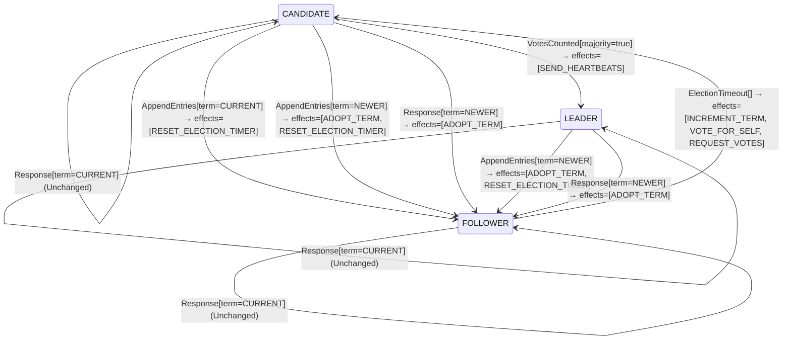

<!-- Generated by examples/demo/tools/build.py from example.json and the verifier's output. Edit example.json. -->
# 059 · A server that grants a vote without adopting the candidate's term elects two leaders

[← All examples](../README.md)

| Verdict | Categories | Severity if shipped | Change | Verified unit | Approach |
|---|---|---|---|---|---|
| **✗ Violation: ElectionSafety, 5-step trace** | functional | critical | bug-fix, behaviour change intended | [`RoleMachine#decide`](../../../examples/demo/apps/quorum/src/main/java/net/terminalvalue/quorum/raft/RoleMachine.java) | [D1: Protocol model checking](../../../examples/demo/apps/quorum/spec/README.md) |

> A Raft server that receives a vote request from a newer term adopts the term and becomes a follower of it, and only then applies the vote rule. A developer stops the adoption, so that a server whose timer fired cannot drag the cluster into a new term by asking: the vote rule already counts a candidate's newer term as a free vote, so the vote is still granted. The contract diff is three cases, one per role, and is approved; the vote rule is untouched and its regression proofs pass. The election model finds a five-step run that ends with two leaders in one term.

## The change

On a `RequestVote` from a newer term, answer `unchanged` instead of `transition(FOLLOWER, ADOPT_TERM)`. The reasoning in the comment: a server adopts a term when it hears from a leader; a mere request for votes should not move it, because a server that keeps timing out, partitioned or slow, raises the whole cluster's term every time it asks (the disruptive server of Ongaro's thesis, section 4.2.3). The vote rule, `VoteRule.grant`, treats a candidate's term that is ahead of the voter's as a free vote, so the candidate still gets it. The behavioural contract is regenerated and its diff is the three cases `decide(FOLLOWER | CANDIDATE | LEADER, RequestVote[term=NEWER])`, from a transition with `ADOPT_TERM` to unchanged; a test for the new rule is added. The reviewer approves the diff.

**Before** ([`RoleMachine.java`](../../../examples/demo/apps/quorum/src/main/java/net/terminalvalue/quorum/raft/RoleMachine.java), line 52):

```java
    };
    case OLDER -> rejected("stale leader");
};
case RequestVote vote -> vote.term() == NEWER
        ? transition(FOLLOWER, ADOPT_TERM)
        : unchanged("the vote itself is decided by the vote rule");
case Response response -> response.term() == NEWER
        ? transition(FOLLOWER, ADOPT_TERM)
        : unchanged("a reply from the current or an older term changes no role");
```

**After:**

```java
    };
    case OLDER -> rejected("stale leader");
};
// A request for a vote changes no role. The vote rule already treats a candidate's newer term as a
// free vote, and adopting the term here let any server whose timer fired, even one that could not
// win, drag the whole cluster into a new term. A server adopts a term when it hears from a leader.
case RequestVote _ -> unchanged("the vote itself is decided by the vote rule");
case Response response -> response.term() == NEWER
        ? transition(FOLLOWER, ADOPT_TERM)
        : unchanged("a reply from the current or an older term changes no role");
```

<details><summary>Patch</summary>

```diff
--- a/examples/demo/apps/quorum/src/main/java/net/terminalvalue/quorum/raft/RoleMachine.java
+++ b/examples/demo/apps/quorum/src/main/java/net/terminalvalue/quorum/raft/RoleMachine.java
@@ -52,9 +52,10 @@
                 };
                 case OLDER -> rejected("stale leader");
             };
-            case RequestVote vote -> vote.term() == NEWER
-                    ? transition(FOLLOWER, ADOPT_TERM)
-                    : unchanged("the vote itself is decided by the vote rule");
+            // A request for a vote changes no role. The vote rule already treats a candidate's newer term as a
+            // free vote, and adopting the term here let any server whose timer fired, even one that could not
+            // win, drag the whole cluster into a new term. A server adopts a term when it hears from a leader.
+            case RequestVote _ -> unchanged("the vote itself is decided by the vote rule");
             case Response response -> response.term() == NEWER
                     ? transition(FOLLOWER, ADOPT_TERM)
                     : unchanged("a reply from the current or an older term changes no role");
--- a/examples/demo/apps/quorum/src/test/java/net/terminalvalue/quorum/raft/RoleMachineTest.java
+++ b/examples/demo/apps/quorum/src/test/java/net/terminalvalue/quorum/raft/RoleMachineTest.java
@@ -32,6 +32,10 @@
                 RoleMachine.decide(Role.LEADER, new RoleEvent.AppendEntries(TermOrder.NEWER)));
     }
 
+    public static void aVoteRequestChangesNoRole() {
+        check(RoleMachine.decide(Role.FOLLOWER, new RoleEvent.RequestVote(TermOrder.NEWER)) instanceof Decision.Unchanged, "a candidate is not a leader");
+    }
+
     public static void staleLeaderIsRejected() {
         check(RoleMachine.decide(Role.FOLLOWER, new RoleEvent.AppendEntries(TermOrder.OLDER)) instanceof Decision.Rejected, "stale");
     }
```

</details>

## What the verifier found

TLC found a run of the system, 5 steps long, that violates the invariant **ElectionSafety** (at most one leader per term). Each step is one action of one part of the system:

1. **Initial state**: every server a follower in term 0, no vote cast, no vote held.
2. **Timeout**, `Server.onElectionTimeout`: a server's election timer fires, and the server acts on the role machine's decision. `currentTerm = (s1 :> 1 @@ s2 :> 0 @@ s3 :> 0)`, `role = (s1 :> "CANDIDATE" @@ s2 :> "FOLLOWER" @@ s3 :> "FOLLOWER")`, `votedFor = (s1 :> s1 @@ s2 :> "none" @@ s3 :> "none")`, `votes = (s1 :> {s1} @@ s2 :> {} @@ s3 :> {})`
3. **Timeout**, `Server.onElectionTimeout`: a server's election timer fires, and the server acts on the role machine's decision. `currentTerm = (s1 :> 1 @@ s2 :> 1 @@ s3 :> 0)`, `role = (s1 :> "CANDIDATE" @@ s2 :> "CANDIDATE" @@ s3 :> "FOLLOWER")`, `votedFor = (s1 :> s1 @@ s2 :> s2 @@ s3 :> "none")`, `votes = (s1 :> {s1} @@ s2 :> {s2} @@ s3 :> {})`
4. **Canvass**, `Server.requestVote`: a candidate asks one server for its vote and gets the answer; the request and the reply each go through the role machine, then the vote rule on the voter and the tally on the candidate. `role = (s1 :> "LEADER" @@ s2 :> "CANDIDATE" @@ s3 :> "FOLLOWER")`, `votedFor = (s1 :> s1 @@ s2 :> s2 @@ s3 :> s1)`, `votes = (s1 :> {s1, s3} @@ s2 :> {s2} @@ s3 :> {})`
5. **Canvass**, `Server.requestVote`: a candidate asks one server for its vote and gets the answer; the request and the reply each go through the role machine, then the vote rule on the voter and the tally on the candidate. `role = (s1 :> "LEADER" @@ s2 :> "LEADER" @@ s3 :> "FOLLOWER")`, `votedFor = (s1 :> s1 @@ s2 :> s2 @@ s3 :> s2)`, `votes = (s1 :> {s1, s3} @@ s2 :> {s2, s3} @@ s3 :> {})`

The model is small (Servers = {s1, s2, s3}, MaxTerm = 3), which is what keeps the trace readable. TLC explored every interleaving of the servers, their terms and votes, and the RPCs between them within those bounds.

The state machine the patched code implements, drawn from its derived contract (`jvmcontract statemachine`); a state with no way in or no way out is marked:



## Would the existing tests have caught it?

No: every existing unit test passes (`java -ea net.terminalvalue.quorum.Tests`, run against the patched code).

## Why it matters

The vote rule's `candidateTerm > currentTerm` clause is not a second way to grant a vote; it is the first half of a rule whose second half is that the voter then has that term, with its vote recorded in it. Without the adoption, the voter stays in its old term with no vote recorded in the new one, and the next candidate of the same term is also ahead of it, also free, also granted. One server votes twice in one term, two candidates each reach a majority with it, and two leaders serve the same term: the election safety property of Raft (figure 3), on which every other guarantee rests, is gone. Each leader appends entries at the same indexes; whichever one the clients reach, committed entries are overwritten. The role machine's contract is exactly what the developer intended, and the vote rule's proofs pass, because the vote rule did not change: the failure is in how the two kernels compose, which neither contract states.

## Why the verdict is right

The election model has one action per RPC of a server, with the role transitions generated from the behavioural contract of `RoleMachine#decide`, which the tool proves the bytecode satisfies on all 52 inputs, and the vote rule written as `VoteRule.grant` is, without the log comparison. TLC checks every interleaving of three servers over three terms. With the committed rule every invariant and both action properties hold in all 610 states. With the patched rule it reports the shortest run that breaks `ElectionSafety`: s1's timer fires and it runs for term 1; s2's fires and it runs for term 1 too; s1 asks s3, which is in term 0, grants, records the vote and stays in term 0, and s1 has a majority; s2 asks s3, whose term is still behind s2's, so the vote is free again, and s2 has a majority. Two leaders in term 1, in five steps. The trace shows the state that makes it possible, `votedFor = s1` on a server whose `currentTerm` is still 0, a combination the committed rule never produces. The model's candidate counts the granted reply, as a server that trusts the reply does; a server that discarded a reply from an older term would never elect a leader at all under this rule, which is the other way the change breaks the cluster.

## What to do

Revert. The rule in the paper (figure 2, rules for all servers) is unconditional: any RPC with a term ahead of the server's makes it a follower of that term, requests included, and the vote rule is stated for a voter that is already in the candidate's term. The disruptive-server problem the developer meant to solve has its own fix, the pre-vote phase of section 4.2.3, in which a server asks whether it could win before it increments its term; that keeps the adoption rule intact. The election model stays in the build, so that the next change to the role machine is checked against what the vote rule assumes of it.

## Evidence

How the verdict was reached: TLC 2.19 explored 86 distinct states to depth 5 in 0 s, for the model Servers = {s1, s2, s3}, MaxTerm = 3.

<details><summary>Verifier output</summary>

```text
TLC2 Version 2.19 of 08 August 2024 (rev: 5a47802)
Running breadth-first search Model-Checking with fp 1 and seed 1 with 1 worker on 8 cores with 910MB heap and 64MB offheap memory [pid: 1795833] (Linux 6.6.87.2-microsoft-standard-WSL2 aarch64, Eclipse Adoptium 25.0.4.1 x86_64, MSBDiskFPSet, DiskStateQueue).
Parsing file examples/demo/apps/quorum/spec/RaftElection.tla
Parsing file examples/demo/tools/tla/standard-modules/Naturals.tla
Parsing file examples/demo/tools/tla/standard-modules/FiniteSets.tla
Parsing file examples/demo/tools/tla/standard-modules/Sequences.tla
Parsing file examples/demo/apps/quorum/spec/RoleMachineContract.tla
Semantic processing of module Naturals
Semantic processing of module Sequences
Semantic processing of module FiniteSets
Semantic processing of module RoleMachineContract
Semantic processing of module RaftElection
Starting... (2026-11-01 22:42:04)
Computing initial states...
Finished computing initial states: 1 distinct state generated at 2026-11-01 22:42:04.
Error: Invariant ElectionSafety is violated.
Error: The behavior up to this point is:
State 1: <Initial predicate>
/\ currentTerm = (s1 :> 0 @@ s2 :> 0 @@ s3 :> 0)
/\ role = (s1 :> "FOLLOWER" @@ s2 :> "FOLLOWER" @@ s3 :> "FOLLOWER")
/\ votedFor = (s1 :> "none" @@ s2 :> "none" @@ s3 :> "none")
/\ votes = (s1 :> {} @@ s2 :> {} @@ s3 :> {})

State 2: <Timeout line 63, col 5 to line 71, col 85 of module RaftElection>
/\ currentTerm = (s1 :> 1 @@ s2 :> 0 @@ s3 :> 0)
/\ role = (s1 :> "CANDIDATE" @@ s2 :> "FOLLOWER" @@ s3 :> "FOLLOWER")
/\ votedFor = (s1 :> s1 @@ s2 :> "none" @@ s3 :> "none")
/\ votes = (s1 :> {s1} @@ s2 :> {} @@ s3 :> {})

State 3: <Timeout line 63, col 5 to line 71, col 85 of module RaftElection>
/\ currentTerm = (s1 :> 1 @@ s2 :> 1 @@ s3 :> 0)
/\ role = (s1 :> "CANDIDATE" @@ s2 :> "CANDIDATE" @@ s3 :> "FOLLOWER")
/\ votedFor = (s1 :> s1 @@ s2 :> s2 @@ s3 :> "none")
/\ votes = (s1 :> {s1} @@ s2 :> {s2} @@ s3 :> {})

State 4: <Canvass line 81, col 5 to line 93, col 75 of module RaftElection>
/\ currentTerm = (s1 :> 1 @@ s2 :> 1 @@ s3 :> 0)
/\ role = (s1 :> "LEADER" @@ s2 :> "CANDIDATE" @@ s3 :> "FOLLOWER")
/\ votedFor = (s1 :> s1 @@ s2 :> s2 @@ s3 :> s1)
/\ votes = (s1 :> {s1, s3} @@ s2 :> {s2} @@ s3 :> {})

State 5: <Canvass line 81, col 5 to line 93, col 75 of module RaftElection>
/\ currentTerm = (s1 :> 1 @@ s2 :> 1 @@ s3 :> 0)
/\ role = (s1 :> "LEADER" @@ s2 :> "LEADER" @@ s3 :> "FOLLOWER")
/\ votedFor = (s1 :> s1 @@ s2 :> s2 @@ s3 :> s2)
/\ votes = (s1 :> {s1, s3} @@ s2 :> {s2, s3} @@ s3 :> {})

134 states generated, 86 distinct states found, 61 states left on queue.
The depth of the complete state graph search is 5.
The average outdegree of the complete state graph is 4 (minimum is 1, the maximum 6 and the 95th percentile is 6).
Finished in 00s at (2026-11-01 22:42:05)
```

</details>

<details><summary>SARIF report (as uploaded to GitHub code scanning or SonarQube)</summary>

```json
{
  "version": "2.1.0",
  "$schema": "https://json.schemastore.org/sarif-2.1.0.json",
  "runs": [
    {
      "tool": {
        "driver": {
          "name": "jvmcontract tlc",
          "rules": [
            {
              "id": "invariant-violated",
              "shortDescription": {
                "text": "TLC found a behaviour of the model that violates an invariant or a temporal property, or ends in a deadlock."
              }
            },
            {
              "id": "unverifiable",
              "shortDescription": {
                "text": "TLC could not check the model."
              }
            }
          ]
        }
      },
      "results": [
        {
          "ruleId": "invariant-violated",
          "level": "error",
          "message": {
            "text": "Invariant ElectionSafety of spec/RaftElection.tla is violated after 5 steps"
          },
          "locations": [
            {
              "physicalLocation": {
                "artifactLocation": {
                  "uri": "examples/demo/apps/quorum/src/main/java/net/terminalvalue/quorum/raft/RoleMachine.java"
                },
                "region": {
                  "startLine": 52
                }
              }
            }
          ]
        }
      ]
    }
  ]
}
```

</details>

**Provenance:** Constructed from the rules for all servers in figure 2 of the Raft paper, by removing the term adoption from the handling of RequestVote.

- [Ongaro and Ousterhout, In Search of an Understandable Consensus Algorithm (2014): section 5.2, leader election, and figure 3, election safety](https://raft.github.io/raft.pdf)
- [Ongaro, Consensus: Bridging Theory and Practice (2014): chapter 3, the basic algorithm, and section 4.2.3, disruptive servers](https://web.stanford.edu/~ouster/cgi-bin/papers/OngaroPhD.pdf)
## Reproduce

```bash
python3 examples/demo/tools/build.py 059
```

This applies `change.patch` to a temporary copy of the repo, runs the verifier on it, and rewrites this page.
