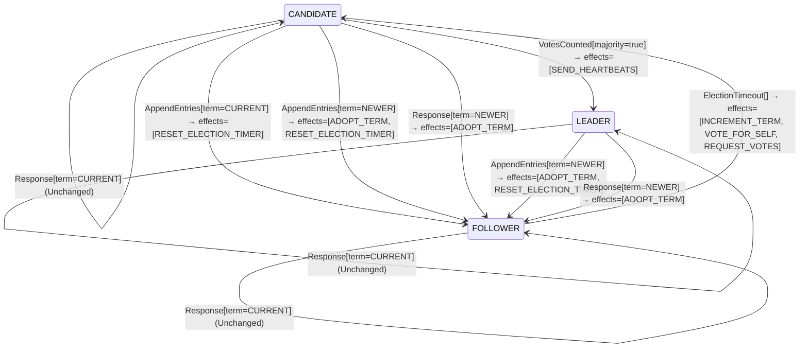

<!-- Generated by examples/demo/tools/build.py from example.json and the verifier's output. Edit example.json. -->
# 059 · A server that grants a vote without adopting the candidate's term elects two leaders

[← All examples](../README.md)

| Verdict | Categories | Severity if shipped | Change | Verified unit | Approach |
|---|---|---|---|---|---|
| **✗ Violation: ElectionSafety, 5-step trace** | functional | critical | bug-fix, behaviour change intended | [`RoleMachine#decide`](../../../examples/demo/apps/quorum/src/main/java/net/terminalvalue/quorum/raft/RoleMachine.java) | [D1: Protocol model checking](../../../examples/demo/apps/quorum/spec/README.md) |

> A Raft server that receives a vote request from a newer term adopts the term and becomes a follower of it, and only then applies the vote rule. A developer stops the adoption, so that a server whose timer fired cannot drag the cluster into a new term by asking: the vote rule already counts a candidate's newer term as a free vote, so the vote is still granted. The contract diff is three cases, one per role, and is approved; the vote rule is untouched and its regression proofs pass. The election model finds a five-step run that ends with two leaders in one term.

## The change

On a `RequestVote` from a newer term, answer `unchanged` instead of `transition(FOLLOWER, ADOPT_TERM)`. The reasoning in the comment: a server adopts a term when it hears from a leader; a mere request for votes should not move it, because a server that keeps timing out, partitioned or slow, raises the whole cluster's term every time it asks (the disruptive server of Ongaro's thesis, section 4.2.3). The vote rule, `VoteRule.grant`, treats a candidate's term that is ahead of the voter's as a free vote, so the candidate still gets it. The behavioural contract is regenerated and its diff is the three cases `decide(FOLLOWER | CANDIDATE | LEADER, RequestVote[term=NEWER])`, from a transition with `ADOPT_TERM` to unchanged; a test for the new rule is added. The reviewer approves the diff.

**Before** ([`RoleMachine.java`](../../../examples/demo/apps/quorum/src/main/java/net/terminalvalue/quorum/raft/RoleMachine.java), line 52):

```java
    };
    case OLDER -> rejected("stale leader");
};
case RequestVote vote -> vote.term() == NEWER
        ? transition(FOLLOWER, ADOPT_TERM)
        : unchanged("the vote itself is decided by the vote rule");
case Response response -> response.term() == NEWER
        ? transition(FOLLOWER, ADOPT_TERM)
        : unchanged("a reply from the current or an older term changes no role");
```

**After:**

```java
    };
    case OLDER -> rejected("stale leader");
};
// A request for a vote changes no role. The vote rule already treats a candidate's newer term as a
// free vote, and adopting the term here let any server whose timer fired, even one that could not
// win, drag the whole cluster into a new term. A server adopts a term when it hears from a leader.
case RequestVote _ -> unchanged("the vote itself is decided by the vote rule");
case Response response -> response.term() == NEWER
        ? transition(FOLLOWER, ADOPT_TERM)
        : unchanged("a reply from the current or an older term changes no role");
```

<details><summary>Patch</summary>

```diff
--- a/examples/demo/apps/quorum/src/main/java/net/terminalvalue/quorum/raft/RoleMachine.java
+++ b/examples/demo/apps/quorum/src/main/java/net/terminalvalue/quorum/raft/RoleMachine.java
@@ -52,9 +52,10 @@
                 };
                 case OLDER -> rejected("stale leader");
             };
-            case RequestVote vote -> vote.term() == NEWER
-                    ? transition(FOLLOWER, ADOPT_TERM)
-                    : unchanged("the vote itself is decided by the vote rule");
+            // A request for a vote changes no role. The vote rule already treats a candidate's newer term as a
+            // free vote, and adopting the term here let any server whose timer fired, even one that could not
+            // win, drag the whole cluster into a new term. A server adopts a term when it hears from a leader.
+            case RequestVote _ -> unchanged("the vote itself is decided by the vote rule");
             case Response response -> response.term() == NEWER
                     ? transition(FOLLOWER, ADOPT_TERM)
                     : unchanged("a reply from the current or an older term changes no role");
--- a/examples/demo/apps/quorum/src/test/java/net/terminalvalue/quorum/raft/RoleMachineTest.java
+++ b/examples/demo/apps/quorum/src/test/java/net/terminalvalue/quorum/raft/RoleMachineTest.java
@@ -32,6 +32,10 @@
                 RoleMachine.decide(Role.LEADER, new RoleEvent.AppendEntries(TermOrder.NEWER)));
     }
 
+    public static void aVoteRequestChangesNoRole() {
+        check(RoleMachine.decide(Role.FOLLOWER, new RoleEvent.RequestVote(TermOrder.NEWER)) instanceof Decision.Unchanged, "a candidate is not a leader");
+    }
+
     public static void staleLeaderIsRejected() {
         check(RoleMachine.decide(Role.FOLLOWER, new RoleEvent.AppendEntries(TermOrder.OLDER)) instanceof Decision.Rejected, "stale");
     }
```

</details>

## What the verifier found

The model is checked under 7 configurations, and the verdict is the first that fails:

| Configuration | What it checks | Model | Result |
|---|---|---|---|
| three servers (`spec/RaftElection.cfg`) | every run from the initial state, every interleaving within the configuration's bounds | Servers = {s1, s2, s3}, MaxTerm = 3, LeftBehind = {}, DelayedReplies = FALSE, History = FALSE | ✗ Violation: ElectionSafety, 5-step trace |
| the inductive step (`spec/RaftElectionInductive.cfg`) | that the invariant `Inductive` is inductive: TLC starts from every state the invariant admits, reachable or not, rather than from the initial state, takes one step, and checks the invariant again, conjunct by conjunct. No counterexample is a proof of election safety by induction, for any run of the cluster however long; a counterexample is one step from a state that need not be reachable | Servers = {s1, s2, s3}, MaxTerm = 3, LeftBehind = {}, DelayedReplies = FALSE, History = FALSE | ✗ Violation: VotesAreBound, 2-step trace |
| four servers (`spec/RaftElectionFour.cfg`) | every run with four servers, a cluster in which a candidate can hold a vote besides its own and still be short of a majority, which three servers never show; under a symmetry set, so that of the states that differ only by the servers' names TLC explores one | Servers = {s1, s2, s3, s4}, MaxTerm = 3, LeftBehind = {}, DelayedReplies = FALSE, History = FALSE | ✗ Violation: ElectionSafety, 7-step trace |
| fairness (`spec/RaftElectionLive.cfg`) | the two liveness properties, under the fairness conditions `Fairness`: a server whose timer nothing resets times out, a candidate asks for the votes it lacks, a leader sends its heartbeats. A counterexample is a run that goes on forever without satisfying a property: a prefix, then a state or a cycle the system never leaves | Servers = {s1, s2, s3}, MaxTerm = 3, LeftBehind = {}, DelayedReplies = FALSE, History = FALSE | ✗ Violation: ElectionSafety, 5-step trace |
| a server left behind (`spec/RaftElectionLogs.cfg`) | the election restriction: one server holds the log a deposed leader of term 1 left behind, three entries of its term, while the other two hold an entry of term 2 that a majority holds and is therefore committed, so that the longer log is the one behind; every run with these logs, which nothing changes, under the invariant `LeaderCompleteness` besides the usual ones | Servers = {s1, s2, s3}, MaxTerm = 3, LeftBehind = {s1}, DelayedReplies = FALSE, History = FALSE | ✗ Violation: ElectionSafety, 5-step trace |
| delayed replies (`spec/RaftElectionDelayed.cfg`) | every run of three servers and two terms in which the reply to a vote request is a step of its own, which the candidate may take after it has timed out into a newer term, stepped down, or won; the one-step RPC of the other configurations never hands the role machine a reply from an older term than the server's own, and this one does, under the usual invariants and action properties | Servers = {s1, s2, s3}, MaxTerm = 2, LeftBehind = {}, DelayedReplies = TRUE, History = FALSE | ✓ Verified: all invariants and properties hold in 81,542 states |
| history (`spec/RaftElectionHistory.cfg`) | every run of three servers and three terms with the two history variables recording, `elected`, every term a server has led, and `voted`, every vote cast, under the two invariants that are about a run rather than a state: at most one leader elected per term and at most one vote per server per term, as the paper states them. The state invariants of the other configurations hold in a run in which a term's leader steps down and the term then elects another; these do not | Servers = {s1, s2, s3}, MaxTerm = 3, LeftBehind = {}, DelayedReplies = FALSE, History = TRUE | ✗ Violation: AtMostOneVotePerTerm, 5-step trace |

TLC found a run of the system under three servers, 5 steps long, that violates the invariant **ElectionSafety** (at most one leader per term). Each step is one action of one part of the system:

1. **Initial state**: every server a follower in term 0, no vote cast, no vote held.
2. **Timeout**, `Server.onElectionTimeout`: a server's election timer fires, and the server acts on the role machine's decision. `currentTerm = (s1 :> 1 @@ s2 :> 0 @@ s3 :> 0)`, `role = (s1 :> "CANDIDATE" @@ s2 :> "FOLLOWER" @@ s3 :> "FOLLOWER")`, `votedFor = (s1 :> s1 @@ s2 :> "none" @@ s3 :> "none")`, `votes = (s1 :> {s1} @@ s2 :> {} @@ s3 :> {})`
3. **Timeout**, `Server.onElectionTimeout`: a server's election timer fires, and the server acts on the role machine's decision. `currentTerm = (s1 :> 1 @@ s2 :> 1 @@ s3 :> 0)`, `role = (s1 :> "CANDIDATE" @@ s2 :> "CANDIDATE" @@ s3 :> "FOLLOWER")`, `votedFor = (s1 :> s1 @@ s2 :> s2 @@ s3 :> "none")`, `votes = (s1 :> {s1} @@ s2 :> {s2} @@ s3 :> {})`
4. **Canvass**, `Server.requestVote`: a candidate asks one server for its vote and gets the answer; the request and the reply each go through the role machine, then the vote rule on the voter, given its ballot and the candidate's term and log against its own, and the tally on the candidate. `role = (s1 :> "LEADER" @@ s2 :> "CANDIDATE" @@ s3 :> "FOLLOWER")`, `votedFor = (s1 :> s1 @@ s2 :> s2 @@ s3 :> s1)`, `votes = (s1 :> {s1, s3} @@ s2 :> {s2} @@ s3 :> {})`
5. **Canvass**, `Server.requestVote`: a candidate asks one server for its vote and gets the answer; the request and the reply each go through the role machine, then the vote rule on the voter, given its ballot and the candidate's term and log against its own, and the tally on the candidate. `role = (s1 :> "LEADER" @@ s2 :> "LEADER" @@ s3 :> "FOLLOWER")`, `votedFor = (s1 :> s1 @@ s2 :> s2 @@ s3 :> s2)`, `votes = (s1 :> {s1, s3} @@ s2 :> {s2, s3} @@ s3 :> {})`

The model is small (Servers = {s1, s2, s3}, MaxTerm = 3, LeftBehind = {}, DelayedReplies = FALSE, History = FALSE), which is what keeps the trace readable. TLC explored every interleaving of the servers, their terms and votes, and the RPCs between them within those bounds.

<details><summary>The counterexample under the inductive step: invariant <b>VotesAreBound</b>, 2 steps</summary>

Invariant **VotesAreBound**: a vote in a tally was cast in the tally's term: the voter is still in that term and voted for the tally's owner, or has since moved to a newer term.

1. **Starting state**, a state the invariant `Inductive` admits, which need not be reachable: `currentTerm = (s1 :> 0 @@ s2 :> 0 @@ s3 :> 1)`, `elected = {}`, `replies = {}`, `role = (s1 :> "FOLLOWER" @@ s2 :> "FOLLOWER" @@ s3 :> "CANDIDATE")`, `voted = {}`, `votedFor = (s1 :> "none" @@ s2 :> "none" @@ s3 :> s3)`, `votes = (s1 :> {} @@ s2 :> {} @@ s3 :> {s3})`
2. **Canvass**, `Server.requestVote`: a candidate asks one server for its vote and gets the answer; the request and the reply each go through the role machine, then the vote rule on the voter, given its ballot and the candidate's term and log against its own, and the tally on the candidate. `role = (s1 :> "FOLLOWER" @@ s2 :> "FOLLOWER" @@ s3 :> "LEADER")`, `votedFor = (s1 :> s3 @@ s2 :> "none" @@ s3 :> s3)`, `votes = (s1 :> {} @@ s2 :> {} @@ s3 :> {s1, s3})`

</details>

<details><summary>The counterexample under four servers: invariant <b>ElectionSafety</b>, 7 steps</summary>

Invariant **ElectionSafety**: at most one leader per term.

1. **Initial state**: every server a follower in term 0, no vote cast, no vote held.
2. **Timeout**, `Server.onElectionTimeout`: a server's election timer fires, and the server acts on the role machine's decision. `currentTerm = (s1 :> 1 @@ s2 :> 0 @@ s3 :> 0 @@ s4 :> 0)`, `role = (s1 :> "CANDIDATE" @@ s2 :> "FOLLOWER" @@ s3 :> "FOLLOWER" @@ s4 :> "FOLLOWER")`, `votedFor = (s1 :> s1 @@ s2 :> "none" @@ s3 :> "none" @@ s4 :> "none")`, `votes = (s1 :> {s1} @@ s2 :> {} @@ s3 :> {} @@ s4 :> {})`
3. **Timeout**, `Server.onElectionTimeout`: a server's election timer fires, and the server acts on the role machine's decision. `currentTerm = (s1 :> 1 @@ s2 :> 1 @@ s3 :> 0 @@ s4 :> 0)`, `role = (s1 :> "CANDIDATE" @@ s2 :> "CANDIDATE" @@ s3 :> "FOLLOWER" @@ s4 :> "FOLLOWER")`, `votedFor = (s1 :> s1 @@ s2 :> s2 @@ s3 :> "none" @@ s4 :> "none")`, `votes = (s1 :> {s1} @@ s2 :> {s2} @@ s3 :> {} @@ s4 :> {})`
4. **Canvass**, `Server.requestVote`: a candidate asks one server for its vote and gets the answer; the request and the reply each go through the role machine, then the vote rule on the voter, given its ballot and the candidate's term and log against its own, and the tally on the candidate. `votedFor = (s1 :> s1 @@ s2 :> s2 @@ s3 :> s1 @@ s4 :> "none")`, `votes = (s1 :> {s1, s3} @@ s2 :> {s2} @@ s3 :> {} @@ s4 :> {})`
5. **Canvass**, `Server.requestVote`: a candidate asks one server for its vote and gets the answer; the request and the reply each go through the role machine, then the vote rule on the voter, given its ballot and the candidate's term and log against its own, and the tally on the candidate. `votedFor = (s1 :> s1 @@ s2 :> s2 @@ s3 :> s2 @@ s4 :> "none")`, `votes = (s1 :> {s1, s3} @@ s2 :> {s2, s3} @@ s3 :> {} @@ s4 :> {})`
6. **Canvass**, `Server.requestVote`: a candidate asks one server for its vote and gets the answer; the request and the reply each go through the role machine, then the vote rule on the voter, given its ballot and the candidate's term and log against its own, and the tally on the candidate. `role = (s1 :> "LEADER" @@ s2 :> "CANDIDATE" @@ s3 :> "FOLLOWER" @@ s4 :> "FOLLOWER")`, `votedFor = (s1 :> s1 @@ s2 :> s2 @@ s3 :> s2 @@ s4 :> s1)`, `votes = (s1 :> {s1, s3, s4} @@ s2 :> {s2, s3} @@ s3 :> {} @@ s4 :> {})`
7. **Canvass**, `Server.requestVote`: a candidate asks one server for its vote and gets the answer; the request and the reply each go through the role machine, then the vote rule on the voter, given its ballot and the candidate's term and log against its own, and the tally on the candidate. `role = (s1 :> "LEADER" @@ s2 :> "LEADER" @@ s3 :> "FOLLOWER" @@ s4 :> "FOLLOWER")`, `votedFor = (s1 :> s1 @@ s2 :> s2 @@ s3 :> s2 @@ s4 :> s2)`, `votes = (s1 :> {s1, s3, s4} @@ s2 :> {s2, s3, s4} @@ s3 :> {} @@ s4 :> {})`

</details>

Under fairness TLC found the same run, and reported it the same way.

<details><summary>The counterexample under a server left behind: invariant <b>ElectionSafety</b>, 5 steps</summary>

Invariant **ElectionSafety**: at most one leader per term.

1. **Initial state**: every server a follower in term 0, no vote cast, no vote held.
2. **Timeout**, `Server.onElectionTimeout`: a server's election timer fires, and the server acts on the role machine's decision. `currentTerm = (s1 :> 0 @@ s2 :> 1 @@ s3 :> 0)`, `role = (s1 :> "FOLLOWER" @@ s2 :> "CANDIDATE" @@ s3 :> "FOLLOWER")`, `votedFor = (s1 :> "none" @@ s2 :> s2 @@ s3 :> "none")`, `votes = (s1 :> {} @@ s2 :> {s2} @@ s3 :> {})`
3. **Timeout**, `Server.onElectionTimeout`: a server's election timer fires, and the server acts on the role machine's decision. `currentTerm = (s1 :> 0 @@ s2 :> 1 @@ s3 :> 1)`, `role = (s1 :> "FOLLOWER" @@ s2 :> "CANDIDATE" @@ s3 :> "CANDIDATE")`, `votedFor = (s1 :> "none" @@ s2 :> s2 @@ s3 :> s3)`, `votes = (s1 :> {} @@ s2 :> {s2} @@ s3 :> {s3})`
4. **Canvass**, `Server.requestVote`: a candidate asks one server for its vote and gets the answer; the request and the reply each go through the role machine, then the vote rule on the voter, given its ballot and the candidate's term and log against its own, and the tally on the candidate. `role = (s1 :> "FOLLOWER" @@ s2 :> "LEADER" @@ s3 :> "CANDIDATE")`, `votedFor = (s1 :> s2 @@ s2 :> s2 @@ s3 :> s3)`, `votes = (s1 :> {} @@ s2 :> {s1, s2} @@ s3 :> {s3})`
5. **Canvass**, `Server.requestVote`: a candidate asks one server for its vote and gets the answer; the request and the reply each go through the role machine, then the vote rule on the voter, given its ballot and the candidate's term and log against its own, and the tally on the candidate. `role = (s1 :> "FOLLOWER" @@ s2 :> "LEADER" @@ s3 :> "LEADER")`, `votedFor = (s1 :> s3 @@ s2 :> s2 @@ s3 :> s3)`, `votes = (s1 :> {} @@ s2 :> {s1, s2} @@ s3 :> {s1, s3})`

</details>

<details><summary>The counterexample under history: invariant <b>AtMostOneVotePerTerm</b>, 5 steps</summary>

Invariant **AtMostOneVotePerTerm**: AtMostOneVotePerTerm.

1. **Initial state**: every server a follower in term 0, no vote cast, no vote held.
2. **Timeout**, `Server.onElectionTimeout`: a server's election timer fires, and the server acts on the role machine's decision. `currentTerm = (s1 :> 1 @@ s2 :> 0 @@ s3 :> 0)`, `role = (s1 :> "CANDIDATE" @@ s2 :> "FOLLOWER" @@ s3 :> "FOLLOWER")`, `voted = {<<s1, 1, s1>>}`, `votedFor = (s1 :> s1 @@ s2 :> "none" @@ s3 :> "none")`, `votes = (s1 :> {s1} @@ s2 :> {} @@ s3 :> {})`
3. **Timeout**, `Server.onElectionTimeout`: a server's election timer fires, and the server acts on the role machine's decision. `currentTerm = (s1 :> 2 @@ s2 :> 0 @@ s3 :> 0)`, `voted = {<<s1, 1, s1>>, <<s1, 2, s1>>}`
4. **Timeout**, `Server.onElectionTimeout`: a server's election timer fires, and the server acts on the role machine's decision. `currentTerm = (s1 :> 2 @@ s2 :> 1 @@ s3 :> 0)`, `role = (s1 :> "CANDIDATE" @@ s2 :> "CANDIDATE" @@ s3 :> "FOLLOWER")`, `voted = {<<s1, 1, s1>>, <<s1, 2, s1>>, <<s2, 1, s2>>}`, `votedFor = (s1 :> s1 @@ s2 :> s2 @@ s3 :> "none")`, `votes = (s1 :> {s1} @@ s2 :> {s2} @@ s3 :> {})`
5. **Canvass**, `Server.requestVote`: a candidate asks one server for its vote and gets the answer; the request and the reply each go through the role machine, then the vote rule on the voter, given its ballot and the candidate's term and log against its own, and the tally on the candidate. `elected = {<<s1, 2>>}`, `role = (s1 :> "LEADER" @@ s2 :> "CANDIDATE" @@ s3 :> "FOLLOWER")`, `voted = {<<s1, 1, s1>>, <<s1, 2, s1>>, <<s2, 1, s1>>, <<s2, 1, s2>>}`, `votedFor = (s1 :> s1 @@ s2 :> s1 @@ s3 :> "none")`, `votes = (s1 :> {s1, s2} @@ s2 :> {s2} @@ s3 :> {})`

</details>

**What the verdict rests on.** TLC counted how often a step of the model took each row of the generated operators. A row no step takes is one the model says nothing about, whatever the verdict.

| Configuration | Rows of `RoleMachine#decide` taken | Rows of `VoteRule#decide` taken |
|---|---|---|
| three servers | stopped at the counterexample | stopped at the counterexample |
| the inductive step (from the states the invariant admits, not from a run) | stopped at the counterexample | stopped at the counterexample |
| four servers | stopped at the counterexample | stopped at the counterexample |
| fairness | stopped at the counterexample | stopped at the counterexample |
| a server left behind | stopped at the counterexample | stopped at the counterexample |
| delayed replies | 25 of 36 | 7 of 27 |
| history | stopped at the counterexample | stopped at the counterexample |

The change alters 3 rows of the contract, and 1 with a null argument, which the model leaves out:

- `decide(FOLLOWER, RequestVote[term=NEWER])`: `Transition[next=FOLLOWER, effects=[ADOPT_TERM]]` → `Unchanged[reason="the vote itself is decided by the vote rule"]`, taken under delayed replies
- `decide(CANDIDATE, RequestVote[term=NEWER])`: `Transition[next=FOLLOWER, effects=[ADOPT_TERM]]` → `Unchanged[reason="the vote itself is decided by the vote rule"]`, taken under delayed replies
- `decide(LEADER, RequestVote[term=NEWER])`: `Transition[next=FOLLOWER, effects=[ADOPT_TERM]]` → `Unchanged[reason="the vote itself is decided by the vote rule"]`, taken by no run that finished

The run under three servers, the inductive step, four servers, fairness, a server left behind, history stopped at its counterexample, the steps above, and its counts are left out: the verdict rests on the counterexample.

<details><summary>Rows no step takes under delayed replies</summary>

`net.terminalvalue.quorum.raft.RoleMachine#decide`:

```
decide(FOLLOWER, VotesCounted[majority=true]) => Unchanged
decide(FOLLOWER, AppendEntries[term=OLDER]) => Rejected
decide(FOLLOWER, Response[term=NEWER]) => Transition[next=FOLLOWER, effects=[ADOPT_TERM]]
decide(CANDIDATE, AppendEntries[term=OLDER]) => Rejected
decide(LEADER, ElectionTimeout[]) => Unchanged
decide(LEADER, VotesCounted[majority=false]) => Unchanged
decide(LEADER, AppendEntries[term=OLDER]) => Rejected
decide(LEADER, AppendEntries[term=CURRENT]) => throws IllegalStateException
decide(LEADER, AppendEntries[term=NEWER]) => Transition[next=FOLLOWER, effects=[ADOPT_TERM, RESET_ELECTION_TIMER]]
decide(LEADER, RequestVote[term=NEWER]) => Unchanged
decide(LEADER, Response[term=NEWER]) => Transition[next=FOLLOWER, effects=[ADOPT_TERM]]
```

`net.terminalvalue.quorum.raft.VoteRule#decide`:

```
decide(OPEN, VoteRequest[term=OLDER, log=BEHIND]) => Rejected
decide(OPEN, VoteRequest[term=OLDER, log=AHEAD]) => Rejected
decide(OPEN, VoteRequest[term=CURRENT, log=BEHIND]) => Rejected
decide(OPEN, VoteRequest[term=CURRENT, log=AHEAD]) => Transition[next=FOR_THE_CANDIDATE, effects=[GRANT]]
decide(OPEN, VoteRequest[term=NEWER, log=BEHIND]) => Rejected
decide(OPEN, VoteRequest[term=NEWER, log=AHEAD]) => Transition[next=FOR_THE_CANDIDATE, effects=[GRANT]]
decide(FOR_THE_CANDIDATE, VoteRequest[term=OLDER, log=BEHIND]) => Rejected
decide(FOR_THE_CANDIDATE, VoteRequest[term=OLDER, log=EVEN]) => Rejected
decide(FOR_THE_CANDIDATE, VoteRequest[term=OLDER, log=AHEAD]) => Rejected
decide(FOR_THE_CANDIDATE, VoteRequest[term=CURRENT, log=BEHIND]) => Rejected
decide(FOR_THE_CANDIDATE, VoteRequest[term=CURRENT, log=EVEN]) => Transition[next=FOR_THE_CANDIDATE, effects=[GRANT]]
decide(FOR_THE_CANDIDATE, VoteRequest[term=CURRENT, log=AHEAD]) => Transition[next=FOR_THE_CANDIDATE, effects=[GRANT]]
decide(FOR_THE_CANDIDATE, VoteRequest[term=NEWER, log=BEHIND]) => Rejected
decide(FOR_THE_CANDIDATE, VoteRequest[term=NEWER, log=AHEAD]) => Transition[next=FOR_THE_CANDIDATE, effects=[GRANT]]
decide(FOR_ANOTHER, VoteRequest[term=OLDER, log=BEHIND]) => Rejected
decide(FOR_ANOTHER, VoteRequest[term=OLDER, log=AHEAD]) => Rejected
decide(FOR_ANOTHER, VoteRequest[term=CURRENT, log=BEHIND]) => Rejected
decide(FOR_ANOTHER, VoteRequest[term=CURRENT, log=AHEAD]) => Rejected
decide(FOR_ANOTHER, VoteRequest[term=NEWER, log=BEHIND]) => Rejected
decide(FOR_ANOTHER, VoteRequest[term=NEWER, log=AHEAD]) => Transition[next=FOR_THE_CANDIDATE, effects=[GRANT]]
```

</details>

The state machine the patched code implements, drawn from its derived contract (`jvmcontract statemachine`); a state with no way in or no way out is marked:



## Would the existing tests have caught it?

No: every existing unit test passes (`java -ea net.terminalvalue.quorum.Tests`, run against the patched code).

## Why it matters

The vote rule's `candidateTerm > currentTerm` clause is not a second way to grant a vote; it is the first half of a rule whose second half is that the voter then has that term, with its vote recorded in it. Without the adoption, the voter stays in its old term with no vote recorded in the new one, and the next candidate of the same term is also ahead of it, also free, also granted. One server votes twice in one term, two candidates each reach a majority with it, and two leaders serve the same term: the election safety property of Raft (figure 3), on which every other guarantee rests, is gone. Each leader appends entries at the same indexes; whichever one the clients reach, committed entries are overwritten. The role machine's contract is exactly what the developer intended, and the vote rule's proofs pass, because the vote rule did not change: the failure is in how the two kernels compose, which neither contract states.

## Why the verdict is right

The election model has one action per RPC of a server, with the role transitions generated from the behavioural contract of `RoleMachine#decide`, which the tool proves the bytecode satisfies on all 52 inputs, and the vote rule written as `VoteRule.grant` is, without the log comparison. TLC checks every interleaving of three servers over three terms. With the committed rule every invariant and both action properties hold in all 610 states. With the patched rule it reports the shortest run that breaks `ElectionSafety`: s1's timer fires and it runs for term 1; s2's fires and it runs for term 1 too; s1 asks s3, which is in term 0, grants, records the vote and stays in term 0, and s1 has a majority; s2 asks s3, whose term is still behind s2's, so the vote is free again, and s2 has a majority. Two leaders in term 1, in five steps. The trace shows the state that makes it possible, `votedFor = s1` on a server whose `currentTerm` is still 0, a combination the committed rule never produces. The model's candidate counts the granted reply, as a server that trusts the reply does; a server that discarded a reply from an older term would never elect a leader at all under this rule, which is the other way the change breaks the cluster.

## What to do

Revert. The rule in the paper (figure 2, rules for all servers) is unconditional: any RPC with a term ahead of the server's makes it a follower of that term, requests included, and the vote rule is stated for a voter that is already in the candidate's term. The disruptive-server problem the developer meant to solve has its own fix, the pre-vote phase of section 4.2.3, in which a server asks whether it could win before it increments its term; that keeps the adoption rule intact. The election model stays in the build, so that the next change to the role machine is checked against what the vote rule assumes of it.

## Evidence

How the verdict was reached: three servers: TLC 2.19 explored 86 distinct states to depth 5 in 0 s, for the model Servers = {s1, s2, s3}, MaxTerm = 3, LeftBehind = {}, DelayedReplies = FALSE, History = FALSE; the inductive step: TLC 2.19 explored 17,471 distinct states to depth 2 in 5 s, for the model Servers = {s1, s2, s3}, MaxTerm = 3, LeftBehind = {}, DelayedReplies = FALSE, History = FALSE; four servers: TLC 2.19 explored 285 distinct states to depth 7 in 1 s, for the model Servers = {s1, s2, s3, s4}, MaxTerm = 3, LeftBehind = {}, DelayedReplies = FALSE, History = FALSE; fairness: TLC 2.19 explored 86 distinct states to depth 5 in 1 s, for the model Servers = {s1, s2, s3}, MaxTerm = 3, LeftBehind = {}, DelayedReplies = FALSE, History = FALSE; a server left behind: TLC 2.19 explored 90 distinct states to depth 5 in 0 s, for the model Servers = {s1, s2, s3}, MaxTerm = 3, LeftBehind = {s1}, DelayedReplies = FALSE, History = FALSE; delayed replies: TLC 2.19 explored 81,542 distinct states to depth 15 in 25 s, for the model Servers = {s1, s2, s3}, MaxTerm = 2, LeftBehind = {}, DelayedReplies = TRUE, History = FALSE; history: TLC 2.19 explored 64 distinct states to depth 5 in 0 s, for the model Servers = {s1, s2, s3}, MaxTerm = 3, LeftBehind = {}, DelayedReplies = FALSE, History = TRUE.

<details><summary>Verifier output</summary>

```text
== three servers: spec/RaftElection.cfg ==
TLC2 Version 2.19 of 08 August 2024 (rev: 5a47802)
Running breadth-first search Model-Checking with fp 1 and seed 1 with 1 worker on 8 cores with 910MB heap and 64MB offheap memory [pid: 2617763] (Linux 6.6.87.2-microsoft-standard-WSL2 aarch64, Eclipse Adoptium 25.0.4.1 x86_64, MSBDiskFPSet, DiskStateQueue).
Parsing file examples/demo/apps/quorum/spec/RaftElection.tla
Parsing file examples/demo/tools/tla/standard-modules/Naturals.tla
Parsing file examples/demo/tools/tla/standard-modules/FiniteSets.tla
Parsing file examples/demo/tools/tla/standard-modules/Sequences.tla
Parsing file examples/demo/tools/tla/standard-modules/TLC.tla
Parsing file examples/demo/apps/quorum/spec/RoleMachineContract.tla
Parsing file examples/demo/apps/quorum/spec/VoteRuleContract.tla
Semantic processing of module Naturals
Semantic processing of module Sequences
Semantic processing of module FiniteSets
Semantic processing of module TLC
Semantic processing of module RoleMachineContract
Semantic processing of module VoteRuleContract
Semantic processing of module RaftElection
Starting... (2026-11-02 03:36:30)
Computing initial states...
Finished computing initial states: 1 distinct state generated at 2026-11-02 03:36:31.
Error: Invariant ElectionSafety is violated.
Error: The behavior up to this point is:
State 1: <Initial predicate>
/\ replies = {}
/\ currentTerm = (s1 :> 0 @@ s2 :> 0 @@ s3 :> 0)
/\ voted = {}
/\ votes = (s1 :> {} @@ s2 :> {} @@ s3 :> {})
/\ role = (s1 :> "FOLLOWER" @@ s2 :> "FOLLOWER" @@ s3 :> "FOLLOWER")
/\ votedFor = (s1 :> "none" @@ s2 :> "none" @@ s3 :> "none")
/\ elected = {}

State 2: <Timeout line 147, col 15 to line 147, col 88 of module RaftElection>
/\ replies = {}
/\ currentTerm = (s1 :> 1 @@ s2 :> 0 @@ s3 :> 0)
/\ voted = {}
/\ votes = (s1 :> {s1} @@ s2 :> {} @@ s3 :> {})
/\ role = (s1 :> "CANDIDATE" @@ s2 :> "FOLLOWER" @@ s3 :> "FOLLOWER")
/\ votedFor = (s1 :> s1 @@ s2 :> "none" @@ s3 :> "none")
/\ elected = {}

State 3: <Timeout line 147, col 15 to line 147, col 88 of module RaftElection>
/\ replies = {}
/\ currentTerm = (s1 :> 1 @@ s2 :> 1 @@ s3 :> 0)
/\ voted = {}
/\ votes = (s1 :> {s1} @@ s2 :> {s2} @@ s3 :> {})
/\ role = (s1 :> "CANDIDATE" @@ s2 :> "CANDIDATE" @@ s3 :> "FOLLOWER")
/\ votedFor = (s1 :> s1 @@ s2 :> s2 @@ s3 :> "none")
/\ elected = {}

State 4: <Canvass line 176, col 5 to line 180, col 30 of module RaftElection>
/\ replies = {}
/\ currentTerm = (s1 :> 1 @@ s2 :> 1 @@ s3 :> 0)
/\ voted = {}
/\ votes = (s1 :> {s1, s3} @@ s2 :> {s2} @@ s3 :> {})
/\ role = (s1 :> "LEADER" @@ s2 :> "CANDIDATE" @@ s3 :> "FOLLOWER")
/\ votedFor = (s1 :> s1 @@ s2 :> s2 @@ s3 :> s1)
/\ elected = {}

State 5: <Canvass line 176, col 5 to line 180, col 30 of module RaftElection>
/\ replies = {}
/\ currentTerm = (s1 :> 1 @@ s2 :> 1 @@ s3 :> 0)
/\ voted = {}
/\ votes = (s1 :> {s1, s3} @@ s2 :> {s2, s3} @@ s3 :> {})
/\ role = (s1 :> "LEADER" @@ s2 :> "LEADER" @@ s3 :> "FOLLOWER")
/\ votedFor = (s1 :> s1 @@ s2 :> s2 @@ s3 :> s2)
/\ elected = {}

Rows of net.terminalvalue.quorum.raft.RoleMachine#decide a step of the model takes: 16 of 36; never taken (20):
  decide(FOLLOWER, VotesCounted[majority=true]) => Unchanged
  decide(FOLLOWER, AppendEntries[term=OLDER]) => Rejected
  decide(FOLLOWER, AppendEntries[term=CURRENT]) => Transition[next=FOLLOWER, effects=[RESET_ELECTION_TIMER]]
  decide(FOLLOWER, RequestVote[term=OLDER]) => Unchanged
  decide(FOLLOWER, RequestVote[term=CURRENT]) => Unchanged
  decide(FOLLOWER, Response[term=OLDER]) => Unchanged
  decide(FOLLOWER, Response[term=CURRENT]) => Unchanged
  decide(FOLLOWER, Response[term=NEWER]) => Transition[next=FOLLOWER, effects=[ADOPT_TERM]]
  decide(CANDIDATE, AppendEntries[term=OLDER]) => Rejected
  decide(CANDIDATE, AppendEntries[term=CURRENT]) => Transition[next=FOLLOWER, effects=[RESET_ELECTION_TIMER]]
  decide(CANDIDATE, AppendEntries[term=NEWER]) => Transition[next=FOLLOWER, effects=[ADOPT_TERM, RESET_ELECTION_TIMER]]
  decide(LEADER, VotesCounted[majority=false]) => Unchanged
  decide(LEADER, VotesCounted[majority=true]) => Unchanged
  decide(LEADER, AppendEntries[term=OLDER]) => Rejected
  decide(LEADER, AppendEntries[term=CURRENT]) => throws IllegalStateException
  decide(LEADER, AppendEntries[term=NEWER]) => Transition[next=FOLLOWER, effects=[ADOPT_TERM, RESET_ELECTION_TIMER]]
  decide(LEADER, RequestVote[term=OLDER]) => Unchanged
  decide(LEADER, RequestVote[term=NEWER]) => Unchanged
  decide(LEADER, Response[term=OLDER]) => Unchanged
  decide(LEADER, Response[term=NEWER]) => Transition[next=FOLLOWER, effects=[ADOPT_TERM]]
Rows of net.terminalvalue.quorum.raft.VoteRule#decide a step of the model takes: 4 of 27; never taken (23):
  decide(OPEN, VoteRequest[term=OLDER, log=BEHIND]) => Rejected
  decide(OPEN, VoteRequest[term=OLDER, log=EVEN]) => Rejected
  decide(OPEN, VoteRequest[term=OLDER, log=AHEAD]) => Rejected
  decide(OPEN, VoteRequest[term=CURRENT, log=BEHIND]) => Rejected
  decide(OPEN, VoteRequest[term=CURRENT, log=EVEN]) => Transition[next=FOR_THE_CANDIDATE, effects=[GRANT]]
  decide(OPEN, VoteRequest[term=CURRENT, log=AHEAD]) => Transition[next=FOR_THE_CANDIDATE, effects=[GRANT]]
  decide(OPEN, VoteRequest[term=NEWER, log=BEHIND]) => Rejected
  decide(OPEN, VoteRequest[term=NEWER, log=AHEAD]) => Transition[next=FOR_THE_CANDIDATE, effects=[GRANT]]
  decide(FOR_THE_CANDIDATE, VoteRequest[term=OLDER, log=BEHIND]) => Rejected
  decide(FOR_THE_CANDIDATE, VoteRequest[term=OLDER, log=EVEN]) => Rejected
  decide(FOR_THE_CANDIDATE, VoteRequest[term=OLDER, log=AHEAD]) => Rejected
  decide(FOR_THE_CANDIDATE, VoteRequest[term=CURRENT, log=BEHIND]) => Rejected
  decide(FOR_THE_CANDIDATE, VoteRequest[term=CURRENT, log=EVEN]) => Transition[next=FOR_THE_CANDIDATE, effects=[GRANT]]
  decide(FOR_THE_CANDIDATE, VoteRequest[term=CURRENT, log=AHEAD]) => Transition[next=FOR_THE_CANDIDATE, effects=[GRANT]]
  decide(FOR_THE_CANDIDATE, VoteRequest[term=NEWER, log=BEHIND]) => Rejected
  decide(FOR_THE_CANDIDATE, VoteRequest[term=NEWER, log=EVEN]) => Transition[next=FOR_THE_CANDIDATE, effects=[GRANT]]
  decide(FOR_THE_CANDIDATE, VoteRequest[term=NEWER, log=AHEAD]) => Transition[next=FOR_THE_CANDIDATE, effects=[GRANT]]
  decide(FOR_ANOTHER, VoteRequest[term=OLDER, log=BEHIND]) => Rejected
  decide(FOR_ANOTHER, VoteRequest[term=OLDER, log=AHEAD]) => Rejected
  decide(FOR_ANOTHER, VoteRequest[term=CURRENT, log=BEHIND]) => Rejected
  decide(FOR_ANOTHER, VoteRequest[term=CURRENT, log=AHEAD]) => Rejected
  decide(FOR_ANOTHER, VoteRequest[term=NEWER, log=BEHIND]) => Rejected
  decide(FOR_ANOTHER, VoteRequest[term=NEWER, log=AHEAD]) => Transition[next=FOR_THE_CANDIDATE, effects=[GRANT]]
134 states generated, 86 distinct states found, 61 states left on queue.
The depth of the complete state graph search is 5.
The average outdegree of the complete state graph is 4 (minimum is 1, the maximum 6 and the 95th percentile is 6).
Finished in 00s at (2026-11-02 03:36:31)

== the inductive step: spec/RaftElectionInductive.cfg ==
TLC2 Version 2.19 of 08 August 2024 (rev: 5a47802)
Running breadth-first search Model-Checking with fp 1 and seed 1 with 1 worker on 8 cores with 910MB heap and 64MB offheap memory [pid: 2617829] (Linux 6.6.87.2-microsoft-standard-WSL2 aarch64, Eclipse Adoptium 25.0.4.1 x86_64, MSBDiskFPSet, DiskStateQueue).
Parsing file examples/demo/apps/quorum/spec/RaftElection.tla
Parsing file examples/demo/tools/tla/standard-modules/Naturals.tla
Parsing file examples/demo/tools/tla/standard-modules/FiniteSets.tla
Parsing file examples/demo/tools/tla/standard-modules/Sequences.tla
Parsing file examples/demo/tools/tla/standard-modules/TLC.tla
Parsing file examples/demo/apps/quorum/spec/RoleMachineContract.tla
Parsing file examples/demo/apps/quorum/spec/VoteRuleContract.tla
Semantic processing of module Naturals
Semantic processing of module Sequences
Semantic processing of module FiniteSets
Semantic processing of module TLC
Semantic processing of module RoleMachineContract
Semantic processing of module VoteRuleContract
Semantic processing of module RaftElection
Starting... (2026-11-02 03:36:32)
Computing initial states...
Computed 2 initial states...
Computed 4 initial states...
Computed 8 initial states...
Computed 16 initial states...
Computed 32 initial states...
Computed 64 initial states...
Computed 128 initial states...
Computed 256 initial states...
Computed 512 initial states...
Computed 1024 initial states...
Computed 2048 initial states...
Computed 4096 initial states...
Computed 8192 initial states...
Computed 16384 initial states...
Finished computing initial states: 17470 distinct states generated at 2026-11-02 03:36:37.
Error: Invariant VotesAreBound is violated.
Error: The behavior up to this point is:
State 1: <Initial predicate>
/\ replies = {}
/\ currentTerm = (s1 :> 0 @@ s2 :> 0 @@ s3 :> 1)
/\ voted = {}
/\ votes = (s1 :> {} @@ s2 :> {} @@ s3 :> {s3})
/\ role = (s1 :> "FOLLOWER" @@ s2 :> "FOLLOWER" @@ s3 :> "CANDIDATE")
/\ votedFor = (s1 :> "none" @@ s2 :> "none" @@ s3 :> s3)
/\ elected = {}

State 2: <Canvass line 176, col 5 to line 180, col 30 of module RaftElection>
/\ replies = {}
/\ currentTerm = (s1 :> 0 @@ s2 :> 0 @@ s3 :> 1)
/\ voted = {}
/\ votes = (s1 :> {} @@ s2 :> {} @@ s3 :> {s1, s3})
/\ role = (s1 :> "FOLLOWER" @@ s2 :> "FOLLOWER" @@ s3 :> "LEADER")
/\ votedFor = (s1 :> s3 @@ s2 :> "none" @@ s3 :> s3)
/\ elected = {}

Rows of net.terminalvalue.quorum.raft.RoleMachine#decide a step of the model takes: 5 of 36; never taken (31):
  decide(FOLLOWER, VotesCounted[majority=false]) => Unchanged
  decide(FOLLOWER, VotesCounted[majority=true]) => Unchanged
  decide(FOLLOWER, AppendEntries[term=OLDER]) => Rejected
  decide(FOLLOWER, AppendEntries[term=CURRENT]) => Transition[next=FOLLOWER, effects=[RESET_ELECTION_TIMER]]
  decide(FOLLOWER, AppendEntries[term=NEWER]) => Transition[next=FOLLOWER, effects=[ADOPT_TERM, RESET_ELECTION_TIMER]]
  decide(FOLLOWER, RequestVote[term=OLDER]) => Unchanged
  decide(FOLLOWER, RequestVote[term=CURRENT]) => Unchanged
  decide(FOLLOWER, Response[term=OLDER]) => Unchanged
  decide(FOLLOWER, Response[term=CURRENT]) => Unchanged
  decide(FOLLOWER, Response[term=NEWER]) => Transition[next=FOLLOWER, effects=[ADOPT_TERM]]
  decide(CANDIDATE, VotesCounted[majority=false]) => Unchanged
  decide(CANDIDATE, AppendEntries[term=OLDER]) => Rejected
  decide(CANDIDATE, AppendEntries[term=CURRENT]) => Transition[next=FOLLOWER, effects=[RESET_ELECTION_TIMER]]
  decide(CANDIDATE, AppendEntries[term=NEWER]) => Transition[next=FOLLOWER, effects=[ADOPT_TERM, RESET_ELECTION_TIMER]]
  decide(CANDIDATE, RequestVote[term=OLDER]) => Unchanged
  decide(CANDIDATE, RequestVote[term=CURRENT]) => Unchanged
  decide(CANDIDATE, RequestVote[term=NEWER]) => Unchanged
  decide(CANDIDATE, Response[term=CURRENT]) => Unchanged
  decide(CANDIDATE, Response[term=NEWER]) => Transition[next=FOLLOWER, effects=[ADOPT_TERM]]
  decide(LEADER, ElectionTimeout[]) => Unchanged
  decide(LEADER, VotesCounted[majority=false]) => Unchanged
  decide(LEADER, VotesCounted[majority=true]) => Unchanged
  decide(LEADER, AppendEntries[term=OLDER]) => Rejected
  decide(LEADER, AppendEntries[term=CURRENT]) => throws IllegalStateException
  decide(LEADER, AppendEntries[term=NEWER]) => Transition[next=FOLLOWER, effects=[ADOPT_TERM, RESET_ELECTION_TIMER]]
  decide(LEADER, RequestVote[term=OLDER]) => Unchanged
  decide(LEADER, RequestVote[term=CURRENT]) => Unchanged
  decide(LEADER, RequestVote[term=NEWER]) => Unchanged
  decide(LEADER, Response[term=OLDER]) => Unchanged
  decide(LEADER, Response[term=CURRENT]) => Unchanged
  decide(LEADER, Response[term=NEWER]) => Transition[next=FOLLOWER, effects=[ADOPT_TERM]]
Rows of net.terminalvalue.quorum.raft.VoteRule#decide a step of the model takes: 1 of 27; never taken (26):
  decide(OPEN, VoteRequest[term=OLDER, log=BEHIND]) => Rejected
  decide(OPEN, VoteRequest[term=OLDER, log=EVEN]) => Rejected
  decide(OPEN, VoteRequest[term=OLDER, log=AHEAD]) => Rejected
  decide(OPEN, VoteRequest[term=CURRENT, log=BEHIND]) => Rejected
  decide(OPEN, VoteRequest[term=CURRENT, log=EVEN]) => Transition[next=FOR_THE_CANDIDATE, effects=[GRANT]]
  decide(OPEN, VoteRequest[term=CURRENT, log=AHEAD]) => Transition[next=FOR_THE_CANDIDATE, effects=[GRANT]]
  decide(OPEN, VoteRequest[term=NEWER, log=BEHIND]) => Rejected
  decide(OPEN, VoteRequest[term=NEWER, log=AHEAD]) => Transition[next=FOR_THE_CANDIDATE, effects=[GRANT]]
  decide(FOR_THE_CANDIDATE, VoteRequest[term=OLDER, log=BEHIND]) => Rejected
  decide(FOR_THE_CANDIDATE, VoteRequest[term=OLDER, log=EVEN]) => Rejected
  decide(FOR_THE_CANDIDATE, VoteRequest[term=OLDER, log=AHEAD]) => Rejected
  decide(FOR_THE_CANDIDATE, VoteRequest[term=CURRENT, log=BEHIND]) => Rejected
  decide(FOR_THE_CANDIDATE, VoteRequest[term=CURRENT, log=EVEN]) => Transition[next=FOR_THE_CANDIDATE, effects=[GRANT]]
  decide(FOR_THE_CANDIDATE, VoteRequest[term=CURRENT, log=AHEAD]) => Transition[next=FOR_THE_CANDIDATE, effects=[GRANT]]
  decide(FOR_THE_CANDIDATE, VoteRequest[term=NEWER, log=BEHIND]) => Rejected
  decide(FOR_THE_CANDIDATE, VoteRequest[term=NEWER, log=EVEN]) => Transition[next=FOR_THE_CANDIDATE, effects=[GRANT]]
  decide(FOR_THE_CANDIDATE, VoteRequest[term=NEWER, log=AHEAD]) => Transition[next=FOR_THE_CANDIDATE, effects=[GRANT]]
  decide(FOR_ANOTHER, VoteRequest[term=OLDER, log=BEHIND]) => Rejected
  decide(FOR_ANOTHER, VoteRequest[term=OLDER, log=EVEN]) => Rejected
  decide(FOR_ANOTHER, VoteRequest[term=OLDER, log=AHEAD]) => Rejected
  decide(FOR_ANOTHER, VoteRequest[term=CURRENT, log=BEHIND]) => Rejected
  decide(FOR_ANOTHER, VoteRequest[term=CURRENT, log=EVEN]) => Rejected
  decide(FOR_ANOTHER, VoteRequest[term=CURRENT, log=AHEAD]) => Rejected
  decide(FOR_ANOTHER, VoteRequest[term=NEWER, log=BEHIND]) => Rejected
  decide(FOR_ANOTHER, VoteRequest[term=NEWER, log=EVEN]) => Transition[next=FOR_THE_CANDIDATE, effects=[GRANT]]
  decide(FOR_ANOTHER, VoteRequest[term=NEWER, log=AHEAD]) => Transition[next=FOR_THE_CANDIDATE, effects=[GRANT]]
17492 states generated, 17471 distinct states found, 17463 states left on queue.
The depth of the complete state graph search is 2.
The average outdegree of the complete state graph is 0 (minimum is 0, the maximum 0 and the 95th percentile is 0).
Finished in 05s at (2026-11-02 03:36:37)

== four servers: spec/RaftElectionFour.cfg ==
TLC2 Version 2.19 of 08 August 2024 (rev: 5a47802)
Running breadth-first search Model-Checking with fp 1 and seed 1 with 1 worker on 8 cores with 910MB heap and 64MB offheap memory [pid: 2618140] (Linux 6.6.87.2-microsoft-standard-WSL2 aarch64, Eclipse Adoptium 25.0.4.1 x86_64, MSBDiskFPSet, DiskStateQueue).
Parsing file examples/demo/apps/quorum/spec/RaftElection.tla
Parsing file examples/demo/tools/tla/standard-modules/Naturals.tla
Parsing file examples/demo/tools/tla/standard-modules/FiniteSets.tla
Parsing file examples/demo/tools/tla/standard-modules/Sequences.tla
Parsing file examples/demo/tools/tla/standard-modules/TLC.tla
Parsing file examples/demo/apps/quorum/spec/RoleMachineContract.tla
Parsing file examples/demo/apps/quorum/spec/VoteRuleContract.tla
Semantic processing of module Naturals
Semantic processing of module Sequences
Semantic processing of module FiniteSets
Semantic processing of module TLC
Semantic processing of module RoleMachineContract
Semantic processing of module VoteRuleContract
Semantic processing of module RaftElection
Starting... (2026-11-02 03:36:37)
Computing initial states...
Finished computing initial states: 1 distinct state generated at 2026-11-02 03:36:38.
Error: Invariant ElectionSafety is violated.
Error: The behavior up to this point is:
State 1: <Initial predicate>
/\ replies = {}
/\ currentTerm = (s1 :> 0 @@ s2 :> 0 @@ s3 :> 0 @@ s4 :> 0)
/\ voted = {}
/\ votes = (s1 :> {} @@ s2 :> {} @@ s3 :> {} @@ s4 :> {})
/\ role = (s1 :> "FOLLOWER" @@ s2 :> "FOLLOWER" @@ s3 :> "FOLLOWER" @@ s4 :> "FOLLOWER")
/\ votedFor = (s1 :> "none" @@ s2 :> "none" @@ s3 :> "none" @@ s4 :> "none")
/\ elected = {}

State 2: <Timeout line 147, col 15 to line 147, col 88 of module RaftElection>
/\ replies = {}
/\ currentTerm = (s1 :> 1 @@ s2 :> 0 @@ s3 :> 0 @@ s4 :> 0)
/\ voted = {}
/\ votes = (s1 :> {s1} @@ s2 :> {} @@ s3 :> {} @@ s4 :> {})
/\ role = (s1 :> "CANDIDATE" @@ s2 :> "FOLLOWER" @@ s3 :> "FOLLOWER" @@ s4 :> "FOLLOWER")
/\ votedFor = (s1 :> s1 @@ s2 :> "none" @@ s3 :> "none" @@ s4 :> "none")
/\ elected = {}

State 3: <Timeout line 147, col 15 to line 147, col 88 of module RaftElection>
/\ replies = {}
/\ currentTerm = (s1 :> 1 @@ s2 :> 1 @@ s3 :> 0 @@ s4 :> 0)
/\ voted = {}
/\ votes = (s1 :> {s1} @@ s2 :> {s2} @@ s3 :> {} @@ s4 :> {})
/\ role = (s1 :> "CANDIDATE" @@ s2 :> "CANDIDATE" @@ s3 :> "FOLLOWER" @@ s4 :> "FOLLOWER")
/\ votedFor = (s1 :> s1 @@ s2 :> s2 @@ s3 :> "none" @@ s4 :> "none")
/\ elected = {}

State 4: <Canvass line 176, col 5 to line 180, col 30 of module RaftElection>
/\ replies = {}
/\ currentTerm = (s1 :> 1 @@ s2 :> 1 @@ s3 :> 0 @@ s4 :> 0)
/\ voted = {}
/\ votes = (s1 :> {s1, s3} @@ s2 :> {s2} @@ s3 :> {} @@ s4 :> {})
/\ role = (s1 :> "CANDIDATE" @@ s2 :> "CANDIDATE" @@ s3 :> "FOLLOWER" @@ s4 :> "FOLLOWER")
/\ votedFor = (s1 :> s1 @@ s2 :> s2 @@ s3 :> s1 @@ s4 :> "none")
/\ elected = {}

State 5: <Canvass line 176, col 5 to line 180, col 30 of module RaftElection>
/\ replies = {}
/\ currentTerm = (s1 :> 1 @@ s2 :> 1 @@ s3 :> 0 @@ s4 :> 0)
/\ voted = {}
/\ votes = (s1 :> {s1, s3} @@ s2 :> {s2, s3} @@ s3 :> {} @@ s4 :> {})
/\ role = (s1 :> "CANDIDATE" @@ s2 :> "CANDIDATE" @@ s3 :> "FOLLOWER" @@ s4 :> "FOLLOWER")
/\ votedFor = (s1 :> s1 @@ s2 :> s2 @@ s3 :> s2 @@ s4 :> "none")
/\ elected = {}

State 6: <Canvass line 176, col 5 to line 180, col 30 of module RaftElection>
/\ replies = {}
/\ currentTerm = (s1 :> 1 @@ s2 :> 1 @@ s3 :> 0 @@ s4 :> 0)
/\ voted = {}
/\ votes = (s1 :> {s1, s3, s4} @@ s2 :> {s2, s3} @@ s3 :> {} @@ s4 :> {})
/\ role = (s1 :> "LEADER" @@ s2 :> "CANDIDATE" @@ s3 :> "FOLLOWER" @@ s4 :> "FOLLOWER")
/\ votedFor = (s1 :> s1 @@ s2 :> s2 @@ s3 :> s2 @@ s4 :> s1)
/\ elected = {}

State 7: <Canvass line 176, col 5 to line 180, col 30 of module RaftElection>
/\ replies = {}
/\ currentTerm = (s1 :> 1 @@ s2 :> 1 @@ s3 :> 0 @@ s4 :> 0)
/\ voted = {}
/\ votes = (s1 :> {s1, s3, s4} @@ s2 :> {s2, s3, s4} @@ s3 :> {} @@ s4 :> {})
/\ role = (s1 :> "LEADER" @@ s2 :> "LEADER" @@ s3 :> "FOLLOWER" @@ s4 :> "FOLLOWER")
/\ votedFor = (s1 :> s1 @@ s2 :> s2 @@ s3 :> s2 @@ s4 :> s2)
/\ elected = {}

Rows of net.terminalvalue.quorum.raft.RoleMachine#decide a step of the model takes: 25 of 36; never taken (11):
  decide(FOLLOWER, VotesCounted[majority=true]) => Unchanged
  decide(FOLLOWER, AppendEntries[term=OLDER]) => Rejected
  decide(FOLLOWER, Response[term=OLDER]) => Unchanged
  decide(FOLLOWER, Response[term=CURRENT]) => Unchanged
  decide(FOLLOWER, Response[term=NEWER]) => Transition[next=FOLLOWER, effects=[ADOPT_TERM]]
  decide(LEADER, VotesCounted[majority=false]) => Unchanged
  decide(LEADER, VotesCounted[majority=true]) => Unchanged
  decide(LEADER, AppendEntries[term=OLDER]) => Rejected
  decide(LEADER, AppendEntries[term=CURRENT]) => throws IllegalStateException
  decide(LEADER, AppendEntries[term=NEWER]) => Transition[next=FOLLOWER, effects=[ADOPT_TERM, RESET_ELECTION_TIMER]]
  decide(LEADER, Response[term=OLDER]) => Unchanged
Rows of net.terminalvalue.quorum.raft.VoteRule#decide a step of the model takes: 7 of 27; never taken (20):
  decide(OPEN, VoteRequest[term=OLDER, log=BEHIND]) => Rejected
  decide(OPEN, VoteRequest[term=OLDER, log=AHEAD]) => Rejected
  decide(OPEN, VoteRequest[term=CURRENT, log=BEHIND]) => Rejected
  decide(OPEN, VoteRequest[term=CURRENT, log=AHEAD]) => Transition[next=FOR_THE_CANDIDATE, effects=[GRANT]]
  decide(OPEN, VoteRequest[term=NEWER, log=BEHIND]) => Rejected
  decide(OPEN, VoteRequest[term=NEWER, log=AHEAD]) => Transition[next=FOR_THE_CANDIDATE, effects=[GRANT]]
  decide(FOR_THE_CANDIDATE, VoteRequest[term=OLDER, log=BEHIND]) => Rejected
  decide(FOR_THE_CANDIDATE, VoteRequest[term=OLDER, log=EVEN]) => Rejected
  decide(FOR_THE_CANDIDATE, VoteRequest[term=OLDER, log=AHEAD]) => Rejected
  decide(FOR_THE_CANDIDATE, VoteRequest[term=CURRENT, log=BEHIND]) => Rejected
  decide(FOR_THE_CANDIDATE, VoteRequest[term=CURRENT, log=EVEN]) => Transition[next=FOR_THE_CANDIDATE, effects=[GRANT]]
  decide(FOR_THE_CANDIDATE, VoteRequest[term=CURRENT, log=AHEAD]) => Transition[next=FOR_THE_CANDIDATE, effects=[GRANT]]
  decide(FOR_THE_CANDIDATE, VoteRequest[term=NEWER, log=BEHIND]) => Rejected
  decide(FOR_THE_CANDIDATE, VoteRequest[term=NEWER, log=AHEAD]) => Transition[next=FOR_THE_CANDIDATE, effects=[GRANT]]
  decide(FOR_ANOTHER, VoteRequest[term=OLDER, log=BEHIND]) => Rejected
  decide(FOR_ANOTHER, VoteRequest[term=OLDER, log=AHEAD]) => Rejected
  decide(FOR_ANOTHER, VoteRequest[term=CURRENT, log=BEHIND]) => Rejected
  decide(FOR_ANOTHER, VoteRequest[term=CURRENT, log=AHEAD]) => Rejected
  decide(FOR_ANOTHER, VoteRequest[term=NEWER, log=BEHIND]) => Rejected
  decide(FOR_ANOTHER, VoteRequest[term=NEWER, log=AHEAD]) => Transition[next=FOR_THE_CANDIDATE, effects=[GRANT]]
803 states generated, 285 distinct states found, 195 states left on queue.
The depth of the complete state graph search is 7.
The average outdegree of the complete state graph is 3 (minimum is 0, the maximum 7 and the 95th percentile is 6).
Finished in 01s at (2026-11-02 03:36:38)

== fairness: spec/RaftElectionLive.cfg ==
TLC2 Version 2.19 of 08 August 2024 (rev: 5a47802)
Running breadth-first search Model-Checking with fp 1 and seed 1 with 1 worker on 8 cores with 910MB heap and 64MB offheap memory [pid: 2618254] (Linux 6.6.87.2-microsoft-standard-WSL2 aarch64, Eclipse Adoptium 25.0.4.1 x86_64, MSBDiskFPSet, DiskStateQueue).
Parsing file examples/demo/apps/quorum/spec/RaftElection.tla
Parsing file examples/demo/tools/tla/standard-modules/Naturals.tla
Parsing file examples/demo/tools/tla/standard-modules/FiniteSets.tla
Parsing file examples/demo/tools/tla/standard-modules/Sequences.tla
Parsing file examples/demo/tools/tla/standard-modules/TLC.tla
Parsing file examples/demo/apps/quorum/spec/RoleMachineContract.tla
Parsing file examples/demo/apps/quorum/spec/VoteRuleContract.tla
Semantic processing of module Naturals
Semantic processing of module Sequences
Semantic processing of module FiniteSets
Semantic processing of module TLC
Semantic processing of module RoleMachineContract
Semantic processing of module VoteRuleContract
Semantic processing of module RaftElection
Starting... (2026-11-02 03:36:39)
Implied-temporal checking--satisfiability problem has 4 branches.
Computing initial states...
Finished computing initial states: 1 distinct state generated at 2026-11-02 03:36:39.
Error: Invariant ElectionSafety is violated.
Error: The behavior up to this point is:
State 1: <Initial predicate>
/\ replies = {}
/\ currentTerm = (s1 :> 0 @@ s2 :> 0 @@ s3 :> 0)
/\ voted = {}
/\ votes = (s1 :> {} @@ s2 :> {} @@ s3 :> {})
/\ role = (s1 :> "FOLLOWER" @@ s2 :> "FOLLOWER" @@ s3 :> "FOLLOWER")
/\ votedFor = (s1 :> "none" @@ s2 :> "none" @@ s3 :> "none")
/\ elected = {}

State 2: <Timeout line 147, col 15 to line 147, col 88 of module RaftElection>
/\ replies = {}
/\ currentTerm = (s1 :> 1 @@ s2 :> 0 @@ s3 :> 0)
/\ voted = {}
/\ votes = (s1 :> {s1} @@ s2 :> {} @@ s3 :> {})
/\ role = (s1 :> "CANDIDATE" @@ s2 :> "FOLLOWER" @@ s3 :> "FOLLOWER")
/\ votedFor = (s1 :> s1 @@ s2 :> "none" @@ s3 :> "none")
/\ elected = {}

State 3: <Timeout line 147, col 15 to line 147, col 88 of module RaftElection>
/\ replies = {}
/\ currentTerm = (s1 :> 1 @@ s2 :> 1 @@ s3 :> 0)
/\ voted = {}
/\ votes = (s1 :> {s1} @@ s2 :> {s2} @@ s3 :> {})
/\ role = (s1 :> "CANDIDATE" @@ s2 :> "CANDIDATE" @@ s3 :> "FOLLOWER")
/\ votedFor = (s1 :> s1 @@ s2 :> s2 @@ s3 :> "none")
/\ elected = {}

State 4: <Canvass line 176, col 5 to line 180, col 30 of module RaftElection>
/\ replies = {}
/\ currentTerm = (s1 :> 1 @@ s2 :> 1 @@ s3 :> 0)
/\ voted = {}
/\ votes = (s1 :> {s1, s3} @@ s2 :> {s2} @@ s3 :> {})
/\ role = (s1 :> "LEADER" @@ s2 :> "CANDIDATE" @@ s3 :> "FOLLOWER")
/\ votedFor = (s1 :> s1 @@ s2 :> s2 @@ s3 :> s1)
/\ elected = {}

State 5: <Canvass line 176, col 5 to line 180, col 30 of module RaftElection>
/\ replies = {}
/\ currentTerm = (s1 :> 1 @@ s2 :> 1 @@ s3 :> 0)
/\ voted = {}
/\ votes = (s1 :> {s1, s3} @@ s2 :> {s2, s3} @@ s3 :> {})
/\ role = (s1 :> "LEADER" @@ s2 :> "LEADER" @@ s3 :> "FOLLOWER")
/\ votedFor = (s1 :> s1 @@ s2 :> s2 @@ s3 :> s2)
/\ elected = {}

Rows of net.terminalvalue.quorum.raft.RoleMachine#decide a step of the model takes: 16 of 36; never taken (20):
  decide(FOLLOWER, VotesCounted[majority=true]) => Unchanged
  decide(FOLLOWER, AppendEntries[term=OLDER]) => Rejected
  decide(FOLLOWER, AppendEntries[term=CURRENT]) => Transition[next=FOLLOWER, effects=[RESET_ELECTION_TIMER]]
  decide(FOLLOWER, RequestVote[term=OLDER]) => Unchanged
  decide(FOLLOWER, RequestVote[term=CURRENT]) => Unchanged
  decide(FOLLOWER, Response[term=OLDER]) => Unchanged
  decide(FOLLOWER, Response[term=CURRENT]) => Unchanged
  decide(FOLLOWER, Response[term=NEWER]) => Transition[next=FOLLOWER, effects=[ADOPT_TERM]]
  decide(CANDIDATE, AppendEntries[term=OLDER]) => Rejected
  decide(CANDIDATE, AppendEntries[term=CURRENT]) => Transition[next=FOLLOWER, effects=[RESET_ELECTION_TIMER]]
  decide(CANDIDATE, AppendEntries[term=NEWER]) => Transition[next=FOLLOWER, effects=[ADOPT_TERM, RESET_ELECTION_TIMER]]
  decide(LEADER, VotesCounted[majority=false]) => Unchanged
  decide(LEADER, VotesCounted[majority=true]) => Unchanged
  decide(LEADER, AppendEntries[term=OLDER]) => Rejected
  decide(LEADER, AppendEntries[term=CURRENT]) => throws IllegalStateException
  decide(LEADER, AppendEntries[term=NEWER]) => Transition[next=FOLLOWER, effects=[ADOPT_TERM, RESET_ELECTION_TIMER]]
  decide(LEADER, RequestVote[term=OLDER]) => Unchanged
  decide(LEADER, RequestVote[term=NEWER]) => Unchanged
  decide(LEADER, Response[term=OLDER]) => Unchanged
  decide(LEADER, Response[term=NEWER]) => Transition[next=FOLLOWER, effects=[ADOPT_TERM]]
Rows of net.terminalvalue.quorum.raft.VoteRule#decide a step of the model takes: 4 of 27; never taken (23):
  decide(OPEN, VoteRequest[term=OLDER, log=BEHIND]) => Rejected
  decide(OPEN, VoteRequest[term=OLDER, log=EVEN]) => Rejected
  decide(OPEN, VoteRequest[term=OLDER, log=AHEAD]) => Rejected
  decide(OPEN, VoteRequest[term=CURRENT, log=BEHIND]) => Rejected
  decide(OPEN, VoteRequest[term=CURRENT, log=EVEN]) => Transition[next=FOR_THE_CANDIDATE, effects=[GRANT]]
  decide(OPEN, VoteRequest[term=CURRENT, log=AHEAD]) => Transition[next=FOR_THE_CANDIDATE, effects=[GRANT]]
  decide(OPEN, VoteRequest[term=NEWER, log=BEHIND]) => Rejected
  decide(OPEN, VoteRequest[term=NEWER, log=AHEAD]) => Transition[next=FOR_THE_CANDIDATE, effects=[GRANT]]
  decide(FOR_THE_CANDIDATE, VoteRequest[term=OLDER, log=BEHIND]) => Rejected
  decide(FOR_THE_CANDIDATE, VoteRequest[term=OLDER, log=EVEN]) => Rejected
  decide(FOR_THE_CANDIDATE, VoteRequest[term=OLDER, log=AHEAD]) => Rejected
  decide(FOR_THE_CANDIDATE, VoteRequest[term=CURRENT, log=BEHIND]) => Rejected
  decide(FOR_THE_CANDIDATE, VoteRequest[term=CURRENT, log=EVEN]) => Transition[next=FOR_THE_CANDIDATE, effects=[GRANT]]
  decide(FOR_THE_CANDIDATE, VoteRequest[term=CURRENT, log=AHEAD]) => Transition[next=FOR_THE_CANDIDATE, effects=[GRANT]]
  decide(FOR_THE_CANDIDATE, VoteRequest[term=NEWER, log=BEHIND]) => Rejected
  decide(FOR_THE_CANDIDATE, VoteRequest[term=NEWER, log=EVEN]) => Transition[next=FOR_THE_CANDIDATE, effects=[GRANT]]
  decide(FOR_THE_CANDIDATE, VoteRequest[term=NEWER, log=AHEAD]) => Transition[next=FOR_THE_CANDIDATE, effects=[GRANT]]
  decide(FOR_ANOTHER, VoteRequest[term=OLDER, log=BEHIND]) => Rejected
  decide(FOR_ANOTHER, VoteRequest[term=OLDER, log=AHEAD]) => Rejected
  decide(FOR_ANOTHER, VoteRequest[term=CURRENT, log=BEHIND]) => Rejected
  decide(FOR_ANOTHER, VoteRequest[term=CURRENT, log=AHEAD]) => Rejected
  decide(FOR_ANOTHER, VoteRequest[term=NEWER, log=BEHIND]) => Rejected
  decide(FOR_ANOTHER, VoteRequest[term=NEWER, log=AHEAD]) => Transition[next=FOR_THE_CANDIDATE, effects=[GRANT]]
134 states generated, 86 distinct states found, 61 states left on queue.
The depth of the complete state graph search is 5.
The average outdegree of the complete state graph is 4 (minimum is 1, the maximum 6 and the 95th percentile is 6).
Finished in 01s at (2026-11-02 03:36:40)

== a server left behind: spec/RaftElectionLogs.cfg ==
TLC2 Version 2.19 of 08 August 2024 (rev: 5a47802)
Running breadth-first search Model-Checking with fp 1 and seed 1 with 1 worker on 8 cores with 910MB heap and 64MB offheap memory [pid: 2618362] (Linux 6.6.87.2-microsoft-standard-WSL2 aarch64, Eclipse Adoptium 25.0.4.1 x86_64, MSBDiskFPSet, DiskStateQueue).
Parsing file examples/demo/apps/quorum/spec/RaftElection.tla
Parsing file examples/demo/tools/tla/standard-modules/Naturals.tla
Parsing file examples/demo/tools/tla/standard-modules/FiniteSets.tla
Parsing file examples/demo/tools/tla/standard-modules/Sequences.tla
Parsing file examples/demo/tools/tla/standard-modules/TLC.tla
Parsing file examples/demo/apps/quorum/spec/RoleMachineContract.tla
Parsing file examples/demo/apps/quorum/spec/VoteRuleContract.tla
Semantic processing of module Naturals
Semantic processing of module Sequences
Semantic processing of module FiniteSets
Semantic processing of module TLC
Semantic processing of module RoleMachineContract
Semantic processing of module VoteRuleContract
Semantic processing of module RaftElection
Starting... (2026-11-02 03:36:40)
Computing initial states...
Finished computing initial states: 1 distinct state generated at 2026-11-02 03:36:41.
Error: Invariant ElectionSafety is violated.
Error: The behavior up to this point is:
State 1: <Initial predicate>
/\ replies = {}
/\ currentTerm = (s1 :> 0 @@ s2 :> 0 @@ s3 :> 0)
/\ voted = {}
/\ votes = (s1 :> {} @@ s2 :> {} @@ s3 :> {})
/\ role = (s1 :> "FOLLOWER" @@ s2 :> "FOLLOWER" @@ s3 :> "FOLLOWER")
/\ votedFor = (s1 :> "none" @@ s2 :> "none" @@ s3 :> "none")
/\ elected = {}

State 2: <Timeout line 147, col 15 to line 147, col 88 of module RaftElection>
/\ replies = {}
/\ currentTerm = (s1 :> 0 @@ s2 :> 1 @@ s3 :> 0)
/\ voted = {}
/\ votes = (s1 :> {} @@ s2 :> {s2} @@ s3 :> {})
/\ role = (s1 :> "FOLLOWER" @@ s2 :> "CANDIDATE" @@ s3 :> "FOLLOWER")
/\ votedFor = (s1 :> "none" @@ s2 :> s2 @@ s3 :> "none")
/\ elected = {}

State 3: <Timeout line 147, col 15 to line 147, col 88 of module RaftElection>
/\ replies = {}
/\ currentTerm = (s1 :> 0 @@ s2 :> 1 @@ s3 :> 1)
/\ voted = {}
/\ votes = (s1 :> {} @@ s2 :> {s2} @@ s3 :> {s3})
/\ role = (s1 :> "FOLLOWER" @@ s2 :> "CANDIDATE" @@ s3 :> "CANDIDATE")
/\ votedFor = (s1 :> "none" @@ s2 :> s2 @@ s3 :> s3)
/\ elected = {}

State 4: <Canvass line 176, col 5 to line 180, col 30 of module RaftElection>
/\ replies = {}
/\ currentTerm = (s1 :> 0 @@ s2 :> 1 @@ s3 :> 1)
/\ voted = {}
/\ votes = (s1 :> {} @@ s2 :> {s1, s2} @@ s3 :> {s3})
/\ role = (s1 :> "FOLLOWER" @@ s2 :> "LEADER" @@ s3 :> "CANDIDATE")
/\ votedFor = (s1 :> s2 @@ s2 :> s2 @@ s3 :> s3)
/\ elected = {}

State 5: <Canvass line 176, col 5 to line 180, col 30 of module RaftElection>
/\ replies = {}
/\ currentTerm = (s1 :> 0 @@ s2 :> 1 @@ s3 :> 1)
/\ voted = {}
/\ votes = (s1 :> {} @@ s2 :> {s1, s2} @@ s3 :> {s1, s3})
/\ role = (s1 :> "FOLLOWER" @@ s2 :> "LEADER" @@ s3 :> "LEADER")
/\ votedFor = (s1 :> s3 @@ s2 :> s2 @@ s3 :> s3)
/\ elected = {}

Rows of net.terminalvalue.quorum.raft.RoleMachine#decide a step of the model takes: 17 of 36; never taken (19):
  decide(FOLLOWER, VotesCounted[majority=true]) => Unchanged
  decide(FOLLOWER, AppendEntries[term=OLDER]) => Rejected
  decide(FOLLOWER, AppendEntries[term=CURRENT]) => Transition[next=FOLLOWER, effects=[RESET_ELECTION_TIMER]]
  decide(FOLLOWER, RequestVote[term=OLDER]) => Unchanged
  decide(FOLLOWER, RequestVote[term=CURRENT]) => Unchanged
  decide(FOLLOWER, Response[term=OLDER]) => Unchanged
  decide(FOLLOWER, Response[term=CURRENT]) => Unchanged
  decide(FOLLOWER, Response[term=NEWER]) => Transition[next=FOLLOWER, effects=[ADOPT_TERM]]
  decide(CANDIDATE, AppendEntries[term=OLDER]) => Rejected
  decide(CANDIDATE, AppendEntries[term=NEWER]) => Transition[next=FOLLOWER, effects=[ADOPT_TERM, RESET_ELECTION_TIMER]]
  decide(LEADER, VotesCounted[majority=false]) => Unchanged
  decide(LEADER, VotesCounted[majority=true]) => Unchanged
  decide(LEADER, AppendEntries[term=OLDER]) => Rejected
  decide(LEADER, AppendEntries[term=CURRENT]) => throws IllegalStateException
  decide(LEADER, AppendEntries[term=NEWER]) => Transition[next=FOLLOWER, effects=[ADOPT_TERM, RESET_ELECTION_TIMER]]
  decide(LEADER, RequestVote[term=OLDER]) => Unchanged
  decide(LEADER, RequestVote[term=NEWER]) => Unchanged
  decide(LEADER, Response[term=OLDER]) => Unchanged
  decide(LEADER, Response[term=NEWER]) => Transition[next=FOLLOWER, effects=[ADOPT_TERM]]
Rows of net.terminalvalue.quorum.raft.VoteRule#decide a step of the model takes: 12 of 27; never taken (15):
  decide(OPEN, VoteRequest[term=OLDER, log=BEHIND]) => Rejected
  decide(OPEN, VoteRequest[term=OLDER, log=EVEN]) => Rejected
  decide(OPEN, VoteRequest[term=OLDER, log=AHEAD]) => Rejected
  decide(OPEN, VoteRequest[term=CURRENT, log=BEHIND]) => Rejected
  decide(OPEN, VoteRequest[term=CURRENT, log=EVEN]) => Transition[next=FOR_THE_CANDIDATE, effects=[GRANT]]
  decide(OPEN, VoteRequest[term=CURRENT, log=AHEAD]) => Transition[next=FOR_THE_CANDIDATE, effects=[GRANT]]
  decide(FOR_THE_CANDIDATE, VoteRequest[term=OLDER, log=BEHIND]) => Rejected
  decide(FOR_THE_CANDIDATE, VoteRequest[term=OLDER, log=EVEN]) => Rejected
  decide(FOR_THE_CANDIDATE, VoteRequest[term=OLDER, log=AHEAD]) => Rejected
  decide(FOR_THE_CANDIDATE, VoteRequest[term=CURRENT, log=BEHIND]) => Rejected
  decide(FOR_THE_CANDIDATE, VoteRequest[term=CURRENT, log=EVEN]) => Transition[next=FOR_THE_CANDIDATE, effects=[GRANT]]
  decide(FOR_THE_CANDIDATE, VoteRequest[term=CURRENT, log=AHEAD]) => Transition[next=FOR_THE_CANDIDATE, effects=[GRANT]]
  decide(FOR_THE_CANDIDATE, VoteRequest[term=NEWER, log=BEHIND]) => Rejected
  decide(FOR_THE_CANDIDATE, VoteRequest[term=NEWER, log=EVEN]) => Transition[next=FOR_THE_CANDIDATE, effects=[GRANT]]
  decide(FOR_THE_CANDIDATE, VoteRequest[term=NEWER, log=AHEAD]) => Transition[next=FOR_THE_CANDIDATE, effects=[GRANT]]
162 states generated, 90 distinct states found, 61 states left on queue.
The depth of the complete state graph search is 5.
The average outdegree of the complete state graph is 3 (minimum is 1, the maximum 5 and the 95th percentile is 5).
Finished in 00s at (2026-11-02 03:36:41)

== delayed replies: spec/RaftElectionDelayed.cfg ==
TLC2 Version 2.19 of 08 August 2024 (rev: 5a47802)
Running breadth-first search Model-Checking with fp 1 and seed 1 with 1 worker on 8 cores with 910MB heap and 64MB offheap memory [pid: 2618431] (Linux 6.6.87.2-microsoft-standard-WSL2 aarch64, Eclipse Adoptium 25.0.4.1 x86_64, MSBDiskFPSet, DiskStateQueue).
Parsing file examples/demo/apps/quorum/spec/RaftElection.tla
Parsing file examples/demo/tools/tla/standard-modules/Naturals.tla
Parsing file examples/demo/tools/tla/standard-modules/FiniteSets.tla
Parsing file examples/demo/tools/tla/standard-modules/Sequences.tla
Parsing file examples/demo/tools/tla/standard-modules/TLC.tla
Parsing file examples/demo/apps/quorum/spec/RoleMachineContract.tla
Parsing file examples/demo/apps/quorum/spec/VoteRuleContract.tla
Semantic processing of module Naturals
Semantic processing of module Sequences
Semantic processing of module FiniteSets
Semantic processing of module TLC
Semantic processing of module RoleMachineContract
Semantic processing of module VoteRuleContract
Semantic processing of module RaftElection
Starting... (2026-11-02 03:36:42)
Computing initial states...
Finished computing initial states: 1 distinct state generated at 2026-11-02 03:36:42.
Model checking completed. No error has been found.
  Estimates of the probability that TLC did not check all reachable states
  because two distinct states had the same fingerprint:
  calculated (optimistic):  val = 1.9E-9
  based on the actual fingerprints:  val = 4.9E-9
Rows of net.terminalvalue.quorum.raft.RoleMachine#decide a step of the model takes: 25 of 36; never taken (11):
  decide(FOLLOWER, VotesCounted[majority=true]) => Unchanged
  decide(FOLLOWER, AppendEntries[term=OLDER]) => Rejected
  decide(FOLLOWER, Response[term=NEWER]) => Transition[next=FOLLOWER, effects=[ADOPT_TERM]]
  decide(CANDIDATE, AppendEntries[term=OLDER]) => Rejected
  decide(LEADER, ElectionTimeout[]) => Unchanged
  decide(LEADER, VotesCounted[majority=false]) => Unchanged
  decide(LEADER, AppendEntries[term=OLDER]) => Rejected
  decide(LEADER, AppendEntries[term=CURRENT]) => throws IllegalStateException
  decide(LEADER, AppendEntries[term=NEWER]) => Transition[next=FOLLOWER, effects=[ADOPT_TERM, RESET_ELECTION_TIMER]]
  decide(LEADER, RequestVote[term=NEWER]) => Unchanged
  decide(LEADER, Response[term=NEWER]) => Transition[next=FOLLOWER, effects=[ADOPT_TERM]]
Rows of net.terminalvalue.quorum.raft.VoteRule#decide a step of the model takes: 7 of 27; never taken (20):
  decide(OPEN, VoteRequest[term=OLDER, log=BEHIND]) => Rejected
  decide(OPEN, VoteRequest[term=OLDER, log=AHEAD]) => Rejected
  decide(OPEN, VoteRequest[term=CURRENT, log=BEHIND]) => Rejected
  decide(OPEN, VoteRequest[term=CURRENT, log=AHEAD]) => Transition[next=FOR_THE_CANDIDATE, effects=[GRANT]]
  decide(OPEN, VoteRequest[term=NEWER, log=BEHIND]) => Rejected
  decide(OPEN, VoteRequest[term=NEWER, log=AHEAD]) => Transition[next=FOR_THE_CANDIDATE, effects=[GRANT]]
  decide(FOR_THE_CANDIDATE, VoteRequest[term=OLDER, log=BEHIND]) => Rejected
  decide(FOR_THE_CANDIDATE, VoteRequest[term=OLDER, log=EVEN]) => Rejected
  decide(FOR_THE_CANDIDATE, VoteRequest[term=OLDER, log=AHEAD]) => Rejected
  decide(FOR_THE_CANDIDATE, VoteRequest[term=CURRENT, log=BEHIND]) => Rejected
  decide(FOR_THE_CANDIDATE, VoteRequest[term=CURRENT, log=EVEN]) => Transition[next=FOR_THE_CANDIDATE, effects=[GRANT]]
  decide(FOR_THE_CANDIDATE, VoteRequest[term=CURRENT, log=AHEAD]) => Transition[next=FOR_THE_CANDIDATE, effects=[GRANT]]
  decide(FOR_THE_CANDIDATE, VoteRequest[term=NEWER, log=BEHIND]) => Rejected
  decide(FOR_THE_CANDIDATE, VoteRequest[term=NEWER, log=AHEAD]) => Transition[next=FOR_THE_CANDIDATE, effects=[GRANT]]
  decide(FOR_ANOTHER, VoteRequest[term=OLDER, log=BEHIND]) => Rejected
  decide(FOR_ANOTHER, VoteRequest[term=OLDER, log=AHEAD]) => Rejected
  decide(FOR_ANOTHER, VoteRequest[term=CURRENT, log=BEHIND]) => Rejected
  decide(FOR_ANOTHER, VoteRequest[term=CURRENT, log=AHEAD]) => Rejected
  decide(FOR_ANOTHER, VoteRequest[term=NEWER, log=BEHIND]) => Rejected
  decide(FOR_ANOTHER, VoteRequest[term=NEWER, log=AHEAD]) => Transition[next=FOR_THE_CANDIDATE, effects=[GRANT]]
500623 states generated, 81542 distinct states found, 0 states left on queue.
The depth of the complete state graph search is 15.
The average outdegree of the complete state graph is 1 (minimum is 0, the maximum 7 and the 95th percentile is 3).
Finished in 25s at (2026-11-02 03:37:06)

== history: spec/RaftElectionHistory.cfg ==
TLC2 Version 2.19 of 08 August 2024 (rev: 5a47802)
Running breadth-first search Model-Checking with fp 1 and seed 1 with 1 worker on 8 cores with 910MB heap and 64MB offheap memory [pid: 2619687] (Linux 6.6.87.2-microsoft-standard-WSL2 aarch64, Eclipse Adoptium 25.0.4.1 x86_64, MSBDiskFPSet, DiskStateQueue).
Parsing file examples/demo/apps/quorum/spec/RaftElection.tla
Parsing file examples/demo/tools/tla/standard-modules/Naturals.tla
Parsing file examples/demo/tools/tla/standard-modules/FiniteSets.tla
Parsing file examples/demo/tools/tla/standard-modules/Sequences.tla
Parsing file examples/demo/tools/tla/standard-modules/TLC.tla
Parsing file examples/demo/apps/quorum/spec/RoleMachineContract.tla
Parsing file examples/demo/apps/quorum/spec/VoteRuleContract.tla
Semantic processing of module Naturals
Semantic processing of module Sequences
Semantic processing of module FiniteSets
Semantic processing of module TLC
Semantic processing of module RoleMachineContract
Semantic processing of module VoteRuleContract
Semantic processing of module RaftElection
Starting... (2026-11-02 03:37:07)
Computing initial states...
Finished computing initial states: 1 distinct state generated at 2026-11-02 03:37:07.
Error: Invariant AtMostOneVotePerTerm is violated.
Error: The behavior up to this point is:
State 1: <Initial predicate>
/\ replies = {}
/\ currentTerm = (s1 :> 0 @@ s2 :> 0 @@ s3 :> 0)
/\ voted = {}
/\ votes = (s1 :> {} @@ s2 :> {} @@ s3 :> {})
/\ role = (s1 :> "FOLLOWER" @@ s2 :> "FOLLOWER" @@ s3 :> "FOLLOWER")
/\ votedFor = (s1 :> "none" @@ s2 :> "none" @@ s3 :> "none")
/\ elected = {}

State 2: <Timeout line 147, col 15 to line 147, col 88 of module RaftElection>
/\ replies = {}
/\ currentTerm = (s1 :> 1 @@ s2 :> 0 @@ s3 :> 0)
/\ voted = {<<s1, 1, s1>>}
/\ votes = (s1 :> {s1} @@ s2 :> {} @@ s3 :> {})
/\ role = (s1 :> "CANDIDATE" @@ s2 :> "FOLLOWER" @@ s3 :> "FOLLOWER")
/\ votedFor = (s1 :> s1 @@ s2 :> "none" @@ s3 :> "none")
/\ elected = {}

State 3: <Timeout line 147, col 15 to line 147, col 88 of module RaftElection>
/\ replies = {}
/\ currentTerm = (s1 :> 2 @@ s2 :> 0 @@ s3 :> 0)
/\ voted = {<<s1, 1, s1>>, <<s1, 2, s1>>}
/\ votes = (s1 :> {s1} @@ s2 :> {} @@ s3 :> {})
/\ role = (s1 :> "CANDIDATE" @@ s2 :> "FOLLOWER" @@ s3 :> "FOLLOWER")
/\ votedFor = (s1 :> s1 @@ s2 :> "none" @@ s3 :> "none")
/\ elected = {}

State 4: <Timeout line 147, col 15 to line 147, col 88 of module RaftElection>
/\ replies = {}
/\ currentTerm = (s1 :> 2 @@ s2 :> 1 @@ s3 :> 0)
/\ voted = {<<s1, 1, s1>>, <<s1, 2, s1>>, <<s2, 1, s2>>}
/\ votes = (s1 :> {s1} @@ s2 :> {s2} @@ s3 :> {})
/\ role = (s1 :> "CANDIDATE" @@ s2 :> "CANDIDATE" @@ s3 :> "FOLLOWER")
/\ votedFor = (s1 :> s1 @@ s2 :> s2 @@ s3 :> "none")
/\ elected = {}

State 5: <Canvass line 176, col 5 to line 180, col 30 of module RaftElection>
/\ replies = {}
/\ currentTerm = (s1 :> 2 @@ s2 :> 1 @@ s3 :> 0)
/\ voted = {<<s1, 1, s1>>, <<s1, 2, s1>>, <<s2, 1, s1>>, <<s2, 1, s2>>}
/\ votes = (s1 :> {s1, s2} @@ s2 :> {s2} @@ s3 :> {})
/\ role = (s1 :> "LEADER" @@ s2 :> "CANDIDATE" @@ s3 :> "FOLLOWER")
/\ votedFor = (s1 :> s1 @@ s2 :> s1 @@ s3 :> "none")
/\ elected = {<<s1, 2>>}

Rows of net.terminalvalue.quorum.raft.RoleMachine#decide a step of the model takes: 15 of 36; never taken (21):
  decide(FOLLOWER, VotesCounted[majority=true]) => Unchanged
  decide(FOLLOWER, AppendEntries[term=OLDER]) => Rejected
  decide(FOLLOWER, AppendEntries[term=CURRENT]) => Transition[next=FOLLOWER, effects=[RESET_ELECTION_TIMER]]
  decide(FOLLOWER, RequestVote[term=OLDER]) => Unchanged
  decide(FOLLOWER, RequestVote[term=CURRENT]) => Unchanged
  decide(FOLLOWER, Response[term=OLDER]) => Unchanged
  decide(FOLLOWER, Response[term=CURRENT]) => Unchanged
  decide(FOLLOWER, Response[term=NEWER]) => Transition[next=FOLLOWER, effects=[ADOPT_TERM]]
  decide(CANDIDATE, AppendEntries[term=OLDER]) => Rejected
  decide(CANDIDATE, AppendEntries[term=CURRENT]) => Transition[next=FOLLOWER, effects=[RESET_ELECTION_TIMER]]
  decide(CANDIDATE, AppendEntries[term=NEWER]) => Transition[next=FOLLOWER, effects=[ADOPT_TERM, RESET_ELECTION_TIMER]]
  decide(LEADER, VotesCounted[majority=false]) => Unchanged
  decide(LEADER, VotesCounted[majority=true]) => Unchanged
  decide(LEADER, AppendEntries[term=OLDER]) => Rejected
  decide(LEADER, AppendEntries[term=CURRENT]) => throws IllegalStateException
  decide(LEADER, AppendEntries[term=NEWER]) => Transition[next=FOLLOWER, effects=[ADOPT_TERM, RESET_ELECTION_TIMER]]
  decide(LEADER, RequestVote[term=OLDER]) => Unchanged
  decide(LEADER, RequestVote[term=CURRENT]) => Unchanged
  decide(LEADER, RequestVote[term=NEWER]) => Unchanged
  decide(LEADER, Response[term=OLDER]) => Unchanged
  decide(LEADER, Response[term=NEWER]) => Transition[next=FOLLOWER, effects=[ADOPT_TERM]]
Rows of net.terminalvalue.quorum.raft.VoteRule#decide a step of the model takes: 4 of 27; never taken (23):
  decide(OPEN, VoteRequest[term=OLDER, log=BEHIND]) => Rejected
  decide(OPEN, VoteRequest[term=OLDER, log=EVEN]) => Rejected
  decide(OPEN, VoteRequest[term=OLDER, log=AHEAD]) => Rejected
  decide(OPEN, VoteRequest[term=CURRENT, log=BEHIND]) => Rejected
  decide(OPEN, VoteRequest[term=CURRENT, log=EVEN]) => Transition[next=FOR_THE_CANDIDATE, effects=[GRANT]]
  decide(OPEN, VoteRequest[term=CURRENT, log=AHEAD]) => Transition[next=FOR_THE_CANDIDATE, effects=[GRANT]]
  decide(OPEN, VoteRequest[term=NEWER, log=BEHIND]) => Rejected
  decide(OPEN, VoteRequest[term=NEWER, log=AHEAD]) => Transition[next=FOR_THE_CANDIDATE, effects=[GRANT]]
  decide(FOR_THE_CANDIDATE, VoteRequest[term=OLDER, log=BEHIND]) => Rejected
  decide(FOR_THE_CANDIDATE, VoteRequest[term=OLDER, log=EVEN]) => Rejected
  decide(FOR_THE_CANDIDATE, VoteRequest[term=OLDER, log=AHEAD]) => Rejected
  decide(FOR_THE_CANDIDATE, VoteRequest[term=CURRENT, log=BEHIND]) => Rejected
  decide(FOR_THE_CANDIDATE, VoteRequest[term=CURRENT, log=EVEN]) => Transition[next=FOR_THE_CANDIDATE, effects=[GRANT]]
  decide(FOR_THE_CANDIDATE, VoteRequest[term=CURRENT, log=AHEAD]) => Transition[next=FOR_THE_CANDIDATE, effects=[GRANT]]
  decide(FOR_THE_CANDIDATE, VoteRequest[term=NEWER, log=BEHIND]) => Rejected
  decide(FOR_THE_CANDIDATE, VoteRequest[term=NEWER, log=EVEN]) => Transition[next=FOR_THE_CANDIDATE, effects=[GRANT]]
  decide(FOR_THE_CANDIDATE, VoteRequest[term=NEWER, log=AHEAD]) => Transition[next=FOR_THE_CANDIDATE, effects=[GRANT]]
  decide(FOR_ANOTHER, VoteRequest[term=OLDER, log=BEHIND]) => Rejected
  decide(FOR_ANOTHER, VoteRequest[term=OLDER, log=AHEAD]) => Rejected
  decide(FOR_ANOTHER, VoteRequest[term=CURRENT, log=BEHIND]) => Rejected
  decide(FOR_ANOTHER, VoteRequest[term=CURRENT, log=AHEAD]) => Rejected
  decide(FOR_ANOTHER, VoteRequest[term=NEWER, log=BEHIND]) => Rejected
  decide(FOR_ANOTHER, VoteRequest[term=NEWER, log=AHEAD]) => Transition[next=FOR_THE_CANDIDATE, effects=[GRANT]]
94 states generated, 64 distinct states found, 45 states left on queue.
The depth of the complete state graph search is 5.
The average outdegree of the complete state graph is 3 (minimum is 3, the maximum 5 and the 95th percentile is 5).
Finished in 00s at (2026-11-02 03:37:07)
```

</details>

<details><summary>SARIF report (as uploaded to GitHub code scanning or SonarQube)</summary>

```json
{
  "version": "2.1.0",
  "$schema": "https://json.schemastore.org/sarif-2.1.0.json",
  "runs": [
    {
      "tool": {
        "driver": {
          "name": "jvmcontract tlc",
          "rules": [
            {
              "id": "invariant-violated",
              "shortDescription": {
                "text": "TLC found a behaviour of the model that violates an invariant or a temporal property, or ends in a deadlock."
              }
            },
            {
              "id": "unverifiable",
              "shortDescription": {
                "text": "TLC could not check the model."
              }
            }
          ]
        }
      },
      "results": [
        {
          "ruleId": "invariant-violated",
          "level": "error",
          "message": {
            "text": "Invariant ElectionSafety of spec/RaftElection.tla (three servers) is violated after 5 steps"
          },
          "locations": [
            {
              "physicalLocation": {
                "artifactLocation": {
                  "uri": "examples/demo/apps/quorum/src/main/java/net/terminalvalue/quorum/raft/RoleMachine.java"
                },
                "region": {
                  "startLine": 52
                }
              }
            }
          ]
        },
        {
          "ruleId": "invariant-violated",
          "level": "error",
          "message": {
            "text": "Invariant VotesAreBound of spec/RaftElection.tla (the inductive step) is violated after 2 steps"
          },
          "locations": [
            {
              "physicalLocation": {
                "artifactLocation": {
                  "uri": "examples/demo/apps/quorum/src/main/java/net/terminalvalue/quorum/raft/RoleMachine.java"
                },
                "region": {
                  "startLine": 52
                }
              }
            }
          ]
        },
        {
          "ruleId": "invariant-violated",
          "level": "error",
          "message": {
            "text": "Invariant ElectionSafety of spec/RaftElection.tla (four servers) is violated after 7 steps"
          },
          "locations": [
            {
              "physicalLocation": {
                "artifactLocation": {
                  "uri": "examples/demo/apps/quorum/src/main/java/net/terminalvalue/quorum/raft/RoleMachine.java"
                },
                "region": {
                  "startLine": 52
                }
              }
            }
          ]
        },
        {
          "ruleId": "invariant-violated",
          "level": "error",
          "message": {
            "text": "Invariant ElectionSafety of spec/RaftElection.tla (fairness) is violated after 5 steps"
          },
          "locations": [
            {
              "physicalLocation": {
                "artifactLocation": {
                  "uri": "examples/demo/apps/quorum/src/main/java/net/terminalvalue/quorum/raft/RoleMachine.java"
                },
                "region": {
                  "startLine": 52
                }
              }
            }
          ]
        },
        {
          "ruleId": "invariant-violated",
          "level": "error",
          "message": {
            "text": "Invariant ElectionSafety of spec/RaftElection.tla (a server left behind) is violated after 5 steps"
          },
          "locations": [
            {
              "physicalLocation": {
                "artifactLocation": {
                  "uri": "examples/demo/apps/quorum/src/main/java/net/terminalvalue/quorum/raft/RoleMachine.java"
                },
                "region": {
                  "startLine": 52
                }
              }
            }
          ]
        },
        {
          "ruleId": "invariant-violated",
          "level": "error",
          "message": {
            "text": "Invariant AtMostOneVotePerTerm of spec/RaftElection.tla (history) is violated after 5 steps"
          },
          "locations": [
            {
              "physicalLocation": {
                "artifactLocation": {
                  "uri": "examples/demo/apps/quorum/src/main/java/net/terminalvalue/quorum/raft/RoleMachine.java"
                },
                "region": {
                  "startLine": 52
                }
              }
            }
          ]
        }
      ]
    }
  ]
}
```

</details>

**Provenance:** Constructed from the rules for all servers in figure 2 of the Raft paper, by removing the term adoption from the handling of RequestVote.

- [Ongaro and Ousterhout, In Search of an Understandable Consensus Algorithm (2014): section 5.2, leader election, and figure 3, election safety](https://raft.github.io/raft.pdf)
- [Ongaro, Consensus: Bridging Theory and Practice (2014): chapter 3, the basic algorithm, and section 4.2.3, disruptive servers](https://web.stanford.edu/~ouster/cgi-bin/papers/OngaroPhD.pdf)
## Reproduce

```bash
python3 examples/demo/tools/build.py 059
```

This applies `change.patch` to a temporary copy of the repo, runs the verifier on it, and rewrites this page.
