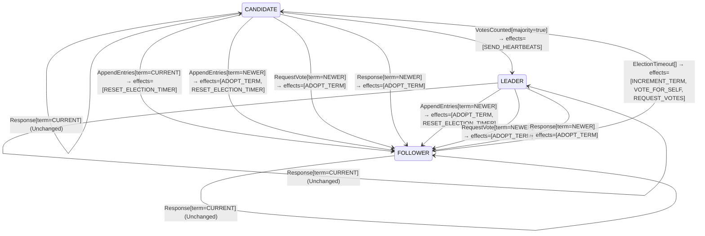

<!-- Generated by examples/demo/tools/build.py from example.json and the verifier's output. Edit example.json. -->
# 063 · A candidate that retries in the same term, proved safe, and what the proof does not say

[← All examples](../README.md)

| Verdict | Categories | Severity if shipped | Change | Verified unit | Approach |
|---|---|---|---|---|---|
| **✓ Verified: all invariants and properties hold in 464 states, and under 2 more configurations** | functional | high | feature, behaviour change intended | [`RoleMachine#decide`](../../../examples/demo/apps/quorum/src/main/java/net/terminalvalue/quorum/raft/RoleMachine.java) | [D1: Protocol model checking](../../../examples/demo/apps/quorum/spec/README.md) |

> A Raft candidate whose election timed out starts a new one in a new term. A developer makes it ask again in the same term instead, for the votes it lacks, so that a candidate that cannot win does not drive the whole cluster's term up on every timeout. The contract diff is one case and is approved. The election model proves the change safe under all three of its configurations: one leader per term, by induction and with four servers too. What the model does not state is that an election ever ends, and under this rule a split vote never does: three candidates of one term ask each other forever. The proof is exact about what it covers, and this example is about reading it that way.

## The change

Split the `ElectionTimeout` case by role: a follower runs as before; a candidate retries with `REQUEST_VOTES` alone, keeping its term, its vote and its tally. The reasoning in the comment: every retry in a new term forces every server to adopt that term, and a candidate that cannot reach a majority, partitioned or slow, inflates the cluster's term on every timeout (the disruptive server of Ongaro's thesis, section 4.2.3). The behavioural contract is regenerated and its diff is the one case `decide(CANDIDATE, ElectionTimeout[])`, whose effects lose `INCREMENT_TERM` and `VOTE_FOR_SELF`; a test for the new effects is added. The reviewer approves the diff.

**Before** ([`RoleMachine.java`](../../../examples/demo/apps/quorum/src/main/java/net/terminalvalue/quorum/raft/RoleMachine.java), line 36):

```java
public static Decision<Role, RoleEffect> decide(Role role, RoleEvent event) {
    return switch (event) {
        case ElectionTimeout _ -> switch (role) {
            case FOLLOWER, CANDIDATE -> transition(CANDIDATE, INCREMENT_TERM, VOTE_FOR_SELF, REQUEST_VOTES);
            case LEADER -> unchanged("a leader does not hold elections");
        };
        case VotesCounted votes -> switch (role) {
```

**After:**

```java
public static Decision<Role, RoleEffect> decide(Role role, RoleEvent event) {
    return switch (event) {
        case ElectionTimeout _ -> switch (role) {
            case FOLLOWER -> transition(CANDIDATE, INCREMENT_TERM, VOTE_FOR_SELF, REQUEST_VOTES);
            // A candidate whose election timed out asks again for the votes it lacks, in the same term. A new
            // term per retry makes every server in the cluster adopt it, and a candidate that cannot reach a
            // majority would otherwise drive the term up on every timeout.
            case CANDIDATE -> transition(CANDIDATE, REQUEST_VOTES);
            case LEADER -> unchanged("a leader does not hold elections");
        };
        case VotesCounted votes -> switch (role) {
```

<details><summary>Patch</summary>

```diff
--- a/examples/demo/apps/quorum/src/main/java/net/terminalvalue/quorum/raft/RoleMachine.java
+++ b/examples/demo/apps/quorum/src/main/java/net/terminalvalue/quorum/raft/RoleMachine.java
@@ -36,7 +36,11 @@
     public static Decision<Role, RoleEffect> decide(Role role, RoleEvent event) {
         return switch (event) {
             case ElectionTimeout _ -> switch (role) {
-                case FOLLOWER, CANDIDATE -> transition(CANDIDATE, INCREMENT_TERM, VOTE_FOR_SELF, REQUEST_VOTES);
+                case FOLLOWER -> transition(CANDIDATE, INCREMENT_TERM, VOTE_FOR_SELF, REQUEST_VOTES);
+                // A candidate whose election timed out asks again for the votes it lacks, in the same term. A new
+                // term per retry makes every server in the cluster adopt it, and a candidate that cannot reach a
+                // majority would otherwise drive the term up on every timeout.
+                case CANDIDATE -> transition(CANDIDATE, REQUEST_VOTES);
                 case LEADER -> unchanged("a leader does not hold elections");
             };
             case VotesCounted votes -> switch (role) {
--- a/examples/demo/apps/quorum/src/test/java/net/terminalvalue/quorum/raft/RoleMachineTest.java
+++ b/examples/demo/apps/quorum/src/test/java/net/terminalvalue/quorum/raft/RoleMachineTest.java
@@ -32,6 +32,11 @@
                 RoleMachine.decide(Role.LEADER, new RoleEvent.AppendEntries(TermOrder.NEWER)));
     }
 
+    public static void candidateRetriesInItsTerm() {
+        equal(new Transition<>(Role.CANDIDATE, List.of(RoleEffect.REQUEST_VOTES)),
+                RoleMachine.decide(Role.CANDIDATE, new RoleEvent.ElectionTimeout()));
+    }
+
     public static void staleLeaderIsRejected() {
         check(RoleMachine.decide(Role.FOLLOWER, new RoleEvent.AppendEntries(TermOrder.OLDER)) instanceof Decision.Rejected, "stale");
     }
```

</details>

## What the verifier found

The model is checked under 3 configurations, and the verdict is the first that fails:

| Configuration | What it checks | Model | Result |
|---|---|---|---|
| three servers (`spec/RaftElection.cfg`) | every run from the initial state, every interleaving within the configuration's bounds | Servers = {s1, s2, s3}, MaxTerm = 3 | ✓ Verified: all invariants and properties hold in 464 states |
| the inductive step (`spec/RaftElectionInductive.cfg`) | that the invariant `Inductive` is inductive: TLC starts from every state the invariant admits, reachable or not, rather than from the initial state, takes one step, and checks the invariant again, conjunct by conjunct. No counterexample is a proof of election safety by induction, for any run of the cluster however long; a counterexample is one step from a state that need not be reachable | Servers = {s1, s2, s3}, MaxTerm = 3 | ✓ Verified: all invariants and properties hold in 17,470 states |
| four servers (`spec/RaftElectionFour.cfg`) | every run with four servers, a cluster in which a candidate can hold a vote besides its own and still be short of a majority, which three servers never show; under a symmetry set, so that of the states that differ only by the servers' names TLC explores one | Servers = {s1, s2, s3, s4}, MaxTerm = 3 | ✓ Verified: all invariants and properties hold in 496 states |

Every invariant holds in every reachable state of the model, and every temporal property holds of every behaviour, the infinite ones included under three servers: 464 distinct states, which is every interleaving of the servers, their terms and votes, and the RPCs between them within the model's bounds (Servers = {s1, s2, s3}, MaxTerm = 3).

The servers' role machine inside the model is generated from the behavioural contract of the patched code, so the model checks the role transitions the servers really make.

The other configurations hold too, as the table says: the inductive step, 17,470 states; four servers, 496 states.

The state machine the patched code implements, drawn from its derived contract (`jvmcontract statemachine`); a state with no way in or no way out is marked:



## Would the existing tests have caught it?

Every existing unit test passes, as it should (`java -ea net.terminalvalue.quorum.Tests`, run against the patched code).

## Why it matters

Safety is intact, and the model proves it: the candidate keeps its term, its vote and a tally whose votes were all cast in that term, so nothing it counts is stale and nothing it does lets anyone vote twice. What is lost is the one thing a new term is for. Raft resolves a split vote, two or more candidates of one term that each hold their own vote and cannot reach a majority, by having each start a new election in a new term after a randomized timeout, so that one of them is first to ask a cluster whose votes are free again (section 5.2). Under this rule the candidates of a split term ask the same servers for the same votes, already cast, forever; nothing increments the term until a follower's timer fires, and in a cluster where every server is a candidate there is no follower. Three servers that time out together are a cluster with no leader, for good. That is a liveness failure, and this model states no liveness property for elections: its timers fire whenever the model likes, which is also why it could not, since even the committed rule elects nobody if every timer always fires in lockstep. The model's header says so. A proof covers what the model states, and a reviewer who reads a green result as 'the change is fine' has read more than it says.

## Why the verdict is right

The election model's role machine is generated from the behavioural contract of the patched `RoleMachine#decide`, which the tool proves the bytecode satisfies on all 52 inputs. Under three servers and three terms every invariant and both action properties hold; there are fewer reachable states than with the committed rule, since a candidate no longer leaves its term on its own. The inductive step holds too: from every state the invariant `Inductive` admits, a candidate's retry changes nothing the invariant mentions, so every conjunct is kept, and election safety holds by induction for runs of any length. With four servers, under the symmetry set, it holds as well. The verdict is correct, and complete for what the configurations check: the invariants, the action properties, and the inductive invariant are all safety properties, statements about every state and every step, and the change breaks none of them. The run in which three candidates of term 1 each ask the other two, are refused, time out, and ask again is in the state graph TLC explored; no property it was asked to check is false of it.

## What to do

Revert, and read the result for what it is. The rule the developer wanted is pre-vote (thesis, section 4.2.3 and 9.6): a candidate first asks whether it could win, without incrementing its term, and starts the election only if a majority says yes, which spares the cluster the term inflation without touching the retry. A liveness property for elections would need the model to say when timers fire, which means a model of time or at least of fairness between servers, and a property weak enough that randomized timeouts can satisfy it; that is a different model, and until it exists the honest reading of this one is that it proves one leader per term and nothing about whether there is one. The example sits next to 062, where the same three configurations find a bug, so that the two verdicts can be read side by side: a proof is as strong as the properties it proves.

## Evidence

How the verdict was reached: three servers: TLC 2.19 explored 464 distinct states to depth 10 in 0 s, for the model Servers = {s1, s2, s3}, MaxTerm = 3; the inductive step: TLC 2.19 explored 17,470 distinct states to depth 1 in 4 s, for the model Servers = {s1, s2, s3}, MaxTerm = 3; four servers: TLC 2.19 explored 496 distinct states to depth 12 in 0 s, for the model Servers = {s1, s2, s3, s4}, MaxTerm = 3.

<details><summary>Verifier output</summary>

```text
== three servers: spec/RaftElection.cfg ==
TLC2 Version 2.19 of 08 August 2024 (rev: 5a47802)
Running breadth-first search Model-Checking with fp 1 and seed 1 with 1 worker on 8 cores with 910MB heap and 64MB offheap memory [pid: 1888305] (Linux 6.6.87.2-microsoft-standard-WSL2 aarch64, Eclipse Adoptium 25.0.4.1 x86_64, MSBDiskFPSet, DiskStateQueue).
Parsing file examples/demo/apps/quorum/spec/RaftElection.tla
Parsing file examples/demo/tools/tla/standard-modules/Naturals.tla
Parsing file examples/demo/tools/tla/standard-modules/FiniteSets.tla
Parsing file examples/demo/tools/tla/standard-modules/Sequences.tla
Parsing file examples/demo/tools/tla/standard-modules/TLC.tla
Parsing file examples/demo/apps/quorum/spec/RoleMachineContract.tla
Semantic processing of module Naturals
Semantic processing of module Sequences
Semantic processing of module FiniteSets
Semantic processing of module TLC
Semantic processing of module RoleMachineContract
Semantic processing of module RaftElection
Starting... (2026-11-01 23:16:32)
Computing initial states...
Finished computing initial states: 1 distinct state generated at 2026-11-01 23:16:32.
Model checking completed. No error has been found.
  Estimates of the probability that TLC did not check all reachable states
  because two distinct states had the same fingerprint:
  calculated (optimistic):  val = 5.1E-14
2500 states generated, 464 distinct states found, 0 states left on queue.
The depth of the complete state graph search is 10.
The average outdegree of the complete state graph is 1 (minimum is 0, the maximum 5 and the 95th percentile is 3).
Finished in 00s at (2026-11-01 23:16:32)

== the inductive step: spec/RaftElectionInductive.cfg ==
TLC2 Version 2.19 of 08 August 2024 (rev: 5a47802)
Running breadth-first search Model-Checking with fp 1 and seed 1 with 1 worker on 8 cores with 910MB heap and 64MB offheap memory [pid: 1888391] (Linux 6.6.87.2-microsoft-standard-WSL2 aarch64, Eclipse Adoptium 25.0.4.1 x86_64, MSBDiskFPSet, DiskStateQueue).
Parsing file examples/demo/apps/quorum/spec/RaftElection.tla
Parsing file examples/demo/tools/tla/standard-modules/Naturals.tla
Parsing file examples/demo/tools/tla/standard-modules/FiniteSets.tla
Parsing file examples/demo/tools/tla/standard-modules/Sequences.tla
Parsing file examples/demo/tools/tla/standard-modules/TLC.tla
Parsing file examples/demo/apps/quorum/spec/RoleMachineContract.tla
Semantic processing of module Naturals
Semantic processing of module Sequences
Semantic processing of module FiniteSets
Semantic processing of module TLC
Semantic processing of module RoleMachineContract
Semantic processing of module RaftElection
Starting... (2026-11-01 23:16:33)
Computing initial states...
Computed 2 initial states...
Computed 4 initial states...
Computed 8 initial states...
Computed 16 initial states...
Computed 32 initial states...
Computed 64 initial states...
Computed 128 initial states...
Computed 256 initial states...
Computed 512 initial states...
Computed 1024 initial states...
Computed 2048 initial states...
Computed 4096 initial states...
Computed 8192 initial states...
Computed 16384 initial states...
Finished computing initial states: 17470 distinct states generated at 2026-11-01 23:16:35.
Model checking completed. No error has been found.
  Estimates of the probability that TLC did not check all reachable states
  because two distinct states had the same fingerprint:
  calculated (optimistic):  val = 5.6E-11
76099 states generated, 17470 distinct states found, 0 states left on queue.
The depth of the complete state graph search is 1.
The average outdegree of the complete state graph is 0 (minimum is 0, the maximum 0 and the 95th percentile is 0).
Finished in 04s at (2026-11-01 23:16:37)

== four servers: spec/RaftElectionFour.cfg ==
TLC2 Version 2.19 of 08 August 2024 (rev: 5a47802)
Running breadth-first search Model-Checking with fp 1 and seed 1 with 1 worker on 8 cores with 910MB heap and 64MB offheap memory [pid: 1888624] (Linux 6.6.87.2-microsoft-standard-WSL2 aarch64, Eclipse Adoptium 25.0.4.1 x86_64, MSBDiskFPSet, DiskStateQueue).
Parsing file examples/demo/apps/quorum/spec/RaftElection.tla
Parsing file examples/demo/tools/tla/standard-modules/Naturals.tla
Parsing file examples/demo/tools/tla/standard-modules/FiniteSets.tla
Parsing file examples/demo/tools/tla/standard-modules/Sequences.tla
Parsing file examples/demo/tools/tla/standard-modules/TLC.tla
Parsing file examples/demo/apps/quorum/spec/RoleMachineContract.tla
Semantic processing of module Naturals
Semantic processing of module Sequences
Semantic processing of module FiniteSets
Semantic processing of module TLC
Semantic processing of module RoleMachineContract
Semantic processing of module RaftElection
Starting... (2026-11-01 23:16:38)
Computing initial states...
Finished computing initial states: 1 distinct state generated at 2026-11-01 23:16:38.
Model checking completed. No error has been found.
  Estimates of the probability that TLC did not check all reachable states
  because two distinct states had the same fingerprint:
  calculated (optimistic):  val = 9.9E-14
4165 states generated, 496 distinct states found, 0 states left on queue.
The depth of the complete state graph search is 12.
The average outdegree of the complete state graph is 1 (minimum is 0, the maximum 7 and the 95th percentile is 4).
Finished in 00s at (2026-11-01 23:16:38)
```

</details>

<details><summary>SARIF report (as uploaded to GitHub code scanning or SonarQube)</summary>

```json
{
  "version": "2.1.0",
  "$schema": "https://json.schemastore.org/sarif-2.1.0.json",
  "runs": [
    {
      "tool": {
        "driver": {
          "name": "jvmcontract tlc",
          "rules": [
            {
              "id": "invariant-violated",
              "shortDescription": {
                "text": "TLC found a behaviour of the model that violates an invariant or a temporal property, or ends in a deadlock."
              }
            },
            {
              "id": "unverifiable",
              "shortDescription": {
                "text": "TLC could not check the model."
              }
            }
          ]
        }
      },
      "results": []
    }
  ]
}
```

</details>

**Provenance:** Constructed from the rules for candidates in figure 2 of the Raft paper, by keeping the term on a candidate's retry.

- [Ongaro and Ousterhout, In Search of an Understandable Consensus Algorithm (2014): figure 2, the rules for candidates, and section 5.2, leader election and split votes](https://raft.github.io/raft.pdf)
- [Ongaro, Consensus: Bridging Theory and Practice (2014): chapter 3, the basic algorithm, and section 4.2.3, disruptive servers](https://web.stanford.edu/~ouster/cgi-bin/papers/OngaroPhD.pdf)
- [Lamport, Using TLC to Check Inductive Invariance (2018): the invariant as TLC's initial predicate](https://lamport.azurewebsites.net/tla/inductive-invariant.pdf)
## Reproduce

```bash
python3 examples/demo/tools/build.py 063
```

This applies `change.patch` to a temporary copy of the repo, runs the verifier on it, and rewrites this page.
