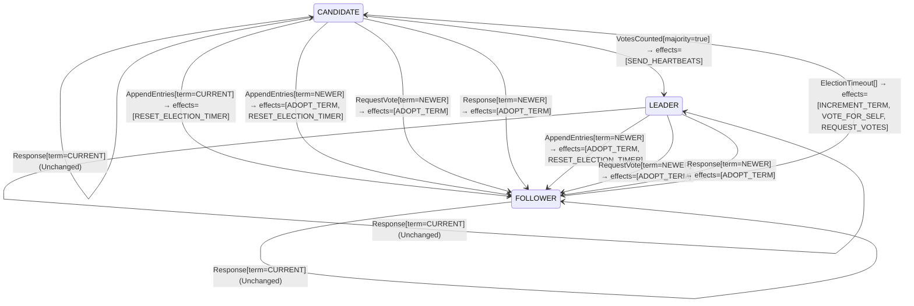

<!-- Generated by examples/demo/tools/build.py from example.json and the verifier's output. Edit example.json. -->
# 063 · A candidate that retries in the same term, proved safe, and shown never to elect a leader

[← All examples](../README.md)

| Verdict | Categories | Severity if shipped | Change | Verified unit | Approach |
|---|---|---|---|---|---|
| **✗ Violation: ALeaderIsElected, 4-step trace then forever (fairness)** | functional | high | feature, behaviour change intended | [`RoleMachine#decide`](../../../examples/demo/apps/quorum/src/main/java/net/terminalvalue/quorum/raft/RoleMachine.java) | [D1: Protocol model checking](../../../examples/demo/apps/quorum/spec/README.md) |

> A Raft candidate whose election timed out starts a new one in a new term. A developer makes it ask again in the same term instead, for the votes it lacks, so that a candidate that cannot win does not drive the whole cluster's term up on every timeout. The contract diff is one case and is approved. The election model proves the change safe under three of its configurations: one leader per term, with three servers, by induction, and with four. The fourth configuration, the liveness check, finds the run the safety proofs cannot see: three servers whose timers fire together are three candidates of term 1, each refused by the other two, and under this rule nothing ever starts term 2. The cluster has no leader, for good. A green safety result says exactly what it checked; the liveness property says the rest.

## The change

Split the `ElectionTimeout` case by role: a follower runs as before; a candidate retries with `REQUEST_VOTES` alone, keeping its term, its vote and its tally. The reasoning in the comment: every retry in a new term forces every server to adopt that term, and a candidate that cannot reach a majority, partitioned or slow, inflates the cluster's term on every timeout (the disruptive server of Ongaro's thesis, section 4.2.3). The behavioural contract is regenerated and its diff is the one case `decide(CANDIDATE, ElectionTimeout[])`, whose effects lose `INCREMENT_TERM` and `VOTE_FOR_SELF`; a test for the new effects is added. The reviewer approves the diff.

**Before** ([`RoleMachine.java`](../../../examples/demo/apps/quorum/src/main/java/net/terminalvalue/quorum/raft/RoleMachine.java), line 36):

```java
public static Decision<Role, RoleEffect> decide(Role role, RoleEvent event) {
    return switch (event) {
        case ElectionTimeout _ -> switch (role) {
            case FOLLOWER, CANDIDATE -> transition(CANDIDATE, INCREMENT_TERM, VOTE_FOR_SELF, REQUEST_VOTES);
            case LEADER -> unchanged("a leader does not hold elections");
        };
        case VotesCounted votes -> switch (role) {
```

**After:**

```java
public static Decision<Role, RoleEffect> decide(Role role, RoleEvent event) {
    return switch (event) {
        case ElectionTimeout _ -> switch (role) {
            case FOLLOWER -> transition(CANDIDATE, INCREMENT_TERM, VOTE_FOR_SELF, REQUEST_VOTES);
            // A candidate whose election timed out asks again for the votes it lacks, in the same term. A new
            // term per retry makes every server in the cluster adopt it, and a candidate that cannot reach a
            // majority would otherwise drive the term up on every timeout.
            case CANDIDATE -> transition(CANDIDATE, REQUEST_VOTES);
            case LEADER -> unchanged("a leader does not hold elections");
        };
        case VotesCounted votes -> switch (role) {
```

<details><summary>Patch</summary>

```diff
--- a/examples/demo/apps/quorum/src/main/java/net/terminalvalue/quorum/raft/RoleMachine.java
+++ b/examples/demo/apps/quorum/src/main/java/net/terminalvalue/quorum/raft/RoleMachine.java
@@ -36,7 +36,11 @@
     public static Decision<Role, RoleEffect> decide(Role role, RoleEvent event) {
         return switch (event) {
             case ElectionTimeout _ -> switch (role) {
-                case FOLLOWER, CANDIDATE -> transition(CANDIDATE, INCREMENT_TERM, VOTE_FOR_SELF, REQUEST_VOTES);
+                case FOLLOWER -> transition(CANDIDATE, INCREMENT_TERM, VOTE_FOR_SELF, REQUEST_VOTES);
+                // A candidate whose election timed out asks again for the votes it lacks, in the same term. A new
+                // term per retry makes every server in the cluster adopt it, and a candidate that cannot reach a
+                // majority would otherwise drive the term up on every timeout.
+                case CANDIDATE -> transition(CANDIDATE, REQUEST_VOTES);
                 case LEADER -> unchanged("a leader does not hold elections");
             };
             case VotesCounted votes -> switch (role) {
--- a/examples/demo/apps/quorum/src/test/java/net/terminalvalue/quorum/raft/RoleMachineTest.java
+++ b/examples/demo/apps/quorum/src/test/java/net/terminalvalue/quorum/raft/RoleMachineTest.java
@@ -32,6 +32,11 @@
                 RoleMachine.decide(Role.LEADER, new RoleEvent.AppendEntries(TermOrder.NEWER)));
     }
 
+    public static void candidateRetriesInItsTerm() {
+        equal(new Transition<>(Role.CANDIDATE, List.of(RoleEffect.REQUEST_VOTES)),
+                RoleMachine.decide(Role.CANDIDATE, new RoleEvent.ElectionTimeout()));
+    }
+
     public static void staleLeaderIsRejected() {
         check(RoleMachine.decide(Role.FOLLOWER, new RoleEvent.AppendEntries(TermOrder.OLDER)) instanceof Decision.Rejected, "stale");
     }
```

</details>

## What the verifier found

The model is checked under 6 configurations, and the verdict is the first that fails:

| Configuration | What it checks | Model | Result |
|---|---|---|---|
| three servers (`spec/RaftElection.cfg`) | every run from the initial state, every interleaving within the configuration's bounds | Servers = {s1, s2, s3}, MaxTerm = 3, LeftBehind = {}, DelayedReplies = FALSE | ✓ Verified: all invariants and properties hold in 464 states |
| the inductive step (`spec/RaftElectionInductive.cfg`) | that the invariant `Inductive` is inductive: TLC starts from every state the invariant admits, reachable or not, rather than from the initial state, takes one step, and checks the invariant again, conjunct by conjunct. No counterexample is a proof of election safety by induction, for any run of the cluster however long; a counterexample is one step from a state that need not be reachable | Servers = {s1, s2, s3}, MaxTerm = 3, LeftBehind = {}, DelayedReplies = FALSE | ✓ Verified: all invariants and properties hold in 17,470 states |
| four servers (`spec/RaftElectionFour.cfg`) | every run with four servers, a cluster in which a candidate can hold a vote besides its own and still be short of a majority, which three servers never show; under a symmetry set, so that of the states that differ only by the servers' names TLC explores one | Servers = {s1, s2, s3, s4}, MaxTerm = 3, LeftBehind = {}, DelayedReplies = FALSE | ✓ Verified: all invariants and properties hold in 496 states |
| fairness (`spec/RaftElectionLive.cfg`) | the two liveness properties, under the fairness conditions `Fairness`: a server whose timer nothing resets times out, a candidate asks for the votes it lacks, a leader sends its heartbeats. A counterexample is a run that goes on forever without satisfying a property: a prefix, then a state or a cycle the system never leaves | Servers = {s1, s2, s3}, MaxTerm = 3, LeftBehind = {}, DelayedReplies = FALSE | ✗ Violation: ALeaderIsElected, 4-step trace then forever |
| a server left behind (`spec/RaftElectionLogs.cfg`) | the election restriction: one server holds the log a deposed leader of term 1 left behind, three entries of its term, while the other two hold an entry of term 2 that a majority holds and is therefore committed, so that the longer log is the one behind; every run with these logs, which nothing changes, under the invariant `LeaderCompleteness` besides the usual ones | Servers = {s1, s2, s3}, MaxTerm = 3, LeftBehind = {s1}, DelayedReplies = FALSE | ✓ Verified: all invariants and properties hold in 332 states |
| delayed replies (`spec/RaftElectionDelayed.cfg`) | every run of three servers and two terms in which the reply to a vote request is a step of its own, which the candidate may take after it has timed out into a newer term, stepped down, or won; the one-step RPC of the other configurations never hands the role machine a reply from an older term than the server's own, and this one does, under the usual invariants and action properties | Servers = {s1, s2, s3}, MaxTerm = 2, LeftBehind = {}, DelayedReplies = TRUE | ✓ Verified: all invariants and properties hold in 5,768 states |

TLC found a run of the system under fairness that violates the temporal property **ALeaderIsElected** (a run that stays within the term budget elects a leader: with no leader every server's timer keeps firing, and each firing starts a term, so a run in which the terms stop and no leader comes is a cluster that has stopped trying): after the 4 steps below, the system stays in that state forever, and the property never comes true. The run respects every fairness condition the model assumes; the parts that could act, do. Each step is one action of one part of the system:

1. **Initial state**: every server a follower in term 0, no vote cast, no vote held.
2. **Timeout**, `Server.onElectionTimeout`: a server's election timer fires, and the server acts on the role machine's decision. `currentTerm = (s1 :> 1 @@ s2 :> 0 @@ s3 :> 0)`, `role = (s1 :> "CANDIDATE" @@ s2 :> "FOLLOWER" @@ s3 :> "FOLLOWER")`, `votedFor = (s1 :> s1 @@ s2 :> "none" @@ s3 :> "none")`, `votes = (s1 :> {s1} @@ s2 :> {} @@ s3 :> {})`
3. **Timeout**, `Server.onElectionTimeout`: a server's election timer fires, and the server acts on the role machine's decision. `currentTerm = (s1 :> 1 @@ s2 :> 0 @@ s3 :> 1)`, `role = (s1 :> "CANDIDATE" @@ s2 :> "FOLLOWER" @@ s3 :> "CANDIDATE")`, `votedFor = (s1 :> s1 @@ s2 :> "none" @@ s3 :> s3)`, `votes = (s1 :> {s1} @@ s2 :> {} @@ s3 :> {s3})`
4. **Timeout**, `Server.onElectionTimeout`: a server's election timer fires, and the server acts on the role machine's decision. `currentTerm = (s1 :> 1 @@ s2 :> 1 @@ s3 :> 1)`, `role = (s1 :> "CANDIDATE" @@ s2 :> "CANDIDATE" @@ s3 :> "CANDIDATE")`, `votedFor = (s1 :> s1 @@ s2 :> s2 @@ s3 :> s3)`, `votes = (s1 :> {s1} @@ s2 :> {s2} @@ s3 :> {s3})`

The model is small (Servers = {s1, s2, s3}, MaxTerm = 3, LeftBehind = {}, DelayedReplies = FALSE), which is what keeps the trace readable. TLC explored every interleaving of the servers, their terms and votes, and the RPCs between them within those bounds.

**What the verdict rests on.** TLC counted how often a step of the model took each row of the generated operators. A row no step takes is one the model says nothing about, whatever the verdict.

| Configuration | Rows of `RoleMachine#decide` taken | Rows of `VoteRule#decide` taken |
|---|---|---|
| three servers | 27 of 36 | 4 of 27 |
| the inductive step (from the states the invariant admits, not from a run) | 27 of 36 | 6 of 27 |
| four servers | 27 of 36 | 4 of 27 |
| fairness | stopped at the counterexample | stopped at the counterexample |
| a server left behind | 27 of 36 | 12 of 27 |
| delayed replies | 33 of 36 | 4 of 27 |

The change alters 1 row of the contract:

- `decide(CANDIDATE, ElectionTimeout[])`: `Transition[next=CANDIDATE, effects=[INCREMENT_TERM, VOTE_FOR_SELF, REQUEST_VOTES]]` → `Transition[next=CANDIDATE, effects=[REQUEST_VOTES]]`, taken under three servers, the inductive step, four servers, a server left behind, delayed replies

The run under fairness stopped at its counterexample, the steps above, and its counts are left out: the verdict rests on the counterexample.

<details><summary>Rows no step takes under three servers</summary>

`net.terminalvalue.quorum.raft.RoleMachine#decide`:

```
decide(FOLLOWER, VotesCounted[majority=true]) => Unchanged
decide(FOLLOWER, Response[term=OLDER]) => Unchanged
decide(FOLLOWER, Response[term=CURRENT]) => Unchanged
decide(FOLLOWER, Response[term=NEWER]) => Transition[next=FOLLOWER, effects=[ADOPT_TERM]]
decide(CANDIDATE, Response[term=OLDER]) => Unchanged
decide(LEADER, VotesCounted[majority=false]) => Unchanged
decide(LEADER, VotesCounted[majority=true]) => Unchanged
decide(LEADER, AppendEntries[term=CURRENT]) => throws IllegalStateException
decide(LEADER, Response[term=OLDER]) => Unchanged
```

`net.terminalvalue.quorum.raft.VoteRule#decide`:

```
decide(OPEN, VoteRequest[term=OLDER, log=BEHIND]) => Rejected
decide(OPEN, VoteRequest[term=OLDER, log=AHEAD]) => Rejected
decide(OPEN, VoteRequest[term=CURRENT, log=BEHIND]) => Rejected
decide(OPEN, VoteRequest[term=CURRENT, log=AHEAD]) => Transition[next=FOR_THE_CANDIDATE, effects=[GRANT]]
decide(OPEN, VoteRequest[term=NEWER, log=BEHIND]) => Rejected
decide(OPEN, VoteRequest[term=NEWER, log=EVEN]) => Transition[next=FOR_THE_CANDIDATE, effects=[GRANT]]
decide(OPEN, VoteRequest[term=NEWER, log=AHEAD]) => Transition[next=FOR_THE_CANDIDATE, effects=[GRANT]]
decide(FOR_THE_CANDIDATE, VoteRequest[term=OLDER, log=BEHIND]) => Rejected
decide(FOR_THE_CANDIDATE, VoteRequest[term=OLDER, log=EVEN]) => Rejected
decide(FOR_THE_CANDIDATE, VoteRequest[term=OLDER, log=AHEAD]) => Rejected
decide(FOR_THE_CANDIDATE, VoteRequest[term=CURRENT, log=BEHIND]) => Rejected
decide(FOR_THE_CANDIDATE, VoteRequest[term=CURRENT, log=EVEN]) => Transition[next=FOR_THE_CANDIDATE, effects=[GRANT]]
decide(FOR_THE_CANDIDATE, VoteRequest[term=CURRENT, log=AHEAD]) => Transition[next=FOR_THE_CANDIDATE, effects=[GRANT]]
decide(FOR_THE_CANDIDATE, VoteRequest[term=NEWER, log=BEHIND]) => Rejected
decide(FOR_THE_CANDIDATE, VoteRequest[term=NEWER, log=EVEN]) => Transition[next=FOR_THE_CANDIDATE, effects=[GRANT]]
decide(FOR_THE_CANDIDATE, VoteRequest[term=NEWER, log=AHEAD]) => Transition[next=FOR_THE_CANDIDATE, effects=[GRANT]]
decide(FOR_ANOTHER, VoteRequest[term=OLDER, log=BEHIND]) => Rejected
decide(FOR_ANOTHER, VoteRequest[term=OLDER, log=AHEAD]) => Rejected
decide(FOR_ANOTHER, VoteRequest[term=CURRENT, log=BEHIND]) => Rejected
decide(FOR_ANOTHER, VoteRequest[term=CURRENT, log=AHEAD]) => Rejected
decide(FOR_ANOTHER, VoteRequest[term=NEWER, log=BEHIND]) => Rejected
decide(FOR_ANOTHER, VoteRequest[term=NEWER, log=EVEN]) => Transition[next=FOR_THE_CANDIDATE, effects=[GRANT]]
decide(FOR_ANOTHER, VoteRequest[term=NEWER, log=AHEAD]) => Transition[next=FOR_THE_CANDIDATE, effects=[GRANT]]
```

</details>

The state machine the patched code implements, drawn from its derived contract (`jvmcontract statemachine`); a state with no way in or no way out is marked:



## Would the existing tests have caught it?

No: every existing unit test passes (`java -ea net.terminalvalue.quorum.Tests`, run against the patched code).

## Why it matters

Safety is intact, and the model proves it: the candidate keeps its term, its vote and a tally whose votes were all cast in that term, so nothing it counts is stale and nothing it does lets anyone vote twice. What is lost is the one thing a new term is for. Raft resolves a split vote, two or more candidates of one term that each hold their own vote and cannot reach a majority, by having each start a new election in a new term after a randomized timeout, so that one of them is first to ask a cluster whose votes are free again (section 5.2). Under this rule the candidates of a split term ask the same servers for the same votes, already cast, forever; nothing increments the term until a follower's timer fires, and in a cluster where every server is a candidate there is no follower. Three servers that time out together are a cluster with no leader, for good. That is a liveness failure: no state is wrong, no step is wrong, and the run never ends. An invariant cannot say it, an action property cannot say it, and the inductive invariant cannot say it; only a property of whole runs can, and the model has two, checked under fairness conditions that say what each server is assumed to get round to.

## Why the verdict is right

The election model's role machine is generated from the behavioural contract of the patched `RoleMachine#decide`, which the tool proves the bytecode satisfies on all 52 inputs. Under three servers and three terms every invariant and both action properties hold, and there are fewer reachable states than with the committed rule, since a candidate no longer leaves its term on its own; the inductive step holds, since a candidate's retry changes nothing the invariant mentions; four servers under the symmetry set hold too. The liveness configuration checks the same three-server model under the fairness conditions `Fairness` (a server whose timer nothing resets times out, a candidate asks for the votes it lacks, a leader sends its heartbeats) and finds a run that breaks `ALeaderIsElected`, the property that a run which stays within the term budget elects a leader: s3's timer fires, then s1's, then s2's, each starting term 1 with a vote for itself, and the run stays in that state forever (TLC's `Stuttering`). Every term is 1, well within the budget; no leader ever comes. Fairness demands nothing more of it: each candidate's retry is a step that changes nothing, so no timer is enabled in the sense that matters, and each canvass is refused, since every vote of term 1 is cast. With the committed rule the same three timers firing together start term 2 on the next timeout, and the first candidate to ask a server whose vote is free again wins. TLC names the property after rerunning each temporal property alone.

## What to do

Revert. The rule the developer wanted is pre-vote (thesis, sections 4.2.3 and 9.6): a candidate first asks whether it could win, without incrementing its term, and starts the election only if a majority says yes, which spares the cluster the term inflation without touching the retry. The liveness property is the one to keep in mind for any retry rule: a retry that does not start a new term cannot end a split vote, because the votes of the split term are cast. What the property does not say is also worth reading: it is conditioned on the term budget, because a model without a clock cannot show that a leader comes within any number of terms (every term can split, and Raft's answer is randomized timeouts), and it holds under the fairness conditions stated with it and no others. The example sits next to 062, where the three safety configurations find a bug, and 064, where all four configurations hold.

## Evidence

How the verdict was reached: three servers: TLC 2.19 explored 464 distinct states to depth 10 in 1 s, for the model Servers = {s1, s2, s3}, MaxTerm = 3, LeftBehind = {}, DelayedReplies = FALSE; the inductive step: TLC 2.19 explored 17,470 distinct states to depth 1 in 7 s, for the model Servers = {s1, s2, s3}, MaxTerm = 3, LeftBehind = {}, DelayedReplies = FALSE; four servers: TLC 2.19 explored 496 distinct states to depth 12 in 1 s, for the model Servers = {s1, s2, s3, s4}, MaxTerm = 3, LeftBehind = {}, DelayedReplies = FALSE; fairness: TLC 2.19 explored 464 distinct states in 1 s, for the model Servers = {s1, s2, s3}, MaxTerm = 3, LeftBehind = {}, DelayedReplies = FALSE; a server left behind: TLC 2.19 explored 332 distinct states to depth 10 in 0 s, for the model Servers = {s1, s2, s3}, MaxTerm = 3, LeftBehind = {s1}, DelayedReplies = FALSE; delayed replies: TLC 2.19 explored 5,768 distinct states to depth 15 in 2 s, for the model Servers = {s1, s2, s3}, MaxTerm = 2, LeftBehind = {}, DelayedReplies = TRUE.

<details><summary>Verifier output</summary>

```text
== three servers: spec/RaftElection.cfg ==
TLC2 Version 2.19 of 08 August 2024 (rev: 5a47802)
Running breadth-first search Model-Checking with fp 1 and seed 1 with 1 worker on 8 cores with 910MB heap and 64MB offheap memory [pid: 2528270] (Linux 6.6.87.2-microsoft-standard-WSL2 aarch64, Eclipse Adoptium 25.0.4.1 x86_64, MSBDiskFPSet, DiskStateQueue).
Parsing file examples/demo/apps/quorum/spec/RaftElection.tla
Parsing file examples/demo/tools/tla/standard-modules/Naturals.tla
Parsing file examples/demo/tools/tla/standard-modules/FiniteSets.tla
Parsing file examples/demo/tools/tla/standard-modules/Sequences.tla
Parsing file examples/demo/tools/tla/standard-modules/TLC.tla
Parsing file examples/demo/apps/quorum/spec/RoleMachineContract.tla
Parsing file examples/demo/apps/quorum/spec/VoteRuleContract.tla
Semantic processing of module Naturals
Semantic processing of module Sequences
Semantic processing of module FiniteSets
Semantic processing of module TLC
Semantic processing of module RoleMachineContract
Semantic processing of module VoteRuleContract
Semantic processing of module RaftElection
Starting... (2026-11-02 03:05:19)
Computing initial states...
Finished computing initial states: 1 distinct state generated at 2026-11-02 03:05:20.
Model checking completed. No error has been found.
  Estimates of the probability that TLC did not check all reachable states
  because two distinct states had the same fingerprint:
  calculated (optimistic):  val = 5.1E-14
Rows of net.terminalvalue.quorum.raft.RoleMachine#decide a step of the model takes: 27 of 36; never taken (9):
  decide(FOLLOWER, VotesCounted[majority=true]) => Unchanged
  decide(FOLLOWER, Response[term=OLDER]) => Unchanged
  decide(FOLLOWER, Response[term=CURRENT]) => Unchanged
  decide(FOLLOWER, Response[term=NEWER]) => Transition[next=FOLLOWER, effects=[ADOPT_TERM]]
  decide(CANDIDATE, Response[term=OLDER]) => Unchanged
  decide(LEADER, VotesCounted[majority=false]) => Unchanged
  decide(LEADER, VotesCounted[majority=true]) => Unchanged
  decide(LEADER, AppendEntries[term=CURRENT]) => throws IllegalStateException
  decide(LEADER, Response[term=OLDER]) => Unchanged
Rows of net.terminalvalue.quorum.raft.VoteRule#decide a step of the model takes: 4 of 27; never taken (23):
  decide(OPEN, VoteRequest[term=OLDER, log=BEHIND]) => Rejected
  decide(OPEN, VoteRequest[term=OLDER, log=AHEAD]) => Rejected
  decide(OPEN, VoteRequest[term=CURRENT, log=BEHIND]) => Rejected
  decide(OPEN, VoteRequest[term=CURRENT, log=AHEAD]) => Transition[next=FOR_THE_CANDIDATE, effects=[GRANT]]
  decide(OPEN, VoteRequest[term=NEWER, log=BEHIND]) => Rejected
  decide(OPEN, VoteRequest[term=NEWER, log=EVEN]) => Transition[next=FOR_THE_CANDIDATE, effects=[GRANT]]
  decide(OPEN, VoteRequest[term=NEWER, log=AHEAD]) => Transition[next=FOR_THE_CANDIDATE, effects=[GRANT]]
  decide(FOR_THE_CANDIDATE, VoteRequest[term=OLDER, log=BEHIND]) => Rejected
  decide(FOR_THE_CANDIDATE, VoteRequest[term=OLDER, log=EVEN]) => Rejected
  decide(FOR_THE_CANDIDATE, VoteRequest[term=OLDER, log=AHEAD]) => Rejected
  decide(FOR_THE_CANDIDATE, VoteRequest[term=CURRENT, log=BEHIND]) => Rejected
  decide(FOR_THE_CANDIDATE, VoteRequest[term=CURRENT, log=EVEN]) => Transition[next=FOR_THE_CANDIDATE, effects=[GRANT]]
  decide(FOR_THE_CANDIDATE, VoteRequest[term=CURRENT, log=AHEAD]) => Transition[next=FOR_THE_CANDIDATE, effects=[GRANT]]
  decide(FOR_THE_CANDIDATE, VoteRequest[term=NEWER, log=BEHIND]) => Rejected
  decide(FOR_THE_CANDIDATE, VoteRequest[term=NEWER, log=EVEN]) => Transition[next=FOR_THE_CANDIDATE, effects=[GRANT]]
  decide(FOR_THE_CANDIDATE, VoteRequest[term=NEWER, log=AHEAD]) => Transition[next=FOR_THE_CANDIDATE, effects=[GRANT]]
  decide(FOR_ANOTHER, VoteRequest[term=OLDER, log=BEHIND]) => Rejected
  decide(FOR_ANOTHER, VoteRequest[term=OLDER, log=AHEAD]) => Rejected
  decide(FOR_ANOTHER, VoteRequest[term=CURRENT, log=BEHIND]) => Rejected
  decide(FOR_ANOTHER, VoteRequest[term=CURRENT, log=AHEAD]) => Rejected
  decide(FOR_ANOTHER, VoteRequest[term=NEWER, log=BEHIND]) => Rejected
  decide(FOR_ANOTHER, VoteRequest[term=NEWER, log=EVEN]) => Transition[next=FOR_THE_CANDIDATE, effects=[GRANT]]
  decide(FOR_ANOTHER, VoteRequest[term=NEWER, log=AHEAD]) => Transition[next=FOR_THE_CANDIDATE, effects=[GRANT]]
2500 states generated, 464 distinct states found, 0 states left on queue.
The depth of the complete state graph search is 10.
The average outdegree of the complete state graph is 1 (minimum is 0, the maximum 5 and the 95th percentile is 3).
Finished in 01s at (2026-11-02 03:05:20)

== the inductive step: spec/RaftElectionInductive.cfg ==
TLC2 Version 2.19 of 08 August 2024 (rev: 5a47802)
Running breadth-first search Model-Checking with fp 1 and seed 1 with 1 worker on 8 cores with 910MB heap and 64MB offheap memory [pid: 2528392] (Linux 6.6.87.2-microsoft-standard-WSL2 aarch64, Eclipse Adoptium 25.0.4.1 x86_64, MSBDiskFPSet, DiskStateQueue).
Parsing file examples/demo/apps/quorum/spec/RaftElection.tla
Parsing file examples/demo/tools/tla/standard-modules/Naturals.tla
Parsing file examples/demo/tools/tla/standard-modules/FiniteSets.tla
Parsing file examples/demo/tools/tla/standard-modules/Sequences.tla
Parsing file examples/demo/tools/tla/standard-modules/TLC.tla
Parsing file examples/demo/apps/quorum/spec/RoleMachineContract.tla
Parsing file examples/demo/apps/quorum/spec/VoteRuleContract.tla
Semantic processing of module Naturals
Semantic processing of module Sequences
Semantic processing of module FiniteSets
Semantic processing of module TLC
Semantic processing of module RoleMachineContract
Semantic processing of module VoteRuleContract
Semantic processing of module RaftElection
Starting... (2026-11-02 03:05:21)
Computing initial states...
Computed 2 initial states...
Computed 4 initial states...
Computed 8 initial states...
Computed 16 initial states...
Computed 32 initial states...
Computed 64 initial states...
Computed 128 initial states...
Computed 256 initial states...
Computed 512 initial states...
Computed 1024 initial states...
Computed 2048 initial states...
Computed 4096 initial states...
Computed 8192 initial states...
Computed 16384 initial states...
Finished computing initial states: 17470 distinct states generated at 2026-11-02 03:05:26.
Model checking completed. No error has been found.
  Estimates of the probability that TLC did not check all reachable states
  because two distinct states had the same fingerprint:
  calculated (optimistic):  val = 5.6E-11
Rows of net.terminalvalue.quorum.raft.RoleMachine#decide a step of the model takes: 27 of 36; never taken (9):
  decide(FOLLOWER, VotesCounted[majority=true]) => Unchanged
  decide(FOLLOWER, Response[term=OLDER]) => Unchanged
  decide(FOLLOWER, Response[term=CURRENT]) => Unchanged
  decide(FOLLOWER, Response[term=NEWER]) => Transition[next=FOLLOWER, effects=[ADOPT_TERM]]
  decide(CANDIDATE, Response[term=OLDER]) => Unchanged
  decide(LEADER, VotesCounted[majority=false]) => Unchanged
  decide(LEADER, VotesCounted[majority=true]) => Unchanged
  decide(LEADER, AppendEntries[term=CURRENT]) => throws IllegalStateException
  decide(LEADER, Response[term=OLDER]) => Unchanged
Rows of net.terminalvalue.quorum.raft.VoteRule#decide a step of the model takes: 6 of 27; never taken (21):
  decide(OPEN, VoteRequest[term=OLDER, log=BEHIND]) => Rejected
  decide(OPEN, VoteRequest[term=OLDER, log=AHEAD]) => Rejected
  decide(OPEN, VoteRequest[term=CURRENT, log=BEHIND]) => Rejected
  decide(OPEN, VoteRequest[term=CURRENT, log=AHEAD]) => Transition[next=FOR_THE_CANDIDATE, effects=[GRANT]]
  decide(OPEN, VoteRequest[term=NEWER, log=BEHIND]) => Rejected
  decide(OPEN, VoteRequest[term=NEWER, log=EVEN]) => Transition[next=FOR_THE_CANDIDATE, effects=[GRANT]]
  decide(OPEN, VoteRequest[term=NEWER, log=AHEAD]) => Transition[next=FOR_THE_CANDIDATE, effects=[GRANT]]
  decide(FOR_THE_CANDIDATE, VoteRequest[term=OLDER, log=BEHIND]) => Rejected
  decide(FOR_THE_CANDIDATE, VoteRequest[term=OLDER, log=AHEAD]) => Rejected
  decide(FOR_THE_CANDIDATE, VoteRequest[term=CURRENT, log=BEHIND]) => Rejected
  decide(FOR_THE_CANDIDATE, VoteRequest[term=CURRENT, log=AHEAD]) => Transition[next=FOR_THE_CANDIDATE, effects=[GRANT]]
  decide(FOR_THE_CANDIDATE, VoteRequest[term=NEWER, log=BEHIND]) => Rejected
  decide(FOR_THE_CANDIDATE, VoteRequest[term=NEWER, log=EVEN]) => Transition[next=FOR_THE_CANDIDATE, effects=[GRANT]]
  decide(FOR_THE_CANDIDATE, VoteRequest[term=NEWER, log=AHEAD]) => Transition[next=FOR_THE_CANDIDATE, effects=[GRANT]]
  decide(FOR_ANOTHER, VoteRequest[term=OLDER, log=BEHIND]) => Rejected
  decide(FOR_ANOTHER, VoteRequest[term=OLDER, log=AHEAD]) => Rejected
  decide(FOR_ANOTHER, VoteRequest[term=CURRENT, log=BEHIND]) => Rejected
  decide(FOR_ANOTHER, VoteRequest[term=CURRENT, log=AHEAD]) => Rejected
  decide(FOR_ANOTHER, VoteRequest[term=NEWER, log=BEHIND]) => Rejected
  decide(FOR_ANOTHER, VoteRequest[term=NEWER, log=EVEN]) => Transition[next=FOR_THE_CANDIDATE, effects=[GRANT]]
  decide(FOR_ANOTHER, VoteRequest[term=NEWER, log=AHEAD]) => Transition[next=FOR_THE_CANDIDATE, effects=[GRANT]]
76099 states generated, 17470 distinct states found, 0 states left on queue.
The depth of the complete state graph search is 1.
The average outdegree of the complete state graph is 0 (minimum is 0, the maximum 0 and the 95th percentile is 0).
Finished in 07s at (2026-11-02 03:05:28)

== four servers: spec/RaftElectionFour.cfg ==
TLC2 Version 2.19 of 08 August 2024 (rev: 5a47802)
Running breadth-first search Model-Checking with fp 1 and seed 1 with 1 worker on 8 cores with 910MB heap and 64MB offheap memory [pid: 2528777] (Linux 6.6.87.2-microsoft-standard-WSL2 aarch64, Eclipse Adoptium 25.0.4.1 x86_64, MSBDiskFPSet, DiskStateQueue).
Parsing file examples/demo/apps/quorum/spec/RaftElection.tla
Parsing file examples/demo/tools/tla/standard-modules/Naturals.tla
Parsing file examples/demo/tools/tla/standard-modules/FiniteSets.tla
Parsing file examples/demo/tools/tla/standard-modules/Sequences.tla
Parsing file examples/demo/tools/tla/standard-modules/TLC.tla
Parsing file examples/demo/apps/quorum/spec/RoleMachineContract.tla
Parsing file examples/demo/apps/quorum/spec/VoteRuleContract.tla
Semantic processing of module Naturals
Semantic processing of module Sequences
Semantic processing of module FiniteSets
Semantic processing of module TLC
Semantic processing of module RoleMachineContract
Semantic processing of module VoteRuleContract
Semantic processing of module RaftElection
Starting... (2026-11-02 03:05:29)
Computing initial states...
Finished computing initial states: 1 distinct state generated at 2026-11-02 03:05:29.
Model checking completed. No error has been found.
  Estimates of the probability that TLC did not check all reachable states
  because two distinct states had the same fingerprint:
  calculated (optimistic):  val = 9.9E-14
Rows of net.terminalvalue.quorum.raft.RoleMachine#decide a step of the model takes: 27 of 36; never taken (9):
  decide(FOLLOWER, VotesCounted[majority=true]) => Unchanged
  decide(FOLLOWER, Response[term=OLDER]) => Unchanged
  decide(FOLLOWER, Response[term=CURRENT]) => Unchanged
  decide(FOLLOWER, Response[term=NEWER]) => Transition[next=FOLLOWER, effects=[ADOPT_TERM]]
  decide(CANDIDATE, Response[term=OLDER]) => Unchanged
  decide(LEADER, VotesCounted[majority=false]) => Unchanged
  decide(LEADER, VotesCounted[majority=true]) => Unchanged
  decide(LEADER, AppendEntries[term=CURRENT]) => throws IllegalStateException
  decide(LEADER, Response[term=OLDER]) => Unchanged
Rows of net.terminalvalue.quorum.raft.VoteRule#decide a step of the model takes: 4 of 27; never taken (23):
  decide(OPEN, VoteRequest[term=OLDER, log=BEHIND]) => Rejected
  decide(OPEN, VoteRequest[term=OLDER, log=AHEAD]) => Rejected
  decide(OPEN, VoteRequest[term=CURRENT, log=BEHIND]) => Rejected
  decide(OPEN, VoteRequest[term=CURRENT, log=AHEAD]) => Transition[next=FOR_THE_CANDIDATE, effects=[GRANT]]
  decide(OPEN, VoteRequest[term=NEWER, log=BEHIND]) => Rejected
  decide(OPEN, VoteRequest[term=NEWER, log=EVEN]) => Transition[next=FOR_THE_CANDIDATE, effects=[GRANT]]
  decide(OPEN, VoteRequest[term=NEWER, log=AHEAD]) => Transition[next=FOR_THE_CANDIDATE, effects=[GRANT]]
  decide(FOR_THE_CANDIDATE, VoteRequest[term=OLDER, log=BEHIND]) => Rejected
  decide(FOR_THE_CANDIDATE, VoteRequest[term=OLDER, log=EVEN]) => Rejected
  decide(FOR_THE_CANDIDATE, VoteRequest[term=OLDER, log=AHEAD]) => Rejected
  decide(FOR_THE_CANDIDATE, VoteRequest[term=CURRENT, log=BEHIND]) => Rejected
  decide(FOR_THE_CANDIDATE, VoteRequest[term=CURRENT, log=EVEN]) => Transition[next=FOR_THE_CANDIDATE, effects=[GRANT]]
  decide(FOR_THE_CANDIDATE, VoteRequest[term=CURRENT, log=AHEAD]) => Transition[next=FOR_THE_CANDIDATE, effects=[GRANT]]
  decide(FOR_THE_CANDIDATE, VoteRequest[term=NEWER, log=BEHIND]) => Rejected
  decide(FOR_THE_CANDIDATE, VoteRequest[term=NEWER, log=EVEN]) => Transition[next=FOR_THE_CANDIDATE, effects=[GRANT]]
  decide(FOR_THE_CANDIDATE, VoteRequest[term=NEWER, log=AHEAD]) => Transition[next=FOR_THE_CANDIDATE, effects=[GRANT]]
  decide(FOR_ANOTHER, VoteRequest[term=OLDER, log=BEHIND]) => Rejected
  decide(FOR_ANOTHER, VoteRequest[term=OLDER, log=AHEAD]) => Rejected
  decide(FOR_ANOTHER, VoteRequest[term=CURRENT, log=BEHIND]) => Rejected
  decide(FOR_ANOTHER, VoteRequest[term=CURRENT, log=AHEAD]) => Rejected
  decide(FOR_ANOTHER, VoteRequest[term=NEWER, log=BEHIND]) => Rejected
  decide(FOR_ANOTHER, VoteRequest[term=NEWER, log=EVEN]) => Transition[next=FOR_THE_CANDIDATE, effects=[GRANT]]
  decide(FOR_ANOTHER, VoteRequest[term=NEWER, log=AHEAD]) => Transition[next=FOR_THE_CANDIDATE, effects=[GRANT]]
4165 states generated, 496 distinct states found, 0 states left on queue.
The depth of the complete state graph search is 12.
The average outdegree of the complete state graph is 1 (minimum is 0, the maximum 7 and the 95th percentile is 4).
Finished in 01s at (2026-11-02 03:05:30)

== fairness: spec/RaftElectionLive.cfg ==
TLC2 Version 2.19 of 08 August 2024 (rev: 5a47802)
Running breadth-first search Model-Checking with fp 1 and seed 1 with 1 worker on 8 cores with 910MB heap and 64MB offheap memory [pid: 2529265] (Linux 6.6.87.2-microsoft-standard-WSL2 aarch64, Eclipse Adoptium 25.0.4.1 x86_64, MSBDiskFPSet, DiskStateQueue).
Parsing file examples/demo/apps/quorum/spec/RaftElection.tla
Parsing file examples/demo/tools/tla/standard-modules/Naturals.tla
Parsing file examples/demo/tools/tla/standard-modules/FiniteSets.tla
Parsing file examples/demo/tools/tla/standard-modules/Sequences.tla
Parsing file examples/demo/tools/tla/standard-modules/TLC.tla
Parsing file examples/demo/apps/quorum/spec/RoleMachineContract.tla
Parsing file examples/demo/apps/quorum/spec/VoteRuleContract.tla
Semantic processing of module Naturals
Semantic processing of module Sequences
Semantic processing of module FiniteSets
Semantic processing of module TLC
Semantic processing of module RoleMachineContract
Semantic processing of module VoteRuleContract
Semantic processing of module RaftElection
Starting... (2026-11-02 03:05:36)
Implied-temporal checking--satisfiability problem has 1 branches.
Computing initial states...
Finished computing initial states: 1 distinct state generated at 2026-11-02 03:05:37.
Checking temporal properties for the complete state space with 464 total distinct states at (2026-11-02 03:05:37)
Error: Temporal properties were violated.

Error: The following behavior constitutes a counter-example:

State 1: <Initial predicate>
/\ replies = {}
/\ currentTerm = (s1 :> 0 @@ s2 :> 0 @@ s3 :> 0)
/\ votes = (s1 :> {} @@ s2 :> {} @@ s3 :> {})
/\ role = (s1 :> "FOLLOWER" @@ s2 :> "FOLLOWER" @@ s3 :> "FOLLOWER")
/\ votedFor = (s1 :> "none" @@ s2 :> "none" @@ s3 :> "none")

State 2: <Timeout line 129, col 15 to line 129, col 88 of module RaftElection>
/\ replies = {}
/\ currentTerm = (s1 :> 1 @@ s2 :> 0 @@ s3 :> 0)
/\ votes = (s1 :> {s1} @@ s2 :> {} @@ s3 :> {})
/\ role = (s1 :> "CANDIDATE" @@ s2 :> "FOLLOWER" @@ s3 :> "FOLLOWER")
/\ votedFor = (s1 :> s1 @@ s2 :> "none" @@ s3 :> "none")

State 3: <Timeout line 129, col 15 to line 129, col 88 of module RaftElection>
/\ replies = {}
/\ currentTerm = (s1 :> 1 @@ s2 :> 0 @@ s3 :> 1)
/\ votes = (s1 :> {s1} @@ s2 :> {} @@ s3 :> {s3})
/\ role = (s1 :> "CANDIDATE" @@ s2 :> "FOLLOWER" @@ s3 :> "CANDIDATE")
/\ votedFor = (s1 :> s1 @@ s2 :> "none" @@ s3 :> s3)

State 4: <Timeout line 129, col 15 to line 129, col 88 of module RaftElection>
/\ replies = {}
/\ currentTerm = (s1 :> 1 @@ s2 :> 1 @@ s3 :> 1)
/\ votes = (s1 :> {s1} @@ s2 :> {s2} @@ s3 :> {s3})
/\ role = (s1 :> "CANDIDATE" @@ s2 :> "CANDIDATE" @@ s3 :> "CANDIDATE")
/\ votedFor = (s1 :> s1 @@ s2 :> s2 @@ s3 :> s3)

State 5: Stuttering
Finished checking temporal properties in 00s at 2026-11-02 03:05:37
The coverage statistics at 2026-11-02 03:05:37
<Init line 242, col 1 to line 242, col 4 of module RaftElection>: 2:2
  line 243, col 5 to line 247, col 19 of module RaftElection: 2
<Timeout line 129, col 1 to line 129, col 10 of module RaftElection>: 136:900
  line 129, col 15 to line 129, col 38 of module RaftElection: 900
  |line 129, col 15 to line 129, col 28 of module RaftElection: 1401
  |line 129, col 32 to line 129, col 38 of module RaftElection: 1401
  line 129, col 43 to line 129, col 64 of module RaftElection: 1800
  |line 129, col 44 to line 129, col 64 of module RaftElection: 900
  ||line 129, col 44 to line 129, col 57 of module RaftElection: 900
  |||line 121, col 17 to line 121, col 64 of module RaftElection: 900
  ||||line 121, col 17 to line 121, col 37 of module RaftElection: 900
  ||||line 121, col 42 to line 121, col 64 of module RaftElection: 630
  |||||line 95, col 19 to line 95, col 68 of module RaftElection: 630
  ||||||line 95, col 48 to line 95, col 68 of module RaftElection: 1036
  ||||||line 95, col 28 to line 95, col 44 of module RaftElection: 630
  |||line 120, col 14 to line 120, col 109 of module RaftElection: 900
  ||||line 120, col 17 to line 120, col 65 of module RaftElection: 900
  |||||line 120, col 17 to line 120, col 37 of module RaftElection: 900
  |||||line 120, col 42 to line 120, col 65 of module RaftElection: 630
  ||||line 120, col 72 to line 120, col 89 of module RaftElection: 406
  ||||line 120, col 96 to line 120, col 109 of module RaftElection: 494
  |||line 119, col 14 to line 119, col 58 of module RaftElection: 900
  ||||line 13, col 3 to line 48, col 119 of module RoleMachineContract: 900
  |||||line 13, col 8 to line 13, col 95 of module RoleMachineContract: 900
  ||||||line 13, col 8 to line 13, col 55 of module RoleMachineContract: 900
  |||||||line 13, col 9 to line 13, col 31 of module RoleMachineContract: 900
  ||||||||line 13, col 27 to line 13, col 31 of module RoleMachineContract: 1800
  ||||||||line 13, col 18 to line 13, col 23 of module RoleMachineContract: 900:2700
  |||||||line 13, col 37 to line 13, col 55 of module RoleMachineContract: 900
  ||||||line 13, col 60 to line 13, col 95 of module RoleMachineContract: 406
  |||||line 13, col 100 to line 13, col 178 of module RoleMachineContract: 406
  |||||line 14, col 8 to line 14, col 96 of module RoleMachineContract: 494
  |||||line 15, col 8 to line 15, col 95 of module RoleMachineContract: 494
  |||||line 16, col 8 to line 16, col 94 of module RoleMachineContract: 494
  |||||line 17, col 8 to line 17, col 138 of module RoleMachineContract: 494
  |||||line 18, col 8 to line 18, col 150 of module RoleMachineContract: 494
  |||||line 19, col 8 to line 19, col 93 of module RoleMachineContract: 494
  |||||line 20, col 8 to line 20, col 95 of module RoleMachineContract: 494
  |||||line 21, col 8 to line 21, col 124 of module RoleMachineContract: 494
  |||||line 22, col 8 to line 22, col 90 of module RoleMachineContract: 494
  |||||line 23, col 8 to line 23, col 92 of module RoleMachineContract: 494
  |||||line 24, col 8 to line 24, col 121 of module RoleMachineContract: 494
  |||||line 25, col 8 to line 25, col 67 of module RoleMachineContract: 494
  ||||||line 25, col 8 to line 25, col 27 of module RoleMachineContract: 494
  ||||||line 25, col 32 to line 25, col 67 of module RoleMachineContract: 224
  |||||line 25, col 72 to line 25, col 115 of module RoleMachineContract: 224
  |||||line 26, col 8 to line 26, col 97 of module RoleMachineContract: 270
  |||||line 27, col 8 to line 27, col 130 of module RoleMachineContract: 270
  |||||line 28, col 8 to line 28, col 95 of module RoleMachineContract: 270
  |||||line 29, col 8 to line 29, col 139 of module RoleMachineContract: 270
  |||||line 30, col 8 to line 30, col 151 of module RoleMachineContract: 270
  |||||line 31, col 8 to line 31, col 94 of module RoleMachineContract: 270
  |||||line 32, col 8 to line 32, col 96 of module RoleMachineContract: 270
  |||||line 33, col 8 to line 33, col 125 of module RoleMachineContract: 270
  |||||line 34, col 8 to line 34, col 91 of module RoleMachineContract: 270
  |||||line 35, col 8 to line 35, col 93 of module RoleMachineContract: 270
  |||||line 36, col 8 to line 36, col 122 of module RoleMachineContract: 270
  |||||line 37, col 8 to line 37, col 77 of module RoleMachineContract: 270
  ||||line 119, col 21 to line 119, col 27 of module RaftElection: 900
  ||||line 119, col 30 to line 119, col 57 of module RaftElection: 900
  |||line 122, col 8 to line 127, col 28 of module RaftElection: 900
  ||||line 122, col 9 to line 122, col 36 of module RaftElection: 900
  ||||line 123, col 18 to line 123, col 53 of module RaftElection: 900
  |||||line 123, col 19 to line 123, col 22 of module RaftElection: 900
  |||||line 123, col 31 to line 123, col 52 of module RaftElection: 900
  |||||line 123, col 38 to line 123, col 52 of module RaftElection: 900
  ||||||line 100, col 20 to line 100, col 68 of module RaftElection: 900
  |||||||line 100, col 23 to line 100, col 43 of module RaftElection: 900
  |||||||line 100, col 50 to line 100, col 55 of module RaftElection: 630
  |||||||line 100, col 62 to line 100, col 68 of module RaftElection: 270
  ||||line 124, col 9 to line 124, col 53 of module RaftElection: 900
  ||||line 125, col 22 to line 125, col 106 of module RaftElection: 900
  |||||line 125, col 23 to line 125, col 30 of module RaftElection: 900
  |||||line 125, col 39 to line 125, col 105 of module RaftElection: 900
  |||||line 125, col 46 to line 125, col 105 of module RaftElection: 900
  ||||||line 125, col 49 to line 125, col 52 of module RaftElection: 900
  ||||||line 125, col 59 to line 125, col 59 of module RaftElection: 406
  ||||||line 125, col 66 to line 125, col 105 of module RaftElection: 494
  ||||line 126, col 19 to line 126, col 63 of module RaftElection: 900
  |||||line 126, col 20 to line 126, col 24 of module RaftElection: 900
  |||||line 126, col 33 to line 126, col 62 of module RaftElection: 900
  |||||line 126, col 40 to line 126, col 62 of module RaftElection: 900
  ||||||line 126, col 43 to line 126, col 46 of module RaftElection: 900
  ||||||line 126, col 53 to line 126, col 55 of module RaftElection: 406
  ||||line 127, col 9 to line 127, col 27 of module RaftElection: 900
  |||line 129, col 56 to line 129, col 56 of module RaftElection: 900
  line 107, col 12 to line 107, col 127 of module RaftElection: 900
  line 129, col 74 to line 129, col 87 of module RaftElection: 900
  |line 121, col 17 to line 121, col 64 of module RaftElection: 900
  ||line 121, col 17 to line 121, col 37 of module RaftElection: 900
  ||line 121, col 42 to line 121, col 64 of module RaftElection: 630
  |||line 95, col 19 to line 95, col 68 of module RaftElection: 630
  ||||line 95, col 48 to line 95, col 68 of module RaftElection: 1036
  ||||line 95, col 28 to line 95, col 44 of module RaftElection: 630
  |line 120, col 14 to line 120, col 109 of module RaftElection: 900
  ||line 120, col 17 to line 120, col 65 of module RaftElection: 900
  |||line 120, col 17 to line 120, col 37 of module RaftElection: 900
  |||line 120, col 42 to line 120, col 65 of module RaftElection: 630
  ||line 120, col 72 to line 120, col 89 of module RaftElection: 406
  ||line 120, col 96 to line 120, col 109 of module RaftElection: 494
  |line 119, col 14 to line 119, col 58 of module RaftElection: 900
  ||line 13, col 3 to line 48, col 119 of module RoleMachineContract: 900
  |||line 13, col 8 to line 13, col 95 of module RoleMachineContract: 900
  ||||line 13, col 8 to line 13, col 55 of module RoleMachineContract: 900
  |||||line 13, col 9 to line 13, col 31 of module RoleMachineContract: 900
  ||||||line 13, col 27 to line 13, col 31 of module RoleMachineContract: 1800
  ||||||line 13, col 18 to line 13, col 23 of module RoleMachineContract: 900:2700
  |||||line 13, col 37 to line 13, col 55 of module RoleMachineContract: 900
  ||||line 13, col 60 to line 13, col 95 of module RoleMachineContract: 406
  |||line 13, col 100 to line 13, col 178 of module RoleMachineContract: 406
  |||line 14, col 8 to line 14, col 96 of module RoleMachineContract: 494
  |||line 15, col 8 to line 15, col 95 of module RoleMachineContract: 494
  |||line 16, col 8 to line 16, col 94 of module RoleMachineContract: 494
  |||line 17, col 8 to line 17, col 138 of module RoleMachineContract: 494
  |||line 18, col 8 to line 18, col 150 of module RoleMachineContract: 494
  |||line 19, col 8 to line 19, col 93 of module RoleMachineContract: 494
  |||line 20, col 8 to line 20, col 95 of module RoleMachineContract: 494
  |||line 21, col 8 to line 21, col 124 of module RoleMachineContract: 494
  |||line 22, col 8 to line 22, col 90 of module RoleMachineContract: 494
  |||line 23, col 8 to line 23, col 92 of module RoleMachineContract: 494
  |||line 24, col 8 to line 24, col 121 of module RoleMachineContract: 494
  |||line 25, col 8 to line 25, col 67 of module RoleMachineContract: 494
  ||||line 25, col 8 to line 25, col 27 of module RoleMachineContract: 494
  ||||line 25, col 32 to line 25, col 67 of module RoleMachineContract: 224
  |||line 25, col 72 to line 25, col 115 of module RoleMachineContract: 224
  |||line 26, col 8 to line 26, col 97 of module RoleMachineContract: 270
  |||line 27, col 8 to line 27, col 130 of module RoleMachineContract: 270
  |||line 28, col 8 to line 28, col 95 of module RoleMachineContract: 270
  |||line 29, col 8 to line 29, col 139 of module RoleMachineContract: 270
  |||line 30, col 8 to line 30, col 151 of module RoleMachineContract: 270
  |||line 31, col 8 to line 31, col 94 of module RoleMachineContract: 270
  |||line 32, col 8 to line 32, col 96 of module RoleMachineContract: 270
  |||line 33, col 8 to line 33, col 125 of module RoleMachineContract: 270
  |||line 34, col 8 to line 34, col 91 of module RoleMachineContract: 270
  |||line 35, col 8 to line 35, col 93 of module RoleMachineContract: 270
  |||line 36, col 8 to line 36, col 122 of module RoleMachineContract: 270
  |||line 37, col 8 to line 37, col 77 of module RoleMachineContract: 270
  ||line 119, col 21 to line 119, col 27 of module RaftElection: 900
  ||line 119, col 30 to line 119, col 57 of module RaftElection: 900
  |line 122, col 8 to line 127, col 28 of module RaftElection: 900
  ||line 122, col 9 to line 122, col 36 of module RaftElection: 900
  ||line 123, col 18 to line 123, col 53 of module RaftElection: 900
  |||line 123, col 19 to line 123, col 22 of module RaftElection: 900
  |||line 123, col 31 to line 123, col 52 of module RaftElection: 900
  |||line 123, col 38 to line 123, col 52 of module RaftElection: 900
  ||||line 100, col 20 to line 100, col 68 of module RaftElection: 900
  |||||line 100, col 23 to line 100, col 43 of module RaftElection: 900
  |||||line 100, col 50 to line 100, col 55 of module RaftElection: 630
  |||||line 100, col 62 to line 100, col 68 of module RaftElection: 270
  ||line 124, col 9 to line 124, col 53 of module RaftElection: 900
  ||line 125, col 22 to line 125, col 106 of module RaftElection: 900
  |||line 125, col 23 to line 125, col 30 of module RaftElection: 900
  |||line 125, col 39 to line 125, col 105 of module RaftElection: 900
  |||line 125, col 46 to line 125, col 105 of module RaftElection: 900
  ||||line 125, col 49 to line 125, col 52 of module RaftElection: 900
  ||||line 125, col 59 to line 125, col 59 of module RaftElection: 406
  ||||line 125, col 66 to line 125, col 105 of module RaftElection: 494
  ||line 126, col 19 to line 126, col 63 of module RaftElection: 900
  |||line 126, col 20 to line 126, col 24 of module RaftElection: 900
  |||line 126, col 33 to line 126, col 62 of module RaftElection: 900
  |||line 126, col 40 to line 126, col 62 of module RaftElection: 900
  ||||line 126, col 43 to line 126, col 46 of module RaftElection: 900
  ||||line 126, col 53 to line 126, col 55 of module RaftElection: 406:1032
  ||line 127, col 9 to line 127, col 27 of module RaftElection: 900
  |line 129, col 86 to line 129, col 86 of module RaftElection: 900
<Canvass line 157, col 1 to line 157, col 13 of module RaftElection>: 153:876
  line 158, col 8 to line 158, col 22 of module RaftElection: 5061
  |line 158, col 9 to line 158, col 22 of module RaftElection: 4185
  line 159, col 8 to line 159, col 28 of module RaftElection: 5061
  |line 159, col 8 to line 159, col 14 of module RaftElection: 4185
  line 160, col 8 to line 160, col 33 of module RaftElection: 2190
  |line 160, col 8 to line 160, col 8 of module RaftElection: 1314
  |line 160, col 17 to line 160, col 33 of module RaftElection: 1314
  line 161, col 8 to line 161, col 32 of module RaftElection: 1752
  |line 161, col 9 to line 161, col 32 of module RaftElection: 876
  ||line 161, col 9 to line 161, col 25 of module RaftElection: 876
  |||line 141, col 15 to line 141, col 90 of module RaftElection: 876
  ||||line 13, col 3 to line 48, col 119 of module RoleMachineContract: 876
  |||||line 13, col 8 to line 13, col 95 of module RoleMachineContract: 876
  ||||||line 13, col 8 to line 13, col 55 of module RoleMachineContract: 876
  |||||||line 13, col 9 to line 13, col 31 of module RoleMachineContract: 876
  ||||||||line 13, col 27 to line 13, col 31 of module RoleMachineContract: 1752
  ||||||||line 13, col 18 to line 13, col 23 of module RoleMachineContract: 876:2628
  |||||||line 13, col 37 to line 13, col 55 of module RoleMachineContract: 876
  ||||||line 13, col 60 to line 13, col 95 of module RoleMachineContract: 390
  |||||line 14, col 8 to line 14, col 83 of module RoleMachineContract: 876
  ||||||line 14, col 8 to line 14, col 26 of module RoleMachineContract: 876
  ||||||line 14, col 31 to line 14, col 83 of module RoleMachineContract: 390
  |||||line 15, col 8 to line 15, col 82 of module RoleMachineContract: 876
  ||||||line 15, col 8 to line 15, col 26 of module RoleMachineContract: 876
  ||||||line 15, col 31 to line 15, col 82 of module RoleMachineContract: 390
  |||||line 16, col 8 to line 16, col 82 of module RoleMachineContract: 876
  ||||||line 16, col 8 to line 16, col 26 of module RoleMachineContract: 876
  ||||||line 16, col 31 to line 16, col 82 of module RoleMachineContract: 390
  |||||line 17, col 8 to line 17, col 84 of module RoleMachineContract: 876
  ||||||line 17, col 8 to line 17, col 26 of module RoleMachineContract: 876
  ||||||line 17, col 31 to line 17, col 84 of module RoleMachineContract: 390
  |||||line 18, col 8 to line 18, col 82 of module RoleMachineContract: 876
  ||||||line 18, col 8 to line 18, col 26 of module RoleMachineContract: 876
  ||||||line 18, col 31 to line 18, col 82 of module RoleMachineContract: 390
  |||||line 19, col 8 to line 19, col 80 of module RoleMachineContract: 876
  ||||||line 19, col 8 to line 19, col 26 of module RoleMachineContract: 876
  ||||||line 19, col 31 to line 19, col 80 of module RoleMachineContract: 390
  |||||line 19, col 85 to line 19, col 93 of module RoleMachineContract: 36
  |||||line 20, col 8 to line 20, col 82 of module RoleMachineContract: 840
  ||||||line 20, col 8 to line 20, col 26 of module RoleMachineContract: 840
  ||||||line 20, col 31 to line 20, col 82 of module RoleMachineContract: 354
  |||||line 20, col 87 to line 20, col 95 of module RoleMachineContract: 156
  |||||line 21, col 8 to line 21, col 80 of module RoleMachineContract: 684
  ||||||line 21, col 8 to line 21, col 26 of module RoleMachineContract: 684
  ||||||line 21, col 31 to line 21, col 80 of module RoleMachineContract: 198
  |||||line 21, col 85 to line 21, col 124 of module RoleMachineContract: 198
  |||||line 22, col 8 to line 22, col 90 of module RoleMachineContract: 486
  |||||line 23, col 8 to line 23, col 92 of module RoleMachineContract: 486
  |||||line 24, col 8 to line 24, col 121 of module RoleMachineContract: 486
  |||||line 25, col 8 to line 25, col 67 of module RoleMachineContract: 486
  ||||||line 25, col 8 to line 25, col 27 of module RoleMachineContract: 486
  ||||||line 25, col 32 to line 25, col 67 of module RoleMachineContract: 264
  |||||line 26, col 8 to line 26, col 84 of module RoleMachineContract: 486
  ||||||line 26, col 8 to line 26, col 27 of module RoleMachineContract: 486
  ||||||line 26, col 32 to line 26, col 84 of module RoleMachineContract: 264
  |||||line 27, col 8 to line 27, col 83 of module RoleMachineContract: 486
  ||||||line 27, col 8 to line 27, col 27 of module RoleMachineContract: 486
  ||||||line 27, col 32 to line 27, col 83 of module RoleMachineContract: 264
  |||||line 28, col 8 to line 28, col 83 of module RoleMachineContract: 486
  ||||||line 28, col 8 to line 28, col 27 of module RoleMachineContract: 486
  ||||||line 28, col 32 to line 28, col 83 of module RoleMachineContract: 264
  |||||line 29, col 8 to line 29, col 85 of module RoleMachineContract: 486
  ||||||line 29, col 8 to line 29, col 27 of module RoleMachineContract: 486
  ||||||line 29, col 32 to line 29, col 85 of module RoleMachineContract: 264
  |||||line 30, col 8 to line 30, col 83 of module RoleMachineContract: 486
  ||||||line 30, col 8 to line 30, col 27 of module RoleMachineContract: 486
  ||||||line 30, col 32 to line 30, col 83 of module RoleMachineContract: 264
  |||||line 31, col 8 to line 31, col 81 of module RoleMachineContract: 486
  ||||||line 31, col 8 to line 31, col 27 of module RoleMachineContract: 486
  ||||||line 31, col 32 to line 31, col 81 of module RoleMachineContract: 264
  |||||line 31, col 86 to line 31, col 94 of module RoleMachineContract: 102
  |||||line 32, col 8 to line 32, col 83 of module RoleMachineContract: 384
  ||||||line 32, col 8 to line 32, col 27 of module RoleMachineContract: 384
  ||||||line 32, col 32 to line 32, col 83 of module RoleMachineContract: 162
  |||||line 32, col 88 to line 32, col 96 of module RoleMachineContract: 60
  |||||line 33, col 8 to line 33, col 81 of module RoleMachineContract: 324
  ||||||line 33, col 8 to line 33, col 27 of module RoleMachineContract: 324
  ||||||line 33, col 32 to line 33, col 81 of module RoleMachineContract: 102
  |||||line 33, col 86 to line 33, col 125 of module RoleMachineContract: 102
  |||||line 34, col 8 to line 34, col 91 of module RoleMachineContract: 222
  |||||line 35, col 8 to line 35, col 93 of module RoleMachineContract: 222
  |||||line 36, col 8 to line 36, col 122 of module RoleMachineContract: 222
  |||||line 37, col 8 to line 37, col 77 of module RoleMachineContract: 222
  |||||line 38, col 8 to line 38, col 94 of module RoleMachineContract: 222
  |||||line 39, col 8 to line 39, col 93 of module RoleMachineContract: 222
  |||||line 40, col 8 to line 40, col 92 of module RoleMachineContract: 222
  |||||line 41, col 8 to line 41, col 163 of module RoleMachineContract: 222
  |||||line 42, col 8 to line 42, col 148 of module RoleMachineContract: 222
  |||||line 43, col 8 to line 43, col 78 of module RoleMachineContract: 222
  |||||line 43, col 83 to line 43, col 91 of module RoleMachineContract: 24
  |||||line 44, col 8 to line 44, col 80 of module RoleMachineContract: 198
  |||||line 44, col 85 to line 44, col 93 of module RoleMachineContract: 30
  |||||line 45, col 8 to line 45, col 122 of module RoleMachineContract: 168
  ||||line 141, col 22 to line 141, col 28 of module RaftElection: 876
  ||||line 141, col 31 to line 141, col 89 of module RaftElection: 876
  |||||line 141, col 65 to line 141, col 88 of module RaftElection: 876
  ||||||line 77, col 16 to line 77, col 41 of module RaftElection: 876
  |||||||line 76, col 20 to line 76, col 86 of module RaftElection: 876
  ||||||||line 76, col 23 to line 76, col 29 of module RaftElection: 876
  ||||||||line 76, col 49 to line 76, col 86 of module RaftElection: 408
  |||||||line 77, col 24 to line 77, col 37 of module RaftElection: 876
  ||||||line 141, col 74 to line 141, col 87 of module RaftElection: 876
  |||line 149, col 15 to line 149, col 95 of module RaftElection: 876
  ||||line 13, col 3 to line 48, col 119 of module RoleMachineContract: 876
  |||||line 13, col 8 to line 13, col 95 of module RoleMachineContract: 876
  ||||||line 13, col 8 to line 13, col 55 of module RoleMachineContract: 876
  |||||||line 13, col 9 to line 13, col 31 of module RoleMachineContract: 876
  ||||||||line 13, col 27 to line 13, col 31 of module RoleMachineContract: 1752
  ||||||||line 13, col 18 to line 13, col 23 of module RoleMachineContract: 876:2628
  |||||||line 13, col 37 to line 13, col 55 of module RoleMachineContract: 876
  ||||||line 13, col 60 to line 13, col 95 of module RoleMachineContract: 162
  |||||line 14, col 8 to line 14, col 83 of module RoleMachineContract: 876
  ||||||line 14, col 8 to line 14, col 26 of module RoleMachineContract: 876
  ||||||line 14, col 31 to line 14, col 83 of module RoleMachineContract: 162
  |||||line 14, col 88 to line 14, col 96 of module RoleMachineContract: 162
  |||||line 15, col 8 to line 15, col 95 of module RoleMachineContract: 714
  |||||line 16, col 8 to line 16, col 94 of module RoleMachineContract: 714
  |||||line 17, col 8 to line 17, col 138 of module RoleMachineContract: 714
  |||||line 18, col 8 to line 18, col 150 of module RoleMachineContract: 714
  |||||line 19, col 8 to line 19, col 93 of module RoleMachineContract: 714
  |||||line 20, col 8 to line 20, col 95 of module RoleMachineContract: 714
  |||||line 21, col 8 to line 21, col 124 of module RoleMachineContract: 714
  |||||line 22, col 8 to line 22, col 90 of module RoleMachineContract: 714
  |||||line 23, col 8 to line 23, col 92 of module RoleMachineContract: 714
  |||||line 24, col 8 to line 24, col 121 of module RoleMachineContract: 714
  |||||line 25, col 8 to line 25, col 115 of module RoleMachineContract: 714
  |||||line 26, col 8 to line 26, col 84 of module RoleMachineContract: 714
  |||||line 26, col 89 to line 26, col 97 of module RoleMachineContract: 108
  |||||line 27, col 8 to line 27, col 130 of module RoleMachineContract: 606
  ||||line 149, col 22 to line 149, col 37 of module RaftElection: 876
  |||||line 100, col 20 to line 100, col 68 of module RaftElection: 876
  ||||||line 100, col 23 to line 100, col 43 of module RaftElection: 876
  ||||||line 100, col 50 to line 100, col 55 of module RaftElection: 162
  ||||||line 100, col 62 to line 100, col 68 of module RaftElection: 714
  ||||line 149, col 40 to line 149, col 94 of module RaftElection: 876
  |||line 148, col 18 to line 148, col 91 of module RaftElection: 876
  ||||line 148, col 21 to line 148, col 30 of module RaftElection: 876
  |||||line 96, col 14 to line 96, col 58 of module RaftElection: 876
  ||||||line 96, col 14 to line 96, col 34 of module RaftElection: 876
  ||||||line 96, col 39 to line 96, col 58 of module RaftElection: 162
  ||||line 148, col 37 to line 148, col 38 of module RaftElection: 162
  ||||line 148, col 45 to line 148, col 91 of module RaftElection: 714
  |||||line 148, col 48 to line 148, col 54 of module RaftElection: 714
  |||||line 148, col 61 to line 148, col 77 of module RaftElection: 606
  |||||line 148, col 84 to line 148, col 91 of module RaftElection: 108
  |||line 144, col 19 to line 144, col 107 of module RaftElection: 876
  ||||line 144, col 22 to line 144, col 34 of module RaftElection: 876
  ||||line 144, col 53 to line 144, col 107 of module RaftElection: 252
  |||line 142, col 15 to line 142, col 46 of module RaftElection: 876
  ||||line 101, col 23 to line 101, col 61 of module RaftElection: 876
  |||||line 101, col 26 to line 101, col 34 of module RaftElection: 876
  ||||||line 96, col 14 to line 96, col 58 of module RaftElection: 876
  |||||||line 96, col 14 to line 96, col 34 of module RaftElection: 876
  |||||||line 96, col 39 to line 96, col 58 of module RaftElection: 468
  |||||line 101, col 41 to line 101, col 41 of module RaftElection: 468
  |||||line 101, col 48 to line 101, col 61 of module RaftElection: 408
  ||||line 142, col 32 to line 142, col 45 of module RaftElection: 468
  |||line 146, col 20 to line 146, col 61 of module RaftElection: 876
  ||||line 146, col 20 to line 146, col 41 of module RaftElection: 876
  ||||line 146, col 46 to line 146, col 61 of module RaftElection: 606
  |||line 143, col 17 to line 143, col 36 of module RaftElection: 876
  ||||line 102, col 24 to line 102, col 64 of module RaftElection: 876
  |||||line 102, col 27 to line 102, col 35 of module RaftElection: 876
  ||||||line 96, col 14 to line 96, col 58 of module RaftElection: 876
  |||||||line 96, col 14 to line 96, col 34 of module RaftElection: 876
  |||||||line 96, col 39 to line 96, col 58 of module RaftElection: 468
  |||||line 102, col 54 to line 102, col 64 of module RaftElection: 408
  |||line 145, col 15 to line 145, col 121 of module RaftElection: 876
  ||||line 13, col 3 to line 39, col 148 of module VoteRuleContract: 876
  |||||line 13, col 8 to line 13, col 123 of module VoteRuleContract: 876
  ||||||line 13, col 8 to line 13, col 51 of module VoteRuleContract: 876
  |||||||line 13, col 9 to line 13, col 31 of module VoteRuleContract: 876
  ||||||||line 13, col 27 to line 13, col 31 of module VoteRuleContract: 1752
  ||||||||line 13, col 18 to line 13, col 23 of module VoteRuleContract: 876:2628
  |||||||line 13, col 37 to line 13, col 51 of module VoteRuleContract: 876
  ||||||line 13, col 56 to line 13, col 123 of module VoteRuleContract: 624
  |||||line 14, col 8 to line 14, col 92 of module VoteRuleContract: 876
  ||||||line 14, col 8 to line 14, col 22 of module VoteRuleContract: 876
  ||||||line 14, col 27 to line 14, col 92 of module VoteRuleContract: 624
  |||||line 14, col 97 to line 14, col 104 of module VoteRuleContract: 18
  |||||line 15, col 8 to line 15, col 93 of module VoteRuleContract: 858
  ||||||line 15, col 8 to line 15, col 22 of module VoteRuleContract: 858
  ||||||line 15, col 27 to line 15, col 93 of module VoteRuleContract: 606
  |||||line 16, col 8 to line 16, col 96 of module VoteRuleContract: 858
  ||||||line 16, col 8 to line 16, col 22 of module VoteRuleContract: 858
  ||||||line 16, col 27 to line 16, col 96 of module VoteRuleContract: 606
  |||||line 17, col 8 to line 17, col 94 of module VoteRuleContract: 858
  ||||||line 17, col 8 to line 17, col 22 of module VoteRuleContract: 858
  ||||||line 17, col 27 to line 17, col 94 of module VoteRuleContract: 606
  |||||line 17, col 99 to line 17, col 142 of module VoteRuleContract: 606
  |||||line 18, col 8 to line 18, col 143 of module VoteRuleContract: 252
  |||||line 19, col 8 to line 19, col 106 of module VoteRuleContract: 252
  |||||line 20, col 8 to line 20, col 140 of module VoteRuleContract: 252
  |||||line 21, col 8 to line 21, col 141 of module VoteRuleContract: 252
  |||||line 22, col 8 to line 22, col 119 of module VoteRuleContract: 252
  |||||line 23, col 8 to line 23, col 117 of module VoteRuleContract: 252
  |||||line 24, col 8 to line 24, col 118 of module VoteRuleContract: 252
  |||||line 25, col 8 to line 25, col 121 of module VoteRuleContract: 252
  |||||line 26, col 8 to line 26, col 155 of module VoteRuleContract: 252
  |||||line 27, col 8 to line 27, col 156 of module VoteRuleContract: 252
  |||||line 28, col 8 to line 28, col 119 of module VoteRuleContract: 252
  |||||line 29, col 8 to line 29, col 153 of module VoteRuleContract: 252
  |||||line 30, col 8 to line 30, col 154 of module VoteRuleContract: 252
  |||||line 31, col 8 to line 31, col 113 of module VoteRuleContract: 252
  |||||line 32, col 8 to line 32, col 99 of module VoteRuleContract: 252
  |||||line 32, col 104 to line 32, col 111 of module VoteRuleContract: 144
  |||||line 33, col 8 to line 33, col 112 of module VoteRuleContract: 108
  |||||line 34, col 8 to line 34, col 115 of module VoteRuleContract: 108
  |||||line 35, col 8 to line 35, col 113 of module VoteRuleContract: 108
  ||||line 145, col 35 to line 145, col 120 of module RaftElection: 876
  |||line 147, col 15 to line 147, col 75 of module RaftElection: 876
  ||||line 13, col 3 to line 48, col 119 of module RoleMachineContract: 876
  |||||line 13, col 8 to line 13, col 95 of module RoleMachineContract: 876
  ||||||line 13, col 8 to line 13, col 55 of module RoleMachineContract: 876
  |||||||line 13, col 9 to line 13, col 31 of module RoleMachineContract: 876
  ||||||||line 13, col 27 to line 13, col 31 of module RoleMachineContract: 1752
  ||||||||line 13, col 18 to line 13, col 23 of module RoleMachineContract: 876:2628
  |||||||line 13, col 37 to line 13, col 55 of module RoleMachineContract: 876
  |||||line 14, col 8 to line 14, col 96 of module RoleMachineContract: 876
  |||||line 15, col 8 to line 15, col 95 of module RoleMachineContract: 876
  |||||line 16, col 8 to line 16, col 94 of module RoleMachineContract: 876
  |||||line 17, col 8 to line 17, col 138 of module RoleMachineContract: 876
  |||||line 18, col 8 to line 18, col 150 of module RoleMachineContract: 876
  |||||line 19, col 8 to line 19, col 93 of module RoleMachineContract: 876
  |||||line 20, col 8 to line 20, col 95 of module RoleMachineContract: 876
  |||||line 21, col 8 to line 21, col 124 of module RoleMachineContract: 876
  |||||line 22, col 8 to line 22, col 90 of module RoleMachineContract: 876
  |||||line 23, col 8 to line 23, col 92 of module RoleMachineContract: 876
  |||||line 24, col 8 to line 24, col 121 of module RoleMachineContract: 876
  |||||line 25, col 8 to line 25, col 115 of module RoleMachineContract: 876
  |||||line 26, col 8 to line 26, col 97 of module RoleMachineContract: 876
  |||||line 27, col 8 to line 27, col 130 of module RoleMachineContract: 876
  |||||line 28, col 8 to line 28, col 95 of module RoleMachineContract: 876
  |||||line 29, col 8 to line 29, col 139 of module RoleMachineContract: 876
  |||||line 30, col 8 to line 30, col 151 of module RoleMachineContract: 876
  |||||line 31, col 8 to line 31, col 94 of module RoleMachineContract: 876
  |||||line 32, col 8 to line 32, col 96 of module RoleMachineContract: 876
  |||||line 33, col 8 to line 33, col 125 of module RoleMachineContract: 876
  |||||line 34, col 8 to line 34, col 91 of module RoleMachineContract: 876
  |||||line 35, col 8 to line 35, col 80 of module RoleMachineContract: 876
  |||||line 35, col 85 to line 35, col 93 of module RoleMachineContract: 714
  |||||line 36, col 8 to line 36, col 122 of module RoleMachineContract: 162
  ||||line 147, col 22 to line 147, col 28 of module RaftElection: 876
  ||||line 147, col 31 to line 147, col 74 of module RaftElection: 876
  |||||line 147, col 62 to line 147, col 73 of module RaftElection: 876
  ||||||line 77, col 16 to line 77, col 41 of module RaftElection: 876
  |||||||line 76, col 20 to line 76, col 86 of module RaftElection: 876
  ||||||||line 76, col 23 to line 76, col 29 of module RaftElection: 876
  ||||||||line 76, col 49 to line 76, col 86 of module RaftElection: 714
  |||||||line 77, col 24 to line 77, col 37 of module RaftElection: 876
  |||line 150, col 8 to line 155, col 28 of module RaftElection: 876
  ||||line 150, col 9 to line 150, col 103 of module RaftElection: 876
  ||||line 151, col 18 to line 151, col 123 of module RaftElection: 876
  |||||line 151, col 19 to line 151, col 22 of module RaftElection: 876
  |||||line 151, col 31 to line 151, col 53 of module RaftElection: 876
  |||||line 151, col 38 to line 151, col 53 of module RaftElection: 876
  ||||||line 100, col 20 to line 100, col 68 of module RaftElection: 876
  |||||||line 100, col 23 to line 100, col 43 of module RaftElection: 876
  |||||||line 100, col 50 to line 100, col 55 of module RaftElection: 468
  |||||||line 100, col 62 to line 100, col 68 of module RaftElection: 408
  |||||line 151, col 56 to line 151, col 122 of module RaftElection: 876
  |||||line 151, col 63 to line 151, col 122 of module RaftElection: 876
  ||||||line 151, col 66 to line 151, col 87 of module RaftElection: 876
  ||||||line 151, col 94 to line 151, col 100 of module RaftElection: 606
  ||||||line 151, col 107 to line 151, col 122 of module RaftElection: 270
  |||||||line 100, col 20 to line 100, col 68 of module RaftElection: 270
  ||||||||line 100, col 23 to line 100, col 43 of module RaftElection: 270
  ||||||||line 100, col 50 to line 100, col 55 of module RaftElection: 162
  ||||||||line 100, col 62 to line 100, col 68 of module RaftElection: 108
  ||||line 152, col 25 to line 152, col 83 of module RaftElection: 876
  |||||line 152, col 26 to line 152, col 36 of module RaftElection: 876
  |||||line 152, col 45 to line 152, col 53 of module RaftElection: 876
  |||||line 152, col 56 to line 152, col 82 of module RaftElection: 876
  |||||line 152, col 63 to line 152, col 82 of module RaftElection: 876
  ||||||line 101, col 23 to line 101, col 61 of module RaftElection: 876
  |||||||line 101, col 26 to line 101, col 34 of module RaftElection: 876
  ||||||||line 96, col 14 to line 96, col 58 of module RaftElection: 876
  |||||||||line 96, col 14 to line 96, col 34 of module RaftElection: 876
  |||||||||line 96, col 39 to line 96, col 58 of module RaftElection: 162
  |||||||line 101, col 41 to line 101, col 41 of module RaftElection: 162
  |||||||line 101, col 48 to line 101, col 61 of module RaftElection: 714
  ||||line 153, col 22 to line 153, col 102 of module RaftElection: 876
  |||||line 153, col 23 to line 153, col 30 of module RaftElection: 876
  |||||line 153, col 39 to line 153, col 72 of module RaftElection: 876
  |||||line 153, col 46 to line 153, col 72 of module RaftElection: 876
  ||||||line 153, col 49 to line 153, col 55 of module RaftElection: 876
  ||||||line 153, col 62 to line 153, col 62 of module RaftElection: 606
  ||||||line 153, col 69 to line 153, col 72 of module RaftElection: 270
  |||||line 153, col 75 to line 153, col 101 of module RaftElection: 876
  |||||line 153, col 82 to line 153, col 101 of module RaftElection: 876
  ||||||line 102, col 24 to line 102, col 64 of module RaftElection: 876
  |||||||line 102, col 27 to line 102, col 35 of module RaftElection: 876
  ||||||||line 96, col 14 to line 96, col 58 of module RaftElection: 876
  |||||||||line 96, col 14 to line 96, col 34 of module RaftElection: 876
  |||||||||line 96, col 39 to line 96, col 58 of module RaftElection: 162
  |||||||line 102, col 54 to line 102, col 64 of module RaftElection: 714
  ||||line 154, col 19 to line 154, col 71 of module RaftElection: 876
  |||||line 154, col 20 to line 154, col 24 of module RaftElection: 876
  |||||line 154, col 33 to line 154, col 56 of module RaftElection: 876
  |||||line 154, col 40 to line 154, col 56 of module RaftElection: 876
  ||||||line 103, col 21 to line 103, col 54 of module RaftElection: 876
  |||||||line 103, col 24 to line 103, col 32 of module RaftElection: 876
  ||||||||line 96, col 14 to line 96, col 58 of module RaftElection: 876
  |||||||||line 96, col 14 to line 96, col 34 of module RaftElection: 876
  |||||||||line 96, col 39 to line 96, col 58 of module RaftElection: 468
  |||||||line 103, col 39 to line 103, col 40 of module RaftElection: 468
  |||||||line 103, col 47 to line 103, col 54 of module RaftElection: 408
  |||||line 154, col 59 to line 154, col 70 of module RaftElection: 876
  ||||line 155, col 9 to line 155, col 27 of module RaftElection: 876
  |||line 161, col 21 to line 161, col 21 of module RaftElection: 876
  |||line 161, col 24 to line 161, col 24 of module RaftElection: 876
  line 107, col 12 to line 107, col 127 of module RaftElection: 876
  line 162, col 13 to line 162, col 29 of module RaftElection: 876
  |line 141, col 15 to line 141, col 90 of module RaftElection: 876
  ||line 13, col 3 to line 48, col 119 of module RoleMachineContract: 876
  |||line 13, col 8 to line 13, col 95 of module RoleMachineContract: 876
  ||||line 13, col 8 to line 13, col 55 of module RoleMachineContract: 876
  |||||line 13, col 9 to line 13, col 31 of module RoleMachineContract: 876
  ||||||line 13, col 27 to line 13, col 31 of module RoleMachineContract: 1752
  ||||||line 13, col 18 to line 13, col 23 of module RoleMachineContract: 876:2628
  |||||line 13, col 37 to line 13, col 55 of module RoleMachineContract: 876
  ||||line 13, col 60 to line 13, col 95 of module RoleMachineContract: 390
  |||line 14, col 8 to line 14, col 83 of module RoleMachineContract: 876
  ||||line 14, col 8 to line 14, col 26 of module RoleMachineContract: 876
  ||||line 14, col 31 to line 14, col 83 of module RoleMachineContract: 390
  |||line 15, col 8 to line 15, col 82 of module RoleMachineContract: 876
  ||||line 15, col 8 to line 15, col 26 of module RoleMachineContract: 876
  ||||line 15, col 31 to line 15, col 82 of module RoleMachineContract: 390
  |||line 16, col 8 to line 16, col 82 of module RoleMachineContract: 876
  ||||line 16, col 8 to line 16, col 26 of module RoleMachineContract: 876
  ||||line 16, col 31 to line 16, col 82 of module RoleMachineContract: 390
  |||line 17, col 8 to line 17, col 84 of module RoleMachineContract: 876
  ||||line 17, col 8 to line 17, col 26 of module RoleMachineContract: 876
  ||||line 17, col 31 to line 17, col 84 of module RoleMachineContract: 390
  |||line 18, col 8 to line 18, col 82 of module RoleMachineContract: 876
  ||||line 18, col 8 to line 18, col 26 of module RoleMachineContract: 876
  ||||line 18, col 31 to line 18, col 82 of module RoleMachineContract: 390
  |||line 19, col 8 to line 19, col 80 of module RoleMachineContract: 876
  ||||line 19, col 8 to line 19, col 26 of module RoleMachineContract: 876
  ||||line 19, col 31 to line 19, col 80 of module RoleMachineContract: 390
  |||line 19, col 85 to line 19, col 93 of module RoleMachineContract: 36
  |||line 20, col 8 to line 20, col 82 of module RoleMachineContract: 840
  ||||line 20, col 8 to line 20, col 26 of module RoleMachineContract: 840
  ||||line 20, col 31 to line 20, col 82 of module RoleMachineContract: 354
  |||line 20, col 87 to line 20, col 95 of module RoleMachineContract: 156
  |||line 21, col 8 to line 21, col 80 of module RoleMachineContract: 684
  ||||line 21, col 8 to line 21, col 26 of module RoleMachineContract: 684
  ||||line 21, col 31 to line 21, col 80 of module RoleMachineContract: 198
  |||line 21, col 85 to line 21, col 124 of module RoleMachineContract: 198
  |||line 22, col 8 to line 22, col 90 of module RoleMachineContract: 486
  |||line 23, col 8 to line 23, col 92 of module RoleMachineContract: 486
  |||line 24, col 8 to line 24, col 121 of module RoleMachineContract: 486
  |||line 25, col 8 to line 25, col 67 of module RoleMachineContract: 486
  ||||line 25, col 8 to line 25, col 27 of module RoleMachineContract: 486
  ||||line 25, col 32 to line 25, col 67 of module RoleMachineContract: 264
  |||line 26, col 8 to line 26, col 84 of module RoleMachineContract: 486
  ||||line 26, col 8 to line 26, col 27 of module RoleMachineContract: 486
  ||||line 26, col 32 to line 26, col 84 of module RoleMachineContract: 264
  |||line 27, col 8 to line 27, col 83 of module RoleMachineContract: 486
  ||||line 27, col 8 to line 27, col 27 of module RoleMachineContract: 486
  ||||line 27, col 32 to line 27, col 83 of module RoleMachineContract: 264
  |||line 28, col 8 to line 28, col 83 of module RoleMachineContract: 486
  ||||line 28, col 8 to line 28, col 27 of module RoleMachineContract: 486
  ||||line 28, col 32 to line 28, col 83 of module RoleMachineContract: 264
  |||line 29, col 8 to line 29, col 85 of module RoleMachineContract: 486
  ||||line 29, col 8 to line 29, col 27 of module RoleMachineContract: 486
  ||||line 29, col 32 to line 29, col 85 of module RoleMachineContract: 264
  |||line 30, col 8 to line 30, col 83 of module RoleMachineContract: 486
  ||||line 30, col 8 to line 30, col 27 of module RoleMachineContract: 486
  ||||line 30, col 32 to line 30, col 83 of module RoleMachineContract: 264
  |||line 31, col 8 to line 31, col 81 of module RoleMachineContract: 486
  ||||line 31, col 8 to line 31, col 27 of module RoleMachineContract: 486
  ||||line 31, col 32 to line 31, col 81 of module RoleMachineContract: 264
  |||line 31, col 86 to line 31, col 94 of module RoleMachineContract: 102
  |||line 32, col 8 to line 32, col 83 of module RoleMachineContract: 384
  ||||line 32, col 8 to line 32, col 27 of module RoleMachineContract: 384
  ||||line 32, col 32 to line 32, col 83 of module RoleMachineContract: 162
  |||line 32, col 88 to line 32, col 96 of module RoleMachineContract: 60
  |||line 33, col 8 to line 33, col 81 of module RoleMachineContract: 324
  ||||line 33, col 8 to line 33, col 27 of module RoleMachineContract: 324
  ||||line 33, col 32 to line 33, col 81 of module RoleMachineContract: 102
  |||line 33, col 86 to line 33, col 125 of module RoleMachineContract: 102
  |||line 34, col 8 to line 34, col 91 of module RoleMachineContract: 222
  |||line 35, col 8 to line 35, col 93 of module RoleMachineContract: 222
  |||line 36, col 8 to line 36, col 122 of module RoleMachineContract: 222
  |||line 37, col 8 to line 37, col 77 of module RoleMachineContract: 222
  |||line 38, col 8 to line 38, col 94 of module RoleMachineContract: 222
  |||line 39, col 8 to line 39, col 93 of module RoleMachineContract: 222
  |||line 40, col 8 to line 40, col 92 of module RoleMachineContract: 222
  |||line 41, col 8 to line 41, col 163 of module RoleMachineContract: 222
  |||line 42, col 8 to line 42, col 148 of module RoleMachineContract: 222
  |||line 43, col 8 to line 43, col 78 of module RoleMachineContract: 222
  |||line 43, col 83 to line 43, col 91 of module RoleMachineContract: 24
  |||line 44, col 8 to line 44, col 80 of module RoleMachineContract: 198
  |||line 44, col 85 to line 44, col 93 of module RoleMachineContract: 30
  |||line 45, col 8 to line 45, col 122 of module RoleMachineContract: 168
  ||line 141, col 22 to line 141, col 28 of module RaftElection: 876
  ||line 141, col 31 to line 141, col 89 of module RaftElection: 876
  |||line 141, col 65 to line 141, col 88 of module RaftElection: 876
  ||||line 77, col 16 to line 77, col 41 of module RaftElection: 876
  |||||line 76, col 20 to line 76, col 86 of module RaftElection: 876
  ||||||line 76, col 23 to line 76, col 29 of module RaftElection: 876
  ||||||line 76, col 49 to line 76, col 86 of module RaftElection: 408
  |||||line 77, col 24 to line 77, col 37 of module RaftElection: 876
  ||||line 141, col 74 to line 141, col 87 of module RaftElection: 876
  |line 149, col 15 to line 149, col 95 of module RaftElection: 876
  ||line 13, col 3 to line 48, col 119 of module RoleMachineContract: 876
  |||line 13, col 8 to line 13, col 95 of module RoleMachineContract: 876
  ||||line 13, col 8 to line 13, col 55 of module RoleMachineContract: 876
  |||||line 13, col 9 to line 13, col 31 of module RoleMachineContract: 876
  ||||||line 13, col 27 to line 13, col 31 of module RoleMachineContract: 1752
  ||||||line 13, col 18 to line 13, col 23 of module RoleMachineContract: 876:2628
  |||||line 13, col 37 to line 13, col 55 of module RoleMachineContract: 876
  ||||line 13, col 60 to line 13, col 95 of module RoleMachineContract: 162
  |||line 14, col 8 to line 14, col 83 of module RoleMachineContract: 876
  ||||line 14, col 8 to line 14, col 26 of module RoleMachineContract: 876
  ||||line 14, col 31 to line 14, col 83 of module RoleMachineContract: 162
  |||line 14, col 88 to line 14, col 96 of module RoleMachineContract: 162
  |||line 15, col 8 to line 15, col 95 of module RoleMachineContract: 714
  |||line 16, col 8 to line 16, col 94 of module RoleMachineContract: 714
  |||line 17, col 8 to line 17, col 138 of module RoleMachineContract: 714
  |||line 18, col 8 to line 18, col 150 of module RoleMachineContract: 714
  |||line 19, col 8 to line 19, col 93 of module RoleMachineContract: 714
  |||line 20, col 8 to line 20, col 95 of module RoleMachineContract: 714
  |||line 21, col 8 to line 21, col 124 of module RoleMachineContract: 714
  |||line 22, col 8 to line 22, col 90 of module RoleMachineContract: 714
  |||line 23, col 8 to line 23, col 92 of module RoleMachineContract: 714
  |||line 24, col 8 to line 24, col 121 of module RoleMachineContract: 714
  |||line 25, col 8 to line 25, col 115 of module RoleMachineContract: 714
  |||line 26, col 8 to line 26, col 84 of module RoleMachineContract: 714
  |||line 26, col 89 to line 26, col 97 of module RoleMachineContract: 108
  |||line 27, col 8 to line 27, col 130 of module RoleMachineContract: 606
  ||line 149, col 22 to line 149, col 37 of module RaftElection: 876
  |||line 100, col 20 to line 100, col 68 of module RaftElection: 876
  ||||line 100, col 23 to line 100, col 43 of module RaftElection: 876
  ||||line 100, col 50 to line 100, col 55 of module RaftElection: 162
  ||||line 100, col 62 to line 100, col 68 of module RaftElection: 714
  ||line 149, col 40 to line 149, col 94 of module RaftElection: 876
  |line 148, col 18 to line 148, col 91 of module RaftElection: 876
  ||line 148, col 21 to line 148, col 30 of module RaftElection: 876
  |||line 96, col 14 to line 96, col 58 of module RaftElection: 876
  ||||line 96, col 14 to line 96, col 34 of module RaftElection: 876
  ||||line 96, col 39 to line 96, col 58 of module RaftElection: 162
  ||line 148, col 37 to line 148, col 38 of module RaftElection: 162:15
  ||line 148, col 45 to line 148, col 91 of module RaftElection: 714
  |||line 148, col 48 to line 148, col 54 of module RaftElection: 714
  |||line 148, col 61 to line 148, col 77 of module RaftElection: 606
  |||line 148, col 84 to line 148, col 91 of module RaftElection: 108
  |line 144, col 19 to line 144, col 107 of module RaftElection: 876
  ||line 144, col 22 to line 144, col 34 of module RaftElection: 876
  ||line 144, col 53 to line 144, col 107 of module RaftElection: 252
  |line 142, col 15 to line 142, col 46 of module RaftElection: 876
  ||line 101, col 23 to line 101, col 61 of module RaftElection: 876
  |||line 101, col 26 to line 101, col 34 of module RaftElection: 876
  ||||line 96, col 14 to line 96, col 58 of module RaftElection: 876
  |||||line 96, col 14 to line 96, col 34 of module RaftElection: 876
  |||||line 96, col 39 to line 96, col 58 of module RaftElection: 468
  |||line 101, col 41 to line 101, col 41 of module RaftElection: 468
  |||line 101, col 48 to line 101, col 61 of module RaftElection: 408
  ||line 142, col 32 to line 142, col 45 of module RaftElection: 468
  |line 146, col 20 to line 146, col 61 of module RaftElection: 876
  ||line 146, col 20 to line 146, col 41 of module RaftElection: 876
  ||line 146, col 46 to line 146, col 61 of module RaftElection: 606
  |line 143, col 17 to line 143, col 36 of module RaftElection: 876
  ||line 102, col 24 to line 102, col 64 of module RaftElection: 876
  |||line 102, col 27 to line 102, col 35 of module RaftElection: 876
  ||||line 96, col 14 to line 96, col 58 of module RaftElection: 876
  |||||line 96, col 14 to line 96, col 34 of module RaftElection: 876
  |||||line 96, col 39 to line 96, col 58 of module RaftElection: 468
  |||line 102, col 54 to line 102, col 64 of module RaftElection: 408
  |line 145, col 15 to line 145, col 121 of module RaftElection: 876
  ||line 13, col 3 to line 39, col 148 of module VoteRuleContract: 876
  |||line 13, col 8 to line 13, col 123 of module VoteRuleContract: 876
  ||||line 13, col 8 to line 13, col 51 of module VoteRuleContract: 876
  |||||line 13, col 9 to line 13, col 31 of module VoteRuleContract: 876
  ||||||line 13, col 27 to line 13, col 31 of module VoteRuleContract: 1752
  ||||||line 13, col 18 to line 13, col 23 of module VoteRuleContract: 876:2628
  |||||line 13, col 37 to line 13, col 51 of module VoteRuleContract: 876
  ||||line 13, col 56 to line 13, col 123 of module VoteRuleContract: 624
  |||line 14, col 8 to line 14, col 92 of module VoteRuleContract: 876
  ||||line 14, col 8 to line 14, col 22 of module VoteRuleContract: 876
  ||||line 14, col 27 to line 14, col 92 of module VoteRuleContract: 624
  |||line 14, col 97 to line 14, col 104 of module VoteRuleContract: 18
  |||line 15, col 8 to line 15, col 93 of module VoteRuleContract: 858
  ||||line 15, col 8 to line 15, col 22 of module VoteRuleContract: 858
  ||||line 15, col 27 to line 15, col 93 of module VoteRuleContract: 606
  |||line 16, col 8 to line 16, col 96 of module VoteRuleContract: 858
  ||||line 16, col 8 to line 16, col 22 of module VoteRuleContract: 858
  ||||line 16, col 27 to line 16, col 96 of module VoteRuleContract: 606
  |||line 17, col 8 to line 17, col 94 of module VoteRuleContract: 858
  ||||line 17, col 8 to line 17, col 22 of module VoteRuleContract: 858
  ||||line 17, col 27 to line 17, col 94 of module VoteRuleContract: 606
  |||line 17, col 99 to line 17, col 142 of module VoteRuleContract: 606
  |||line 18, col 8 to line 18, col 143 of module VoteRuleContract: 252
  |||line 19, col 8 to line 19, col 106 of module VoteRuleContract: 252
  |||line 20, col 8 to line 20, col 140 of module VoteRuleContract: 252
  |||line 21, col 8 to line 21, col 141 of module VoteRuleContract: 252
  |||line 22, col 8 to line 22, col 119 of module VoteRuleContract: 252
  |||line 23, col 8 to line 23, col 117 of module VoteRuleContract: 252
  |||line 24, col 8 to line 24, col 118 of module VoteRuleContract: 252
  |||line 25, col 8 to line 25, col 121 of module VoteRuleContract: 252
  |||line 26, col 8 to line 26, col 155 of module VoteRuleContract: 252
  |||line 27, col 8 to line 27, col 156 of module VoteRuleContract: 252
  |||line 28, col 8 to line 28, col 119 of module VoteRuleContract: 252
  |||line 29, col 8 to line 29, col 153 of module VoteRuleContract: 252
  |||line 30, col 8 to line 30, col 154 of module VoteRuleContract: 252
  |||line 31, col 8 to line 31, col 113 of module VoteRuleContract: 252
  |||line 32, col 8 to line 32, col 99 of module VoteRuleContract: 252
  |||line 32, col 104 to line 32, col 111 of module VoteRuleContract: 144
  |||line 33, col 8 to line 33, col 112 of module VoteRuleContract: 108
  |||line 34, col 8 to line 34, col 115 of module VoteRuleContract: 108
  |||line 35, col 8 to line 35, col 113 of module VoteRuleContract: 108
  ||line 145, col 35 to line 145, col 120 of module RaftElection: 876
  |line 147, col 15 to line 147, col 75 of module RaftElection: 876
  ||line 13, col 3 to line 48, col 119 of module RoleMachineContract: 876
  |||line 13, col 8 to line 13, col 95 of module RoleMachineContract: 876
  ||||line 13, col 8 to line 13, col 55 of module RoleMachineContract: 876
  |||||line 13, col 9 to line 13, col 31 of module RoleMachineContract: 876
  ||||||line 13, col 27 to line 13, col 31 of module RoleMachineContract: 1752
  ||||||line 13, col 18 to line 13, col 23 of module RoleMachineContract: 876:2628
  |||||line 13, col 37 to line 13, col 55 of module RoleMachineContract: 876
  |||line 14, col 8 to line 14, col 96 of module RoleMachineContract: 876
  |||line 15, col 8 to line 15, col 95 of module RoleMachineContract: 876
  |||line 16, col 8 to line 16, col 94 of module RoleMachineContract: 876
  |||line 17, col 8 to line 17, col 138 of module RoleMachineContract: 876
  |||line 18, col 8 to line 18, col 150 of module RoleMachineContract: 876
  |||line 19, col 8 to line 19, col 93 of module RoleMachineContract: 876
  |||line 20, col 8 to line 20, col 95 of module RoleMachineContract: 876
  |||line 21, col 8 to line 21, col 124 of module RoleMachineContract: 876
  |||line 22, col 8 to line 22, col 90 of module RoleMachineContract: 876
  |||line 23, col 8 to line 23, col 92 of module RoleMachineContract: 876
  |||line 24, col 8 to line 24, col 121 of module RoleMachineContract: 876
  |||line 25, col 8 to line 25, col 115 of module RoleMachineContract: 876
  |||line 26, col 8 to line 26, col 97 of module RoleMachineContract: 876
  |||line 27, col 8 to line 27, col 130 of module RoleMachineContract: 876
  |||line 28, col 8 to line 28, col 95 of module RoleMachineContract: 876
  |||line 29, col 8 to line 29, col 139 of module RoleMachineContract: 876
  |||line 30, col 8 to line 30, col 151 of module RoleMachineContract: 876
  |||line 31, col 8 to line 31, col 94 of module RoleMachineContract: 876
  |||line 32, col 8 to line 32, col 96 of module RoleMachineContract: 876
  |||line 33, col 8 to line 33, col 125 of module RoleMachineContract: 876
  |||line 34, col 8 to line 34, col 91 of module RoleMachineContract: 876
  |||line 35, col 8 to line 35, col 80 of module RoleMachineContract: 876
  |||line 35, col 85 to line 35, col 93 of module RoleMachineContract: 714
  |||line 36, col 8 to line 36, col 122 of module RoleMachineContract: 162
  ||line 147, col 22 to line 147, col 28 of module RaftElection: 876
  ||line 147, col 31 to line 147, col 74 of module RaftElection: 876
  |||line 147, col 62 to line 147, col 73 of module RaftElection: 876
  ||||line 77, col 16 to line 77, col 41 of module RaftElection: 876
  |||||line 76, col 20 to line 76, col 86 of module RaftElection: 876
  ||||||line 76, col 23 to line 76, col 29 of module RaftElection: 876
  ||||||line 76, col 49 to line 76, col 86 of module RaftElection: 714
  |||||line 77, col 24 to line 77, col 37 of module RaftElection: 876
  |line 150, col 8 to line 155, col 28 of module RaftElection: 876
  ||line 150, col 9 to line 150, col 103 of module RaftElection: 876
  ||line 151, col 18 to line 151, col 123 of module RaftElection: 876
  |||line 151, col 19 to line 151, col 22 of module RaftElection: 876
  |||line 151, col 31 to line 151, col 53 of module RaftElection: 876
  |||line 151, col 38 to line 151, col 53 of module RaftElection: 876
  ||||line 100, col 20 to line 100, col 68 of module RaftElection: 876
  |||||line 100, col 23 to line 100, col 43 of module RaftElection: 876
  |||||line 100, col 50 to line 100, col 55 of module RaftElection: 468
  |||||line 100, col 62 to line 100, col 68 of module RaftElection: 408
  |||line 151, col 56 to line 151, col 122 of module RaftElection: 876
  |||line 151, col 63 to line 151, col 122 of module RaftElection: 876
  ||||line 151, col 66 to line 151, col 87 of module RaftElection: 876
  ||||line 151, col 94 to line 151, col 100 of module RaftElection: 606
  ||||line 151, col 107 to line 151, col 122 of module RaftElection: 270
  |||||line 100, col 20 to line 100, col 68 of module RaftElection: 270
  ||||||line 100, col 23 to line 100, col 43 of module RaftElection: 270
  ||||||line 100, col 50 to line 100, col 55 of module RaftElection: 162
  ||||||line 100, col 62 to line 100, col 68 of module RaftElection: 108
  ||line 152, col 25 to line 152, col 83 of module RaftElection: 876
  |||line 152, col 26 to line 152, col 36 of module RaftElection: 876
  |||line 152, col 45 to line 152, col 53 of module RaftElection: 876
  |||line 152, col 56 to line 152, col 82 of module RaftElection: 876
  |||line 152, col 63 to line 152, col 82 of module RaftElection: 876
  ||||line 101, col 23 to line 101, col 61 of module RaftElection: 876
  |||||line 101, col 26 to line 101, col 34 of module RaftElection: 876
  ||||||line 96, col 14 to line 96, col 58 of module RaftElection: 876
  |||||||line 96, col 14 to line 96, col 34 of module RaftElection: 876
  |||||||line 96, col 39 to line 96, col 58 of module RaftElection: 162
  |||||line 101, col 41 to line 101, col 41 of module RaftElection: 162
  |||||line 101, col 48 to line 101, col 61 of module RaftElection: 714
  ||line 153, col 22 to line 153, col 102 of module RaftElection: 876
  |||line 153, col 23 to line 153, col 30 of module RaftElection: 876
  |||line 153, col 39 to line 153, col 72 of module RaftElection: 876
  |||line 153, col 46 to line 153, col 72 of module RaftElection: 876
  ||||line 153, col 49 to line 153, col 55 of module RaftElection: 876
  ||||line 153, col 62 to line 153, col 62 of module RaftElection: 606
  ||||line 153, col 69 to line 153, col 72 of module RaftElection: 270
  |||line 153, col 75 to line 153, col 101 of module RaftElection: 876
  |||line 153, col 82 to line 153, col 101 of module RaftElection: 876
  ||||line 102, col 24 to line 102, col 64 of module RaftElection: 876
  |||||line 102, col 27 to line 102, col 35 of module RaftElection: 876
  ||||||line 96, col 14 to line 96, col 58 of module RaftElection: 876
  |||||||line 96, col 14 to line 96, col 34 of module RaftElection: 876
  |||||||line 96, col 39 to line 96, col 58 of module RaftElection: 162
  |||||line 102, col 54 to line 102, col 64 of module RaftElection: 714
  ||line 154, col 19 to line 154, col 71 of module RaftElection: 876
  |||line 154, col 20 to line 154, col 24 of module RaftElection: 876
  |||line 154, col 33 to line 154, col 56 of module RaftElection: 876
  |||line 154, col 40 to line 154, col 56 of module RaftElection: 876
  ||||line 103, col 21 to line 103, col 54 of module RaftElection: 876
  |||||line 103, col 24 to line 103, col 32 of module RaftElection: 876
  ||||||line 96, col 14 to line 96, col 58 of module RaftElection: 876
  |||||||line 96, col 14 to line 96, col 34 of module RaftElection: 876
  |||||||line 96, col 39 to line 96, col 58 of module RaftElection: 468
  |||||line 103, col 39 to line 103, col 40 of module RaftElection: 468:240
  |||||line 103, col 47 to line 103, col 54 of module RaftElection: 408
  |||line 154, col 59 to line 154, col 70 of module RaftElection: 876
  ||line 155, col 9 to line 155, col 27 of module RaftElection: 876
  |line 162, col 25 to line 162, col 25 of module RaftElection: 876
  |line 162, col 28 to line 162, col 28 of module RaftElection: 876
<Ask line 185, col 1 to line 185, col 9 of module RaftElection>: 0:0
  line 107, col 12 to line 107, col 25 of module RaftElection: 0
  line 107, col 30 to line 107, col 57 of module RaftElection: 0
  line 107, col 62 to line 107, col 83 of module RaftElection: 0
  line 107, col 88 to line 107, col 103 of module RaftElection: 0
  line 107, col 108 to line 107, col 127 of module RaftElection: 0
<Answer line 211, col 1 to line 211, col 12 of module RaftElection>: 0:0
  line 212, col 8 to line 212, col 24 of module RaftElection: 4185
  line 107, col 12 to line 107, col 25 of module RaftElection: 0
  line 107, col 30 to line 107, col 57 of module RaftElection: 0
  line 107, col 62 to line 107, col 83 of module RaftElection: 0
  line 107, col 88 to line 107, col 103 of module RaftElection: 0
  line 107, col 108 to line 107, col 127 of module RaftElection: 0
<Heartbeat line 232, col 1 to line 232, col 15 of module RaftElection>: 174:732
  line 233, col 8 to line 233, col 25 of module RaftElection: 4917
  |line 233, col 8 to line 233, col 14 of module RaftElection: 4185
  line 234, col 8 to line 234, col 12 of module RaftElection: 1830
  |line 234, col 8 to line 234, col 8 of module RaftElection: 1098
  |line 234, col 12 to line 234, col 12 of module RaftElection: 1098
  line 235, col 8 to line 235, col 34 of module RaftElection: 1464
  |line 235, col 9 to line 235, col 34 of module RaftElection: 732
  ||line 235, col 9 to line 235, col 27 of module RaftElection: 732
  |||line 224, col 15 to line 224, col 75 of module RaftElection: 732
  ||||line 13, col 3 to line 48, col 119 of module RoleMachineContract: 732
  |||||line 13, col 8 to line 13, col 95 of module RoleMachineContract: 732
  ||||||line 13, col 8 to line 13, col 55 of module RoleMachineContract: 732
  |||||||line 13, col 9 to line 13, col 31 of module RoleMachineContract: 732
  ||||||||line 13, col 27 to line 13, col 31 of module RoleMachineContract: 1464
  ||||||||line 13, col 18 to line 13, col 23 of module RoleMachineContract: 732:2196
  |||||||line 13, col 37 to line 13, col 55 of module RoleMachineContract: 732
  |||||line 14, col 8 to line 14, col 96 of module RoleMachineContract: 732
  |||||line 15, col 8 to line 15, col 95 of module RoleMachineContract: 732
  |||||line 16, col 8 to line 16, col 94 of module RoleMachineContract: 732
  |||||line 17, col 8 to line 17, col 138 of module RoleMachineContract: 732
  |||||line 18, col 8 to line 18, col 150 of module RoleMachineContract: 732
  |||||line 19, col 8 to line 19, col 93 of module RoleMachineContract: 732
  |||||line 20, col 8 to line 20, col 95 of module RoleMachineContract: 732
  |||||line 21, col 8 to line 21, col 124 of module RoleMachineContract: 732
  |||||line 22, col 8 to line 22, col 90 of module RoleMachineContract: 732
  |||||line 23, col 8 to line 23, col 92 of module RoleMachineContract: 732
  |||||line 24, col 8 to line 24, col 121 of module RoleMachineContract: 732
  |||||line 25, col 8 to line 25, col 115 of module RoleMachineContract: 732
  |||||line 26, col 8 to line 26, col 97 of module RoleMachineContract: 732
  |||||line 27, col 8 to line 27, col 130 of module RoleMachineContract: 732
  |||||line 28, col 8 to line 28, col 95 of module RoleMachineContract: 732
  |||||line 29, col 8 to line 29, col 139 of module RoleMachineContract: 732
  |||||line 30, col 8 to line 30, col 151 of module RoleMachineContract: 732
  |||||line 31, col 8 to line 31, col 94 of module RoleMachineContract: 732
  |||||line 32, col 8 to line 32, col 96 of module RoleMachineContract: 732
  |||||line 33, col 8 to line 33, col 125 of module RoleMachineContract: 732
  |||||line 34, col 8 to line 34, col 91 of module RoleMachineContract: 732
  |||||line 35, col 8 to line 35, col 93 of module RoleMachineContract: 732
  |||||line 36, col 8 to line 36, col 122 of module RoleMachineContract: 732
  |||||line 37, col 8 to line 37, col 77 of module RoleMachineContract: 732
  |||||line 38, col 8 to line 38, col 94 of module RoleMachineContract: 732
  |||||line 39, col 8 to line 39, col 93 of module RoleMachineContract: 732
  |||||line 40, col 8 to line 40, col 92 of module RoleMachineContract: 732
  |||||line 41, col 8 to line 41, col 163 of module RoleMachineContract: 732
  |||||line 42, col 8 to line 42, col 148 of module RoleMachineContract: 732
  |||||line 43, col 8 to line 43, col 91 of module RoleMachineContract: 732
  |||||line 44, col 8 to line 44, col 93 of module RoleMachineContract: 732
  |||||line 45, col 8 to line 45, col 122 of module RoleMachineContract: 732
  |||||line 46, col 8 to line 46, col 88 of module RoleMachineContract: 732
  |||||line 47, col 8 to line 47, col 77 of module RoleMachineContract: 732
  |||||line 47, col 82 to line 47, col 90 of module RoleMachineContract: 456
  |||||line 48, col 8 to line 48, col 119 of module RoleMachineContract: 276
  ||||line 224, col 22 to line 224, col 28 of module RaftElection: 732
  ||||line 224, col 31 to line 224, col 74 of module RaftElection: 732
  |||||line 224, col 62 to line 224, col 73 of module RaftElection: 732
  ||||||line 77, col 16 to line 77, col 41 of module RaftElection: 732
  |||||||line 76, col 20 to line 76, col 86 of module RaftElection: 732
  ||||||||line 76, col 23 to line 76, col 29 of module RaftElection: 732
  ||||||||line 76, col 49 to line 76, col 86 of module RaftElection: 456
  |||||||line 77, col 24 to line 77, col 37 of module RaftElection: 732
  |||line 223, col 15 to line 223, col 46 of module RaftElection: 732
  ||||line 101, col 23 to line 101, col 61 of module RaftElection: 732
  |||||line 101, col 26 to line 101, col 34 of module RaftElection: 732
  ||||||line 96, col 14 to line 96, col 58 of module RaftElection: 732
  |||||||line 96, col 14 to line 96, col 34 of module RaftElection: 732
  |||||||line 96, col 39 to line 96, col 58 of module RaftElection: 456
  |||||line 101, col 41 to line 101, col 41 of module RaftElection: 174
  |||||line 101, col 48 to line 101, col 61 of module RaftElection: 558
  ||||line 223, col 32 to line 223, col 45 of module RaftElection: 174
  |||line 222, col 15 to line 222, col 92 of module RaftElection: 732
  ||||line 13, col 3 to line 48, col 119 of module RoleMachineContract: 732
  |||||line 13, col 8 to line 13, col 95 of module RoleMachineContract: 732
  ||||||line 13, col 8 to line 13, col 55 of module RoleMachineContract: 732
  |||||||line 13, col 9 to line 13, col 31 of module RoleMachineContract: 732
  ||||||||line 13, col 27 to line 13, col 31 of module RoleMachineContract: 1464
  ||||||||line 13, col 18 to line 13, col 23 of module RoleMachineContract: 732:2196
  |||||||line 13, col 37 to line 13, col 55 of module RoleMachineContract: 732
  ||||||line 13, col 60 to line 13, col 95 of module RoleMachineContract: 414
  |||||line 14, col 8 to line 14, col 83 of module RoleMachineContract: 732
  ||||||line 14, col 8 to line 14, col 26 of module RoleMachineContract: 732
  ||||||line 14, col 31 to line 14, col 83 of module RoleMachineContract: 414
  |||||line 15, col 8 to line 15, col 82 of module RoleMachineContract: 732
  ||||||line 15, col 8 to line 15, col 26 of module RoleMachineContract: 732
  ||||||line 15, col 31 to line 15, col 82 of module RoleMachineContract: 414
  |||||line 16, col 8 to line 16, col 82 of module RoleMachineContract: 732
  ||||||line 16, col 8 to line 16, col 26 of module RoleMachineContract: 732
  ||||||line 16, col 31 to line 16, col 82 of module RoleMachineContract: 414
  |||||line 16, col 87 to line 16, col 94 of module RoleMachineContract: 60
  |||||line 17, col 8 to line 17, col 84 of module RoleMachineContract: 672
  ||||||line 17, col 8 to line 17, col 26 of module RoleMachineContract: 672
  ||||||line 17, col 31 to line 17, col 84 of module RoleMachineContract: 354
  |||||line 17, col 89 to line 17, col 138 of module RoleMachineContract: 252
  |||||line 18, col 8 to line 18, col 82 of module RoleMachineContract: 420
  ||||||line 18, col 8 to line 18, col 26 of module RoleMachineContract: 420
  ||||||line 18, col 31 to line 18, col 82 of module RoleMachineContract: 102
  |||||line 18, col 87 to line 18, col 150 of module RoleMachineContract: 102
  |||||line 19, col 8 to line 19, col 93 of module RoleMachineContract: 318
  |||||line 20, col 8 to line 20, col 95 of module RoleMachineContract: 318
  |||||line 21, col 8 to line 21, col 124 of module RoleMachineContract: 318
  |||||line 22, col 8 to line 22, col 90 of module RoleMachineContract: 318
  |||||line 23, col 8 to line 23, col 92 of module RoleMachineContract: 318
  |||||line 24, col 8 to line 24, col 121 of module RoleMachineContract: 318
  |||||line 25, col 8 to line 25, col 67 of module RoleMachineContract: 318
  ||||||line 25, col 8 to line 25, col 27 of module RoleMachineContract: 318
  ||||||line 25, col 32 to line 25, col 67 of module RoleMachineContract: 222
  |||||line 26, col 8 to line 26, col 84 of module RoleMachineContract: 318
  ||||||line 26, col 8 to line 26, col 27 of module RoleMachineContract: 318
  ||||||line 26, col 32 to line 26, col 84 of module RoleMachineContract: 222
  |||||line 27, col 8 to line 27, col 83 of module RoleMachineContract: 318
  ||||||line 27, col 8 to line 27, col 27 of module RoleMachineContract: 318
  ||||||line 27, col 32 to line 27, col 83 of module RoleMachineContract: 222
  |||||line 28, col 8 to line 28, col 83 of module RoleMachineContract: 318
  ||||||line 28, col 8 to line 28, col 27 of module RoleMachineContract: 318
  ||||||line 28, col 32 to line 28, col 83 of module RoleMachineContract: 222
  |||||line 28, col 88 to line 28, col 95 of module RoleMachineContract: 168
  |||||line 29, col 8 to line 29, col 85 of module RoleMachineContract: 150
  ||||||line 29, col 8 to line 29, col 27 of module RoleMachineContract: 150
  ||||||line 29, col 32 to line 29, col 85 of module RoleMachineContract: 54
  |||||line 29, col 90 to line 29, col 139 of module RoleMachineContract: 30
  |||||line 30, col 8 to line 30, col 83 of module RoleMachineContract: 120
  ||||||line 30, col 8 to line 30, col 27 of module RoleMachineContract: 120
  ||||||line 30, col 32 to line 30, col 83 of module RoleMachineContract: 24
  |||||line 30, col 88 to line 30, col 151 of module RoleMachineContract: 24
  |||||line 31, col 8 to line 31, col 94 of module RoleMachineContract: 96
  |||||line 32, col 8 to line 32, col 96 of module RoleMachineContract: 96
  |||||line 33, col 8 to line 33, col 125 of module RoleMachineContract: 96
  |||||line 34, col 8 to line 34, col 91 of module RoleMachineContract: 96
  |||||line 35, col 8 to line 35, col 93 of module RoleMachineContract: 96
  |||||line 36, col 8 to line 36, col 122 of module RoleMachineContract: 96
  |||||line 37, col 8 to line 37, col 77 of module RoleMachineContract: 96
  |||||line 38, col 8 to line 38, col 94 of module RoleMachineContract: 96
  |||||line 39, col 8 to line 39, col 93 of module RoleMachineContract: 96
  |||||line 40, col 8 to line 40, col 80 of module RoleMachineContract: 96
  |||||line 40, col 85 to line 40, col 92 of module RoleMachineContract: 48
  |||||line 41, col 8 to line 41, col 163 of module RoleMachineContract: 48
  |||||line 42, col 8 to line 42, col 148 of module RoleMachineContract: 48
  ||||line 222, col 22 to line 222, col 28 of module RaftElection: 732
  ||||line 222, col 31 to line 222, col 91 of module RaftElection: 732
  |||||line 222, col 67 to line 222, col 90 of module RaftElection: 732
  ||||||line 77, col 16 to line 77, col 41 of module RaftElection: 732
  |||||||line 76, col 20 to line 76, col 86 of module RaftElection: 732
  ||||||||line 76, col 23 to line 76, col 29 of module RaftElection: 732
  ||||||||line 76, col 49 to line 76, col 86 of module RaftElection: 558
  |||||||line 77, col 24 to line 77, col 37 of module RaftElection: 732
  ||||||line 222, col 76 to line 222, col 89 of module RaftElection: 732
  |||line 225, col 8 to line 230, col 28 of module RaftElection: 732
  ||||line 225, col 9 to line 225, col 37 of module RaftElection: 732
  ||||line 226, col 18 to line 226, col 79 of module RaftElection: 732
  |||||line 226, col 19 to line 226, col 22 of module RaftElection: 732
  |||||line 226, col 31 to line 226, col 53 of module RaftElection: 732
  |||||line 226, col 38 to line 226, col 53 of module RaftElection: 732
  ||||||line 100, col 20 to line 100, col 68 of module RaftElection: 732
  |||||||line 100, col 23 to line 100, col 43 of module RaftElection: 732
  |||||||line 100, col 50 to line 100, col 55 of module RaftElection: 456
  |||||||line 100, col 62 to line 100, col 68 of module RaftElection: 276
  |||||line 226, col 56 to line 226, col 78 of module RaftElection: 732
  |||||line 226, col 63 to line 226, col 78 of module RaftElection: 732
  ||||||line 100, col 20 to line 100, col 68 of module RaftElection: 732
  |||||||line 100, col 23 to line 100, col 43 of module RaftElection: 732
  |||||||line 100, col 50 to line 100, col 55 of module RaftElection: 276
  |||||||line 100, col 62 to line 100, col 68 of module RaftElection: 456
  ||||line 227, col 25 to line 227, col 83 of module RaftElection: 732
  |||||line 227, col 26 to line 227, col 36 of module RaftElection: 732
  |||||line 227, col 45 to line 227, col 53 of module RaftElection: 732
  |||||line 227, col 56 to line 227, col 82 of module RaftElection: 732
  |||||line 227, col 63 to line 227, col 82 of module RaftElection: 732
  ||||||line 101, col 23 to line 101, col 61 of module RaftElection: 732
  |||||||line 101, col 26 to line 101, col 34 of module RaftElection: 732
  ||||||||line 96, col 14 to line 96, col 58 of module RaftElection: 732
  |||||||||line 96, col 14 to line 96, col 34 of module RaftElection: 732
  |||||||||line 96, col 39 to line 96, col 58 of module RaftElection: 276
  |||||||line 101, col 41 to line 101, col 41 of module RaftElection: 276
  |||||||line 101, col 48 to line 101, col 61 of module RaftElection: 456
  ||||line 228, col 22 to line 228, col 95 of module RaftElection: 732
  |||||line 228, col 23 to line 228, col 30 of module RaftElection: 732
  |||||line 228, col 39 to line 228, col 65 of module RaftElection: 732
  |||||line 228, col 46 to line 228, col 65 of module RaftElection: 732
  ||||||line 102, col 24 to line 102, col 64 of module RaftElection: 732
  |||||||line 102, col 27 to line 102, col 35 of module RaftElection: 732
  ||||||||line 96, col 14 to line 96, col 58 of module RaftElection: 732
  |||||||||line 96, col 14 to line 96, col 34 of module RaftElection: 732
  |||||||||line 96, col 39 to line 96, col 58 of module RaftElection: 456
  |||||||line 102, col 54 to line 102, col 64 of module RaftElection: 558
  |||||line 228, col 68 to line 228, col 94 of module RaftElection: 732
  |||||line 228, col 75 to line 228, col 94 of module RaftElection: 732
  ||||||line 102, col 24 to line 102, col 64 of module RaftElection: 732
  |||||||line 102, col 27 to line 102, col 35 of module RaftElection: 732
  ||||||||line 96, col 14 to line 96, col 58 of module RaftElection: 732
  |||||||||line 96, col 14 to line 96, col 34 of module RaftElection: 732
  |||||||||line 96, col 39 to line 96, col 58 of module RaftElection: 276
  |||||||line 102, col 54 to line 102, col 64 of module RaftElection: 456
  ||||line 229, col 19 to line 229, col 83 of module RaftElection: 732
  |||||line 229, col 20 to line 229, col 24 of module RaftElection: 732
  |||||line 229, col 33 to line 229, col 56 of module RaftElection: 732
  |||||line 229, col 40 to line 229, col 56 of module RaftElection: 732
  ||||||line 103, col 21 to line 103, col 54 of module RaftElection: 732
  |||||||line 103, col 24 to line 103, col 32 of module RaftElection: 732
  ||||||||line 96, col 14 to line 96, col 58 of module RaftElection: 732
  |||||||||line 96, col 14 to line 96, col 34 of module RaftElection: 732
  |||||||||line 96, col 39 to line 96, col 58 of module RaftElection: 456
  |||||||line 103, col 39 to line 103, col 40 of module RaftElection: 174
  |||||||line 103, col 47 to line 103, col 54 of module RaftElection: 558
  |||||line 229, col 59 to line 229, col 82 of module RaftElection: 732
  |||||line 229, col 66 to line 229, col 82 of module RaftElection: 732
  ||||||line 103, col 21 to line 103, col 54 of module RaftElection: 732
  |||||||line 103, col 24 to line 103, col 32 of module RaftElection: 732
  ||||||||line 96, col 14 to line 96, col 58 of module RaftElection: 732
  |||||||||line 96, col 14 to line 96, col 34 of module RaftElection: 732
  |||||||||line 96, col 39 to line 96, col 58 of module RaftElection: 276
  |||||||line 103, col 39 to line 103, col 40 of module RaftElection: 276
  |||||||line 103, col 47 to line 103, col 54 of module RaftElection: 456
  ||||line 230, col 9 to line 230, col 27 of module RaftElection: 732
  |||line 235, col 23 to line 235, col 23 of module RaftElection: 732
  |||line 235, col 26 to line 235, col 26 of module RaftElection: 732
  line 107, col 12 to line 107, col 127 of module RaftElection: 732
  line 236, col 13 to line 236, col 31 of module RaftElection: 732
  |line 224, col 15 to line 224, col 75 of module RaftElection: 732
  ||line 13, col 3 to line 48, col 119 of module RoleMachineContract: 732
  |||line 13, col 8 to line 13, col 95 of module RoleMachineContract: 732
  ||||line 13, col 8 to line 13, col 55 of module RoleMachineContract: 732
  |||||line 13, col 9 to line 13, col 31 of module RoleMachineContract: 732
  ||||||line 13, col 27 to line 13, col 31 of module RoleMachineContract: 1464
  ||||||line 13, col 18 to line 13, col 23 of module RoleMachineContract: 732:2196
  |||||line 13, col 37 to line 13, col 55 of module RoleMachineContract: 732
  |||line 14, col 8 to line 14, col 96 of module RoleMachineContract: 732
  |||line 15, col 8 to line 15, col 95 of module RoleMachineContract: 732
  |||line 16, col 8 to line 16, col 94 of module RoleMachineContract: 732
  |||line 17, col 8 to line 17, col 138 of module RoleMachineContract: 732
  |||line 18, col 8 to line 18, col 150 of module RoleMachineContract: 732
  |||line 19, col 8 to line 19, col 93 of module RoleMachineContract: 732
  |||line 20, col 8 to line 20, col 95 of module RoleMachineContract: 732
  |||line 21, col 8 to line 21, col 124 of module RoleMachineContract: 732
  |||line 22, col 8 to line 22, col 90 of module RoleMachineContract: 732
  |||line 23, col 8 to line 23, col 92 of module RoleMachineContract: 732
  |||line 24, col 8 to line 24, col 121 of module RoleMachineContract: 732
  |||line 25, col 8 to line 25, col 115 of module RoleMachineContract: 732
  |||line 26, col 8 to line 26, col 97 of module RoleMachineContract: 732
  |||line 27, col 8 to line 27, col 130 of module RoleMachineContract: 732
  |||line 28, col 8 to line 28, col 95 of module RoleMachineContract: 732
  |||line 29, col 8 to line 29, col 139 of module RoleMachineContract: 732
  |||line 30, col 8 to line 30, col 151 of module RoleMachineContract: 732
  |||line 31, col 8 to line 31, col 94 of module RoleMachineContract: 732
  |||line 32, col 8 to line 32, col 96 of module RoleMachineContract: 732
  |||line 33, col 8 to line 33, col 125 of module RoleMachineContract: 732
  |||line 34, col 8 to line 34, col 91 of module RoleMachineContract: 732
  |||line 35, col 8 to line 35, col 93 of module RoleMachineContract: 732
  |||line 36, col 8 to line 36, col 122 of module RoleMachineContract: 732
  |||line 37, col 8 to line 37, col 77 of module RoleMachineContract: 732
  |||line 38, col 8 to line 38, col 94 of module RoleMachineContract: 732
  |||line 39, col 8 to line 39, col 93 of module RoleMachineContract: 732
  |||line 40, col 8 to line 40, col 92 of module RoleMachineContract: 732
  |||line 41, col 8 to line 41, col 163 of module RoleMachineContract: 732
  |||line 42, col 8 to line 42, col 148 of module RoleMachineContract: 732
  |||line 43, col 8 to line 43, col 91 of module RoleMachineContract: 732
  |||line 44, col 8 to line 44, col 93 of module RoleMachineContract: 732
  |||line 45, col 8 to line 45, col 122 of module RoleMachineContract: 732
  |||line 46, col 8 to line 46, col 88 of module RoleMachineContract: 732
  |||line 47, col 8 to line 47, col 77 of module RoleMachineContract: 732
  |||line 47, col 82 to line 47, col 90 of module RoleMachineContract: 456
  |||line 48, col 8 to line 48, col 119 of module RoleMachineContract: 276
  ||line 224, col 22 to line 224, col 28 of module RaftElection: 732
  ||line 224, col 31 to line 224, col 74 of module RaftElection: 732
  |||line 224, col 62 to line 224, col 73 of module RaftElection: 732
  ||||line 77, col 16 to line 77, col 41 of module RaftElection: 732
  |||||line 76, col 20 to line 76, col 86 of module RaftElection: 732
  ||||||line 76, col 23 to line 76, col 29 of module RaftElection: 732
  ||||||line 76, col 49 to line 76, col 86 of module RaftElection: 456
  |||||line 77, col 24 to line 77, col 37 of module RaftElection: 732
  |line 223, col 15 to line 223, col 46 of module RaftElection: 732
  ||line 101, col 23 to line 101, col 61 of module RaftElection: 732
  |||line 101, col 26 to line 101, col 34 of module RaftElection: 732
  ||||line 96, col 14 to line 96, col 58 of module RaftElection: 732
  |||||line 96, col 14 to line 96, col 34 of module RaftElection: 732
  |||||line 96, col 39 to line 96, col 58 of module RaftElection: 456
  |||line 101, col 41 to line 101, col 41 of module RaftElection: 174
  |||line 101, col 48 to line 101, col 61 of module RaftElection: 558
  ||line 223, col 32 to line 223, col 45 of module RaftElection: 174
  |line 222, col 15 to line 222, col 92 of module RaftElection: 732
  ||line 13, col 3 to line 48, col 119 of module RoleMachineContract: 732
  |||line 13, col 8 to line 13, col 95 of module RoleMachineContract: 732
  ||||line 13, col 8 to line 13, col 55 of module RoleMachineContract: 732
  |||||line 13, col 9 to line 13, col 31 of module RoleMachineContract: 732
  ||||||line 13, col 27 to line 13, col 31 of module RoleMachineContract: 1464
  ||||||line 13, col 18 to line 13, col 23 of module RoleMachineContract: 732:2196
  |||||line 13, col 37 to line 13, col 55 of module RoleMachineContract: 732
  ||||line 13, col 60 to line 13, col 95 of module RoleMachineContract: 414
  |||line 14, col 8 to line 14, col 83 of module RoleMachineContract: 732
  ||||line 14, col 8 to line 14, col 26 of module RoleMachineContract: 732
  ||||line 14, col 31 to line 14, col 83 of module RoleMachineContract: 414
  |||line 15, col 8 to line 15, col 82 of module RoleMachineContract: 732
  ||||line 15, col 8 to line 15, col 26 of module RoleMachineContract: 732
  ||||line 15, col 31 to line 15, col 82 of module RoleMachineContract: 414
  |||line 16, col 8 to line 16, col 82 of module RoleMachineContract: 732
  ||||line 16, col 8 to line 16, col 26 of module RoleMachineContract: 732
  ||||line 16, col 31 to line 16, col 82 of module RoleMachineContract: 414
  |||line 16, col 87 to line 16, col 94 of module RoleMachineContract: 60
  |||line 17, col 8 to line 17, col 84 of module RoleMachineContract: 672
  ||||line 17, col 8 to line 17, col 26 of module RoleMachineContract: 672
  ||||line 17, col 31 to line 17, col 84 of module RoleMachineContract: 354
  |||line 17, col 89 to line 17, col 138 of module RoleMachineContract: 252
  |||line 18, col 8 to line 18, col 82 of module RoleMachineContract: 420
  ||||line 18, col 8 to line 18, col 26 of module RoleMachineContract: 420
  ||||line 18, col 31 to line 18, col 82 of module RoleMachineContract: 102
  |||line 18, col 87 to line 18, col 150 of module RoleMachineContract: 102
  |||line 19, col 8 to line 19, col 93 of module RoleMachineContract: 318
  |||line 20, col 8 to line 20, col 95 of module RoleMachineContract: 318
  |||line 21, col 8 to line 21, col 124 of module RoleMachineContract: 318
  |||line 22, col 8 to line 22, col 90 of module RoleMachineContract: 318
  |||line 23, col 8 to line 23, col 92 of module RoleMachineContract: 318
  |||line 24, col 8 to line 24, col 121 of module RoleMachineContract: 318
  |||line 25, col 8 to line 25, col 67 of module RoleMachineContract: 318
  ||||line 25, col 8 to line 25, col 27 of module RoleMachineContract: 318
  ||||line 25, col 32 to line 25, col 67 of module RoleMachineContract: 222
  |||line 26, col 8 to line 26, col 84 of module RoleMachineContract: 318
  ||||line 26, col 8 to line 26, col 27 of module RoleMachineContract: 318
  ||||line 26, col 32 to line 26, col 84 of module RoleMachineContract: 222
  |||line 27, col 8 to line 27, col 83 of module RoleMachineContract: 318
  ||||line 27, col 8 to line 27, col 27 of module RoleMachineContract: 318
  ||||line 27, col 32 to line 27, col 83 of module RoleMachineContract: 222
  |||line 28, col 8 to line 28, col 83 of module RoleMachineContract: 318
  ||||line 28, col 8 to line 28, col 27 of module RoleMachineContract: 318
  ||||line 28, col 32 to line 28, col 83 of module RoleMachineContract: 222
  |||line 28, col 88 to line 28, col 95 of module RoleMachineContract: 168
  |||line 29, col 8 to line 29, col 85 of module RoleMachineContract: 150
  ||||line 29, col 8 to line 29, col 27 of module RoleMachineContract: 150
  ||||line 29, col 32 to line 29, col 85 of module RoleMachineContract: 54
  |||line 29, col 90 to line 29, col 139 of module RoleMachineContract: 30
  |||line 30, col 8 to line 30, col 83 of module RoleMachineContract: 120
  ||||line 30, col 8 to line 30, col 27 of module RoleMachineContract: 120
  ||||line 30, col 32 to line 30, col 83 of module RoleMachineContract: 24
  |||line 30, col 88 to line 30, col 151 of module RoleMachineContract: 24
  |||line 31, col 8 to line 31, col 94 of module RoleMachineContract: 96
  |||line 32, col 8 to line 32, col 96 of module RoleMachineContract: 96
  |||line 33, col 8 to line 33, col 125 of module RoleMachineContract: 96
  |||line 34, col 8 to line 34, col 91 of module RoleMachineContract: 96
  |||line 35, col 8 to line 35, col 93 of module RoleMachineContract: 96
  |||line 36, col 8 to line 36, col 122 of module RoleMachineContract: 96
  |||line 37, col 8 to line 37, col 77 of module RoleMachineContract: 96
  |||line 38, col 8 to line 38, col 94 of module RoleMachineContract: 96
  |||line 39, col 8 to line 39, col 93 of module RoleMachineContract: 96
  |||line 40, col 8 to line 40, col 80 of module RoleMachineContract: 96
  |||line 40, col 85 to line 40, col 92 of module RoleMachineContract: 48
  |||line 41, col 8 to line 41, col 163 of module RoleMachineContract: 48
  |||line 42, col 8 to line 42, col 148 of module RoleMachineContract: 48
  ||line 222, col 22 to line 222, col 28 of module RaftElection: 732
  ||line 222, col 31 to line 222, col 91 of module RaftElection: 732
  |||line 222, col 67 to line 222, col 90 of module RaftElection: 732
  ||||line 77, col 16 to line 77, col 41 of module RaftElection: 732
  |||||line 76, col 20 to line 76, col 86 of module RaftElection: 732
  ||||||line 76, col 23 to line 76, col 29 of module RaftElection: 732
  ||||||line 76, col 49 to line 76, col 86 of module RaftElection: 558
  |||||line 77, col 24 to line 77, col 37 of module RaftElection: 732
  ||||line 222, col 76 to line 222, col 89 of module RaftElection: 732
  |line 225, col 8 to line 230, col 28 of module RaftElection: 732
  ||line 225, col 9 to line 225, col 37 of module RaftElection: 732
  ||line 226, col 18 to line 226, col 79 of module RaftElection: 732
  |||line 226, col 19 to line 226, col 22 of module RaftElection: 732
  |||line 226, col 31 to line 226, col 53 of module RaftElection: 732
  |||line 226, col 38 to line 226, col 53 of module RaftElection: 732
  ||||line 100, col 20 to line 100, col 68 of module RaftElection: 732
  |||||line 100, col 23 to line 100, col 43 of module RaftElection: 732
  |||||line 100, col 50 to line 100, col 55 of module RaftElection: 456
  |||||line 100, col 62 to line 100, col 68 of module RaftElection: 276
  |||line 226, col 56 to line 226, col 78 of module RaftElection: 732
  |||line 226, col 63 to line 226, col 78 of module RaftElection: 732
  ||||line 100, col 20 to line 100, col 68 of module RaftElection: 732
  |||||line 100, col 23 to line 100, col 43 of module RaftElection: 732
  |||||line 100, col 50 to line 100, col 55 of module RaftElection: 276
  |||||line 100, col 62 to line 100, col 68 of module RaftElection: 456
  ||line 227, col 25 to line 227, col 83 of module RaftElection: 732
  |||line 227, col 26 to line 227, col 36 of module RaftElection: 732
  |||line 227, col 45 to line 227, col 53 of module RaftElection: 732
  |||line 227, col 56 to line 227, col 82 of module RaftElection: 732
  |||line 227, col 63 to line 227, col 82 of module RaftElection: 732
  ||||line 101, col 23 to line 101, col 61 of module RaftElection: 732
  |||||line 101, col 26 to line 101, col 34 of module RaftElection: 732
  ||||||line 96, col 14 to line 96, col 58 of module RaftElection: 732
  |||||||line 96, col 14 to line 96, col 34 of module RaftElection: 732
  |||||||line 96, col 39 to line 96, col 58 of module RaftElection: 276
  |||||line 101, col 41 to line 101, col 41 of module RaftElection: 276
  |||||line 101, col 48 to line 101, col 61 of module RaftElection: 456
  ||line 228, col 22 to line 228, col 95 of module RaftElection: 732
  |||line 228, col 23 to line 228, col 30 of module RaftElection: 732
  |||line 228, col 39 to line 228, col 65 of module RaftElection: 732
  |||line 228, col 46 to line 228, col 65 of module RaftElection: 732
  ||||line 102, col 24 to line 102, col 64 of module RaftElection: 732
  |||||line 102, col 27 to line 102, col 35 of module RaftElection: 732
  ||||||line 96, col 14 to line 96, col 58 of module RaftElection: 732
  |||||||line 96, col 14 to line 96, col 34 of module RaftElection: 732
  |||||||line 96, col 39 to line 96, col 58 of module RaftElection: 456
  |||||line 102, col 54 to line 102, col 64 of module RaftElection: 558
  |||line 228, col 68 to line 228, col 94 of module RaftElection: 732
  |||line 228, col 75 to line 228, col 94 of module RaftElection: 732
  ||||line 102, col 24 to line 102, col 64 of module RaftElection: 732
  |||||line 102, col 27 to line 102, col 35 of module RaftElection: 732
  ||||||line 96, col 14 to line 96, col 58 of module RaftElection: 732
  |||||||line 96, col 14 to line 96, col 34 of module RaftElection: 732
  |||||||line 96, col 39 to line 96, col 58 of module RaftElection: 276
  |||||line 102, col 54 to line 102, col 64 of module RaftElection: 456
  ||line 229, col 19 to line 229, col 83 of module RaftElection: 732
  |||line 229, col 20 to line 229, col 24 of module RaftElection: 732
  |||line 229, col 33 to line 229, col 56 of module RaftElection: 732
  |||line 229, col 40 to line 229, col 56 of module RaftElection: 732
  ||||line 103, col 21 to line 103, col 54 of module RaftElection: 732
  |||||line 103, col 24 to line 103, col 32 of module RaftElection: 732
  ||||||line 96, col 14 to line 96, col 58 of module RaftElection: 732
  |||||||line 96, col 14 to line 96, col 34 of module RaftElection: 732
  |||||||line 96, col 39 to line 96, col 58 of module RaftElection: 456
  |||||line 103, col 39 to line 103, col 40 of module RaftElection: 174:71
  |||||line 103, col 47 to line 103, col 54 of module RaftElection: 558
  |||line 229, col 59 to line 229, col 82 of module RaftElection: 732
  |||line 229, col 66 to line 229, col 82 of module RaftElection: 732
  ||||line 103, col 21 to line 103, col 54 of module RaftElection: 732
  |||||line 103, col 24 to line 103, col 32 of module RaftElection: 732
  ||||||line 96, col 14 to line 96, col 58 of module RaftElection: 732
  |||||||line 96, col 14 to line 96, col 34 of module RaftElection: 732
  |||||||line 96, col 39 to line 96, col 58 of module RaftElection: 276
  |||||line 103, col 39 to line 103, col 40 of module RaftElection: 276:124
  |||||line 103, col 47 to line 103, col 54 of module RaftElection: 456
  ||line 230, col 9 to line 230, col 27 of module RaftElection: 732
  |line 236, col 27 to line 236, col 27 of module RaftElection: 732
  |line 236, col 30 to line 236, col 30 of module RaftElection: 732
<TypeOK line 260, col 1 to line 260, col 6 of module RaftElection>
  line 261, col 5 to line 266, col 38 of module RaftElection: 464
<ElectionSafety line 281, col 1 to line 281, col 14 of module RaftElection>
  line 282, col 5 to line 282, col 110 of module RaftElection: 464
  |line 282, col 27 to line 282, col 110 of module RaftElection: 4176
  ||line 282, col 27 to line 282, col 101 of module RaftElection: 4176
  |||line 282, col 27 to line 282, col 66 of module RaftElection: 4176
  ||||line 282, col 27 to line 282, col 44 of module RaftElection: 4176
  ||||line 282, col 49 to line 282, col 66 of module RaftElection: 1098
  |||line 282, col 71 to line 282, col 101 of module RaftElection: 462
  ||line 282, col 106 to line 282, col 110 of module RaftElection: 366
  |line 282, col 17 to line 282, col 23 of module RaftElection: 464
<LeaderHasAMajority line 285, col 1 to line 285, col 18 of module RaftElection>
  line 285, col 23 to line 285, col 99 of module RaftElection: 464
  |line 285, col 42 to line 285, col 99 of module RaftElection: 1392
  ||line 285, col 42 to line 285, col 59 of module RaftElection: 1392
  ||line 285, col 64 to line 285, col 99 of module RaftElection: 366
  |line 285, col 32 to line 285, col 38 of module RaftElection: 464
<KernelNeverThrows line 273, col 1 to line 273, col 17 of module RaftElection>
  line 274, col 5 to line 278, col 87 of module RaftElection: 464
  |line 274, col 8 to line 274, col 76 of module RaftElection: 464
  ||line 274, col 27 to line 274, col 76 of module RaftElection: 1392
  |||line 274, col 27 to line 274, col 50 of module RaftElection: 1392
  |||line 274, col 55 to line 274, col 76 of module RaftElection: 891
  ||||line 274, col 56 to line 274, col 76 of module RaftElection: 891
  |||||line 274, col 56 to line 274, col 69 of module RaftElection: 891
  ||||||line 121, col 17 to line 121, col 64 of module RaftElection: 891
  |||||||line 121, col 17 to line 121, col 37 of module RaftElection: 891
  |||||||line 121, col 42 to line 121, col 64 of module RaftElection: 621
  ||||||||line 95, col 19 to line 95, col 68 of module RaftElection: 621
  |||||||||line 95, col 48 to line 95, col 68 of module RaftElection: 1020
  |||||||||line 95, col 28 to line 95, col 44 of module RaftElection: 621
  ||||||line 120, col 14 to line 120, col 109 of module RaftElection: 891
  |||||||line 120, col 17 to line 120, col 65 of module RaftElection: 891
  ||||||||line 120, col 17 to line 120, col 37 of module RaftElection: 891
  ||||||||line 120, col 42 to line 120, col 65 of module RaftElection: 621
  |||||||line 120, col 72 to line 120, col 89 of module RaftElection: 399
  |||||||line 120, col 96 to line 120, col 109 of module RaftElection: 492
  ||||||line 119, col 14 to line 119, col 58 of module RaftElection: 891
  |||||||line 13, col 3 to line 48, col 119 of module RoleMachineContract: 891
  ||||||||line 13, col 8 to line 13, col 95 of module RoleMachineContract: 891
  |||||||||line 13, col 8 to line 13, col 55 of module RoleMachineContract: 891
  ||||||||||line 13, col 9 to line 13, col 31 of module RoleMachineContract: 891
  |||||||||||line 13, col 27 to line 13, col 31 of module RoleMachineContract: 1782
  |||||||||||line 13, col 18 to line 13, col 23 of module RoleMachineContract: 891:2673
  ||||||||||line 13, col 37 to line 13, col 55 of module RoleMachineContract: 891
  |||||||||line 13, col 60 to line 13, col 95 of module RoleMachineContract: 399
  ||||||||line 13, col 100 to line 13, col 178 of module RoleMachineContract: 399
  ||||||||line 14, col 8 to line 14, col 96 of module RoleMachineContract: 492
  ||||||||line 15, col 8 to line 15, col 95 of module RoleMachineContract: 492
  ||||||||line 16, col 8 to line 16, col 94 of module RoleMachineContract: 492
  ||||||||line 17, col 8 to line 17, col 138 of module RoleMachineContract: 492
  ||||||||line 18, col 8 to line 18, col 150 of module RoleMachineContract: 492
  ||||||||line 19, col 8 to line 19, col 93 of module RoleMachineContract: 492
  ||||||||line 20, col 8 to line 20, col 95 of module RoleMachineContract: 492
  ||||||||line 21, col 8 to line 21, col 124 of module RoleMachineContract: 492
  ||||||||line 22, col 8 to line 22, col 90 of module RoleMachineContract: 492
  ||||||||line 23, col 8 to line 23, col 92 of module RoleMachineContract: 492
  ||||||||line 24, col 8 to line 24, col 121 of module RoleMachineContract: 492
  ||||||||line 25, col 8 to line 25, col 67 of module RoleMachineContract: 492
  |||||||||line 25, col 8 to line 25, col 27 of module RoleMachineContract: 492
  |||||||||line 25, col 32 to line 25, col 67 of module RoleMachineContract: 222
  ||||||||line 25, col 72 to line 25, col 115 of module RoleMachineContract: 222
  ||||||||line 26, col 8 to line 26, col 97 of module RoleMachineContract: 270
  ||||||||line 27, col 8 to line 27, col 130 of module RoleMachineContract: 270
  ||||||||line 28, col 8 to line 28, col 95 of module RoleMachineContract: 270
  ||||||||line 29, col 8 to line 29, col 139 of module RoleMachineContract: 270
  ||||||||line 30, col 8 to line 30, col 151 of module RoleMachineContract: 270
  ||||||||line 31, col 8 to line 31, col 94 of module RoleMachineContract: 270
  ||||||||line 32, col 8 to line 32, col 96 of module RoleMachineContract: 270
  ||||||||line 33, col 8 to line 33, col 125 of module RoleMachineContract: 270
  ||||||||line 34, col 8 to line 34, col 91 of module RoleMachineContract: 270
  ||||||||line 35, col 8 to line 35, col 93 of module RoleMachineContract: 270
  ||||||||line 36, col 8 to line 36, col 122 of module RoleMachineContract: 270
  ||||||||line 37, col 8 to line 37, col 77 of module RoleMachineContract: 270
  |||||||line 119, col 21 to line 119, col 27 of module RaftElection: 891
  |||||||line 119, col 30 to line 119, col 57 of module RaftElection: 891
  ||||||line 122, col 8 to line 127, col 28 of module RaftElection: 891
  |||||||line 122, col 9 to line 122, col 36 of module RaftElection: 891
  |||||||line 123, col 18 to line 123, col 53 of module RaftElection: 891
  ||||||||line 123, col 19 to line 123, col 22 of module RaftElection: 891
  ||||||||line 123, col 31 to line 123, col 52 of module RaftElection: 891
  ||||||||line 123, col 38 to line 123, col 52 of module RaftElection: 891
  |||||||||line 100, col 20 to line 100, col 68 of module RaftElection: 891
  ||||||||||line 100, col 23 to line 100, col 43 of module RaftElection: 891
  ||||||||||line 100, col 50 to line 100, col 55 of module RaftElection: 621
  ||||||||||line 100, col 62 to line 100, col 68 of module RaftElection: 270
  |||||||line 124, col 9 to line 124, col 53 of module RaftElection: 891
  |||||||line 125, col 22 to line 125, col 106 of module RaftElection: 891
  ||||||||line 125, col 23 to line 125, col 30 of module RaftElection: 891
  ||||||||line 125, col 39 to line 125, col 105 of module RaftElection: 891
  ||||||||line 125, col 46 to line 125, col 105 of module RaftElection: 891
  |||||||||line 125, col 49 to line 125, col 52 of module RaftElection: 891
  |||||||||line 125, col 59 to line 125, col 59 of module RaftElection: 399
  |||||||||line 125, col 66 to line 125, col 105 of module RaftElection: 492
  |||||||line 126, col 19 to line 126, col 63 of module RaftElection: 891
  ||||||||line 126, col 20 to line 126, col 24 of module RaftElection: 891
  ||||||||line 126, col 33 to line 126, col 62 of module RaftElection: 891
  ||||||||line 126, col 40 to line 126, col 62 of module RaftElection: 891
  |||||||||line 126, col 43 to line 126, col 46 of module RaftElection: 891
  |||||||||line 126, col 53 to line 126, col 55 of module RaftElection: 399
  |||||||line 127, col 9 to line 127, col 27 of module RaftElection: 891
  ||||||line 274, col 68 to line 274, col 68 of module RaftElection: 891
  ||line 274, col 17 to line 274, col 23 of module RaftElection: 464
  |line 275, col 8 to line 275, col 128 of module RaftElection: 464
  ||line 275, col 30 to line 275, col 128 of module RaftElection: 4176
  |||line 275, col 30 to line 275, col 99 of module RaftElection: 4176
  ||||line 275, col 30 to line 275, col 69 of module RaftElection: 4176
  ||||line 275, col 74 to line 275, col 99 of module RaftElection: 1314
  |||line 275, col 104 to line 275, col 128 of module RaftElection: 876
  ||||line 275, col 105 to line 275, col 128 of module RaftElection: 876
  |||||line 275, col 105 to line 275, col 121 of module RaftElection: 876
  ||||||line 141, col 15 to line 141, col 90 of module RaftElection: 876
  |||||||line 13, col 3 to line 48, col 119 of module RoleMachineContract: 876
  ||||||||line 13, col 8 to line 13, col 95 of module RoleMachineContract: 876
  |||||||||line 13, col 8 to line 13, col 55 of module RoleMachineContract: 876
  ||||||||||line 13, col 9 to line 13, col 31 of module RoleMachineContract: 876
  |||||||||||line 13, col 27 to line 13, col 31 of module RoleMachineContract: 1752
  |||||||||||line 13, col 18 to line 13, col 23 of module RoleMachineContract: 876:2628
  ||||||||||line 13, col 37 to line 13, col 55 of module RoleMachineContract: 876
  |||||||||line 13, col 60 to line 13, col 95 of module RoleMachineContract: 390
  ||||||||line 14, col 8 to line 14, col 83 of module RoleMachineContract: 876
  |||||||||line 14, col 8 to line 14, col 26 of module RoleMachineContract: 876
  |||||||||line 14, col 31 to line 14, col 83 of module RoleMachineContract: 390
  ||||||||line 15, col 8 to line 15, col 82 of module RoleMachineContract: 876
  |||||||||line 15, col 8 to line 15, col 26 of module RoleMachineContract: 876
  |||||||||line 15, col 31 to line 15, col 82 of module RoleMachineContract: 390
  ||||||||line 16, col 8 to line 16, col 82 of module RoleMachineContract: 876
  |||||||||line 16, col 8 to line 16, col 26 of module RoleMachineContract: 876
  |||||||||line 16, col 31 to line 16, col 82 of module RoleMachineContract: 390
  ||||||||line 17, col 8 to line 17, col 84 of module RoleMachineContract: 876
  |||||||||line 17, col 8 to line 17, col 26 of module RoleMachineContract: 876
  |||||||||line 17, col 31 to line 17, col 84 of module RoleMachineContract: 390
  ||||||||line 18, col 8 to line 18, col 82 of module RoleMachineContract: 876
  |||||||||line 18, col 8 to line 18, col 26 of module RoleMachineContract: 876
  |||||||||line 18, col 31 to line 18, col 82 of module RoleMachineContract: 390
  ||||||||line 19, col 8 to line 19, col 80 of module RoleMachineContract: 876
  |||||||||line 19, col 8 to line 19, col 26 of module RoleMachineContract: 876
  |||||||||line 19, col 31 to line 19, col 80 of module RoleMachineContract: 390
  ||||||||line 19, col 85 to line 19, col 93 of module RoleMachineContract: 36
  ||||||||line 20, col 8 to line 20, col 82 of module RoleMachineContract: 840
  |||||||||line 20, col 8 to line 20, col 26 of module RoleMachineContract: 840
  |||||||||line 20, col 31 to line 20, col 82 of module RoleMachineContract: 354
  ||||||||line 20, col 87 to line 20, col 95 of module RoleMachineContract: 156
  ||||||||line 21, col 8 to line 21, col 80 of module RoleMachineContract: 684
  |||||||||line 21, col 8 to line 21, col 26 of module RoleMachineContract: 684
  |||||||||line 21, col 31 to line 21, col 80 of module RoleMachineContract: 198
  ||||||||line 21, col 85 to line 21, col 124 of module RoleMachineContract: 198
  ||||||||line 22, col 8 to line 22, col 90 of module RoleMachineContract: 486
  ||||||||line 23, col 8 to line 23, col 92 of module RoleMachineContract: 486
  ||||||||line 24, col 8 to line 24, col 121 of module RoleMachineContract: 486
  ||||||||line 25, col 8 to line 25, col 67 of module RoleMachineContract: 486
  |||||||||line 25, col 8 to line 25, col 27 of module RoleMachineContract: 486
  |||||||||line 25, col 32 to line 25, col 67 of module RoleMachineContract: 264
  ||||||||line 26, col 8 to line 26, col 84 of module RoleMachineContract: 486
  |||||||||line 26, col 8 to line 26, col 27 of module RoleMachineContract: 486
  |||||||||line 26, col 32 to line 26, col 84 of module RoleMachineContract: 264
  ||||||||line 27, col 8 to line 27, col 83 of module RoleMachineContract: 486
  |||||||||line 27, col 8 to line 27, col 27 of module RoleMachineContract: 486
  |||||||||line 27, col 32 to line 27, col 83 of module RoleMachineContract: 264
  ||||||||line 28, col 8 to line 28, col 83 of module RoleMachineContract: 486
  |||||||||line 28, col 8 to line 28, col 27 of module RoleMachineContract: 486
  |||||||||line 28, col 32 to line 28, col 83 of module RoleMachineContract: 264
  ||||||||line 29, col 8 to line 29, col 85 of module RoleMachineContract: 486
  |||||||||line 29, col 8 to line 29, col 27 of module RoleMachineContract: 486
  |||||||||line 29, col 32 to line 29, col 85 of module RoleMachineContract: 264
  ||||||||line 30, col 8 to line 30, col 83 of module RoleMachineContract: 486
  |||||||||line 30, col 8 to line 30, col 27 of module RoleMachineContract: 486
  |||||||||line 30, col 32 to line 30, col 83 of module RoleMachineContract: 264
  ||||||||line 31, col 8 to line 31, col 81 of module RoleMachineContract: 486
  |||||||||line 31, col 8 to line 31, col 27 of module RoleMachineContract: 486
  |||||||||line 31, col 32 to line 31, col 81 of module RoleMachineContract: 264
  ||||||||line 31, col 86 to line 31, col 94 of module RoleMachineContract: 102
  ||||||||line 32, col 8 to line 32, col 83 of module RoleMachineContract: 384
  |||||||||line 32, col 8 to line 32, col 27 of module RoleMachineContract: 384
  |||||||||line 32, col 32 to line 32, col 83 of module RoleMachineContract: 162
  ||||||||line 32, col 88 to line 32, col 96 of module RoleMachineContract: 60
  ||||||||line 33, col 8 to line 33, col 81 of module RoleMachineContract: 324
  |||||||||line 33, col 8 to line 33, col 27 of module RoleMachineContract: 324
  |||||||||line 33, col 32 to line 33, col 81 of module RoleMachineContract: 102
  ||||||||line 33, col 86 to line 33, col 125 of module RoleMachineContract: 102
  ||||||||line 34, col 8 to line 34, col 91 of module RoleMachineContract: 222
  ||||||||line 35, col 8 to line 35, col 93 of module RoleMachineContract: 222
  ||||||||line 36, col 8 to line 36, col 122 of module RoleMachineContract: 222
  ||||||||line 37, col 8 to line 37, col 77 of module RoleMachineContract: 222
  ||||||||line 38, col 8 to line 38, col 94 of module RoleMachineContract: 222
  ||||||||line 39, col 8 to line 39, col 93 of module RoleMachineContract: 222
  ||||||||line 40, col 8 to line 40, col 92 of module RoleMachineContract: 222
  ||||||||line 41, col 8 to line 41, col 163 of module RoleMachineContract: 222
  ||||||||line 42, col 8 to line 42, col 148 of module RoleMachineContract: 222
  ||||||||line 43, col 8 to line 43, col 78 of module RoleMachineContract: 222
  ||||||||line 43, col 83 to line 43, col 91 of module RoleMachineContract: 24
  ||||||||line 44, col 8 to line 44, col 80 of module RoleMachineContract: 198
  ||||||||line 44, col 85 to line 44, col 93 of module RoleMachineContract: 30
  ||||||||line 45, col 8 to line 45, col 122 of module RoleMachineContract: 168
  |||||||line 141, col 22 to line 141, col 28 of module RaftElection: 876
  |||||||line 141, col 31 to line 141, col 89 of module RaftElection: 876
  ||||||||line 141, col 65 to line 141, col 88 of module RaftElection: 876
  |||||||||line 77, col 16 to line 77, col 41 of module RaftElection: 876
  ||||||||||line 76, col 20 to line 76, col 86 of module RaftElection: 876
  |||||||||||line 76, col 23 to line 76, col 29 of module RaftElection: 876
  |||||||||||line 76, col 49 to line 76, col 86 of module RaftElection: 408
  ||||||||||line 77, col 24 to line 77, col 37 of module RaftElection: 876
  |||||||||line 141, col 74 to line 141, col 87 of module RaftElection: 876
  ||||||line 149, col 15 to line 149, col 95 of module RaftElection: 876
  |||||||line 13, col 3 to line 48, col 119 of module RoleMachineContract: 876
  ||||||||line 13, col 8 to line 13, col 95 of module RoleMachineContract: 876
  |||||||||line 13, col 8 to line 13, col 55 of module RoleMachineContract: 876
  ||||||||||line 13, col 9 to line 13, col 31 of module RoleMachineContract: 876
  |||||||||||line 13, col 27 to line 13, col 31 of module RoleMachineContract: 1752
  |||||||||||line 13, col 18 to line 13, col 23 of module RoleMachineContract: 876:2628
  ||||||||||line 13, col 37 to line 13, col 55 of module RoleMachineContract: 876
  |||||||||line 13, col 60 to line 13, col 95 of module RoleMachineContract: 162
  ||||||||line 14, col 8 to line 14, col 83 of module RoleMachineContract: 876
  |||||||||line 14, col 8 to line 14, col 26 of module RoleMachineContract: 876
  |||||||||line 14, col 31 to line 14, col 83 of module RoleMachineContract: 162
  ||||||||line 14, col 88 to line 14, col 96 of module RoleMachineContract: 162
  ||||||||line 15, col 8 to line 15, col 95 of module RoleMachineContract: 714
  ||||||||line 16, col 8 to line 16, col 94 of module RoleMachineContract: 714
  ||||||||line 17, col 8 to line 17, col 138 of module RoleMachineContract: 714
  ||||||||line 18, col 8 to line 18, col 150 of module RoleMachineContract: 714
  ||||||||line 19, col 8 to line 19, col 93 of module RoleMachineContract: 714
  ||||||||line 20, col 8 to line 20, col 95 of module RoleMachineContract: 714
  ||||||||line 21, col 8 to line 21, col 124 of module RoleMachineContract: 714
  ||||||||line 22, col 8 to line 22, col 90 of module RoleMachineContract: 714
  ||||||||line 23, col 8 to line 23, col 92 of module RoleMachineContract: 714
  ||||||||line 24, col 8 to line 24, col 121 of module RoleMachineContract: 714
  ||||||||line 25, col 8 to line 25, col 115 of module RoleMachineContract: 714
  ||||||||line 26, col 8 to line 26, col 84 of module RoleMachineContract: 714
  ||||||||line 26, col 89 to line 26, col 97 of module RoleMachineContract: 108
  ||||||||line 27, col 8 to line 27, col 130 of module RoleMachineContract: 606
  |||||||line 149, col 22 to line 149, col 37 of module RaftElection: 876
  ||||||||line 100, col 20 to line 100, col 68 of module RaftElection: 876
  |||||||||line 100, col 23 to line 100, col 43 of module RaftElection: 876
  |||||||||line 100, col 50 to line 100, col 55 of module RaftElection: 162
  |||||||||line 100, col 62 to line 100, col 68 of module RaftElection: 714
  |||||||line 149, col 40 to line 149, col 94 of module RaftElection: 876
  ||||||line 148, col 18 to line 148, col 91 of module RaftElection: 876
  |||||||line 148, col 21 to line 148, col 30 of module RaftElection: 876
  ||||||||line 96, col 14 to line 96, col 58 of module RaftElection: 876
  |||||||||line 96, col 14 to line 96, col 34 of module RaftElection: 876
  |||||||||line 96, col 39 to line 96, col 58 of module RaftElection: 162
  |||||||line 148, col 37 to line 148, col 38 of module RaftElection: 162
  |||||||line 148, col 45 to line 148, col 91 of module RaftElection: 714
  ||||||||line 148, col 48 to line 148, col 54 of module RaftElection: 714
  ||||||||line 148, col 61 to line 148, col 77 of module RaftElection: 606
  ||||||||line 148, col 84 to line 148, col 91 of module RaftElection: 108
  ||||||line 144, col 19 to line 144, col 107 of module RaftElection: 876
  |||||||line 144, col 22 to line 144, col 34 of module RaftElection: 876
  |||||||line 144, col 53 to line 144, col 107 of module RaftElection: 252
  ||||||line 142, col 15 to line 142, col 46 of module RaftElection: 876
  |||||||line 101, col 23 to line 101, col 61 of module RaftElection: 876
  ||||||||line 101, col 26 to line 101, col 34 of module RaftElection: 876
  |||||||||line 96, col 14 to line 96, col 58 of module RaftElection: 876
  ||||||||||line 96, col 14 to line 96, col 34 of module RaftElection: 876
  ||||||||||line 96, col 39 to line 96, col 58 of module RaftElection: 468
  ||||||||line 101, col 41 to line 101, col 41 of module RaftElection: 468
  ||||||||line 101, col 48 to line 101, col 61 of module RaftElection: 408
  |||||||line 142, col 32 to line 142, col 45 of module RaftElection: 468
  ||||||line 146, col 20 to line 146, col 61 of module RaftElection: 876
  |||||||line 146, col 20 to line 146, col 41 of module RaftElection: 876
  |||||||line 146, col 46 to line 146, col 61 of module RaftElection: 606
  ||||||line 143, col 17 to line 143, col 36 of module RaftElection: 876
  |||||||line 102, col 24 to line 102, col 64 of module RaftElection: 876
  ||||||||line 102, col 27 to line 102, col 35 of module RaftElection: 876
  |||||||||line 96, col 14 to line 96, col 58 of module RaftElection: 876
  ||||||||||line 96, col 14 to line 96, col 34 of module RaftElection: 876
  ||||||||||line 96, col 39 to line 96, col 58 of module RaftElection: 468
  ||||||||line 102, col 54 to line 102, col 64 of module RaftElection: 408
  ||||||line 145, col 15 to line 145, col 121 of module RaftElection: 876
  |||||||line 13, col 3 to line 39, col 148 of module VoteRuleContract: 876
  ||||||||line 13, col 8 to line 13, col 123 of module VoteRuleContract: 876
  |||||||||line 13, col 8 to line 13, col 51 of module VoteRuleContract: 876
  ||||||||||line 13, col 9 to line 13, col 31 of module VoteRuleContract: 876
  |||||||||||line 13, col 27 to line 13, col 31 of module VoteRuleContract: 1752
  |||||||||||line 13, col 18 to line 13, col 23 of module VoteRuleContract: 876:2628
  ||||||||||line 13, col 37 to line 13, col 51 of module VoteRuleContract: 876
  |||||||||line 13, col 56 to line 13, col 123 of module VoteRuleContract: 624
  ||||||||line 14, col 8 to line 14, col 92 of module VoteRuleContract: 876
  |||||||||line 14, col 8 to line 14, col 22 of module VoteRuleContract: 876
  |||||||||line 14, col 27 to line 14, col 92 of module VoteRuleContract: 624
  ||||||||line 14, col 97 to line 14, col 104 of module VoteRuleContract: 18
  ||||||||line 15, col 8 to line 15, col 93 of module VoteRuleContract: 858
  |||||||||line 15, col 8 to line 15, col 22 of module VoteRuleContract: 858
  |||||||||line 15, col 27 to line 15, col 93 of module VoteRuleContract: 606
  ||||||||line 16, col 8 to line 16, col 96 of module VoteRuleContract: 858
  |||||||||line 16, col 8 to line 16, col 22 of module VoteRuleContract: 858
  |||||||||line 16, col 27 to line 16, col 96 of module VoteRuleContract: 606
  ||||||||line 17, col 8 to line 17, col 94 of module VoteRuleContract: 858
  |||||||||line 17, col 8 to line 17, col 22 of module VoteRuleContract: 858
  |||||||||line 17, col 27 to line 17, col 94 of module VoteRuleContract: 606
  ||||||||line 17, col 99 to line 17, col 142 of module VoteRuleContract: 606
  ||||||||line 18, col 8 to line 18, col 143 of module VoteRuleContract: 252
  ||||||||line 19, col 8 to line 19, col 106 of module VoteRuleContract: 252
  ||||||||line 20, col 8 to line 20, col 140 of module VoteRuleContract: 252
  ||||||||line 21, col 8 to line 21, col 141 of module VoteRuleContract: 252
  ||||||||line 22, col 8 to line 22, col 119 of module VoteRuleContract: 252
  ||||||||line 23, col 8 to line 23, col 117 of module VoteRuleContract: 252
  ||||||||line 24, col 8 to line 24, col 118 of module VoteRuleContract: 252
  ||||||||line 25, col 8 to line 25, col 121 of module VoteRuleContract: 252
  ||||||||line 26, col 8 to line 26, col 155 of module VoteRuleContract: 252
  ||||||||line 27, col 8 to line 27, col 156 of module VoteRuleContract: 252
  ||||||||line 28, col 8 to line 28, col 119 of module VoteRuleContract: 252
  ||||||||line 29, col 8 to line 29, col 153 of module VoteRuleContract: 252
  ||||||||line 30, col 8 to line 30, col 154 of module VoteRuleContract: 252
  ||||||||line 31, col 8 to line 31, col 113 of module VoteRuleContract: 252
  ||||||||line 32, col 8 to line 32, col 99 of module VoteRuleContract: 252
  ||||||||line 32, col 104 to line 32, col 111 of module VoteRuleContract: 144
  ||||||||line 33, col 8 to line 33, col 112 of module VoteRuleContract: 108
  ||||||||line 34, col 8 to line 34, col 115 of module VoteRuleContract: 108
  ||||||||line 35, col 8 to line 35, col 113 of module VoteRuleContract: 108
  |||||||line 145, col 35 to line 145, col 120 of module RaftElection: 876
  ||||||line 147, col 15 to line 147, col 75 of module RaftElection: 876
  |||||||line 13, col 3 to line 48, col 119 of module RoleMachineContract: 876
  ||||||||line 13, col 8 to line 13, col 95 of module RoleMachineContract: 876
  |||||||||line 13, col 8 to line 13, col 55 of module RoleMachineContract: 876
  ||||||||||line 13, col 9 to line 13, col 31 of module RoleMachineContract: 876
  |||||||||||line 13, col 27 to line 13, col 31 of module RoleMachineContract: 1752
  |||||||||||line 13, col 18 to line 13, col 23 of module RoleMachineContract: 876:2628
  ||||||||||line 13, col 37 to line 13, col 55 of module RoleMachineContract: 876
  ||||||||line 14, col 8 to line 14, col 96 of module RoleMachineContract: 876
  ||||||||line 15, col 8 to line 15, col 95 of module RoleMachineContract: 876
  ||||||||line 16, col 8 to line 16, col 94 of module RoleMachineContract: 876
  ||||||||line 17, col 8 to line 17, col 138 of module RoleMachineContract: 876
  ||||||||line 18, col 8 to line 18, col 150 of module RoleMachineContract: 876
  ||||||||line 19, col 8 to line 19, col 93 of module RoleMachineContract: 876
  ||||||||line 20, col 8 to line 20, col 95 of module RoleMachineContract: 876
  ||||||||line 21, col 8 to line 21, col 124 of module RoleMachineContract: 876
  ||||||||line 22, col 8 to line 22, col 90 of module RoleMachineContract: 876
  ||||||||line 23, col 8 to line 23, col 92 of module RoleMachineContract: 876
  ||||||||line 24, col 8 to line 24, col 121 of module RoleMachineContract: 876
  ||||||||line 25, col 8 to line 25, col 115 of module RoleMachineContract: 876
  ||||||||line 26, col 8 to line 26, col 97 of module RoleMachineContract: 876
  ||||||||line 27, col 8 to line 27, col 130 of module RoleMachineContract: 876
  ||||||||line 28, col 8 to line 28, col 95 of module RoleMachineContract: 876
  ||||||||line 29, col 8 to line 29, col 139 of module RoleMachineContract: 876
  ||||||||line 30, col 8 to line 30, col 151 of module RoleMachineContract: 876
  ||||||||line 31, col 8 to line 31, col 94 of module RoleMachineContract: 876
  ||||||||line 32, col 8 to line 32, col 96 of module RoleMachineContract: 876
  ||||||||line 33, col 8 to line 33, col 125 of module RoleMachineContract: 876
  ||||||||line 34, col 8 to line 34, col 91 of module RoleMachineContract: 876
  ||||||||line 35, col 8 to line 35, col 80 of module RoleMachineContract: 876
  ||||||||line 35, col 85 to line 35, col 93 of module RoleMachineContract: 714
  ||||||||line 36, col 8 to line 36, col 122 of module RoleMachineContract: 162
  |||||||line 147, col 22 to line 147, col 28 of module RaftElection: 876
  |||||||line 147, col 31 to line 147, col 74 of module RaftElection: 876
  ||||||||line 147, col 62 to line 147, col 73 of module RaftElection: 876
  |||||||||line 77, col 16 to line 77, col 41 of module RaftElection: 876
  ||||||||||line 76, col 20 to line 76, col 86 of module RaftElection: 876
  |||||||||||line 76, col 23 to line 76, col 29 of module RaftElection: 876
  |||||||||||line 76, col 49 to line 76, col 86 of module RaftElection: 714
  ||||||||||line 77, col 24 to line 77, col 37 of module RaftElection: 876
  ||||||line 150, col 8 to line 155, col 28 of module RaftElection: 876
  |||||||line 150, col 9 to line 150, col 103 of module RaftElection: 876
  |||||||line 151, col 18 to line 151, col 123 of module RaftElection: 876
  ||||||||line 151, col 19 to line 151, col 22 of module RaftElection: 876
  ||||||||line 151, col 31 to line 151, col 53 of module RaftElection: 876
  ||||||||line 151, col 38 to line 151, col 53 of module RaftElection: 876
  |||||||||line 100, col 20 to line 100, col 68 of module RaftElection: 876
  ||||||||||line 100, col 23 to line 100, col 43 of module RaftElection: 876
  ||||||||||line 100, col 50 to line 100, col 55 of module RaftElection: 468
  ||||||||||line 100, col 62 to line 100, col 68 of module RaftElection: 408
  ||||||||line 151, col 56 to line 151, col 122 of module RaftElection: 876
  ||||||||line 151, col 63 to line 151, col 122 of module RaftElection: 876
  |||||||||line 151, col 66 to line 151, col 87 of module RaftElection: 876
  |||||||||line 151, col 94 to line 151, col 100 of module RaftElection: 606
  |||||||||line 151, col 107 to line 151, col 122 of module RaftElection: 270
  ||||||||||line 100, col 20 to line 100, col 68 of module RaftElection: 270
  |||||||||||line 100, col 23 to line 100, col 43 of module RaftElection: 270
  |||||||||||line 100, col 50 to line 100, col 55 of module RaftElection: 162
  |||||||||||line 100, col 62 to line 100, col 68 of module RaftElection: 108
  |||||||line 152, col 25 to line 152, col 83 of module RaftElection: 876
  ||||||||line 152, col 26 to line 152, col 36 of module RaftElection: 876
  ||||||||line 152, col 45 to line 152, col 53 of module RaftElection: 876
  ||||||||line 152, col 56 to line 152, col 82 of module RaftElection: 876
  ||||||||line 152, col 63 to line 152, col 82 of module RaftElection: 876
  |||||||||line 101, col 23 to line 101, col 61 of module RaftElection: 876
  ||||||||||line 101, col 26 to line 101, col 34 of module RaftElection: 876
  |||||||||||line 96, col 14 to line 96, col 58 of module RaftElection: 876
  ||||||||||||line 96, col 14 to line 96, col 34 of module RaftElection: 876
  ||||||||||||line 96, col 39 to line 96, col 58 of module RaftElection: 162
  ||||||||||line 101, col 41 to line 101, col 41 of module RaftElection: 162
  ||||||||||line 101, col 48 to line 101, col 61 of module RaftElection: 714
  |||||||line 153, col 22 to line 153, col 102 of module RaftElection: 876
  ||||||||line 153, col 23 to line 153, col 30 of module RaftElection: 876
  ||||||||line 153, col 39 to line 153, col 72 of module RaftElection: 876
  ||||||||line 153, col 46 to line 153, col 72 of module RaftElection: 876
  |||||||||line 153, col 49 to line 153, col 55 of module RaftElection: 876
  |||||||||line 153, col 62 to line 153, col 62 of module RaftElection: 606
  |||||||||line 153, col 69 to line 153, col 72 of module RaftElection: 270
  ||||||||line 153, col 75 to line 153, col 101 of module RaftElection: 876
  ||||||||line 153, col 82 to line 153, col 101 of module RaftElection: 876
  |||||||||line 102, col 24 to line 102, col 64 of module RaftElection: 876
  ||||||||||line 102, col 27 to line 102, col 35 of module RaftElection: 876
  |||||||||||line 96, col 14 to line 96, col 58 of module RaftElection: 876
  ||||||||||||line 96, col 14 to line 96, col 34 of module RaftElection: 876
  ||||||||||||line 96, col 39 to line 96, col 58 of module RaftElection: 162
  ||||||||||line 102, col 54 to line 102, col 64 of module RaftElection: 714
  |||||||line 154, col 19 to line 154, col 71 of module RaftElection: 876
  ||||||||line 154, col 20 to line 154, col 24 of module RaftElection: 876
  ||||||||line 154, col 33 to line 154, col 56 of module RaftElection: 876
  ||||||||line 154, col 40 to line 154, col 56 of module RaftElection: 876
  |||||||||line 103, col 21 to line 103, col 54 of module RaftElection: 876
  ||||||||||line 103, col 24 to line 103, col 32 of module RaftElection: 876
  |||||||||||line 96, col 14 to line 96, col 58 of module RaftElection: 876
  ||||||||||||line 96, col 14 to line 96, col 34 of module RaftElection: 876
  ||||||||||||line 96, col 39 to line 96, col 58 of module RaftElection: 468
  ||||||||||line 103, col 39 to line 103, col 40 of module RaftElection: 468
  ||||||||||line 103, col 47 to line 103, col 54 of module RaftElection: 408
  ||||||||line 154, col 59 to line 154, col 70 of module RaftElection: 876
  |||||||line 155, col 9 to line 155, col 27 of module RaftElection: 876
  ||||||line 275, col 117 to line 275, col 117 of module RaftElection: 876
  ||||||line 275, col 120 to line 275, col 120 of module RaftElection: 876
  ||line 275, col 20 to line 275, col 26 of module RaftElection: 464
  |line 276, col 8 to line 276, col 145 of module RaftElection: 464
  ||line 276, col 30 to line 276, col 145 of module RaftElection: 4176
  ||line 276, col 20 to line 276, col 26 of module RaftElection: 464
  |line 277, col 8 to line 277, col 74 of module RaftElection: 464
  ||line 277, col 30 to line 277, col 74 of module RaftElection: 4176
  ||line 277, col 20 to line 277, col 26 of module RaftElection: 464
  |line 278, col 8 to line 278, col 87 of module RaftElection: 464
  ||line 278, col 30 to line 278, col 87 of module RaftElection: 4176
  |||line 278, col 30 to line 278, col 56 of module RaftElection: 4176
  ||||line 278, col 30 to line 278, col 47 of module RaftElection: 4176
  ||||line 278, col 52 to line 278, col 56 of module RaftElection: 1098
  |||line 278, col 61 to line 278, col 87 of module RaftElection: 732
  ||||line 278, col 62 to line 278, col 87 of module RaftElection: 732
  |||||line 278, col 62 to line 278, col 80 of module RaftElection: 732
  ||||||line 224, col 15 to line 224, col 75 of module RaftElection: 732
  |||||||line 13, col 3 to line 48, col 119 of module RoleMachineContract: 732
  ||||||||line 13, col 8 to line 13, col 95 of module RoleMachineContract: 732
  |||||||||line 13, col 8 to line 13, col 55 of module RoleMachineContract: 732
  ||||||||||line 13, col 9 to line 13, col 31 of module RoleMachineContract: 732
  |||||||||||line 13, col 27 to line 13, col 31 of module RoleMachineContract: 1464
  |||||||||||line 13, col 18 to line 13, col 23 of module RoleMachineContract: 732:2196
  ||||||||||line 13, col 37 to line 13, col 55 of module RoleMachineContract: 732
  ||||||||line 14, col 8 to line 14, col 96 of module RoleMachineContract: 732
  ||||||||line 15, col 8 to line 15, col 95 of module RoleMachineContract: 732
  ||||||||line 16, col 8 to line 16, col 94 of module RoleMachineContract: 732
  ||||||||line 17, col 8 to line 17, col 138 of module RoleMachineContract: 732
  ||||||||line 18, col 8 to line 18, col 150 of module RoleMachineContract: 732
  ||||||||line 19, col 8 to line 19, col 93 of module RoleMachineContract: 732
  ||||||||line 20, col 8 to line 20, col 95 of module RoleMachineContract: 732
  ||||||||line 21, col 8 to line 21, col 124 of module RoleMachineContract: 732
  ||||||||line 22, col 8 to line 22, col 90 of module RoleMachineContract: 732
  ||||||||line 23, col 8 to line 23, col 92 of module RoleMachineContract: 732
  ||||||||line 24, col 8 to line 24, col 121 of module RoleMachineContract: 732
  ||||||||line 25, col 8 to line 25, col 115 of module RoleMachineContract: 732
  ||||||||line 26, col 8 to line 26, col 97 of module RoleMachineContract: 732
  ||||||||line 27, col 8 to line 27, col 130 of module RoleMachineContract: 732
  ||||||||line 28, col 8 to line 28, col 95 of module RoleMachineContract: 732
  ||||||||line 29, col 8 to line 29, col 139 of module RoleMachineContract: 732
  ||||||||line 30, col 8 to line 30, col 151 of module RoleMachineContract: 732
  ||||||||line 31, col 8 to line 31, col 94 of module RoleMachineContract: 732
  ||||||||line 32, col 8 to line 32, col 96 of module RoleMachineContract: 732
  ||||||||line 33, col 8 to line 33, col 125 of module RoleMachineContract: 732
  ||||||||line 34, col 8 to line 34, col 91 of module RoleMachineContract: 732
  ||||||||line 35, col 8 to line 35, col 93 of module RoleMachineContract: 732
  ||||||||line 36, col 8 to line 36, col 122 of module RoleMachineContract: 732
  ||||||||line 37, col 8 to line 37, col 77 of module RoleMachineContract: 732
  ||||||||line 38, col 8 to line 38, col 94 of module RoleMachineContract: 732
  ||||||||line 39, col 8 to line 39, col 93 of module RoleMachineContract: 732
  ||||||||line 40, col 8 to line 40, col 92 of module RoleMachineContract: 732
  ||||||||line 41, col 8 to line 41, col 163 of module RoleMachineContract: 732
  ||||||||line 42, col 8 to line 42, col 148 of module RoleMachineContract: 732
  ||||||||line 43, col 8 to line 43, col 91 of module RoleMachineContract: 732
  ||||||||line 44, col 8 to line 44, col 93 of module RoleMachineContract: 732
  ||||||||line 45, col 8 to line 45, col 122 of module RoleMachineContract: 732
  ||||||||line 46, col 8 to line 46, col 88 of module RoleMachineContract: 732
  ||||||||line 47, col 8 to line 47, col 77 of module RoleMachineContract: 732
  ||||||||line 47, col 82 to line 47, col 90 of module RoleMachineContract: 456
  ||||||||line 48, col 8 to line 48, col 119 of module RoleMachineContract: 276
  |||||||line 224, col 22 to line 224, col 28 of module RaftElection: 732
  |||||||line 224, col 31 to line 224, col 74 of module RaftElection: 732
  ||||||||line 224, col 62 to line 224, col 73 of module RaftElection: 732
  |||||||||line 77, col 16 to line 77, col 41 of module RaftElection: 732
  ||||||||||line 76, col 20 to line 76, col 86 of module RaftElection: 732
  |||||||||||line 76, col 23 to line 76, col 29 of module RaftElection: 732
  |||||||||||line 76, col 49 to line 76, col 86 of module RaftElection: 456
  ||||||||||line 77, col 24 to line 77, col 37 of module RaftElection: 732
  ||||||line 223, col 15 to line 223, col 46 of module RaftElection: 732
  |||||||line 101, col 23 to line 101, col 61 of module RaftElection: 732
  ||||||||line 101, col 26 to line 101, col 34 of module RaftElection: 732
  |||||||||line 96, col 14 to line 96, col 58 of module RaftElection: 732
  ||||||||||line 96, col 14 to line 96, col 34 of module RaftElection: 732
  ||||||||||line 96, col 39 to line 96, col 58 of module RaftElection: 456
  ||||||||line 101, col 41 to line 101, col 41 of module RaftElection: 174
  ||||||||line 101, col 48 to line 101, col 61 of module RaftElection: 558
  |||||||line 223, col 32 to line 223, col 45 of module RaftElection: 174
  ||||||line 222, col 15 to line 222, col 92 of module RaftElection: 732
  |||||||line 13, col 3 to line 48, col 119 of module RoleMachineContract: 732
  ||||||||line 13, col 8 to line 13, col 95 of module RoleMachineContract: 732
  |||||||||line 13, col 8 to line 13, col 55 of module RoleMachineContract: 732
  ||||||||||line 13, col 9 to line 13, col 31 of module RoleMachineContract: 732
  |||||||||||line 13, col 27 to line 13, col 31 of module RoleMachineContract: 1464
  |||||||||||line 13, col 18 to line 13, col 23 of module RoleMachineContract: 732:2196
  ||||||||||line 13, col 37 to line 13, col 55 of module RoleMachineContract: 732
  |||||||||line 13, col 60 to line 13, col 95 of module RoleMachineContract: 414
  ||||||||line 14, col 8 to line 14, col 83 of module RoleMachineContract: 732
  |||||||||line 14, col 8 to line 14, col 26 of module RoleMachineContract: 732
  |||||||||line 14, col 31 to line 14, col 83 of module RoleMachineContract: 414
  ||||||||line 15, col 8 to line 15, col 82 of module RoleMachineContract: 732
  |||||||||line 15, col 8 to line 15, col 26 of module RoleMachineContract: 732
  |||||||||line 15, col 31 to line 15, col 82 of module RoleMachineContract: 414
  ||||||||line 16, col 8 to line 16, col 82 of module RoleMachineContract: 732
  |||||||||line 16, col 8 to line 16, col 26 of module RoleMachineContract: 732
  |||||||||line 16, col 31 to line 16, col 82 of module RoleMachineContract: 414
  ||||||||line 16, col 87 to line 16, col 94 of module RoleMachineContract: 60
  ||||||||line 17, col 8 to line 17, col 84 of module RoleMachineContract: 672
  |||||||||line 17, col 8 to line 17, col 26 of module RoleMachineContract: 672
  |||||||||line 17, col 31 to line 17, col 84 of module RoleMachineContract: 354
  ||||||||line 17, col 89 to line 17, col 138 of module RoleMachineContract: 252
  ||||||||line 18, col 8 to line 18, col 82 of module RoleMachineContract: 420
  |||||||||line 18, col 8 to line 18, col 26 of module RoleMachineContract: 420
  |||||||||line 18, col 31 to line 18, col 82 of module RoleMachineContract: 102
  ||||||||line 18, col 87 to line 18, col 150 of module RoleMachineContract: 102
  ||||||||line 19, col 8 to line 19, col 93 of module RoleMachineContract: 318
  ||||||||line 20, col 8 to line 20, col 95 of module RoleMachineContract: 318
  ||||||||line 21, col 8 to line 21, col 124 of module RoleMachineContract: 318
  ||||||||line 22, col 8 to line 22, col 90 of module RoleMachineContract: 318
  ||||||||line 23, col 8 to line 23, col 92 of module RoleMachineContract: 318
  ||||||||line 24, col 8 to line 24, col 121 of module RoleMachineContract: 318
  ||||||||line 25, col 8 to line 25, col 67 of module RoleMachineContract: 318
  |||||||||line 25, col 8 to line 25, col 27 of module RoleMachineContract: 318
  |||||||||line 25, col 32 to line 25, col 67 of module RoleMachineContract: 222
  ||||||||line 26, col 8 to line 26, col 84 of module RoleMachineContract: 318
  |||||||||line 26, col 8 to line 26, col 27 of module RoleMachineContract: 318
  |||||||||line 26, col 32 to line 26, col 84 of module RoleMachineContract: 222
  ||||||||line 27, col 8 to line 27, col 83 of module RoleMachineContract: 318
  |||||||||line 27, col 8 to line 27, col 27 of module RoleMachineContract: 318
  |||||||||line 27, col 32 to line 27, col 83 of module RoleMachineContract: 222
  ||||||||line 28, col 8 to line 28, col 83 of module RoleMachineContract: 318
  |||||||||line 28, col 8 to line 28, col 27 of module RoleMachineContract: 318
  |||||||||line 28, col 32 to line 28, col 83 of module RoleMachineContract: 222
  ||||||||line 28, col 88 to line 28, col 95 of module RoleMachineContract: 168
  ||||||||line 29, col 8 to line 29, col 85 of module RoleMachineContract: 150
  |||||||||line 29, col 8 to line 29, col 27 of module RoleMachineContract: 150
  |||||||||line 29, col 32 to line 29, col 85 of module RoleMachineContract: 54
  ||||||||line 29, col 90 to line 29, col 139 of module RoleMachineContract: 30
  ||||||||line 30, col 8 to line 30, col 83 of module RoleMachineContract: 120
  |||||||||line 30, col 8 to line 30, col 27 of module RoleMachineContract: 120
  |||||||||line 30, col 32 to line 30, col 83 of module RoleMachineContract: 24
  ||||||||line 30, col 88 to line 30, col 151 of module RoleMachineContract: 24
  ||||||||line 31, col 8 to line 31, col 94 of module RoleMachineContract: 96
  ||||||||line 32, col 8 to line 32, col 96 of module RoleMachineContract: 96
  ||||||||line 33, col 8 to line 33, col 125 of module RoleMachineContract: 96
  ||||||||line 34, col 8 to line 34, col 91 of module RoleMachineContract: 96
  ||||||||line 35, col 8 to line 35, col 93 of module RoleMachineContract: 96
  ||||||||line 36, col 8 to line 36, col 122 of module RoleMachineContract: 96
  ||||||||line 37, col 8 to line 37, col 77 of module RoleMachineContract: 96
  ||||||||line 38, col 8 to line 38, col 94 of module RoleMachineContract: 96
  ||||||||line 39, col 8 to line 39, col 93 of module RoleMachineContract: 96
  ||||||||line 40, col 8 to line 40, col 80 of module RoleMachineContract: 96
  ||||||||line 40, col 85 to line 40, col 92 of module RoleMachineContract: 48
  ||||||||line 41, col 8 to line 41, col 163 of module RoleMachineContract: 48
  ||||||||line 42, col 8 to line 42, col 148 of module RoleMachineContract: 48
  |||||||line 222, col 22 to line 222, col 28 of module RaftElection: 732
  |||||||line 222, col 31 to line 222, col 91 of module RaftElection: 732
  ||||||||line 222, col 67 to line 222, col 90 of module RaftElection: 732
  |||||||||line 77, col 16 to line 77, col 41 of module RaftElection: 732
  ||||||||||line 76, col 20 to line 76, col 86 of module RaftElection: 732
  |||||||||||line 76, col 23 to line 76, col 29 of module RaftElection: 732
  |||||||||||line 76, col 49 to line 76, col 86 of module RaftElection: 558
  ||||||||||line 77, col 24 to line 77, col 37 of module RaftElection: 732
  |||||||||line 222, col 76 to line 222, col 89 of module RaftElection: 732
  ||||||line 225, col 8 to line 230, col 28 of module RaftElection: 732
  |||||||line 225, col 9 to line 225, col 37 of module RaftElection: 732
  |||||||line 226, col 18 to line 226, col 79 of module RaftElection: 732
  ||||||||line 226, col 19 to line 226, col 22 of module RaftElection: 732
  ||||||||line 226, col 31 to line 226, col 53 of module RaftElection: 732
  ||||||||line 226, col 38 to line 226, col 53 of module RaftElection: 732
  |||||||||line 100, col 20 to line 100, col 68 of module RaftElection: 732
  ||||||||||line 100, col 23 to line 100, col 43 of module RaftElection: 732
  ||||||||||line 100, col 50 to line 100, col 55 of module RaftElection: 456
  ||||||||||line 100, col 62 to line 100, col 68 of module RaftElection: 276
  ||||||||line 226, col 56 to line 226, col 78 of module RaftElection: 732
  ||||||||line 226, col 63 to line 226, col 78 of module RaftElection: 732
  |||||||||line 100, col 20 to line 100, col 68 of module RaftElection: 732
  ||||||||||line 100, col 23 to line 100, col 43 of module RaftElection: 732
  ||||||||||line 100, col 50 to line 100, col 55 of module RaftElection: 276
  ||||||||||line 100, col 62 to line 100, col 68 of module RaftElection: 456
  |||||||line 227, col 25 to line 227, col 83 of module RaftElection: 732
  ||||||||line 227, col 26 to line 227, col 36 of module RaftElection: 732
  ||||||||line 227, col 45 to line 227, col 53 of module RaftElection: 732
  ||||||||line 227, col 56 to line 227, col 82 of module RaftElection: 732
  ||||||||line 227, col 63 to line 227, col 82 of module RaftElection: 732
  |||||||||line 101, col 23 to line 101, col 61 of module RaftElection: 732
  ||||||||||line 101, col 26 to line 101, col 34 of module RaftElection: 732
  |||||||||||line 96, col 14 to line 96, col 58 of module RaftElection: 732
  ||||||||||||line 96, col 14 to line 96, col 34 of module RaftElection: 732
  ||||||||||||line 96, col 39 to line 96, col 58 of module RaftElection: 276
  ||||||||||line 101, col 41 to line 101, col 41 of module RaftElection: 276
  ||||||||||line 101, col 48 to line 101, col 61 of module RaftElection: 456
  |||||||line 228, col 22 to line 228, col 95 of module RaftElection: 732
  ||||||||line 228, col 23 to line 228, col 30 of module RaftElection: 732
  ||||||||line 228, col 39 to line 228, col 65 of module RaftElection: 732
  ||||||||line 228, col 46 to line 228, col 65 of module RaftElection: 732
  |||||||||line 102, col 24 to line 102, col 64 of module RaftElection: 732
  ||||||||||line 102, col 27 to line 102, col 35 of module RaftElection: 732
  |||||||||||line 96, col 14 to line 96, col 58 of module RaftElection: 732
  ||||||||||||line 96, col 14 to line 96, col 34 of module RaftElection: 732
  ||||||||||||line 96, col 39 to line 96, col 58 of module RaftElection: 456
  ||||||||||line 102, col 54 to line 102, col 64 of module RaftElection: 558
  ||||||||line 228, col 68 to line 228, col 94 of module RaftElection: 732
  ||||||||line 228, col 75 to line 228, col 94 of module RaftElection: 732
  |||||||||line 102, col 24 to line 102, col 64 of module RaftElection: 732
  ||||||||||line 102, col 27 to line 102, col 35 of module RaftElection: 732
  |||||||||||line 96, col 14 to line 96, col 58 of module RaftElection: 732
  ||||||||||||line 96, col 14 to line 96, col 34 of module RaftElection: 732
  ||||||||||||line 96, col 39 to line 96, col 58 of module RaftElection: 276
  ||||||||||line 102, col 54 to line 102, col 64 of module RaftElection: 456
  |||||||line 229, col 19 to line 229, col 83 of module RaftElection: 732
  ||||||||line 229, col 20 to line 229, col 24 of module RaftElection: 732
  ||||||||line 229, col 33 to line 229, col 56 of module RaftElection: 732
  ||||||||line 229, col 40 to line 229, col 56 of module RaftElection: 732
  |||||||||line 103, col 21 to line 103, col 54 of module RaftElection: 732
  ||||||||||line 103, col 24 to line 103, col 32 of module RaftElection: 732
  |||||||||||line 96, col 14 to line 96, col 58 of module RaftElection: 732
  ||||||||||||line 96, col 14 to line 96, col 34 of module RaftElection: 732
  ||||||||||||line 96, col 39 to line 96, col 58 of module RaftElection: 456
  ||||||||||line 103, col 39 to line 103, col 40 of module RaftElection: 174
  ||||||||||line 103, col 47 to line 103, col 54 of module RaftElection: 558
  ||||||||line 229, col 59 to line 229, col 82 of module RaftElection: 732
  ||||||||line 229, col 66 to line 229, col 82 of module RaftElection: 732
  |||||||||line 103, col 21 to line 103, col 54 of module RaftElection: 732
  ||||||||||line 103, col 24 to line 103, col 32 of module RaftElection: 732
  |||||||||||line 96, col 14 to line 96, col 58 of module RaftElection: 732
  ||||||||||||line 96, col 14 to line 96, col 34 of module RaftElection: 732
  ||||||||||||line 96, col 39 to line 96, col 58 of module RaftElection: 276
  ||||||||||line 103, col 39 to line 103, col 40 of module RaftElection: 276
  ||||||||||line 103, col 47 to line 103, col 54 of module RaftElection: 456
  |||||||line 230, col 9 to line 230, col 27 of module RaftElection: 732
  ||||||line 278, col 76 to line 278, col 76 of module RaftElection: 732
  ||||||line 278, col 79 to line 278, col 79 of module RaftElection: 732
  ||line 278, col 20 to line 278, col 26 of module RaftElection: 464
End of statistics.
2500 states generated, 464 distinct states found, 0 states left on queue.
Finished in 01s at (2026-11-02 03:05:37)
(jvmcontract checked the temporal properties one at a time to name the violated one: ALeaderIsElected)

== a server left behind: spec/RaftElectionLogs.cfg ==
TLC2 Version 2.19 of 08 August 2024 (rev: 5a47802)
Running breadth-first search Model-Checking with fp 1 and seed 1 with 1 worker on 8 cores with 910MB heap and 64MB offheap memory [pid: 2529408] (Linux 6.6.87.2-microsoft-standard-WSL2 aarch64, Eclipse Adoptium 25.0.4.1 x86_64, MSBDiskFPSet, DiskStateQueue).
Parsing file examples/demo/apps/quorum/spec/RaftElection.tla
Parsing file examples/demo/tools/tla/standard-modules/Naturals.tla
Parsing file examples/demo/tools/tla/standard-modules/FiniteSets.tla
Parsing file examples/demo/tools/tla/standard-modules/Sequences.tla
Parsing file examples/demo/tools/tla/standard-modules/TLC.tla
Parsing file examples/demo/apps/quorum/spec/RoleMachineContract.tla
Parsing file examples/demo/apps/quorum/spec/VoteRuleContract.tla
Semantic processing of module Naturals
Semantic processing of module Sequences
Semantic processing of module FiniteSets
Semantic processing of module TLC
Semantic processing of module RoleMachineContract
Semantic processing of module VoteRuleContract
Semantic processing of module RaftElection
Starting... (2026-11-02 03:05:38)
Computing initial states...
Finished computing initial states: 1 distinct state generated at 2026-11-02 03:05:39.
Model checking completed. No error has been found.
  Estimates of the probability that TLC did not check all reachable states
  because two distinct states had the same fingerprint:
  calculated (optimistic):  val = 2.7E-14
Rows of net.terminalvalue.quorum.raft.RoleMachine#decide a step of the model takes: 27 of 36; never taken (9):
  decide(FOLLOWER, VotesCounted[majority=true]) => Unchanged
  decide(FOLLOWER, Response[term=OLDER]) => Unchanged
  decide(FOLLOWER, Response[term=CURRENT]) => Unchanged
  decide(FOLLOWER, Response[term=NEWER]) => Transition[next=FOLLOWER, effects=[ADOPT_TERM]]
  decide(CANDIDATE, Response[term=OLDER]) => Unchanged
  decide(LEADER, VotesCounted[majority=false]) => Unchanged
  decide(LEADER, VotesCounted[majority=true]) => Unchanged
  decide(LEADER, AppendEntries[term=CURRENT]) => throws IllegalStateException
  decide(LEADER, Response[term=OLDER]) => Unchanged
Rows of net.terminalvalue.quorum.raft.VoteRule#decide a step of the model takes: 12 of 27; never taken (15):
  decide(OPEN, VoteRequest[term=NEWER, log=BEHIND]) => Rejected
  decide(OPEN, VoteRequest[term=NEWER, log=EVEN]) => Transition[next=FOR_THE_CANDIDATE, effects=[GRANT]]
  decide(OPEN, VoteRequest[term=NEWER, log=AHEAD]) => Transition[next=FOR_THE_CANDIDATE, effects=[GRANT]]
  decide(FOR_THE_CANDIDATE, VoteRequest[term=OLDER, log=BEHIND]) => Rejected
  decide(FOR_THE_CANDIDATE, VoteRequest[term=OLDER, log=EVEN]) => Rejected
  decide(FOR_THE_CANDIDATE, VoteRequest[term=OLDER, log=AHEAD]) => Rejected
  decide(FOR_THE_CANDIDATE, VoteRequest[term=CURRENT, log=BEHIND]) => Rejected
  decide(FOR_THE_CANDIDATE, VoteRequest[term=CURRENT, log=EVEN]) => Transition[next=FOR_THE_CANDIDATE, effects=[GRANT]]
  decide(FOR_THE_CANDIDATE, VoteRequest[term=CURRENT, log=AHEAD]) => Transition[next=FOR_THE_CANDIDATE, effects=[GRANT]]
  decide(FOR_THE_CANDIDATE, VoteRequest[term=NEWER, log=BEHIND]) => Rejected
  decide(FOR_THE_CANDIDATE, VoteRequest[term=NEWER, log=EVEN]) => Transition[next=FOR_THE_CANDIDATE, effects=[GRANT]]
  decide(FOR_THE_CANDIDATE, VoteRequest[term=NEWER, log=AHEAD]) => Transition[next=FOR_THE_CANDIDATE, effects=[GRANT]]
  decide(FOR_ANOTHER, VoteRequest[term=NEWER, log=BEHIND]) => Rejected
  decide(FOR_ANOTHER, VoteRequest[term=NEWER, log=EVEN]) => Transition[next=FOR_THE_CANDIDATE, effects=[GRANT]]
  decide(FOR_ANOTHER, VoteRequest[term=NEWER, log=AHEAD]) => Transition[next=FOR_THE_CANDIDATE, effects=[GRANT]]
1808 states generated, 332 distinct states found, 0 states left on queue.
The depth of the complete state graph search is 10.
The average outdegree of the complete state graph is 1 (minimum is 0, the maximum 5 and the 95th percentile is 3).
Finished in 00s at (2026-11-02 03:05:39)

== delayed replies: spec/RaftElectionDelayed.cfg ==
TLC2 Version 2.19 of 08 August 2024 (rev: 5a47802)
Running breadth-first search Model-Checking with fp 1 and seed 1 with 1 worker on 8 cores with 910MB heap and 64MB offheap memory [pid: 2529493] (Linux 6.6.87.2-microsoft-standard-WSL2 aarch64, Eclipse Adoptium 25.0.4.1 x86_64, MSBDiskFPSet, DiskStateQueue).
Parsing file examples/demo/apps/quorum/spec/RaftElection.tla
Parsing file examples/demo/tools/tla/standard-modules/Naturals.tla
Parsing file examples/demo/tools/tla/standard-modules/FiniteSets.tla
Parsing file examples/demo/tools/tla/standard-modules/Sequences.tla
Parsing file examples/demo/tools/tla/standard-modules/TLC.tla
Parsing file examples/demo/apps/quorum/spec/RoleMachineContract.tla
Parsing file examples/demo/apps/quorum/spec/VoteRuleContract.tla
Semantic processing of module Naturals
Semantic processing of module Sequences
Semantic processing of module FiniteSets
Semantic processing of module TLC
Semantic processing of module RoleMachineContract
Semantic processing of module VoteRuleContract
Semantic processing of module RaftElection
Starting... (2026-11-02 03:05:40)
Computing initial states...
Finished computing initial states: 1 distinct state generated at 2026-11-02 03:05:40.
Model checking completed. No error has been found.
  Estimates of the probability that TLC did not check all reachable states
  because two distinct states had the same fingerprint:
  calculated (optimistic):  val = 7.8E-12
Rows of net.terminalvalue.quorum.raft.RoleMachine#decide a step of the model takes: 33 of 36; never taken (3):
  decide(FOLLOWER, VotesCounted[majority=true]) => Unchanged
  decide(LEADER, VotesCounted[majority=false]) => Unchanged
  decide(LEADER, AppendEntries[term=CURRENT]) => throws IllegalStateException
Rows of net.terminalvalue.quorum.raft.VoteRule#decide a step of the model takes: 4 of 27; never taken (23):
  decide(OPEN, VoteRequest[term=OLDER, log=BEHIND]) => Rejected
  decide(OPEN, VoteRequest[term=OLDER, log=AHEAD]) => Rejected
  decide(OPEN, VoteRequest[term=CURRENT, log=BEHIND]) => Rejected
  decide(OPEN, VoteRequest[term=CURRENT, log=AHEAD]) => Transition[next=FOR_THE_CANDIDATE, effects=[GRANT]]
  decide(OPEN, VoteRequest[term=NEWER, log=BEHIND]) => Rejected
  decide(OPEN, VoteRequest[term=NEWER, log=EVEN]) => Transition[next=FOR_THE_CANDIDATE, effects=[GRANT]]
  decide(OPEN, VoteRequest[term=NEWER, log=AHEAD]) => Transition[next=FOR_THE_CANDIDATE, effects=[GRANT]]
  decide(FOR_THE_CANDIDATE, VoteRequest[term=OLDER, log=BEHIND]) => Rejected
  decide(FOR_THE_CANDIDATE, VoteRequest[term=OLDER, log=EVEN]) => Rejected
  decide(FOR_THE_CANDIDATE, VoteRequest[term=OLDER, log=AHEAD]) => Rejected
  decide(FOR_THE_CANDIDATE, VoteRequest[term=CURRENT, log=BEHIND]) => Rejected
  decide(FOR_THE_CANDIDATE, VoteRequest[term=CURRENT, log=EVEN]) => Transition[next=FOR_THE_CANDIDATE, effects=[GRANT]]
  decide(FOR_THE_CANDIDATE, VoteRequest[term=CURRENT, log=AHEAD]) => Transition[next=FOR_THE_CANDIDATE, effects=[GRANT]]
  decide(FOR_THE_CANDIDATE, VoteRequest[term=NEWER, log=BEHIND]) => Rejected
  decide(FOR_THE_CANDIDATE, VoteRequest[term=NEWER, log=EVEN]) => Transition[next=FOR_THE_CANDIDATE, effects=[GRANT]]
  decide(FOR_THE_CANDIDATE, VoteRequest[term=NEWER, log=AHEAD]) => Transition[next=FOR_THE_CANDIDATE, effects=[GRANT]]
  decide(FOR_ANOTHER, VoteRequest[term=OLDER, log=BEHIND]) => Rejected
  decide(FOR_ANOTHER, VoteRequest[term=OLDER, log=AHEAD]) => Rejected
  decide(FOR_ANOTHER, VoteRequest[term=CURRENT, log=BEHIND]) => Rejected
  decide(FOR_ANOTHER, VoteRequest[term=CURRENT, log=AHEAD]) => Rejected
  decide(FOR_ANOTHER, VoteRequest[term=NEWER, log=BEHIND]) => Rejected
  decide(FOR_ANOTHER, VoteRequest[term=NEWER, log=EVEN]) => Transition[next=FOR_THE_CANDIDATE, effects=[GRANT]]
  decide(FOR_ANOTHER, VoteRequest[term=NEWER, log=AHEAD]) => Transition[next=FOR_THE_CANDIDATE, effects=[GRANT]]
30667 states generated, 5768 distinct states found, 0 states left on queue.
The depth of the complete state graph search is 15.
The average outdegree of the complete state graph is 1 (minimum is 0, the maximum 6 and the 95th percentile is 3).
Finished in 02s at (2026-11-02 03:05:42)
```

</details>

<details><summary>SARIF report (as uploaded to GitHub code scanning or SonarQube)</summary>

```json
{
  "version": "2.1.0",
  "$schema": "https://json.schemastore.org/sarif-2.1.0.json",
  "runs": [
    {
      "tool": {
        "driver": {
          "name": "jvmcontract tlc",
          "rules": [
            {
              "id": "invariant-violated",
              "shortDescription": {
                "text": "TLC found a behaviour of the model that violates an invariant or a temporal property, or ends in a deadlock."
              }
            },
            {
              "id": "unverifiable",
              "shortDescription": {
                "text": "TLC could not check the model."
              }
            }
          ]
        }
      },
      "results": [
        {
          "ruleId": "invariant-violated",
          "level": "error",
          "message": {
            "text": "Temporal property ALeaderIsElected of spec/RaftElection.tla (fairness) is violated: after 4 steps the system stays in that state forever"
          },
          "locations": [
            {
              "physicalLocation": {
                "artifactLocation": {
                  "uri": "examples/demo/apps/quorum/src/main/java/net/terminalvalue/quorum/raft/RoleMachine.java"
                },
                "region": {
                  "startLine": 36
                }
              }
            }
          ]
        }
      ]
    }
  ]
}
```

</details>

**Provenance:** Constructed from the rules for candidates in figure 2 of the Raft paper, by keeping the term on a candidate's retry.

- [Ongaro and Ousterhout, In Search of an Understandable Consensus Algorithm (2014): figure 2, the rules for candidates, and section 5.2, leader election and split votes](https://raft.github.io/raft.pdf)
- [Ongaro, Consensus: Bridging Theory and Practice (2014): chapter 3, the basic algorithm, and section 4.2.3, disruptive servers](https://web.stanford.edu/~ouster/cgi-bin/papers/OngaroPhD.pdf)
- [Lamport, Specifying Systems, chapter 8: liveness and fairness, and section 14.3.5, checking liveness with TLC](https://lamport.azurewebsites.net/tla/book.html)
- [Lamport, Using TLC to Check Inductive Invariance (2018): the invariant as TLC's initial predicate](https://lamport.azurewebsites.net/tla/inductive-invariant.pdf)
## Reproduce

```bash
python3 examples/demo/tools/build.py 063
```

This applies `change.patch` to a temporary copy of the repo, runs the verifier on it, and rewrites this page.
