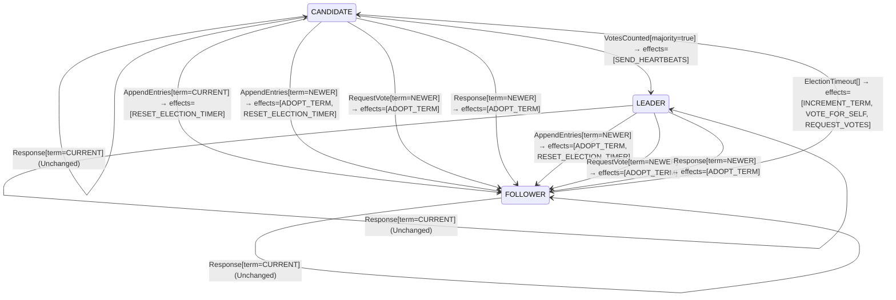

<!-- Generated by examples/demo/tools/build.py from example.json and the verifier's output. Edit example.json. -->
# 063 · A candidate that retries in the same term, proved safe, and shown never to elect a leader

[← All examples](../README.md)

| Verdict | Categories | Severity if shipped | Change | Verified unit | Approach |
|---|---|---|---|---|---|
| **✗ Violation: ALeaderIsElected, 4-step trace then forever (fairness)** | functional | high | feature, behaviour change intended | [`RoleMachine#decide`](../../../examples/demo/apps/quorum/src/main/java/net/terminalvalue/quorum/raft/RoleMachine.java) | [D1: Protocol model checking](../../../examples/demo/apps/quorum/spec/README.md) |

> A Raft candidate whose election timed out starts a new one in a new term. A developer makes it ask again in the same term instead, for the votes it lacks, so that a candidate that cannot win does not drive the whole cluster's term up on every timeout. The contract diff is one case and is approved. The election model proves the change safe under three of its configurations: one leader per term, with three servers, by induction, and with four. The fourth configuration, the liveness check, finds the run the safety proofs cannot see: three servers whose timers fire together are three candidates of term 1, each refused by the other two, and under this rule nothing ever starts term 2. The cluster has no leader, for good. A green safety result says exactly what it checked; the liveness property says the rest.

## The change

Split the `ElectionTimeout` case by role: a follower runs as before; a candidate retries with `REQUEST_VOTES` alone, keeping its term, its vote and its tally. The reasoning in the comment: every retry in a new term forces every server to adopt that term, and a candidate that cannot reach a majority, partitioned or slow, inflates the cluster's term on every timeout (the disruptive server of Ongaro's thesis, section 4.2.3). The behavioural contract is regenerated and its diff is the one case `decide(CANDIDATE, ElectionTimeout[])`, whose effects lose `INCREMENT_TERM` and `VOTE_FOR_SELF`; a test for the new effects is added. The reviewer approves the diff.

**Before** ([`RoleMachine.java`](../../../examples/demo/apps/quorum/src/main/java/net/terminalvalue/quorum/raft/RoleMachine.java), line 36):

```java
public static Decision<Role, RoleEffect> decide(Role role, RoleEvent event) {
    return switch (event) {
        case ElectionTimeout _ -> switch (role) {
            case FOLLOWER, CANDIDATE -> transition(CANDIDATE, INCREMENT_TERM, VOTE_FOR_SELF, REQUEST_VOTES);
            case LEADER -> unchanged("a leader does not hold elections");
        };
        case VotesCounted votes -> switch (role) {
```

**After:**

```java
public static Decision<Role, RoleEffect> decide(Role role, RoleEvent event) {
    return switch (event) {
        case ElectionTimeout _ -> switch (role) {
            case FOLLOWER -> transition(CANDIDATE, INCREMENT_TERM, VOTE_FOR_SELF, REQUEST_VOTES);
            // A candidate whose election timed out asks again for the votes it lacks, in the same term. A new
            // term per retry makes every server in the cluster adopt it, and a candidate that cannot reach a
            // majority would otherwise drive the term up on every timeout.
            case CANDIDATE -> transition(CANDIDATE, REQUEST_VOTES);
            case LEADER -> unchanged("a leader does not hold elections");
        };
        case VotesCounted votes -> switch (role) {
```

<details><summary>Patch</summary>

```diff
--- a/examples/demo/apps/quorum/src/main/java/net/terminalvalue/quorum/raft/RoleMachine.java
+++ b/examples/demo/apps/quorum/src/main/java/net/terminalvalue/quorum/raft/RoleMachine.java
@@ -36,7 +36,11 @@
     public static Decision<Role, RoleEffect> decide(Role role, RoleEvent event) {
         return switch (event) {
             case ElectionTimeout _ -> switch (role) {
-                case FOLLOWER, CANDIDATE -> transition(CANDIDATE, INCREMENT_TERM, VOTE_FOR_SELF, REQUEST_VOTES);
+                case FOLLOWER -> transition(CANDIDATE, INCREMENT_TERM, VOTE_FOR_SELF, REQUEST_VOTES);
+                // A candidate whose election timed out asks again for the votes it lacks, in the same term. A new
+                // term per retry makes every server in the cluster adopt it, and a candidate that cannot reach a
+                // majority would otherwise drive the term up on every timeout.
+                case CANDIDATE -> transition(CANDIDATE, REQUEST_VOTES);
                 case LEADER -> unchanged("a leader does not hold elections");
             };
             case VotesCounted votes -> switch (role) {
--- a/examples/demo/apps/quorum/src/test/java/net/terminalvalue/quorum/raft/RoleMachineTest.java
+++ b/examples/demo/apps/quorum/src/test/java/net/terminalvalue/quorum/raft/RoleMachineTest.java
@@ -32,6 +32,11 @@
                 RoleMachine.decide(Role.LEADER, new RoleEvent.AppendEntries(TermOrder.NEWER)));
     }
 
+    public static void candidateRetriesInItsTerm() {
+        equal(new Transition<>(Role.CANDIDATE, List.of(RoleEffect.REQUEST_VOTES)),
+                RoleMachine.decide(Role.CANDIDATE, new RoleEvent.ElectionTimeout()));
+    }
+
     public static void staleLeaderIsRejected() {
         check(RoleMachine.decide(Role.FOLLOWER, new RoleEvent.AppendEntries(TermOrder.OLDER)) instanceof Decision.Rejected, "stale");
     }
```

</details>

## What the verifier found

The model is checked under 5 configurations, and the verdict is the first that fails:

| Configuration | What it checks | Model | Result |
|---|---|---|---|
| three servers (`spec/RaftElection.cfg`) | every run from the initial state, every interleaving within the configuration's bounds | Servers = {s1, s2, s3}, MaxTerm = 3, LeftBehind = {} | ✓ Verified: all invariants and properties hold in 464 states |
| the inductive step (`spec/RaftElectionInductive.cfg`) | that the invariant `Inductive` is inductive: TLC starts from every state the invariant admits, reachable or not, rather than from the initial state, takes one step, and checks the invariant again, conjunct by conjunct. No counterexample is a proof of election safety by induction, for any run of the cluster however long; a counterexample is one step from a state that need not be reachable | Servers = {s1, s2, s3}, MaxTerm = 3, LeftBehind = {} | ✓ Verified: all invariants and properties hold in 17,470 states |
| four servers (`spec/RaftElectionFour.cfg`) | every run with four servers, a cluster in which a candidate can hold a vote besides its own and still be short of a majority, which three servers never show; under a symmetry set, so that of the states that differ only by the servers' names TLC explores one | Servers = {s1, s2, s3, s4}, MaxTerm = 3, LeftBehind = {} | ✓ Verified: all invariants and properties hold in 496 states |
| fairness (`spec/RaftElectionLive.cfg`) | the two liveness properties, under the fairness conditions `Fairness`: a server whose timer nothing resets times out, a candidate asks for the votes it lacks, a leader sends its heartbeats. A counterexample is a run that goes on forever without satisfying a property: a prefix, then a state or a cycle the system never leaves | Servers = {s1, s2, s3}, MaxTerm = 3, LeftBehind = {} | ✗ Violation: ALeaderIsElected, 4-step trace then forever |
| a server left behind (`spec/RaftElectionLogs.cfg`) | the election restriction: one server holds the log a deposed leader of term 1 left behind, three entries of its term, while the other two hold an entry of term 2 that a majority holds and is therefore committed, so that the longer log is the one behind; every run with these logs, which nothing changes, under the invariant `LeaderCompleteness` besides the usual ones | Servers = {s1, s2, s3}, MaxTerm = 3, LeftBehind = {s1} | ✓ Verified: all invariants and properties hold in 332 states |

TLC found a run of the system under fairness that violates the temporal property **ALeaderIsElected** (a run that stays within the term budget elects a leader: with no leader every server's timer keeps firing, and each firing starts a term, so a run in which the terms stop and no leader comes is a cluster that has stopped trying): after the 4 steps below, the system stays in that state forever, and the property never comes true. The run respects every fairness condition the model assumes; the parts that could act, do. Each step is one action of one part of the system:

1. **Initial state**: every server a follower in term 0, no vote cast, no vote held.
2. **Timeout**, `Server.onElectionTimeout`: a server's election timer fires, and the server acts on the role machine's decision. `currentTerm = (s1 :> 0 @@ s2 :> 0 @@ s3 :> 1)`, `role = (s1 :> "FOLLOWER" @@ s2 :> "FOLLOWER" @@ s3 :> "CANDIDATE")`, `votedFor = (s1 :> "none" @@ s2 :> "none" @@ s3 :> s3)`, `votes = (s1 :> {} @@ s2 :> {} @@ s3 :> {s3})`
3. **Timeout**, `Server.onElectionTimeout`: a server's election timer fires, and the server acts on the role machine's decision. `currentTerm = (s1 :> 1 @@ s2 :> 0 @@ s3 :> 1)`, `role = (s1 :> "CANDIDATE" @@ s2 :> "FOLLOWER" @@ s3 :> "CANDIDATE")`, `votedFor = (s1 :> s1 @@ s2 :> "none" @@ s3 :> s3)`, `votes = (s1 :> {s1} @@ s2 :> {} @@ s3 :> {s3})`
4. **Timeout**, `Server.onElectionTimeout`: a server's election timer fires, and the server acts on the role machine's decision. `currentTerm = (s1 :> 1 @@ s2 :> 1 @@ s3 :> 1)`, `role = (s1 :> "CANDIDATE" @@ s2 :> "CANDIDATE" @@ s3 :> "CANDIDATE")`, `votedFor = (s1 :> s1 @@ s2 :> s2 @@ s3 :> s3)`, `votes = (s1 :> {s1} @@ s2 :> {s2} @@ s3 :> {s3})`

The model is small (Servers = {s1, s2, s3}, MaxTerm = 3, LeftBehind = {}), which is what keeps the trace readable. TLC explored every interleaving of the servers, their terms and votes, and the RPCs between them within those bounds.

The state machine the patched code implements, drawn from its derived contract (`jvmcontract statemachine`); a state with no way in or no way out is marked:



## Would the existing tests have caught it?

No: every existing unit test passes (`java -ea net.terminalvalue.quorum.Tests`, run against the patched code).

## Why it matters

Safety is intact, and the model proves it: the candidate keeps its term, its vote and a tally whose votes were all cast in that term, so nothing it counts is stale and nothing it does lets anyone vote twice. What is lost is the one thing a new term is for. Raft resolves a split vote, two or more candidates of one term that each hold their own vote and cannot reach a majority, by having each start a new election in a new term after a randomized timeout, so that one of them is first to ask a cluster whose votes are free again (section 5.2). Under this rule the candidates of a split term ask the same servers for the same votes, already cast, forever; nothing increments the term until a follower's timer fires, and in a cluster where every server is a candidate there is no follower. Three servers that time out together are a cluster with no leader, for good. That is a liveness failure: no state is wrong, no step is wrong, and the run never ends. An invariant cannot say it, an action property cannot say it, and the inductive invariant cannot say it; only a property of whole runs can, and the model has two, checked under fairness conditions that say what each server is assumed to get round to.

## Why the verdict is right

The election model's role machine is generated from the behavioural contract of the patched `RoleMachine#decide`, which the tool proves the bytecode satisfies on all 52 inputs. Under three servers and three terms every invariant and both action properties hold, and there are fewer reachable states than with the committed rule, since a candidate no longer leaves its term on its own; the inductive step holds, since a candidate's retry changes nothing the invariant mentions; four servers under the symmetry set hold too. The liveness configuration checks the same three-server model under the fairness conditions `Fairness` (a server whose timer nothing resets times out, a candidate asks for the votes it lacks, a leader sends its heartbeats) and finds a run that breaks `ALeaderIsElected`, the property that a run which stays within the term budget elects a leader: s3's timer fires, then s1's, then s2's, each starting term 1 with a vote for itself, and the run stays in that state forever (TLC's `Stuttering`). Every term is 1, well within the budget; no leader ever comes. Fairness demands nothing more of it: each candidate's retry is a step that changes nothing, so no timer is enabled in the sense that matters, and each canvass is refused, since every vote of term 1 is cast. With the committed rule the same three timers firing together start term 2 on the next timeout, and the first candidate to ask a server whose vote is free again wins. TLC names the property after rerunning each temporal property alone.

## What to do

Revert. The rule the developer wanted is pre-vote (thesis, sections 4.2.3 and 9.6): a candidate first asks whether it could win, without incrementing its term, and starts the election only if a majority says yes, which spares the cluster the term inflation without touching the retry. The liveness property is the one to keep in mind for any retry rule: a retry that does not start a new term cannot end a split vote, because the votes of the split term are cast. What the property does not say is also worth reading: it is conditioned on the term budget, because a model without a clock cannot show that a leader comes within any number of terms (every term can split, and Raft's answer is randomized timeouts), and it holds under the fairness conditions stated with it and no others. The example sits next to 062, where the three safety configurations find a bug, and 064, where all four configurations hold.

## Evidence

How the verdict was reached: three servers: TLC 2.19 explored 464 distinct states to depth 10 in 0 s, for the model Servers = {s1, s2, s3}, MaxTerm = 3, LeftBehind = {}; the inductive step: TLC 2.19 explored 17,470 distinct states to depth 1 in 3 s, for the model Servers = {s1, s2, s3}, MaxTerm = 3, LeftBehind = {}; four servers: TLC 2.19 explored 496 distinct states to depth 12 in 0 s, for the model Servers = {s1, s2, s3, s4}, MaxTerm = 3, LeftBehind = {}; fairness: TLC 2.19 explored 464 distinct states in 0 s, for the model Servers = {s1, s2, s3}, MaxTerm = 3, LeftBehind = {}; a server left behind: TLC 2.19 explored 332 distinct states to depth 10 in 0 s, for the model Servers = {s1, s2, s3}, MaxTerm = 3, LeftBehind = {s1}.

<details><summary>Verifier output</summary>

```text
== three servers: spec/RaftElection.cfg ==
TLC2 Version 2.19 of 08 August 2024 (rev: 5a47802)
Running breadth-first search Model-Checking with fp 1 and seed 1 with 1 worker on 8 cores with 910MB heap and 64MB offheap memory [pid: 2172925] (Linux 6.6.87.2-microsoft-standard-WSL2 aarch64, Eclipse Adoptium 25.0.4.1 x86_64, MSBDiskFPSet, DiskStateQueue).
Parsing file examples/demo/apps/quorum/spec/RaftElection.tla
Parsing file examples/demo/tools/tla/standard-modules/Naturals.tla
Parsing file examples/demo/tools/tla/standard-modules/FiniteSets.tla
Parsing file examples/demo/tools/tla/standard-modules/Sequences.tla
Parsing file examples/demo/tools/tla/standard-modules/TLC.tla
Parsing file examples/demo/apps/quorum/spec/RoleMachineContract.tla
Parsing file examples/demo/apps/quorum/spec/VoteRuleContract.tla
Semantic processing of module Naturals
Semantic processing of module Sequences
Semantic processing of module FiniteSets
Semantic processing of module TLC
Semantic processing of module RoleMachineContract
Semantic processing of module VoteRuleContract
Semantic processing of module RaftElection
Starting... (2026-11-02 00:59:22)
Computing initial states...
Finished computing initial states: 1 distinct state generated at 2026-11-02 00:59:22.
Model checking completed. No error has been found.
  Estimates of the probability that TLC did not check all reachable states
  because two distinct states had the same fingerprint:
  calculated (optimistic):  val = 5.1E-14
2500 states generated, 464 distinct states found, 0 states left on queue.
The depth of the complete state graph search is 10.
The average outdegree of the complete state graph is 1 (minimum is 0, the maximum 5 and the 95th percentile is 3).
Finished in 00s at (2026-11-02 00:59:22)

== the inductive step: spec/RaftElectionInductive.cfg ==
TLC2 Version 2.19 of 08 August 2024 (rev: 5a47802)
Running breadth-first search Model-Checking with fp 1 and seed 1 with 1 worker on 8 cores with 910MB heap and 64MB offheap memory [pid: 2173009] (Linux 6.6.87.2-microsoft-standard-WSL2 aarch64, Eclipse Adoptium 25.0.4.1 x86_64, MSBDiskFPSet, DiskStateQueue).
Parsing file examples/demo/apps/quorum/spec/RaftElection.tla
Parsing file examples/demo/tools/tla/standard-modules/Naturals.tla
Parsing file examples/demo/tools/tla/standard-modules/FiniteSets.tla
Parsing file examples/demo/tools/tla/standard-modules/Sequences.tla
Parsing file examples/demo/tools/tla/standard-modules/TLC.tla
Parsing file examples/demo/apps/quorum/spec/RoleMachineContract.tla
Parsing file examples/demo/apps/quorum/spec/VoteRuleContract.tla
Semantic processing of module Naturals
Semantic processing of module Sequences
Semantic processing of module FiniteSets
Semantic processing of module TLC
Semantic processing of module RoleMachineContract
Semantic processing of module VoteRuleContract
Semantic processing of module RaftElection
Starting... (2026-11-02 00:59:23)
Computing initial states...
Computed 2 initial states...
Computed 4 initial states...
Computed 8 initial states...
Computed 16 initial states...
Computed 32 initial states...
Computed 64 initial states...
Computed 128 initial states...
Computed 256 initial states...
Computed 512 initial states...
Computed 1024 initial states...
Computed 2048 initial states...
Computed 4096 initial states...
Computed 8192 initial states...
Computed 16384 initial states...
Finished computing initial states: 17470 distinct states generated at 2026-11-02 00:59:26.
Model checking completed. No error has been found.
  Estimates of the probability that TLC did not check all reachable states
  because two distinct states had the same fingerprint:
  calculated (optimistic):  val = 5.6E-11
76099 states generated, 17470 distinct states found, 0 states left on queue.
The depth of the complete state graph search is 1.
The average outdegree of the complete state graph is 0 (minimum is 0, the maximum 0 and the 95th percentile is 0).
Finished in 03s at (2026-11-02 00:59:27)

== four servers: spec/RaftElectionFour.cfg ==
TLC2 Version 2.19 of 08 August 2024 (rev: 5a47802)
Running breadth-first search Model-Checking with fp 1 and seed 1 with 1 worker on 8 cores with 910MB heap and 64MB offheap memory [pid: 2173280] (Linux 6.6.87.2-microsoft-standard-WSL2 aarch64, Eclipse Adoptium 25.0.4.1 x86_64, MSBDiskFPSet, DiskStateQueue).
Parsing file examples/demo/apps/quorum/spec/RaftElection.tla
Parsing file examples/demo/tools/tla/standard-modules/Naturals.tla
Parsing file examples/demo/tools/tla/standard-modules/FiniteSets.tla
Parsing file examples/demo/tools/tla/standard-modules/Sequences.tla
Parsing file examples/demo/tools/tla/standard-modules/TLC.tla
Parsing file examples/demo/apps/quorum/spec/RoleMachineContract.tla
Parsing file examples/demo/apps/quorum/spec/VoteRuleContract.tla
Semantic processing of module Naturals
Semantic processing of module Sequences
Semantic processing of module FiniteSets
Semantic processing of module TLC
Semantic processing of module RoleMachineContract
Semantic processing of module VoteRuleContract
Semantic processing of module RaftElection
Starting... (2026-11-02 00:59:28)
Computing initial states...
Finished computing initial states: 1 distinct state generated at 2026-11-02 00:59:28.
Model checking completed. No error has been found.
  Estimates of the probability that TLC did not check all reachable states
  because two distinct states had the same fingerprint:
  calculated (optimistic):  val = 9.9E-14
4165 states generated, 496 distinct states found, 0 states left on queue.
The depth of the complete state graph search is 12.
The average outdegree of the complete state graph is 1 (minimum is 0, the maximum 7 and the 95th percentile is 4).
Finished in 00s at (2026-11-02 00:59:28)

== fairness: spec/RaftElectionLive.cfg ==
TLC2 Version 2.19 of 08 August 2024 (rev: 5a47802)
Running breadth-first search Model-Checking with fp 1 and seed 1 with 1 worker on 8 cores with 910MB heap and 64MB offheap memory [pid: 2173669] (Linux 6.6.87.2-microsoft-standard-WSL2 aarch64, Eclipse Adoptium 25.0.4.1 x86_64, MSBDiskFPSet, DiskStateQueue).
Parsing file examples/demo/apps/quorum/spec/RaftElection.tla
Parsing file examples/demo/tools/tla/standard-modules/Naturals.tla
Parsing file examples/demo/tools/tla/standard-modules/FiniteSets.tla
Parsing file examples/demo/tools/tla/standard-modules/Sequences.tla
Parsing file examples/demo/tools/tla/standard-modules/TLC.tla
Parsing file examples/demo/apps/quorum/spec/RoleMachineContract.tla
Parsing file examples/demo/apps/quorum/spec/VoteRuleContract.tla
Semantic processing of module Naturals
Semantic processing of module Sequences
Semantic processing of module FiniteSets
Semantic processing of module TLC
Semantic processing of module RoleMachineContract
Semantic processing of module VoteRuleContract
Semantic processing of module RaftElection
Starting... (2026-11-02 00:59:33)
Implied-temporal checking--satisfiability problem has 1 branches.
Computing initial states...
Finished computing initial states: 1 distinct state generated at 2026-11-02 00:59:33.
Checking temporal properties for the complete state space with 464 total distinct states at (2026-11-02 00:59:34)
Error: Temporal properties were violated.

Error: The following behavior constitutes a counter-example:

State 1: <Initial predicate>
/\ currentTerm = (s1 :> 0 @@ s2 :> 0 @@ s3 :> 0)
/\ votes = (s1 :> {} @@ s2 :> {} @@ s3 :> {})
/\ role = (s1 :> "FOLLOWER" @@ s2 :> "FOLLOWER" @@ s3 :> "FOLLOWER")
/\ votedFor = (s1 :> "none" @@ s2 :> "none" @@ s3 :> "none")

State 2: <Timeout line 119, col 15 to line 119, col 88 of module RaftElection>
/\ currentTerm = (s1 :> 0 @@ s2 :> 0 @@ s3 :> 1)
/\ votes = (s1 :> {} @@ s2 :> {} @@ s3 :> {s3})
/\ role = (s1 :> "FOLLOWER" @@ s2 :> "FOLLOWER" @@ s3 :> "CANDIDATE")
/\ votedFor = (s1 :> "none" @@ s2 :> "none" @@ s3 :> s3)

State 3: <Timeout line 119, col 15 to line 119, col 88 of module RaftElection>
/\ currentTerm = (s1 :> 1 @@ s2 :> 0 @@ s3 :> 1)
/\ votes = (s1 :> {s1} @@ s2 :> {} @@ s3 :> {s3})
/\ role = (s1 :> "CANDIDATE" @@ s2 :> "FOLLOWER" @@ s3 :> "CANDIDATE")
/\ votedFor = (s1 :> s1 @@ s2 :> "none" @@ s3 :> s3)

State 4: <Timeout line 119, col 15 to line 119, col 88 of module RaftElection>
/\ currentTerm = (s1 :> 1 @@ s2 :> 1 @@ s3 :> 1)
/\ votes = (s1 :> {s1} @@ s2 :> {s2} @@ s3 :> {s3})
/\ role = (s1 :> "CANDIDATE" @@ s2 :> "CANDIDATE" @@ s3 :> "CANDIDATE")
/\ votedFor = (s1 :> s1 @@ s2 :> s2 @@ s3 :> s3)

State 5: Stuttering
Finished checking temporal properties in 00s at 2026-11-02 00:59:34
2500 states generated, 464 distinct states found, 0 states left on queue.
Finished in 00s at (2026-11-02 00:59:34)
(jvmcontract checked the temporal properties one at a time to name the violated one: ALeaderIsElected)

== a server left behind: spec/RaftElectionLogs.cfg ==
TLC2 Version 2.19 of 08 August 2024 (rev: 5a47802)
Running breadth-first search Model-Checking with fp 1 and seed 1 with 1 worker on 8 cores with 910MB heap and 64MB offheap memory [pid: 2173776] (Linux 6.6.87.2-microsoft-standard-WSL2 aarch64, Eclipse Adoptium 25.0.4.1 x86_64, MSBDiskFPSet, DiskStateQueue).
Parsing file examples/demo/apps/quorum/spec/RaftElection.tla
Parsing file examples/demo/tools/tla/standard-modules/Naturals.tla
Parsing file examples/demo/tools/tla/standard-modules/FiniteSets.tla
Parsing file examples/demo/tools/tla/standard-modules/Sequences.tla
Parsing file examples/demo/tools/tla/standard-modules/TLC.tla
Parsing file examples/demo/apps/quorum/spec/RoleMachineContract.tla
Parsing file examples/demo/apps/quorum/spec/VoteRuleContract.tla
Semantic processing of module Naturals
Semantic processing of module Sequences
Semantic processing of module FiniteSets
Semantic processing of module TLC
Semantic processing of module RoleMachineContract
Semantic processing of module VoteRuleContract
Semantic processing of module RaftElection
Starting... (2026-11-02 00:59:34)
Computing initial states...
Finished computing initial states: 1 distinct state generated at 2026-11-02 00:59:34.
Model checking completed. No error has been found.
  Estimates of the probability that TLC did not check all reachable states
  because two distinct states had the same fingerprint:
  calculated (optimistic):  val = 2.7E-14
1808 states generated, 332 distinct states found, 0 states left on queue.
The depth of the complete state graph search is 10.
The average outdegree of the complete state graph is 1 (minimum is 0, the maximum 5 and the 95th percentile is 3).
Finished in 00s at (2026-11-02 00:59:35)
```

</details>

<details><summary>SARIF report (as uploaded to GitHub code scanning or SonarQube)</summary>

```json
{
  "version": "2.1.0",
  "$schema": "https://json.schemastore.org/sarif-2.1.0.json",
  "runs": [
    {
      "tool": {
        "driver": {
          "name": "jvmcontract tlc",
          "rules": [
            {
              "id": "invariant-violated",
              "shortDescription": {
                "text": "TLC found a behaviour of the model that violates an invariant or a temporal property, or ends in a deadlock."
              }
            },
            {
              "id": "unverifiable",
              "shortDescription": {
                "text": "TLC could not check the model."
              }
            }
          ]
        }
      },
      "results": [
        {
          "ruleId": "invariant-violated",
          "level": "error",
          "message": {
            "text": "Temporal property ALeaderIsElected of spec/RaftElection.tla (fairness) is violated: after 4 steps the system stays in that state forever"
          },
          "locations": [
            {
              "physicalLocation": {
                "artifactLocation": {
                  "uri": "examples/demo/apps/quorum/src/main/java/net/terminalvalue/quorum/raft/RoleMachine.java"
                },
                "region": {
                  "startLine": 36
                }
              }
            }
          ]
        }
      ]
    }
  ]
}
```

</details>

**Provenance:** Constructed from the rules for candidates in figure 2 of the Raft paper, by keeping the term on a candidate's retry.

- [Ongaro and Ousterhout, In Search of an Understandable Consensus Algorithm (2014): figure 2, the rules for candidates, and section 5.2, leader election and split votes](https://raft.github.io/raft.pdf)
- [Ongaro, Consensus: Bridging Theory and Practice (2014): chapter 3, the basic algorithm, and section 4.2.3, disruptive servers](https://web.stanford.edu/~ouster/cgi-bin/papers/OngaroPhD.pdf)
- [Lamport, Specifying Systems, chapter 8: liveness and fairness, and section 14.3.5, checking liveness with TLC](https://lamport.azurewebsites.net/tla/book.html)
- [Lamport, Using TLC to Check Inductive Invariance (2018): the invariant as TLC's initial predicate](https://lamport.azurewebsites.net/tla/inductive-invariant.pdf)
## Reproduce

```bash
python3 examples/demo/tools/build.py 063
```

This applies `change.patch` to a temporary copy of the repo, runs the verifier on it, and rewrites this page.
