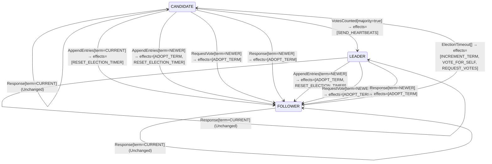

<!-- Generated by examples/demo/tools/build.py from example.json and the verifier's output. Edit example.json. -->
# 066 · A leader that treats a vote request of its own term as impossible crashes on a split vote

[← All examples](../README.md)

| Verdict | Categories | Severity if shipped | Change | Verified unit | Approach |
|---|---|---|---|---|---|
| **✗ Violation: KernelNeverThrows, 4-step trace** | functional | high | refactor, behaviour change intended | [`RoleMachine#decide`](../../../examples/demo/apps/quorum/src/main/java/net/terminalvalue/quorum/raft/RoleMachine.java) | [D1: Protocol model checking](../../../examples/demo/apps/quorum/spec/README.md) |

> The Raft role machine throws on one input, a leader hearing a leader of its own term, because election safety says it cannot happen. A developer extends the reasoning to vote requests: a candidate campaigning in a term that already has a leader is just as impossible, so a leader throws on a vote request of its own term too. The contract diff is one case, from unchanged to an exception, and is approved; the input is covered by a new test, which checks that it throws. The election model has an invariant for exactly this claim, that no input the protocol can deliver makes the role machine throw, and it fails in four steps: two servers time out into term 1, one wins with the third's vote, and the other, still a candidate of term 1, asks the new leader for its vote. A split vote makes the exception reachable, and the leader crashes on the loser's request.

## The change

Rewrite the `RequestVote` case as a switch on the request's term: `NEWER` adopts the term as before, `OLDER` is unchanged as before, and `CURRENT` is unchanged for a follower or candidate but throws `IllegalStateException` for a leader. The reasoning in the comment: a term has at most one leader, and its heartbeats keep every other server a follower, so a request for a vote in the leader's own term is as impossible as a second leader's heartbeat, which the role machine already treats as an error. The behavioural contract is regenerated and its diff is the one case `decide(LEADER, RequestVote[term=CURRENT])`, from unchanged to the exception; a test checks that it throws. The reviewer approves the diff: the existing exception for two leaders has the same shape.

**Before** ([`RoleMachine.java`](../../../examples/demo/apps/quorum/src/main/java/net/terminalvalue/quorum/raft/RoleMachine.java), line 52):

```java
    };
    case OLDER -> rejected("stale leader");
};
case RequestVote vote -> vote.term() == NEWER
        ? transition(FOLLOWER, ADOPT_TERM)
        : unchanged("the vote itself is decided by the vote rule");
case Response response -> response.term() == NEWER
        ? transition(FOLLOWER, ADOPT_TERM)
        : unchanged("a reply from the current or an older term changes no role");
```

**After:**

```java
    };
    case OLDER -> rejected("stale leader");
};
case RequestVote vote -> switch (vote.term()) {
    case NEWER -> transition(FOLLOWER, ADOPT_TERM);
    // A term has one leader at most, and its heartbeats keep every other server a follower: a vote
    // request of the leader's own term cannot happen, any more than a second leader's heartbeat can.
    case CURRENT -> switch (role) {
        case LEADER -> throw new IllegalStateException("a candidate in a term that has a leader");
        case FOLLOWER, CANDIDATE -> unchanged("the vote itself is decided by the vote rule");
    };
    case OLDER -> unchanged("the vote itself is decided by the vote rule");
};
case Response response -> response.term() == NEWER
        ? transition(FOLLOWER, ADOPT_TERM)
        : unchanged("a reply from the current or an older term changes no role");
```

<details><summary>Patch</summary>

```diff
--- a/examples/demo/apps/quorum/src/main/java/net/terminalvalue/quorum/raft/RoleMachine.java
+++ b/examples/demo/apps/quorum/src/main/java/net/terminalvalue/quorum/raft/RoleMachine.java
@@ -52,9 +52,16 @@
                 };
                 case OLDER -> rejected("stale leader");
             };
-            case RequestVote vote -> vote.term() == NEWER
-                    ? transition(FOLLOWER, ADOPT_TERM)
-                    : unchanged("the vote itself is decided by the vote rule");
+            case RequestVote vote -> switch (vote.term()) {
+                case NEWER -> transition(FOLLOWER, ADOPT_TERM);
+                // A term has one leader at most, and its heartbeats keep every other server a follower: a vote
+                // request of the leader's own term cannot happen, any more than a second leader's heartbeat can.
+                case CURRENT -> switch (role) {
+                    case LEADER -> throw new IllegalStateException("a candidate in a term that has a leader");
+                    case FOLLOWER, CANDIDATE -> unchanged("the vote itself is decided by the vote rule");
+                };
+                case OLDER -> unchanged("the vote itself is decided by the vote rule");
+            };
             case Response response -> response.term() == NEWER
                     ? transition(FOLLOWER, ADOPT_TERM)
                     : unchanged("a reply from the current or an older term changes no role");
--- a/examples/demo/apps/quorum/src/test/java/net/terminalvalue/quorum/raft/RoleMachineTest.java
+++ b/examples/demo/apps/quorum/src/test/java/net/terminalvalue/quorum/raft/RoleMachineTest.java
@@ -32,6 +32,15 @@
                 RoleMachine.decide(Role.LEADER, new RoleEvent.AppendEntries(TermOrder.NEWER)));
     }
 
+    public static void leaderTreatsACampaignInItsTermAsImpossible() {
+        try {
+            RoleMachine.decide(Role.LEADER, new RoleEvent.RequestVote(TermOrder.CURRENT));
+        } catch (IllegalStateException expected) {
+            return;
+        }
+        throw new AssertionError("expected an IllegalStateException");
+    }
+
     public static void staleLeaderIsRejected() {
         check(RoleMachine.decide(Role.FOLLOWER, new RoleEvent.AppendEntries(TermOrder.OLDER)) instanceof Decision.Rejected, "stale");
     }
```

</details>

## What the verifier found

The model is checked under 4 configurations, and the verdict is the first that fails:

| Configuration | What it checks | Model | Result |
|---|---|---|---|
| three servers (`spec/RaftElection.cfg`) | every run from the initial state, every interleaving within the configuration's bounds | Servers = {s1, s2, s3}, MaxTerm = 3 | ✗ Violation: KernelNeverThrows, 4-step trace |
| the inductive step (`spec/RaftElectionInductive.cfg`) | that the invariant `Inductive` is inductive: TLC starts from every state the invariant admits, reachable or not, rather than from the initial state, takes one step, and checks the invariant again, conjunct by conjunct. No counterexample is a proof of election safety by induction, for any run of the cluster however long; a counterexample is one step from a state that need not be reachable | Servers = {s1, s2, s3}, MaxTerm = 3 | ✗ Violation: KernelNeverThrows, violated by a starting state |
| four servers (`spec/RaftElectionFour.cfg`) | every run with four servers, a cluster in which a candidate can hold a vote besides its own and still be short of a majority, which three servers never show; under a symmetry set, so that of the states that differ only by the servers' names TLC explores one | Servers = {s1, s2, s3, s4}, MaxTerm = 3 | ✗ Violation: KernelNeverThrows, 5-step trace |
| fairness (`spec/RaftElectionLive.cfg`) | the two liveness properties, under the fairness conditions `Fairness`: a server whose timer nothing resets times out, a candidate asks for the votes it lacks, a leader sends its heartbeats. A counterexample is a run that goes on forever without satisfying a property: a prefix, then a state or a cycle the system never leaves | Servers = {s1, s2, s3}, MaxTerm = 3 | ✗ Violation: KernelNeverThrows, 4-step trace |

TLC found a run of the system under three servers, 4 steps long, that violates the invariant **KernelNeverThrows** (no timeout or RPC any reachable state allows makes the role machine throw: the IllegalStateException the Java reserves for an input it holds impossible never fires). Each step is one action of one part of the system:

1. **Initial state**: every server a follower in term 0, no vote cast, no vote held.
2. **Timeout**, `Server.onElectionTimeout`: a server's election timer fires, and the server acts on the role machine's decision. `currentTerm = (s1 :> 1 @@ s2 :> 0 @@ s3 :> 0)`, `role = (s1 :> "CANDIDATE" @@ s2 :> "FOLLOWER" @@ s3 :> "FOLLOWER")`, `votedFor = (s1 :> s1 @@ s2 :> "none" @@ s3 :> "none")`, `votes = (s1 :> {s1} @@ s2 :> {} @@ s3 :> {})`
3. **Timeout**, `Server.onElectionTimeout`: a server's election timer fires, and the server acts on the role machine's decision. `currentTerm = (s1 :> 1 @@ s2 :> 1 @@ s3 :> 0)`, `role = (s1 :> "CANDIDATE" @@ s2 :> "CANDIDATE" @@ s3 :> "FOLLOWER")`, `votedFor = (s1 :> s1 @@ s2 :> s2 @@ s3 :> "none")`, `votes = (s1 :> {s1} @@ s2 :> {s2} @@ s3 :> {})`
4. **Canvass**, `Server.requestVote`: a candidate asks one server for its vote and gets the answer; the request and the reply each go through the role machine, then the vote rule on the voter and the tally on the candidate. `currentTerm = (s1 :> 1 @@ s2 :> 1 @@ s3 :> 1)`, `role = (s1 :> "LEADER" @@ s2 :> "CANDIDATE" @@ s3 :> "FOLLOWER")`, `votedFor = (s1 :> s1 @@ s2 :> s2 @@ s3 :> s1)`, `votes = (s1 :> {s1, s3} @@ s2 :> {s2} @@ s3 :> {})`

The model is small (Servers = {s1, s2, s3}, MaxTerm = 3), which is what keeps the trace readable. TLC explored every interleaving of the servers, their terms and votes, and the RPCs between them within those bounds.

<details><summary>The counterexample under the inductive step: invariant <b>KernelNeverThrows</b>, a starting state</summary>

Invariant **KernelNeverThrows**: no timeout or RPC any reachable state allows makes the role machine throw: the IllegalStateException the Java reserves for an input it holds impossible never fires.

1. **Starting state**, a state the invariant `Inductive` admits, which need not be reachable: `currentTerm = (s1 :> 1 @@ s2 :> 1 @@ s3 :> 1)`, `role = (s1 :> "FOLLOWER" @@ s2 :> "CANDIDATE" @@ s3 :> "LEADER")`, `votedFor = (s1 :> s3 @@ s2 :> s2 @@ s3 :> s3)`, `votes = (s1 :> {} @@ s2 :> {s2} @@ s3 :> {s1, s3})`

</details>

<details><summary>The counterexample under four servers: invariant <b>KernelNeverThrows</b>, 5 steps</summary>

Invariant **KernelNeverThrows**: no timeout or RPC any reachable state allows makes the role machine throw: the IllegalStateException the Java reserves for an input it holds impossible never fires.

1. **Initial state**: every server a follower in term 0, no vote cast, no vote held.
2. **Timeout**, `Server.onElectionTimeout`: a server's election timer fires, and the server acts on the role machine's decision. `currentTerm = (s1 :> 1 @@ s2 :> 0 @@ s3 :> 0 @@ s4 :> 0)`, `role = (s1 :> "CANDIDATE" @@ s2 :> "FOLLOWER" @@ s3 :> "FOLLOWER" @@ s4 :> "FOLLOWER")`, `votedFor = (s1 :> s1 @@ s2 :> "none" @@ s3 :> "none" @@ s4 :> "none")`, `votes = (s1 :> {s1} @@ s2 :> {} @@ s3 :> {} @@ s4 :> {})`
3. **Timeout**, `Server.onElectionTimeout`: a server's election timer fires, and the server acts on the role machine's decision. `currentTerm = (s1 :> 1 @@ s2 :> 1 @@ s3 :> 0 @@ s4 :> 0)`, `role = (s1 :> "CANDIDATE" @@ s2 :> "CANDIDATE" @@ s3 :> "FOLLOWER" @@ s4 :> "FOLLOWER")`, `votedFor = (s1 :> s1 @@ s2 :> s2 @@ s3 :> "none" @@ s4 :> "none")`, `votes = (s1 :> {s1} @@ s2 :> {s2} @@ s3 :> {} @@ s4 :> {})`
4. **Canvass**, `Server.requestVote`: a candidate asks one server for its vote and gets the answer; the request and the reply each go through the role machine, then the vote rule on the voter and the tally on the candidate. `currentTerm = (s1 :> 1 @@ s2 :> 1 @@ s3 :> 1 @@ s4 :> 0)`, `votedFor = (s1 :> s1 @@ s2 :> s2 @@ s3 :> s1 @@ s4 :> "none")`, `votes = (s1 :> {s1, s3} @@ s2 :> {s2} @@ s3 :> {} @@ s4 :> {})`
5. **Canvass**, `Server.requestVote`: a candidate asks one server for its vote and gets the answer; the request and the reply each go through the role machine, then the vote rule on the voter and the tally on the candidate. `currentTerm = (s1 :> 1 @@ s2 :> 1 @@ s3 :> 1 @@ s4 :> 1)`, `role = (s1 :> "LEADER" @@ s2 :> "CANDIDATE" @@ s3 :> "FOLLOWER" @@ s4 :> "FOLLOWER")`, `votedFor = (s1 :> s1 @@ s2 :> s2 @@ s3 :> s1 @@ s4 :> s1)`, `votes = (s1 :> {s1, s3, s4} @@ s2 :> {s2} @@ s3 :> {} @@ s4 :> {})`

</details>

Under fairness TLC found the same run, and reported it the same way.

The state machine the patched code implements, drawn from its derived contract (`jvmcontract statemachine`); a state with no way in or no way out is marked:



## Would the existing tests have caught it?

No: every existing unit test passes (`java -ea net.terminalvalue.quorum.Tests`, run against the patched code).

## Why it matters

An exception in a decision kernel is a claim about the protocol: this input does not occur. The claim behind the existing exception is election safety, one leader per term, which the model proves. The claim behind the new one is false. Raft elects a leader out of split votes: two servers time out together, each votes for itself, and one of them collects a majority first. The one that lost is still a candidate of that term, asking the servers it has not asked, until the leader's heartbeat turns it back into a follower, and the leader itself is one of the servers it asks. Every split vote in which the loser's request reaches the leader before the leader's heartbeat reaches the loser throws inside the leader's RPC handler, and a leader that crashes on a common event leaves the cluster without one. The new test checks what the developer intends, that the input throws; no test asks whether the protocol delivers the input, and the reviewer, reading a one-case contract diff next to an exception of the same shape, has no reason to think it does.

## Why the verdict is right

The model's actions take no step whose role-machine decision throws, and the invariant `KernelNeverThrows` says there is never such a step to take: for every timer a server may have and every RPC a server may send in a reachable state, the decisions on both ends are not `Throws`. On the committed kernel the only throwing row is a leader's heartbeat to a leader of the same term, and the invariant holds in all 610 states by election safety: the exception is dead at the protocol level, which the model proves rather than assumes. On the patched kernel TLC reports a four-step run with three servers: s1 and s2 time out, so both are candidates of term 1 with their own vote; s3 grants s1 its vote, and s1 leads term 1; s2 is a candidate of term 1 with one vote left to ask for, s1's, and s1 is a leader of term 1. The request is the input the developer held impossible, and the invariant names the state in which the protocol delivers it. The inductive configuration starts from every state the invariant `Inductive` admits and finds one that violates `KernelNeverThrows` before any step is taken, a leader and a candidate of one term: nothing among the reasons for election safety rules out a candidate alongside a leader, since election safety is about leaders. Four servers reach the same kind of state, and the liveness configuration reports the same run as the first before it gets to the temporal properties.

## What to do

Revert to `unchanged`: the vote itself is the vote rule's to decide, and a leader of the same term refuses it, having voted for itself. The existing exception keeps its proof, and `KernelNeverThrows` stays in all four configurations, so the next input a developer holds impossible is checked against every run of the cluster before it is merged. An `IllegalStateException` in a kernel is a theorem about the protocol, and the model is where theorems about the protocol are checked.

## Evidence

How the verdict was reached: three servers: TLC 2.19 explored 24 distinct states to depth 4 in 0 s, for the model Servers = {s1, s2, s3}, MaxTerm = 3; four servers: TLC 2.19 explored 28 distinct states to depth 5 in 0 s, for the model Servers = {s1, s2, s3, s4}, MaxTerm = 3; fairness: TLC 2.19 explored 24 distinct states to depth 4 in 0 s, for the model Servers = {s1, s2, s3}, MaxTerm = 3.

<details><summary>Verifier output</summary>

```text
== three servers: spec/RaftElection.cfg ==
TLC2 Version 2.19 of 08 August 2024 (rev: 5a47802)
Running breadth-first search Model-Checking with fp 1 and seed 1 with 1 worker on 8 cores with 910MB heap and 64MB offheap memory [pid: 2083512] (Linux 6.6.87.2-microsoft-standard-WSL2 aarch64, Eclipse Adoptium 25.0.4.1 x86_64, MSBDiskFPSet, DiskStateQueue).
Parsing file examples/demo/apps/quorum/spec/RaftElection.tla
Parsing file examples/demo/tools/tla/standard-modules/Naturals.tla
Parsing file examples/demo/tools/tla/standard-modules/FiniteSets.tla
Parsing file examples/demo/tools/tla/standard-modules/Sequences.tla
Parsing file examples/demo/tools/tla/standard-modules/TLC.tla
Parsing file examples/demo/apps/quorum/spec/RoleMachineContract.tla
Semantic processing of module Naturals
Semantic processing of module Sequences
Semantic processing of module FiniteSets
Semantic processing of module TLC
Semantic processing of module RoleMachineContract
Semantic processing of module RaftElection
Starting... (2026-11-02 00:27:54)
Computing initial states...
Finished computing initial states: 1 distinct state generated at 2026-11-02 00:27:54.
Error: Invariant KernelNeverThrows is violated.
Error: The behavior up to this point is:
State 1: <Initial predicate>
/\ currentTerm = (s1 :> 0 @@ s2 :> 0 @@ s3 :> 0)
/\ votes = (s1 :> {} @@ s2 :> {} @@ s3 :> {})
/\ role = (s1 :> "FOLLOWER" @@ s2 :> "FOLLOWER" @@ s3 :> "FOLLOWER")
/\ votedFor = (s1 :> "none" @@ s2 :> "none" @@ s3 :> "none")

State 2: <Timeout line 89, col 15 to line 89, col 88 of module RaftElection>
/\ currentTerm = (s1 :> 1 @@ s2 :> 0 @@ s3 :> 0)
/\ votes = (s1 :> {s1} @@ s2 :> {} @@ s3 :> {})
/\ role = (s1 :> "CANDIDATE" @@ s2 :> "FOLLOWER" @@ s3 :> "FOLLOWER")
/\ votedFor = (s1 :> s1 @@ s2 :> "none" @@ s3 :> "none")

State 3: <Timeout line 89, col 15 to line 89, col 88 of module RaftElection>
/\ currentTerm = (s1 :> 1 @@ s2 :> 1 @@ s3 :> 0)
/\ votes = (s1 :> {s1} @@ s2 :> {s2} @@ s3 :> {})
/\ role = (s1 :> "CANDIDATE" @@ s2 :> "CANDIDATE" @@ s3 :> "FOLLOWER")
/\ votedFor = (s1 :> s1 @@ s2 :> s2 @@ s3 :> "none")

State 4: <Canvass line 113, col 5 to line 116, col 30 of module RaftElection>
/\ currentTerm = (s1 :> 1 @@ s2 :> 1 @@ s3 :> 1)
/\ votes = (s1 :> {s1, s3} @@ s2 :> {s2} @@ s3 :> {})
/\ role = (s1 :> "LEADER" @@ s2 :> "CANDIDATE" @@ s3 :> "FOLLOWER")
/\ votedFor = (s1 :> s1 @@ s2 :> s2 @@ s3 :> s1)

30 states generated, 24 distinct states found, 17 states left on queue.
The depth of the complete state graph search is 4.
The average outdegree of the complete state graph is 4 (minimum is 3, the maximum 5 and the 95th percentile is 5).
Finished in 00s at (2026-11-02 00:27:54)

== the inductive step: spec/RaftElectionInductive.cfg ==
TLC2 Version 2.19 of 08 August 2024 (rev: 5a47802)
Running breadth-first search Model-Checking with fp 1 and seed 1 with 1 worker on 8 cores with 910MB heap and 64MB offheap memory [pid: 2083577] (Linux 6.6.87.2-microsoft-standard-WSL2 aarch64, Eclipse Adoptium 25.0.4.1 x86_64, MSBDiskFPSet, DiskStateQueue).
Parsing file examples/demo/apps/quorum/spec/RaftElection.tla
Parsing file examples/demo/tools/tla/standard-modules/Naturals.tla
Parsing file examples/demo/tools/tla/standard-modules/FiniteSets.tla
Parsing file examples/demo/tools/tla/standard-modules/Sequences.tla
Parsing file examples/demo/tools/tla/standard-modules/TLC.tla
Parsing file examples/demo/apps/quorum/spec/RoleMachineContract.tla
Semantic processing of module Naturals
Semantic processing of module Sequences
Semantic processing of module FiniteSets
Semantic processing of module TLC
Semantic processing of module RoleMachineContract
Semantic processing of module RaftElection
Starting... (2026-11-02 00:27:54)
Computing initial states...
Computed 2 initial states...
Computed 4 initial states...
Computed 8 initial states...
Computed 16 initial states...
Computed 32 initial states...
Computed 64 initial states...
Computed 128 initial states...
Computed 256 initial states...
Computed 512 initial states...
Error: Invariant KernelNeverThrows is violated by the initial state:
/\ currentTerm = (s1 :> 1 @@ s2 :> 1 @@ s3 :> 1)
/\ votes = (s1 :> {} @@ s2 :> {s2} @@ s3 :> {s1, s3})
/\ role = (s1 :> "FOLLOWER" @@ s2 :> "CANDIDATE" @@ s3 :> "LEADER")
/\ votedFor = (s1 :> s3 @@ s2 :> s2 @@ s3 :> s3)

Finished in 00s at (2026-11-02 00:27:55)

== four servers: spec/RaftElectionFour.cfg ==
TLC2 Version 2.19 of 08 August 2024 (rev: 5a47802)
Running breadth-first search Model-Checking with fp 1 and seed 1 with 1 worker on 8 cores with 910MB heap and 64MB offheap memory [pid: 2083666] (Linux 6.6.87.2-microsoft-standard-WSL2 aarch64, Eclipse Adoptium 25.0.4.1 x86_64, MSBDiskFPSet, DiskStateQueue).
Parsing file examples/demo/apps/quorum/spec/RaftElection.tla
Parsing file examples/demo/tools/tla/standard-modules/Naturals.tla
Parsing file examples/demo/tools/tla/standard-modules/FiniteSets.tla
Parsing file examples/demo/tools/tla/standard-modules/Sequences.tla
Parsing file examples/demo/tools/tla/standard-modules/TLC.tla
Parsing file examples/demo/apps/quorum/spec/RoleMachineContract.tla
Semantic processing of module Naturals
Semantic processing of module Sequences
Semantic processing of module FiniteSets
Semantic processing of module TLC
Semantic processing of module RoleMachineContract
Semantic processing of module RaftElection
Starting... (2026-11-02 00:27:56)
Computing initial states...
Finished computing initial states: 1 distinct state generated at 2026-11-02 00:27:56.
Error: Invariant KernelNeverThrows is violated.
Error: The behavior up to this point is:
State 1: <Initial predicate>
/\ currentTerm = (s1 :> 0 @@ s2 :> 0 @@ s3 :> 0 @@ s4 :> 0)
/\ votes = (s1 :> {} @@ s2 :> {} @@ s3 :> {} @@ s4 :> {})
/\ role = (s1 :> "FOLLOWER" @@ s2 :> "FOLLOWER" @@ s3 :> "FOLLOWER" @@ s4 :> "FOLLOWER")
/\ votedFor = (s1 :> "none" @@ s2 :> "none" @@ s3 :> "none" @@ s4 :> "none")

State 2: <Timeout line 89, col 15 to line 89, col 88 of module RaftElection>
/\ currentTerm = (s1 :> 1 @@ s2 :> 0 @@ s3 :> 0 @@ s4 :> 0)
/\ votes = (s1 :> {s1} @@ s2 :> {} @@ s3 :> {} @@ s4 :> {})
/\ role = (s1 :> "CANDIDATE" @@ s2 :> "FOLLOWER" @@ s3 :> "FOLLOWER" @@ s4 :> "FOLLOWER")
/\ votedFor = (s1 :> s1 @@ s2 :> "none" @@ s3 :> "none" @@ s4 :> "none")

State 3: <Timeout line 89, col 15 to line 89, col 88 of module RaftElection>
/\ currentTerm = (s1 :> 1 @@ s2 :> 1 @@ s3 :> 0 @@ s4 :> 0)
/\ votes = (s1 :> {s1} @@ s2 :> {s2} @@ s3 :> {} @@ s4 :> {})
/\ role = (s1 :> "CANDIDATE" @@ s2 :> "CANDIDATE" @@ s3 :> "FOLLOWER" @@ s4 :> "FOLLOWER")
/\ votedFor = (s1 :> s1 @@ s2 :> s2 @@ s3 :> "none" @@ s4 :> "none")

State 4: <Canvass line 113, col 5 to line 116, col 30 of module RaftElection>
/\ currentTerm = (s1 :> 1 @@ s2 :> 1 @@ s3 :> 1 @@ s4 :> 0)
/\ votes = (s1 :> {s1, s3} @@ s2 :> {s2} @@ s3 :> {} @@ s4 :> {})
/\ role = (s1 :> "CANDIDATE" @@ s2 :> "CANDIDATE" @@ s3 :> "FOLLOWER" @@ s4 :> "FOLLOWER")
/\ votedFor = (s1 :> s1 @@ s2 :> s2 @@ s3 :> s1 @@ s4 :> "none")

State 5: <Canvass line 113, col 5 to line 116, col 30 of module RaftElection>
/\ currentTerm = (s1 :> 1 @@ s2 :> 1 @@ s3 :> 1 @@ s4 :> 1)
/\ votes = (s1 :> {s1, s3, s4} @@ s2 :> {s2} @@ s3 :> {} @@ s4 :> {})
/\ role = (s1 :> "LEADER" @@ s2 :> "CANDIDATE" @@ s3 :> "FOLLOWER" @@ s4 :> "FOLLOWER")
/\ votedFor = (s1 :> s1 @@ s2 :> s2 @@ s3 :> s1 @@ s4 :> s1)

78 states generated, 28 distinct states found, 17 states left on queue.
The depth of the complete state graph search is 5.
The average outdegree of the complete state graph is 3 (minimum is 1, the maximum 5 and the 95th percentile is 5).
Finished in 00s at (2026-11-02 00:27:56)

== fairness: spec/RaftElectionLive.cfg ==
TLC2 Version 2.19 of 08 August 2024 (rev: 5a47802)
Running breadth-first search Model-Checking with fp 1 and seed 1 with 1 worker on 8 cores with 910MB heap and 64MB offheap memory [pid: 2083790] (Linux 6.6.87.2-microsoft-standard-WSL2 aarch64, Eclipse Adoptium 25.0.4.1 x86_64, MSBDiskFPSet, DiskStateQueue).
Parsing file examples/demo/apps/quorum/spec/RaftElection.tla
Parsing file examples/demo/tools/tla/standard-modules/Naturals.tla
Parsing file examples/demo/tools/tla/standard-modules/FiniteSets.tla
Parsing file examples/demo/tools/tla/standard-modules/Sequences.tla
Parsing file examples/demo/tools/tla/standard-modules/TLC.tla
Parsing file examples/demo/apps/quorum/spec/RoleMachineContract.tla
Semantic processing of module Naturals
Semantic processing of module Sequences
Semantic processing of module FiniteSets
Semantic processing of module TLC
Semantic processing of module RoleMachineContract
Semantic processing of module RaftElection
Starting... (2026-11-02 00:27:57)
Implied-temporal checking--satisfiability problem has 4 branches.
Computing initial states...
Finished computing initial states: 1 distinct state generated at 2026-11-02 00:27:57.
Error: Invariant KernelNeverThrows is violated.
Error: The behavior up to this point is:
State 1: <Initial predicate>
/\ currentTerm = (s1 :> 0 @@ s2 :> 0 @@ s3 :> 0)
/\ votes = (s1 :> {} @@ s2 :> {} @@ s3 :> {})
/\ role = (s1 :> "FOLLOWER" @@ s2 :> "FOLLOWER" @@ s3 :> "FOLLOWER")
/\ votedFor = (s1 :> "none" @@ s2 :> "none" @@ s3 :> "none")

State 2: <Timeout line 89, col 15 to line 89, col 88 of module RaftElection>
/\ currentTerm = (s1 :> 1 @@ s2 :> 0 @@ s3 :> 0)
/\ votes = (s1 :> {s1} @@ s2 :> {} @@ s3 :> {})
/\ role = (s1 :> "CANDIDATE" @@ s2 :> "FOLLOWER" @@ s3 :> "FOLLOWER")
/\ votedFor = (s1 :> s1 @@ s2 :> "none" @@ s3 :> "none")

State 3: <Timeout line 89, col 15 to line 89, col 88 of module RaftElection>
/\ currentTerm = (s1 :> 1 @@ s2 :> 1 @@ s3 :> 0)
/\ votes = (s1 :> {s1} @@ s2 :> {s2} @@ s3 :> {})
/\ role = (s1 :> "CANDIDATE" @@ s2 :> "CANDIDATE" @@ s3 :> "FOLLOWER")
/\ votedFor = (s1 :> s1 @@ s2 :> s2 @@ s3 :> "none")

State 4: <Canvass line 113, col 5 to line 116, col 30 of module RaftElection>
/\ currentTerm = (s1 :> 1 @@ s2 :> 1 @@ s3 :> 1)
/\ votes = (s1 :> {s1, s3} @@ s2 :> {s2} @@ s3 :> {})
/\ role = (s1 :> "LEADER" @@ s2 :> "CANDIDATE" @@ s3 :> "FOLLOWER")
/\ votedFor = (s1 :> s1 @@ s2 :> s2 @@ s3 :> s1)

30 states generated, 24 distinct states found, 17 states left on queue.
The depth of the complete state graph search is 4.
The average outdegree of the complete state graph is 4 (minimum is 3, the maximum 5 and the 95th percentile is 5).
Finished in 00s at (2026-11-02 00:27:57)
```

</details>

<details><summary>SARIF report (as uploaded to GitHub code scanning or SonarQube)</summary>

```json
{
  "version": "2.1.0",
  "$schema": "https://json.schemastore.org/sarif-2.1.0.json",
  "runs": [
    {
      "tool": {
        "driver": {
          "name": "jvmcontract tlc",
          "rules": [
            {
              "id": "invariant-violated",
              "shortDescription": {
                "text": "TLC found a behaviour of the model that violates an invariant or a temporal property, or ends in a deadlock."
              }
            },
            {
              "id": "unverifiable",
              "shortDescription": {
                "text": "TLC could not check the model."
              }
            }
          ]
        }
      },
      "results": [
        {
          "ruleId": "invariant-violated",
          "level": "error",
          "message": {
            "text": "Invariant KernelNeverThrows of spec/RaftElection.tla (three servers) is violated after 4 steps"
          },
          "locations": [
            {
              "physicalLocation": {
                "artifactLocation": {
                  "uri": "examples/demo/apps/quorum/src/main/java/net/terminalvalue/quorum/raft/RoleMachine.java"
                },
                "region": {
                  "startLine": 52
                }
              }
            }
          ]
        },
        {
          "ruleId": "invariant-violated",
          "level": "error",
          "message": {
            "text": "Invariant KernelNeverThrows of spec/RaftElection.tla (the inductive step) is violated by a starting state"
          },
          "locations": [
            {
              "physicalLocation": {
                "artifactLocation": {
                  "uri": "examples/demo/apps/quorum/src/main/java/net/terminalvalue/quorum/raft/RoleMachine.java"
                },
                "region": {
                  "startLine": 52
                }
              }
            }
          ]
        },
        {
          "ruleId": "invariant-violated",
          "level": "error",
          "message": {
            "text": "Invariant KernelNeverThrows of spec/RaftElection.tla (four servers) is violated after 5 steps"
          },
          "locations": [
            {
              "physicalLocation": {
                "artifactLocation": {
                  "uri": "examples/demo/apps/quorum/src/main/java/net/terminalvalue/quorum/raft/RoleMachine.java"
                },
                "region": {
                  "startLine": 52
                }
              }
            }
          ]
        },
        {
          "ruleId": "invariant-violated",
          "level": "error",
          "message": {
            "text": "Invariant KernelNeverThrows of spec/RaftElection.tla (fairness) is violated after 4 steps"
          },
          "locations": [
            {
              "physicalLocation": {
                "artifactLocation": {
                  "uri": "examples/demo/apps/quorum/src/main/java/net/terminalvalue/quorum/raft/RoleMachine.java"
                },
                "region": {
                  "startLine": 52
                }
              }
            }
          ]
        }
      ]
    }
  ]
}
```

</details>

**Provenance:** Constructed from the role machine's own exception for two leaders in one term, by extending it to an input Raft's split votes make reachable (section 5.2 of the paper).

- [Ongaro and Ousterhout, In Search of an Understandable Consensus Algorithm (2014): figure 2, the rules for servers, and section 5.2, leader election and split votes](https://raft.github.io/raft.pdf)
- [Lamport, Using TLC to Check Inductive Invariance (2018): the invariant as TLC's initial predicate](https://lamport.azurewebsites.net/tla/inductive-invariant.pdf)
## Reproduce

```bash
python3 examples/demo/tools/build.py 066
```

This applies `change.patch` to a temporary copy of the repo, runs the verifier on it, and rewrites this page.
