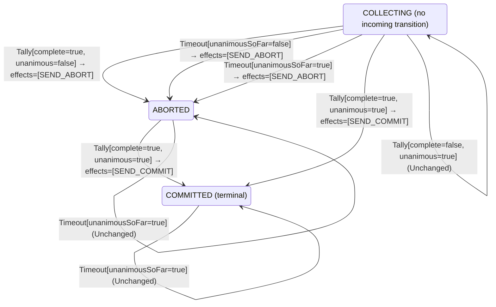

<!-- Generated by examples/demo/tools/build.py from example.json and the verifier's output. Edit example.json. -->
# 067 · A coordinator that commits after aborting on timeout, once the late votes are all yes

[← All examples](../README.md)

| Verdict | Categories | Severity if shipped | Change | Verified unit | Approach |
|---|---|---|---|---|---|
| **✗ Violation: Atomicity, 9-step trace** | functional | critical | feature, behaviour change intended | [`Coordinator#decide`](../../../examples/demo/apps/quorum/src/main/java/net/terminalvalue/quorum/twopc/Coordinator.java) | [D1: Protocol model checking](../../../examples/demo/apps/quorum/spec/README.md) |

> When the vote collection times out, the two-phase-commit coordinator aborts: a participant that has not answered may have given up. A developer adds a second chance: if the missing votes arrive after all and every one of them is yes, the abort was a wrong guess and nothing has been lost, so the coordinator commits. The contract diff is one case, in the `ABORTED` phase, and is approved; the test that said an aborted transaction stays aborted is adjusted to the new rule. The model finds the run the developer did not picture in nine steps, and the inductive step finds it in one: an abort is a decision participants act on, and by the time the late votes are in, a participant that voted yes has aborted on the coordinator's say-so and released its locks. The commit that follows splits the participants.

## The change

In the `ABORTED` phase, a `Tally` that is complete and unanimous moves the coordinator to `COMMITTED` with `SEND_COMMIT`; any other tally, and any tally in `COMMITTED`, is unchanged as before. The reasoning in the comment: an abort on timeout is a guess that a missing participant gave up, and when every vote turns out to be yes the guess was wrong. The contract diff is the one case `decide(ABORTED, Tally[complete=true, unanimous=true])`, from unchanged to a transition to `COMMITTED`; the test `aDecisionIsFinal` is changed to a tally with a no in it, and a test for the new case is added. The reviewer approves the diff.

**Before** ([`Coordinator.java`](../../../examples/demo/apps/quorum/src/main/java/net/terminalvalue/quorum/twopc/Coordinator.java), line 26):

```java
    case COLLECTING -> !tally.complete()
            ? unchanged("waiting for the remaining votes")
            : tally.unanimous() ? transition(COMMITTED, SEND_COMMIT) : transition(ABORTED, SEND_ABORT);
    case COMMITTED, ABORTED -> unchanged("already decided");
};
case Timeout _ -> switch (phase) {
    case COLLECTING -> transition(ABORTED, SEND_ABORT); // presumed abort
```

**After:**

```java
    case COLLECTING -> !tally.complete()
            ? unchanged("waiting for the remaining votes")
            : tally.unanimous() ? transition(COMMITTED, SEND_COMMIT) : transition(ABORTED, SEND_ABORT);
    // An abort on timeout is a guess that a missing participant gave up. When the missing votes arrive
    // after all and every one of them is yes, the guess was wrong and nothing has been lost: commit.
    case ABORTED -> tally.complete() && tally.unanimous()
            ? transition(COMMITTED, SEND_COMMIT)
            : unchanged("already decided");
    case COMMITTED -> unchanged("already decided");
};
case Timeout _ -> switch (phase) {
    case COLLECTING -> transition(ABORTED, SEND_ABORT); // presumed abort
```

<details><summary>Patch</summary>

```diff
--- a/examples/demo/apps/quorum/src/main/java/net/terminalvalue/quorum/twopc/Coordinator.java
+++ b/examples/demo/apps/quorum/src/main/java/net/terminalvalue/quorum/twopc/Coordinator.java
@@ -26,7 +26,12 @@
                 case COLLECTING -> !tally.complete()
                         ? unchanged("waiting for the remaining votes")
                         : tally.unanimous() ? transition(COMMITTED, SEND_COMMIT) : transition(ABORTED, SEND_ABORT);
-                case COMMITTED, ABORTED -> unchanged("already decided");
+                // An abort on timeout is a guess that a missing participant gave up. When the missing votes arrive
+                // after all and every one of them is yes, the guess was wrong and nothing has been lost: commit.
+                case ABORTED -> tally.complete() && tally.unanimous()
+                        ? transition(COMMITTED, SEND_COMMIT)
+                        : unchanged("already decided");
+                case COMMITTED -> unchanged("already decided");
             };
             case Timeout _ -> switch (phase) {
                 case COLLECTING -> transition(ABORTED, SEND_ABORT); // presumed abort
--- a/examples/demo/apps/quorum/src/test/java/net/terminalvalue/quorum/twopc/CoordinatorTest.java
+++ b/examples/demo/apps/quorum/src/test/java/net/terminalvalue/quorum/twopc/CoordinatorTest.java
@@ -34,6 +34,11 @@
 
     public static void aDecisionIsFinal() {
         check(Coordinator.decide(Phase.COMMITTED, new Timeout(true)) instanceof Decision.Unchanged, "committed stays");
-        check(Coordinator.decide(Phase.ABORTED, new Tally(true, true)) instanceof Decision.Unchanged, "aborted stays");
+        check(Coordinator.decide(Phase.ABORTED, new Tally(true, false)) instanceof Decision.Unchanged, "aborted stays");
+    }
+
+    public static void commitsAfterAllWhenTheLateVotesAreAllYes() {
+        equal(new Transition<>(Phase.COMMITTED, List.of(CoordinatorEffect.SEND_COMMIT)),
+                Coordinator.decide(Phase.ABORTED, new Tally(true, true)));
     }
 }
```

</details>

## What the verifier found

The model is checked under 2 configurations, and the verdict is the first that fails:

| Configuration | What it checks | Model | Result |
|---|---|---|---|
| three participants (`spec/TwoPhaseCommit.cfg`) | every run from the initial state, every interleaving within the configuration's bounds | Participants = {p1, p2, p3} | ✗ Violation: Atomicity, 9-step trace |
| the inductive step (`spec/TwoPhaseCommitInductive.cfg`) | that the invariant `Inductive` is inductive: TLC starts from every state the invariant admits, reachable or not, rather than from the initial state, takes one step, and checks the invariant again, conjunct by conjunct. No counterexample is a proof of atomicity by induction, for any run of the protocol however long; a counterexample is one step from a state that need not be reachable | Participants = {p1, p2, p3} | ✗ Violation: Atomicity, 2-step trace |

TLC found a run of the system under three participants, 9 steps long, that violates the invariant **Atomicity** (once the coordinator or any participant has committed, no participant has aborted). Each step is one action of one part of the system:

1. **Initial state**: every participant working, no vote counted, no decision.
2. **Vote**, `Participant.prepare`: a participant votes yes (and holds its locks) or no (and aborts). `inbox = {[from |-> p1, vote |-> "YES"]}`, `pstate = (p1 :> "PREPARED" @@ p2 :> "WORKING" @@ p3 :> "WORKING")`
3. **Vote**, `Participant.prepare`: a participant votes yes (and holds its locks) or no (and aborts). `inbox = {[from |-> p1, vote |-> "YES"], [from |-> p2, vote |-> "YES"]}`, `pstate = (p1 :> "PREPARED" @@ p2 :> "PREPARED" @@ p3 :> "WORKING")`
4. **Vote**, `Participant.prepare`: a participant votes yes (and holds its locks) or no (and aborts). `inbox = { [from |-> p1, vote |-> "YES"], [from |-> p2, vote |-> "YES"], [from |-> p3, vote |-> "YES"] }`, `pstate = (p1 :> "PREPARED" @@ p2 :> "PREPARED" @@ p3 :> "PREPARED")`
5. **ReceiveVote**, `Coordinator.onVote`: the coordinator counts a vote and decides on the tally. `inbox = {[from |-> p2, vote |-> "YES"], [from |-> p3, vote |-> "YES"]}`, `votes = (p1 :> "YES" @@ p2 :> "NONE" @@ p3 :> "NONE")`
6. **ReceiveVote**, `Coordinator.onVote`: the coordinator counts a vote and decides on the tally. `inbox = {[from |-> p3, vote |-> "YES"]}`, `votes = (p1 :> "YES" @@ p2 :> "YES" @@ p3 :> "NONE")`
7. **CoordinatorTimeout**, `Coordinator.onTimeout`: the collection timer fires with votes missing. `decision = "ABORT"`, `phase = "ABORTED"`
8. **Learn**, `Participant.learn`: a participant applies the coordinator's decision. `pstate = (p1 :> "ABORTED" @@ p2 :> "PREPARED" @@ p3 :> "PREPARED")`
9. **ReceiveVote**, `Coordinator.onVote`: the coordinator counts a vote and decides on the tally. `decision = "COMMIT"`, `inbox = {}`, `phase = "COMMITTED"`, `votes = (p1 :> "YES" @@ p2 :> "YES" @@ p3 :> "YES")`

The model is small (Participants = {p1, p2, p3}), which is what keeps the trace readable. TLC explored every interleaving of the participants, the coordinator and the votes in flight within those bounds.

<details><summary>The counterexample under the inductive step: invariant <b>Atomicity</b>, 2 steps</summary>

Invariant **Atomicity**: once the coordinator or any participant has committed, no participant has aborted.

1. **Starting state**, a state the invariant `Inductive` admits, which need not be reachable: `decision = "ABORT"`, `inbox = {[from |-> p1, vote |-> "YES"]}`, `phase = "ABORTED"`, `pstate = (p1 :> "ABORTED" @@ p2 :> "ABORTED" @@ p3 :> "ABORTED")`, `votes = (p1 :> "NONE" @@ p2 :> "YES" @@ p3 :> "YES")`
2. **ReceiveVote**, `Coordinator.onVote`: the coordinator counts a vote and decides on the tally. `decision = "COMMIT"`, `inbox = {}`, `phase = "COMMITTED"`, `votes = (p1 :> "YES" @@ p2 :> "YES" @@ p3 :> "YES")`

</details>

The state machine the patched code implements, drawn from its derived contract (`jvmcontract statemachine`); a state with no way in or no way out is marked:



## Would the existing tests have caught it?

No: every existing unit test passes (`java -ea net.terminalvalue.quorum.Tests`, run against the patched code).

## Why it matters

A decision in two-phase commit is final because the participants act on it the moment they hear it: a prepared participant that is told to abort rolls back and releases its locks, and there is no taking that back. The late votes say that every participant was willing to commit when it voted; they say nothing about what the participants have done since, and what they have done since is abort, because the coordinator told them to. The coordinator's second decision reaches participants that are no longer prepared, and those that are still prepared commit while the others have aborted: atomicity, the one property the protocol exists for, is gone. The contract diff is exactly what the developer intended, the adjusted test passes, and the unanimous tally the new case asks for is real; the bug is in the order of events the rule cannot see from its two arguments.

## Why the verdict is right

The model is checked under two configurations. With three participants TLC reports the shortest run that breaks `Atomicity`: all three vote yes; the coordinator counts two of the votes, and the third is still in flight when its timer fires, so it aborts and broadcasts the abort; p1 applies the decision and is aborted; the third vote arrives, the tally is complete and unanimous, and the patched rule commits. The coordinator has committed a transaction one participant has already aborted, and the two still prepared will commit it. The inductive configuration starts from every state the invariant `Inductive` admits, reachable or not, and finds the one step that leaves it: a coordinator that aborted, two yes votes counted and the third on its way, every participant aborted, and the step that counts the third vote commits. The conjunct that makes the state admissible is `ParticipantsAgreeWithTheirVotes`, that a yes voter which aborted did so on the coordinator's say-so, and the step shows that the coordinator's say-so is what the new rule revokes. The inductive invariant was written for the committed kernel and holds there in 736 states, eight more than are reachable, which is how close it comes to describing exactly what the protocol does; the one-step counterexample is the same bug as the nine-step run, found without searching for it.

## What to do

Revert. Once the coordinator has decided, the decision is the only thing it may say again; example 068 is a coordinator that says it again on every late vote, proved safe under both configurations. The late-vote problem the developer saw is real, and its fix is on the other side of the timeout: example 058's grace period waits for the last vote before deciding, and is proved live.

## Evidence

How the verdict was reached: three participants: TLC 2.19 explored 692 distinct states to depth 9 in 0 s, for the model Participants = {p1, p2, p3}; the inductive step: TLC 2.19 explored 737 distinct states to depth 2 in 0 s, for the model Participants = {p1, p2, p3}.

<details><summary>Verifier output</summary>

```text
== three participants: spec/TwoPhaseCommit.cfg ==
TLC2 Version 2.19 of 08 August 2024 (rev: 5a47802)
Running breadth-first search Model-Checking with fp 1 and seed 1 with 1 worker on 8 cores with 910MB heap and 64MB offheap memory [pid: 2084006] (Linux 6.6.87.2-microsoft-standard-WSL2 aarch64, Eclipse Adoptium 25.0.4.1 x86_64, MSBDiskFPSet, DiskStateQueue).
Parsing file examples/demo/apps/quorum/spec/TwoPhaseCommit.tla
Parsing file examples/demo/tools/tla/standard-modules/Naturals.tla
Parsing file examples/demo/tools/tla/standard-modules/Sequences.tla
Parsing file examples/demo/tools/tla/standard-modules/FiniteSets.tla
Parsing file examples/demo/apps/quorum/spec/CoordinatorContract.tla
Parsing file examples/demo/apps/quorum/spec/TCommit.tla
Semantic processing of module Naturals
Semantic processing of module Sequences
Semantic processing of module FiniteSets
Semantic processing of module CoordinatorContract
Semantic processing of module TCommit
Semantic processing of module TwoPhaseCommit
Starting... (2026-11-02 00:27:59)
Implied-temporal checking--satisfiability problem has 3 branches.
Computing initial states...
Finished computing initial states: 1 distinct state generated at 2026-11-02 00:27:59.
Error: Invariant Atomicity is violated.
Error: The behavior up to this point is:
State 1: <Initial predicate>
/\ pstate = (p1 :> "WORKING" @@ p2 :> "WORKING" @@ p3 :> "WORKING")
/\ decision = "NONE"
/\ phase = "COLLECTING"
/\ inbox = {}
/\ votes = (p1 :> "NONE" @@ p2 :> "NONE" @@ p3 :> "NONE")

State 2: <Vote line 44, col 5 to line 48, col 43 of module TwoPhaseCommit>
/\ pstate = (p1 :> "PREPARED" @@ p2 :> "WORKING" @@ p3 :> "WORKING")
/\ decision = "NONE"
/\ phase = "COLLECTING"
/\ inbox = {[from |-> p1, vote |-> "YES"]}
/\ votes = (p1 :> "NONE" @@ p2 :> "NONE" @@ p3 :> "NONE")

State 3: <Vote line 44, col 5 to line 48, col 43 of module TwoPhaseCommit>
/\ pstate = (p1 :> "PREPARED" @@ p2 :> "PREPARED" @@ p3 :> "WORKING")
/\ decision = "NONE"
/\ phase = "COLLECTING"
/\ inbox = {[from |-> p1, vote |-> "YES"], [from |-> p2, vote |-> "YES"]}
/\ votes = (p1 :> "NONE" @@ p2 :> "NONE" @@ p3 :> "NONE")

State 4: <Vote line 44, col 5 to line 48, col 43 of module TwoPhaseCommit>
/\ pstate = (p1 :> "PREPARED" @@ p2 :> "PREPARED" @@ p3 :> "PREPARED")
/\ decision = "NONE"
/\ phase = "COLLECTING"
/\ inbox = { [from |-> p1, vote |-> "YES"],
  [from |-> p2, vote |-> "YES"],
  [from |-> p3, vote |-> "YES"] }
/\ votes = (p1 :> "NONE" @@ p2 :> "NONE" @@ p3 :> "NONE")

State 5: <ReceiveVote line 80, col 5 to line 88, col 23 of module TwoPhaseCommit>
/\ pstate = (p1 :> "PREPARED" @@ p2 :> "PREPARED" @@ p3 :> "PREPARED")
/\ decision = "NONE"
/\ phase = "COLLECTING"
/\ inbox = {[from |-> p2, vote |-> "YES"], [from |-> p3, vote |-> "YES"]}
/\ votes = (p1 :> "YES" @@ p2 :> "NONE" @@ p3 :> "NONE")

State 6: <ReceiveVote line 80, col 5 to line 88, col 23 of module TwoPhaseCommit>
/\ pstate = (p1 :> "PREPARED" @@ p2 :> "PREPARED" @@ p3 :> "PREPARED")
/\ decision = "NONE"
/\ phase = "COLLECTING"
/\ inbox = {[from |-> p3, vote |-> "YES"]}
/\ votes = (p1 :> "YES" @@ p2 :> "YES" @@ p3 :> "NONE")

State 7: <CoordinatorTimeout line 92, col 5 to line 95, col 41 of module TwoPhaseCommit>
/\ pstate = (p1 :> "PREPARED" @@ p2 :> "PREPARED" @@ p3 :> "PREPARED")
/\ decision = "ABORT"
/\ phase = "ABORTED"
/\ inbox = {[from |-> p3, vote |-> "YES"]}
/\ votes = (p1 :> "YES" @@ p2 :> "YES" @@ p3 :> "NONE")

State 8: <Learn line 59, col 5 to line 62, col 50 of module TwoPhaseCommit>
/\ pstate = (p1 :> "ABORTED" @@ p2 :> "PREPARED" @@ p3 :> "PREPARED")
/\ decision = "ABORT"
/\ phase = "ABORTED"
/\ inbox = {[from |-> p3, vote |-> "YES"]}
/\ votes = (p1 :> "YES" @@ p2 :> "YES" @@ p3 :> "NONE")

State 9: <ReceiveVote line 80, col 5 to line 88, col 23 of module TwoPhaseCommit>
/\ pstate = (p1 :> "ABORTED" @@ p2 :> "PREPARED" @@ p3 :> "PREPARED")
/\ decision = "COMMIT"
/\ phase = "COMMITTED"
/\ inbox = {}
/\ votes = (p1 :> "YES" @@ p2 :> "YES" @@ p3 :> "YES")

2291 states generated, 692 distinct states found, 89 states left on queue.
The depth of the complete state graph search is 9.
The average outdegree of the complete state graph is 1 (minimum is 0, the maximum 10 and the 95th percentile is 3).
Finished in 00s at (2026-11-02 00:28:00)

== the inductive step: spec/TwoPhaseCommitInductive.cfg ==
TLC2 Version 2.19 of 08 August 2024 (rev: 5a47802)
Running breadth-first search Model-Checking with fp 1 and seed 1 with 1 worker on 8 cores with 910MB heap and 64MB offheap memory [pid: 2084070] (Linux 6.6.87.2-microsoft-standard-WSL2 aarch64, Eclipse Adoptium 25.0.4.1 x86_64, MSBDiskFPSet, DiskStateQueue).
Parsing file examples/demo/apps/quorum/spec/TwoPhaseCommit.tla
Parsing file examples/demo/tools/tla/standard-modules/Naturals.tla
Parsing file examples/demo/tools/tla/standard-modules/Sequences.tla
Parsing file examples/demo/tools/tla/standard-modules/FiniteSets.tla
Parsing file examples/demo/apps/quorum/spec/CoordinatorContract.tla
Parsing file examples/demo/apps/quorum/spec/TCommit.tla
Semantic processing of module Naturals
Semantic processing of module Sequences
Semantic processing of module FiniteSets
Semantic processing of module CoordinatorContract
Semantic processing of module TCommit
Semantic processing of module TwoPhaseCommit
Starting... (2026-11-02 00:28:00)
Computing initial states...
Computed 2 initial states...
Computed 4 initial states...
Computed 8 initial states...
Computed 16 initial states...
Computed 32 initial states...
Computed 64 initial states...
Computed 128 initial states...
Computed 256 initial states...
Computed 512 initial states...
Finished computing initial states: 736 distinct states generated at 2026-11-02 00:28:01.
Error: Invariant Atomicity is violated.
Error: The behavior up to this point is:
State 1: <Initial predicate>
/\ pstate = (p1 :> "ABORTED" @@ p2 :> "ABORTED" @@ p3 :> "ABORTED")
/\ decision = "ABORT"
/\ phase = "ABORTED"
/\ inbox = {[from |-> p1, vote |-> "YES"]}
/\ votes = (p1 :> "NONE" @@ p2 :> "YES" @@ p3 :> "YES")

State 2: <ReceiveVote line 80, col 5 to line 88, col 23 of module TwoPhaseCommit>
/\ pstate = (p1 :> "ABORTED" @@ p2 :> "ABORTED" @@ p3 :> "ABORTED")
/\ decision = "COMMIT"
/\ phase = "COMMITTED"
/\ inbox = {}
/\ votes = (p1 :> "YES" @@ p2 :> "YES" @@ p3 :> "YES")

1575 states generated, 737 distinct states found, 464 states left on queue.
The depth of the complete state graph search is 2.
The average outdegree of the complete state graph is 0 (minimum is 0, the maximum 0 and the 95th percentile is 0).
Finished in 00s at (2026-11-02 00:28:01)
```

</details>

<details><summary>SARIF report (as uploaded to GitHub code scanning or SonarQube)</summary>

```json
{
  "version": "2.1.0",
  "$schema": "https://json.schemastore.org/sarif-2.1.0.json",
  "runs": [
    {
      "tool": {
        "driver": {
          "name": "jvmcontract tlc",
          "rules": [
            {
              "id": "invariant-violated",
              "shortDescription": {
                "text": "TLC found a behaviour of the model that violates an invariant or a temporal property, or ends in a deadlock."
              }
            },
            {
              "id": "unverifiable",
              "shortDescription": {
                "text": "TLC could not check the model."
              }
            }
          ]
        }
      },
      "results": [
        {
          "ruleId": "invariant-violated",
          "level": "error",
          "message": {
            "text": "Invariant Atomicity of spec/TwoPhaseCommit.tla (three participants) is violated after 9 steps"
          },
          "locations": [
            {
              "physicalLocation": {
                "artifactLocation": {
                  "uri": "examples/demo/apps/quorum/src/main/java/net/terminalvalue/quorum/twopc/Coordinator.java"
                },
                "region": {
                  "startLine": 26
                }
              }
            }
          ]
        },
        {
          "ruleId": "invariant-violated",
          "level": "error",
          "message": {
            "text": "Invariant Atomicity of spec/TwoPhaseCommit.tla (the inductive step) is violated after 2 steps"
          },
          "locations": [
            {
              "physicalLocation": {
                "artifactLocation": {
                  "uri": "examples/demo/apps/quorum/src/main/java/net/terminalvalue/quorum/twopc/Coordinator.java"
                },
                "region": {
                  "startLine": 26
                }
              }
            }
          ]
        }
      ]
    }
  ]
}
```

</details>

**Provenance:** Constructed from the finality of a two-phase-commit decision (Gray, 1978), by revoking an abort on the strength of votes cast before it.

- [Gray, Notes on Data Base Operating Systems (1978): two-phase commit and the blocking of a prepared participant](https://jimgray.azurewebsites.net/papers/dbos.pdf)
- [Lamport and Gray, Consensus on Transaction Commit: the TCommit and TwoPhase specifications, and the invariant of TwoPhase](https://lamport.azurewebsites.net/video/consensus-on-transaction-commit.pdf)
- [Lamport, Using TLC to Check Inductive Invariance (2018): the invariant as TLC's initial predicate](https://lamport.azurewebsites.net/tla/inductive-invariant.pdf)
## Reproduce

```bash
python3 examples/demo/tools/build.py 067
```

This applies `change.patch` to a temporary copy of the repo, runs the verifier on it, and rewrites this page.
