<!-- Generated by examples/demo/tools/build.py from example.json and the verifier's output. Edit example.json. -->
# 069 · A vote rule that lets a voter switch candidates within a term elects two leaders

[← All examples](../README.md)

| Verdict | Categories | Severity if shipped | Change | Verified unit | Approach |
|---|---|---|---|---|---|
| **✗ Violation: ElectionSafety, 5-step trace** | functional | critical | feature, behaviour change intended | [`VoteRule#decide`](../../../examples/demo/apps/quorum/src/main/java/net/terminalvalue/quorum/raft/VoteRule.java) | [D1: Protocol model checking](../../../examples/demo/apps/quorum/spec/README.md) |

> Raft's vote rule grants one vote per term: a server that has voted for a candidate refuses every other candidate of that term, and a split vote costs the cluster a new term. A developer lets the vote move instead: a candidate still asking in the voter's term is one the term's election has not settled, since the candidate the voter chose has not won, so the vote goes to whoever is asking and the split resolves within the term. The behavioural contract of the vote rule, a second operator of the election model generated from the Java, changes in three rows, and the tests are updated to say so. TLC finds two leaders of one term in five steps: two servers time out together, and each, still a candidate, grants the other its vote. The vote a server cast for itself moves too, and both tallies reach a majority.

## The change

Drop the check that refuses a candidate of the current term when the voter's ballot is cast for another, with the reasoning in a comment: a candidate still canvassing in the voter's term is one whose election the term has not settled, because the candidate this server voted for has not won, or its heartbeats would have arrived; so the vote goes to whoever is asking now, and a split vote resolves within the term instead of costing the cluster a new one. The contract of `VoteRule#decide` is regenerated: the three rows of a ballot cast for another and a candidate of the current term change, two from refused to granted and one in its reason. The test that said one vote per term now says the vote moves, and the test of the kernel says the same.

**Before** ([`VoteRule.java`](../../../examples/demo/apps/quorum/src/main/java/net/terminalvalue/quorum/raft/VoteRule.java), line 31):

```java

/**
 * The vote rule proper: a candidate from the past is refused; a newer term is a new vote, and in the current
 * term the vote is one per server, which the same candidate may collect again; and a candidate whose log is
 * behind the voter's is refused whatever its term.
 */
public static Decision<Ballot, VoteEffect> decide(Ballot ballot, VoteRequest request) {
    if (request.term() == OLDER) {
        return rejected("a candidate from the past");
    }
    if (request.term() == CURRENT && ballot == Ballot.FOR_ANOTHER) {
        return rejected("one vote per term");
    }
    if (request.log() == BEHIND) {
        return rejected("a log behind the voter's");
    }
```

**After:**

```java

/**
 * The vote rule proper: a candidate from the past is refused; a newer term is a new vote, and in the current
 * term the vote goes to the candidate asking; and a candidate whose log is behind the voter's is refused
 * whatever its term.
 */
public static Decision<Ballot, VoteEffect> decide(Ballot ballot, VoteRequest request) {
    if (request.term() == OLDER) {
        return rejected("a candidate from the past");
    }
    // A candidate still asking in the voter's term is one whose election the term has not settled: the vote
    // this server cast went to a candidate that has not won, or its heartbeats would have arrived by now. So
    // the vote goes to whoever is asking, and a split vote resolves within the term instead of costing a new one.
    if (request.log() == BEHIND) {
        return rejected("a log behind the voter's");
    }
```

<details><summary>Patch</summary>

```diff
--- a/examples/demo/apps/quorum/src/main/java/net/terminalvalue/quorum/raft/VoteRule.java
+++ b/examples/demo/apps/quorum/src/main/java/net/terminalvalue/quorum/raft/VoteRule.java
@@ -31,16 +31,16 @@
 
     /**
      * The vote rule proper: a candidate from the past is refused; a newer term is a new vote, and in the current
-     * term the vote is one per server, which the same candidate may collect again; and a candidate whose log is
-     * behind the voter's is refused whatever its term.
+     * term the vote goes to the candidate asking; and a candidate whose log is behind the voter's is refused
+     * whatever its term.
      */
     public static Decision<Ballot, VoteEffect> decide(Ballot ballot, VoteRequest request) {
         if (request.term() == OLDER) {
             return rejected("a candidate from the past");
         }
-        if (request.term() == CURRENT && ballot == Ballot.FOR_ANOTHER) {
-            return rejected("one vote per term");
-        }
+        // A candidate still asking in the voter's term is one whose election the term has not settled: the vote
+        // this server cast went to a candidate that has not won, or its heartbeats would have arrived by now. So
+        // the vote goes to whoever is asking, and a split vote resolves within the term instead of costing a new one.
         if (request.log() == BEHIND) {
             return rejected("a log behind the voter's");
         }
--- a/examples/demo/apps/quorum/src/test/java/net/terminalvalue/quorum/raft/VoteRuleTest.java
+++ b/examples/demo/apps/quorum/src/test/java/net/terminalvalue/quorum/raft/VoteRuleTest.java
@@ -21,8 +21,8 @@
         check(!VoteRule.grant(5, NO_VOTE, 3, 10, 7, 4, 3, 10), "older term");
     }
 
-    public static void oneVotePerTerm() {
-        check(!VoteRule.grant(4, 2, 3, 10, 7, 4, 3, 10), "already voted for 2 in term 4");
+    public static void aSplitVoteResolvesWithinTheTerm() {
+        check(VoteRule.grant(4, 2, 3, 10, 7, 4, 3, 10), "voted for 2 in term 4, and 7 is still asking: the vote moves");
         check(VoteRule.grant(4, 7, 3, 10, 7, 4, 3, 10), "the same candidate may ask again");
         check(VoteRule.grant(4, 2, 3, 10, 7, 5, 3, 10), "a new term is a new vote");
     }
@@ -31,12 +31,12 @@
         check(!VoteRule.grant(3, NO_VOTE, 3, 10, 7, 4, 3, 9), "shorter log");
     }
 
-    public static void theRuleGrantsOneVotePerTerm() {
+    public static void theRuleGrantsTheCandidateAsking() {
         equal(new Transition<>(Ballot.FOR_THE_CANDIDATE, List.of(VoteEffect.GRANT)),
                 VoteRule.decide(Ballot.OPEN, new VoteRequest(TermOrder.CURRENT, LogOrder.EVEN)));
         equal(new Transition<>(Ballot.FOR_THE_CANDIDATE, List.of(VoteEffect.GRANT)),
                 VoteRule.decide(Ballot.FOR_THE_CANDIDATE, new VoteRequest(TermOrder.CURRENT, LogOrder.EVEN)));
-        check(VoteRule.decide(Ballot.FOR_ANOTHER, new VoteRequest(TermOrder.CURRENT, LogOrder.AHEAD)) instanceof Decision.Rejected, "voted for another");
+        check(VoteRule.decide(Ballot.FOR_ANOTHER, new VoteRequest(TermOrder.CURRENT, LogOrder.AHEAD)) instanceof Decision.Transition, "voted for another, who has not won: the vote moves");
         check(VoteRule.decide(Ballot.FOR_ANOTHER, new VoteRequest(TermOrder.NEWER, LogOrder.EVEN)) instanceof Decision.Transition, "a new term is a new vote");
     }
 
```

</details>

## What the verifier found

The model is checked under 7 configurations, and the verdict is the first that fails:

| Configuration | What it checks | Model | Result |
|---|---|---|---|
| three servers (`spec/RaftElection.cfg`) | every run from the initial state, every interleaving within the configuration's bounds | Servers = {s1, s2, s3}, MaxTerm = 3, LeftBehind = {}, DelayedReplies = FALSE, History = FALSE | ✗ Violation: ElectionSafety, 5-step trace |
| the inductive step (`spec/RaftElectionInductive.cfg`) | that the invariant `Inductive` is inductive: TLC starts from every state the invariant admits, reachable or not, rather than from the initial state, takes one step, and checks the invariant again, conjunct by conjunct. No counterexample is a proof of election safety by induction, for any run of the cluster however long; a counterexample is one step from a state that need not be reachable | Servers = {s1, s2, s3}, MaxTerm = 3, LeftBehind = {}, DelayedReplies = FALSE, History = FALSE | ✗ Violation: TalliesOfATermAreDisjoint, 2-step trace |
| four servers (`spec/RaftElectionFour.cfg`) | every run with four servers, a cluster in which a candidate can hold a vote besides its own and still be short of a majority, which three servers never show; under a symmetry set, so that of the states that differ only by the servers' names TLC explores one | Servers = {s1, s2, s3, s4}, MaxTerm = 3, LeftBehind = {}, DelayedReplies = FALSE, History = FALSE | ✗ Violation: ElectionSafety, 7-step trace |
| fairness (`spec/RaftElectionLive.cfg`) | the two liveness properties, under the fairness conditions `Fairness`: a server whose timer nothing resets times out, a candidate asks for the votes it lacks, a leader sends its heartbeats. A counterexample is a run that goes on forever without satisfying a property: a prefix, then a state or a cycle the system never leaves | Servers = {s1, s2, s3}, MaxTerm = 3, LeftBehind = {}, DelayedReplies = FALSE, History = FALSE | ✗ Violation: ElectionSafety, 5-step trace |
| a server left behind (`spec/RaftElectionLogs.cfg`) | the election restriction: one server holds the log a deposed leader of term 1 left behind, three entries of its term, while the other two hold an entry of term 2 that a majority holds and is therefore committed, so that the longer log is the one behind; every run with these logs, which nothing changes, under the invariant `LeaderCompleteness` besides the usual ones | Servers = {s1, s2, s3}, MaxTerm = 3, LeftBehind = {s1}, DelayedReplies = FALSE, History = FALSE | ✗ Violation: ElectionSafety, 5-step trace |
| delayed replies (`spec/RaftElectionDelayed.cfg`) | every run of three servers and two terms in which the reply to a vote request is a step of its own, which the candidate may take after it has timed out into a newer term, stepped down, or won; the one-step RPC of the other configurations never hands the role machine a reply from an older term than the server's own, and this one does, under the usual invariants and action properties | Servers = {s1, s2, s3}, MaxTerm = 2, LeftBehind = {}, DelayedReplies = TRUE, History = FALSE | ✗ Violation: ElectionSafety, 7-step trace |
| history (`spec/RaftElectionHistory.cfg`) | every run of three servers and three terms with the two history variables recording, `elected`, every term a server has led, and `voted`, every vote cast, under the two invariants that are about a run rather than a state: at most one leader elected per term and at most one vote per server per term, as the paper states them. The state invariants of the other configurations hold in a run in which a term's leader steps down and the term then elects another; these do not | Servers = {s1, s2, s3}, MaxTerm = 3, LeftBehind = {}, DelayedReplies = FALSE, History = TRUE | ✗ Violation: AtMostOneVotePerTerm, 4-step trace |

TLC found a run of the system under three servers, 5 steps long, that violates the invariant **ElectionSafety** (at most one leader per term). Each step is one action of one part of the system:

1. **Initial state**: every server a follower in term 0, no vote cast, no vote held.
2. **Timeout**, `Server.onElectionTimeout`: a server's election timer fires, and the server acts on the role machine's decision. `currentTerm = (s1 :> 1 @@ s2 :> 0 @@ s3 :> 0)`, `role = (s1 :> "CANDIDATE" @@ s2 :> "FOLLOWER" @@ s3 :> "FOLLOWER")`, `votedFor = (s1 :> s1 @@ s2 :> "none" @@ s3 :> "none")`, `votes = (s1 :> {s1} @@ s2 :> {} @@ s3 :> {})`
3. **Timeout**, `Server.onElectionTimeout`: a server's election timer fires, and the server acts on the role machine's decision. `currentTerm = (s1 :> 1 @@ s2 :> 1 @@ s3 :> 0)`, `role = (s1 :> "CANDIDATE" @@ s2 :> "CANDIDATE" @@ s3 :> "FOLLOWER")`, `votedFor = (s1 :> s1 @@ s2 :> s2 @@ s3 :> "none")`, `votes = (s1 :> {s1} @@ s2 :> {s2} @@ s3 :> {})`
4. **Canvass**, `Server.requestVote`: a candidate asks one server for its vote and gets the answer; the request and the reply each go through the role machine, then the vote rule on the voter, given its ballot and the candidate's term and log against its own, and the tally on the candidate. `role = (s1 :> "CANDIDATE" @@ s2 :> "LEADER" @@ s3 :> "FOLLOWER")`, `votedFor = (s1 :> s2 @@ s2 :> s2 @@ s3 :> "none")`, `votes = (s1 :> {s1} @@ s2 :> {s1, s2} @@ s3 :> {})`
5. **Canvass**, `Server.requestVote`: a candidate asks one server for its vote and gets the answer; the request and the reply each go through the role machine, then the vote rule on the voter, given its ballot and the candidate's term and log against its own, and the tally on the candidate. `role = (s1 :> "LEADER" @@ s2 :> "LEADER" @@ s3 :> "FOLLOWER")`, `votedFor = (s1 :> s2 @@ s2 :> s1 @@ s3 :> "none")`, `votes = (s1 :> {s1, s2} @@ s2 :> {s1, s2} @@ s3 :> {})`

The model is small (Servers = {s1, s2, s3}, MaxTerm = 3, LeftBehind = {}, DelayedReplies = FALSE, History = FALSE), which is what keeps the trace readable. TLC explored every interleaving of the servers, their terms and votes, and the RPCs between them within those bounds.

<details><summary>The counterexample under the inductive step: invariant <b>TalliesOfATermAreDisjoint</b>, 2 steps</summary>

Invariant **TalliesOfATermAreDisjoint**: no server's vote is in two tallies of one term.

1. **Starting state**, a state the invariant `Inductive` admits, which need not be reachable: `currentTerm = (s1 :> 0 @@ s2 :> 1 @@ s3 :> 1)`, `elected = {}`, `replies = {}`, `role = (s1 :> "FOLLOWER" @@ s2 :> "FOLLOWER" @@ s3 :> "CANDIDATE")`, `voted = {}`, `votedFor = (s1 :> "none" @@ s2 :> s2 @@ s3 :> s3)`, `votes = (s1 :> {} @@ s2 :> {s2} @@ s3 :> {s3})`
2. **Canvass**, `Server.requestVote`: a candidate asks one server for its vote and gets the answer; the request and the reply each go through the role machine, then the vote rule on the voter, given its ballot and the candidate's term and log against its own, and the tally on the candidate. `role = (s1 :> "FOLLOWER" @@ s2 :> "FOLLOWER" @@ s3 :> "LEADER")`, `votedFor = (s1 :> "none" @@ s2 :> s3 @@ s3 :> s3)`, `votes = (s1 :> {} @@ s2 :> {s2} @@ s3 :> {s2, s3})`

</details>

<details><summary>The counterexample under four servers: invariant <b>ElectionSafety</b>, 7 steps</summary>

Invariant **ElectionSafety**: at most one leader per term.

1. **Initial state**: every server a follower in term 0, no vote cast, no vote held.
2. **Timeout**, `Server.onElectionTimeout`: a server's election timer fires, and the server acts on the role machine's decision. `currentTerm = (s1 :> 1 @@ s2 :> 0 @@ s3 :> 0 @@ s4 :> 0)`, `role = (s1 :> "CANDIDATE" @@ s2 :> "FOLLOWER" @@ s3 :> "FOLLOWER" @@ s4 :> "FOLLOWER")`, `votedFor = (s1 :> s1 @@ s2 :> "none" @@ s3 :> "none" @@ s4 :> "none")`, `votes = (s1 :> {s1} @@ s2 :> {} @@ s3 :> {} @@ s4 :> {})`
3. **Timeout**, `Server.onElectionTimeout`: a server's election timer fires, and the server acts on the role machine's decision. `currentTerm = (s1 :> 1 @@ s2 :> 1 @@ s3 :> 0 @@ s4 :> 0)`, `role = (s1 :> "CANDIDATE" @@ s2 :> "CANDIDATE" @@ s3 :> "FOLLOWER" @@ s4 :> "FOLLOWER")`, `votedFor = (s1 :> s1 @@ s2 :> s2 @@ s3 :> "none" @@ s4 :> "none")`, `votes = (s1 :> {s1} @@ s2 :> {s2} @@ s3 :> {} @@ s4 :> {})`
4. **Canvass**, `Server.requestVote`: a candidate asks one server for its vote and gets the answer; the request and the reply each go through the role machine, then the vote rule on the voter, given its ballot and the candidate's term and log against its own, and the tally on the candidate. `votedFor = (s1 :> s2 @@ s2 :> s2 @@ s3 :> "none" @@ s4 :> "none")`, `votes = (s1 :> {s1} @@ s2 :> {s1, s2} @@ s3 :> {} @@ s4 :> {})`
5. **Canvass**, `Server.requestVote`: a candidate asks one server for its vote and gets the answer; the request and the reply each go through the role machine, then the vote rule on the voter, given its ballot and the candidate's term and log against its own, and the tally on the candidate. `votedFor = (s1 :> s2 @@ s2 :> s1 @@ s3 :> "none" @@ s4 :> "none")`, `votes = (s1 :> {s1, s2} @@ s2 :> {s1, s2} @@ s3 :> {} @@ s4 :> {})`
6. **Canvass**, `Server.requestVote`: a candidate asks one server for its vote and gets the answer; the request and the reply each go through the role machine, then the vote rule on the voter, given its ballot and the candidate's term and log against its own, and the tally on the candidate. `currentTerm = (s1 :> 1 @@ s2 :> 1 @@ s3 :> 1 @@ s4 :> 0)`, `role = (s1 :> "LEADER" @@ s2 :> "CANDIDATE" @@ s3 :> "FOLLOWER" @@ s4 :> "FOLLOWER")`, `votedFor = (s1 :> s2 @@ s2 :> s1 @@ s3 :> s1 @@ s4 :> "none")`, `votes = (s1 :> {s1, s2, s3} @@ s2 :> {s1, s2} @@ s3 :> {} @@ s4 :> {})`
7. **Canvass**, `Server.requestVote`: a candidate asks one server for its vote and gets the answer; the request and the reply each go through the role machine, then the vote rule on the voter, given its ballot and the candidate's term and log against its own, and the tally on the candidate. `role = (s1 :> "LEADER" @@ s2 :> "LEADER" @@ s3 :> "FOLLOWER" @@ s4 :> "FOLLOWER")`, `votedFor = (s1 :> s2 @@ s2 :> s1 @@ s3 :> s2 @@ s4 :> "none")`, `votes = (s1 :> {s1, s2, s3} @@ s2 :> {s1, s2, s3} @@ s3 :> {} @@ s4 :> {})`

</details>

Under fairness TLC found the same run, and reported it the same way.

<details><summary>The counterexample under a server left behind: invariant <b>ElectionSafety</b>, 5 steps</summary>

Invariant **ElectionSafety**: at most one leader per term.

1. **Initial state**: every server a follower in term 0, no vote cast, no vote held.
2. **Timeout**, `Server.onElectionTimeout`: a server's election timer fires, and the server acts on the role machine's decision. `currentTerm = (s1 :> 0 @@ s2 :> 1 @@ s3 :> 0)`, `role = (s1 :> "FOLLOWER" @@ s2 :> "CANDIDATE" @@ s3 :> "FOLLOWER")`, `votedFor = (s1 :> "none" @@ s2 :> s2 @@ s3 :> "none")`, `votes = (s1 :> {} @@ s2 :> {s2} @@ s3 :> {})`
3. **Timeout**, `Server.onElectionTimeout`: a server's election timer fires, and the server acts on the role machine's decision. `currentTerm = (s1 :> 0 @@ s2 :> 1 @@ s3 :> 1)`, `role = (s1 :> "FOLLOWER" @@ s2 :> "CANDIDATE" @@ s3 :> "CANDIDATE")`, `votedFor = (s1 :> "none" @@ s2 :> s2 @@ s3 :> s3)`, `votes = (s1 :> {} @@ s2 :> {s2} @@ s3 :> {s3})`
4. **Canvass**, `Server.requestVote`: a candidate asks one server for its vote and gets the answer; the request and the reply each go through the role machine, then the vote rule on the voter, given its ballot and the candidate's term and log against its own, and the tally on the candidate. `currentTerm = (s1 :> 1 @@ s2 :> 1 @@ s3 :> 1)`, `role = (s1 :> "FOLLOWER" @@ s2 :> "LEADER" @@ s3 :> "CANDIDATE")`, `votedFor = (s1 :> s2 @@ s2 :> s2 @@ s3 :> s3)`, `votes = (s1 :> {} @@ s2 :> {s1, s2} @@ s3 :> {s3})`
5. **Canvass**, `Server.requestVote`: a candidate asks one server for its vote and gets the answer; the request and the reply each go through the role machine, then the vote rule on the voter, given its ballot and the candidate's term and log against its own, and the tally on the candidate. `role = (s1 :> "FOLLOWER" @@ s2 :> "LEADER" @@ s3 :> "LEADER")`, `votedFor = (s1 :> s3 @@ s2 :> s2 @@ s3 :> s3)`, `votes = (s1 :> {} @@ s2 :> {s1, s2} @@ s3 :> {s1, s3})`

</details>

<details><summary>The counterexample under delayed replies: invariant <b>ElectionSafety</b>, 7 steps</summary>

Invariant **ElectionSafety**: at most one leader per term.

1. **Initial state**: every server a follower in term 0, no vote cast, no vote held.
2. **Timeout**, `Server.onElectionTimeout`: a server's election timer fires, and the server acts on the role machine's decision. `currentTerm = (s1 :> 1 @@ s2 :> 0 @@ s3 :> 0)`, `role = (s1 :> "CANDIDATE" @@ s2 :> "FOLLOWER" @@ s3 :> "FOLLOWER")`, `votedFor = (s1 :> s1 @@ s2 :> "none" @@ s3 :> "none")`, `votes = (s1 :> {s1} @@ s2 :> {} @@ s3 :> {})`
3. **Timeout**, `Server.onElectionTimeout`: a server's election timer fires, and the server acts on the role machine's decision. `currentTerm = (s1 :> 1 @@ s2 :> 1 @@ s3 :> 0)`, `role = (s1 :> "CANDIDATE" @@ s2 :> "CANDIDATE" @@ s3 :> "FOLLOWER")`, `votedFor = (s1 :> s1 @@ s2 :> s2 @@ s3 :> "none")`, `votes = (s1 :> {s1} @@ s2 :> {s2} @@ s3 :> {})`
4. **Ask**, `Server.requestVote`, the request alone: a candidate asks one server for its vote, which the voter decides as in `Canvass`, and the reply waits on the wire with the term the voter answered in. `replies = {[term |-> 1, granted |-> TRUE, to |-> s2, from |-> s1]}`, `votedFor = (s1 :> s2 @@ s2 :> s2 @@ s3 :> "none")`
5. **Answer**, `Server.onVote`: the candidate takes a reply that waited; its term goes through the role machine as it compares with the candidate's term now, a granted vote of the current term goes into the tally, and the tally through the role machine. `replies = {}`, `role = (s1 :> "CANDIDATE" @@ s2 :> "LEADER" @@ s3 :> "FOLLOWER")`, `votes = (s1 :> {s1} @@ s2 :> {s1, s2} @@ s3 :> {})`
6. **Ask**, `Server.requestVote`, the request alone: a candidate asks one server for its vote, which the voter decides as in `Canvass`, and the reply waits on the wire with the term the voter answered in. `replies = {[term |-> 1, granted |-> TRUE, to |-> s1, from |-> s2]}`, `votedFor = (s1 :> s2 @@ s2 :> s1 @@ s3 :> "none")`
7. **Answer**, `Server.onVote`: the candidate takes a reply that waited; its term goes through the role machine as it compares with the candidate's term now, a granted vote of the current term goes into the tally, and the tally through the role machine. `replies = {}`, `role = (s1 :> "LEADER" @@ s2 :> "LEADER" @@ s3 :> "FOLLOWER")`, `votes = (s1 :> {s1, s2} @@ s2 :> {s1, s2} @@ s3 :> {})`

</details>

<details><summary>The counterexample under history: invariant <b>AtMostOneVotePerTerm</b>, 4 steps</summary>

Invariant **AtMostOneVotePerTerm**: AtMostOneVotePerTerm.

1. **Initial state**: every server a follower in term 0, no vote cast, no vote held.
2. **Timeout**, `Server.onElectionTimeout`: a server's election timer fires, and the server acts on the role machine's decision. `currentTerm = (s1 :> 1 @@ s2 :> 0 @@ s3 :> 0)`, `role = (s1 :> "CANDIDATE" @@ s2 :> "FOLLOWER" @@ s3 :> "FOLLOWER")`, `voted = {<<s1, 1, s1>>}`, `votedFor = (s1 :> s1 @@ s2 :> "none" @@ s3 :> "none")`, `votes = (s1 :> {s1} @@ s2 :> {} @@ s3 :> {})`
3. **Timeout**, `Server.onElectionTimeout`: a server's election timer fires, and the server acts on the role machine's decision. `currentTerm = (s1 :> 1 @@ s2 :> 1 @@ s3 :> 0)`, `role = (s1 :> "CANDIDATE" @@ s2 :> "CANDIDATE" @@ s3 :> "FOLLOWER")`, `voted = {<<s1, 1, s1>>, <<s2, 1, s2>>}`, `votedFor = (s1 :> s1 @@ s2 :> s2 @@ s3 :> "none")`, `votes = (s1 :> {s1} @@ s2 :> {s2} @@ s3 :> {})`
4. **Canvass**, `Server.requestVote`: a candidate asks one server for its vote and gets the answer; the request and the reply each go through the role machine, then the vote rule on the voter, given its ballot and the candidate's term and log against its own, and the tally on the candidate. `elected = {<<s2, 1>>}`, `role = (s1 :> "CANDIDATE" @@ s2 :> "LEADER" @@ s3 :> "FOLLOWER")`, `voted = {<<s1, 1, s1>>, <<s1, 1, s2>>, <<s2, 1, s2>>}`, `votedFor = (s1 :> s2 @@ s2 :> s2 @@ s3 :> "none")`, `votes = (s1 :> {s1} @@ s2 :> {s1, s2} @@ s3 :> {})`

</details>

The state machine the patched code implements, drawn from its derived contract (`jvmcontract statemachine`); a state with no way in or no way out is marked:

```mermaid
stateDiagram-v2
    FOR_ANOTHER: FOR_ANOTHER (no incoming transition)
    FOR_THE_CANDIDATE: FOR_THE_CANDIDATE (terminal)
    OPEN: OPEN (no incoming transition)
    FOR_ANOTHER --> FOR_THE_CANDIDATE: VoteRequest[term=CURRENT, log=EVEN] → effects=[GRANT]
    FOR_ANOTHER --> FOR_THE_CANDIDATE: VoteRequest[term=CURRENT, log=AHEAD] → effects=[GRANT]
    FOR_ANOTHER --> FOR_THE_CANDIDATE: VoteRequest[term=NEWER, log=EVEN] → effects=[GRANT]
    FOR_ANOTHER --> FOR_THE_CANDIDATE: VoteRequest[term=NEWER, log=AHEAD] → effects=[GRANT]
    FOR_THE_CANDIDATE --> FOR_THE_CANDIDATE: VoteRequest[term=CURRENT, log=EVEN] → effects=[GRANT]
    FOR_THE_CANDIDATE --> FOR_THE_CANDIDATE: VoteRequest[term=CURRENT, log=AHEAD] → effects=[GRANT]
    FOR_THE_CANDIDATE --> FOR_THE_CANDIDATE: VoteRequest[term=NEWER, log=EVEN] → effects=[GRANT]
    FOR_THE_CANDIDATE --> FOR_THE_CANDIDATE: VoteRequest[term=NEWER, log=AHEAD] → effects=[GRANT]
    OPEN --> FOR_THE_CANDIDATE: VoteRequest[term=CURRENT, log=EVEN] → effects=[GRANT]
    OPEN --> FOR_THE_CANDIDATE: VoteRequest[term=CURRENT, log=AHEAD] → effects=[GRANT]
    OPEN --> FOR_THE_CANDIDATE: VoteRequest[term=NEWER, log=EVEN] → effects=[GRANT]
    OPEN --> FOR_THE_CANDIDATE: VoteRequest[term=NEWER, log=AHEAD] → effects=[GRANT]
    OPEN --> OPEN: VoteRequest[term=OLDER, log=BEHIND] (Rejected)
    OPEN --> OPEN: VoteRequest[term=OLDER, log=EVEN] (Rejected)
    OPEN --> OPEN: VoteRequest[term=OLDER, log=AHEAD] (Rejected)
    OPEN --> OPEN: VoteRequest[term=CURRENT, log=BEHIND] (Rejected)
    OPEN --> OPEN: VoteRequest[term=NEWER, log=BEHIND] (Rejected)
    FOR_THE_CANDIDATE --> FOR_THE_CANDIDATE: VoteRequest[term=OLDER, log=BEHIND] (Rejected)
    FOR_THE_CANDIDATE --> FOR_THE_CANDIDATE: VoteRequest[term=OLDER, log=EVEN] (Rejected)
    FOR_THE_CANDIDATE --> FOR_THE_CANDIDATE: VoteRequest[term=OLDER, log=AHEAD] (Rejected)
    FOR_THE_CANDIDATE --> FOR_THE_CANDIDATE: VoteRequest[term=CURRENT, log=BEHIND] (Rejected)
    FOR_THE_CANDIDATE --> FOR_THE_CANDIDATE: VoteRequest[term=NEWER, log=BEHIND] (Rejected)
    FOR_ANOTHER --> FOR_ANOTHER: VoteRequest[term=OLDER, log=BEHIND] (Rejected)
    FOR_ANOTHER --> FOR_ANOTHER: VoteRequest[term=OLDER, log=EVEN] (Rejected)
    FOR_ANOTHER --> FOR_ANOTHER: VoteRequest[term=OLDER, log=AHEAD] (Rejected)
    FOR_ANOTHER --> FOR_ANOTHER: VoteRequest[term=CURRENT, log=BEHIND] (Rejected)
    FOR_ANOTHER --> FOR_ANOTHER: VoteRequest[term=NEWER, log=BEHIND] (Rejected)
```



## Would the existing tests have caught it?

No: every existing unit test passes (`java -ea net.terminalvalue.quorum.Tests`, run against the patched code).

## Why it matters

One vote per term is the whole of Raft's election safety: a leader holds a majority of the votes of its term, two majorities share a server, and a server votes once, so two leaders of one term would need a vote the rule does not give twice. Let the vote move and a split vote, the common case the developer means to speed up, elects both sides. Two leaders of one term each take writes from clients and replicate them to the followers that accept them, and the log matching property that lets a follower trust a leader's entries no longer holds: two different entries of one term at one index, which Raft's replication never expects and never repairs. The tests are the developer's own: the one that said one vote per term was changed to say the opposite, and nothing else in the module exercises a voter asked twice. A reviewer reads a three-row contract diff of a rule described as resolving split votes faster, and the comment's reasoning, that the first candidate has not won, is true and beside the point.

## Why the verdict is right

The vote rule in the model is the generated operator `Vote!Decide`, from the behavioural contract of the patched kernel; the model computes the voter's ballot and the candidate's term and log against the voter's own, as the Java's `grant` does around the kernel, and grants when the kernel says to. TLC reports a five-step run with three servers, the initial state and four RPCs and timeouts: s1 and s2 time out, so both are candidates of term 1, each with its own vote; s2 asks s1, whose ballot is cast for itself, another candidate, and the patched rule grants, so s2 holds two votes of three and leads term 1; s1 asks s2, whose ballot is cast for itself too, and the rule grants again. Both tallies hold both servers, and `ElectionSafety` fails with two leaders of term 1, s3 never having voted. The configuration with four servers and the one with a server left behind find the same kind of run, and the liveness configuration reports the run before it gets to the temporal properties. The inductive configuration finds the step from a state the invariant admits: a follower of term 1 that voted for itself, asked by a candidate of its term, grants, and `TalliesOfATermAreDisjoint` fails, one server's vote in two tallies of one term. The reasons election safety held are the conjuncts of `Inductive`, and the one the change breaks is named.

## What to do

Keep the refusal: one vote per term, which the same candidate may collect again. Split votes are Raft's to resolve by randomized election timeouts, so that one candidate's timer fires alone in the next term, not the voters' to resolve by changing their minds. The property `VoteRule#grant` proves with JBMC, that a voter whose vote went to another candidate of its term refuses, states the rule over the arithmetic around the kernel and fails on this change as well; the model shows what the rule is for.

## Evidence

How the verdict was reached: three servers: TLC 2.19 explored 86 distinct states to depth 5 in 0 s, for the model Servers = {s1, s2, s3}, MaxTerm = 3, LeftBehind = {}, DelayedReplies = FALSE, History = FALSE; the inductive step: TLC 2.19 explored 17,471 distinct states to depth 2 in 5 s, for the model Servers = {s1, s2, s3}, MaxTerm = 3, LeftBehind = {}, DelayedReplies = FALSE, History = FALSE; four servers: TLC 2.19 explored 291 distinct states to depth 7 in 1 s, for the model Servers = {s1, s2, s3, s4}, MaxTerm = 3, LeftBehind = {}, DelayedReplies = FALSE, History = FALSE; fairness: TLC 2.19 explored 86 distinct states to depth 5 in 1 s, for the model Servers = {s1, s2, s3}, MaxTerm = 3, LeftBehind = {}, DelayedReplies = FALSE, History = FALSE; a server left behind: TLC 2.19 explored 115 distinct states to depth 5 in 0 s, for the model Servers = {s1, s2, s3}, MaxTerm = 3, LeftBehind = {s1}, DelayedReplies = FALSE, History = FALSE; delayed replies: TLC 2.19 explored 976 distinct states to depth 7 in 1 s, for the model Servers = {s1, s2, s3}, MaxTerm = 2, LeftBehind = {}, DelayedReplies = TRUE, History = FALSE; history: TLC 2.19 explored 24 distinct states to depth 4 in 0 s, for the model Servers = {s1, s2, s3}, MaxTerm = 3, LeftBehind = {}, DelayedReplies = FALSE, History = TRUE.

<details><summary>Verifier output</summary>

```text
== three servers: spec/RaftElection.cfg ==
TLC2 Version 2.19 of 08 August 2024 (rev: 5a47802)
Running breadth-first search Model-Checking with fp 1 and seed 1 with 1 worker on 8 cores with 910MB heap and 64MB offheap memory [pid: 2630099] (Linux 6.6.87.2-microsoft-standard-WSL2 aarch64, Eclipse Adoptium 25.0.4.1 x86_64, MSBDiskFPSet, DiskStateQueue).
Parsing file examples/demo/apps/quorum/spec/RaftElection.tla
Parsing file examples/demo/tools/tla/standard-modules/Naturals.tla
Parsing file examples/demo/tools/tla/standard-modules/FiniteSets.tla
Parsing file examples/demo/tools/tla/standard-modules/Sequences.tla
Parsing file examples/demo/tools/tla/standard-modules/TLC.tla
Parsing file examples/demo/apps/quorum/spec/RoleMachineContract.tla
Parsing file examples/demo/apps/quorum/spec/VoteRuleContract.tla
Semantic processing of module Naturals
Semantic processing of module Sequences
Semantic processing of module FiniteSets
Semantic processing of module TLC
Semantic processing of module RoleMachineContract
Semantic processing of module VoteRuleContract
Semantic processing of module RaftElection
Starting... (2026-11-02 03:39:58)
Computing initial states...
Finished computing initial states: 1 distinct state generated at 2026-11-02 03:39:58.
Error: Invariant ElectionSafety is violated.
Error: The behavior up to this point is:
State 1: <Initial predicate>
/\ replies = {}
/\ currentTerm = (s1 :> 0 @@ s2 :> 0 @@ s3 :> 0)
/\ voted = {}
/\ votes = (s1 :> {} @@ s2 :> {} @@ s3 :> {})
/\ role = (s1 :> "FOLLOWER" @@ s2 :> "FOLLOWER" @@ s3 :> "FOLLOWER")
/\ votedFor = (s1 :> "none" @@ s2 :> "none" @@ s3 :> "none")
/\ elected = {}

State 2: <Timeout line 147, col 15 to line 147, col 88 of module RaftElection>
/\ replies = {}
/\ currentTerm = (s1 :> 1 @@ s2 :> 0 @@ s3 :> 0)
/\ voted = {}
/\ votes = (s1 :> {s1} @@ s2 :> {} @@ s3 :> {})
/\ role = (s1 :> "CANDIDATE" @@ s2 :> "FOLLOWER" @@ s3 :> "FOLLOWER")
/\ votedFor = (s1 :> s1 @@ s2 :> "none" @@ s3 :> "none")
/\ elected = {}

State 3: <Timeout line 147, col 15 to line 147, col 88 of module RaftElection>
/\ replies = {}
/\ currentTerm = (s1 :> 1 @@ s2 :> 1 @@ s3 :> 0)
/\ voted = {}
/\ votes = (s1 :> {s1} @@ s2 :> {s2} @@ s3 :> {})
/\ role = (s1 :> "CANDIDATE" @@ s2 :> "CANDIDATE" @@ s3 :> "FOLLOWER")
/\ votedFor = (s1 :> s1 @@ s2 :> s2 @@ s3 :> "none")
/\ elected = {}

State 4: <Canvass line 176, col 5 to line 180, col 30 of module RaftElection>
/\ replies = {}
/\ currentTerm = (s1 :> 1 @@ s2 :> 1 @@ s3 :> 0)
/\ voted = {}
/\ votes = (s1 :> {s1} @@ s2 :> {s1, s2} @@ s3 :> {})
/\ role = (s1 :> "CANDIDATE" @@ s2 :> "LEADER" @@ s3 :> "FOLLOWER")
/\ votedFor = (s1 :> s2 @@ s2 :> s2 @@ s3 :> "none")
/\ elected = {}

State 5: <Canvass line 176, col 5 to line 180, col 30 of module RaftElection>
/\ replies = {}
/\ currentTerm = (s1 :> 1 @@ s2 :> 1 @@ s3 :> 0)
/\ voted = {}
/\ votes = (s1 :> {s1, s2} @@ s2 :> {s1, s2} @@ s3 :> {})
/\ role = (s1 :> "LEADER" @@ s2 :> "LEADER" @@ s3 :> "FOLLOWER")
/\ votedFor = (s1 :> s2 @@ s2 :> s1 @@ s3 :> "none")
/\ elected = {}

Rows of net.terminalvalue.quorum.raft.RoleMachine#decide a step of the model takes: 15 of 36; never taken (21):
  decide(FOLLOWER, VotesCounted[majority=true]) => Unchanged
  decide(FOLLOWER, AppendEntries[term=OLDER]) => Rejected
  decide(FOLLOWER, RequestVote[term=OLDER]) => Unchanged
  decide(FOLLOWER, RequestVote[term=CURRENT]) => Unchanged
  decide(FOLLOWER, Response[term=OLDER]) => Unchanged
  decide(FOLLOWER, Response[term=CURRENT]) => Unchanged
  decide(FOLLOWER, Response[term=NEWER]) => Transition[next=FOLLOWER, effects=[ADOPT_TERM]]
  decide(CANDIDATE, VotesCounted[majority=false]) => Unchanged
  decide(CANDIDATE, AppendEntries[term=OLDER]) => Rejected
  decide(CANDIDATE, AppendEntries[term=CURRENT]) => Transition[next=FOLLOWER, effects=[RESET_ELECTION_TIMER]]
  decide(CANDIDATE, AppendEntries[term=NEWER]) => Transition[next=FOLLOWER, effects=[ADOPT_TERM, RESET_ELECTION_TIMER]]
  decide(CANDIDATE, Response[term=OLDER]) => Unchanged
  decide(LEADER, VotesCounted[majority=false]) => Unchanged
  decide(LEADER, VotesCounted[majority=true]) => Unchanged
  decide(LEADER, AppendEntries[term=OLDER]) => Rejected
  decide(LEADER, AppendEntries[term=CURRENT]) => throws IllegalStateException
  decide(LEADER, AppendEntries[term=NEWER]) => Transition[next=FOLLOWER, effects=[ADOPT_TERM, RESET_ELECTION_TIMER]]
  decide(LEADER, RequestVote[term=OLDER]) => Unchanged
  decide(LEADER, RequestVote[term=NEWER]) => Transition[next=FOLLOWER, effects=[ADOPT_TERM]]
  decide(LEADER, Response[term=OLDER]) => Unchanged
  decide(LEADER, Response[term=NEWER]) => Transition[next=FOLLOWER, effects=[ADOPT_TERM]]
Rows of net.terminalvalue.quorum.raft.VoteRule#decide a step of the model takes: 3 of 27; never taken (24):
  decide(OPEN, VoteRequest[term=OLDER, log=BEHIND]) => Rejected
  decide(OPEN, VoteRequest[term=OLDER, log=EVEN]) => Rejected
  decide(OPEN, VoteRequest[term=OLDER, log=AHEAD]) => Rejected
  decide(OPEN, VoteRequest[term=CURRENT, log=BEHIND]) => Rejected
  decide(OPEN, VoteRequest[term=CURRENT, log=AHEAD]) => Transition[next=FOR_THE_CANDIDATE, effects=[GRANT]]
  decide(OPEN, VoteRequest[term=NEWER, log=BEHIND]) => Rejected
  decide(OPEN, VoteRequest[term=NEWER, log=EVEN]) => Transition[next=FOR_THE_CANDIDATE, effects=[GRANT]]
  decide(OPEN, VoteRequest[term=NEWER, log=AHEAD]) => Transition[next=FOR_THE_CANDIDATE, effects=[GRANT]]
  decide(FOR_THE_CANDIDATE, VoteRequest[term=OLDER, log=BEHIND]) => Rejected
  decide(FOR_THE_CANDIDATE, VoteRequest[term=OLDER, log=EVEN]) => Rejected
  decide(FOR_THE_CANDIDATE, VoteRequest[term=OLDER, log=AHEAD]) => Rejected
  decide(FOR_THE_CANDIDATE, VoteRequest[term=CURRENT, log=BEHIND]) => Rejected
  decide(FOR_THE_CANDIDATE, VoteRequest[term=CURRENT, log=EVEN]) => Transition[next=FOR_THE_CANDIDATE, effects=[GRANT]]
  decide(FOR_THE_CANDIDATE, VoteRequest[term=CURRENT, log=AHEAD]) => Transition[next=FOR_THE_CANDIDATE, effects=[GRANT]]
  decide(FOR_THE_CANDIDATE, VoteRequest[term=NEWER, log=BEHIND]) => Rejected
  decide(FOR_THE_CANDIDATE, VoteRequest[term=NEWER, log=EVEN]) => Transition[next=FOR_THE_CANDIDATE, effects=[GRANT]]
  decide(FOR_THE_CANDIDATE, VoteRequest[term=NEWER, log=AHEAD]) => Transition[next=FOR_THE_CANDIDATE, effects=[GRANT]]
  decide(FOR_ANOTHER, VoteRequest[term=OLDER, log=BEHIND]) => Rejected
  decide(FOR_ANOTHER, VoteRequest[term=OLDER, log=AHEAD]) => Rejected
  decide(FOR_ANOTHER, VoteRequest[term=CURRENT, log=BEHIND]) => Rejected
  decide(FOR_ANOTHER, VoteRequest[term=CURRENT, log=AHEAD]) => Transition[next=FOR_THE_CANDIDATE, effects=[GRANT]]
  decide(FOR_ANOTHER, VoteRequest[term=NEWER, log=BEHIND]) => Rejected
  decide(FOR_ANOTHER, VoteRequest[term=NEWER, log=EVEN]) => Transition[next=FOR_THE_CANDIDATE, effects=[GRANT]]
  decide(FOR_ANOTHER, VoteRequest[term=NEWER, log=AHEAD]) => Transition[next=FOR_THE_CANDIDATE, effects=[GRANT]]
133 states generated, 86 distinct states found, 61 states left on queue.
The depth of the complete state graph search is 5.
The average outdegree of the complete state graph is 4 (minimum is 2, the maximum 7 and the 95th percentile is 6).
Finished in 00s at (2026-11-02 03:39:59)

== the inductive step: spec/RaftElectionInductive.cfg ==
TLC2 Version 2.19 of 08 August 2024 (rev: 5a47802)
Running breadth-first search Model-Checking with fp 1 and seed 1 with 1 worker on 8 cores with 910MB heap and 64MB offheap memory [pid: 2630235] (Linux 6.6.87.2-microsoft-standard-WSL2 aarch64, Eclipse Adoptium 25.0.4.1 x86_64, MSBDiskFPSet, DiskStateQueue).
Parsing file examples/demo/apps/quorum/spec/RaftElection.tla
Parsing file examples/demo/tools/tla/standard-modules/Naturals.tla
Parsing file examples/demo/tools/tla/standard-modules/FiniteSets.tla
Parsing file examples/demo/tools/tla/standard-modules/Sequences.tla
Parsing file examples/demo/tools/tla/standard-modules/TLC.tla
Parsing file examples/demo/apps/quorum/spec/RoleMachineContract.tla
Parsing file examples/demo/apps/quorum/spec/VoteRuleContract.tla
Semantic processing of module Naturals
Semantic processing of module Sequences
Semantic processing of module FiniteSets
Semantic processing of module TLC
Semantic processing of module RoleMachineContract
Semantic processing of module VoteRuleContract
Semantic processing of module RaftElection
Starting... (2026-11-02 03:39:59)
Computing initial states...
Computed 2 initial states...
Computed 4 initial states...
Computed 8 initial states...
Computed 16 initial states...
Computed 32 initial states...
Computed 64 initial states...
Computed 128 initial states...
Computed 256 initial states...
Computed 512 initial states...
Computed 1024 initial states...
Computed 2048 initial states...
Computed 4096 initial states...
Computed 8192 initial states...
Computed 16384 initial states...
Finished computing initial states: 17470 distinct states generated at 2026-11-02 03:40:05.
Error: Invariant TalliesOfATermAreDisjoint is violated.
Error: The behavior up to this point is:
State 1: <Initial predicate>
/\ replies = {}
/\ currentTerm = (s1 :> 0 @@ s2 :> 1 @@ s3 :> 1)
/\ voted = {}
/\ votes = (s1 :> {} @@ s2 :> {s2} @@ s3 :> {s3})
/\ role = (s1 :> "FOLLOWER" @@ s2 :> "FOLLOWER" @@ s3 :> "CANDIDATE")
/\ votedFor = (s1 :> "none" @@ s2 :> s2 @@ s3 :> s3)
/\ elected = {}

State 2: <Canvass line 176, col 5 to line 180, col 30 of module RaftElection>
/\ replies = {}
/\ currentTerm = (s1 :> 0 @@ s2 :> 1 @@ s3 :> 1)
/\ voted = {}
/\ votes = (s1 :> {} @@ s2 :> {s2} @@ s3 :> {s2, s3})
/\ role = (s1 :> "FOLLOWER" @@ s2 :> "FOLLOWER" @@ s3 :> "LEADER")
/\ votedFor = (s1 :> "none" @@ s2 :> s3 @@ s3 :> s3)
/\ elected = {}

Rows of net.terminalvalue.quorum.raft.RoleMachine#decide a step of the model takes: 6 of 36; never taken (30):
  decide(FOLLOWER, VotesCounted[majority=false]) => Unchanged
  decide(FOLLOWER, VotesCounted[majority=true]) => Unchanged
  decide(FOLLOWER, AppendEntries[term=OLDER]) => Rejected
  decide(FOLLOWER, AppendEntries[term=CURRENT]) => Transition[next=FOLLOWER, effects=[RESET_ELECTION_TIMER]]
  decide(FOLLOWER, AppendEntries[term=NEWER]) => Transition[next=FOLLOWER, effects=[ADOPT_TERM, RESET_ELECTION_TIMER]]
  decide(FOLLOWER, RequestVote[term=OLDER]) => Unchanged
  decide(FOLLOWER, Response[term=OLDER]) => Unchanged
  decide(FOLLOWER, Response[term=CURRENT]) => Unchanged
  decide(FOLLOWER, Response[term=NEWER]) => Transition[next=FOLLOWER, effects=[ADOPT_TERM]]
  decide(CANDIDATE, VotesCounted[majority=false]) => Unchanged
  decide(CANDIDATE, AppendEntries[term=OLDER]) => Rejected
  decide(CANDIDATE, AppendEntries[term=CURRENT]) => Transition[next=FOLLOWER, effects=[RESET_ELECTION_TIMER]]
  decide(CANDIDATE, AppendEntries[term=NEWER]) => Transition[next=FOLLOWER, effects=[ADOPT_TERM, RESET_ELECTION_TIMER]]
  decide(CANDIDATE, RequestVote[term=OLDER]) => Unchanged
  decide(CANDIDATE, RequestVote[term=CURRENT]) => Unchanged
  decide(CANDIDATE, RequestVote[term=NEWER]) => Transition[next=FOLLOWER, effects=[ADOPT_TERM]]
  decide(CANDIDATE, Response[term=OLDER]) => Unchanged
  decide(CANDIDATE, Response[term=NEWER]) => Transition[next=FOLLOWER, effects=[ADOPT_TERM]]
  decide(LEADER, ElectionTimeout[]) => Unchanged
  decide(LEADER, VotesCounted[majority=false]) => Unchanged
  decide(LEADER, VotesCounted[majority=true]) => Unchanged
  decide(LEADER, AppendEntries[term=OLDER]) => Rejected
  decide(LEADER, AppendEntries[term=CURRENT]) => throws IllegalStateException
  decide(LEADER, AppendEntries[term=NEWER]) => Transition[next=FOLLOWER, effects=[ADOPT_TERM, RESET_ELECTION_TIMER]]
  decide(LEADER, RequestVote[term=OLDER]) => Unchanged
  decide(LEADER, RequestVote[term=CURRENT]) => Unchanged
  decide(LEADER, RequestVote[term=NEWER]) => Transition[next=FOLLOWER, effects=[ADOPT_TERM]]
  decide(LEADER, Response[term=OLDER]) => Unchanged
  decide(LEADER, Response[term=CURRENT]) => Unchanged
  decide(LEADER, Response[term=NEWER]) => Transition[next=FOLLOWER, effects=[ADOPT_TERM]]
Rows of net.terminalvalue.quorum.raft.VoteRule#decide a step of the model takes: 2 of 27; never taken (25):
  decide(OPEN, VoteRequest[term=OLDER, log=BEHIND]) => Rejected
  decide(OPEN, VoteRequest[term=OLDER, log=EVEN]) => Rejected
  decide(OPEN, VoteRequest[term=OLDER, log=AHEAD]) => Rejected
  decide(OPEN, VoteRequest[term=CURRENT, log=BEHIND]) => Rejected
  decide(OPEN, VoteRequest[term=CURRENT, log=AHEAD]) => Transition[next=FOR_THE_CANDIDATE, effects=[GRANT]]
  decide(OPEN, VoteRequest[term=NEWER, log=BEHIND]) => Rejected
  decide(OPEN, VoteRequest[term=NEWER, log=EVEN]) => Transition[next=FOR_THE_CANDIDATE, effects=[GRANT]]
  decide(OPEN, VoteRequest[term=NEWER, log=AHEAD]) => Transition[next=FOR_THE_CANDIDATE, effects=[GRANT]]
  decide(FOR_THE_CANDIDATE, VoteRequest[term=OLDER, log=BEHIND]) => Rejected
  decide(FOR_THE_CANDIDATE, VoteRequest[term=OLDER, log=EVEN]) => Rejected
  decide(FOR_THE_CANDIDATE, VoteRequest[term=OLDER, log=AHEAD]) => Rejected
  decide(FOR_THE_CANDIDATE, VoteRequest[term=CURRENT, log=BEHIND]) => Rejected
  decide(FOR_THE_CANDIDATE, VoteRequest[term=CURRENT, log=EVEN]) => Transition[next=FOR_THE_CANDIDATE, effects=[GRANT]]
  decide(FOR_THE_CANDIDATE, VoteRequest[term=CURRENT, log=AHEAD]) => Transition[next=FOR_THE_CANDIDATE, effects=[GRANT]]
  decide(FOR_THE_CANDIDATE, VoteRequest[term=NEWER, log=BEHIND]) => Rejected
  decide(FOR_THE_CANDIDATE, VoteRequest[term=NEWER, log=EVEN]) => Transition[next=FOR_THE_CANDIDATE, effects=[GRANT]]
  decide(FOR_THE_CANDIDATE, VoteRequest[term=NEWER, log=AHEAD]) => Transition[next=FOR_THE_CANDIDATE, effects=[GRANT]]
  decide(FOR_ANOTHER, VoteRequest[term=OLDER, log=BEHIND]) => Rejected
  decide(FOR_ANOTHER, VoteRequest[term=OLDER, log=EVEN]) => Rejected
  decide(FOR_ANOTHER, VoteRequest[term=OLDER, log=AHEAD]) => Rejected
  decide(FOR_ANOTHER, VoteRequest[term=CURRENT, log=BEHIND]) => Rejected
  decide(FOR_ANOTHER, VoteRequest[term=CURRENT, log=AHEAD]) => Transition[next=FOR_THE_CANDIDATE, effects=[GRANT]]
  decide(FOR_ANOTHER, VoteRequest[term=NEWER, log=BEHIND]) => Rejected
  decide(FOR_ANOTHER, VoteRequest[term=NEWER, log=EVEN]) => Transition[next=FOR_THE_CANDIDATE, effects=[GRANT]]
  decide(FOR_ANOTHER, VoteRequest[term=NEWER, log=AHEAD]) => Transition[next=FOR_THE_CANDIDATE, effects=[GRANT]]
17643 states generated, 17471 distinct states found, 17415 states left on queue.
The depth of the complete state graph search is 2.
The average outdegree of the complete state graph is 0 (minimum is 0, the maximum 0 and the 95th percentile is 0).
Finished in 05s at (2026-11-02 03:40:05)

== four servers: spec/RaftElectionFour.cfg ==
TLC2 Version 2.19 of 08 August 2024 (rev: 5a47802)
Running breadth-first search Model-Checking with fp 1 and seed 1 with 1 worker on 8 cores with 910MB heap and 64MB offheap memory [pid: 2630520] (Linux 6.6.87.2-microsoft-standard-WSL2 aarch64, Eclipse Adoptium 25.0.4.1 x86_64, MSBDiskFPSet, DiskStateQueue).
Parsing file examples/demo/apps/quorum/spec/RaftElection.tla
Parsing file examples/demo/tools/tla/standard-modules/Naturals.tla
Parsing file examples/demo/tools/tla/standard-modules/FiniteSets.tla
Parsing file examples/demo/tools/tla/standard-modules/Sequences.tla
Parsing file examples/demo/tools/tla/standard-modules/TLC.tla
Parsing file examples/demo/apps/quorum/spec/RoleMachineContract.tla
Parsing file examples/demo/apps/quorum/spec/VoteRuleContract.tla
Semantic processing of module Naturals
Semantic processing of module Sequences
Semantic processing of module FiniteSets
Semantic processing of module TLC
Semantic processing of module RoleMachineContract
Semantic processing of module VoteRuleContract
Semantic processing of module RaftElection
Starting... (2026-11-02 03:40:06)
Computing initial states...
Finished computing initial states: 1 distinct state generated at 2026-11-02 03:40:06.
Error: Invariant ElectionSafety is violated.
Error: The behavior up to this point is:
State 1: <Initial predicate>
/\ replies = {}
/\ currentTerm = (s1 :> 0 @@ s2 :> 0 @@ s3 :> 0 @@ s4 :> 0)
/\ voted = {}
/\ votes = (s1 :> {} @@ s2 :> {} @@ s3 :> {} @@ s4 :> {})
/\ role = (s1 :> "FOLLOWER" @@ s2 :> "FOLLOWER" @@ s3 :> "FOLLOWER" @@ s4 :> "FOLLOWER")
/\ votedFor = (s1 :> "none" @@ s2 :> "none" @@ s3 :> "none" @@ s4 :> "none")
/\ elected = {}

State 2: <Timeout line 147, col 15 to line 147, col 88 of module RaftElection>
/\ replies = {}
/\ currentTerm = (s1 :> 1 @@ s2 :> 0 @@ s3 :> 0 @@ s4 :> 0)
/\ voted = {}
/\ votes = (s1 :> {s1} @@ s2 :> {} @@ s3 :> {} @@ s4 :> {})
/\ role = (s1 :> "CANDIDATE" @@ s2 :> "FOLLOWER" @@ s3 :> "FOLLOWER" @@ s4 :> "FOLLOWER")
/\ votedFor = (s1 :> s1 @@ s2 :> "none" @@ s3 :> "none" @@ s4 :> "none")
/\ elected = {}

State 3: <Timeout line 147, col 15 to line 147, col 88 of module RaftElection>
/\ replies = {}
/\ currentTerm = (s1 :> 1 @@ s2 :> 1 @@ s3 :> 0 @@ s4 :> 0)
/\ voted = {}
/\ votes = (s1 :> {s1} @@ s2 :> {s2} @@ s3 :> {} @@ s4 :> {})
/\ role = (s1 :> "CANDIDATE" @@ s2 :> "CANDIDATE" @@ s3 :> "FOLLOWER" @@ s4 :> "FOLLOWER")
/\ votedFor = (s1 :> s1 @@ s2 :> s2 @@ s3 :> "none" @@ s4 :> "none")
/\ elected = {}

State 4: <Canvass line 176, col 5 to line 180, col 30 of module RaftElection>
/\ replies = {}
/\ currentTerm = (s1 :> 1 @@ s2 :> 1 @@ s3 :> 0 @@ s4 :> 0)
/\ voted = {}
/\ votes = (s1 :> {s1} @@ s2 :> {s1, s2} @@ s3 :> {} @@ s4 :> {})
/\ role = (s1 :> "CANDIDATE" @@ s2 :> "CANDIDATE" @@ s3 :> "FOLLOWER" @@ s4 :> "FOLLOWER")
/\ votedFor = (s1 :> s2 @@ s2 :> s2 @@ s3 :> "none" @@ s4 :> "none")
/\ elected = {}

State 5: <Canvass line 176, col 5 to line 180, col 30 of module RaftElection>
/\ replies = {}
/\ currentTerm = (s1 :> 1 @@ s2 :> 1 @@ s3 :> 0 @@ s4 :> 0)
/\ voted = {}
/\ votes = (s1 :> {s1, s2} @@ s2 :> {s1, s2} @@ s3 :> {} @@ s4 :> {})
/\ role = (s1 :> "CANDIDATE" @@ s2 :> "CANDIDATE" @@ s3 :> "FOLLOWER" @@ s4 :> "FOLLOWER")
/\ votedFor = (s1 :> s2 @@ s2 :> s1 @@ s3 :> "none" @@ s4 :> "none")
/\ elected = {}

State 6: <Canvass line 176, col 5 to line 180, col 30 of module RaftElection>
/\ replies = {}
/\ currentTerm = (s1 :> 1 @@ s2 :> 1 @@ s3 :> 1 @@ s4 :> 0)
/\ voted = {}
/\ votes = (s1 :> {s1, s2, s3} @@ s2 :> {s1, s2} @@ s3 :> {} @@ s4 :> {})
/\ role = (s1 :> "LEADER" @@ s2 :> "CANDIDATE" @@ s3 :> "FOLLOWER" @@ s4 :> "FOLLOWER")
/\ votedFor = (s1 :> s2 @@ s2 :> s1 @@ s3 :> s1 @@ s4 :> "none")
/\ elected = {}

State 7: <Canvass line 176, col 5 to line 180, col 30 of module RaftElection>
/\ replies = {}
/\ currentTerm = (s1 :> 1 @@ s2 :> 1 @@ s3 :> 1 @@ s4 :> 0)
/\ voted = {}
/\ votes = (s1 :> {s1, s2, s3} @@ s2 :> {s1, s2, s3} @@ s3 :> {} @@ s4 :> {})
/\ role = (s1 :> "LEADER" @@ s2 :> "LEADER" @@ s3 :> "FOLLOWER" @@ s4 :> "FOLLOWER")
/\ votedFor = (s1 :> s2 @@ s2 :> s1 @@ s3 :> s2 @@ s4 :> "none")
/\ elected = {}

Rows of net.terminalvalue.quorum.raft.RoleMachine#decide a step of the model takes: 24 of 36; never taken (12):
  decide(FOLLOWER, VotesCounted[majority=true]) => Unchanged
  decide(FOLLOWER, AppendEntries[term=OLDER]) => Rejected
  decide(FOLLOWER, Response[term=OLDER]) => Unchanged
  decide(FOLLOWER, Response[term=CURRENT]) => Unchanged
  decide(FOLLOWER, Response[term=NEWER]) => Transition[next=FOLLOWER, effects=[ADOPT_TERM]]
  decide(CANDIDATE, Response[term=OLDER]) => Unchanged
  decide(LEADER, VotesCounted[majority=false]) => Unchanged
  decide(LEADER, VotesCounted[majority=true]) => Unchanged
  decide(LEADER, AppendEntries[term=OLDER]) => Rejected
  decide(LEADER, AppendEntries[term=CURRENT]) => throws IllegalStateException
  decide(LEADER, AppendEntries[term=NEWER]) => Transition[next=FOLLOWER, effects=[ADOPT_TERM, RESET_ELECTION_TIMER]]
  decide(LEADER, Response[term=OLDER]) => Unchanged
Rows of net.terminalvalue.quorum.raft.VoteRule#decide a step of the model takes: 4 of 27; never taken (23):
  decide(OPEN, VoteRequest[term=OLDER, log=BEHIND]) => Rejected
  decide(OPEN, VoteRequest[term=OLDER, log=AHEAD]) => Rejected
  decide(OPEN, VoteRequest[term=CURRENT, log=BEHIND]) => Rejected
  decide(OPEN, VoteRequest[term=CURRENT, log=AHEAD]) => Transition[next=FOR_THE_CANDIDATE, effects=[GRANT]]
  decide(OPEN, VoteRequest[term=NEWER, log=BEHIND]) => Rejected
  decide(OPEN, VoteRequest[term=NEWER, log=EVEN]) => Transition[next=FOR_THE_CANDIDATE, effects=[GRANT]]
  decide(OPEN, VoteRequest[term=NEWER, log=AHEAD]) => Transition[next=FOR_THE_CANDIDATE, effects=[GRANT]]
  decide(FOR_THE_CANDIDATE, VoteRequest[term=OLDER, log=BEHIND]) => Rejected
  decide(FOR_THE_CANDIDATE, VoteRequest[term=OLDER, log=EVEN]) => Rejected
  decide(FOR_THE_CANDIDATE, VoteRequest[term=OLDER, log=AHEAD]) => Rejected
  decide(FOR_THE_CANDIDATE, VoteRequest[term=CURRENT, log=BEHIND]) => Rejected
  decide(FOR_THE_CANDIDATE, VoteRequest[term=CURRENT, log=EVEN]) => Transition[next=FOR_THE_CANDIDATE, effects=[GRANT]]
  decide(FOR_THE_CANDIDATE, VoteRequest[term=CURRENT, log=AHEAD]) => Transition[next=FOR_THE_CANDIDATE, effects=[GRANT]]
  decide(FOR_THE_CANDIDATE, VoteRequest[term=NEWER, log=BEHIND]) => Rejected
  decide(FOR_THE_CANDIDATE, VoteRequest[term=NEWER, log=EVEN]) => Transition[next=FOR_THE_CANDIDATE, effects=[GRANT]]
  decide(FOR_THE_CANDIDATE, VoteRequest[term=NEWER, log=AHEAD]) => Transition[next=FOR_THE_CANDIDATE, effects=[GRANT]]
  decide(FOR_ANOTHER, VoteRequest[term=OLDER, log=BEHIND]) => Rejected
  decide(FOR_ANOTHER, VoteRequest[term=OLDER, log=AHEAD]) => Rejected
  decide(FOR_ANOTHER, VoteRequest[term=CURRENT, log=BEHIND]) => Rejected
  decide(FOR_ANOTHER, VoteRequest[term=CURRENT, log=AHEAD]) => Transition[next=FOR_THE_CANDIDATE, effects=[GRANT]]
  decide(FOR_ANOTHER, VoteRequest[term=NEWER, log=BEHIND]) => Rejected
  decide(FOR_ANOTHER, VoteRequest[term=NEWER, log=EVEN]) => Transition[next=FOR_THE_CANDIDATE, effects=[GRANT]]
  decide(FOR_ANOTHER, VoteRequest[term=NEWER, log=AHEAD]) => Transition[next=FOR_THE_CANDIDATE, effects=[GRANT]]
826 states generated, 291 distinct states found, 200 states left on queue.
The depth of the complete state graph search is 7.
The average outdegree of the complete state graph is 3 (minimum is 0, the maximum 8 and the 95th percentile is 6).
Finished in 01s at (2026-11-02 03:40:06)

== fairness: spec/RaftElectionLive.cfg ==
TLC2 Version 2.19 of 08 August 2024 (rev: 5a47802)
Running breadth-first search Model-Checking with fp 1 and seed 1 with 1 worker on 8 cores with 910MB heap and 64MB offheap memory [pid: 2630635] (Linux 6.6.87.2-microsoft-standard-WSL2 aarch64, Eclipse Adoptium 25.0.4.1 x86_64, MSBDiskFPSet, DiskStateQueue).
Parsing file examples/demo/apps/quorum/spec/RaftElection.tla
Parsing file examples/demo/tools/tla/standard-modules/Naturals.tla
Parsing file examples/demo/tools/tla/standard-modules/FiniteSets.tla
Parsing file examples/demo/tools/tla/standard-modules/Sequences.tla
Parsing file examples/demo/tools/tla/standard-modules/TLC.tla
Parsing file examples/demo/apps/quorum/spec/RoleMachineContract.tla
Parsing file examples/demo/apps/quorum/spec/VoteRuleContract.tla
Semantic processing of module Naturals
Semantic processing of module Sequences
Semantic processing of module FiniteSets
Semantic processing of module TLC
Semantic processing of module RoleMachineContract
Semantic processing of module VoteRuleContract
Semantic processing of module RaftElection
Starting... (2026-11-02 03:40:07)
Implied-temporal checking--satisfiability problem has 4 branches.
Computing initial states...
Finished computing initial states: 1 distinct state generated at 2026-11-02 03:40:08.
Error: Invariant ElectionSafety is violated.
Error: The behavior up to this point is:
State 1: <Initial predicate>
/\ replies = {}
/\ currentTerm = (s1 :> 0 @@ s2 :> 0 @@ s3 :> 0)
/\ voted = {}
/\ votes = (s1 :> {} @@ s2 :> {} @@ s3 :> {})
/\ role = (s1 :> "FOLLOWER" @@ s2 :> "FOLLOWER" @@ s3 :> "FOLLOWER")
/\ votedFor = (s1 :> "none" @@ s2 :> "none" @@ s3 :> "none")
/\ elected = {}

State 2: <Timeout line 147, col 15 to line 147, col 88 of module RaftElection>
/\ replies = {}
/\ currentTerm = (s1 :> 1 @@ s2 :> 0 @@ s3 :> 0)
/\ voted = {}
/\ votes = (s1 :> {s1} @@ s2 :> {} @@ s3 :> {})
/\ role = (s1 :> "CANDIDATE" @@ s2 :> "FOLLOWER" @@ s3 :> "FOLLOWER")
/\ votedFor = (s1 :> s1 @@ s2 :> "none" @@ s3 :> "none")
/\ elected = {}

State 3: <Timeout line 147, col 15 to line 147, col 88 of module RaftElection>
/\ replies = {}
/\ currentTerm = (s1 :> 1 @@ s2 :> 1 @@ s3 :> 0)
/\ voted = {}
/\ votes = (s1 :> {s1} @@ s2 :> {s2} @@ s3 :> {})
/\ role = (s1 :> "CANDIDATE" @@ s2 :> "CANDIDATE" @@ s3 :> "FOLLOWER")
/\ votedFor = (s1 :> s1 @@ s2 :> s2 @@ s3 :> "none")
/\ elected = {}

State 4: <Canvass line 176, col 5 to line 180, col 30 of module RaftElection>
/\ replies = {}
/\ currentTerm = (s1 :> 1 @@ s2 :> 1 @@ s3 :> 0)
/\ voted = {}
/\ votes = (s1 :> {s1} @@ s2 :> {s1, s2} @@ s3 :> {})
/\ role = (s1 :> "CANDIDATE" @@ s2 :> "LEADER" @@ s3 :> "FOLLOWER")
/\ votedFor = (s1 :> s2 @@ s2 :> s2 @@ s3 :> "none")
/\ elected = {}

State 5: <Canvass line 176, col 5 to line 180, col 30 of module RaftElection>
/\ replies = {}
/\ currentTerm = (s1 :> 1 @@ s2 :> 1 @@ s3 :> 0)
/\ voted = {}
/\ votes = (s1 :> {s1, s2} @@ s2 :> {s1, s2} @@ s3 :> {})
/\ role = (s1 :> "LEADER" @@ s2 :> "LEADER" @@ s3 :> "FOLLOWER")
/\ votedFor = (s1 :> s2 @@ s2 :> s1 @@ s3 :> "none")
/\ elected = {}

Rows of net.terminalvalue.quorum.raft.RoleMachine#decide a step of the model takes: 15 of 36; never taken (21):
  decide(FOLLOWER, VotesCounted[majority=true]) => Unchanged
  decide(FOLLOWER, AppendEntries[term=OLDER]) => Rejected
  decide(FOLLOWER, RequestVote[term=OLDER]) => Unchanged
  decide(FOLLOWER, RequestVote[term=CURRENT]) => Unchanged
  decide(FOLLOWER, Response[term=OLDER]) => Unchanged
  decide(FOLLOWER, Response[term=CURRENT]) => Unchanged
  decide(FOLLOWER, Response[term=NEWER]) => Transition[next=FOLLOWER, effects=[ADOPT_TERM]]
  decide(CANDIDATE, VotesCounted[majority=false]) => Unchanged
  decide(CANDIDATE, AppendEntries[term=OLDER]) => Rejected
  decide(CANDIDATE, AppendEntries[term=CURRENT]) => Transition[next=FOLLOWER, effects=[RESET_ELECTION_TIMER]]
  decide(CANDIDATE, AppendEntries[term=NEWER]) => Transition[next=FOLLOWER, effects=[ADOPT_TERM, RESET_ELECTION_TIMER]]
  decide(CANDIDATE, Response[term=OLDER]) => Unchanged
  decide(LEADER, VotesCounted[majority=false]) => Unchanged
  decide(LEADER, VotesCounted[majority=true]) => Unchanged
  decide(LEADER, AppendEntries[term=OLDER]) => Rejected
  decide(LEADER, AppendEntries[term=CURRENT]) => throws IllegalStateException
  decide(LEADER, AppendEntries[term=NEWER]) => Transition[next=FOLLOWER, effects=[ADOPT_TERM, RESET_ELECTION_TIMER]]
  decide(LEADER, RequestVote[term=OLDER]) => Unchanged
  decide(LEADER, RequestVote[term=NEWER]) => Transition[next=FOLLOWER, effects=[ADOPT_TERM]]
  decide(LEADER, Response[term=OLDER]) => Unchanged
  decide(LEADER, Response[term=NEWER]) => Transition[next=FOLLOWER, effects=[ADOPT_TERM]]
Rows of net.terminalvalue.quorum.raft.VoteRule#decide a step of the model takes: 3 of 27; never taken (24):
  decide(OPEN, VoteRequest[term=OLDER, log=BEHIND]) => Rejected
  decide(OPEN, VoteRequest[term=OLDER, log=EVEN]) => Rejected
  decide(OPEN, VoteRequest[term=OLDER, log=AHEAD]) => Rejected
  decide(OPEN, VoteRequest[term=CURRENT, log=BEHIND]) => Rejected
  decide(OPEN, VoteRequest[term=CURRENT, log=AHEAD]) => Transition[next=FOR_THE_CANDIDATE, effects=[GRANT]]
  decide(OPEN, VoteRequest[term=NEWER, log=BEHIND]) => Rejected
  decide(OPEN, VoteRequest[term=NEWER, log=EVEN]) => Transition[next=FOR_THE_CANDIDATE, effects=[GRANT]]
  decide(OPEN, VoteRequest[term=NEWER, log=AHEAD]) => Transition[next=FOR_THE_CANDIDATE, effects=[GRANT]]
  decide(FOR_THE_CANDIDATE, VoteRequest[term=OLDER, log=BEHIND]) => Rejected
  decide(FOR_THE_CANDIDATE, VoteRequest[term=OLDER, log=EVEN]) => Rejected
  decide(FOR_THE_CANDIDATE, VoteRequest[term=OLDER, log=AHEAD]) => Rejected
  decide(FOR_THE_CANDIDATE, VoteRequest[term=CURRENT, log=BEHIND]) => Rejected
  decide(FOR_THE_CANDIDATE, VoteRequest[term=CURRENT, log=EVEN]) => Transition[next=FOR_THE_CANDIDATE, effects=[GRANT]]
  decide(FOR_THE_CANDIDATE, VoteRequest[term=CURRENT, log=AHEAD]) => Transition[next=FOR_THE_CANDIDATE, effects=[GRANT]]
  decide(FOR_THE_CANDIDATE, VoteRequest[term=NEWER, log=BEHIND]) => Rejected
  decide(FOR_THE_CANDIDATE, VoteRequest[term=NEWER, log=EVEN]) => Transition[next=FOR_THE_CANDIDATE, effects=[GRANT]]
  decide(FOR_THE_CANDIDATE, VoteRequest[term=NEWER, log=AHEAD]) => Transition[next=FOR_THE_CANDIDATE, effects=[GRANT]]
  decide(FOR_ANOTHER, VoteRequest[term=OLDER, log=BEHIND]) => Rejected
  decide(FOR_ANOTHER, VoteRequest[term=OLDER, log=AHEAD]) => Rejected
  decide(FOR_ANOTHER, VoteRequest[term=CURRENT, log=BEHIND]) => Rejected
  decide(FOR_ANOTHER, VoteRequest[term=CURRENT, log=AHEAD]) => Transition[next=FOR_THE_CANDIDATE, effects=[GRANT]]
  decide(FOR_ANOTHER, VoteRequest[term=NEWER, log=BEHIND]) => Rejected
  decide(FOR_ANOTHER, VoteRequest[term=NEWER, log=EVEN]) => Transition[next=FOR_THE_CANDIDATE, effects=[GRANT]]
  decide(FOR_ANOTHER, VoteRequest[term=NEWER, log=AHEAD]) => Transition[next=FOR_THE_CANDIDATE, effects=[GRANT]]
133 states generated, 86 distinct states found, 61 states left on queue.
The depth of the complete state graph search is 5.
The average outdegree of the complete state graph is 4 (minimum is 2, the maximum 7 and the 95th percentile is 6).
Finished in 01s at (2026-11-02 03:40:08)

== a server left behind: spec/RaftElectionLogs.cfg ==
TLC2 Version 2.19 of 08 August 2024 (rev: 5a47802)
Running breadth-first search Model-Checking with fp 1 and seed 1 with 1 worker on 8 cores with 910MB heap and 64MB offheap memory [pid: 2630740] (Linux 6.6.87.2-microsoft-standard-WSL2 aarch64, Eclipse Adoptium 25.0.4.1 x86_64, MSBDiskFPSet, DiskStateQueue).
Parsing file examples/demo/apps/quorum/spec/RaftElection.tla
Parsing file examples/demo/tools/tla/standard-modules/Naturals.tla
Parsing file examples/demo/tools/tla/standard-modules/FiniteSets.tla
Parsing file examples/demo/tools/tla/standard-modules/Sequences.tla
Parsing file examples/demo/tools/tla/standard-modules/TLC.tla
Parsing file examples/demo/apps/quorum/spec/RoleMachineContract.tla
Parsing file examples/demo/apps/quorum/spec/VoteRuleContract.tla
Semantic processing of module Naturals
Semantic processing of module Sequences
Semantic processing of module FiniteSets
Semantic processing of module TLC
Semantic processing of module RoleMachineContract
Semantic processing of module VoteRuleContract
Semantic processing of module RaftElection
Starting... (2026-11-02 03:40:09)
Computing initial states...
Finished computing initial states: 1 distinct state generated at 2026-11-02 03:40:09.
Error: Invariant ElectionSafety is violated.
Error: The behavior up to this point is:
State 1: <Initial predicate>
/\ replies = {}
/\ currentTerm = (s1 :> 0 @@ s2 :> 0 @@ s3 :> 0)
/\ voted = {}
/\ votes = (s1 :> {} @@ s2 :> {} @@ s3 :> {})
/\ role = (s1 :> "FOLLOWER" @@ s2 :> "FOLLOWER" @@ s3 :> "FOLLOWER")
/\ votedFor = (s1 :> "none" @@ s2 :> "none" @@ s3 :> "none")
/\ elected = {}

State 2: <Timeout line 147, col 15 to line 147, col 88 of module RaftElection>
/\ replies = {}
/\ currentTerm = (s1 :> 0 @@ s2 :> 1 @@ s3 :> 0)
/\ voted = {}
/\ votes = (s1 :> {} @@ s2 :> {s2} @@ s3 :> {})
/\ role = (s1 :> "FOLLOWER" @@ s2 :> "CANDIDATE" @@ s3 :> "FOLLOWER")
/\ votedFor = (s1 :> "none" @@ s2 :> s2 @@ s3 :> "none")
/\ elected = {}

State 3: <Timeout line 147, col 15 to line 147, col 88 of module RaftElection>
/\ replies = {}
/\ currentTerm = (s1 :> 0 @@ s2 :> 1 @@ s3 :> 1)
/\ voted = {}
/\ votes = (s1 :> {} @@ s2 :> {s2} @@ s3 :> {s3})
/\ role = (s1 :> "FOLLOWER" @@ s2 :> "CANDIDATE" @@ s3 :> "CANDIDATE")
/\ votedFor = (s1 :> "none" @@ s2 :> s2 @@ s3 :> s3)
/\ elected = {}

State 4: <Canvass line 176, col 5 to line 180, col 30 of module RaftElection>
/\ replies = {}
/\ currentTerm = (s1 :> 1 @@ s2 :> 1 @@ s3 :> 1)
/\ voted = {}
/\ votes = (s1 :> {} @@ s2 :> {s1, s2} @@ s3 :> {s3})
/\ role = (s1 :> "FOLLOWER" @@ s2 :> "LEADER" @@ s3 :> "CANDIDATE")
/\ votedFor = (s1 :> s2 @@ s2 :> s2 @@ s3 :> s3)
/\ elected = {}

State 5: <Canvass line 176, col 5 to line 180, col 30 of module RaftElection>
/\ replies = {}
/\ currentTerm = (s1 :> 1 @@ s2 :> 1 @@ s3 :> 1)
/\ voted = {}
/\ votes = (s1 :> {} @@ s2 :> {s1, s2} @@ s3 :> {s1, s3})
/\ role = (s1 :> "FOLLOWER" @@ s2 :> "LEADER" @@ s3 :> "LEADER")
/\ votedFor = (s1 :> s3 @@ s2 :> s2 @@ s3 :> s3)
/\ elected = {}

Rows of net.terminalvalue.quorum.raft.RoleMachine#decide a step of the model takes: 18 of 36; never taken (18):
  decide(FOLLOWER, VotesCounted[majority=true]) => Unchanged
  decide(FOLLOWER, AppendEntries[term=OLDER]) => Rejected
  decide(FOLLOWER, RequestVote[term=OLDER]) => Unchanged
  decide(FOLLOWER, Response[term=OLDER]) => Unchanged
  decide(FOLLOWER, Response[term=CURRENT]) => Unchanged
  decide(FOLLOWER, Response[term=NEWER]) => Transition[next=FOLLOWER, effects=[ADOPT_TERM]]
  decide(CANDIDATE, AppendEntries[term=OLDER]) => Rejected
  decide(CANDIDATE, AppendEntries[term=NEWER]) => Transition[next=FOLLOWER, effects=[ADOPT_TERM, RESET_ELECTION_TIMER]]
  decide(CANDIDATE, Response[term=OLDER]) => Unchanged
  decide(LEADER, VotesCounted[majority=false]) => Unchanged
  decide(LEADER, VotesCounted[majority=true]) => Unchanged
  decide(LEADER, AppendEntries[term=OLDER]) => Rejected
  decide(LEADER, AppendEntries[term=CURRENT]) => throws IllegalStateException
  decide(LEADER, AppendEntries[term=NEWER]) => Transition[next=FOLLOWER, effects=[ADOPT_TERM, RESET_ELECTION_TIMER]]
  decide(LEADER, RequestVote[term=OLDER]) => Unchanged
  decide(LEADER, RequestVote[term=NEWER]) => Transition[next=FOLLOWER, effects=[ADOPT_TERM]]
  decide(LEADER, Response[term=OLDER]) => Unchanged
  decide(LEADER, Response[term=NEWER]) => Transition[next=FOLLOWER, effects=[ADOPT_TERM]]
Rows of net.terminalvalue.quorum.raft.VoteRule#decide a step of the model takes: 9 of 27; never taken (18):
  decide(OPEN, VoteRequest[term=OLDER, log=BEHIND]) => Rejected
  decide(OPEN, VoteRequest[term=OLDER, log=EVEN]) => Rejected
  decide(OPEN, VoteRequest[term=OLDER, log=AHEAD]) => Rejected
  decide(OPEN, VoteRequest[term=NEWER, log=BEHIND]) => Rejected
  decide(OPEN, VoteRequest[term=NEWER, log=EVEN]) => Transition[next=FOR_THE_CANDIDATE, effects=[GRANT]]
  decide(OPEN, VoteRequest[term=NEWER, log=AHEAD]) => Transition[next=FOR_THE_CANDIDATE, effects=[GRANT]]
  decide(FOR_THE_CANDIDATE, VoteRequest[term=OLDER, log=BEHIND]) => Rejected
  decide(FOR_THE_CANDIDATE, VoteRequest[term=OLDER, log=EVEN]) => Rejected
  decide(FOR_THE_CANDIDATE, VoteRequest[term=OLDER, log=AHEAD]) => Rejected
  decide(FOR_THE_CANDIDATE, VoteRequest[term=CURRENT, log=BEHIND]) => Rejected
  decide(FOR_THE_CANDIDATE, VoteRequest[term=CURRENT, log=EVEN]) => Transition[next=FOR_THE_CANDIDATE, effects=[GRANT]]
  decide(FOR_THE_CANDIDATE, VoteRequest[term=CURRENT, log=AHEAD]) => Transition[next=FOR_THE_CANDIDATE, effects=[GRANT]]
  decide(FOR_THE_CANDIDATE, VoteRequest[term=NEWER, log=BEHIND]) => Rejected
  decide(FOR_THE_CANDIDATE, VoteRequest[term=NEWER, log=EVEN]) => Transition[next=FOR_THE_CANDIDATE, effects=[GRANT]]
  decide(FOR_THE_CANDIDATE, VoteRequest[term=NEWER, log=AHEAD]) => Transition[next=FOR_THE_CANDIDATE, effects=[GRANT]]
  decide(FOR_ANOTHER, VoteRequest[term=NEWER, log=BEHIND]) => Rejected
  decide(FOR_ANOTHER, VoteRequest[term=NEWER, log=EVEN]) => Transition[next=FOR_THE_CANDIDATE, effects=[GRANT]]
  decide(FOR_ANOTHER, VoteRequest[term=NEWER, log=AHEAD]) => Transition[next=FOR_THE_CANDIDATE, effects=[GRANT]]
225 states generated, 115 distinct states found, 75 states left on queue.
The depth of the complete state graph search is 5.
The average outdegree of the complete state graph is 3 (minimum is 1, the maximum 5 and the 95th percentile is 5).
Finished in 00s at (2026-11-02 03:40:09)

== delayed replies: spec/RaftElectionDelayed.cfg ==
TLC2 Version 2.19 of 08 August 2024 (rev: 5a47802)
Running breadth-first search Model-Checking with fp 1 and seed 1 with 1 worker on 8 cores with 910MB heap and 64MB offheap memory [pid: 2630832] (Linux 6.6.87.2-microsoft-standard-WSL2 aarch64, Eclipse Adoptium 25.0.4.1 x86_64, MSBDiskFPSet, DiskStateQueue).
Parsing file examples/demo/apps/quorum/spec/RaftElection.tla
Parsing file examples/demo/tools/tla/standard-modules/Naturals.tla
Parsing file examples/demo/tools/tla/standard-modules/FiniteSets.tla
Parsing file examples/demo/tools/tla/standard-modules/Sequences.tla
Parsing file examples/demo/tools/tla/standard-modules/TLC.tla
Parsing file examples/demo/apps/quorum/spec/RoleMachineContract.tla
Parsing file examples/demo/apps/quorum/spec/VoteRuleContract.tla
Semantic processing of module Naturals
Semantic processing of module Sequences
Semantic processing of module FiniteSets
Semantic processing of module TLC
Semantic processing of module RoleMachineContract
Semantic processing of module VoteRuleContract
Semantic processing of module RaftElection
Starting... (2026-11-02 03:40:10)
Computing initial states...
Finished computing initial states: 1 distinct state generated at 2026-11-02 03:40:10.
Error: Invariant ElectionSafety is violated.
Error: The behavior up to this point is:
State 1: <Initial predicate>
/\ replies = {}
/\ currentTerm = (s1 :> 0 @@ s2 :> 0 @@ s3 :> 0)
/\ voted = {}
/\ votes = (s1 :> {} @@ s2 :> {} @@ s3 :> {})
/\ role = (s1 :> "FOLLOWER" @@ s2 :> "FOLLOWER" @@ s3 :> "FOLLOWER")
/\ votedFor = (s1 :> "none" @@ s2 :> "none" @@ s3 :> "none")
/\ elected = {}

State 2: <Timeout line 147, col 15 to line 147, col 88 of module RaftElection>
/\ replies = {}
/\ currentTerm = (s1 :> 1 @@ s2 :> 0 @@ s3 :> 0)
/\ voted = {}
/\ votes = (s1 :> {s1} @@ s2 :> {} @@ s3 :> {})
/\ role = (s1 :> "CANDIDATE" @@ s2 :> "FOLLOWER" @@ s3 :> "FOLLOWER")
/\ votedFor = (s1 :> s1 @@ s2 :> "none" @@ s3 :> "none")
/\ elected = {}

State 3: <Timeout line 147, col 15 to line 147, col 88 of module RaftElection>
/\ replies = {}
/\ currentTerm = (s1 :> 1 @@ s2 :> 1 @@ s3 :> 0)
/\ voted = {}
/\ votes = (s1 :> {s1} @@ s2 :> {s2} @@ s3 :> {})
/\ role = (s1 :> "CANDIDATE" @@ s2 :> "CANDIDATE" @@ s3 :> "FOLLOWER")
/\ votedFor = (s1 :> s1 @@ s2 :> s2 @@ s3 :> "none")
/\ elected = {}

State 4: <Ask line 204, col 5 to line 209, col 26 of module RaftElection>
/\ replies = {[term |-> 1, granted |-> TRUE, to |-> s2, from |-> s1]}
/\ currentTerm = (s1 :> 1 @@ s2 :> 1 @@ s3 :> 0)
/\ voted = {}
/\ votes = (s1 :> {s1} @@ s2 :> {s2} @@ s3 :> {})
/\ role = (s1 :> "CANDIDATE" @@ s2 :> "CANDIDATE" @@ s3 :> "FOLLOWER")
/\ votedFor = (s1 :> s2 @@ s2 :> s2 @@ s3 :> "none")
/\ elected = {}

State 5: <Answer line 230, col 5 to line 232, col 29 of module RaftElection>
/\ replies = {}
/\ currentTerm = (s1 :> 1 @@ s2 :> 1 @@ s3 :> 0)
/\ voted = {}
/\ votes = (s1 :> {s1} @@ s2 :> {s1, s2} @@ s3 :> {})
/\ role = (s1 :> "CANDIDATE" @@ s2 :> "LEADER" @@ s3 :> "FOLLOWER")
/\ votedFor = (s1 :> s2 @@ s2 :> s2 @@ s3 :> "none")
/\ elected = {}

State 6: <Ask line 204, col 5 to line 209, col 26 of module RaftElection>
/\ replies = {[term |-> 1, granted |-> TRUE, to |-> s1, from |-> s2]}
/\ currentTerm = (s1 :> 1 @@ s2 :> 1 @@ s3 :> 0)
/\ voted = {}
/\ votes = (s1 :> {s1} @@ s2 :> {s1, s2} @@ s3 :> {})
/\ role = (s1 :> "CANDIDATE" @@ s2 :> "LEADER" @@ s3 :> "FOLLOWER")
/\ votedFor = (s1 :> s2 @@ s2 :> s1 @@ s3 :> "none")
/\ elected = {}

State 7: <Answer line 230, col 5 to line 232, col 29 of module RaftElection>
/\ replies = {}
/\ currentTerm = (s1 :> 1 @@ s2 :> 1 @@ s3 :> 0)
/\ voted = {}
/\ votes = (s1 :> {s1, s2} @@ s2 :> {s1, s2} @@ s3 :> {})
/\ role = (s1 :> "LEADER" @@ s2 :> "LEADER" @@ s3 :> "FOLLOWER")
/\ votedFor = (s1 :> s2 @@ s2 :> s1 @@ s3 :> "none")
/\ elected = {}

Rows of net.terminalvalue.quorum.raft.RoleMachine#decide a step of the model takes: 28 of 36; never taken (8):
  decide(FOLLOWER, VotesCounted[majority=true]) => Unchanged
  decide(FOLLOWER, AppendEntries[term=OLDER]) => Rejected
  decide(FOLLOWER, Response[term=NEWER]) => Transition[next=FOLLOWER, effects=[ADOPT_TERM]]
  decide(LEADER, VotesCounted[majority=false]) => Unchanged
  decide(LEADER, AppendEntries[term=OLDER]) => Rejected
  decide(LEADER, AppendEntries[term=CURRENT]) => throws IllegalStateException
  decide(LEADER, AppendEntries[term=NEWER]) => Transition[next=FOLLOWER, effects=[ADOPT_TERM, RESET_ELECTION_TIMER]]
  decide(LEADER, Response[term=OLDER]) => Unchanged
Rows of net.terminalvalue.quorum.raft.VoteRule#decide a step of the model takes: 3 of 27; never taken (24):
  decide(OPEN, VoteRequest[term=OLDER, log=BEHIND]) => Rejected
  decide(OPEN, VoteRequest[term=OLDER, log=EVEN]) => Rejected
  decide(OPEN, VoteRequest[term=OLDER, log=AHEAD]) => Rejected
  decide(OPEN, VoteRequest[term=CURRENT, log=BEHIND]) => Rejected
  decide(OPEN, VoteRequest[term=CURRENT, log=AHEAD]) => Transition[next=FOR_THE_CANDIDATE, effects=[GRANT]]
  decide(OPEN, VoteRequest[term=NEWER, log=BEHIND]) => Rejected
  decide(OPEN, VoteRequest[term=NEWER, log=EVEN]) => Transition[next=FOR_THE_CANDIDATE, effects=[GRANT]]
  decide(OPEN, VoteRequest[term=NEWER, log=AHEAD]) => Transition[next=FOR_THE_CANDIDATE, effects=[GRANT]]
  decide(FOR_THE_CANDIDATE, VoteRequest[term=OLDER, log=BEHIND]) => Rejected
  decide(FOR_THE_CANDIDATE, VoteRequest[term=OLDER, log=EVEN]) => Rejected
  decide(FOR_THE_CANDIDATE, VoteRequest[term=OLDER, log=AHEAD]) => Rejected
  decide(FOR_THE_CANDIDATE, VoteRequest[term=CURRENT, log=BEHIND]) => Rejected
  decide(FOR_THE_CANDIDATE, VoteRequest[term=CURRENT, log=EVEN]) => Transition[next=FOR_THE_CANDIDATE, effects=[GRANT]]
  decide(FOR_THE_CANDIDATE, VoteRequest[term=CURRENT, log=AHEAD]) => Transition[next=FOR_THE_CANDIDATE, effects=[GRANT]]
  decide(FOR_THE_CANDIDATE, VoteRequest[term=NEWER, log=BEHIND]) => Rejected
  decide(FOR_THE_CANDIDATE, VoteRequest[term=NEWER, log=EVEN]) => Transition[next=FOR_THE_CANDIDATE, effects=[GRANT]]
  decide(FOR_THE_CANDIDATE, VoteRequest[term=NEWER, log=AHEAD]) => Transition[next=FOR_THE_CANDIDATE, effects=[GRANT]]
  decide(FOR_ANOTHER, VoteRequest[term=OLDER, log=BEHIND]) => Rejected
  decide(FOR_ANOTHER, VoteRequest[term=OLDER, log=AHEAD]) => Rejected
  decide(FOR_ANOTHER, VoteRequest[term=CURRENT, log=BEHIND]) => Rejected
  decide(FOR_ANOTHER, VoteRequest[term=CURRENT, log=AHEAD]) => Transition[next=FOR_THE_CANDIDATE, effects=[GRANT]]
  decide(FOR_ANOTHER, VoteRequest[term=NEWER, log=BEHIND]) => Rejected
  decide(FOR_ANOTHER, VoteRequest[term=NEWER, log=EVEN]) => Transition[next=FOR_THE_CANDIDATE, effects=[GRANT]]
  decide(FOR_ANOTHER, VoteRequest[term=NEWER, log=AHEAD]) => Transition[next=FOR_THE_CANDIDATE, effects=[GRANT]]
1814 states generated, 976 distinct states found, 668 states left on queue.
The depth of the complete state graph search is 7.
The average outdegree of the complete state graph is 3 (minimum is 0, the maximum 7 and the 95th percentile is 6).
Finished in 01s at (2026-11-02 03:40:11)

== history: spec/RaftElectionHistory.cfg ==
TLC2 Version 2.19 of 08 August 2024 (rev: 5a47802)
Running breadth-first search Model-Checking with fp 1 and seed 1 with 1 worker on 8 cores with 910MB heap and 64MB offheap memory [pid: 2630935] (Linux 6.6.87.2-microsoft-standard-WSL2 aarch64, Eclipse Adoptium 25.0.4.1 x86_64, MSBDiskFPSet, DiskStateQueue).
Parsing file examples/demo/apps/quorum/spec/RaftElection.tla
Parsing file examples/demo/tools/tla/standard-modules/Naturals.tla
Parsing file examples/demo/tools/tla/standard-modules/FiniteSets.tla
Parsing file examples/demo/tools/tla/standard-modules/Sequences.tla
Parsing file examples/demo/tools/tla/standard-modules/TLC.tla
Parsing file examples/demo/apps/quorum/spec/RoleMachineContract.tla
Parsing file examples/demo/apps/quorum/spec/VoteRuleContract.tla
Semantic processing of module Naturals
Semantic processing of module Sequences
Semantic processing of module FiniteSets
Semantic processing of module TLC
Semantic processing of module RoleMachineContract
Semantic processing of module VoteRuleContract
Semantic processing of module RaftElection
Starting... (2026-11-02 03:40:12)
Computing initial states...
Finished computing initial states: 1 distinct state generated at 2026-11-02 03:40:12.
Error: Invariant AtMostOneVotePerTerm is violated.
Error: The behavior up to this point is:
State 1: <Initial predicate>
/\ replies = {}
/\ currentTerm = (s1 :> 0 @@ s2 :> 0 @@ s3 :> 0)
/\ voted = {}
/\ votes = (s1 :> {} @@ s2 :> {} @@ s3 :> {})
/\ role = (s1 :> "FOLLOWER" @@ s2 :> "FOLLOWER" @@ s3 :> "FOLLOWER")
/\ votedFor = (s1 :> "none" @@ s2 :> "none" @@ s3 :> "none")
/\ elected = {}

State 2: <Timeout line 147, col 15 to line 147, col 88 of module RaftElection>
/\ replies = {}
/\ currentTerm = (s1 :> 1 @@ s2 :> 0 @@ s3 :> 0)
/\ voted = {<<s1, 1, s1>>}
/\ votes = (s1 :> {s1} @@ s2 :> {} @@ s3 :> {})
/\ role = (s1 :> "CANDIDATE" @@ s2 :> "FOLLOWER" @@ s3 :> "FOLLOWER")
/\ votedFor = (s1 :> s1 @@ s2 :> "none" @@ s3 :> "none")
/\ elected = {}

State 3: <Timeout line 147, col 15 to line 147, col 88 of module RaftElection>
/\ replies = {}
/\ currentTerm = (s1 :> 1 @@ s2 :> 1 @@ s3 :> 0)
/\ voted = {<<s1, 1, s1>>, <<s2, 1, s2>>}
/\ votes = (s1 :> {s1} @@ s2 :> {s2} @@ s3 :> {})
/\ role = (s1 :> "CANDIDATE" @@ s2 :> "CANDIDATE" @@ s3 :> "FOLLOWER")
/\ votedFor = (s1 :> s1 @@ s2 :> s2 @@ s3 :> "none")
/\ elected = {}

State 4: <Canvass line 176, col 5 to line 180, col 30 of module RaftElection>
/\ replies = {}
/\ currentTerm = (s1 :> 1 @@ s2 :> 1 @@ s3 :> 0)
/\ voted = {<<s1, 1, s1>>, <<s1, 1, s2>>, <<s2, 1, s2>>}
/\ votes = (s1 :> {s1} @@ s2 :> {s1, s2} @@ s3 :> {})
/\ role = (s1 :> "CANDIDATE" @@ s2 :> "LEADER" @@ s3 :> "FOLLOWER")
/\ votedFor = (s1 :> s2 @@ s2 :> s2 @@ s3 :> "none")
/\ elected = {<<s2, 1>>}

Rows of net.terminalvalue.quorum.raft.RoleMachine#decide a step of the model takes: 6 of 36; never taken (30):
  decide(FOLLOWER, VotesCounted[majority=false]) => Unchanged
  decide(FOLLOWER, VotesCounted[majority=true]) => Unchanged
  decide(FOLLOWER, AppendEntries[term=OLDER]) => Rejected
  decide(FOLLOWER, AppendEntries[term=CURRENT]) => Transition[next=FOLLOWER, effects=[RESET_ELECTION_TIMER]]
  decide(FOLLOWER, AppendEntries[term=NEWER]) => Transition[next=FOLLOWER, effects=[ADOPT_TERM, RESET_ELECTION_TIMER]]
  decide(FOLLOWER, RequestVote[term=OLDER]) => Unchanged
  decide(FOLLOWER, RequestVote[term=CURRENT]) => Unchanged
  decide(FOLLOWER, Response[term=OLDER]) => Unchanged
  decide(FOLLOWER, Response[term=CURRENT]) => Unchanged
  decide(FOLLOWER, Response[term=NEWER]) => Transition[next=FOLLOWER, effects=[ADOPT_TERM]]
  decide(CANDIDATE, VotesCounted[majority=false]) => Unchanged
  decide(CANDIDATE, AppendEntries[term=OLDER]) => Rejected
  decide(CANDIDATE, AppendEntries[term=CURRENT]) => Transition[next=FOLLOWER, effects=[RESET_ELECTION_TIMER]]
  decide(CANDIDATE, AppendEntries[term=NEWER]) => Transition[next=FOLLOWER, effects=[ADOPT_TERM, RESET_ELECTION_TIMER]]
  decide(CANDIDATE, RequestVote[term=OLDER]) => Unchanged
  decide(CANDIDATE, RequestVote[term=NEWER]) => Transition[next=FOLLOWER, effects=[ADOPT_TERM]]
  decide(CANDIDATE, Response[term=OLDER]) => Unchanged
  decide(CANDIDATE, Response[term=NEWER]) => Transition[next=FOLLOWER, effects=[ADOPT_TERM]]
  decide(LEADER, ElectionTimeout[]) => Unchanged
  decide(LEADER, VotesCounted[majority=false]) => Unchanged
  decide(LEADER, VotesCounted[majority=true]) => Unchanged
  decide(LEADER, AppendEntries[term=OLDER]) => Rejected
  decide(LEADER, AppendEntries[term=CURRENT]) => throws IllegalStateException
  decide(LEADER, AppendEntries[term=NEWER]) => Transition[next=FOLLOWER, effects=[ADOPT_TERM, RESET_ELECTION_TIMER]]
  decide(LEADER, RequestVote[term=OLDER]) => Unchanged
  decide(LEADER, RequestVote[term=CURRENT]) => Unchanged
  decide(LEADER, RequestVote[term=NEWER]) => Transition[next=FOLLOWER, effects=[ADOPT_TERM]]
  decide(LEADER, Response[term=OLDER]) => Unchanged
  decide(LEADER, Response[term=CURRENT]) => Unchanged
  decide(LEADER, Response[term=NEWER]) => Transition[next=FOLLOWER, effects=[ADOPT_TERM]]
Rows of net.terminalvalue.quorum.raft.VoteRule#decide a step of the model takes: 2 of 27; never taken (25):
  decide(OPEN, VoteRequest[term=OLDER, log=BEHIND]) => Rejected
  decide(OPEN, VoteRequest[term=OLDER, log=EVEN]) => Rejected
  decide(OPEN, VoteRequest[term=OLDER, log=AHEAD]) => Rejected
  decide(OPEN, VoteRequest[term=CURRENT, log=BEHIND]) => Rejected
  decide(OPEN, VoteRequest[term=CURRENT, log=AHEAD]) => Transition[next=FOR_THE_CANDIDATE, effects=[GRANT]]
  decide(OPEN, VoteRequest[term=NEWER, log=BEHIND]) => Rejected
  decide(OPEN, VoteRequest[term=NEWER, log=EVEN]) => Transition[next=FOR_THE_CANDIDATE, effects=[GRANT]]
  decide(OPEN, VoteRequest[term=NEWER, log=AHEAD]) => Transition[next=FOR_THE_CANDIDATE, effects=[GRANT]]
  decide(FOR_THE_CANDIDATE, VoteRequest[term=OLDER, log=BEHIND]) => Rejected
  decide(FOR_THE_CANDIDATE, VoteRequest[term=OLDER, log=EVEN]) => Rejected
  decide(FOR_THE_CANDIDATE, VoteRequest[term=OLDER, log=AHEAD]) => Rejected
  decide(FOR_THE_CANDIDATE, VoteRequest[term=CURRENT, log=BEHIND]) => Rejected
  decide(FOR_THE_CANDIDATE, VoteRequest[term=CURRENT, log=EVEN]) => Transition[next=FOR_THE_CANDIDATE, effects=[GRANT]]
  decide(FOR_THE_CANDIDATE, VoteRequest[term=CURRENT, log=AHEAD]) => Transition[next=FOR_THE_CANDIDATE, effects=[GRANT]]
  decide(FOR_THE_CANDIDATE, VoteRequest[term=NEWER, log=BEHIND]) => Rejected
  decide(FOR_THE_CANDIDATE, VoteRequest[term=NEWER, log=EVEN]) => Transition[next=FOR_THE_CANDIDATE, effects=[GRANT]]
  decide(FOR_THE_CANDIDATE, VoteRequest[term=NEWER, log=AHEAD]) => Transition[next=FOR_THE_CANDIDATE, effects=[GRANT]]
  decide(FOR_ANOTHER, VoteRequest[term=OLDER, log=BEHIND]) => Rejected
  decide(FOR_ANOTHER, VoteRequest[term=OLDER, log=EVEN]) => Rejected
  decide(FOR_ANOTHER, VoteRequest[term=OLDER, log=AHEAD]) => Rejected
  decide(FOR_ANOTHER, VoteRequest[term=CURRENT, log=BEHIND]) => Rejected
  decide(FOR_ANOTHER, VoteRequest[term=CURRENT, log=AHEAD]) => Transition[next=FOR_THE_CANDIDATE, effects=[GRANT]]
  decide(FOR_ANOTHER, VoteRequest[term=NEWER, log=BEHIND]) => Rejected
  decide(FOR_ANOTHER, VoteRequest[term=NEWER, log=EVEN]) => Transition[next=FOR_THE_CANDIDATE, effects=[GRANT]]
  decide(FOR_ANOTHER, VoteRequest[term=NEWER, log=AHEAD]) => Transition[next=FOR_THE_CANDIDATE, effects=[GRANT]]
28 states generated, 24 distinct states found, 17 states left on queue.
The depth of the complete state graph search is 4.
The average outdegree of the complete state graph is 4 (minimum is 3, the maximum 5 and the 95th percentile is 5).
Finished in 00s at (2026-11-02 03:40:12)
```

</details>

<details><summary>SARIF report (as uploaded to GitHub code scanning or SonarQube)</summary>

```json
{
  "version": "2.1.0",
  "$schema": "https://json.schemastore.org/sarif-2.1.0.json",
  "runs": [
    {
      "tool": {
        "driver": {
          "name": "jvmcontract tlc",
          "rules": [
            {
              "id": "invariant-violated",
              "shortDescription": {
                "text": "TLC found a behaviour of the model that violates an invariant or a temporal property, or ends in a deadlock."
              }
            },
            {
              "id": "unverifiable",
              "shortDescription": {
                "text": "TLC could not check the model."
              }
            }
          ]
        }
      },
      "results": [
        {
          "ruleId": "invariant-violated",
          "level": "error",
          "message": {
            "text": "Invariant ElectionSafety of spec/RaftElection.tla (three servers) is violated after 5 steps"
          },
          "locations": [
            {
              "physicalLocation": {
                "artifactLocation": {
                  "uri": "examples/demo/apps/quorum/src/main/java/net/terminalvalue/quorum/raft/VoteRule.java"
                },
                "region": {
                  "startLine": 31
                }
              }
            }
          ]
        },
        {
          "ruleId": "invariant-violated",
          "level": "error",
          "message": {
            "text": "Invariant TalliesOfATermAreDisjoint of spec/RaftElection.tla (the inductive step) is violated after 2 steps"
          },
          "locations": [
            {
              "physicalLocation": {
                "artifactLocation": {
                  "uri": "examples/demo/apps/quorum/src/main/java/net/terminalvalue/quorum/raft/VoteRule.java"
                },
                "region": {
                  "startLine": 31
                }
              }
            }
          ]
        },
        {
          "ruleId": "invariant-violated",
          "level": "error",
          "message": {
            "text": "Invariant ElectionSafety of spec/RaftElection.tla (four servers) is violated after 7 steps"
          },
          "locations": [
            {
              "physicalLocation": {
                "artifactLocation": {
                  "uri": "examples/demo/apps/quorum/src/main/java/net/terminalvalue/quorum/raft/VoteRule.java"
                },
                "region": {
                  "startLine": 31
                }
              }
            }
          ]
        },
        {
          "ruleId": "invariant-violated",
          "level": "error",
          "message": {
            "text": "Invariant ElectionSafety of spec/RaftElection.tla (fairness) is violated after 5 steps"
          },
          "locations": [
            {
              "physicalLocation": {
                "artifactLocation": {
                  "uri": "examples/demo/apps/quorum/src/main/java/net/terminalvalue/quorum/raft/VoteRule.java"
                },
                "region": {
                  "startLine": 31
                }
              }
            }
          ]
        },
        {
          "ruleId": "invariant-violated",
          "level": "error",
          "message": {
            "text": "Invariant ElectionSafety of spec/RaftElection.tla (a server left behind) is violated after 5 steps"
          },
          "locations": [
            {
              "physicalLocation": {
                "artifactLocation": {
                  "uri": "examples/demo/apps/quorum/src/main/java/net/terminalvalue/quorum/raft/VoteRule.java"
                },
                "region": {
                  "startLine": 31
                }
              }
            }
          ]
        },
        {
          "ruleId": "invariant-violated",
          "level": "error",
          "message": {
            "text": "Invariant ElectionSafety of spec/RaftElection.tla (delayed replies) is violated after 7 steps"
          },
          "locations": [
            {
              "physicalLocation": {
                "artifactLocation": {
                  "uri": "examples/demo/apps/quorum/src/main/java/net/terminalvalue/quorum/raft/VoteRule.java"
                },
                "region": {
                  "startLine": 31
                }
              }
            }
          ]
        },
        {
          "ruleId": "invariant-violated",
          "level": "error",
          "message": {
            "text": "Invariant AtMostOneVotePerTerm of spec/RaftElection.tla (history) is violated after 4 steps"
          },
          "locations": [
            {
              "physicalLocation": {
                "artifactLocation": {
                  "uri": "examples/demo/apps/quorum/src/main/java/net/terminalvalue/quorum/raft/VoteRule.java"
                },
                "region": {
                  "startLine": 31
                }
              }
            }
          ]
        }
      ]
    }
  ]
}
```

</details>

**Provenance:** Constructed from the one rule of Raft's RequestVote RPC that the election safety argument rests on (section 5.2 of the paper), with the developer's reasoning taken from the split-vote discussion of the same section.

- [Ongaro and Ousterhout, In Search of an Understandable Consensus Algorithm (2014): section 5.2, leader election, and section 5.4.1, the election restriction](https://raft.github.io/raft.pdf)
- [Lamport, Using TLC to Check Inductive Invariance (2018): the invariant as TLC's initial predicate](https://lamport.azurewebsites.net/tla/inductive-invariant.pdf)
## Reproduce

```bash
python3 examples/demo/tools/build.py 069
```

This applies `change.patch` to a temporary copy of the repo, runs the verifier on it, and rewrites this page.
