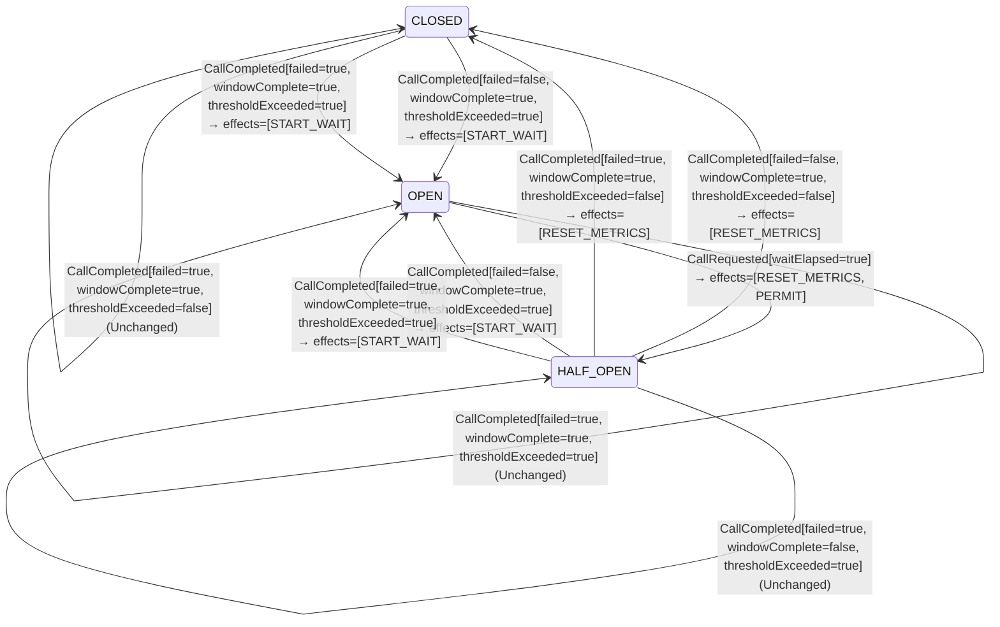

<!-- Generated by examples/demo/tools/build.py from example.json and the verifier's output. Edit example.json. -->
# 076 · A half-open breaker that judges its probes as a window is proved safe and live

[← All examples](../README.md)

| Verdict | Categories | Severity if shipped | Change | Verified unit | Approach |
|---|---|---|---|---|---|
| **✓ Verified: all invariants hold in 98 states, and under 1 more configuration** | functional, no-false-positive | none | feature, behaviour change intended | [`CircuitBreaker#decide`](../../../examples/demo/apps/crosscut/src/main/java/net/terminalvalue/crosscut/resilience/CircuitBreaker.java) | [D1: Protocol model checking](../../../examples/demo/apps/crosscut/spec/README.md) |

> A half-open circuit breaker used to reopen on the first probe that failed. A developer makes it judge the probes together once the last has completed, as Resilience4j does: a failed probe is recorded like any other outcome, and the failure rate of the probes decides between closing and reopening. The contract changes in three rows, the test that expected the first failure to reopen is rewritten, and the model verifies the change under both configurations: every safety invariant in every state, and every liveness property under fairness, the three that say an open breaker probes again, a dependency that comes back is used again, and a dependency that stays down gets its wait between rounds of probes. The verdict comes with what it rests on: runs of the model take one of the three rows the change alters, a failed probe before the window is complete with the failure rate at the threshold, and the other two, a failed probe with the rate below the threshold, are rows the model's two probes and threshold of one in two can never produce.

## The change

In the HALF_OPEN state, drop the branch that reopens the breaker on a failed probe, with the reasoning in a comment: the probes are judged together once the last has completed, a failed probe is recorded like any other outcome, and the failure rate decides between closing and reopening. The contract of `CircuitBreaker#decide` is regenerated: a failed probe before the window is complete now leaves the state unchanged (two rows), and a failed probe that completes the window with the failure rate below the threshold now closes the breaker (one row); a failed probe that completes it with the rate at the threshold still reopens. The test that expected the first failed probe to reopen now expects it recorded, and the breaker reopened when the probes are judged; the class comment describes the new rule.

**Before** ([`CircuitBreaker.java`](../../../examples/demo/apps/crosscut/src/main/java/net/terminalvalue/crosscut/resilience/CircuitBreaker.java), line 20):

```java
 *
 * <p>CLOSED lets every call through and opens when a complete window's failure rate reaches the threshold. OPEN
 * rejects every call until the wait duration has passed, then lets a limited number of probe calls through as
 * HALF_OPEN. HALF_OPEN closes only once every permitted probe has completed with the failure rate below the
 * threshold; a probe that fails reopens the breaker at once.
 */
public final class CircuitBreaker {

    // ...
                        : unchanged("recorded in the sliding window");
                case OPEN -> unchanged("a call permitted before the breaker opened; its outcome is not recorded");
                case HALF_OPEN -> {
                    if (call.failed()) {
                        yield transition(OPEN, START_WAIT);
                    }
                    if (!call.windowComplete()) {
                        yield unchanged("more probes to go");
                    }
```

**After:**

```java
 *
 * <p>CLOSED lets every call through and opens when a complete window's failure rate reaches the threshold. OPEN
 * rejects every call until the wait duration has passed, then lets a limited number of probe calls through as
 * HALF_OPEN. HALF_OPEN judges the probes together once the last has completed, as Resilience4j judges them: it
 * closes when their failure rate is below the threshold and reopens when it is not, a failed probe being recorded
 * like any other outcome rather than reopening the breaker at once.
 */
public final class CircuitBreaker {

    // ...
                        : unchanged("recorded in the sliding window");
                case OPEN -> unchanged("a call permitted before the breaker opened; its outcome is not recorded");
                case HALF_OPEN -> {
                    // The probes are judged together, once the last has completed: a failed probe is recorded like
                    // any other outcome, and the failure rate of the probes decides between closing and reopening.
                    if (!call.windowComplete()) {
                        yield unchanged("more probes to go");
                    }
```

<details><summary>Patch</summary>

```diff
--- a/examples/demo/apps/crosscut/src/main/java/net/terminalvalue/crosscut/resilience/CircuitBreaker.java
+++ b/examples/demo/apps/crosscut/src/main/java/net/terminalvalue/crosscut/resilience/CircuitBreaker.java
@@ -20,8 +20,9 @@
  *
  * <p>CLOSED lets every call through and opens when a complete window's failure rate reaches the threshold. OPEN
  * rejects every call until the wait duration has passed, then lets a limited number of probe calls through as
- * HALF_OPEN. HALF_OPEN closes only once every permitted probe has completed with the failure rate below the
- * threshold; a probe that fails reopens the breaker at once.
+ * HALF_OPEN. HALF_OPEN judges the probes together once the last has completed, as Resilience4j judges them: it
+ * closes when their failure rate is below the threshold and reopens when it is not, a failed probe being recorded
+ * like any other outcome rather than reopening the breaker at once.
  */
 public final class CircuitBreaker {
 
@@ -41,9 +42,8 @@
                         : unchanged("recorded in the sliding window");
                 case OPEN -> unchanged("a call permitted before the breaker opened; its outcome is not recorded");
                 case HALF_OPEN -> {
-                    if (call.failed()) {
-                        yield transition(OPEN, START_WAIT);
-                    }
+                    // The probes are judged together, once the last has completed: a failed probe is recorded like
+                    // any other outcome, and the failure rate of the probes decides between closing and reopening.
                     if (!call.windowComplete()) {
                         yield unchanged("more probes to go");
                     }
--- a/examples/demo/apps/crosscut/src/test/java/net/terminalvalue/crosscut/resilience/CircuitBreakerTest.java
+++ b/examples/demo/apps/crosscut/src/test/java/net/terminalvalue/crosscut/resilience/CircuitBreakerTest.java
@@ -31,8 +31,9 @@
                 CircuitBreaker.decide(OPEN, new CallRequested(true)));
     }
 
-    public static void aFailedProbeReopens() {
-        equal(new Transition<>(OPEN, List.of(BreakerEffect.START_WAIT)), CircuitBreaker.decide(HALF_OPEN, new CallCompleted(true, false, false)));
+    public static void aFailedProbeIsJudgedWithTheOthers() {
+        check(CircuitBreaker.decide(HALF_OPEN, new CallCompleted(true, false, true)) instanceof Decision.Unchanged, "more probes to go");
+        equal(new Transition<>(OPEN, List.of(BreakerEffect.START_WAIT)), CircuitBreaker.decide(HALF_OPEN, new CallCompleted(true, true, true)));
     }
 
     public static void halfOpenClosesWhenEveryProbeSucceeded() {
```

</details>

## What the verifier found

The model is checked under 2 configurations, and the verdict is the first that fails:

| Configuration | What it checks | Model | Result |
|---|---|---|---|
| two calls in flight (`spec/CircuitBreaker.cfg`) | every run from the initial state, every interleaving within the configuration's bounds | WindowSize = 2, FailureRate = 50, PermittedProbes = 2, WaitDuration = 2, MaxInFlight = 2 | ✓ Verified: all invariants hold in 98 states |
| fairness (`spec/CircuitBreakerLive.cfg`) | the three liveness properties, under the fairness conditions `Fairness`: the caller keeps calling, every permitted call completes, the clock ticks, and nothing is assumed of the dependency. A counterexample is a run that goes on forever without satisfying a property: a prefix, then a state or a cycle the system never leaves | WindowSize = 2, FailureRate = 50, PermittedProbes = 2, WaitDuration = 2, MaxInFlight = 2 | ✓ Verified: all invariants and properties hold in 98 states |

Every invariant holds in every reachable state of the model under two calls in flight: 98 distinct states, which is every interleaving of the caller, the owner of the breaker with its window, its probes and its wait, the dependency and the clock within the model's bounds (WindowSize = 2, FailureRate = 50, PermittedProbes = 2, WaitDuration = 2, MaxInFlight = 2).

The breaker's decision rule inside the model is generated from the behavioural contract of the patched code, so the model checks the transitions the breaker really makes; the owner's part, the window, the probe cap and the wait, is written in the model and applies whatever the rule returns.

The other configurations hold too, as the table says: fairness, 98 states.

**What the verdict rests on.** TLC counted how often a step of the model took each row of the generated operators. A row no step takes is one the model says nothing about, whatever the verdict.

| Configuration | Rows of `CircuitBreaker#decide` taken |
|---|---|
| two calls in flight | 14 of 30 |
| fairness | 14 of 30 |

The change alters 3 rows of the contract:

- `decide(HALF_OPEN, CallCompleted[failed=true, windowComplete=false, thresholdExceeded=false])`: `Transition[next=OPEN, effects=[START_WAIT]]` → `Unchanged[reason="more probes to go"]`, taken by no run
- `decide(HALF_OPEN, CallCompleted[failed=true, windowComplete=false, thresholdExceeded=true])`: `Transition[next=OPEN, effects=[START_WAIT]]` → `Unchanged[reason="more probes to go"]`, taken under two calls in flight, fairness
- `decide(HALF_OPEN, CallCompleted[failed=true, windowComplete=true, thresholdExceeded=false])`: `Transition[next=OPEN, effects=[START_WAIT]]` → `Transition[next=CLOSED, effects=[RESET_METRICS]]`, taken by no run

Runs of the model take 1 of the 3 rows the change alters; the verdict rests on those, and says nothing about the others.

<details><summary>Rows no step takes under two calls in flight</summary>

`net.terminalvalue.crosscut.resilience.CircuitBreaker#decide`:

```
decide(CLOSED, CallRequested[waitElapsed=false]) => Transition[next=CLOSED, effects=[PERMIT]]
decide(CLOSED, CallCompleted[failed=false, windowComplete=false, thresholdExceeded=true]) => Unchanged
decide(CLOSED, CallCompleted[failed=true, windowComplete=false, thresholdExceeded=false]) => Unchanged
decide(CLOSED, CallCompleted[failed=true, windowComplete=true, thresholdExceeded=false]) => Unchanged
decide(OPEN, CallCompleted[failed=false, windowComplete=false, thresholdExceeded=false]) => Unchanged
decide(OPEN, CallCompleted[failed=false, windowComplete=false, thresholdExceeded=true]) => Unchanged
decide(OPEN, CallCompleted[failed=false, windowComplete=true, thresholdExceeded=false]) => Unchanged
decide(OPEN, CallCompleted[failed=false, windowComplete=true, thresholdExceeded=true]) => Unchanged
decide(OPEN, CallCompleted[failed=true, windowComplete=false, thresholdExceeded=false]) => Unchanged
decide(OPEN, CallCompleted[failed=true, windowComplete=false, thresholdExceeded=true]) => Unchanged
decide(OPEN, CallCompleted[failed=true, windowComplete=true, thresholdExceeded=false]) => Unchanged
decide(OPEN, CallCompleted[failed=true, windowComplete=true, thresholdExceeded=true]) => Unchanged
decide(HALF_OPEN, CallRequested[waitElapsed=false]) => Transition[next=HALF_OPEN, effects=[PERMIT]]
decide(HALF_OPEN, CallCompleted[failed=false, windowComplete=false, thresholdExceeded=true]) => Unchanged
decide(HALF_OPEN, CallCompleted[failed=true, windowComplete=false, thresholdExceeded=false]) => Unchanged
decide(HALF_OPEN, CallCompleted[failed=true, windowComplete=true, thresholdExceeded=false]) => Transition[next=CLOSED, effects=[RESET_METRICS]]
```

</details>

The state machine the patched code implements, drawn from its derived contract (`jvmcontract statemachine`); a state with no way in or no way out is marked:



## Would the existing tests have caught it?

Every existing unit test passes, as it should (`java -ea net.terminalvalue.crosscut.Tests`, run against the patched code).

## Why it matters

None, and that is the point. The question a reviewer has to answer is whether a breaker that lets a failed probe pass can now close too early, probe too often, or let a call through while it should be shielding the dependency, and whether, under the fairness the breaker is used with, it still probes again after it opens, still closes once the dependency is back, and still gives a dependency that stays down its wait between rounds of probes. The two examples beside this one, 075 and 077, show one-row and four-row changes of the same shape that keep every invariant and fail a liveness property. Answering by inspection means tracing the window, the probe cap and the wait through every interleaving of calls, completions and ticks; answering by model checking takes two seconds.

## Why the verdict is right

The breaker's rule in the model is generated from the regenerated contract, so the model runs the new rule. Under the first configuration TLC explores every interleaving of the caller, the owner, the dependency and the clock within the model's bounds, 98 states, and finds every safety invariant holding: half-open still closes only after every permitted probe, since the window must be complete before the rule closes, and still lets only the permitted number through, since the owner caps the probes whatever the rule says. Under the second it checks the three liveness properties against every infinite behaviour that respects the fairness conditions, and they hold: a failed probe no longer reopens at once, but the window completes on the next probe, and a dependency that is down fails that one too, so the rate reaches the threshold and the breaker reopens with its wait. Coverage says which rows the verdict rests on. Runs take one of the three rows the change alters, a failed probe before the window is complete with the failure rate at the threshold; no run takes the two rows of a failed probe with the rate below it, before or at the end of the window, because with two probes and a threshold of one in two, one failure in at most two is at the threshold. Those rows are live in a breaker configured with more probes or a higher threshold, and the model says nothing about them; the page says so, and a reviewer who wants them covered can widen the bounds.

## What to do

Merge. The contract diff is committed with the change, and the model is checked under both configurations on every build, so the next change to the breaker is held to the same invariants and the same liveness properties.

## Evidence

How the verdict was reached: two calls in flight: TLC 2.19 explored 98 distinct states to depth 19 in 0 s, for the model WindowSize = 2, FailureRate = 50, PermittedProbes = 2, WaitDuration = 2, MaxInFlight = 2; fairness: TLC 2.19 explored 98 distinct states to depth 19 in 0 s, for the model WindowSize = 2, FailureRate = 50, PermittedProbes = 2, WaitDuration = 2, MaxInFlight = 2.

<details><summary>Verifier output</summary>

```text
== two calls in flight: spec/CircuitBreaker.cfg ==
TLC2 Version 2.19 of 08 August 2024 (rev: 5a47802)
Running breadth-first search Model-Checking with fp 1 and seed 1 with 1 worker on 8 cores with 910MB heap and 64MB offheap memory [pid: 2384657] (Linux 6.6.87.2-microsoft-standard-WSL2 aarch64, Eclipse Adoptium 25.0.4.1 x86_64, MSBDiskFPSet, DiskStateQueue).
Parsing file examples/demo/apps/crosscut/spec/CircuitBreaker.tla
Parsing file examples/demo/tools/tla/standard-modules/Naturals.tla
Parsing file examples/demo/tools/tla/standard-modules/Sequences.tla
Parsing file examples/demo/tools/tla/standard-modules/FiniteSets.tla
Parsing file examples/demo/apps/crosscut/spec/CircuitBreakerContract.tla
Semantic processing of module Naturals
Semantic processing of module Sequences
Semantic processing of module FiniteSets
Semantic processing of module CircuitBreakerContract
Semantic processing of module CircuitBreaker
Starting... (2026-11-02 02:12:55)
Computing initial states...
Finished computing initial states: 2 distinct states generated at 2026-11-02 02:12:55.
Model checking completed. No error has been found.
  Estimates of the probability that TLC did not check all reachable states
  because two distinct states had the same fingerprint:
  calculated (optimistic):  val = 9.5E-16
Rows of net.terminalvalue.crosscut.resilience.CircuitBreaker#decide a step of the model takes: 14 of 30; never taken (16):
  decide(CLOSED, CallRequested[waitElapsed=false]) => Transition[next=CLOSED, effects=[PERMIT]]
  decide(CLOSED, CallCompleted[failed=false, windowComplete=false, thresholdExceeded=true]) => Unchanged
  decide(CLOSED, CallCompleted[failed=true, windowComplete=false, thresholdExceeded=false]) => Unchanged
  decide(CLOSED, CallCompleted[failed=true, windowComplete=true, thresholdExceeded=false]) => Unchanged
  decide(OPEN, CallCompleted[failed=false, windowComplete=false, thresholdExceeded=false]) => Unchanged
  decide(OPEN, CallCompleted[failed=false, windowComplete=false, thresholdExceeded=true]) => Unchanged
  decide(OPEN, CallCompleted[failed=false, windowComplete=true, thresholdExceeded=false]) => Unchanged
  decide(OPEN, CallCompleted[failed=false, windowComplete=true, thresholdExceeded=true]) => Unchanged
  decide(OPEN, CallCompleted[failed=true, windowComplete=false, thresholdExceeded=false]) => Unchanged
  decide(OPEN, CallCompleted[failed=true, windowComplete=false, thresholdExceeded=true]) => Unchanged
  decide(OPEN, CallCompleted[failed=true, windowComplete=true, thresholdExceeded=false]) => Unchanged
  decide(OPEN, CallCompleted[failed=true, windowComplete=true, thresholdExceeded=true]) => Unchanged
  decide(HALF_OPEN, CallRequested[waitElapsed=false]) => Transition[next=HALF_OPEN, effects=[PERMIT]]
  decide(HALF_OPEN, CallCompleted[failed=false, windowComplete=false, thresholdExceeded=true]) => Unchanged
  decide(HALF_OPEN, CallCompleted[failed=true, windowComplete=false, thresholdExceeded=false]) => Unchanged
  decide(HALF_OPEN, CallCompleted[failed=true, windowComplete=true, thresholdExceeded=false]) => Transition[next=CLOSED, effects=[RESET_METRICS]]
276 states generated, 98 distinct states found, 0 states left on queue.
The depth of the complete state graph search is 19.
The average outdegree of the complete state graph is 1 (minimum is 0, the maximum 3 and the 95th percentile is 2).
Finished in 00s at (2026-11-02 02:12:55)

== fairness: spec/CircuitBreakerLive.cfg ==
TLC2 Version 2.19 of 08 August 2024 (rev: 5a47802)
Running breadth-first search Model-Checking with fp 1 and seed 1 with 1 worker on 8 cores with 910MB heap and 64MB offheap memory [pid: 2384762] (Linux 6.6.87.2-microsoft-standard-WSL2 aarch64, Eclipse Adoptium 25.0.4.1 x86_64, MSBDiskFPSet, DiskStateQueue).
Parsing file examples/demo/apps/crosscut/spec/CircuitBreaker.tla
Parsing file examples/demo/tools/tla/standard-modules/Naturals.tla
Parsing file examples/demo/tools/tla/standard-modules/Sequences.tla
Parsing file examples/demo/tools/tla/standard-modules/FiniteSets.tla
Parsing file examples/demo/apps/crosscut/spec/CircuitBreakerContract.tla
Semantic processing of module Naturals
Semantic processing of module Sequences
Semantic processing of module FiniteSets
Semantic processing of module CircuitBreakerContract
Semantic processing of module CircuitBreaker
Starting... (2026-11-02 02:12:55)
Implied-temporal checking--satisfiability problem has 2 branches.
Computing initial states...
Finished computing initial states: 2 distinct states generated at 2026-11-02 02:12:56.
Checking 2 branches of temporal properties for the complete state space with 196 total distinct states at (2026-11-02 02:12:56)
Finished checking temporal properties in 00s at 2026-11-02 02:12:56
Model checking completed. No error has been found.
  Estimates of the probability that TLC did not check all reachable states
  because two distinct states had the same fingerprint:
  calculated (optimistic):  val = 9.5E-16
Rows of net.terminalvalue.crosscut.resilience.CircuitBreaker#decide a step of the model takes: 14 of 30; never taken (16):
  decide(CLOSED, CallRequested[waitElapsed=false]) => Transition[next=CLOSED, effects=[PERMIT]]
  decide(CLOSED, CallCompleted[failed=false, windowComplete=false, thresholdExceeded=true]) => Unchanged
  decide(CLOSED, CallCompleted[failed=true, windowComplete=false, thresholdExceeded=false]) => Unchanged
  decide(CLOSED, CallCompleted[failed=true, windowComplete=true, thresholdExceeded=false]) => Unchanged
  decide(OPEN, CallCompleted[failed=false, windowComplete=false, thresholdExceeded=false]) => Unchanged
  decide(OPEN, CallCompleted[failed=false, windowComplete=false, thresholdExceeded=true]) => Unchanged
  decide(OPEN, CallCompleted[failed=false, windowComplete=true, thresholdExceeded=false]) => Unchanged
  decide(OPEN, CallCompleted[failed=false, windowComplete=true, thresholdExceeded=true]) => Unchanged
  decide(OPEN, CallCompleted[failed=true, windowComplete=false, thresholdExceeded=false]) => Unchanged
  decide(OPEN, CallCompleted[failed=true, windowComplete=false, thresholdExceeded=true]) => Unchanged
  decide(OPEN, CallCompleted[failed=true, windowComplete=true, thresholdExceeded=false]) => Unchanged
  decide(OPEN, CallCompleted[failed=true, windowComplete=true, thresholdExceeded=true]) => Unchanged
  decide(HALF_OPEN, CallRequested[waitElapsed=false]) => Transition[next=HALF_OPEN, effects=[PERMIT]]
  decide(HALF_OPEN, CallCompleted[failed=false, windowComplete=false, thresholdExceeded=true]) => Unchanged
  decide(HALF_OPEN, CallCompleted[failed=true, windowComplete=false, thresholdExceeded=false]) => Unchanged
  decide(HALF_OPEN, CallCompleted[failed=true, windowComplete=true, thresholdExceeded=false]) => Transition[next=CLOSED, effects=[RESET_METRICS]]
276 states generated, 98 distinct states found, 0 states left on queue.
The depth of the complete state graph search is 19.
The average outdegree of the complete state graph is 1 (minimum is 0, the maximum 3 and the 95th percentile is 2).
Finished in 00s at (2026-11-02 02:12:56)
```

</details>

<details><summary>SARIF report (as uploaded to GitHub code scanning or SonarQube)</summary>

```json
{
  "version": "2.1.0",
  "$schema": "https://json.schemastore.org/sarif-2.1.0.json",
  "runs": [
    {
      "tool": {
        "driver": {
          "name": "jvmcontract tlc",
          "rules": [
            {
              "id": "invariant-violated",
              "shortDescription": {
                "text": "TLC found a behaviour of the model that violates an invariant or a temporal property, or ends in a deadlock."
              }
            },
            {
              "id": "unverifiable",
              "shortDescription": {
                "text": "TLC could not check the model."
              }
            }
          ]
        }
      },
      "results": []
    }
  ]
}
```

</details>

**Provenance:** Constructed to show an intended change to a protocol's decision rule accepted on the strength of the model, safety and liveness both, to pair with examples 075 and 077; the semantics are Resilience4j's, which judges the permitted calls of the half-open state by their failure rate.

- [Resilience4j, CircuitBreaker: the OPEN, HALF_OPEN and CLOSED states, waitDurationInOpenState and permittedNumberOfCallsInHalfOpenState](https://resilience4j.readme.io/docs/circuitbreaker)
- [Nygard, Release It! (the circuit breaker pattern)](https://pragprog.com/titles/mnee2/release-it-second-edition/)
- [Lamport, Specifying Systems, chapter 8: liveness and fairness, and section 14.3.5, checking liveness with TLC](https://lamport.azurewebsites.net/tla/book.html)
## Reproduce

```bash
python3 examples/demo/tools/build.py 076
```

This applies `change.patch` to a temporary copy of the repo, runs the verifier on it, and rewrites this page.
