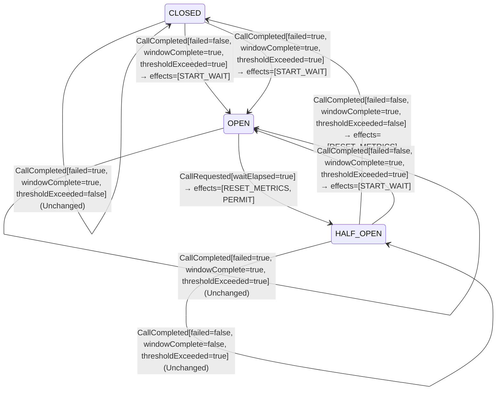

<!-- Generated by examples/demo/tools/build.py from example.json and the verifier's output. Edit example.json. -->
# 077 · A half-open breaker that starts over on a failed probe keeps probing a dead dependency

[← All examples](../README.md)

| Verdict | Categories | Severity if shipped | Change | Verified unit | Approach |
|---|---|---|---|---|---|
| **✗ Violation: ADeadDependencyIsLeftAlone, 14-step trace then forever (fairness)** | functional, performance | high | feature, behaviour change intended | [`CircuitBreaker#decide`](../../../examples/demo/apps/crosscut/src/main/java/net/terminalvalue/crosscut/resilience/CircuitBreaker.java) | [D1: Protocol model checking](../../../examples/demo/apps/crosscut/spec/README.md) |

> A half-open circuit breaker reopens on a probe that fails, and the wait starts again. A developer makes a failed probe start the probes over instead, so that one bad probe does not condemn a dependency on its way back and the breaker closes on the permitted number of successes in a row; the contract changes in four rows, from reopening to a half-open state with its metrics reset, and the test of a failed probe is updated to say so. Every safety invariant holds. The liveness check finds the run in which the dependency stays down: the breaker opens, waits, probes, and from the first failed probe on it is half-open forever, probing a dead dependency at the rate of its probe cap, with no wait ever again. The property that fails is the one that says a dependency which stays down gets the wait between its rounds of probes.

## The change

In the HALF_OPEN state, answer a failed probe with a transition that stays HALF_OPEN and carries RESET_METRICS, instead of reopening with START_WAIT, with the reasoning in a comment: one failed probe does not condemn a dependency on its way back, the probes start over, and the breaker closes once the permitted number in a row have succeeded. The contract of `CircuitBreaker#decide` is regenerated: the four rows of a failed probe, whatever the window and the threshold say, go from reopening to a reset. The test of a failed probe expects the reset; the class comment describes the new rule.

**Before** ([`CircuitBreaker.java`](../../../examples/demo/apps/crosscut/src/main/java/net/terminalvalue/crosscut/resilience/CircuitBreaker.java), line 21):

```java
 * <p>CLOSED lets every call through and opens when a complete window's failure rate reaches the threshold. OPEN
 * rejects every call until the wait duration has passed, then lets a limited number of probe calls through as
 * HALF_OPEN. HALF_OPEN closes only once every permitted probe has completed with the failure rate below the
 * threshold; a probe that fails reopens the breaker at once.
 */
public final class CircuitBreaker {

    // ...
                case OPEN -> unchanged("a call permitted before the breaker opened; its outcome is not recorded");
                case HALF_OPEN -> {
                    if (call.failed()) {
                        yield transition(OPEN, START_WAIT);
                    }
                    if (!call.windowComplete()) {
                        yield unchanged("more probes to go");
```

**After:**

```java
 * <p>CLOSED lets every call through and opens when a complete window's failure rate reaches the threshold. OPEN
 * rejects every call until the wait duration has passed, then lets a limited number of probe calls through as
 * HALF_OPEN. HALF_OPEN closes only once every permitted probe has completed with the failure rate below the
 * threshold; a probe that fails starts the probes over, so that the breaker closes on the permitted number of
 * successes in a row.
 */
public final class CircuitBreaker {

    // ...
                case OPEN -> unchanged("a call permitted before the breaker opened; its outcome is not recorded");
                case HALF_OPEN -> {
                    if (call.failed()) {
                        // One failed probe does not condemn a dependency on its way back: the probes start over, and
                        // the breaker closes once the permitted number in a row have succeeded.
                        yield transition(HALF_OPEN, RESET_METRICS);
                    }
                    if (!call.windowComplete()) {
                        yield unchanged("more probes to go");
```

<details><summary>Patch</summary>

```diff
--- a/examples/demo/apps/crosscut/src/main/java/net/terminalvalue/crosscut/resilience/CircuitBreaker.java
+++ b/examples/demo/apps/crosscut/src/main/java/net/terminalvalue/crosscut/resilience/CircuitBreaker.java
@@ -21,7 +21,8 @@
  * <p>CLOSED lets every call through and opens when a complete window's failure rate reaches the threshold. OPEN
  * rejects every call until the wait duration has passed, then lets a limited number of probe calls through as
  * HALF_OPEN. HALF_OPEN closes only once every permitted probe has completed with the failure rate below the
- * threshold; a probe that fails reopens the breaker at once.
+ * threshold; a probe that fails starts the probes over, so that the breaker closes on the permitted number of
+ * successes in a row.
  */
 public final class CircuitBreaker {
 
@@ -42,7 +43,9 @@
                 case OPEN -> unchanged("a call permitted before the breaker opened; its outcome is not recorded");
                 case HALF_OPEN -> {
                     if (call.failed()) {
-                        yield transition(OPEN, START_WAIT);
+                        // One failed probe does not condemn a dependency on its way back: the probes start over, and
+                        // the breaker closes once the permitted number in a row have succeeded.
+                        yield transition(HALF_OPEN, RESET_METRICS);
                     }
                     if (!call.windowComplete()) {
                         yield unchanged("more probes to go");
--- a/examples/demo/apps/crosscut/src/test/java/net/terminalvalue/crosscut/resilience/CircuitBreakerTest.java
+++ b/examples/demo/apps/crosscut/src/test/java/net/terminalvalue/crosscut/resilience/CircuitBreakerTest.java
@@ -31,8 +31,8 @@
                 CircuitBreaker.decide(OPEN, new CallRequested(true)));
     }
 
-    public static void aFailedProbeReopens() {
-        equal(new Transition<>(OPEN, List.of(BreakerEffect.START_WAIT)), CircuitBreaker.decide(HALF_OPEN, new CallCompleted(true, false, false)));
+    public static void aFailedProbeStartsTheProbesOver() {
+        equal(new Transition<>(HALF_OPEN, List.of(BreakerEffect.RESET_METRICS)), CircuitBreaker.decide(HALF_OPEN, new CallCompleted(true, false, false)));
     }
 
     public static void halfOpenClosesWhenEveryProbeSucceeded() {
```

</details>

## What the verifier found

The model is checked under 2 configurations, and the verdict is the first that fails:

| Configuration | What it checks | Model | Result |
|---|---|---|---|
| two calls in flight (`spec/CircuitBreaker.cfg`) | every run from the initial state, every interleaving within the configuration's bounds | WindowSize = 2, FailureRate = 50, PermittedProbes = 2, WaitDuration = 2, MaxInFlight = 2 | ✓ Verified: all invariants hold in 94 states |
| fairness (`spec/CircuitBreakerLive.cfg`) | the three liveness properties, under the fairness conditions `Fairness`: the caller keeps calling, every permitted call completes, the clock ticks, and nothing is assumed of the dependency. A counterexample is a run that goes on forever without satisfying a property: a prefix, then a state or a cycle the system never leaves | WindowSize = 2, FailureRate = 50, PermittedProbes = 2, WaitDuration = 2, MaxInFlight = 2 | ✗ Violation: ADeadDependencyIsLeftAlone, 14-step trace then forever |

TLC found a run of the system under fairness that violates the temporal property **ADeadDependencyIsLeftAlone** (a dependency that is down for good gets the wait between its probes: the breaker opens again and again, so that no round of probes is followed by another without a wait): after the 14 steps below, the system returns to step 9 and repeats steps 9 to 14 forever, and the property never comes true. The run respects every fairness condition the model assumes; the parts that could act, do. Each step is one action of one part of the system:

1. **Initial state**: the breaker closed, the window empty, no call in flight, no wait running, the dependency up or down.
2. **Request**, `CircuitBreaker.tryAcquirePermission`: a caller asks for a call; the owner reports whether the wait has elapsed and applies the decision, which lets the call through, starts a new metrics generation, or starts the wait. `current = 1`
3. **Complete**, `CircuitBreaker.onResult`, for a call of the current generation: the owner records the outcome, judges the window, and applies the decision. `current = 0`, `window = <<TRUE>>`
4. **Request**, `CircuitBreaker.tryAcquirePermission`: a caller asks for a call; the owner reports whether the wait has elapsed and applies the decision, which lets the call through, starts a new metrics generation, or starts the wait. `current = 1`
5. **Request**, `CircuitBreaker.tryAcquirePermission`: a caller asks for a call; the owner reports whether the wait has elapsed and applies the decision, which lets the call through, starts a new metrics generation, or starts the wait. `current = 2`
6. **Complete**, `CircuitBreaker.onResult`, for a call of the current generation: the owner records the outcome, judges the window, and applies the decision. `current = 0`, `stale = 1`, `state = "OPEN"`, `waitLeft = 2`, `window = <<TRUE, TRUE>>`
7. **Tick**, the clock advances: one tick less of the open state's wait. `waitLeft = 1`
8. **Tick**, the clock advances: one tick less of the open state's wait. `waitLeft = 0`
9. **Request**, `CircuitBreaker.tryAcquirePermission`: a caller asks for a call; the owner reports whether the wait has elapsed and applies the decision, which lets the call through, starts a new metrics generation, or starts the wait. `current = 1`, `state = "HALF_OPEN"`, `window = <<>>`
10. **CompleteStale**, `CircuitBreaker.onResult`, for a call from an earlier generation: its outcome is dropped. `stale = 0`
11. **Complete**, `CircuitBreaker.onResult`, for a call of the current generation: the owner records the outcome, judges the window, and applies the decision. `current = 0`
12. **Request**, `CircuitBreaker.tryAcquirePermission`: a caller asks for a call; the owner reports whether the wait has elapsed and applies the decision, which lets the call through, starts a new metrics generation, or starts the wait. `current = 1`
13. **Request**, `CircuitBreaker.tryAcquirePermission`: a caller asks for a call; the owner reports whether the wait has elapsed and applies the decision, which lets the call through, starts a new metrics generation, or starts the wait. `current = 2`
14. **Complete**, `CircuitBreaker.onResult`, for a call of the current generation: the owner records the outcome, judges the window, and applies the decision. `current = 0`, `stale = 1`

The model is small (WindowSize = 2, FailureRate = 50, PermittedProbes = 2, WaitDuration = 2, MaxInFlight = 2), which is what keeps the trace readable. TLC explored every interleaving of the caller, the owner of the breaker with its window, its probes and its wait, the dependency and the clock within those bounds.

**What the verdict rests on.** TLC counted how often a step of the model took each row of the generated operators. A row no step takes is one the model says nothing about, whatever the verdict.

| Configuration | Rows of `CircuitBreaker#decide` taken |
|---|---|
| two calls in flight | 13 of 30 |
| fairness | stopped at the counterexample |

The change alters 4 rows of the contract:

- `decide(HALF_OPEN, CallCompleted[failed=true, windowComplete=false, thresholdExceeded=false])`: `Transition[next=OPEN, effects=[START_WAIT]]` → `Transition[next=HALF_OPEN, effects=[RESET_METRICS]]`, taken by no run that finished
- `decide(HALF_OPEN, CallCompleted[failed=true, windowComplete=false, thresholdExceeded=true])`: `Transition[next=OPEN, effects=[START_WAIT]]` → `Transition[next=HALF_OPEN, effects=[RESET_METRICS]]`, taken under two calls in flight
- `decide(HALF_OPEN, CallCompleted[failed=true, windowComplete=true, thresholdExceeded=false])`: `Transition[next=OPEN, effects=[START_WAIT]]` → `Transition[next=HALF_OPEN, effects=[RESET_METRICS]]`, taken by no run that finished
- `decide(HALF_OPEN, CallCompleted[failed=true, windowComplete=true, thresholdExceeded=true])`: `Transition[next=OPEN, effects=[START_WAIT]]` → `Transition[next=HALF_OPEN, effects=[RESET_METRICS]]`, taken under two calls in flight

The run under fairness stopped at its counterexample, the steps above, and its counts are left out: the verdict rests on the counterexample.

<details><summary>Rows no step takes under two calls in flight</summary>

`net.terminalvalue.crosscut.resilience.CircuitBreaker#decide`:

```
decide(CLOSED, CallRequested[waitElapsed=false]) => Transition[next=CLOSED, effects=[PERMIT]]
decide(CLOSED, CallCompleted[failed=false, windowComplete=false, thresholdExceeded=true]) => Unchanged
decide(CLOSED, CallCompleted[failed=true, windowComplete=false, thresholdExceeded=false]) => Unchanged
decide(CLOSED, CallCompleted[failed=true, windowComplete=true, thresholdExceeded=false]) => Unchanged
decide(OPEN, CallCompleted[failed=false, windowComplete=false, thresholdExceeded=false]) => Unchanged
decide(OPEN, CallCompleted[failed=false, windowComplete=false, thresholdExceeded=true]) => Unchanged
decide(OPEN, CallCompleted[failed=false, windowComplete=true, thresholdExceeded=false]) => Unchanged
decide(OPEN, CallCompleted[failed=false, windowComplete=true, thresholdExceeded=true]) => Unchanged
decide(OPEN, CallCompleted[failed=true, windowComplete=false, thresholdExceeded=false]) => Unchanged
decide(OPEN, CallCompleted[failed=true, windowComplete=false, thresholdExceeded=true]) => Unchanged
decide(OPEN, CallCompleted[failed=true, windowComplete=true, thresholdExceeded=false]) => Unchanged
decide(OPEN, CallCompleted[failed=true, windowComplete=true, thresholdExceeded=true]) => Unchanged
decide(HALF_OPEN, CallRequested[waitElapsed=false]) => Transition[next=HALF_OPEN, effects=[PERMIT]]
decide(HALF_OPEN, CallCompleted[failed=false, windowComplete=false, thresholdExceeded=true]) => Unchanged
decide(HALF_OPEN, CallCompleted[failed=false, windowComplete=true, thresholdExceeded=true]) => Transition[next=OPEN, effects=[START_WAIT]]
decide(HALF_OPEN, CallCompleted[failed=true, windowComplete=false, thresholdExceeded=false]) => Transition[next=HALF_OPEN, effects=[RESET_METRICS]]
decide(HALF_OPEN, CallCompleted[failed=true, windowComplete=true, thresholdExceeded=false]) => Transition[next=HALF_OPEN, effects=[RESET_METRICS]]
```

</details>

The state machine the patched code implements, drawn from its derived contract (`jvmcontract statemachine`); a state with no way in or no way out is marked:



## Would the existing tests have caught it?

No: every existing unit test passes (`java -ea net.terminalvalue.crosscut.Tests`, run against the patched code).

## Why it matters

The half-open state is a limited experiment: a few calls, then a decision, and if the decision is to reopen, a wait before the next experiment. A failed probe that starts the probes over removes the decision, and with it the wait. A dependency that is down for good then receives probes for as long as it is down, as many at a time as the probe cap allows, each one a real call that takes the full timeout to fail; the breaker has become a rate limiter at the probe cap, and the dependency never gets the quiet period that a breaker exists to give it. The window of the half-open state is reset on each failure, so the failure rate never reaches the threshold, and the rule that reopens the breaker when it does is never reached. No safety invariant sees it: the probes are limited, nothing is let through before a wait, the breaker never closes early. The tests pass, because the developer updated the one that expected a failed probe to reopen, and the comment reads as a reasonable intention: be patient with a dependency that is recovering.

## Why the verdict is right

Under the first configuration TLC explores every interleaving within the model's bounds, 94 states, and every safety invariant holds. Under the second, the fairness conditions of `LiveSpec`, the third property fails: `ADeadDependencyIsLeftAlone`, which says that once the dependency is down for good, the breaker opens again and again, so that no round of probes is followed by another without a wait. TLC shows the run. The dependency is down; two calls fail with a third in flight, and the window opens the breaker, dropping the third call as stale; the wait elapses over two ticks; a call is let through as the first probe, in a fresh generation; the stale call completes, dropped; the probe fails, and the rule resets the metrics and stays half-open; two more probes are let through, and one fails with the other in flight, which the reset drops as stale. From there the run is a cycle of six steps that the system never leaves: probes let through, probes failing, resets, and in no state of it is the breaker open. The run respects every fairness condition: every call completes, and the clock, with no wait to count down, has nothing to tick. The first two properties hold of this rule, since an open breaker still probes again and a dependency that comes back still closes it; it took the third, written for the dependency that does not come back, to see this run.

## What to do

Keep the reopening: a failed probe is the half-open state's answer, and the wait that follows is what the dependency needs. If one failed probe is too harsh a verdict, judge the probes together by their failure rate, as example 076 does and as Resilience4j does, which keeps the decision and the wait; the liveness check confirms that rule under the same fairness. Then keep the three liveness properties in the build: each is written for a different fate of the dependency, and this change was invisible to the two written for one that comes back.

## Evidence

How the verdict was reached: two calls in flight: TLC 2.19 explored 94 distinct states to depth 19 in 0 s, for the model WindowSize = 2, FailureRate = 50, PermittedProbes = 2, WaitDuration = 2, MaxInFlight = 2; fairness: TLC 2.19 explored 94 distinct states in 0 s, for the model WindowSize = 2, FailureRate = 50, PermittedProbes = 2, WaitDuration = 2, MaxInFlight = 2.

<details><summary>Verifier output</summary>

```text
== two calls in flight: spec/CircuitBreaker.cfg ==
TLC2 Version 2.19 of 08 August 2024 (rev: 5a47802)
Running breadth-first search Model-Checking with fp 1 and seed 1 with 1 worker on 8 cores with 910MB heap and 64MB offheap memory [pid: 2381241] (Linux 6.6.87.2-microsoft-standard-WSL2 aarch64, Eclipse Adoptium 25.0.4.1 x86_64, MSBDiskFPSet, DiskStateQueue).
Parsing file examples/demo/apps/crosscut/spec/CircuitBreaker.tla
Parsing file examples/demo/tools/tla/standard-modules/Naturals.tla
Parsing file examples/demo/tools/tla/standard-modules/Sequences.tla
Parsing file examples/demo/tools/tla/standard-modules/FiniteSets.tla
Parsing file examples/demo/apps/crosscut/spec/CircuitBreakerContract.tla
Semantic processing of module Naturals
Semantic processing of module Sequences
Semantic processing of module FiniteSets
Semantic processing of module CircuitBreakerContract
Semantic processing of module CircuitBreaker
Starting... (2026-11-02 02:11:40)
Computing initial states...
Finished computing initial states: 2 distinct states generated at 2026-11-02 02:11:40.
Model checking completed. No error has been found.
  Estimates of the probability that TLC did not check all reachable states
  because two distinct states had the same fingerprint:
  calculated (optimistic):  val = 8.8E-16
Rows of net.terminalvalue.crosscut.resilience.CircuitBreaker#decide a step of the model takes: 13 of 30; never taken (17):
  decide(CLOSED, CallRequested[waitElapsed=false]) => Transition[next=CLOSED, effects=[PERMIT]]
  decide(CLOSED, CallCompleted[failed=false, windowComplete=false, thresholdExceeded=true]) => Unchanged
  decide(CLOSED, CallCompleted[failed=true, windowComplete=false, thresholdExceeded=false]) => Unchanged
  decide(CLOSED, CallCompleted[failed=true, windowComplete=true, thresholdExceeded=false]) => Unchanged
  decide(OPEN, CallCompleted[failed=false, windowComplete=false, thresholdExceeded=false]) => Unchanged
  decide(OPEN, CallCompleted[failed=false, windowComplete=false, thresholdExceeded=true]) => Unchanged
  decide(OPEN, CallCompleted[failed=false, windowComplete=true, thresholdExceeded=false]) => Unchanged
  decide(OPEN, CallCompleted[failed=false, windowComplete=true, thresholdExceeded=true]) => Unchanged
  decide(OPEN, CallCompleted[failed=true, windowComplete=false, thresholdExceeded=false]) => Unchanged
  decide(OPEN, CallCompleted[failed=true, windowComplete=false, thresholdExceeded=true]) => Unchanged
  decide(OPEN, CallCompleted[failed=true, windowComplete=true, thresholdExceeded=false]) => Unchanged
  decide(OPEN, CallCompleted[failed=true, windowComplete=true, thresholdExceeded=true]) => Unchanged
  decide(HALF_OPEN, CallRequested[waitElapsed=false]) => Transition[next=HALF_OPEN, effects=[PERMIT]]
  decide(HALF_OPEN, CallCompleted[failed=false, windowComplete=false, thresholdExceeded=true]) => Unchanged
  decide(HALF_OPEN, CallCompleted[failed=false, windowComplete=true, thresholdExceeded=true]) => Transition[next=OPEN, effects=[START_WAIT]]
  decide(HALF_OPEN, CallCompleted[failed=true, windowComplete=false, thresholdExceeded=false]) => Transition[next=HALF_OPEN, effects=[RESET_METRICS]]
  decide(HALF_OPEN, CallCompleted[failed=true, windowComplete=true, thresholdExceeded=false]) => Transition[next=HALF_OPEN, effects=[RESET_METRICS]]
266 states generated, 94 distinct states found, 0 states left on queue.
The depth of the complete state graph search is 19.
The average outdegree of the complete state graph is 1 (minimum is 0, the maximum 3 and the 95th percentile is 2).
Finished in 00s at (2026-11-02 02:11:41)

== fairness: spec/CircuitBreakerLive.cfg ==
TLC2 Version 2.19 of 08 August 2024 (rev: 5a47802)
Running breadth-first search Model-Checking with fp 1 and seed 1 with 1 worker on 8 cores with 910MB heap and 64MB offheap memory [pid: 2381578] (Linux 6.6.87.2-microsoft-standard-WSL2 aarch64, Eclipse Adoptium 25.0.4.1 x86_64, MSBDiskFPSet, DiskStateQueue).
Parsing file examples/demo/apps/crosscut/spec/CircuitBreaker.tla
Parsing file examples/demo/tools/tla/standard-modules/Naturals.tla
Parsing file examples/demo/tools/tla/standard-modules/Sequences.tla
Parsing file examples/demo/tools/tla/standard-modules/FiniteSets.tla
Parsing file examples/demo/apps/crosscut/spec/CircuitBreakerContract.tla
Semantic processing of module Naturals
Semantic processing of module Sequences
Semantic processing of module FiniteSets
Semantic processing of module CircuitBreakerContract
Semantic processing of module CircuitBreaker
Starting... (2026-11-02 02:11:45)
Implied-temporal checking--satisfiability problem has 1 branches.
Computing initial states...
Finished computing initial states: 2 distinct states generated at 2026-11-02 02:11:45.
Checking temporal properties for the complete state space with 94 total distinct states at (2026-11-02 02:11:45)
Error: Temporal properties were violated.

Error: The following behavior constitutes a counter-example:

State 1: <Initial predicate>
/\ state = "CLOSED"
/\ window = <<>>
/\ probedEarly = FALSE
/\ current = 0
/\ waitLeft = 0
/\ dependency = "DOWN"
/\ stale = 0
/\ closedEarly = FALSE

State 2: <Request line 68, col 5 to line 78, col 44 of module CircuitBreaker>
/\ state = "CLOSED"
/\ window = <<>>
/\ probedEarly = FALSE
/\ current = 1
/\ waitLeft = 0
/\ dependency = "DOWN"
/\ stale = 0
/\ closedEarly = FALSE

State 3: <Complete line 84, col 5 to line 97, col 44 of module CircuitBreaker>
/\ state = "CLOSED"
/\ window = <<TRUE>>
/\ probedEarly = FALSE
/\ current = 0
/\ waitLeft = 0
/\ dependency = "DOWN"
/\ stale = 0
/\ closedEarly = FALSE

State 4: <Request line 68, col 5 to line 78, col 44 of module CircuitBreaker>
/\ state = "CLOSED"
/\ window = <<TRUE>>
/\ probedEarly = FALSE
/\ current = 1
/\ waitLeft = 0
/\ dependency = "DOWN"
/\ stale = 0
/\ closedEarly = FALSE

State 5: <Request line 68, col 5 to line 78, col 44 of module CircuitBreaker>
/\ state = "CLOSED"
/\ window = <<TRUE>>
/\ probedEarly = FALSE
/\ current = 2
/\ waitLeft = 0
/\ dependency = "DOWN"
/\ stale = 0
/\ closedEarly = FALSE

State 6: <Complete line 84, col 5 to line 97, col 44 of module CircuitBreaker>
/\ state = "OPEN"
/\ window = <<TRUE, TRUE>>
/\ probedEarly = FALSE
/\ current = 0
/\ waitLeft = 2
/\ dependency = "DOWN"
/\ stale = 1
/\ closedEarly = FALSE

State 7: <Tick line 111, col 5 to line 113, col 88 of module CircuitBreaker>
/\ state = "OPEN"
/\ window = <<TRUE, TRUE>>
/\ probedEarly = FALSE
/\ current = 0
/\ waitLeft = 1
/\ dependency = "DOWN"
/\ stale = 1
/\ closedEarly = FALSE

State 8: <Tick line 111, col 5 to line 113, col 88 of module CircuitBreaker>
/\ state = "OPEN"
/\ window = <<TRUE, TRUE>>
/\ probedEarly = FALSE
/\ current = 0
/\ waitLeft = 0
/\ dependency = "DOWN"
/\ stale = 1
/\ closedEarly = FALSE

State 9: <Request line 68, col 5 to line 78, col 44 of module CircuitBreaker>
/\ state = "HALF_OPEN"
/\ window = <<>>
/\ probedEarly = FALSE
/\ current = 1
/\ waitLeft = 0
/\ dependency = "DOWN"
/\ stale = 1
/\ closedEarly = FALSE

State 10: <CompleteStale line 101, col 5 to line 103, col 91 of module CircuitBreaker>
/\ state = "HALF_OPEN"
/\ window = <<>>
/\ probedEarly = FALSE
/\ current = 1
/\ waitLeft = 0
/\ dependency = "DOWN"
/\ stale = 0
/\ closedEarly = FALSE

State 11: <Complete line 84, col 5 to line 97, col 44 of module CircuitBreaker>
/\ state = "HALF_OPEN"
/\ window = <<>>
/\ probedEarly = FALSE
/\ current = 0
/\ waitLeft = 0
/\ dependency = "DOWN"
/\ stale = 0
/\ closedEarly = FALSE

State 12: <Request line 68, col 5 to line 78, col 44 of module CircuitBreaker>
/\ state = "HALF_OPEN"
/\ window = <<>>
/\ probedEarly = FALSE
/\ current = 1
/\ waitLeft = 0
/\ dependency = "DOWN"
/\ stale = 0
/\ closedEarly = FALSE

State 13: <Request line 68, col 5 to line 78, col 44 of module CircuitBreaker>
/\ state = "HALF_OPEN"
/\ window = <<>>
/\ probedEarly = FALSE
/\ current = 2
/\ waitLeft = 0
/\ dependency = "DOWN"
/\ stale = 0
/\ closedEarly = FALSE

State 14: <Complete line 84, col 5 to line 97, col 44 of module CircuitBreaker>
/\ state = "HALF_OPEN"
/\ window = <<>>
/\ probedEarly = FALSE
/\ current = 0
/\ waitLeft = 0
/\ dependency = "DOWN"
/\ stale = 1
/\ closedEarly = FALSE

Back to state 9: <Request line 68, col 5 to line 78, col 44 of module CircuitBreaker>

Finished checking temporal properties in 00s at 2026-11-02 02:11:45
The coverage statistics at 2026-11-02 02:11:45
<Init line 124, col 1 to line 124, col 4 of module CircuitBreaker>: 4:4
  line 126, col 8 to line 126, col 36 of module CircuitBreaker: 2
  line 127, col 8 to line 127, col 20 of module CircuitBreaker: 4
  line 131, col 8 to line 131, col 26 of module CircuitBreaker: 4
  line 132, col 8 to line 132, col 26 of module CircuitBreaker: 4
<Request line 67, col 1 to line 67, col 7 of module CircuitBreaker>: 15:81
  line 68, col 8 to line 68, col 36 of module CircuitBreaker: 81
  |line 68, col 8 to line 68, col 22 of module CircuitBreaker: 108
  |line 68, col 26 to line 68, col 36 of module CircuitBreaker: 108
  line 69, col 8 to line 69, col 69 of module CircuitBreaker: 67
  |line 69, col 8 to line 69, col 26 of module CircuitBreaker: 83
  |line 69, col 31 to line 69, col 69 of module CircuitBreaker: 14
  ||line 69, col 31 to line 69, col 51 of module CircuitBreaker: 16
  ||line 69, col 55 to line 69, col 69 of module CircuitBreaker: 16
  line 72, col 14 to line 72, col 69 of module CircuitBreaker: 81
  |line 72, col 23 to line 72, col 69 of module CircuitBreaker: 81
  ||line 72, col 26 to line 72, col 46 of module CircuitBreaker: 81
  |||line 72, col 26 to line 72, col 31 of module CircuitBreaker: 81
  ||||line 72, col 26 to line 72, col 26 of module CircuitBreaker: 81
  |||||line 70, col 17 to line 70, col 89 of module CircuitBreaker: 81
  ||||||line 13, col 3 to line 42, col 183 of module CircuitBreakerContract: 81
  |||||||line 13, col 8 to line 13, col 114 of module CircuitBreakerContract: 81
  ||||||||line 13, col 8 to line 13, col 53 of module CircuitBreakerContract: 81
  |||||||||line 13, col 9 to line 13, col 31 of module CircuitBreakerContract: 81
  ||||||||||line 13, col 27 to line 13, col 31 of module CircuitBreakerContract: 162
  ||||||||||line 13, col 18 to line 13, col 23 of module CircuitBreakerContract: 81:243
  |||||||||line 13, col 37 to line 13, col 53 of module CircuitBreakerContract: 81
  ||||||||line 13, col 58 to line 13, col 114 of module CircuitBreakerContract: 28
  |||||||line 14, col 8 to line 14, col 84 of module CircuitBreakerContract: 81
  ||||||||line 14, col 8 to line 14, col 24 of module CircuitBreakerContract: 81
  ||||||||line 14, col 29 to line 14, col 84 of module CircuitBreakerContract: 28
  |||||||line 14, col 89 to line 14, col 122 of module CircuitBreakerContract: 28
  |||||||line 15, col 8 to line 15, col 148 of module CircuitBreakerContract: 53
  |||||||line 16, col 8 to line 16, col 147 of module CircuitBreakerContract: 53
  |||||||line 17, col 8 to line 17, col 147 of module CircuitBreakerContract: 53
  |||||||line 18, col 8 to line 18, col 173 of module CircuitBreakerContract: 53
  |||||||line 19, col 8 to line 19, col 147 of module CircuitBreakerContract: 53
  |||||||line 20, col 8 to line 20, col 146 of module CircuitBreakerContract: 53
  |||||||line 21, col 8 to line 21, col 146 of module CircuitBreakerContract: 53
  |||||||line 22, col 8 to line 22, col 172 of module CircuitBreakerContract: 53
  |||||||line 23, col 8 to line 23, col 83 of module CircuitBreakerContract: 53
  ||||||||line 23, col 8 to line 23, col 22 of module CircuitBreakerContract: 53
  ||||||||line 23, col 27 to line 23, col 83 of module CircuitBreakerContract: 39
  |||||||line 23, col 88 to line 23, col 95 of module CircuitBreakerContract: 26
  |||||||line 24, col 8 to line 24, col 82 of module CircuitBreakerContract: 27
  ||||||||line 24, col 8 to line 24, col 22 of module CircuitBreakerContract: 27
  ||||||||line 24, col 27 to line 24, col 82 of module CircuitBreakerContract: 13
  |||||||line 24, col 87 to line 24, col 140 of module CircuitBreakerContract: 13
  |||||||line 25, col 8 to line 25, col 146 of module CircuitBreakerContract: 14
  |||||||line 26, col 8 to line 26, col 145 of module CircuitBreakerContract: 14
  |||||||line 27, col 8 to line 27, col 145 of module CircuitBreakerContract: 14
  |||||||line 28, col 8 to line 28, col 144 of module CircuitBreakerContract: 14
  |||||||line 29, col 8 to line 29, col 145 of module CircuitBreakerContract: 14
  |||||||line 30, col 8 to line 30, col 144 of module CircuitBreakerContract: 14
  |||||||line 31, col 8 to line 31, col 144 of module CircuitBreakerContract: 14
  |||||||line 32, col 8 to line 32, col 143 of module CircuitBreakerContract: 14
  |||||||line 33, col 8 to line 33, col 129 of module CircuitBreakerContract: 14
  |||||||line 34, col 8 to line 34, col 128 of module CircuitBreakerContract: 14
  ||||||line 70, col 24 to line 70, col 28 of module CircuitBreaker: 81
  ||||||line 70, col 31 to line 70, col 88 of module CircuitBreaker: 81
  ||line 72, col 53 to line 72, col 58 of module CircuitBreaker: 55
  |||line 72, col 53 to line 72, col 53 of module CircuitBreaker: 55
  ||||line 70, col 17 to line 70, col 89 of module CircuitBreaker: 55
  |||||line 13, col 3 to line 42, col 183 of module CircuitBreakerContract: 55
  ||||||line 13, col 8 to line 13, col 114 of module CircuitBreakerContract: 55
  |||||||line 13, col 8 to line 13, col 53 of module CircuitBreakerContract: 55
  ||||||||line 13, col 9 to line 13, col 31 of module CircuitBreakerContract: 55
  |||||||||line 13, col 27 to line 13, col 31 of module CircuitBreakerContract: 110
  |||||||||line 13, col 18 to line 13, col 23 of module CircuitBreakerContract: 55:165
  ||||||||line 13, col 37 to line 13, col 53 of module CircuitBreakerContract: 55
  |||||||line 13, col 58 to line 13, col 114 of module CircuitBreakerContract: 28
  ||||||line 14, col 8 to line 14, col 84 of module CircuitBreakerContract: 55
  |||||||line 14, col 8 to line 14, col 24 of module CircuitBreakerContract: 55
  |||||||line 14, col 29 to line 14, col 84 of module CircuitBreakerContract: 28
  ||||||line 14, col 89 to line 14, col 122 of module CircuitBreakerContract: 28
  ||||||line 15, col 8 to line 15, col 148 of module CircuitBreakerContract: 27
  ||||||line 16, col 8 to line 16, col 147 of module CircuitBreakerContract: 27
  ||||||line 17, col 8 to line 17, col 147 of module CircuitBreakerContract: 27
  ||||||line 18, col 8 to line 18, col 173 of module CircuitBreakerContract: 27
  ||||||line 19, col 8 to line 19, col 147 of module CircuitBreakerContract: 27
  ||||||line 20, col 8 to line 20, col 146 of module CircuitBreakerContract: 27
  ||||||line 21, col 8 to line 21, col 146 of module CircuitBreakerContract: 27
  ||||||line 22, col 8 to line 22, col 172 of module CircuitBreakerContract: 27
  ||||||line 23, col 8 to line 23, col 83 of module CircuitBreakerContract: 27
  |||||||line 23, col 8 to line 23, col 22 of module CircuitBreakerContract: 27
  |||||||line 23, col 27 to line 23, col 83 of module CircuitBreakerContract: 13
  ||||||line 24, col 8 to line 24, col 82 of module CircuitBreakerContract: 27
  |||||||line 24, col 8 to line 24, col 22 of module CircuitBreakerContract: 27
  |||||||line 24, col 27 to line 24, col 82 of module CircuitBreakerContract: 13
  ||||||line 24, col 87 to line 24, col 140 of module CircuitBreakerContract: 13
  ||||||line 25, col 8 to line 25, col 146 of module CircuitBreakerContract: 14
  ||||||line 26, col 8 to line 26, col 145 of module CircuitBreakerContract: 14
  ||||||line 27, col 8 to line 27, col 145 of module CircuitBreakerContract: 14
  ||||||line 28, col 8 to line 28, col 144 of module CircuitBreakerContract: 14
  ||||||line 29, col 8 to line 29, col 145 of module CircuitBreakerContract: 14
  ||||||line 30, col 8 to line 30, col 144 of module CircuitBreakerContract: 14
  ||||||line 31, col 8 to line 31, col 144 of module CircuitBreakerContract: 14
  ||||||line 32, col 8 to line 32, col 143 of module CircuitBreakerContract: 14
  ||||||line 33, col 8 to line 33, col 129 of module CircuitBreakerContract: 14
  ||||||line 34, col 8 to line 34, col 128 of module CircuitBreakerContract: 14
  |||||line 70, col 24 to line 70, col 28 of module CircuitBreaker: 55
  |||||line 70, col 31 to line 70, col 88 of module CircuitBreaker: 55
  ||line 72, col 65 to line 72, col 69 of module CircuitBreaker: 26
  line 73, col 14 to line 73, col 53 of module CircuitBreaker: 81
  |line 73, col 24 to line 73, col 53 of module CircuitBreaker: 81
  ||line 73, col 27 to line 73, col 31 of module CircuitBreaker: 81
  |||line 71, col 21 to line 71, col 43 of module CircuitBreaker: 81
  ||||line 49, col 19 to line 49, col 68 of module CircuitBreaker: 81
  |||||line 49, col 48 to line 49, col 68 of module CircuitBreaker: 55
  |||||line 49, col 28 to line 49, col 44 of module CircuitBreaker: 81
  ||||line 71, col 25 to line 71, col 25 of module CircuitBreaker: 81
  |||||line 70, col 17 to line 70, col 89 of module CircuitBreaker: 81
  ||||||line 13, col 3 to line 42, col 183 of module CircuitBreakerContract: 81
  |||||||line 13, col 8 to line 13, col 114 of module CircuitBreakerContract: 81
  ||||||||line 13, col 8 to line 13, col 53 of module CircuitBreakerContract: 81
  |||||||||line 13, col 9 to line 13, col 31 of module CircuitBreakerContract: 81
  ||||||||||line 13, col 27 to line 13, col 31 of module CircuitBreakerContract: 162
  ||||||||||line 13, col 18 to line 13, col 23 of module CircuitBreakerContract: 81:243
  |||||||||line 13, col 37 to line 13, col 53 of module CircuitBreakerContract: 81
  ||||||||line 13, col 58 to line 13, col 114 of module CircuitBreakerContract: 28
  |||||||line 14, col 8 to line 14, col 84 of module CircuitBreakerContract: 81
  ||||||||line 14, col 8 to line 14, col 24 of module CircuitBreakerContract: 81
  ||||||||line 14, col 29 to line 14, col 84 of module CircuitBreakerContract: 28
  |||||||line 14, col 89 to line 14, col 122 of module CircuitBreakerContract: 28
  |||||||line 15, col 8 to line 15, col 148 of module CircuitBreakerContract: 53
  |||||||line 16, col 8 to line 16, col 147 of module CircuitBreakerContract: 53
  |||||||line 17, col 8 to line 17, col 147 of module CircuitBreakerContract: 53
  |||||||line 18, col 8 to line 18, col 173 of module CircuitBreakerContract: 53
  |||||||line 19, col 8 to line 19, col 147 of module CircuitBreakerContract: 53
  |||||||line 20, col 8 to line 20, col 146 of module CircuitBreakerContract: 53
  |||||||line 21, col 8 to line 21, col 146 of module CircuitBreakerContract: 53
  |||||||line 22, col 8 to line 22, col 172 of module CircuitBreakerContract: 53
  |||||||line 23, col 8 to line 23, col 83 of module CircuitBreakerContract: 53
  ||||||||line 23, col 8 to line 23, col 22 of module CircuitBreakerContract: 53
  ||||||||line 23, col 27 to line 23, col 83 of module CircuitBreakerContract: 39
  |||||||line 23, col 88 to line 23, col 95 of module CircuitBreakerContract: 26
  |||||||line 24, col 8 to line 24, col 82 of module CircuitBreakerContract: 27
  ||||||||line 24, col 8 to line 24, col 22 of module CircuitBreakerContract: 27
  ||||||||line 24, col 27 to line 24, col 82 of module CircuitBreakerContract: 13
  |||||||line 24, col 87 to line 24, col 140 of module CircuitBreakerContract: 13
  |||||||line 25, col 8 to line 25, col 146 of module CircuitBreakerContract: 14
  |||||||line 26, col 8 to line 26, col 145 of module CircuitBreakerContract: 14
  |||||||line 27, col 8 to line 27, col 145 of module CircuitBreakerContract: 14
  |||||||line 28, col 8 to line 28, col 144 of module CircuitBreakerContract: 14
  |||||||line 29, col 8 to line 29, col 145 of module CircuitBreakerContract: 14
  |||||||line 30, col 8 to line 30, col 144 of module CircuitBreakerContract: 14
  |||||||line 31, col 8 to line 31, col 144 of module CircuitBreakerContract: 14
  |||||||line 32, col 8 to line 32, col 143 of module CircuitBreakerContract: 14
  |||||||line 33, col 8 to line 33, col 129 of module CircuitBreakerContract: 14
  |||||||line 34, col 8 to line 34, col 128 of module CircuitBreakerContract: 14
  ||||||line 70, col 24 to line 70, col 28 of module CircuitBreaker: 81
  ||||||line 70, col 31 to line 70, col 88 of module CircuitBreaker: 81
  ||line 73, col 38 to line 73, col 41 of module CircuitBreaker: 13
  ||line 73, col 48 to line 73, col 53 of module CircuitBreaker: 68
  line 74, col 14 to line 74, col 62 of module CircuitBreaker: 81
  |line 74, col 23 to line 74, col 62 of module CircuitBreaker: 81
  ||line 74, col 26 to line 74, col 30 of module CircuitBreaker: 81
  |||line 71, col 21 to line 71, col 43 of module CircuitBreaker: 81
  ||||line 49, col 19 to line 49, col 68 of module CircuitBreaker: 81
  |||||line 49, col 48 to line 49, col 68 of module CircuitBreaker: 55
  |||||line 49, col 28 to line 49, col 44 of module CircuitBreaker: 81
  ||||line 71, col 25 to line 71, col 25 of module CircuitBreaker: 81
  |||||line 70, col 17 to line 70, col 89 of module CircuitBreaker: 81
  ||||||line 13, col 3 to line 42, col 183 of module CircuitBreakerContract: 81
  |||||||line 13, col 8 to line 13, col 114 of module CircuitBreakerContract: 81
  ||||||||line 13, col 8 to line 13, col 53 of module CircuitBreakerContract: 81
  |||||||||line 13, col 9 to line 13, col 31 of module CircuitBreakerContract: 81
  ||||||||||line 13, col 27 to line 13, col 31 of module CircuitBreakerContract: 162
  ||||||||||line 13, col 18 to line 13, col 23 of module CircuitBreakerContract: 81:243
  |||||||||line 13, col 37 to line 13, col 53 of module CircuitBreakerContract: 81
  ||||||||line 13, col 58 to line 13, col 114 of module CircuitBreakerContract: 28
  |||||||line 14, col 8 to line 14, col 84 of module CircuitBreakerContract: 81
  ||||||||line 14, col 8 to line 14, col 24 of module CircuitBreakerContract: 81
  ||||||||line 14, col 29 to line 14, col 84 of module CircuitBreakerContract: 28
  |||||||line 14, col 89 to line 14, col 122 of module CircuitBreakerContract: 28
  |||||||line 15, col 8 to line 15, col 148 of module CircuitBreakerContract: 53
  |||||||line 16, col 8 to line 16, col 147 of module CircuitBreakerContract: 53
  |||||||line 17, col 8 to line 17, col 147 of module CircuitBreakerContract: 53
  |||||||line 18, col 8 to line 18, col 173 of module CircuitBreakerContract: 53
  |||||||line 19, col 8 to line 19, col 147 of module CircuitBreakerContract: 53
  |||||||line 20, col 8 to line 20, col 146 of module CircuitBreakerContract: 53
  |||||||line 21, col 8 to line 21, col 146 of module CircuitBreakerContract: 53
  |||||||line 22, col 8 to line 22, col 172 of module CircuitBreakerContract: 53
  |||||||line 23, col 8 to line 23, col 83 of module CircuitBreakerContract: 53
  ||||||||line 23, col 8 to line 23, col 22 of module CircuitBreakerContract: 53
  ||||||||line 23, col 27 to line 23, col 83 of module CircuitBreakerContract: 39
  |||||||line 23, col 88 to line 23, col 95 of module CircuitBreakerContract: 26
  |||||||line 24, col 8 to line 24, col 82 of module CircuitBreakerContract: 27
  ||||||||line 24, col 8 to line 24, col 22 of module CircuitBreakerContract: 27
  ||||||||line 24, col 27 to line 24, col 82 of module CircuitBreakerContract: 13
  |||||||line 24, col 87 to line 24, col 140 of module CircuitBreakerContract: 13
  |||||||line 25, col 8 to line 25, col 146 of module CircuitBreakerContract: 14
  |||||||line 26, col 8 to line 26, col 145 of module CircuitBreakerContract: 14
  |||||||line 27, col 8 to line 27, col 145 of module CircuitBreakerContract: 14
  |||||||line 28, col 8 to line 28, col 144 of module CircuitBreakerContract: 14
  |||||||line 29, col 8 to line 29, col 145 of module CircuitBreakerContract: 14
  |||||||line 30, col 8 to line 30, col 144 of module CircuitBreakerContract: 14
  |||||||line 31, col 8 to line 31, col 144 of module CircuitBreakerContract: 14
  |||||||line 32, col 8 to line 32, col 143 of module CircuitBreakerContract: 14
  |||||||line 33, col 8 to line 33, col 129 of module CircuitBreakerContract: 14
  |||||||line 34, col 8 to line 34, col 128 of module CircuitBreakerContract: 14
  ||||||line 70, col 24 to line 70, col 28 of module CircuitBreaker: 81
  ||||||line 70, col 31 to line 70, col 88 of module CircuitBreaker: 81
  ||line 74, col 37 to line 74, col 51 of module CircuitBreaker: 13
  ||line 74, col 58 to line 74, col 62 of module CircuitBreaker: 68
  line 75, col 14 to line 75, col 96 of module CircuitBreaker: 81
  |line 75, col 25 to line 75, col 96 of module CircuitBreaker: 81
  ||line 75, col 28 to line 75, col 43 of module CircuitBreaker: 81
  |||line 49, col 19 to line 49, col 68 of module CircuitBreaker: 81
  ||||line 49, col 48 to line 49, col 68 of module CircuitBreaker: 68
  ||||line 49, col 28 to line 49, col 44 of module CircuitBreaker: 81
  |||line 75, col 32 to line 75, col 32 of module CircuitBreaker: 81
  ||||line 70, col 17 to line 70, col 89 of module CircuitBreaker: 81
  |||||line 13, col 3 to line 42, col 183 of module CircuitBreakerContract: 81
  ||||||line 13, col 8 to line 13, col 114 of module CircuitBreakerContract: 81
  |||||||line 13, col 8 to line 13, col 53 of module CircuitBreakerContract: 81
  ||||||||line 13, col 9 to line 13, col 31 of module CircuitBreakerContract: 81
  |||||||||line 13, col 27 to line 13, col 31 of module CircuitBreakerContract: 162
  |||||||||line 13, col 18 to line 13, col 23 of module CircuitBreakerContract: 81:243
  ||||||||line 13, col 37 to line 13, col 53 of module CircuitBreakerContract: 81
  |||||||line 13, col 58 to line 13, col 114 of module CircuitBreakerContract: 28
  ||||||line 14, col 8 to line 14, col 84 of module CircuitBreakerContract: 81
  |||||||line 14, col 8 to line 14, col 24 of module CircuitBreakerContract: 81
  |||||||line 14, col 29 to line 14, col 84 of module CircuitBreakerContract: 28
  ||||||line 14, col 89 to line 14, col 122 of module CircuitBreakerContract: 28
  ||||||line 15, col 8 to line 15, col 148 of module CircuitBreakerContract: 53
  ||||||line 16, col 8 to line 16, col 147 of module CircuitBreakerContract: 53
  ||||||line 17, col 8 to line 17, col 147 of module CircuitBreakerContract: 53
  ||||||line 18, col 8 to line 18, col 173 of module CircuitBreakerContract: 53
  ||||||line 19, col 8 to line 19, col 147 of module CircuitBreakerContract: 53
  ||||||line 20, col 8 to line 20, col 146 of module CircuitBreakerContract: 53
  ||||||line 21, col 8 to line 21, col 146 of module CircuitBreakerContract: 53
  ||||||line 22, col 8 to line 22, col 172 of module CircuitBreakerContract: 53
  ||||||line 23, col 8 to line 23, col 83 of module CircuitBreakerContract: 53
  |||||||line 23, col 8 to line 23, col 22 of module CircuitBreakerContract: 53
  |||||||line 23, col 27 to line 23, col 83 of module CircuitBreakerContract: 39
  ||||||line 23, col 88 to line 23, col 95 of module CircuitBreakerContract: 26
  ||||||line 24, col 8 to line 24, col 82 of module CircuitBreakerContract: 27
  |||||||line 24, col 8 to line 24, col 22 of module CircuitBreakerContract: 27
  |||||||line 24, col 27 to line 24, col 82 of module CircuitBreakerContract: 13
  ||||||line 24, col 87 to line 24, col 140 of module CircuitBreakerContract: 13
  ||||||line 25, col 8 to line 25, col 146 of module CircuitBreakerContract: 14
  ||||||line 26, col 8 to line 26, col 145 of module CircuitBreakerContract: 14
  ||||||line 27, col 8 to line 27, col 145 of module CircuitBreakerContract: 14
  ||||||line 28, col 8 to line 28, col 144 of module CircuitBreakerContract: 14
  ||||||line 29, col 8 to line 29, col 145 of module CircuitBreakerContract: 14
  ||||||line 30, col 8 to line 30, col 144 of module CircuitBreakerContract: 14
  ||||||line 31, col 8 to line 31, col 144 of module CircuitBreakerContract: 14
  ||||||line 32, col 8 to line 32, col 143 of module CircuitBreakerContract: 14
  ||||||line 33, col 8 to line 33, col 129 of module CircuitBreakerContract: 14
  ||||||line 34, col 8 to line 34, col 128 of module CircuitBreakerContract: 14
  |||||line 70, col 24 to line 70, col 28 of module CircuitBreaker: 81
  |||||line 70, col 31 to line 70, col 88 of module CircuitBreaker: 81
  ||line 75, col 51 to line 75, col 82 of module CircuitBreaker: 55
  |||line 75, col 54 to line 75, col 58 of module CircuitBreaker: 55
  ||||line 71, col 21 to line 71, col 43 of module CircuitBreaker: 55
  |||||line 49, col 19 to line 49, col 68 of module CircuitBreaker: 55
  |||||line 71, col 25 to line 71, col 25 of module CircuitBreaker: 55
  ||||||line 70, col 17 to line 70, col 89 of module CircuitBreaker: 55
  |||||||line 13, col 3 to line 42, col 183 of module CircuitBreakerContract: 55
  ||||||||line 13, col 8 to line 13, col 114 of module CircuitBreakerContract: 55
  |||||||||line 13, col 8 to line 13, col 53 of module CircuitBreakerContract: 55
  ||||||||||line 13, col 9 to line 13, col 31 of module CircuitBreakerContract: 55
  |||||||||||line 13, col 27 to line 13, col 31 of module CircuitBreakerContract: 110
  |||||||||||line 13, col 18 to line 13, col 23 of module CircuitBreakerContract: 55:165
  ||||||||||line 13, col 37 to line 13, col 53 of module CircuitBreakerContract: 55
  |||||||||line 13, col 58 to line 13, col 114 of module CircuitBreakerContract: 28
  ||||||||line 14, col 8 to line 14, col 84 of module CircuitBreakerContract: 55
  |||||||||line 14, col 8 to line 14, col 24 of module CircuitBreakerContract: 55
  |||||||||line 14, col 29 to line 14, col 84 of module CircuitBreakerContract: 28
  ||||||||line 14, col 89 to line 14, col 122 of module CircuitBreakerContract: 28
  ||||||||line 15, col 8 to line 15, col 148 of module CircuitBreakerContract: 27
  ||||||||line 16, col 8 to line 16, col 147 of module CircuitBreakerContract: 27
  ||||||||line 17, col 8 to line 17, col 147 of module CircuitBreakerContract: 27
  ||||||||line 18, col 8 to line 18, col 173 of module CircuitBreakerContract: 27
  ||||||||line 19, col 8 to line 19, col 147 of module CircuitBreakerContract: 27
  ||||||||line 20, col 8 to line 20, col 146 of module CircuitBreakerContract: 27
  ||||||||line 21, col 8 to line 21, col 146 of module CircuitBreakerContract: 27
  ||||||||line 22, col 8 to line 22, col 172 of module CircuitBreakerContract: 27
  ||||||||line 23, col 8 to line 23, col 83 of module CircuitBreakerContract: 27
  |||||||||line 23, col 8 to line 23, col 22 of module CircuitBreakerContract: 27
  |||||||||line 23, col 27 to line 23, col 83 of module CircuitBreakerContract: 13
  ||||||||line 24, col 8 to line 24, col 82 of module CircuitBreakerContract: 27
  |||||||||line 24, col 8 to line 24, col 22 of module CircuitBreakerContract: 27
  |||||||||line 24, col 27 to line 24, col 82 of module CircuitBreakerContract: 13
  ||||||||line 24, col 87 to line 24, col 140 of module CircuitBreakerContract: 13
  ||||||||line 25, col 8 to line 25, col 146 of module CircuitBreakerContract: 14
  ||||||||line 26, col 8 to line 26, col 145 of module CircuitBreakerContract: 14
  ||||||||line 27, col 8 to line 27, col 145 of module CircuitBreakerContract: 14
  ||||||||line 28, col 8 to line 28, col 144 of module CircuitBreakerContract: 14
  ||||||||line 29, col 8 to line 29, col 145 of module CircuitBreakerContract: 14
  ||||||||line 30, col 8 to line 30, col 144 of module CircuitBreakerContract: 14
  ||||||||line 31, col 8 to line 31, col 144 of module CircuitBreakerContract: 14
  ||||||||line 32, col 8 to line 32, col 143 of module CircuitBreakerContract: 14
  ||||||||line 33, col 8 to line 33, col 129 of module CircuitBreakerContract: 14
  ||||||||line 34, col 8 to line 34, col 128 of module CircuitBreakerContract: 14
  |||||||line 70, col 24 to line 70, col 28 of module CircuitBreaker: 55
  |||||||line 70, col 31 to line 70, col 88 of module CircuitBreaker: 55
  |||line 75, col 72 to line 75, col 82 of module CircuitBreaker: 42
  ||line 75, col 90 to line 75, col 96 of module CircuitBreaker: 26
  line 76, col 14 to line 76, col 80 of module CircuitBreaker: 81
  |line 76, col 26 to line 76, col 80 of module CircuitBreaker: 81
  ||line 76, col 29 to line 76, col 48 of module CircuitBreaker: 81
  |||line 49, col 19 to line 49, col 68 of module CircuitBreaker: 81
  ||||line 49, col 48 to line 49, col 68 of module CircuitBreaker: 68
  ||||line 49, col 28 to line 49, col 44 of module CircuitBreaker: 81
  |||line 76, col 33 to line 76, col 33 of module CircuitBreaker: 81
  ||||line 70, col 17 to line 70, col 89 of module CircuitBreaker: 81
  |||||line 13, col 3 to line 42, col 183 of module CircuitBreakerContract: 81
  ||||||line 13, col 8 to line 13, col 114 of module CircuitBreakerContract: 81
  |||||||line 13, col 8 to line 13, col 53 of module CircuitBreakerContract: 81
  ||||||||line 13, col 9 to line 13, col 31 of module CircuitBreakerContract: 81
  |||||||||line 13, col 27 to line 13, col 31 of module CircuitBreakerContract: 162
  |||||||||line 13, col 18 to line 13, col 23 of module CircuitBreakerContract: 81:243
  ||||||||line 13, col 37 to line 13, col 53 of module CircuitBreakerContract: 81
  |||||||line 13, col 58 to line 13, col 114 of module CircuitBreakerContract: 28
  ||||||line 14, col 8 to line 14, col 84 of module CircuitBreakerContract: 81
  |||||||line 14, col 8 to line 14, col 24 of module CircuitBreakerContract: 81
  |||||||line 14, col 29 to line 14, col 84 of module CircuitBreakerContract: 28
  ||||||line 14, col 89 to line 14, col 122 of module CircuitBreakerContract: 28
  ||||||line 15, col 8 to line 15, col 148 of module CircuitBreakerContract: 53
  ||||||line 16, col 8 to line 16, col 147 of module CircuitBreakerContract: 53
  ||||||line 17, col 8 to line 17, col 147 of module CircuitBreakerContract: 53
  ||||||line 18, col 8 to line 18, col 173 of module CircuitBreakerContract: 53
  ||||||line 19, col 8 to line 19, col 147 of module CircuitBreakerContract: 53
  ||||||line 20, col 8 to line 20, col 146 of module CircuitBreakerContract: 53
  ||||||line 21, col 8 to line 21, col 146 of module CircuitBreakerContract: 53
  ||||||line 22, col 8 to line 22, col 172 of module CircuitBreakerContract: 53
  ||||||line 23, col 8 to line 23, col 83 of module CircuitBreakerContract: 53
  |||||||line 23, col 8 to line 23, col 22 of module CircuitBreakerContract: 53
  |||||||line 23, col 27 to line 23, col 83 of module CircuitBreakerContract: 39
  ||||||line 23, col 88 to line 23, col 95 of module CircuitBreakerContract: 26
  ||||||line 24, col 8 to line 24, col 82 of module CircuitBreakerContract: 27
  |||||||line 24, col 8 to line 24, col 22 of module CircuitBreakerContract: 27
  |||||||line 24, col 27 to line 24, col 82 of module CircuitBreakerContract: 13
  ||||||line 24, col 87 to line 24, col 140 of module CircuitBreakerContract: 13
  ||||||line 25, col 8 to line 25, col 146 of module CircuitBreakerContract: 14
  ||||||line 26, col 8 to line 26, col 145 of module CircuitBreakerContract: 14
  ||||||line 27, col 8 to line 27, col 145 of module CircuitBreakerContract: 14
  ||||||line 28, col 8 to line 28, col 144 of module CircuitBreakerContract: 14
  ||||||line 29, col 8 to line 29, col 145 of module CircuitBreakerContract: 14
  ||||||line 30, col 8 to line 30, col 144 of module CircuitBreakerContract: 14
  ||||||line 31, col 8 to line 31, col 144 of module CircuitBreakerContract: 14
  ||||||line 32, col 8 to line 32, col 143 of module CircuitBreakerContract: 14
  ||||||line 33, col 8 to line 33, col 129 of module CircuitBreakerContract: 14
  ||||||line 34, col 8 to line 34, col 128 of module CircuitBreakerContract: 14
  |||||line 70, col 24 to line 70, col 28 of module CircuitBreaker: 81
  |||||line 70, col 31 to line 70, col 88 of module CircuitBreaker: 81
  ||line 76, col 73 to line 76, col 80 of module CircuitBreaker: 81
  line 77, col 14 to line 77, col 97 of module CircuitBreaker: 81
  |line 77, col 30 to line 77, col 96 of module CircuitBreaker: 81
  ||line 77, col 30 to line 77, col 40 of module CircuitBreaker: 81
  ||line 77, col 46 to line 77, col 95 of module CircuitBreaker: 81
  |||line 77, col 46 to line 77, col 75 of module CircuitBreaker: 81
  ||||line 77, col 46 to line 77, col 59 of module CircuitBreaker: 81
  ||||line 77, col 64 to line 77, col 75 of module CircuitBreaker: 39
  |||line 77, col 80 to line 77, col 95 of module CircuitBreaker: 26
  ||||line 49, col 19 to line 49, col 68 of module CircuitBreaker: 26
  ||||line 77, col 84 to line 77, col 84 of module CircuitBreaker: 26
  |||||line 70, col 17 to line 70, col 89 of module CircuitBreaker: 26
  ||||||line 13, col 3 to line 42, col 183 of module CircuitBreakerContract: 26
  |||||||line 13, col 8 to line 13, col 114 of module CircuitBreakerContract: 26
  ||||||||line 13, col 8 to line 13, col 53 of module CircuitBreakerContract: 26
  |||||||||line 13, col 9 to line 13, col 31 of module CircuitBreakerContract: 26
  ||||||||||line 13, col 27 to line 13, col 31 of module CircuitBreakerContract: 52
  ||||||||||line 13, col 18 to line 13, col 23 of module CircuitBreakerContract: 26:78
  |||||||||line 13, col 37 to line 13, col 53 of module CircuitBreakerContract: 26
  |||||||line 14, col 8 to line 14, col 122 of module CircuitBreakerContract: 26
  |||||||line 15, col 8 to line 15, col 148 of module CircuitBreakerContract: 26
  |||||||line 16, col 8 to line 16, col 147 of module CircuitBreakerContract: 26
  |||||||line 17, col 8 to line 17, col 147 of module CircuitBreakerContract: 26
  |||||||line 18, col 8 to line 18, col 173 of module CircuitBreakerContract: 26
  |||||||line 19, col 8 to line 19, col 147 of module CircuitBreakerContract: 26
  |||||||line 20, col 8 to line 20, col 146 of module CircuitBreakerContract: 26
  |||||||line 21, col 8 to line 21, col 146 of module CircuitBreakerContract: 26
  |||||||line 22, col 8 to line 22, col 172 of module CircuitBreakerContract: 26
  |||||||line 23, col 8 to line 23, col 95 of module CircuitBreakerContract: 26
  ||||||line 70, col 24 to line 70, col 28 of module CircuitBreaker: 26
  ||||||line 70, col 31 to line 70, col 88 of module CircuitBreaker: 26
  line 78, col 8 to line 78, col 44 of module CircuitBreaker: 81
<Complete line 83, col 1 to line 83, col 8 of module CircuitBreaker>: 21:39
  line 84, col 8 to line 84, col 18 of module CircuitBreaker: 39
  |line 84, col 8 to line 84, col 14 of module CircuitBreaker: 101
  line 91, col 14 to line 91, col 69 of module CircuitBreaker: 39
  |line 91, col 23 to line 91, col 69 of module CircuitBreaker: 39
  ||line 91, col 26 to line 91, col 46 of module CircuitBreaker: 39
  |||line 91, col 26 to line 91, col 31 of module CircuitBreaker: 39
  ||||line 91, col 26 to line 91, col 26 of module CircuitBreaker: 39
  |||||line 87, col 17 to line 88, col 106 of module CircuitBreaker: 39
  ||||||line 13, col 3 to line 42, col 183 of module CircuitBreakerContract: 39
  |||||||line 13, col 8 to line 13, col 114 of module CircuitBreakerContract: 39
  ||||||||line 13, col 8 to line 13, col 53 of module CircuitBreakerContract: 39
  |||||||||line 13, col 9 to line 13, col 31 of module CircuitBreakerContract: 39
  ||||||||||line 13, col 27 to line 13, col 31 of module CircuitBreakerContract: 78
  ||||||||||line 13, col 18 to line 13, col 23 of module CircuitBreakerContract: 39:117
  |||||||||line 13, col 37 to line 13, col 53 of module CircuitBreakerContract: 39
  ||||||||line 13, col 58 to line 13, col 114 of module CircuitBreakerContract: 26
  |||||||line 14, col 8 to line 14, col 84 of module CircuitBreakerContract: 39
  ||||||||line 14, col 8 to line 14, col 24 of module CircuitBreakerContract: 39
  ||||||||line 14, col 29 to line 14, col 84 of module CircuitBreakerContract: 26
  |||||||line 15, col 8 to line 15, col 135 of module CircuitBreakerContract: 39
  ||||||||line 15, col 8 to line 15, col 24 of module CircuitBreakerContract: 39
  ||||||||line 15, col 29 to line 15, col 135 of module CircuitBreakerContract: 26
  |||||||line 15, col 140 to line 15, col 148 of module CircuitBreakerContract: 3
  |||||||line 16, col 8 to line 16, col 134 of module CircuitBreakerContract: 36
  ||||||||line 16, col 8 to line 16, col 24 of module CircuitBreakerContract: 36
  ||||||||line 16, col 29 to line 16, col 134 of module CircuitBreakerContract: 23
  |||||||line 17, col 8 to line 17, col 134 of module CircuitBreakerContract: 36
  ||||||||line 17, col 8 to line 17, col 24 of module CircuitBreakerContract: 36
  ||||||||line 17, col 29 to line 17, col 134 of module CircuitBreakerContract: 23
  |||||||line 17, col 139 to line 17, col 147 of module CircuitBreakerContract: 6
  |||||||line 18, col 8 to line 18, col 133 of module CircuitBreakerContract: 30
  ||||||||line 18, col 8 to line 18, col 24 of module CircuitBreakerContract: 30
  ||||||||line 18, col 29 to line 18, col 133 of module CircuitBreakerContract: 17
  |||||||line 18, col 138 to line 18, col 173 of module CircuitBreakerContract: 3
  |||||||line 19, col 8 to line 19, col 134 of module CircuitBreakerContract: 27
  ||||||||line 19, col 8 to line 19, col 24 of module CircuitBreakerContract: 27
  ||||||||line 19, col 29 to line 19, col 134 of module CircuitBreakerContract: 14
  |||||||line 20, col 8 to line 20, col 133 of module CircuitBreakerContract: 27
  ||||||||line 20, col 8 to line 20, col 24 of module CircuitBreakerContract: 27
  ||||||||line 20, col 29 to line 20, col 133 of module CircuitBreakerContract: 14
  |||||||line 20, col 138 to line 20, col 146 of module CircuitBreakerContract: 4
  |||||||line 21, col 8 to line 21, col 133 of module CircuitBreakerContract: 23
  ||||||||line 21, col 8 to line 21, col 24 of module CircuitBreakerContract: 23
  ||||||||line 21, col 29 to line 21, col 133 of module CircuitBreakerContract: 10
  |||||||line 22, col 8 to line 22, col 132 of module CircuitBreakerContract: 23
  ||||||||line 22, col 8 to line 22, col 24 of module CircuitBreakerContract: 23
  ||||||||line 22, col 29 to line 22, col 132 of module CircuitBreakerContract: 10
  |||||||line 22, col 137 to line 22, col 172 of module CircuitBreakerContract: 10
  |||||||line 23, col 8 to line 23, col 95 of module CircuitBreakerContract: 13
  |||||||line 24, col 8 to line 24, col 140 of module CircuitBreakerContract: 13
  |||||||line 25, col 8 to line 25, col 146 of module CircuitBreakerContract: 13
  |||||||line 26, col 8 to line 26, col 145 of module CircuitBreakerContract: 13
  |||||||line 27, col 8 to line 27, col 145 of module CircuitBreakerContract: 13
  |||||||line 28, col 8 to line 28, col 144 of module CircuitBreakerContract: 13
  |||||||line 29, col 8 to line 29, col 145 of module CircuitBreakerContract: 13
  |||||||line 30, col 8 to line 30, col 144 of module CircuitBreakerContract: 13
  |||||||line 31, col 8 to line 31, col 144 of module CircuitBreakerContract: 13
  |||||||line 32, col 8 to line 32, col 143 of module CircuitBreakerContract: 13
  |||||||line 33, col 8 to line 33, col 129 of module CircuitBreakerContract: 13
  |||||||line 34, col 8 to line 34, col 128 of module CircuitBreakerContract: 13
  |||||||line 35, col 8 to line 35, col 138 of module CircuitBreakerContract: 13
  |||||||line 35, col 143 to line 35, col 151 of module CircuitBreakerContract: 3
  |||||||line 36, col 8 to line 36, col 150 of module CircuitBreakerContract: 10
  |||||||line 37, col 8 to line 37, col 137 of module CircuitBreakerContract: 10
  |||||||line 37, col 142 to line 37, col 182 of module CircuitBreakerContract: 2
  |||||||line 38, col 8 to line 38, col 176 of module CircuitBreakerContract: 8
  |||||||line 39, col 8 to line 39, col 185 of module CircuitBreakerContract: 8
  |||||||line 40, col 8 to line 40, col 136 of module CircuitBreakerContract: 8
  |||||||line 40, col 141 to line 40, col 184 of module CircuitBreakerContract: 6
  |||||||line 41, col 8 to line 41, col 184 of module CircuitBreakerContract: 2
  |||||||line 42, col 8 to line 42, col 183 of module CircuitBreakerContract: 2
  ||||||line 87, col 24 to line 87, col 28 of module CircuitBreaker: 39
  ||||||line 87, col 31 to line 88, col 105 of module CircuitBreaker: 39
  |||||||line 87, col 58 to line 87, col 74 of module CircuitBreaker: 39
  |||||||line 88, col 53 to line 88, col 68 of module CircuitBreaker: 39
  ||||||||line 88, col 53 to line 88, col 58 of module CircuitBreaker: 39
  |||||||||line 88, col 57 to line 88, col 57 of module CircuitBreaker: 39
  ||||||||||line 86, col 17 to line 86, col 38 of module CircuitBreaker: 39
  |||||||||||line 54, col 22 to line 54, col 95 of module CircuitBreaker: 39
  ||||||||||||line 54, col 25 to line 54, col 43 of module CircuitBreaker: 39
  ||||||||||||line 54, col 50 to line 54, col 66 of module CircuitBreaker: 33
  ||||||||||||line 54, col 73 to line 54, col 95 of module CircuitBreaker: 6
  |||||||||||line 86, col 24 to line 86, col 29 of module CircuitBreaker: 39
  |||||||||||line 86, col 32 to line 86, col 37 of module CircuitBreaker: 39
  ||||||||line 88, col 63 to line 88, col 68 of module CircuitBreaker: 39
  |||||||||line 57, col 11 to line 57, col 69 of module CircuitBreaker: 39
  ||||||||||line 57, col 14 to line 57, col 32 of module CircuitBreaker: 39
  ||||||||||line 57, col 39 to line 57, col 53 of module CircuitBreaker: 13
  ||||||||||line 57, col 60 to line 57, col 69 of module CircuitBreaker: 26
  |||||||line 88, col 94 to line 88, col 104 of module CircuitBreaker: 39
  ||||||||line 51, col 16 to line 51, col 70 of module CircuitBreaker: 39
  |||||||||line 51, col 16 to line 51, col 25 of module CircuitBreaker: 39
  |||||||||line 51, col 30 to line 51, col 70 of module CircuitBreaker: 39
  ||||||||||line 51, col 30 to line 51, col 46 of module CircuitBreaker: 39
  |||||||||||line 51, col 30 to line 51, col 40 of module CircuitBreaker: 39
  ||||||||||||line 50, col 16 to line 50, col 52 of module CircuitBreaker: 39
  |||||||||||||line 50, col 28 to line 50, col 51 of module CircuitBreaker: 39
  ||||||||||||||line 50, col 47 to line 50, col 50 of module CircuitBreaker: 62
  ||||||||||||||line 50, col 35 to line 50, col 43 of module CircuitBreaker: 39
  ||||||||||line 51, col 51 to line 51, col 70 of module CircuitBreaker: 39
  ||||||||line 88, col 103 to line 88, col 103 of module CircuitBreaker: 39
  |||||||||line 86, col 17 to line 86, col 38 of module CircuitBreaker: 39
  ||||||||||line 54, col 22 to line 54, col 95 of module CircuitBreaker: 39
  |||||||||||line 54, col 25 to line 54, col 43 of module CircuitBreaker: 39
  |||||||||||line 54, col 50 to line 54, col 66 of module CircuitBreaker: 33
  |||||||||||line 54, col 73 to line 54, col 95 of module CircuitBreaker: 6
  ||||||||||line 86, col 24 to line 86, col 29 of module CircuitBreaker: 39
  ||||||||||line 86, col 32 to line 86, col 37 of module CircuitBreaker: 39
  ||line 91, col 53 to line 91, col 58 of module CircuitBreaker: 23
  |||line 91, col 53 to line 91, col 53 of module CircuitBreaker: 23
  ||||line 87, col 17 to line 88, col 106 of module CircuitBreaker: 23
  |||||line 13, col 3 to line 42, col 183 of module CircuitBreakerContract: 23
  ||||||line 13, col 8 to line 13, col 114 of module CircuitBreakerContract: 23
  |||||||line 13, col 8 to line 13, col 53 of module CircuitBreakerContract: 23
  ||||||||line 13, col 9 to line 13, col 31 of module CircuitBreakerContract: 23
  |||||||||line 13, col 27 to line 13, col 31 of module CircuitBreakerContract: 46
  |||||||||line 13, col 18 to line 13, col 23 of module CircuitBreakerContract: 23:69
  ||||||||line 13, col 37 to line 13, col 53 of module CircuitBreakerContract: 23
  |||||||line 13, col 58 to line 13, col 114 of module CircuitBreakerContract: 13
  ||||||line 14, col 8 to line 14, col 84 of module CircuitBreakerContract: 23
  |||||||line 14, col 8 to line 14, col 24 of module CircuitBreakerContract: 23
  |||||||line 14, col 29 to line 14, col 84 of module CircuitBreakerContract: 13
  ||||||line 15, col 8 to line 15, col 135 of module CircuitBreakerContract: 23
  |||||||line 15, col 8 to line 15, col 24 of module CircuitBreakerContract: 23
  |||||||line 15, col 29 to line 15, col 135 of module CircuitBreakerContract: 13
  ||||||line 16, col 8 to line 16, col 134 of module CircuitBreakerContract: 23
  |||||||line 16, col 8 to line 16, col 24 of module CircuitBreakerContract: 23
  |||||||line 16, col 29 to line 16, col 134 of module CircuitBreakerContract: 13
  ||||||line 17, col 8 to line 17, col 134 of module CircuitBreakerContract: 23
  |||||||line 17, col 8 to line 17, col 24 of module CircuitBreakerContract: 23
  |||||||line 17, col 29 to line 17, col 134 of module CircuitBreakerContract: 13
  ||||||line 18, col 8 to line 18, col 133 of module CircuitBreakerContract: 23
  |||||||line 18, col 8 to line 18, col 24 of module CircuitBreakerContract: 23
  |||||||line 18, col 29 to line 18, col 133 of module CircuitBreakerContract: 13
  ||||||line 18, col 138 to line 18, col 173 of module CircuitBreakerContract: 3
  ||||||line 19, col 8 to line 19, col 134 of module CircuitBreakerContract: 20
  |||||||line 19, col 8 to line 19, col 24 of module CircuitBreakerContract: 20
  |||||||line 19, col 29 to line 19, col 134 of module CircuitBreakerContract: 10
  ||||||line 20, col 8 to line 20, col 133 of module CircuitBreakerContract: 20
  |||||||line 20, col 8 to line 20, col 24 of module CircuitBreakerContract: 20
  |||||||line 20, col 29 to line 20, col 133 of module CircuitBreakerContract: 10
  ||||||line 21, col 8 to line 21, col 133 of module CircuitBreakerContract: 20
  |||||||line 21, col 8 to line 21, col 24 of module CircuitBreakerContract: 20
  |||||||line 21, col 29 to line 21, col 133 of module CircuitBreakerContract: 10
  ||||||line 22, col 8 to line 22, col 132 of module CircuitBreakerContract: 20
  |||||||line 22, col 8 to line 22, col 24 of module CircuitBreakerContract: 20
  |||||||line 22, col 29 to line 22, col 132 of module CircuitBreakerContract: 10
  ||||||line 22, col 137 to line 22, col 172 of module CircuitBreakerContract: 10
  ||||||line 23, col 8 to line 23, col 95 of module CircuitBreakerContract: 10
  ||||||line 24, col 8 to line 24, col 140 of module CircuitBreakerContract: 10
  ||||||line 25, col 8 to line 25, col 146 of module CircuitBreakerContract: 10
  ||||||line 26, col 8 to line 26, col 145 of module CircuitBreakerContract: 10
  ||||||line 27, col 8 to line 27, col 145 of module CircuitBreakerContract: 10
  ||||||line 28, col 8 to line 28, col 144 of module CircuitBreakerContract: 10
  ||||||line 29, col 8 to line 29, col 145 of module CircuitBreakerContract: 10
  ||||||line 30, col 8 to line 30, col 144 of module CircuitBreakerContract: 10
  ||||||line 31, col 8 to line 31, col 144 of module CircuitBreakerContract: 10
  ||||||line 32, col 8 to line 32, col 143 of module CircuitBreakerContract: 10
  ||||||line 33, col 8 to line 33, col 129 of module CircuitBreakerContract: 10
  ||||||line 34, col 8 to line 34, col 128 of module CircuitBreakerContract: 10
  ||||||line 35, col 8 to line 35, col 151 of module CircuitBreakerContract: 10
  ||||||line 36, col 8 to line 36, col 150 of module CircuitBreakerContract: 10
  ||||||line 37, col 8 to line 37, col 137 of module CircuitBreakerContract: 10
  ||||||line 37, col 142 to line 37, col 182 of module CircuitBreakerContract: 2
  ||||||line 38, col 8 to line 38, col 176 of module CircuitBreakerContract: 8
  ||||||line 39, col 8 to line 39, col 185 of module CircuitBreakerContract: 8
  ||||||line 40, col 8 to line 40, col 136 of module CircuitBreakerContract: 8
  ||||||line 40, col 141 to line 40, col 184 of module CircuitBreakerContract: 6
  ||||||line 41, col 8 to line 41, col 184 of module CircuitBreakerContract: 2
  ||||||line 42, col 8 to line 42, col 183 of module CircuitBreakerContract: 2
  |||||line 87, col 24 to line 87, col 28 of module CircuitBreaker: 23
  |||||line 87, col 31 to line 88, col 105 of module CircuitBreaker: 23
  ||||||line 87, col 58 to line 87, col 74 of module CircuitBreaker: 23
  ||||||line 88, col 53 to line 88, col 68 of module CircuitBreaker: 23
  |||||||line 88, col 53 to line 88, col 58 of module CircuitBreaker: 23
  ||||||||line 88, col 57 to line 88, col 57 of module CircuitBreaker: 23
  |||||||||line 86, col 17 to line 86, col 38 of module CircuitBreaker: 23
  ||||||||||line 54, col 22 to line 54, col 95 of module CircuitBreaker: 23
  |||||||||||line 54, col 25 to line 54, col 43 of module CircuitBreaker: 23
  |||||||||||line 54, col 50 to line 54, col 66 of module CircuitBreaker: 20
  |||||||||||line 54, col 73 to line 54, col 95 of module CircuitBreaker: 3
  ||||||||||line 86, col 24 to line 86, col 29 of module CircuitBreaker: 23
  ||||||||||line 86, col 32 to line 86, col 37 of module CircuitBreaker: 23
  |||||||line 88, col 63 to line 88, col 68 of module CircuitBreaker: 23
  ||||||||line 57, col 11 to line 57, col 69 of module CircuitBreaker: 23
  |||||||||line 57, col 14 to line 57, col 32 of module CircuitBreaker: 23
  |||||||||line 57, col 39 to line 57, col 53 of module CircuitBreaker: 10
  |||||||||line 57, col 60 to line 57, col 69 of module CircuitBreaker: 13
  ||||||line 88, col 94 to line 88, col 104 of module CircuitBreaker: 23
  |||||||line 51, col 16 to line 51, col 70 of module CircuitBreaker: 23
  ||||||||line 51, col 16 to line 51, col 25 of module CircuitBreaker: 23
  ||||||||line 51, col 30 to line 51, col 70 of module CircuitBreaker: 23
  |||||||||line 51, col 30 to line 51, col 46 of module CircuitBreaker: 23
  ||||||||||line 51, col 30 to line 51, col 40 of module CircuitBreaker: 23
  |||||||||||line 50, col 16 to line 50, col 52 of module CircuitBreaker: 23
  ||||||||||||line 50, col 28 to line 50, col 51 of module CircuitBreaker: 23
  |||||||||||||line 50, col 47 to line 50, col 50 of module CircuitBreaker: 40
  |||||||||||||line 50, col 35 to line 50, col 43 of module CircuitBreaker: 23
  |||||||||line 51, col 51 to line 51, col 70 of module CircuitBreaker: 23
  |||||||line 88, col 103 to line 88, col 103 of module CircuitBreaker: 23
  ||||||||line 86, col 17 to line 86, col 38 of module CircuitBreaker: 23
  |||||||||line 54, col 22 to line 54, col 95 of module CircuitBreaker: 23
  ||||||||||line 54, col 25 to line 54, col 43 of module CircuitBreaker: 23
  ||||||||||line 54, col 50 to line 54, col 66 of module CircuitBreaker: 20
  ||||||||||line 54, col 73 to line 54, col 95 of module CircuitBreaker: 3
  |||||||||line 86, col 24 to line 86, col 29 of module CircuitBreaker: 23
  |||||||||line 86, col 32 to line 86, col 37 of module CircuitBreaker: 23
  ||line 91, col 65 to line 91, col 69 of module CircuitBreaker: 16
  line 92, col 14 to line 92, col 48 of module CircuitBreaker: 39
  |line 92, col 24 to line 92, col 48 of module CircuitBreaker: 39
  ||line 92, col 27 to line 92, col 31 of module CircuitBreaker: 39
  |||line 90, col 21 to line 90, col 43 of module CircuitBreaker: 39
  ||||line 49, col 19 to line 49, col 68 of module CircuitBreaker: 39
  |||||line 49, col 48 to line 49, col 68 of module CircuitBreaker: 23
  |||||line 49, col 28 to line 49, col 44 of module CircuitBreaker: 39
  ||||line 90, col 25 to line 90, col 25 of module CircuitBreaker: 39
  |||||line 87, col 17 to line 88, col 106 of module CircuitBreaker: 39
  ||||||line 13, col 3 to line 42, col 183 of module CircuitBreakerContract: 39
  |||||||line 13, col 8 to line 13, col 114 of module CircuitBreakerContract: 39
  ||||||||line 13, col 8 to line 13, col 53 of module CircuitBreakerContract: 39
  |||||||||line 13, col 9 to line 13, col 31 of module CircuitBreakerContract: 39
  ||||||||||line 13, col 27 to line 13, col 31 of module CircuitBreakerContract: 78
  ||||||||||line 13, col 18 to line 13, col 23 of module CircuitBreakerContract: 39:117
  |||||||||line 13, col 37 to line 13, col 53 of module CircuitBreakerContract: 39
  ||||||||line 13, col 58 to line 13, col 114 of module CircuitBreakerContract: 26
  |||||||line 14, col 8 to line 14, col 84 of module CircuitBreakerContract: 39
  ||||||||line 14, col 8 to line 14, col 24 of module CircuitBreakerContract: 39
  ||||||||line 14, col 29 to line 14, col 84 of module CircuitBreakerContract: 26
  |||||||line 15, col 8 to line 15, col 135 of module CircuitBreakerContract: 39
  ||||||||line 15, col 8 to line 15, col 24 of module CircuitBreakerContract: 39
  ||||||||line 15, col 29 to line 15, col 135 of module CircuitBreakerContract: 26
  |||||||line 15, col 140 to line 15, col 148 of module CircuitBreakerContract: 3
  |||||||line 16, col 8 to line 16, col 134 of module CircuitBreakerContract: 36
  ||||||||line 16, col 8 to line 16, col 24 of module CircuitBreakerContract: 36
  ||||||||line 16, col 29 to line 16, col 134 of module CircuitBreakerContract: 23
  |||||||line 17, col 8 to line 17, col 134 of module CircuitBreakerContract: 36
  ||||||||line 17, col 8 to line 17, col 24 of module CircuitBreakerContract: 36
  ||||||||line 17, col 29 to line 17, col 134 of module CircuitBreakerContract: 23
  |||||||line 17, col 139 to line 17, col 147 of module CircuitBreakerContract: 6
  |||||||line 18, col 8 to line 18, col 133 of module CircuitBreakerContract: 30
  ||||||||line 18, col 8 to line 18, col 24 of module CircuitBreakerContract: 30
  ||||||||line 18, col 29 to line 18, col 133 of module CircuitBreakerContract: 17
  |||||||line 18, col 138 to line 18, col 173 of module CircuitBreakerContract: 3
  |||||||line 19, col 8 to line 19, col 134 of module CircuitBreakerContract: 27
  ||||||||line 19, col 8 to line 19, col 24 of module CircuitBreakerContract: 27
  ||||||||line 19, col 29 to line 19, col 134 of module CircuitBreakerContract: 14
  |||||||line 20, col 8 to line 20, col 133 of module CircuitBreakerContract: 27
  ||||||||line 20, col 8 to line 20, col 24 of module CircuitBreakerContract: 27
  ||||||||line 20, col 29 to line 20, col 133 of module CircuitBreakerContract: 14
  |||||||line 20, col 138 to line 20, col 146 of module CircuitBreakerContract: 4
  |||||||line 21, col 8 to line 21, col 133 of module CircuitBreakerContract: 23
  ||||||||line 21, col 8 to line 21, col 24 of module CircuitBreakerContract: 23
  ||||||||line 21, col 29 to line 21, col 133 of module CircuitBreakerContract: 10
  |||||||line 22, col 8 to line 22, col 132 of module CircuitBreakerContract: 23
  ||||||||line 22, col 8 to line 22, col 24 of module CircuitBreakerContract: 23
  ||||||||line 22, col 29 to line 22, col 132 of module CircuitBreakerContract: 10
  |||||||line 22, col 137 to line 22, col 172 of module CircuitBreakerContract: 10
  |||||||line 23, col 8 to line 23, col 95 of module CircuitBreakerContract: 13
  |||||||line 24, col 8 to line 24, col 140 of module CircuitBreakerContract: 13
  |||||||line 25, col 8 to line 25, col 146 of module CircuitBreakerContract: 13
  |||||||line 26, col 8 to line 26, col 145 of module CircuitBreakerContract: 13
  |||||||line 27, col 8 to line 27, col 145 of module CircuitBreakerContract: 13
  |||||||line 28, col 8 to line 28, col 144 of module CircuitBreakerContract: 13
  |||||||line 29, col 8 to line 29, col 145 of module CircuitBreakerContract: 13
  |||||||line 30, col 8 to line 30, col 144 of module CircuitBreakerContract: 13
  |||||||line 31, col 8 to line 31, col 144 of module CircuitBreakerContract: 13
  |||||||line 32, col 8 to line 32, col 143 of module CircuitBreakerContract: 13
  |||||||line 33, col 8 to line 33, col 129 of module CircuitBreakerContract: 13
  |||||||line 34, col 8 to line 34, col 128 of module CircuitBreakerContract: 13
  |||||||line 35, col 8 to line 35, col 138 of module CircuitBreakerContract: 13
  |||||||line 35, col 143 to line 35, col 151 of module CircuitBreakerContract: 3
  |||||||line 36, col 8 to line 36, col 150 of module CircuitBreakerContract: 10
  |||||||line 37, col 8 to line 37, col 137 of module CircuitBreakerContract: 10
  |||||||line 37, col 142 to line 37, col 182 of module CircuitBreakerContract: 2
  |||||||line 38, col 8 to line 38, col 176 of module CircuitBreakerContract: 8
  |||||||line 39, col 8 to line 39, col 185 of module CircuitBreakerContract: 8
  |||||||line 40, col 8 to line 40, col 136 of module CircuitBreakerContract: 8
  |||||||line 40, col 141 to line 40, col 184 of module CircuitBreakerContract: 6
  |||||||line 41, col 8 to line 41, col 184 of module CircuitBreakerContract: 2
  |||||||line 42, col 8 to line 42, col 183 of module CircuitBreakerContract: 2
  ||||||line 87, col 24 to line 87, col 28 of module CircuitBreaker: 39
  ||||||line 87, col 31 to line 88, col 105 of module CircuitBreaker: 39
  |||||||line 87, col 58 to line 87, col 74 of module CircuitBreaker: 39
  |||||||line 88, col 53 to line 88, col 68 of module CircuitBreaker: 39
  ||||||||line 88, col 53 to line 88, col 58 of module CircuitBreaker: 39
  |||||||||line 88, col 57 to line 88, col 57 of module CircuitBreaker: 39
  ||||||||||line 86, col 17 to line 86, col 38 of module CircuitBreaker: 39
  |||||||||||line 54, col 22 to line 54, col 95 of module CircuitBreaker: 39
  ||||||||||||line 54, col 25 to line 54, col 43 of module CircuitBreaker: 39
  ||||||||||||line 54, col 50 to line 54, col 66 of module CircuitBreaker: 33
  ||||||||||||line 54, col 73 to line 54, col 95 of module CircuitBreaker: 6
  |||||||||||line 86, col 24 to line 86, col 29 of module CircuitBreaker: 39
  |||||||||||line 86, col 32 to line 86, col 37 of module CircuitBreaker: 39
  ||||||||line 88, col 63 to line 88, col 68 of module CircuitBreaker: 39
  |||||||||line 57, col 11 to line 57, col 69 of module CircuitBreaker: 39
  ||||||||||line 57, col 14 to line 57, col 32 of module CircuitBreaker: 39
  ||||||||||line 57, col 39 to line 57, col 53 of module CircuitBreaker: 13
  ||||||||||line 57, col 60 to line 57, col 69 of module CircuitBreaker: 26
  |||||||line 88, col 94 to line 88, col 104 of module CircuitBreaker: 39
  ||||||||line 51, col 16 to line 51, col 70 of module CircuitBreaker: 39
  |||||||||line 51, col 16 to line 51, col 25 of module CircuitBreaker: 39
  |||||||||line 51, col 30 to line 51, col 70 of module CircuitBreaker: 39
  ||||||||||line 51, col 30 to line 51, col 46 of module CircuitBreaker: 39
  |||||||||||line 51, col 30 to line 51, col 40 of module CircuitBreaker: 39
  ||||||||||||line 50, col 16 to line 50, col 52 of module CircuitBreaker: 39
  |||||||||||||line 50, col 28 to line 50, col 51 of module CircuitBreaker: 39
  ||||||||||||||line 50, col 47 to line 50, col 50 of module CircuitBreaker: 62
  ||||||||||||||line 50, col 35 to line 50, col 43 of module CircuitBreaker: 39
  ||||||||||line 51, col 51 to line 51, col 70 of module CircuitBreaker: 39
  ||||||||line 88, col 103 to line 88, col 103 of module CircuitBreaker: 39
  |||||||||line 86, col 17 to line 86, col 38 of module CircuitBreaker: 39
  ||||||||||line 54, col 22 to line 54, col 95 of module CircuitBreaker: 39
  |||||||||||line 54, col 25 to line 54, col 43 of module CircuitBreaker: 39
  |||||||||||line 54, col 50 to line 54, col 66 of module CircuitBreaker: 33
  |||||||||||line 54, col 73 to line 54, col 95 of module CircuitBreaker: 6
  ||||||||||line 86, col 24 to line 86, col 29 of module CircuitBreaker: 39
  ||||||||||line 86, col 32 to line 86, col 37 of module CircuitBreaker: 39
  ||line 92, col 38 to line 92, col 41 of module CircuitBreaker: 10
  ||line 92, col 48 to line 92, col 48 of module CircuitBreaker: 29
  |||line 86, col 17 to line 86, col 38 of module CircuitBreaker: 29
  ||||line 54, col 22 to line 54, col 95 of module CircuitBreaker: 29
  |||||line 54, col 25 to line 54, col 43 of module CircuitBreaker: 29
  |||||line 54, col 50 to line 54, col 66 of module CircuitBreaker: 23
  |||||line 54, col 73 to line 54, col 95 of module CircuitBreaker: 6
  ||||line 86, col 24 to line 86, col 29 of module CircuitBreaker: 29
  ||||line 86, col 32 to line 86, col 37 of module CircuitBreaker: 29
  line 93, col 14 to line 93, col 65 of module CircuitBreaker: 39
  |line 93, col 25 to line 93, col 65 of module CircuitBreaker: 39
  ||line 93, col 28 to line 93, col 41 of module CircuitBreaker: 39
  |||line 93, col 28 to line 93, col 32 of module CircuitBreaker: 39
  ||||line 89, col 21 to line 89, col 40 of module CircuitBreaker: 39
  |||||line 49, col 19 to line 49, col 68 of module CircuitBreaker: 39
  ||||||line 49, col 48 to line 49, col 68 of module CircuitBreaker: 23
  ||||||line 49, col 28 to line 49, col 44 of module CircuitBreaker: 39
  |||||line 89, col 25 to line 89, col 25 of module CircuitBreaker: 39
  ||||||line 87, col 17 to line 88, col 106 of module CircuitBreaker: 39
  |||||||line 13, col 3 to line 42, col 183 of module CircuitBreakerContract: 39
  ||||||||line 13, col 8 to line 13, col 114 of module CircuitBreakerContract: 39
  |||||||||line 13, col 8 to line 13, col 53 of module CircuitBreakerContract: 39
  ||||||||||line 13, col 9 to line 13, col 31 of module CircuitBreakerContract: 39
  |||||||||||line 13, col 27 to line 13, col 31 of module CircuitBreakerContract: 78
  |||||||||||line 13, col 18 to line 13, col 23 of module CircuitBreakerContract: 39:117
  ||||||||||line 13, col 37 to line 13, col 53 of module CircuitBreakerContract: 39
  |||||||||line 13, col 58 to line 13, col 114 of module CircuitBreakerContract: 26
  ||||||||line 14, col 8 to line 14, col 84 of module CircuitBreakerContract: 39
  |||||||||line 14, col 8 to line 14, col 24 of module CircuitBreakerContract: 39
  |||||||||line 14, col 29 to line 14, col 84 of module CircuitBreakerContract: 26
  ||||||||line 15, col 8 to line 15, col 135 of module CircuitBreakerContract: 39
  |||||||||line 15, col 8 to line 15, col 24 of module CircuitBreakerContract: 39
  |||||||||line 15, col 29 to line 15, col 135 of module CircuitBreakerContract: 26
  ||||||||line 15, col 140 to line 15, col 148 of module CircuitBreakerContract: 3
  ||||||||line 16, col 8 to line 16, col 134 of module CircuitBreakerContract: 36
  |||||||||line 16, col 8 to line 16, col 24 of module CircuitBreakerContract: 36
  |||||||||line 16, col 29 to line 16, col 134 of module CircuitBreakerContract: 23
  ||||||||line 17, col 8 to line 17, col 134 of module CircuitBreakerContract: 36
  |||||||||line 17, col 8 to line 17, col 24 of module CircuitBreakerContract: 36
  |||||||||line 17, col 29 to line 17, col 134 of module CircuitBreakerContract: 23
  ||||||||line 17, col 139 to line 17, col 147 of module CircuitBreakerContract: 6
  ||||||||line 18, col 8 to line 18, col 133 of module CircuitBreakerContract: 30
  |||||||||line 18, col 8 to line 18, col 24 of module CircuitBreakerContract: 30
  |||||||||line 18, col 29 to line 18, col 133 of module CircuitBreakerContract: 17
  ||||||||line 18, col 138 to line 18, col 173 of module CircuitBreakerContract: 3
  ||||||||line 19, col 8 to line 19, col 134 of module CircuitBreakerContract: 27
  |||||||||line 19, col 8 to line 19, col 24 of module CircuitBreakerContract: 27
  |||||||||line 19, col 29 to line 19, col 134 of module CircuitBreakerContract: 14
  ||||||||line 20, col 8 to line 20, col 133 of module CircuitBreakerContract: 27
  |||||||||line 20, col 8 to line 20, col 24 of module CircuitBreakerContract: 27
  |||||||||line 20, col 29 to line 20, col 133 of module CircuitBreakerContract: 14
  ||||||||line 20, col 138 to line 20, col 146 of module CircuitBreakerContract: 4
  ||||||||line 21, col 8 to line 21, col 133 of module CircuitBreakerContract: 23
  |||||||||line 21, col 8 to line 21, col 24 of module CircuitBreakerContract: 23
  |||||||||line 21, col 29 to line 21, col 133 of module CircuitBreakerContract: 10
  ||||||||line 22, col 8 to line 22, col 132 of module CircuitBreakerContract: 23
  |||||||||line 22, col 8 to line 22, col 24 of module CircuitBreakerContract: 23
  |||||||||line 22, col 29 to line 22, col 132 of module CircuitBreakerContract: 10
  ||||||||line 22, col 137 to line 22, col 172 of module CircuitBreakerContract: 10
  ||||||||line 23, col 8 to line 23, col 95 of module CircuitBreakerContract: 13
  ||||||||line 24, col 8 to line 24, col 140 of module CircuitBreakerContract: 13
  ||||||||line 25, col 8 to line 25, col 146 of module CircuitBreakerContract: 13
  ||||||||line 26, col 8 to line 26, col 145 of module CircuitBreakerContract: 13
  ||||||||line 27, col 8 to line 27, col 145 of module CircuitBreakerContract: 13
  ||||||||line 28, col 8 to line 28, col 144 of module CircuitBreakerContract: 13
  ||||||||line 29, col 8 to line 29, col 145 of module CircuitBreakerContract: 13
  ||||||||line 30, col 8 to line 30, col 144 of module CircuitBreakerContract: 13
  ||||||||line 31, col 8 to line 31, col 144 of module CircuitBreakerContract: 13
  ||||||||line 32, col 8 to line 32, col 143 of module CircuitBreakerContract: 13
  ||||||||line 33, col 8 to line 33, col 129 of module CircuitBreakerContract: 13
  ||||||||line 34, col 8 to line 34, col 128 of module CircuitBreakerContract: 13
  ||||||||line 35, col 8 to line 35, col 138 of module CircuitBreakerContract: 13
  ||||||||line 35, col 143 to line 35, col 151 of module CircuitBreakerContract: 3
  ||||||||line 36, col 8 to line 36, col 150 of module CircuitBreakerContract: 10
  ||||||||line 37, col 8 to line 37, col 137 of module CircuitBreakerContract: 10
  ||||||||line 37, col 142 to line 37, col 182 of module CircuitBreakerContract: 2
  ||||||||line 38, col 8 to line 38, col 176 of module CircuitBreakerContract: 8
  ||||||||line 39, col 8 to line 39, col 185 of module CircuitBreakerContract: 8
  ||||||||line 40, col 8 to line 40, col 136 of module CircuitBreakerContract: 8
  ||||||||line 40, col 141 to line 40, col 184 of module CircuitBreakerContract: 6
  ||||||||line 41, col 8 to line 41, col 184 of module CircuitBreakerContract: 2
  ||||||||line 42, col 8 to line 42, col 183 of module CircuitBreakerContract: 2
  |||||||line 87, col 24 to line 87, col 28 of module CircuitBreaker: 39
  |||||||line 87, col 31 to line 88, col 105 of module CircuitBreaker: 39
  ||||||||line 87, col 58 to line 87, col 74 of module CircuitBreaker: 39
  ||||||||line 88, col 53 to line 88, col 68 of module CircuitBreaker: 39
  |||||||||line 88, col 53 to line 88, col 58 of module CircuitBreaker: 39
  ||||||||||line 88, col 57 to line 88, col 57 of module CircuitBreaker: 39
  |||||||||||line 86, col 17 to line 86, col 38 of module CircuitBreaker: 39
  ||||||||||||line 54, col 22 to line 54, col 95 of module CircuitBreaker: 39
  |||||||||||||line 54, col 25 to line 54, col 43 of module CircuitBreaker: 39
  |||||||||||||line 54, col 50 to line 54, col 66 of module CircuitBreaker: 33
  |||||||||||||line 54, col 73 to line 54, col 95 of module CircuitBreaker: 6
  ||||||||||||line 86, col 24 to line 86, col 29 of module CircuitBreaker: 39
  ||||||||||||line 86, col 32 to line 86, col 37 of module CircuitBreaker: 39
  |||||||||line 88, col 63 to line 88, col 68 of module CircuitBreaker: 39
  ||||||||||line 57, col 11 to line 57, col 69 of module CircuitBreaker: 39
  |||||||||||line 57, col 14 to line 57, col 32 of module CircuitBreaker: 39
  |||||||||||line 57, col 39 to line 57, col 53 of module CircuitBreaker: 13
  |||||||||||line 57, col 60 to line 57, col 69 of module CircuitBreaker: 26
  ||||||||line 88, col 94 to line 88, col 104 of module CircuitBreaker: 39
  |||||||||line 51, col 16 to line 51, col 70 of module CircuitBreaker: 39
  ||||||||||line 51, col 16 to line 51, col 25 of module CircuitBreaker: 39
  ||||||||||line 51, col 30 to line 51, col 70 of module CircuitBreaker: 39
  |||||||||||line 51, col 30 to line 51, col 46 of module CircuitBreaker: 39
  ||||||||||||line 51, col 30 to line 51, col 40 of module CircuitBreaker: 39
  |||||||||||||line 50, col 16 to line 50, col 52 of module CircuitBreaker: 39
  ||||||||||||||line 50, col 28 to line 50, col 51 of module CircuitBreaker: 39
  |||||||||||||||line 50, col 47 to line 50, col 50 of module CircuitBreaker: 62
  |||||||||||||||line 50, col 35 to line 50, col 43 of module CircuitBreaker: 39
  |||||||||||line 51, col 51 to line 51, col 70 of module CircuitBreaker: 39
  |||||||||line 88, col 103 to line 88, col 103 of module CircuitBreaker: 39
  ||||||||||line 86, col 17 to line 86, col 38 of module CircuitBreaker: 39
  |||||||||||line 54, col 22 to line 54, col 95 of module CircuitBreaker: 39
  ||||||||||||line 54, col 25 to line 54, col 43 of module CircuitBreaker: 39
  ||||||||||||line 54, col 50 to line 54, col 66 of module CircuitBreaker: 33
  ||||||||||||line 54, col 73 to line 54, col 95 of module CircuitBreaker: 6
  |||||||||||line 86, col 24 to line 86, col 29 of module CircuitBreaker: 39
  |||||||||||line 86, col 32 to line 86, col 37 of module CircuitBreaker: 39
  |||line 93, col 37 to line 93, col 41 of module CircuitBreaker: 26
  ||||line 90, col 21 to line 90, col 43 of module CircuitBreaker: 26
  |||||line 49, col 19 to line 49, col 68 of module CircuitBreaker: 26
  ||||||line 49, col 48 to line 49, col 68 of module CircuitBreaker: 10
  ||||||line 49, col 28 to line 49, col 44 of module CircuitBreaker: 26
  |||||line 90, col 25 to line 90, col 25 of module CircuitBreaker: 26
  ||||||line 87, col 17 to line 88, col 106 of module CircuitBreaker: 26
  |||||||line 13, col 3 to line 42, col 183 of module CircuitBreakerContract: 26
  ||||||||line 13, col 8 to line 13, col 114 of module CircuitBreakerContract: 26
  |||||||||line 13, col 8 to line 13, col 53 of module CircuitBreakerContract: 26
  ||||||||||line 13, col 9 to line 13, col 31 of module CircuitBreakerContract: 26
  |||||||||||line 13, col 27 to line 13, col 31 of module CircuitBreakerContract: 52
  |||||||||||line 13, col 18 to line 13, col 23 of module CircuitBreakerContract: 26:78
  ||||||||||line 13, col 37 to line 13, col 53 of module CircuitBreakerContract: 26
  |||||||||line 13, col 58 to line 13, col 114 of module CircuitBreakerContract: 13
  ||||||||line 14, col 8 to line 14, col 84 of module CircuitBreakerContract: 26
  |||||||||line 14, col 8 to line 14, col 24 of module CircuitBreakerContract: 26
  |||||||||line 14, col 29 to line 14, col 84 of module CircuitBreakerContract: 13
  ||||||||line 15, col 8 to line 15, col 135 of module CircuitBreakerContract: 26
  |||||||||line 15, col 8 to line 15, col 24 of module CircuitBreakerContract: 26
  |||||||||line 15, col 29 to line 15, col 135 of module CircuitBreakerContract: 13
  ||||||||line 15, col 140 to line 15, col 148 of module CircuitBreakerContract: 3
  ||||||||line 16, col 8 to line 16, col 134 of module CircuitBreakerContract: 23
  |||||||||line 16, col 8 to line 16, col 24 of module CircuitBreakerContract: 23
  |||||||||line 16, col 29 to line 16, col 134 of module CircuitBreakerContract: 10
  ||||||||line 17, col 8 to line 17, col 134 of module CircuitBreakerContract: 23
  |||||||||line 17, col 8 to line 17, col 24 of module CircuitBreakerContract: 23
  |||||||||line 17, col 29 to line 17, col 134 of module CircuitBreakerContract: 10
  ||||||||line 17, col 139 to line 17, col 147 of module CircuitBreakerContract: 6
  ||||||||line 18, col 8 to line 18, col 133 of module CircuitBreakerContract: 17
  |||||||||line 18, col 8 to line 18, col 24 of module CircuitBreakerContract: 17
  |||||||||line 18, col 29 to line 18, col 133 of module CircuitBreakerContract: 4
  ||||||||line 19, col 8 to line 19, col 134 of module CircuitBreakerContract: 17
  |||||||||line 19, col 8 to line 19, col 24 of module CircuitBreakerContract: 17
  |||||||||line 19, col 29 to line 19, col 134 of module CircuitBreakerContract: 4
  ||||||||line 20, col 8 to line 20, col 133 of module CircuitBreakerContract: 17
  |||||||||line 20, col 8 to line 20, col 24 of module CircuitBreakerContract: 17
  |||||||||line 20, col 29 to line 20, col 133 of module CircuitBreakerContract: 4
  ||||||||line 20, col 138 to line 20, col 146 of module CircuitBreakerContract: 4
  ||||||||line 21, col 8 to line 21, col 146 of module CircuitBreakerContract: 13
  ||||||||line 22, col 8 to line 22, col 172 of module CircuitBreakerContract: 13
  ||||||||line 23, col 8 to line 23, col 95 of module CircuitBreakerContract: 13
  ||||||||line 24, col 8 to line 24, col 140 of module CircuitBreakerContract: 13
  ||||||||line 25, col 8 to line 25, col 146 of module CircuitBreakerContract: 13
  ||||||||line 26, col 8 to line 26, col 145 of module CircuitBreakerContract: 13
  ||||||||line 27, col 8 to line 27, col 145 of module CircuitBreakerContract: 13
  ||||||||line 28, col 8 to line 28, col 144 of module CircuitBreakerContract: 13
  ||||||||line 29, col 8 to line 29, col 145 of module CircuitBreakerContract: 13
  ||||||||line 30, col 8 to line 30, col 144 of module CircuitBreakerContract: 13
  ||||||||line 31, col 8 to line 31, col 144 of module CircuitBreakerContract: 13
  ||||||||line 32, col 8 to line 32, col 143 of module CircuitBreakerContract: 13
  ||||||||line 33, col 8 to line 33, col 129 of module CircuitBreakerContract: 13
  ||||||||line 34, col 8 to line 34, col 128 of module CircuitBreakerContract: 13
  ||||||||line 35, col 8 to line 35, col 138 of module CircuitBreakerContract: 13
  ||||||||line 35, col 143 to line 35, col 151 of module CircuitBreakerContract: 3
  ||||||||line 36, col 8 to line 36, col 150 of module CircuitBreakerContract: 10
  ||||||||line 37, col 8 to line 37, col 137 of module CircuitBreakerContract: 10
  ||||||||line 37, col 142 to line 37, col 182 of module CircuitBreakerContract: 2
  ||||||||line 38, col 8 to line 38, col 176 of module CircuitBreakerContract: 8
  ||||||||line 39, col 8 to line 39, col 185 of module CircuitBreakerContract: 8
  ||||||||line 40, col 8 to line 40, col 136 of module CircuitBreakerContract: 8
  ||||||||line 40, col 141 to line 40, col 184 of module CircuitBreakerContract: 6
  ||||||||line 41, col 8 to line 41, col 184 of module CircuitBreakerContract: 2
  ||||||||line 42, col 8 to line 42, col 183 of module CircuitBreakerContract: 2
  |||||||line 87, col 24 to line 87, col 28 of module CircuitBreaker: 26
  |||||||line 87, col 31 to line 88, col 105 of module CircuitBreaker: 26
  ||||||||line 87, col 58 to line 87, col 74 of module CircuitBreaker: 26
  ||||||||line 88, col 53 to line 88, col 68 of module CircuitBreaker: 26
  |||||||||line 88, col 53 to line 88, col 58 of module CircuitBreaker: 26
  ||||||||||line 88, col 57 to line 88, col 57 of module CircuitBreaker: 26
  |||||||||||line 86, col 17 to line 86, col 38 of module CircuitBreaker: 26
  ||||||||||||line 54, col 22 to line 54, col 95 of module CircuitBreaker: 26
  |||||||||||||line 54, col 25 to line 54, col 43 of module CircuitBreaker: 26
  |||||||||||||line 54, col 50 to line 54, col 66 of module CircuitBreaker: 23
  |||||||||||||line 54, col 73 to line 54, col 95 of module CircuitBreaker: 3
  ||||||||||||line 86, col 24 to line 86, col 29 of module CircuitBreaker: 26
  ||||||||||||line 86, col 32 to line 86, col 37 of module CircuitBreaker: 26
  |||||||||line 88, col 63 to line 88, col 68 of module CircuitBreaker: 26
  ||||||||||line 57, col 11 to line 57, col 69 of module CircuitBreaker: 26
  |||||||||||line 57, col 14 to line 57, col 32 of module CircuitBreaker: 26
  |||||||||||line 57, col 39 to line 57, col 53 of module CircuitBreaker: 13
  |||||||||||line 57, col 60 to line 57, col 69 of module CircuitBreaker: 13
  ||||||||line 88, col 94 to line 88, col 104 of module CircuitBreaker: 26
  |||||||||line 51, col 16 to line 51, col 70 of module CircuitBreaker: 26
  ||||||||||line 51, col 16 to line 51, col 25 of module CircuitBreaker: 26
  ||||||||||line 51, col 30 to line 51, col 70 of module CircuitBreaker: 26
  |||||||||||line 51, col 30 to line 51, col 46 of module CircuitBreaker: 26
  ||||||||||||line 51, col 30 to line 51, col 40 of module CircuitBreaker: 26
  |||||||||||||line 50, col 16 to line 50, col 52 of module CircuitBreaker: 26
  ||||||||||||||line 50, col 28 to line 50, col 51 of module CircuitBreaker: 26
  |||||||||||||||line 50, col 47 to line 50, col 50 of module CircuitBreaker: 36
  |||||||||||||||line 50, col 35 to line 50, col 43 of module CircuitBreaker: 26
  |||||||||||line 51, col 51 to line 51, col 70 of module CircuitBreaker: 26
  |||||||||line 88, col 103 to line 88, col 103 of module CircuitBreaker: 26
  ||||||||||line 86, col 17 to line 86, col 38 of module CircuitBreaker: 26
  |||||||||||line 54, col 22 to line 54, col 95 of module CircuitBreaker: 26
  ||||||||||||line 54, col 25 to line 54, col 43 of module CircuitBreaker: 26
  ||||||||||||line 54, col 50 to line 54, col 66 of module CircuitBreaker: 23
  ||||||||||||line 54, col 73 to line 54, col 95 of module CircuitBreaker: 3
  |||||||||||line 86, col 24 to line 86, col 29 of module CircuitBreaker: 26
  |||||||||||line 86, col 32 to line 86, col 37 of module CircuitBreaker: 26
  ||line 93, col 55 to line 93, col 65 of module CircuitBreaker: 16
  line 94, col 14 to line 94, col 75 of module CircuitBreaker: 39
  |line 94, col 23 to line 94, col 75 of module CircuitBreaker: 39
  ||line 94, col 26 to line 94, col 39 of module CircuitBreaker: 39
  |||line 94, col 26 to line 94, col 30 of module CircuitBreaker: 39
  ||||line 89, col 21 to line 89, col 40 of module CircuitBreaker: 39
  |||||line 49, col 19 to line 49, col 68 of module CircuitBreaker: 39
  ||||||line 49, col 48 to line 49, col 68 of module CircuitBreaker: 23
  ||||||line 49, col 28 to line 49, col 44 of module CircuitBreaker: 39
  |||||line 89, col 25 to line 89, col 25 of module CircuitBreaker: 39
  ||||||line 87, col 17 to line 88, col 106 of module CircuitBreaker: 39
  |||||||line 13, col 3 to line 42, col 183 of module CircuitBreakerContract: 39
  ||||||||line 13, col 8 to line 13, col 114 of module CircuitBreakerContract: 39
  |||||||||line 13, col 8 to line 13, col 53 of module CircuitBreakerContract: 39
  ||||||||||line 13, col 9 to line 13, col 31 of module CircuitBreakerContract: 39
  |||||||||||line 13, col 27 to line 13, col 31 of module CircuitBreakerContract: 78
  |||||||||||line 13, col 18 to line 13, col 23 of module CircuitBreakerContract: 39:117
  ||||||||||line 13, col 37 to line 13, col 53 of module CircuitBreakerContract: 39
  |||||||||line 13, col 58 to line 13, col 114 of module CircuitBreakerContract: 26
  ||||||||line 14, col 8 to line 14, col 84 of module CircuitBreakerContract: 39
  |||||||||line 14, col 8 to line 14, col 24 of module CircuitBreakerContract: 39
  |||||||||line 14, col 29 to line 14, col 84 of module CircuitBreakerContract: 26
  ||||||||line 15, col 8 to line 15, col 135 of module CircuitBreakerContract: 39
  |||||||||line 15, col 8 to line 15, col 24 of module CircuitBreakerContract: 39
  |||||||||line 15, col 29 to line 15, col 135 of module CircuitBreakerContract: 26
  ||||||||line 15, col 140 to line 15, col 148 of module CircuitBreakerContract: 3
  ||||||||line 16, col 8 to line 16, col 134 of module CircuitBreakerContract: 36
  |||||||||line 16, col 8 to line 16, col 24 of module CircuitBreakerContract: 36
  |||||||||line 16, col 29 to line 16, col 134 of module CircuitBreakerContract: 23
  ||||||||line 17, col 8 to line 17, col 134 of module CircuitBreakerContract: 36
  |||||||||line 17, col 8 to line 17, col 24 of module CircuitBreakerContract: 36
  |||||||||line 17, col 29 to line 17, col 134 of module CircuitBreakerContract: 23
  ||||||||line 17, col 139 to line 17, col 147 of module CircuitBreakerContract: 6
  ||||||||line 18, col 8 to line 18, col 133 of module CircuitBreakerContract: 30
  |||||||||line 18, col 8 to line 18, col 24 of module CircuitBreakerContract: 30
  |||||||||line 18, col 29 to line 18, col 133 of module CircuitBreakerContract: 17
  ||||||||line 18, col 138 to line 18, col 173 of module CircuitBreakerContract: 3
  ||||||||line 19, col 8 to line 19, col 134 of module CircuitBreakerContract: 27
  |||||||||line 19, col 8 to line 19, col 24 of module CircuitBreakerContract: 27
  |||||||||line 19, col 29 to line 19, col 134 of module CircuitBreakerContract: 14
  ||||||||line 20, col 8 to line 20, col 133 of module CircuitBreakerContract: 27
  |||||||||line 20, col 8 to line 20, col 24 of module CircuitBreakerContract: 27
  |||||||||line 20, col 29 to line 20, col 133 of module CircuitBreakerContract: 14
  ||||||||line 20, col 138 to line 20, col 146 of module CircuitBreakerContract: 4
  ||||||||line 21, col 8 to line 21, col 133 of module CircuitBreakerContract: 23
  |||||||||line 21, col 8 to line 21, col 24 of module CircuitBreakerContract: 23
  |||||||||line 21, col 29 to line 21, col 133 of module CircuitBreakerContract: 10
  ||||||||line 22, col 8 to line 22, col 132 of module CircuitBreakerContract: 23
  |||||||||line 22, col 8 to line 22, col 24 of module CircuitBreakerContract: 23
  |||||||||line 22, col 29 to line 22, col 132 of module CircuitBreakerContract: 10
  ||||||||line 22, col 137 to line 22, col 172 of module CircuitBreakerContract: 10
  ||||||||line 23, col 8 to line 23, col 95 of module CircuitBreakerContract: 13
  ||||||||line 24, col 8 to line 24, col 140 of module CircuitBreakerContract: 13
  ||||||||line 25, col 8 to line 25, col 146 of module CircuitBreakerContract: 13
  ||||||||line 26, col 8 to line 26, col 145 of module CircuitBreakerContract: 13
  ||||||||line 27, col 8 to line 27, col 145 of module CircuitBreakerContract: 13
  ||||||||line 28, col 8 to line 28, col 144 of module CircuitBreakerContract: 13
  ||||||||line 29, col 8 to line 29, col 145 of module CircuitBreakerContract: 13
  ||||||||line 30, col 8 to line 30, col 144 of module CircuitBreakerContract: 13
  ||||||||line 31, col 8 to line 31, col 144 of module CircuitBreakerContract: 13
  ||||||||line 32, col 8 to line 32, col 143 of module CircuitBreakerContract: 13
  ||||||||line 33, col 8 to line 33, col 129 of module CircuitBreakerContract: 13
  ||||||||line 34, col 8 to line 34, col 128 of module CircuitBreakerContract: 13
  ||||||||line 35, col 8 to line 35, col 138 of module CircuitBreakerContract: 13
  ||||||||line 35, col 143 to line 35, col 151 of module CircuitBreakerContract: 3
  ||||||||line 36, col 8 to line 36, col 150 of module CircuitBreakerContract: 10
  ||||||||line 37, col 8 to line 37, col 137 of module CircuitBreakerContract: 10
  ||||||||line 37, col 142 to line 37, col 182 of module CircuitBreakerContract: 2
  ||||||||line 38, col 8 to line 38, col 176 of module CircuitBreakerContract: 8
  ||||||||line 39, col 8 to line 39, col 185 of module CircuitBreakerContract: 8
  ||||||||line 40, col 8 to line 40, col 136 of module CircuitBreakerContract: 8
  ||||||||line 40, col 141 to line 40, col 184 of module CircuitBreakerContract: 6
  ||||||||line 41, col 8 to line 41, col 184 of module CircuitBreakerContract: 2
  ||||||||line 42, col 8 to line 42, col 183 of module CircuitBreakerContract: 2
  |||||||line 87, col 24 to line 87, col 28 of module CircuitBreaker: 39
  |||||||line 87, col 31 to line 88, col 105 of module CircuitBreaker: 39
  ||||||||line 87, col 58 to line 87, col 74 of module CircuitBreaker: 39
  ||||||||line 88, col 53 to line 88, col 68 of module CircuitBreaker: 39
  |||||||||line 88, col 53 to line 88, col 58 of module CircuitBreaker: 39
  ||||||||||line 88, col 57 to line 88, col 57 of module CircuitBreaker: 39
  |||||||||||line 86, col 17 to line 86, col 38 of module CircuitBreaker: 39
  ||||||||||||line 54, col 22 to line 54, col 95 of module CircuitBreaker: 39
  |||||||||||||line 54, col 25 to line 54, col 43 of module CircuitBreaker: 39
  |||||||||||||line 54, col 50 to line 54, col 66 of module CircuitBreaker: 33
  |||||||||||||line 54, col 73 to line 54, col 95 of module CircuitBreaker: 6
  ||||||||||||line 86, col 24 to line 86, col 29 of module CircuitBreaker: 39
  ||||||||||||line 86, col 32 to line 86, col 37 of module CircuitBreaker: 39
  |||||||||line 88, col 63 to line 88, col 68 of module CircuitBreaker: 39
  ||||||||||line 57, col 11 to line 57, col 69 of module CircuitBreaker: 39
  |||||||||||line 57, col 14 to line 57, col 32 of module CircuitBreaker: 39
  |||||||||||line 57, col 39 to line 57, col 53 of module CircuitBreaker: 13
  |||||||||||line 57, col 60 to line 57, col 69 of module CircuitBreaker: 26
  ||||||||line 88, col 94 to line 88, col 104 of module CircuitBreaker: 39
  |||||||||line 51, col 16 to line 51, col 70 of module CircuitBreaker: 39
  ||||||||||line 51, col 16 to line 51, col 25 of module CircuitBreaker: 39
  ||||||||||line 51, col 30 to line 51, col 70 of module CircuitBreaker: 39
  |||||||||||line 51, col 30 to line 51, col 46 of module CircuitBreaker: 39
  ||||||||||||line 51, col 30 to line 51, col 40 of module CircuitBreaker: 39
  |||||||||||||line 50, col 16 to line 50, col 52 of module CircuitBreaker: 39
  ||||||||||||||line 50, col 28 to line 50, col 51 of module CircuitBreaker: 39
  |||||||||||||||line 50, col 47 to line 50, col 50 of module CircuitBreaker: 62
  |||||||||||||||line 50, col 35 to line 50, col 43 of module CircuitBreaker: 39
  |||||||||||line 51, col 51 to line 51, col 70 of module CircuitBreaker: 39
  |||||||||line 88, col 103 to line 88, col 103 of module CircuitBreaker: 39
  ||||||||||line 86, col 17 to line 86, col 38 of module CircuitBreaker: 39
  |||||||||||line 54, col 22 to line 54, col 95 of module CircuitBreaker: 39
  ||||||||||||line 54, col 25 to line 54, col 43 of module CircuitBreaker: 39
  ||||||||||||line 54, col 50 to line 54, col 66 of module CircuitBreaker: 33
  ||||||||||||line 54, col 73 to line 54, col 95 of module CircuitBreaker: 6
  |||||||||||line 86, col 24 to line 86, col 29 of module CircuitBreaker: 39
  |||||||||||line 86, col 32 to line 86, col 37 of module CircuitBreaker: 39
  |||line 94, col 35 to line 94, col 39 of module CircuitBreaker: 26
  ||||line 90, col 21 to line 90, col 43 of module CircuitBreaker: 26
  |||||line 49, col 19 to line 49, col 68 of module CircuitBreaker: 26
  ||||||line 49, col 48 to line 49, col 68 of module CircuitBreaker: 10
  ||||||line 49, col 28 to line 49, col 44 of module CircuitBreaker: 26
  |||||line 90, col 25 to line 90, col 25 of module CircuitBreaker: 26
  ||||||line 87, col 17 to line 88, col 106 of module CircuitBreaker: 26
  |||||||line 13, col 3 to line 42, col 183 of module CircuitBreakerContract: 26
  ||||||||line 13, col 8 to line 13, col 114 of module CircuitBreakerContract: 26
  |||||||||line 13, col 8 to line 13, col 53 of module CircuitBreakerContract: 26
  ||||||||||line 13, col 9 to line 13, col 31 of module CircuitBreakerContract: 26
  |||||||||||line 13, col 27 to line 13, col 31 of module CircuitBreakerContract: 52
  |||||||||||line 13, col 18 to line 13, col 23 of module CircuitBreakerContract: 26:78
  ||||||||||line 13, col 37 to line 13, col 53 of module CircuitBreakerContract: 26
  |||||||||line 13, col 58 to line 13, col 114 of module CircuitBreakerContract: 13
  ||||||||line 14, col 8 to line 14, col 84 of module CircuitBreakerContract: 26
  |||||||||line 14, col 8 to line 14, col 24 of module CircuitBreakerContract: 26
  |||||||||line 14, col 29 to line 14, col 84 of module CircuitBreakerContract: 13
  ||||||||line 15, col 8 to line 15, col 135 of module CircuitBreakerContract: 26
  |||||||||line 15, col 8 to line 15, col 24 of module CircuitBreakerContract: 26
  |||||||||line 15, col 29 to line 15, col 135 of module CircuitBreakerContract: 13
  ||||||||line 15, col 140 to line 15, col 148 of module CircuitBreakerContract: 3
  ||||||||line 16, col 8 to line 16, col 134 of module CircuitBreakerContract: 23
  |||||||||line 16, col 8 to line 16, col 24 of module CircuitBreakerContract: 23
  |||||||||line 16, col 29 to line 16, col 134 of module CircuitBreakerContract: 10
  ||||||||line 17, col 8 to line 17, col 134 of module CircuitBreakerContract: 23
  |||||||||line 17, col 8 to line 17, col 24 of module CircuitBreakerContract: 23
  |||||||||line 17, col 29 to line 17, col 134 of module CircuitBreakerContract: 10
  ||||||||line 17, col 139 to line 17, col 147 of module CircuitBreakerContract: 6
  ||||||||line 18, col 8 to line 18, col 133 of module CircuitBreakerContract: 17
  |||||||||line 18, col 8 to line 18, col 24 of module CircuitBreakerContract: 17
  |||||||||line 18, col 29 to line 18, col 133 of module CircuitBreakerContract: 4
  ||||||||line 19, col 8 to line 19, col 134 of module CircuitBreakerContract: 17
  |||||||||line 19, col 8 to line 19, col 24 of module CircuitBreakerContract: 17
  |||||||||line 19, col 29 to line 19, col 134 of module CircuitBreakerContract: 4
  ||||||||line 20, col 8 to line 20, col 133 of module CircuitBreakerContract: 17
  |||||||||line 20, col 8 to line 20, col 24 of module CircuitBreakerContract: 17
  |||||||||line 20, col 29 to line 20, col 133 of module CircuitBreakerContract: 4
  ||||||||line 20, col 138 to line 20, col 146 of module CircuitBreakerContract: 4
  ||||||||line 21, col 8 to line 21, col 146 of module CircuitBreakerContract: 13
  ||||||||line 22, col 8 to line 22, col 172 of module CircuitBreakerContract: 13
  ||||||||line 23, col 8 to line 23, col 95 of module CircuitBreakerContract: 13
  ||||||||line 24, col 8 to line 24, col 140 of module CircuitBreakerContract: 13
  ||||||||line 25, col 8 to line 25, col 146 of module CircuitBreakerContract: 13
  ||||||||line 26, col 8 to line 26, col 145 of module CircuitBreakerContract: 13
  ||||||||line 27, col 8 to line 27, col 145 of module CircuitBreakerContract: 13
  ||||||||line 28, col 8 to line 28, col 144 of module CircuitBreakerContract: 13
  ||||||||line 29, col 8 to line 29, col 145 of module CircuitBreakerContract: 13
  ||||||||line 30, col 8 to line 30, col 144 of module CircuitBreakerContract: 13
  ||||||||line 31, col 8 to line 31, col 144 of module CircuitBreakerContract: 13
  ||||||||line 32, col 8 to line 32, col 143 of module CircuitBreakerContract: 13
  ||||||||line 33, col 8 to line 33, col 129 of module CircuitBreakerContract: 13
  ||||||||line 34, col 8 to line 34, col 128 of module CircuitBreakerContract: 13
  ||||||||line 35, col 8 to line 35, col 138 of module CircuitBreakerContract: 13
  ||||||||line 35, col 143 to line 35, col 151 of module CircuitBreakerContract: 3
  ||||||||line 36, col 8 to line 36, col 150 of module CircuitBreakerContract: 10
  ||||||||line 37, col 8 to line 37, col 137 of module CircuitBreakerContract: 10
  ||||||||line 37, col 142 to line 37, col 182 of module CircuitBreakerContract: 2
  ||||||||line 38, col 8 to line 38, col 176 of module CircuitBreakerContract: 8
  ||||||||line 39, col 8 to line 39, col 185 of module CircuitBreakerContract: 8
  ||||||||line 40, col 8 to line 40, col 136 of module CircuitBreakerContract: 8
  ||||||||line 40, col 141 to line 40, col 184 of module CircuitBreakerContract: 6
  ||||||||line 41, col 8 to line 41, col 184 of module CircuitBreakerContract: 2
  ||||||||line 42, col 8 to line 42, col 183 of module CircuitBreakerContract: 2
  |||||||line 87, col 24 to line 87, col 28 of module CircuitBreaker: 26
  |||||||line 87, col 31 to line 88, col 105 of module CircuitBreaker: 26
  ||||||||line 87, col 58 to line 87, col 74 of module CircuitBreaker: 26
  ||||||||line 88, col 53 to line 88, col 68 of module CircuitBreaker: 26
  |||||||||line 88, col 53 to line 88, col 58 of module CircuitBreaker: 26
  ||||||||||line 88, col 57 to line 88, col 57 of module CircuitBreaker: 26
  |||||||||||line 86, col 17 to line 86, col 38 of module CircuitBreaker: 26
  ||||||||||||line 54, col 22 to line 54, col 95 of module CircuitBreaker: 26
  |||||||||||||line 54, col 25 to line 54, col 43 of module CircuitBreaker: 26
  |||||||||||||line 54, col 50 to line 54, col 66 of module CircuitBreaker: 23
  |||||||||||||line 54, col 73 to line 54, col 95 of module CircuitBreaker: 3
  ||||||||||||line 86, col 24 to line 86, col 29 of module CircuitBreaker: 26
  ||||||||||||line 86, col 32 to line 86, col 37 of module CircuitBreaker: 26
  |||||||||line 88, col 63 to line 88, col 68 of module CircuitBreaker: 26
  ||||||||||line 57, col 11 to line 57, col 69 of module CircuitBreaker: 26
  |||||||||||line 57, col 14 to line 57, col 32 of module CircuitBreaker: 26
  |||||||||||line 57, col 39 to line 57, col 53 of module CircuitBreaker: 13
  |||||||||||line 57, col 60 to line 57, col 69 of module CircuitBreaker: 13
  ||||||||line 88, col 94 to line 88, col 104 of module CircuitBreaker: 26
  |||||||||line 51, col 16 to line 51, col 70 of module CircuitBreaker: 26
  ||||||||||line 51, col 16 to line 51, col 25 of module CircuitBreaker: 26
  ||||||||||line 51, col 30 to line 51, col 70 of module CircuitBreaker: 26
  |||||||||||line 51, col 30 to line 51, col 46 of module CircuitBreaker: 26
  ||||||||||||line 51, col 30 to line 51, col 40 of module CircuitBreaker: 26
  |||||||||||||line 50, col 16 to line 50, col 52 of module CircuitBreaker: 26
  ||||||||||||||line 50, col 28 to line 50, col 51 of module CircuitBreaker: 26
  |||||||||||||||line 50, col 47 to line 50, col 50 of module CircuitBreaker: 36
  |||||||||||||||line 50, col 35 to line 50, col 43 of module CircuitBreaker: 26
  |||||||||||line 51, col 51 to line 51, col 70 of module CircuitBreaker: 26
  |||||||||line 88, col 103 to line 88, col 103 of module CircuitBreaker: 26
  ||||||||||line 86, col 17 to line 86, col 38 of module CircuitBreaker: 26
  |||||||||||line 54, col 22 to line 54, col 95 of module CircuitBreaker: 26
  ||||||||||||line 54, col 25 to line 54, col 43 of module CircuitBreaker: 26
  ||||||||||||line 54, col 50 to line 54, col 66 of module CircuitBreaker: 23
  ||||||||||||line 54, col 73 to line 54, col 95 of module CircuitBreaker: 3
  |||||||||||line 86, col 24 to line 86, col 29 of module CircuitBreaker: 26
  |||||||||||line 86, col 32 to line 86, col 37 of module CircuitBreaker: 26
  ||line 94, col 46 to line 94, col 64 of module CircuitBreaker: 23
  ||line 94, col 71 to line 94, col 75 of module CircuitBreaker: 16
  line 95, col 14 to line 95, col 65 of module CircuitBreaker: 39
  |line 95, col 26 to line 95, col 65 of module CircuitBreaker: 39
  ||line 95, col 29 to line 95, col 33 of module CircuitBreaker: 39
  |||line 89, col 21 to line 89, col 40 of module CircuitBreaker: 39
  ||||line 49, col 19 to line 49, col 68 of module CircuitBreaker: 39
  |||||line 49, col 48 to line 49, col 68 of module CircuitBreaker: 23
  |||||line 49, col 28 to line 49, col 44 of module CircuitBreaker: 39
  ||||line 89, col 25 to line 89, col 25 of module CircuitBreaker: 39
  |||||line 87, col 17 to line 88, col 106 of module CircuitBreaker: 39
  ||||||line 13, col 3 to line 42, col 183 of module CircuitBreakerContract: 39
  |||||||line 13, col 8 to line 13, col 114 of module CircuitBreakerContract: 39
  ||||||||line 13, col 8 to line 13, col 53 of module CircuitBreakerContract: 39
  |||||||||line 13, col 9 to line 13, col 31 of module CircuitBreakerContract: 39
  ||||||||||line 13, col 27 to line 13, col 31 of module CircuitBreakerContract: 78
  ||||||||||line 13, col 18 to line 13, col 23 of module CircuitBreakerContract: 39:117
  |||||||||line 13, col 37 to line 13, col 53 of module CircuitBreakerContract: 39
  ||||||||line 13, col 58 to line 13, col 114 of module CircuitBreakerContract: 26
  |||||||line 14, col 8 to line 14, col 84 of module CircuitBreakerContract: 39
  ||||||||line 14, col 8 to line 14, col 24 of module CircuitBreakerContract: 39
  ||||||||line 14, col 29 to line 14, col 84 of module CircuitBreakerContract: 26
  |||||||line 15, col 8 to line 15, col 135 of module CircuitBreakerContract: 39
  ||||||||line 15, col 8 to line 15, col 24 of module CircuitBreakerContract: 39
  ||||||||line 15, col 29 to line 15, col 135 of module CircuitBreakerContract: 26
  |||||||line 15, col 140 to line 15, col 148 of module CircuitBreakerContract: 3
  |||||||line 16, col 8 to line 16, col 134 of module CircuitBreakerContract: 36
  ||||||||line 16, col 8 to line 16, col 24 of module CircuitBreakerContract: 36
  ||||||||line 16, col 29 to line 16, col 134 of module CircuitBreakerContract: 23
  |||||||line 17, col 8 to line 17, col 134 of module CircuitBreakerContract: 36
  ||||||||line 17, col 8 to line 17, col 24 of module CircuitBreakerContract: 36
  ||||||||line 17, col 29 to line 17, col 134 of module CircuitBreakerContract: 23
  |||||||line 17, col 139 to line 17, col 147 of module CircuitBreakerContract: 6
  |||||||line 18, col 8 to line 18, col 133 of module CircuitBreakerContract: 30
  ||||||||line 18, col 8 to line 18, col 24 of module CircuitBreakerContract: 30
  ||||||||line 18, col 29 to line 18, col 133 of module CircuitBreakerContract: 17
  |||||||line 18, col 138 to line 18, col 173 of module CircuitBreakerContract: 3
  |||||||line 19, col 8 to line 19, col 134 of module CircuitBreakerContract: 27
  ||||||||line 19, col 8 to line 19, col 24 of module CircuitBreakerContract: 27
  ||||||||line 19, col 29 to line 19, col 134 of module CircuitBreakerContract: 14
  |||||||line 20, col 8 to line 20, col 133 of module CircuitBreakerContract: 27
  ||||||||line 20, col 8 to line 20, col 24 of module CircuitBreakerContract: 27
  ||||||||line 20, col 29 to line 20, col 133 of module CircuitBreakerContract: 14
  |||||||line 20, col 138 to line 20, col 146 of module CircuitBreakerContract: 4
  |||||||line 21, col 8 to line 21, col 133 of module CircuitBreakerContract: 23
  ||||||||line 21, col 8 to line 21, col 24 of module CircuitBreakerContract: 23
  ||||||||line 21, col 29 to line 21, col 133 of module CircuitBreakerContract: 10
  |||||||line 22, col 8 to line 22, col 132 of module CircuitBreakerContract: 23
  ||||||||line 22, col 8 to line 22, col 24 of module CircuitBreakerContract: 23
  ||||||||line 22, col 29 to line 22, col 132 of module CircuitBreakerContract: 10
  |||||||line 22, col 137 to line 22, col 172 of module CircuitBreakerContract: 10
  |||||||line 23, col 8 to line 23, col 95 of module CircuitBreakerContract: 13
  |||||||line 24, col 8 to line 24, col 140 of module CircuitBreakerContract: 13
  |||||||line 25, col 8 to line 25, col 146 of module CircuitBreakerContract: 13
  |||||||line 26, col 8 to line 26, col 145 of module CircuitBreakerContract: 13
  |||||||line 27, col 8 to line 27, col 145 of module CircuitBreakerContract: 13
  |||||||line 28, col 8 to line 28, col 144 of module CircuitBreakerContract: 13
  |||||||line 29, col 8 to line 29, col 145 of module CircuitBreakerContract: 13
  |||||||line 30, col 8 to line 30, col 144 of module CircuitBreakerContract: 13
  |||||||line 31, col 8 to line 31, col 144 of module CircuitBreakerContract: 13
  |||||||line 32, col 8 to line 32, col 143 of module CircuitBreakerContract: 13
  |||||||line 33, col 8 to line 33, col 129 of module CircuitBreakerContract: 13
  |||||||line 34, col 8 to line 34, col 128 of module CircuitBreakerContract: 13
  |||||||line 35, col 8 to line 35, col 138 of module CircuitBreakerContract: 13
  |||||||line 35, col 143 to line 35, col 151 of module CircuitBreakerContract: 3
  |||||||line 36, col 8 to line 36, col 150 of module CircuitBreakerContract: 10
  |||||||line 37, col 8 to line 37, col 137 of module CircuitBreakerContract: 10
  |||||||line 37, col 142 to line 37, col 182 of module CircuitBreakerContract: 2
  |||||||line 38, col 8 to line 38, col 176 of module CircuitBreakerContract: 8
  |||||||line 39, col 8 to line 39, col 185 of module CircuitBreakerContract: 8
  |||||||line 40, col 8 to line 40, col 136 of module CircuitBreakerContract: 8
  |||||||line 40, col 141 to line 40, col 184 of module CircuitBreakerContract: 6
  |||||||line 41, col 8 to line 41, col 184 of module CircuitBreakerContract: 2
  |||||||line 42, col 8 to line 42, col 183 of module CircuitBreakerContract: 2
  ||||||line 87, col 24 to line 87, col 28 of module CircuitBreaker: 39
  ||||||line 87, col 31 to line 88, col 105 of module CircuitBreaker: 39
  |||||||line 87, col 58 to line 87, col 74 of module CircuitBreaker: 39
  |||||||line 88, col 53 to line 88, col 68 of module CircuitBreaker: 39
  ||||||||line 88, col 53 to line 88, col 58 of module CircuitBreaker: 39
  |||||||||line 88, col 57 to line 88, col 57 of module CircuitBreaker: 39
  ||||||||||line 86, col 17 to line 86, col 38 of module CircuitBreaker: 39
  |||||||||||line 54, col 22 to line 54, col 95 of module CircuitBreaker: 39
  ||||||||||||line 54, col 25 to line 54, col 43 of module CircuitBreaker: 39
  ||||||||||||line 54, col 50 to line 54, col 66 of module CircuitBreaker: 33
  ||||||||||||line 54, col 73 to line 54, col 95 of module CircuitBreaker: 6
  |||||||||||line 86, col 24 to line 86, col 29 of module CircuitBreaker: 39
  |||||||||||line 86, col 32 to line 86, col 37 of module CircuitBreaker: 39
  ||||||||line 88, col 63 to line 88, col 68 of module CircuitBreaker: 39
  |||||||||line 57, col 11 to line 57, col 69 of module CircuitBreaker: 39
  ||||||||||line 57, col 14 to line 57, col 32 of module CircuitBreaker: 39
  ||||||||||line 57, col 39 to line 57, col 53 of module CircuitBreaker: 13
  ||||||||||line 57, col 60 to line 57, col 69 of module CircuitBreaker: 26
  |||||||line 88, col 94 to line 88, col 104 of module CircuitBreaker: 39
  ||||||||line 51, col 16 to line 51, col 70 of module CircuitBreaker: 39
  |||||||||line 51, col 16 to line 51, col 25 of module CircuitBreaker: 39
  |||||||||line 51, col 30 to line 51, col 70 of module CircuitBreaker: 39
  ||||||||||line 51, col 30 to line 51, col 46 of module CircuitBreaker: 39
  |||||||||||line 51, col 30 to line 51, col 40 of module CircuitBreaker: 39
  ||||||||||||line 50, col 16 to line 50, col 52 of module CircuitBreaker: 39
  |||||||||||||line 50, col 28 to line 50, col 51 of module CircuitBreaker: 39
  ||||||||||||||line 50, col 47 to line 50, col 50 of module CircuitBreaker: 62
  ||||||||||||||line 50, col 35 to line 50, col 43 of module CircuitBreaker: 39
  ||||||||||line 51, col 51 to line 51, col 70 of module CircuitBreaker: 39
  ||||||||line 88, col 103 to line 88, col 103 of module CircuitBreaker: 39
  |||||||||line 86, col 17 to line 86, col 38 of module CircuitBreaker: 39
  ||||||||||line 54, col 22 to line 54, col 95 of module CircuitBreaker: 39
  |||||||||||line 54, col 25 to line 54, col 43 of module CircuitBreaker: 39
  |||||||||||line 54, col 50 to line 54, col 66 of module CircuitBreaker: 33
  |||||||||||line 54, col 73 to line 54, col 95 of module CircuitBreaker: 6
  ||||||||||line 86, col 24 to line 86, col 29 of module CircuitBreaker: 39
  ||||||||||line 86, col 32 to line 86, col 37 of module CircuitBreaker: 39
  ||line 95, col 40 to line 95, col 51 of module CircuitBreaker: 13
  ||line 95, col 58 to line 95, col 65 of module CircuitBreaker: 26
  line 96, col 14 to line 96, col 115 of module CircuitBreaker: 39
  |line 96, col 30 to line 96, col 114 of module CircuitBreaker: 39
  ||line 96, col 30 to line 96, col 40 of module CircuitBreaker: 39
  ||line 96, col 46 to line 96, col 113 of module CircuitBreaker: 39
  |||line 96, col 46 to line 96, col 85 of module CircuitBreaker: 39
  ||||line 96, col 46 to line 96, col 64 of module CircuitBreaker: 39
  ||||line 96, col 69 to line 96, col 85 of module CircuitBreaker: 13
  |||line 96, col 90 to line 96, col 113 of module CircuitBreaker: 2
  line 97, col 8 to line 97, col 44 of module CircuitBreaker: 39
<CompleteStale line 100, col 1 to line 100, col 13 of module CircuitBreaker>: 0:45
  line 101, col 8 to line 101, col 16 of module CircuitBreaker: 45
  |line 101, col 8 to line 101, col 12 of module CircuitBreaker: 97
  line 102, col 8 to line 102, col 25 of module CircuitBreaker: 45
  line 103, col 8 to line 103, col 91 of module CircuitBreaker: 45
<Tick line 110, col 1 to line 110, col 4 of module CircuitBreaker>: 12:26
  line 111, col 8 to line 111, col 19 of module CircuitBreaker: 26
  |line 111, col 8 to line 111, col 15 of module CircuitBreaker: 96
  line 112, col 8 to line 112, col 31 of module CircuitBreaker: 26
  line 113, col 8 to line 113, col 88 of module CircuitBreaker: 26
<DependencyFlips line 116, col 1 to line 116, col 15 of module CircuitBreaker>: 44:94
  line 117, col 8 to line 117, col 63 of module CircuitBreaker: 94
  line 118, col 8 to line 118, col 86 of module CircuitBreaker: 94
<TypeOK line 142, col 1 to line 142, col 6 of module CircuitBreaker>
  line 143, col 5 to line 148, col 57 of module CircuitBreaker: 94
<NoCallBeforeTheWait line 151, col 1 to line 151, col 19 of module CircuitBreaker>
  line 151, col 24 to line 151, col 35 of module CircuitBreaker: 94
<OpenShieldsTheDependency line 155, col 1 to line 155, col 24 of module CircuitBreaker>
  line 155, col 29 to line 155, col 57 of module CircuitBreaker: 94
  |line 155, col 29 to line 155, col 42 of module CircuitBreaker: 94
  |line 155, col 47 to line 155, col 57 of module CircuitBreaker: 36
<ClosedOnlyAfterEveryProbe line 158, col 1 to line 158, col 25 of module CircuitBreaker>
  line 158, col 30 to line 158, col 41 of module CircuitBreaker: 94
<ProbesAreLimited line 161, col 1 to line 161, col 16 of module CircuitBreaker>
  line 161, col 21 to line 161, col 83 of module CircuitBreaker: 94
  |line 161, col 21 to line 161, col 39 of module CircuitBreaker: 94
  |line 161, col 44 to line 161, col 83 of module CircuitBreaker: 18
<ClosedOnlyBelowTheThreshold line 165, col 1 to line 165, col 27 of module CircuitBreaker>
  line 165, col 32 to line 165, col 98 of module CircuitBreaker: 94
  |line 165, col 32 to line 165, col 47 of module CircuitBreaker: 94
  |line 165, col 52 to line 165, col 98 of module CircuitBreaker: 40
  ||line 165, col 54 to line 165, col 97 of module CircuitBreaker: 40
  |||line 165, col 54 to line 165, col 77 of module CircuitBreaker: 40
  |||line 165, col 82 to line 165, col 97 of module CircuitBreaker: 10
  ||||line 51, col 16 to line 51, col 70 of module CircuitBreaker: 10
  |||||line 51, col 16 to line 51, col 25 of module CircuitBreaker: 10
  |||||line 51, col 30 to line 51, col 70 of module CircuitBreaker: 10
  ||||||line 51, col 30 to line 51, col 46 of module CircuitBreaker: 10
  |||||||line 51, col 30 to line 51, col 40 of module CircuitBreaker: 10
  ||||||||line 50, col 16 to line 50, col 52 of module CircuitBreaker: 10
  |||||||||line 50, col 28 to line 50, col 51 of module CircuitBreaker: 10
  ||||||||||line 50, col 47 to line 50, col 50 of module CircuitBreaker: 20
  ||||||||||line 50, col 35 to line 50, col 43 of module CircuitBreaker: 10
  ||||||line 51, col 51 to line 51, col 70 of module CircuitBreaker: 10
  ||||line 165, col 91 to line 165, col 96 of module CircuitBreaker: 10
End of statistics.
266 states generated, 94 distinct states found, 0 states left on queue.
Finished in 00s at (2026-11-02 02:11:45)
(jvmcontract checked the temporal properties one at a time to name the violated one: ADeadDependencyIsLeftAlone)
```

</details>

<details><summary>SARIF report (as uploaded to GitHub code scanning or SonarQube)</summary>

```json
{
  "version": "2.1.0",
  "$schema": "https://json.schemastore.org/sarif-2.1.0.json",
  "runs": [
    {
      "tool": {
        "driver": {
          "name": "jvmcontract tlc",
          "rules": [
            {
              "id": "invariant-violated",
              "shortDescription": {
                "text": "TLC found a behaviour of the model that violates an invariant or a temporal property, or ends in a deadlock."
              }
            },
            {
              "id": "unverifiable",
              "shortDescription": {
                "text": "TLC could not check the model."
              }
            }
          ]
        }
      },
      "results": [
        {
          "ruleId": "invariant-violated",
          "level": "error",
          "message": {
            "text": "Temporal property ADeadDependencyIsLeftAlone of spec/CircuitBreaker.tla (fairness) is violated: after 14 steps the system returns to step 9 and repeats steps 9 to 14 forever"
          },
          "locations": [
            {
              "physicalLocation": {
                "artifactLocation": {
                  "uri": "examples/demo/apps/crosscut/src/main/java/net/terminalvalue/crosscut/resilience/CircuitBreaker.java"
                },
                "region": {
                  "startLine": 21
                }
              }
            }
          ]
        }
      ]
    }
  ]
}
```

</details>

**Provenance:** Constructed from a consecutive-successes rule for the half-open state, as some breaker libraries offer it, applied without the reopening that keeps it bounded; the property it breaks is the one that gives a dead dependency its wait.

- [Resilience4j, CircuitBreaker: the OPEN, HALF_OPEN and CLOSED states, waitDurationInOpenState and permittedNumberOfCallsInHalfOpenState](https://resilience4j.readme.io/docs/circuitbreaker)
- [Nygard, Release It! (the circuit breaker pattern)](https://pragprog.com/titles/mnee2/release-it-second-edition/)
- [Lamport, Specifying Systems, chapter 8: liveness and fairness, and section 14.3.5, checking liveness with TLC](https://lamport.azurewebsites.net/tla/book.html)
## Reproduce

```bash
python3 examples/demo/tools/build.py 077
```

This applies `change.patch` to a temporary copy of the repo, runs the verifier on it, and rewrites this page.
