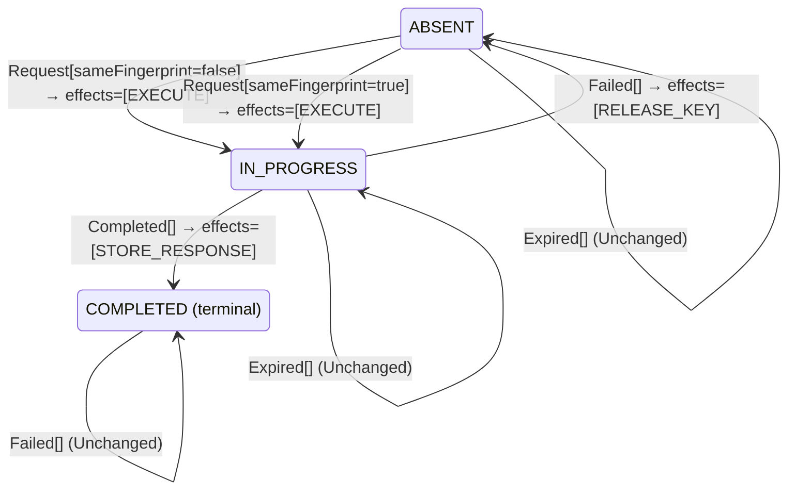

<!-- Generated by examples/demo/tools/build.py from example.json and the verifier's output. Edit example.json. -->
# 080 · Dropping an expired response but keeping its key replays a response that is gone

[← All examples](../README.md)

| Verdict | Categories | Severity if shipped | Change | Verified unit | Approach |
|---|---|---|---|---|---|
| **✗ Violation: ReplayedResponsesExist, 7-step trace (expiring record)** | functional | high | feature, behaviour change intended | [`IdempotentReceiver#decide`](../../../examples/demo/apps/crosscut/src/main/java/net/terminalvalue/crosscut/idempotency/IdempotentReceiver.java) | [D1: Protocol model checking](../../../examples/demo/apps/crosscut/spec/README.md) |

> An `Idempotency-Key` receiver releases a key when its record's time to live passes, and a retry after that executes the request again. A developer wants both the storage back and the guarantee kept: when the time to live passes, drop the stored response, which is the bulk of the record, and keep the key, so that a late retry is recognised and never run twice. The contract diff is one row and a new effect; the tests pass. Under the configuration in which the record expires, TLC finds a seven-step run in which the late retry is recognised, and answered with a response that no longer exists.

## The change

Add `DROP_RESPONSE` to `ReceiverEffect`. On `Expired`, a completed record stays `COMPLETED` and drops its response, instead of being released. The reasoning: the response body is what costs storage, the key is small, and keeping the key is what keeps a late retry from running the request a second time. The contract diff is the case `decide(COMPLETED, Expired[])`; the model's sweeper action treats the new effect as the end of the stored response; the test of the expiry rule is updated.

**Before** ([`IdempotentReceiver.java`](../../../examples/demo/apps/crosscut/src/main/java/net/terminalvalue/crosscut/idempotency/IdempotentReceiver.java), line 6):

```java
import static net.terminalvalue.crosscut.idempotency.KeyState.ABSENT;
import static net.terminalvalue.crosscut.idempotency.KeyState.COMPLETED;
import static net.terminalvalue.crosscut.idempotency.KeyState.IN_PROGRESS;
import static net.terminalvalue.crosscut.idempotency.ReceiverEffect.EXECUTE;
import static net.terminalvalue.crosscut.idempotency.ReceiverEffect.RELEASE_KEY;
import static net.terminalvalue.crosscut.idempotency.ReceiverEffect.REPLAY_RESPONSE;
    // ...
 * a key the server has not seen executes; a retry of a completed request gets the stored response; a retry of a
 * request still in progress is refused (409), because executing it again would do the work twice; a key reused with
 * a different request is refused (422). An attempt that dies without a response releases the key, so that the
 * client's retry can run.
 *
 * <p>The filter that owns the receiver looks the key up and applies the decision in one transaction, so that two
 * retries arriving together cannot both see ABSENT.
    // ...
                case ABSENT, COMPLETED -> unchanged("no attempt is in progress");
            };
            case Expired _ -> switch (state) {
                case COMPLETED -> transition(ABSENT, RELEASE_KEY);
                case ABSENT -> unchanged("nothing to expire");
                case IN_PROGRESS -> unchanged("a key in progress does not expire");
            };
```

**After:**

```java
import static net.terminalvalue.crosscut.idempotency.KeyState.ABSENT;
import static net.terminalvalue.crosscut.idempotency.KeyState.COMPLETED;
import static net.terminalvalue.crosscut.idempotency.KeyState.IN_PROGRESS;
import static net.terminalvalue.crosscut.idempotency.ReceiverEffect.DROP_RESPONSE;
import static net.terminalvalue.crosscut.idempotency.ReceiverEffect.EXECUTE;
import static net.terminalvalue.crosscut.idempotency.ReceiverEffect.RELEASE_KEY;
import static net.terminalvalue.crosscut.idempotency.ReceiverEffect.REPLAY_RESPONSE;
    // ...
 * a key the server has not seen executes; a retry of a completed request gets the stored response; a retry of a
 * request still in progress is refused (409), because executing it again would do the work twice; a key reused with
 * a different request is refused (422). An attempt that dies without a response releases the key, so that the
 * client's retry can run. When a stored response's time to live passes, the response goes and the key stays, so
 * that the request is recognised for as long as the client may retry it and is never run twice.
 *
 * <p>The filter that owns the receiver looks the key up and applies the decision in one transaction, so that two
 * retries arriving together cannot both see ABSENT.
    // ...
                case ABSENT, COMPLETED -> unchanged("no attempt is in progress");
            };
            case Expired _ -> switch (state) {
                // The response body is the bulk of the record. Drop it when the time to live passes and keep the
                // key, so that a late retry is still recognised and the request is never run twice.
                case COMPLETED -> transition(COMPLETED, DROP_RESPONSE);
                case ABSENT -> unchanged("nothing to expire");
                case IN_PROGRESS -> unchanged("a key in progress does not expire");
            };
```

<details><summary>Patch</summary>

```diff
--- a/examples/demo/apps/crosscut/src/main/java/net/terminalvalue/crosscut/idempotency/ReceiverEffect.java
+++ b/examples/demo/apps/crosscut/src/main/java/net/terminalvalue/crosscut/idempotency/ReceiverEffect.java
@@ -9,5 +9,7 @@
     /** Answer with the stored response. */
     REPLAY_RESPONSE,
     /** Delete the record. */
-    RELEASE_KEY
+    RELEASE_KEY,
+    /** Delete the stored response and keep the record. */
+    DROP_RESPONSE
 }
--- a/examples/demo/apps/crosscut/src/main/java/net/terminalvalue/crosscut/idempotency/IdempotentReceiver.java
+++ b/examples/demo/apps/crosscut/src/main/java/net/terminalvalue/crosscut/idempotency/IdempotentReceiver.java
@@ -6,6 +6,7 @@
 import static net.terminalvalue.crosscut.idempotency.KeyState.ABSENT;
 import static net.terminalvalue.crosscut.idempotency.KeyState.COMPLETED;
 import static net.terminalvalue.crosscut.idempotency.KeyState.IN_PROGRESS;
+import static net.terminalvalue.crosscut.idempotency.ReceiverEffect.DROP_RESPONSE;
 import static net.terminalvalue.crosscut.idempotency.ReceiverEffect.EXECUTE;
 import static net.terminalvalue.crosscut.idempotency.ReceiverEffect.RELEASE_KEY;
 import static net.terminalvalue.crosscut.idempotency.ReceiverEffect.REPLAY_RESPONSE;
@@ -22,7 +23,8 @@
  * a key the server has not seen executes; a retry of a completed request gets the stored response; a retry of a
  * request still in progress is refused (409), because executing it again would do the work twice; a key reused with
  * a different request is refused (422). An attempt that dies without a response releases the key, so that the
- * client's retry can run.
+ * client's retry can run. When a stored response's time to live passes, the response goes and the key stays, so
+ * that the request is recognised for as long as the client may retry it and is never run twice.
  *
  * <p>The filter that owns the receiver looks the key up and applies the decision in one transaction, so that two
  * retries arriving together cannot both see ABSENT.
@@ -51,7 +53,9 @@
                 case ABSENT, COMPLETED -> unchanged("no attempt is in progress");
             };
             case Expired _ -> switch (state) {
-                case COMPLETED -> transition(ABSENT, RELEASE_KEY);
+                // The response body is the bulk of the record. Drop it when the time to live passes and keep the
+                // key, so that a late retry is still recognised and the request is never run twice.
+                case COMPLETED -> transition(COMPLETED, DROP_RESPONSE);
                 case ABSENT -> unchanged("nothing to expire");
                 case IN_PROGRESS -> unchanged("a key in progress does not expire");
             };
--- a/examples/demo/apps/crosscut/src/test/java/net/terminalvalue/crosscut/idempotency/IdempotentReceiverTest.java
+++ b/examples/demo/apps/crosscut/src/test/java/net/terminalvalue/crosscut/idempotency/IdempotentReceiverTest.java
@@ -35,7 +35,7 @@
         equal(new Transition<>(ABSENT, List.of(ReceiverEffect.RELEASE_KEY)), IdempotentReceiver.decide(IN_PROGRESS, new Failed()));
     }
 
-    public static void anExpiredKeyIsReleased() {
-        equal(new Transition<>(ABSENT, List.of(ReceiverEffect.RELEASE_KEY)), IdempotentReceiver.decide(COMPLETED, new Expired()));
+    public static void anExpiredKeyKeepsItsRecord() {
+        equal(new Transition<>(COMPLETED, List.of(ReceiverEffect.DROP_RESPONSE)), IdempotentReceiver.decide(COMPLETED, new Expired()));
     }
 }
--- a/examples/demo/apps/crosscut/spec/IdempotentReceiver.tla
+++ b/examples/demo/apps/crosscut/spec/IdempotentReceiver.tla
@@ -108,7 +108,7 @@
     /\ key # "ABSENT"
     /\ LET d == Decide(key, [kind |-> "Expired"])
        IN /\ key' = IF d.kind = "Transition" THEN d.next ELSE key
-          /\ stored' = IF Has(d, "RELEASE_KEY") THEN FALSE ELSE stored
+          /\ stored' = IF Has(d, "RELEASE_KEY") \/ Has(d, "DROP_RESPONSE") THEN FALSE ELSE stored
           /\ completed' = IF Has(d, "RELEASE_KEY") THEN 0 ELSE completed
     /\ UNCHANGED <<sent, inbox, executing, responses>>
 
```

</details>

## What the verifier found

The model is checked under 2 configurations, and the verdict is the first that fails:

| Configuration | What it checks | Model | Result |
|---|---|---|---|
| the record never expires (`spec/IdempotentReceiver.cfg`) | every run from the initial state, every interleaving within the configuration's bounds | Attempts = {a1, a2, a3}, Expires = FALSE | ✓ Verified: all invariants hold in 168 states |
| expiring record (`spec/IdempotentReceiverExpiring.cfg`) | the same invariants, with the record's time to live allowed to pass at any point: the sweeper asks the receiver what to do with the record and applies the decision, and a release ends the record's lifetime, so `AtMostOnce` counts the results since the last release. The model has no clock, so the sweeper's clock has measured the record's age and nothing else, in particular not whether an execution is still running | Attempts = {a1, a2, a3}, Expires = TRUE | ✗ Violation: ReplayedResponsesExist, 7-step trace |

TLC found a run of the system under expiring record, 7 steps long, that violates the invariant **ReplayedResponsesExist** (a client is never answered with a stored response that does not exist). Each step is one action of one part of the system:

1. **Initial state**: no record for the key, nothing sent, nothing executing, no response.
2. **Send**, `IdempotentClient.send`: the client sends the request, or retries it without waiting for an answer. `inbox = {a1}`, `sent = {a1}`
3. **Receive**, `IdempotencyFilter.doFilter`: the receiver looks the key up, decides, and applies the decision in one transaction. `executing = {a1}`, `inbox = {}`, `key = "IN_PROGRESS"`
4. **Finish**, `IdempotencyFilter.onCompleted`: an execution produced a result, which the receiver stores and returns. `completed = 1`, `executing = {}`, `key = "COMPLETED"`, `responses = (a1 :> "RESULT" @@ a2 :> "NONE" @@ a3 :> "NONE")`, `stored = TRUE`
5. **Send**, `IdempotentClient.send`: the client sends the request, or retries it without waiting for an answer. `inbox = {a2}`, `sent = {a1, a2}`
6. **Expire**, `IdempotencySweeper.sweep`: the record's time to live passed; the sweeper asks the receiver what to do with the record and applies the decision. `stored = FALSE`
7. **Receive**, `IdempotencyFilter.doFilter`: the receiver looks the key up, decides, and applies the decision in one transaction. `inbox = {}`, `responses = (a1 :> "RESULT" @@ a2 :> "EMPTY" @@ a3 :> "NONE")`

The model is small (Attempts = {a1, a2, a3}, Expires = TRUE), which is what keeps the trace readable. TLC explored every interleaving of the client's attempts, the receiver, and the attempts in flight and executing within those bounds.

**What the verdict rests on.** TLC counted how often a step of the model took each row of the generated operators. A row no step takes is one the model says nothing about, whatever the verdict.

| Configuration | Rows of `IdempotentReceiver#decide` taken |
|---|---|
| the record never expires | 5 of 15 |
| expiring record | stopped at the counterexample |

The change alters 1 row of the contract:

- `decide(COMPLETED, Expired[])`: `Transition[next=ABSENT, effects=[RELEASE_KEY]]` → `Transition[next=COMPLETED, effects=[DROP_RESPONSE]]`, taken by no run that finished

The run under expiring record stopped at its counterexample, the steps above, and its counts are left out: the verdict rests on the counterexample.

<details><summary>Rows no step takes under the record never expires</summary>

`net.terminalvalue.crosscut.idempotency.IdempotentReceiver#decide`:

```
decide(ABSENT, Request[sameFingerprint=false]) => Transition[next=IN_PROGRESS, effects=[EXECUTE]]
decide(ABSENT, Completed[]) => Unchanged
decide(ABSENT, Failed[]) => Unchanged
decide(ABSENT, Expired[]) => Unchanged
decide(IN_PROGRESS, Request[sameFingerprint=false]) => Rejected
decide(IN_PROGRESS, Expired[]) => Unchanged
decide(COMPLETED, Request[sameFingerprint=false]) => Rejected
decide(COMPLETED, Completed[]) => Unchanged
decide(COMPLETED, Failed[]) => Unchanged
decide(COMPLETED, Expired[]) => Transition[next=COMPLETED, effects=[DROP_RESPONSE]]
```

</details>

The state machine the patched code implements, drawn from its derived contract (`jvmcontract statemachine`); a state with no way in or no way out is marked:



## Would the existing tests have caught it?

No: every existing unit test passes (`java -ea net.terminalvalue.crosscut.Tests`, run against the patched code).

## Why it matters

The record now says the request completed and has nothing to say what the response was. The rule for a retry of a completed request is unchanged, and it replays the stored response: after the time to live, that is an empty body under a status code of the filter's choosing, delivered to a client that retried precisely because it had not seen the response. The customer is not charged twice; they are told nothing about whether they were charged at all. The change is the two-stores version of a familiar bug, the index outliving the data it indexes, and the contract diff could not catch it, because the row that misbehaves is the one that did not change. The model's record never expired until this cycle, so the row the change alters had never been taken by any run; the question is what a retry meets after the sweeper has acted, and only a model in which the sweeper acts answers it.

## Why the verdict is right

The receiver's rule in the model is generated from the regenerated contract, so the model runs the new rule, and the model's sweeper applies the new effect: the stored response is gone, the key stays. The model's replay answers with whatever is stored under the key, the response or nothing, and the invariant says no client is ever answered with nothing. Under the configuration in which the record never expires every invariant holds, and the coverage shows the changed row taken by no step. Under the configuration in which the sweeper may act at any point, TLC reports the shortest run that breaks the invariant: the client sends, the receiver executes and finishes, the client retries, the response expires, and the receiver, finding the key completed, replays the response it no longer has. Seven steps, the initial state and six actions. Example 079 keeps the key after the response for the same reason and refuses the retry instead, and is verified under the same two configurations.

## What to do

Revert, or finish the design: a key whose response is gone is a different state from a key whose response is stored, with its own rule for a retry, which is example 079's tombstone. A single `COMPLETED` state that may or may not have a response is the record lying about itself, and the rule for a retry believes it.

## Evidence

How the verdict was reached: the record never expires: TLC 2.19 explored 168 distinct states to depth 10 in 0 s, for the model Attempts = {a1, a2, a3}, Expires = FALSE; expiring record: TLC 2.19 explored 94 distinct states to depth 7 in 0 s, for the model Attempts = {a1, a2, a3}, Expires = TRUE.

<details><summary>Verifier output</summary>

```text
== the record never expires: spec/IdempotentReceiver.cfg ==
TLC2 Version 2.19 of 08 August 2024 (rev: 5a47802)
Running breadth-first search Model-Checking with fp 1 and seed 1 with 1 worker on 8 cores with 910MB heap and 64MB offheap memory [pid: 2442060] (Linux 6.6.87.2-microsoft-standard-WSL2 aarch64, Eclipse Adoptium 25.0.4.1 x86_64, MSBDiskFPSet, DiskStateQueue).
Parsing file examples/demo/apps/crosscut/spec/IdempotentReceiver.tla
Parsing file examples/demo/tools/tla/standard-modules/Naturals.tla
Parsing file examples/demo/tools/tla/standard-modules/Sequences.tla
Parsing file examples/demo/tools/tla/standard-modules/FiniteSets.tla
Parsing file examples/demo/apps/crosscut/spec/IdempotentReceiverContract.tla
Semantic processing of module Naturals
Semantic processing of module Sequences
Semantic processing of module FiniteSets
Semantic processing of module IdempotentReceiverContract
Semantic processing of module IdempotentReceiver
Starting... (2026-11-02 02:34:04)
Computing initial states...
Finished computing initial states: 1 distinct state generated at 2026-11-02 02:34:04.
Model checking completed. No error has been found.
  Estimates of the probability that TLC did not check all reachable states
  because two distinct states had the same fingerprint:
  calculated (optimistic):  val = 9.4E-16
Rows of net.terminalvalue.crosscut.idempotency.IdempotentReceiver#decide a step of the model takes: 5 of 15; never taken (10):
  decide(ABSENT, Request[sameFingerprint=false]) => Transition[next=IN_PROGRESS, effects=[EXECUTE]]
  decide(ABSENT, Completed[]) => Unchanged
  decide(ABSENT, Failed[]) => Unchanged
  decide(ABSENT, Expired[]) => Unchanged
  decide(IN_PROGRESS, Request[sameFingerprint=false]) => Rejected
  decide(IN_PROGRESS, Expired[]) => Unchanged
  decide(COMPLETED, Request[sameFingerprint=false]) => Rejected
  decide(COMPLETED, Completed[]) => Unchanged
  decide(COMPLETED, Failed[]) => Unchanged
  decide(COMPLETED, Expired[]) => Transition[next=COMPLETED, effects=[DROP_RESPONSE]]
271 states generated, 168 distinct states found, 0 states left on queue.
The depth of the complete state graph search is 10.
The average outdegree of the complete state graph is 1 (minimum is 0, the maximum 4 and the 95th percentile is 3).
Finished in 00s at (2026-11-02 02:34:04)

== expiring record: spec/IdempotentReceiverExpiring.cfg ==
TLC2 Version 2.19 of 08 August 2024 (rev: 5a47802)
Running breadth-first search Model-Checking with fp 1 and seed 1 with 1 worker on 8 cores with 910MB heap and 64MB offheap memory [pid: 2442151] (Linux 6.6.87.2-microsoft-standard-WSL2 aarch64, Eclipse Adoptium 25.0.4.1 x86_64, MSBDiskFPSet, DiskStateQueue).
Parsing file examples/demo/apps/crosscut/spec/IdempotentReceiver.tla
Parsing file examples/demo/tools/tla/standard-modules/Naturals.tla
Parsing file examples/demo/tools/tla/standard-modules/Sequences.tla
Parsing file examples/demo/tools/tla/standard-modules/FiniteSets.tla
Parsing file examples/demo/apps/crosscut/spec/IdempotentReceiverContract.tla
Semantic processing of module Naturals
Semantic processing of module Sequences
Semantic processing of module FiniteSets
Semantic processing of module IdempotentReceiverContract
Semantic processing of module IdempotentReceiver
Starting... (2026-11-02 02:34:05)
Computing initial states...
Finished computing initial states: 1 distinct state generated at 2026-11-02 02:34:05.
Error: Invariant ReplayedResponsesExist is violated.
Error: The behavior up to this point is:
State 1: <Initial predicate>
/\ completed = 0
/\ responses = (a1 :> "NONE" @@ a2 :> "NONE" @@ a3 :> "NONE")
/\ key = "ABSENT"
/\ stored = FALSE
/\ sent = {}
/\ inbox = {}
/\ executing = {}

State 2: <Send line 53, col 5 to line 56, col 65 of module IdempotentReceiver>
/\ completed = 0
/\ responses = (a1 :> "NONE" @@ a2 :> "NONE" @@ a3 :> "NONE")
/\ key = "ABSENT"
/\ stored = FALSE
/\ sent = {a1}
/\ inbox = {a1}
/\ executing = {}

State 3: <Receive line 65, col 5 to line 74, col 44 of module IdempotentReceiver>
/\ completed = 0
/\ responses = (a1 :> "NONE" @@ a2 :> "NONE" @@ a3 :> "NONE")
/\ key = "IN_PROGRESS"
/\ stored = FALSE
/\ sent = {a1}
/\ inbox = {}
/\ executing = {a1}

State 4: <Finish line 79, col 5 to line 86, col 32 of module IdempotentReceiver>
/\ completed = 1
/\ responses = (a1 :> "RESULT" @@ a2 :> "NONE" @@ a3 :> "NONE")
/\ key = "COMPLETED"
/\ stored = TRUE
/\ sent = {a1}
/\ inbox = {}
/\ executing = {}

State 5: <Send line 53, col 5 to line 56, col 65 of module IdempotentReceiver>
/\ completed = 1
/\ responses = (a1 :> "RESULT" @@ a2 :> "NONE" @@ a3 :> "NONE")
/\ key = "COMPLETED"
/\ stored = TRUE
/\ sent = {a1, a2}
/\ inbox = {a2}
/\ executing = {}

State 6: <Expire line 107, col 5 to line 113, col 54 of module IdempotentReceiver>
/\ completed = 1
/\ responses = (a1 :> "RESULT" @@ a2 :> "NONE" @@ a3 :> "NONE")
/\ key = "COMPLETED"
/\ stored = FALSE
/\ sent = {a1, a2}
/\ inbox = {a2}
/\ executing = {}

State 7: <Receive line 65, col 5 to line 74, col 44 of module IdempotentReceiver>
/\ completed = 1
/\ responses = (a1 :> "RESULT" @@ a2 :> "EMPTY" @@ a3 :> "NONE")
/\ key = "COMPLETED"
/\ stored = FALSE
/\ sent = {a1, a2}
/\ inbox = {}
/\ executing = {}

Rows of net.terminalvalue.crosscut.idempotency.IdempotentReceiver#decide a step of the model takes: 7 of 15; never taken (8):
  decide(ABSENT, Request[sameFingerprint=false]) => Transition[next=IN_PROGRESS, effects=[EXECUTE]]
  decide(ABSENT, Completed[]) => Unchanged
  decide(ABSENT, Failed[]) => Unchanged
  decide(ABSENT, Expired[]) => Unchanged
  decide(IN_PROGRESS, Request[sameFingerprint=false]) => Rejected
  decide(COMPLETED, Request[sameFingerprint=false]) => Rejected
  decide(COMPLETED, Completed[]) => Unchanged
  decide(COMPLETED, Failed[]) => Unchanged
169 states generated, 94 distinct states found, 43 states left on queue.
The depth of the complete state graph search is 7.
The average outdegree of the complete state graph is 2 (minimum is 0, the maximum 4 and the 95th percentile is 4).
Finished in 00s at (2026-11-02 02:34:05)
```

</details>

<details><summary>SARIF report (as uploaded to GitHub code scanning or SonarQube)</summary>

```json
{
  "version": "2.1.0",
  "$schema": "https://json.schemastore.org/sarif-2.1.0.json",
  "runs": [
    {
      "tool": {
        "driver": {
          "name": "jvmcontract tlc",
          "rules": [
            {
              "id": "invariant-violated",
              "shortDescription": {
                "text": "TLC found a behaviour of the model that violates an invariant or a temporal property, or ends in a deadlock."
              }
            },
            {
              "id": "unverifiable",
              "shortDescription": {
                "text": "TLC could not check the model."
              }
            }
          ]
        }
      },
      "results": [
        {
          "ruleId": "invariant-violated",
          "level": "error",
          "message": {
            "text": "Invariant ReplayedResponsesExist of spec/IdempotentReceiver.tla (expiring record) is violated after 7 steps"
          },
          "locations": [
            {
              "physicalLocation": {
                "artifactLocation": {
                  "uri": "examples/demo/apps/crosscut/src/main/java/net/terminalvalue/crosscut/idempotency/IdempotentReceiver.java"
                },
                "region": {
                  "startLine": 6
                }
              }
            }
          ]
        }
      ]
    }
  ]
}
```

</details>

**Provenance:** Constructed from the storage pressure every idempotency store meets, resolved the way a cache with a separate index is usually resolved first: by expiring the data and not the index. To pair with example 079.

- [Stripe, Idempotent requests (keys are eligible to be removed after 24 hours; a request in progress under the key is answered 409)](https://docs.stripe.com/api/idempotent_requests)
- [IETF httpapi, The Idempotency-Key HTTP Header Field (draft): the retention period is the server's; 409 while a request is in progress, 422 on a key reused for another request](https://datatracker.ietf.org/doc/draft-ietf-httpapi-idempotency-key-header/)
## Reproduce

```bash
python3 examples/demo/tools/build.py 080
```

This applies `change.patch` to a temporary copy of the repo, runs the verifier on it, and rewrites this page.
