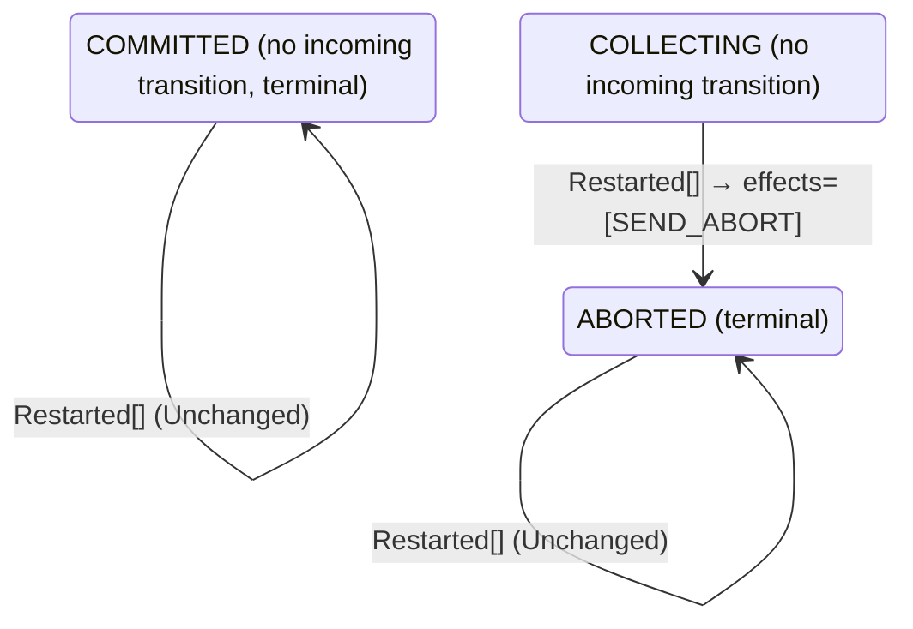

<!-- Generated by examples/demo/tools/build.py from example.json and the verifier's output. Edit example.json. -->
# 088 · A coordinator with nothing to redo on restart leaves a logged decision unsent forever

[← All examples](../README.md)

| Verdict | Categories | Severity if shipped | Change | Verified unit | Approach |
|---|---|---|---|---|---|
| **✗ Violation: EveryParticipantDecides, 10-step trace then forever (crashes)** | functional | high | bug-fix, behaviour change intended | [`Recovery#decide`](../../../examples/demo/apps/quorum/src/main/java/net/terminalvalue/quorum/twopc/Recovery.java) | [D1: Protocol model checking](../../../examples/demo/apps/quorum/spec/README.md) |

> A restarted two-phase-commit coordinator sends a logged decision again, because the crash may have come between logging it and sending it. A developer sees only duplicate broadcasts come of it, since the coordinator cannot tell whether the first copy went out and so always sends a second, and makes a restart in a decided phase change nothing, as the decision rule does for any event in a decided phase. The contract diff is two rows, and the change mirrors the rule beside it. Under the two configurations the model had, nothing crashes and the rows are never taken; the inductive invariant is closed under the new rule as well, since every state the run passes through is one it admits. The third configuration, in which the coordinator may crash twice, finds the run in ten steps: one participant votes yes and two vote no, the coordinator crashes before counting, restarts, logs the abort that presumed abort calls for, and crashes again before sending it; the second restart finds a logged abort and the new rule has nothing to redo. The prepared participant holds its locks forever, a liveness failure, reported as a run that stays in its last state. The fourth configuration finds the step that makes it possible, a coordinator up and decided with nothing out.

## The change

In `Recovery.decide`, a restart in `COMMITTED` or `ABORTED` is unchanged, with the reason `already decided` and the comment that the decision was broadcast when it was made, that a decided coordinator has nothing to redo, and that sending again would hand every participant a second copy. The restart in `COLLECTING` presumes abort as before. The contract diff is two rows, `decide(COMMITTED, Restarted[])` and `decide(ABORTED, Restarted[])`, from a transition that stays in the phase and sends the decision to unchanged; the two tests for them become one.

**Before** ([`Recovery.java`](../../../examples/demo/apps/quorum/src/main/java/net/terminalvalue/quorum/twopc/Recovery.java), line 1):

```java
package net.terminalvalue.quorum.twopc;

import static net.terminalvalue.quorum.Decision.transition;
import static net.terminalvalue.quorum.twopc.CoordinatorEffect.SEND_ABORT;
import static net.terminalvalue.quorum.twopc.CoordinatorEffect.SEND_COMMIT;
import static net.terminalvalue.quorum.twopc.Phase.ABORTED;
    // ...
        return switch (event) {
            case Restarted _ -> switch (logged) {
                case COLLECTING -> transition(ABORTED, SEND_ABORT); // presumed abort
                case COMMITTED -> transition(COMMITTED, SEND_COMMIT);
                case ABORTED -> transition(ABORTED, SEND_ABORT);
            };
        };
    }
```

**After:**

```java
package net.terminalvalue.quorum.twopc;

import static net.terminalvalue.quorum.Decision.transition;
import static net.terminalvalue.quorum.Decision.unchanged;
import static net.terminalvalue.quorum.twopc.CoordinatorEffect.SEND_ABORT;
import static net.terminalvalue.quorum.twopc.CoordinatorEffect.SEND_COMMIT;
import static net.terminalvalue.quorum.twopc.Phase.ABORTED;
    // ...
        return switch (event) {
            case Restarted _ -> switch (logged) {
                case COLLECTING -> transition(ABORTED, SEND_ABORT); // presumed abort
                // The decision was broadcast when it was made, and the participants have applied it or will: a
                // decided coordinator has nothing to redo, and sending again would hand every participant a second
                // copy of a message it has already acted on.
                case COMMITTED, ABORTED -> unchanged("already decided");
            };
        };
    }
```

<details><summary>Patch</summary>

```diff
--- a/examples/demo/apps/quorum/src/main/java/net/terminalvalue/quorum/twopc/Recovery.java
+++ b/examples/demo/apps/quorum/src/main/java/net/terminalvalue/quorum/twopc/Recovery.java
@@ -1,6 +1,7 @@
 package net.terminalvalue.quorum.twopc;
 
 import static net.terminalvalue.quorum.Decision.transition;
+import static net.terminalvalue.quorum.Decision.unchanged;
 import static net.terminalvalue.quorum.twopc.CoordinatorEffect.SEND_ABORT;
 import static net.terminalvalue.quorum.twopc.CoordinatorEffect.SEND_COMMIT;
 import static net.terminalvalue.quorum.twopc.Phase.ABORTED;
@@ -25,8 +26,10 @@
         return switch (event) {
             case Restarted _ -> switch (logged) {
                 case COLLECTING -> transition(ABORTED, SEND_ABORT); // presumed abort
-                case COMMITTED -> transition(COMMITTED, SEND_COMMIT);
-                case ABORTED -> transition(ABORTED, SEND_ABORT);
+                // The decision was broadcast when it was made, and the participants have applied it or will: a
+                // decided coordinator has nothing to redo, and sending again would hand every participant a second
+                // copy of a message it has already acted on.
+                case COMMITTED, ABORTED -> unchanged("already decided");
             };
         };
     }
--- a/examples/demo/apps/quorum/src/test/java/net/terminalvalue/quorum/twopc/RecoveryTest.java
+++ b/examples/demo/apps/quorum/src/test/java/net/terminalvalue/quorum/twopc/RecoveryTest.java
@@ -1,8 +1,10 @@
 package net.terminalvalue.quorum.twopc;
 
+import static net.terminalvalue.quorum.Tests.check;
 import static net.terminalvalue.quorum.Tests.equal;
 
 import java.util.List;
+import net.terminalvalue.quorum.Decision;
 import net.terminalvalue.quorum.Decision.Transition;
 import net.terminalvalue.quorum.twopc.RecoveryEvent.Restarted;
 
@@ -10,14 +12,9 @@
 
     private RecoveryTest() {}
 
-    public static void sendsALoggedCommitAgain() {
-        equal(new Transition<>(Phase.COMMITTED, List.of(CoordinatorEffect.SEND_COMMIT)),
-                Recovery.decide(Phase.COMMITTED, new Restarted()));
-    }
-
-    public static void sendsALoggedAbortAgain() {
-        equal(new Transition<>(Phase.ABORTED, List.of(CoordinatorEffect.SEND_ABORT)),
-                Recovery.decide(Phase.ABORTED, new Restarted()));
+    public static void aDecidedCoordinatorHasNothingToRedo() {
+        check(Recovery.decide(Phase.COMMITTED, new Restarted()) instanceof Decision.Unchanged, "committed stays");
+        check(Recovery.decide(Phase.ABORTED, new Restarted()) instanceof Decision.Unchanged, "aborted stays");
     }
 
     public static void presumesAbortWithoutALoggedDecision() {
```

</details>

## What the verifier found

The model is checked under 4 configurations, and the verdict is the first that fails:

| Configuration | What it checks | Model | Result |
|---|---|---|---|
| three participants (`spec/TwoPhaseCommit.cfg`) | every run from the initial state, every interleaving within the configuration's bounds | Participants = {p1, p2, p3}, MaxCrashes = 0 | ✓ Verified: all invariants and properties hold in 728 states |
| the inductive step (`spec/TwoPhaseCommitInductive.cfg`) | that the invariant `Inductive` is inductive: TLC starts from every state the invariant admits, reachable or not, rather than from the initial state, takes one step, and checks the invariant again, conjunct by conjunct. No counterexample is a proof of atomicity by induction, for any run of the protocol however long; a counterexample is one step from a state that need not be reachable | Participants = {p1, p2, p3}, MaxCrashes = 0 | ✓ Verified: all invariants hold in 736 states |
| crashes (`spec/TwoPhaseCommitCrash.cfg`) | every run from the initial state in which the coordinator may crash, twice at most: between steps, or after logging a phase change and before the broadcast goes out, and restart on the recovery rule, generated from `Recovery#decide`; the same invariants and temporal properties, under the added fairness condition that a crashed coordinator restarts | Participants = {p1, p2, p3}, MaxCrashes = 2 | ✗ Violation: EveryParticipantDecides, 10-step trace then forever |
| the inductive step with crashes (`spec/TwoPhaseCommitCrashInductive.cfg`) | that the invariant `Inductive` is closed under a crash and a restart as well: TLC starts from every state the invariant admits, the coordinator up or down, takes one step, and checks the invariant again | Participants = {p1, p2, p3}, MaxCrashes = 1 | ✗ Violation: BroadcastOnceUp, 2-step trace |

TLC found a run of the system under crashes that violates the temporal property **EveryParticipantDecides** (every participant eventually commits or aborts, under the fairness the model assumes: participants vote or give up, the coordinator counts every vote and fires its timer while votes are missing, and participants apply a decision once made): after the 10 steps below, the system stays in that state forever, and the property never comes true. The run respects every fairness condition the model assumes; the parts that could act, do. Each step is one action of one part of the system:

1. **Initial state**: every participant working, no vote counted, no decision, the coordinator up.
2. **Vote**, `Participant.prepare`: a participant votes yes (and holds its locks) or no (and aborts). `inbox = {[from |-> p3, vote |-> "NO"]}`, `pstate = (p1 :> "WORKING" @@ p2 :> "WORKING" @@ p3 :> "ABORTED")`
3. **Vote**, `Participant.prepare`: a participant votes yes (and holds its locks) or no (and aborts). `inbox = {[from |-> p2, vote |-> "NO"], [from |-> p3, vote |-> "NO"]}`, `pstate = (p1 :> "WORKING" @@ p2 :> "ABORTED" @@ p3 :> "ABORTED")`
4. **Vote**, `Participant.prepare`: a participant votes yes (and holds its locks) or no (and aborts). `inbox = { [from |-> p1, vote |-> "YES"], [from |-> p2, vote |-> "NO"], [from |-> p3, vote |-> "NO"] }`, `pstate = (p1 :> "PREPARED" @@ p2 :> "ABORTED" @@ p3 :> "ABORTED")`
5. **Crash**, the coordinator crashes between steps: it loses nothing it logged, and takes no step until it restarts. `crashes = 1`, `up = FALSE`
6. **Recover**, `Recovery.decide`: the coordinator restarts with the phase it logged and acts on the recovery rule's decision, which a crash can cut short like any other. `crashes = 2`, `phase = "ABORTED"`
7. **Recover**, `Recovery.decide`: the coordinator restarts with the phase it logged and acts on the recovery rule's decision, which a crash can cut short like any other. `up = TRUE`
8. **ReceiveVote**, `Coordinator.onVote`: the coordinator counts a vote and decides on the tally. `inbox = {[from |-> p1, vote |-> "YES"], [from |-> p3, vote |-> "NO"]}`, `votes = (p1 :> "NONE" @@ p2 :> "NO" @@ p3 :> "NONE")`
9. **ReceiveVote**, `Coordinator.onVote`: the coordinator counts a vote and decides on the tally. `inbox = {[from |-> p3, vote |-> "NO"]}`, `votes = (p1 :> "YES" @@ p2 :> "NO" @@ p3 :> "NONE")`
10. **ReceiveVote**, `Coordinator.onVote`: the coordinator counts a vote and decides on the tally. `inbox = {}`, `votes = (p1 :> "YES" @@ p2 :> "NO" @@ p3 :> "NO")`

The model is small (Participants = {p1, p2, p3}, MaxCrashes = 2), which is what keeps the trace readable. TLC explored every interleaving of the participants, the coordinator and the votes in flight within those bounds.

<details><summary>The counterexample under the inductive step with crashes: invariant <b>BroadcastOnceUp</b>, 2 steps</summary>

Invariant **BroadcastOnceUp**: a coordinator that is up and decided has its decision out, broadcast when it decided or on restarting.

1. **Starting state**, a state the invariant `Inductive` admits, the coordinator up or down, which need not be reachable: `crashes = 1`, `decision = "NONE"`, `inbox = {}`, `phase = "ABORTED"`, `pstate = (p1 :> "ABORTED" @@ p2 :> "ABORTED" @@ p3 :> "ABORTED")`, `up = FALSE`, `votes = (p1 :> "NONE" @@ p2 :> "NONE" @@ p3 :> "NONE")`
2. **Recover**, `Recovery.decide`: the coordinator restarts with the phase it logged and acts on the recovery rule's decision, which a crash can cut short like any other. `up = TRUE`

</details>

**What the verdict rests on.** TLC counted how often a step of the model took each row of the generated operators. A row no step takes is one the model says nothing about, whatever the verdict.

| Configuration | Rows of `Coordinator#decide` taken | Rows of `Recovery#decide` taken |
|---|---|---|
| three participants | 10 of 18 | 0 of 3 |
| the inductive step (from the states the invariant admits, not from a run) | 10 of 18 | 0 of 3 |
| crashes | stopped at the counterexample | stopped at the counterexample |
| the inductive step with crashes (from the states the invariant admits, not from a run) | stopped at the counterexample | stopped at the counterexample |

The change alters 2 rows of the contract:

- `decide(COMMITTED, Restarted[])`: `Transition[next=COMMITTED, effects=[SEND_COMMIT]]` → `Unchanged[reason="already decided"]`, taken by no run that finished
- `decide(ABORTED, Restarted[])`: `Transition[next=ABORTED, effects=[SEND_ABORT]]` → `Unchanged[reason="already decided"]`, taken by no run that finished

The run under crashes, the inductive step with crashes stopped at its counterexample, the steps above, and its counts are left out: the verdict rests on the counterexample.

<details><summary>Rows no step takes under three participants</summary>

`net.terminalvalue.quorum.twopc.Coordinator#decide`:

```
decide(COMMITTED, Tally[complete=false, unanimous=false]) => Unchanged
decide(COMMITTED, Tally[complete=false, unanimous=true]) => Unchanged
decide(COMMITTED, Tally[complete=true, unanimous=false]) => Unchanged
decide(COMMITTED, Tally[complete=true, unanimous=true]) => Unchanged
decide(COMMITTED, Timeout[unanimousSoFar=false]) => Unchanged
decide(COMMITTED, Timeout[unanimousSoFar=true]) => Unchanged
decide(ABORTED, Timeout[unanimousSoFar=false]) => Unchanged
decide(ABORTED, Timeout[unanimousSoFar=true]) => Unchanged
```

`net.terminalvalue.quorum.twopc.Recovery#decide`:

```
decide(COLLECTING, Restarted[]) => Transition[next=ABORTED, effects=[SEND_ABORT]]
decide(COMMITTED, Restarted[]) => Unchanged
decide(ABORTED, Restarted[]) => Unchanged
```

</details>

The state machine the patched code implements, drawn from its derived contract (`jvmcontract statemachine`); a state with no way in or no way out is marked:



## Would the existing tests have caught it?

No: every existing unit test passes (`java -ea net.terminalvalue.quorum.Tests`, run against the patched code).

## Why it matters

The resend looks redundant from inside the coordinator, where the decision is made and sent in one step, and the change is written to match the decision rule's own `already decided` arms, which are correct. What it forgets is the one case the recovery rule exists for: the step was logged and not finished, and the broadcast never went out. A participant that voted yes holds its locks until it hears the decision, and after this change it hears nothing, ever; a restart that crashes before sending what it decided, which the change's framing never considers, is enough. No invariant can report it: every state of the run is one the protocol allows, the participant is prepared and waiting, as a prepared participant is allowed to be. The question is whether it waits forever, which is a question about infinite behaviours, and the model's fairness conditions and liveness property are what answer it.

## Why the verdict is right

The recovery rule in the model is generated from the regenerated contract, so the model runs the new rule. Under `TwoPhaseCommit.cfg` and `TwoPhaseCommitInductive.cfg` nothing changes: the coordinator never crashes, so the changed rows are never taken, and the page says so. Under `TwoPhaseCommitCrash.cfg`, where the coordinator may crash twice in a run, between steps or after logging a phase change and before sending, and restarts on the recovery rule under the fairness condition that it does, every invariant holds in every state and the refinement of transaction commit holds in every behaviour, and the liveness property `EveryParticipantDecides` does not. TLC reports the run: p3 votes no and aborts, p2 votes no and aborts, p1 votes yes and holds its locks; the coordinator crashes with the three votes still on their way; it restarts, finds no logged decision, and presumed abort has it log the abort, but the restart is cut short by the second crash before the abort is sent; it restarts again, finds the logged abort, and the new rule has nothing to redo, so it comes up with nothing out. It then counts the three votes, each of which the decision rule answers with `already decided`. Ten steps, after which nothing is enabled that changes the state: the coordinator is up and decided, no decision has been broadcast, and p1 is prepared, waiting for one, forever. TLC shows the behaviour as the ten steps and then stuttering in the last state. `TwoPhaseCommitCrashInductive.cfg` names the step: the conjunct `BroadcastOnceUp`, a coordinator that is up and decided has its decision out, fails one step after a state the invariant admits, the coordinator down with an unsent decision and the new rule bringing it up as it is.

## What to do

Revert: a restart in a decided phase sends the decision again. The duplicate broadcast is the cost of not knowing whether the first went out, and it is harmless, since a participant that has applied a decision ignores a second copy (the decision rule's own `already decided` arms are the same idea on the coordinator's side). A coordinator that wants to avoid it logs a completion record after the broadcast and skips the resend when it finds one, which is a rule the model can check the same way.

## Evidence

How the verdict was reached: three participants: TLC 2.19 explored 728 distinct states to depth 11 in 0 s, for the model Participants = {p1, p2, p3}, MaxCrashes = 0; the inductive step: TLC 2.19 explored 736 distinct states to depth 1 in 0 s, for the model Participants = {p1, p2, p3}, MaxCrashes = 0; crashes: TLC 2.19 explored 3,883 distinct states in 1 s, for the model Participants = {p1, p2, p3}, MaxCrashes = 2; the inductive step with crashes: TLC 2.19 explored 2,729 distinct states to depth 2 in 0 s, for the model Participants = {p1, p2, p3}, MaxCrashes = 1.

<details><summary>Verifier output</summary>

```text
== three participants: spec/TwoPhaseCommit.cfg ==
TLC2 Version 2.19 of 08 August 2024 (rev: 5a47802)
Running breadth-first search Model-Checking with fp 1 and seed 1 with 1 worker on 8 cores with 910MB heap and 64MB offheap memory [pid: 2712876] (Linux 6.6.87.2-microsoft-standard-WSL2 aarch64, Eclipse Adoptium 25.0.4.1 x86_64, MSBDiskFPSet, DiskStateQueue).
Parsing file examples/demo/apps/quorum/spec/TwoPhaseCommit.tla
Parsing file examples/demo/tools/tla/standard-modules/Naturals.tla
Parsing file examples/demo/tools/tla/standard-modules/Sequences.tla
Parsing file examples/demo/tools/tla/standard-modules/FiniteSets.tla
Parsing file examples/demo/apps/quorum/spec/CoordinatorContract.tla
Parsing file examples/demo/apps/quorum/spec/RecoveryContract.tla
Parsing file examples/demo/apps/quorum/spec/TCommit.tla
Semantic processing of module Naturals
Semantic processing of module Sequences
Semantic processing of module FiniteSets
Semantic processing of module CoordinatorContract
Semantic processing of module RecoveryContract
Semantic processing of module TCommit
Semantic processing of module TwoPhaseCommit
Starting... (2026-11-02 04:08:41)
Implied-temporal checking--satisfiability problem has 3 branches.
Computing initial states...
Finished computing initial states: 1 distinct state generated at 2026-11-02 04:08:41.
Checking 3 branches of temporal properties for the complete state space with 2184 total distinct states at (2026-11-02 04:08:42)
Finished checking temporal properties in 00s at 2026-11-02 04:08:42
Model checking completed. No error has been found.
  Estimates of the probability that TLC did not check all reachable states
  because two distinct states had the same fingerprint:
  calculated (optimistic):  val = 6.9E-14
Rows of net.terminalvalue.quorum.twopc.Coordinator#decide a step of the model takes: 10 of 18; never taken (8):
  decide(COMMITTED, Tally[complete=false, unanimous=false]) => Unchanged
  decide(COMMITTED, Tally[complete=false, unanimous=true]) => Unchanged
  decide(COMMITTED, Tally[complete=true, unanimous=false]) => Unchanged
  decide(COMMITTED, Tally[complete=true, unanimous=true]) => Unchanged
  decide(COMMITTED, Timeout[unanimousSoFar=false]) => Unchanged
  decide(COMMITTED, Timeout[unanimousSoFar=true]) => Unchanged
  decide(ABORTED, Timeout[unanimousSoFar=false]) => Unchanged
  decide(ABORTED, Timeout[unanimousSoFar=true]) => Unchanged
Rows of net.terminalvalue.quorum.twopc.Recovery#decide a step of the model takes: 0 of 3; never taken (3):
  decide(COLLECTING, Restarted[]) => Transition[next=ABORTED, effects=[SEND_ABORT]]
  decide(COMMITTED, Restarted[]) => Unchanged
  decide(ABORTED, Restarted[]) => Unchanged
2489 states generated, 728 distinct states found, 0 states left on queue.
The depth of the complete state graph search is 11.
The average outdegree of the complete state graph is 1 (minimum is 0, the maximum 10 and the 95th percentile is 3).
Finished in 00s at (2026-11-02 04:08:42)

== the inductive step: spec/TwoPhaseCommitInductive.cfg ==
TLC2 Version 2.19 of 08 August 2024 (rev: 5a47802)
Running breadth-first search Model-Checking with fp 1 and seed 1 with 1 worker on 8 cores with 910MB heap and 64MB offheap memory [pid: 2712991] (Linux 6.6.87.2-microsoft-standard-WSL2 aarch64, Eclipse Adoptium 25.0.4.1 x86_64, MSBDiskFPSet, DiskStateQueue).
Parsing file examples/demo/apps/quorum/spec/TwoPhaseCommit.tla
Parsing file examples/demo/tools/tla/standard-modules/Naturals.tla
Parsing file examples/demo/tools/tla/standard-modules/Sequences.tla
Parsing file examples/demo/tools/tla/standard-modules/FiniteSets.tla
Parsing file examples/demo/apps/quorum/spec/CoordinatorContract.tla
Parsing file examples/demo/apps/quorum/spec/RecoveryContract.tla
Parsing file examples/demo/apps/quorum/spec/TCommit.tla
Semantic processing of module Naturals
Semantic processing of module Sequences
Semantic processing of module FiniteSets
Semantic processing of module CoordinatorContract
Semantic processing of module RecoveryContract
Semantic processing of module TCommit
Semantic processing of module TwoPhaseCommit
Starting... (2026-11-02 04:08:42)
Computing initial states...
Computed 2 initial states...
Computed 4 initial states...
Computed 8 initial states...
Computed 16 initial states...
Computed 32 initial states...
Computed 64 initial states...
Computed 128 initial states...
Computed 256 initial states...
Computed 512 initial states...
Finished computing initial states: 736 distinct states generated at 2026-11-02 04:08:43.
Model checking completed. No error has been found.
  Estimates of the probability that TLC did not check all reachable states
  because two distinct states had the same fingerprint:
  calculated (optimistic):  val = 9.9E-14
Rows of net.terminalvalue.quorum.twopc.Coordinator#decide a step of the model takes: 10 of 18; never taken (8):
  decide(COMMITTED, Tally[complete=false, unanimous=false]) => Unchanged
  decide(COMMITTED, Tally[complete=false, unanimous=true]) => Unchanged
  decide(COMMITTED, Tally[complete=true, unanimous=false]) => Unchanged
  decide(COMMITTED, Tally[complete=true, unanimous=true]) => Unchanged
  decide(COMMITTED, Timeout[unanimousSoFar=false]) => Unchanged
  decide(COMMITTED, Timeout[unanimousSoFar=true]) => Unchanged
  decide(ABORTED, Timeout[unanimousSoFar=false]) => Unchanged
  decide(ABORTED, Timeout[unanimousSoFar=true]) => Unchanged
Rows of net.terminalvalue.quorum.twopc.Recovery#decide a step of the model takes: 0 of 3; never taken (3):
  decide(COLLECTING, Restarted[]) => Transition[next=ABORTED, effects=[SEND_ABORT]]
  decide(COMMITTED, Restarted[]) => Unchanged
  decide(ABORTED, Restarted[]) => Unchanged
3224 states generated, 736 distinct states found, 0 states left on queue.
The depth of the complete state graph search is 1.
The average outdegree of the complete state graph is 0 (minimum is 0, the maximum 0 and the 95th percentile is 0).
Finished in 00s at (2026-11-02 04:08:43)

== crashes: spec/TwoPhaseCommitCrash.cfg ==
TLC2 Version 2.19 of 08 August 2024 (rev: 5a47802)
Running breadth-first search Model-Checking with fp 1 and seed 1 with 1 worker on 8 cores with 910MB heap and 64MB offheap memory [pid: 2713213] (Linux 6.6.87.2-microsoft-standard-WSL2 aarch64, Eclipse Adoptium 25.0.4.1 x86_64, MSBDiskFPSet, DiskStateQueue).
Parsing file examples/demo/apps/quorum/spec/TwoPhaseCommit.tla
Parsing file examples/demo/tools/tla/standard-modules/Naturals.tla
Parsing file examples/demo/tools/tla/standard-modules/Sequences.tla
Parsing file examples/demo/tools/tla/standard-modules/FiniteSets.tla
Parsing file examples/demo/apps/quorum/spec/CoordinatorContract.tla
Parsing file examples/demo/apps/quorum/spec/RecoveryContract.tla
Parsing file examples/demo/apps/quorum/spec/TCommit.tla
Semantic processing of module Naturals
Semantic processing of module Sequences
Semantic processing of module FiniteSets
Semantic processing of module CoordinatorContract
Semantic processing of module RecoveryContract
Semantic processing of module TCommit
Semantic processing of module TwoPhaseCommit
Starting... (2026-11-02 04:08:46)
Implied-temporal checking--satisfiability problem has 3 branches.
Computing initial states...
Finished computing initial states: 1 distinct state generated at 2026-11-02 04:08:46.
Checking 3 branches of temporal properties for the complete state space with 11649 total distinct states at (2026-11-02 04:08:47)
Error: Temporal properties were violated.

Error: The following behavior constitutes a counter-example:

State 1: <Initial predicate>
/\ phase = "COLLECTING"
/\ decision = "NONE"
/\ pstate = (p1 :> "WORKING" @@ p2 :> "WORKING" @@ p3 :> "WORKING")
/\ crashes = 0
/\ votes = (p1 :> "NONE" @@ p2 :> "NONE" @@ p3 :> "NONE")
/\ up = TRUE
/\ inbox = {}

State 2: <Vote line 62, col 5 to line 66, col 56 of module TwoPhaseCommit>
/\ phase = "COLLECTING"
/\ decision = "NONE"
/\ pstate = (p1 :> "WORKING" @@ p2 :> "WORKING" @@ p3 :> "ABORTED")
/\ crashes = 0
/\ votes = (p1 :> "NONE" @@ p2 :> "NONE" @@ p3 :> "NONE")
/\ up = TRUE
/\ inbox = {[from |-> p3, vote |-> "NO"]}

State 3: <Vote line 62, col 5 to line 66, col 56 of module TwoPhaseCommit>
/\ phase = "COLLECTING"
/\ decision = "NONE"
/\ pstate = (p1 :> "WORKING" @@ p2 :> "ABORTED" @@ p3 :> "ABORTED")
/\ crashes = 0
/\ votes = (p1 :> "NONE" @@ p2 :> "NONE" @@ p3 :> "NONE")
/\ up = TRUE
/\ inbox = {[from |-> p2, vote |-> "NO"], [from |-> p3, vote |-> "NO"]}

State 4: <Vote line 62, col 5 to line 66, col 56 of module TwoPhaseCommit>
/\ phase = "COLLECTING"
/\ decision = "NONE"
/\ pstate = (p1 :> "PREPARED" @@ p2 :> "ABORTED" @@ p3 :> "ABORTED")
/\ crashes = 0
/\ votes = (p1 :> "NONE" @@ p2 :> "NONE" @@ p3 :> "NONE")
/\ up = TRUE
/\ inbox = { [from |-> p1, vote |-> "YES"],
  [from |-> p2, vote |-> "NO"],
  [from |-> p3, vote |-> "NO"] }

State 5: <Crash line 125, col 5 to line 129, col 58 of module TwoPhaseCommit>
/\ phase = "COLLECTING"
/\ decision = "NONE"
/\ pstate = (p1 :> "PREPARED" @@ p2 :> "ABORTED" @@ p3 :> "ABORTED")
/\ crashes = 1
/\ votes = (p1 :> "NONE" @@ p2 :> "NONE" @@ p3 :> "NONE")
/\ up = FALSE
/\ inbox = { [from |-> p1, vote |-> "YES"],
  [from |-> p2, vote |-> "NO"],
  [from |-> p3, vote |-> "NO"] }

State 6: <Recover line 136, col 5 to line 138, col 41 of module TwoPhaseCommit>
/\ phase = "ABORTED"
/\ decision = "NONE"
/\ pstate = (p1 :> "PREPARED" @@ p2 :> "ABORTED" @@ p3 :> "ABORTED")
/\ crashes = 2
/\ votes = (p1 :> "NONE" @@ p2 :> "NONE" @@ p3 :> "NONE")
/\ up = FALSE
/\ inbox = { [from |-> p1, vote |-> "YES"],
  [from |-> p2, vote |-> "NO"],
  [from |-> p3, vote |-> "NO"] }

State 7: <Recover line 136, col 5 to line 138, col 41 of module TwoPhaseCommit>
/\ phase = "ABORTED"
/\ decision = "NONE"
/\ pstate = (p1 :> "PREPARED" @@ p2 :> "ABORTED" @@ p3 :> "ABORTED")
/\ crashes = 2
/\ votes = (p1 :> "NONE" @@ p2 :> "NONE" @@ p3 :> "NONE")
/\ up = TRUE
/\ inbox = { [from |-> p1, vote |-> "YES"],
  [from |-> p2, vote |-> "NO"],
  [from |-> p3, vote |-> "NO"] }

State 8: <ReceiveVote line 106, col 5 to line 114, col 23 of module TwoPhaseCommit>
/\ phase = "ABORTED"
/\ decision = "NONE"
/\ pstate = (p1 :> "PREPARED" @@ p2 :> "ABORTED" @@ p3 :> "ABORTED")
/\ crashes = 2
/\ votes = (p1 :> "NONE" @@ p2 :> "NO" @@ p3 :> "NONE")
/\ up = TRUE
/\ inbox = {[from |-> p1, vote |-> "YES"], [from |-> p3, vote |-> "NO"]}

State 9: <ReceiveVote line 106, col 5 to line 114, col 23 of module TwoPhaseCommit>
/\ phase = "ABORTED"
/\ decision = "NONE"
/\ pstate = (p1 :> "PREPARED" @@ p2 :> "ABORTED" @@ p3 :> "ABORTED")
/\ crashes = 2
/\ votes = (p1 :> "YES" @@ p2 :> "NO" @@ p3 :> "NONE")
/\ up = TRUE
/\ inbox = {[from |-> p3, vote |-> "NO"]}

State 10: <ReceiveVote line 106, col 5 to line 114, col 23 of module TwoPhaseCommit>
/\ phase = "ABORTED"
/\ decision = "NONE"
/\ pstate = (p1 :> "PREPARED" @@ p2 :> "ABORTED" @@ p3 :> "ABORTED")
/\ crashes = 2
/\ votes = (p1 :> "YES" @@ p2 :> "NO" @@ p3 :> "NO")
/\ up = TRUE
/\ inbox = {}

State 11: Stuttering
Finished checking temporal properties in 00s at 2026-11-02 04:08:47
The coverage statistics at 2026-11-02 04:08:47
<Init line 144, col 1 to line 144, col 4 of module TwoPhaseCommit>: 2:2
  line 145, col 5 to line 151, col 18 of module TwoPhaseCommit: 2
<Vote line 61, col 1 to line 61, col 7 of module TwoPhaseCommit>: 42:3228
  line 62, col 8 to line 62, col 28 of module TwoPhaseCommit: 13287
  |line 62, col 8 to line 62, col 16 of module TwoPhaseCommit: 11673
  line 64, col 9 to line 65, col 57 of module TwoPhaseCommit: 3228
  line 63, col 17 to line 63, col 29 of module TwoPhaseCommit: 1614:4842
  line 66, col 8 to line 66, col 56 of module TwoPhaseCommit: 3228
<ParticipantTimeout line 70, col 1 to line 70, col 21 of module TwoPhaseCommit>: 21:1611
  line 71, col 8 to line 71, col 28 of module TwoPhaseCommit: 13281
  |line 71, col 8 to line 71, col 16 of module TwoPhaseCommit: 11670
  line 72, col 8 to line 72, col 49 of module TwoPhaseCommit: 1611
  line 73, col 8 to line 73, col 63 of module TwoPhaseCommit: 1611
<Learn line 76, col 1 to line 76, col 8 of module TwoPhaseCommit>: 573:2940
  line 77, col 8 to line 77, col 24 of module TwoPhaseCommit: 14610
  |line 77, col 8 to line 77, col 15 of module TwoPhaseCommit: 11670
  line 78, col 8 to line 78, col 44 of module TwoPhaseCommit: 10740
  |line 78, col 8 to line 78, col 16 of module TwoPhaseCommit: 7800
  |line 78, col 22 to line 78, col 44 of module TwoPhaseCommit: 7800
  line 79, col 8 to line 79, col 94 of module TwoPhaseCommit: 2940
  line 80, col 8 to line 80, col 63 of module TwoPhaseCommit: 2940
<ReceiveVote line 105, col 1 to line 105, col 14 of module TwoPhaseCommit>: 178:2407
  line 106, col 8 to line 106, col 18 of module TwoPhaseCommit: 25710
  |line 106, col 8 to line 106, col 8 of module TwoPhaseCommit: 23327
  |line 106, col 14 to line 106, col 18 of module TwoPhaseCommit: 23327
  line 107, col 8 to line 107, col 27 of module TwoPhaseCommit: 2383
  |line 107, col 17 to line 107, col 27 of module TwoPhaseCommit: 4189
  line 108, col 8 to line 108, col 49 of module TwoPhaseCommit: 2383
  |line 108, col 17 to line 108, col 49 of module TwoPhaseCommit: 4189
  line 101, col 13 to line 101, col 14 of module TwoPhaseCommit: 2383
  line 94, col 8 to line 94, col 28 of module TwoPhaseCommit: 2383
  line 95, col 13 to line 95, col 27 of module TwoPhaseCommit: 24
  line 96, col 16 to line 96, col 39 of module TwoPhaseCommit: 24
  |line 96, col 28 to line 96, col 39 of module TwoPhaseCommit: 24
  ||line 88, col 17 to line 88, col 110 of module TwoPhaseCommit: 24
  |||line 88, col 20 to line 88, col 40 of module TwoPhaseCommit: 24
  |||line 88, col 61 to line 88, col 110 of module TwoPhaseCommit: 21
  line 96, col 44 to line 96, col 53 of module TwoPhaseCommit: 24
  line 96, col 58 to line 96, col 74 of module TwoPhaseCommit: 24
  line 97, col 16 to line 97, col 76 of module TwoPhaseCommit: 24
  line 97, col 81 to line 97, col 98 of module TwoPhaseCommit: 24
  line 98, col 10 to line 98, col 47 of module TwoPhaseCommit: 2359
  line 98, col 52 to line 98, col 61 of module TwoPhaseCommit: 2359
  line 113, col 17 to line 113, col 36 of module TwoPhaseCommit: 2497
  |line 13, col 3 to line 30, col 95 of module CoordinatorContract: 2497
  ||line 13, col 8 to line 13, col 128 of module CoordinatorContract: 2497
  |||line 13, col 8 to line 13, col 57 of module CoordinatorContract: 2497
  ||||line 13, col 9 to line 13, col 31 of module CoordinatorContract: 2497
  |||||line 13, col 27 to line 13, col 31 of module CoordinatorContract: 4994
  |||||line 13, col 18 to line 13, col 23 of module CoordinatorContract: 2497:7491
  ||||line 13, col 37 to line 13, col 57 of module CoordinatorContract: 2497
  |||line 13, col 62 to line 13, col 128 of module CoordinatorContract: 333
  ||line 13, col 133 to line 13, col 141 of module CoordinatorContract: 122
  ||line 14, col 8 to line 14, col 98 of module CoordinatorContract: 2375
  |||line 14, col 8 to line 14, col 28 of module CoordinatorContract: 2375
  |||line 14, col 33 to line 14, col 98 of module CoordinatorContract: 211
  ||line 14, col 103 to line 14, col 111 of module CoordinatorContract: 73
  ||line 15, col 8 to line 15, col 98 of module CoordinatorContract: 2302
  |||line 15, col 8 to line 15, col 28 of module CoordinatorContract: 2302
  |||line 15, col 33 to line 15, col 98 of module CoordinatorContract: 138
  ||line 15, col 103 to line 15, col 141 of module CoordinatorContract: 126
  ||line 16, col 8 to line 16, col 97 of module CoordinatorContract: 2176
  |||line 16, col 8 to line 16, col 28 of module CoordinatorContract: 2176
  |||line 16, col 33 to line 16, col 97 of module CoordinatorContract: 12
  ||line 16, col 102 to line 16, col 143 of module CoordinatorContract: 12
  ||line 17, col 8 to line 17, col 129 of module CoordinatorContract: 2164
  ||line 18, col 8 to line 18, col 128 of module CoordinatorContract: 2164
  ||line 19, col 8 to line 19, col 111 of module CoordinatorContract: 2164
  ||line 20, col 8 to line 20, col 110 of module CoordinatorContract: 2164
  ||line 21, col 8 to line 21, col 110 of module CoordinatorContract: 2164
  ||line 22, col 8 to line 22, col 109 of module CoordinatorContract: 2164
  ||line 23, col 8 to line 23, col 98 of module CoordinatorContract: 2164
  ||line 24, col 8 to line 24, col 97 of module CoordinatorContract: 2164
  ||line 25, col 8 to line 25, col 96 of module CoordinatorContract: 2164
  ||line 25, col 101 to line 25, col 109 of module CoordinatorContract: 917
  ||line 26, col 8 to line 26, col 95 of module CoordinatorContract: 1247
  ||line 26, col 100 to line 26, col 108 of module CoordinatorContract: 955
  ||line 27, col 8 to line 27, col 95 of module CoordinatorContract: 292
  ||line 27, col 100 to line 27, col 108 of module CoordinatorContract: 214
  ||line 28, col 8 to line 28, col 107 of module CoordinatorContract: 78
  |line 113, col 24 to line 113, col 28 of module TwoPhaseCommit: 2497
  |line 113, col 31 to line 113, col 35 of module TwoPhaseCommit: 4475
  ||line 110, col 21 to line 112, col 72 of module TwoPhaseCommit: 4475
  |||line 111, col 35 to line 111, col 56 of module TwoPhaseCommit: 4475
  ||||line 111, col 35 to line 111, col 41 of module TwoPhaseCommit: 4475
  |||||line 109, col 23 to line 109, col 63 of module TwoPhaseCommit: 4475
  ||||||line 109, col 45 to line 109, col 62 of module TwoPhaseCommit: 13425
  ||||||line 109, col 30 to line 109, col 41 of module TwoPhaseCommit: 4475
  ||||line 111, col 45 to line 111, col 56 of module TwoPhaseCommit: 4475
  |||line 112, col 36 to line 112, col 71 of module TwoPhaseCommit: 4475
  ||||line 112, col 55 to line 112, col 71 of module TwoPhaseCommit: 6981
  ||||line 112, col 45 to line 112, col 51 of module TwoPhaseCommit: 4475
  |||||line 109, col 23 to line 109, col 63 of module TwoPhaseCommit: 4475:11456
  ||||||line 109, col 45 to line 109, col 62 of module TwoPhaseCommit: 13425
  ||||||line 109, col 30 to line 109, col 41 of module TwoPhaseCommit: 4475
  line 114, col 8 to line 114, col 23 of module TwoPhaseCommit: 2407
<CoordinatorTimeout line 117, col 1 to line 117, col 18 of module TwoPhaseCommit>: 416:418
  line 118, col 8 to line 118, col 27 of module TwoPhaseCommit: 4095
  |line 118, col 8 to line 118, col 12 of module TwoPhaseCommit: 3886
  line 119, col 8 to line 119, col 29 of module TwoPhaseCommit: 627
  |line 119, col 8 to line 119, col 14 of module TwoPhaseCommit: 418
  ||line 53, col 12 to line 53, col 51 of module TwoPhaseCommit: 418
  |||line 53, col 34 to line 53, col 50 of module TwoPhaseCommit: 1254
  |||line 53, col 19 to line 53, col 30 of module TwoPhaseCommit: 418
  |line 119, col 18 to line 119, col 29 of module TwoPhaseCommit: 418
  line 101, col 13 to line 101, col 14 of module TwoPhaseCommit: 209
  line 94, col 8 to line 94, col 28 of module TwoPhaseCommit: 209
  line 95, col 13 to line 95, col 27 of module TwoPhaseCommit: 209
  line 96, col 16 to line 96, col 53 of module TwoPhaseCommit: 209
  line 96, col 58 to line 96, col 74 of module TwoPhaseCommit: 209
  line 97, col 16 to line 97, col 76 of module TwoPhaseCommit: 209
  line 97, col 81 to line 97, col 98 of module TwoPhaseCommit: 209
  line 98, col 10 to line 98, col 47 of module TwoPhaseCommit: 0
  line 98, col 52 to line 98, col 61 of module TwoPhaseCommit: 0
  line 120, col 14 to line 120, col 104 of module TwoPhaseCommit: 209
  |line 13, col 3 to line 30, col 95 of module CoordinatorContract: 209
  ||line 13, col 8 to line 13, col 128 of module CoordinatorContract: 209
  |||line 13, col 8 to line 13, col 57 of module CoordinatorContract: 209
  ||||line 13, col 9 to line 13, col 31 of module CoordinatorContract: 209
  |||||line 13, col 27 to line 13, col 31 of module CoordinatorContract: 418
  |||||line 13, col 18 to line 13, col 23 of module CoordinatorContract: 209:627
  ||||line 13, col 37 to line 13, col 57 of module CoordinatorContract: 209
  |||line 13, col 62 to line 13, col 128 of module CoordinatorContract: 209
  ||line 14, col 8 to line 14, col 111 of module CoordinatorContract: 209
  ||line 15, col 8 to line 15, col 141 of module CoordinatorContract: 209
  ||line 16, col 8 to line 16, col 143 of module CoordinatorContract: 209
  ||line 17, col 8 to line 17, col 86 of module CoordinatorContract: 209
  ||line 17, col 91 to line 17, col 129 of module CoordinatorContract: 84
  ||line 18, col 8 to line 18, col 128 of module CoordinatorContract: 125
  |line 120, col 21 to line 120, col 25 of module TwoPhaseCommit: 209
  |line 120, col 28 to line 120, col 103 of module TwoPhaseCommit: 209
  ||line 120, col 68 to line 120, col 102 of module TwoPhaseCommit: 209
  |||line 120, col 87 to line 120, col 102 of module TwoPhaseCommit: 168
  |||line 120, col 77 to line 120, col 83 of module TwoPhaseCommit: 209
  ||||line 53, col 12 to line 53, col 51 of module TwoPhaseCommit: 209:377
  |||||line 53, col 34 to line 53, col 50 of module TwoPhaseCommit: 627
  |||||line 53, col 19 to line 53, col 30 of module TwoPhaseCommit: 209
  line 121, col 8 to line 121, col 41 of module TwoPhaseCommit: 418
<Crash line 124, col 1 to line 124, col 5 of module TwoPhaseCommit>: 1257:1466
  line 125, col 8 to line 125, col 9 of module TwoPhaseCommit: 1466
  line 126, col 8 to line 126, col 27 of module TwoPhaseCommit: 1466
  |line 126, col 8 to line 126, col 14 of module TwoPhaseCommit: 2203
  |line 126, col 18 to line 126, col 27 of module TwoPhaseCommit: 2203
  line 127, col 8 to line 127, col 18 of module TwoPhaseCommit: 1466
  line 128, col 8 to line 128, col 29 of module TwoPhaseCommit: 1466
  line 129, col 8 to line 129, col 58 of module TwoPhaseCommit: 1466
<Recover line 135, col 1 to line 135, col 7 of module TwoPhaseCommit>: 1395:1892
  line 136, col 8 to line 136, col 10 of module TwoPhaseCommit: 5568
  |line 136, col 9 to line 136, col 10 of module TwoPhaseCommit: 3885
  line 94, col 8 to line 94, col 28 of module TwoPhaseCommit: 1683
  line 95, col 13 to line 95, col 27 of module TwoPhaseCommit: 209
  line 96, col 16 to line 96, col 53 of module TwoPhaseCommit: 209
  line 96, col 58 to line 96, col 74 of module TwoPhaseCommit: 209
  line 97, col 16 to line 97, col 76 of module TwoPhaseCommit: 209
  line 97, col 81 to line 97, col 98 of module TwoPhaseCommit: 209
  line 98, col 10 to line 98, col 47 of module TwoPhaseCommit: 1474
  line 98, col 52 to line 98, col 61 of module TwoPhaseCommit: 1474
  line 137, col 16 to line 137, col 61 of module TwoPhaseCommit: 1683
  |line 13, col 3 to line 15, col 72 of module RecoveryContract: 1683
  ||line 13, col 8 to line 13, col 91 of module RecoveryContract: 1683
  |||line 13, col 8 to line 13, col 57 of module RecoveryContract: 1683
  ||||line 13, col 9 to line 13, col 31 of module RecoveryContract: 1683
  |||||line 13, col 27 to line 13, col 31 of module RecoveryContract: 3366
  |||||line 13, col 18 to line 13, col 23 of module RecoveryContract: 1683:5049
  ||||line 13, col 37 to line 13, col 57 of module RecoveryContract: 1683
  |||line 13, col 62 to line 13, col 91 of module RecoveryContract: 209
  ||line 13, col 96 to line 13, col 134 of module RecoveryContract: 209
  ||line 14, col 8 to line 14, col 61 of module RecoveryContract: 1474
  |||line 14, col 8 to line 14, col 27 of module RecoveryContract: 1474
  |||line 14, col 32 to line 14, col 61 of module RecoveryContract: 18
  ||line 14, col 66 to line 14, col 74 of module RecoveryContract: 18
  ||line 15, col 8 to line 15, col 72 of module RecoveryContract: 1456
  |line 137, col 32 to line 137, col 36 of module TwoPhaseCommit: 1683
  |line 137, col 39 to line 137, col 60 of module TwoPhaseCommit: 1683
  line 138, col 8 to line 138, col 41 of module TwoPhaseCommit: 1892
<TypeOK line 179, col 1 to line 179, col 6 of module TwoPhaseCommit>
  line 180, col 5 to line 185, col 32 of module TwoPhaseCommit: 3883
  |line 180, col 8 to line 180, col 55 of module TwoPhaseCommit: 3883
  |line 181, col 8 to line 181, col 92 of module TwoPhaseCommit: 3883
  ||line 181, col 32 to line 181, col 92 of module TwoPhaseCommit: 11649
  ||line 181, col 17 to line 181, col 28 of module TwoPhaseCommit: 3883
  |line 182, col 8 to line 182, col 65 of module TwoPhaseCommit: 3883
  ||line 182, col 32 to line 182, col 65 of module TwoPhaseCommit: 11649
  ||line 182, col 17 to line 182, col 28 of module TwoPhaseCommit: 3883
  |line 183, col 8 to line 183, col 47 of module TwoPhaseCommit: 3883
  |line 184, col 8 to line 184, col 21 of module TwoPhaseCommit: 3883
  |line 185, col 8 to line 185, col 32 of module TwoPhaseCommit: 3883
<Atomicity line 189, col 1 to line 189, col 9 of module TwoPhaseCommit>
  line 190, col 5 to line 191, col 56 of module TwoPhaseCommit: 3883
  |line 190, col 6 to line 190, col 75 of module TwoPhaseCommit: 3883
  ||line 190, col 6 to line 190, col 24 of module TwoPhaseCommit: 3883
  ||line 190, col 29 to line 190, col 75 of module TwoPhaseCommit: 3839
  |||line 190, col 53 to line 190, col 75 of module TwoPhaseCommit: 11517
  |||line 190, col 38 to line 190, col 49 of module TwoPhaseCommit: 3839
  |line 191, col 12 to line 191, col 56 of module TwoPhaseCommit: 44
  ||line 191, col 36 to line 191, col 56 of module TwoPhaseCommit: 132
  ||line 191, col 21 to line 191, col 32 of module TwoPhaseCommit: 44
<CommitFollowsTheCoordinator line 194, col 1 to line 194, col 27 of module TwoPhaseCommit>
  line 195, col 5 to line 195, col 94 of module TwoPhaseCommit: 3883
  |line 195, col 29 to line 195, col 94 of module TwoPhaseCommit: 11649
  ||line 195, col 29 to line 195, col 51 of module TwoPhaseCommit: 11649
  ||line 195, col 56 to line 195, col 94 of module TwoPhaseCommit: 60
  |line 195, col 14 to line 195, col 25 of module TwoPhaseCommit: 3883
End of statistics.
13935 states generated, 3883 distinct states found, 0 states left on queue.
Finished in 01s at (2026-11-02 04:08:47)
(jvmcontract checked the temporal properties one at a time to name the violated one: EveryParticipantDecides)

== the inductive step with crashes: spec/TwoPhaseCommitCrashInductive.cfg ==
TLC2 Version 2.19 of 08 August 2024 (rev: 5a47802)
Running breadth-first search Model-Checking with fp 1 and seed 1 with 1 worker on 8 cores with 910MB heap and 64MB offheap memory [pid: 2713356] (Linux 6.6.87.2-microsoft-standard-WSL2 aarch64, Eclipse Adoptium 25.0.4.1 x86_64, MSBDiskFPSet, DiskStateQueue).
Parsing file examples/demo/apps/quorum/spec/TwoPhaseCommit.tla
Parsing file examples/demo/tools/tla/standard-modules/Naturals.tla
Parsing file examples/demo/tools/tla/standard-modules/Sequences.tla
Parsing file examples/demo/tools/tla/standard-modules/FiniteSets.tla
Parsing file examples/demo/apps/quorum/spec/CoordinatorContract.tla
Parsing file examples/demo/apps/quorum/spec/RecoveryContract.tla
Parsing file examples/demo/apps/quorum/spec/TCommit.tla
Semantic processing of module Naturals
Semantic processing of module Sequences
Semantic processing of module FiniteSets
Semantic processing of module CoordinatorContract
Semantic processing of module RecoveryContract
Semantic processing of module TCommit
Semantic processing of module TwoPhaseCommit
Starting... (2026-11-02 04:08:48)
Computing initial states...
Computed 2 initial states...
Computed 4 initial states...
Computed 8 initial states...
Computed 16 initial states...
Computed 32 initial states...
Computed 64 initial states...
Computed 128 initial states...
Computed 256 initial states...
Computed 512 initial states...
Computed 1024 initial states...
Computed 2048 initial states...
Finished computing initial states: 2728 distinct states generated at 2026-11-02 04:08:48.
Error: Invariant BroadcastOnceUp is violated.
Error: The behavior up to this point is:
State 1: <Initial predicate>
/\ phase = "ABORTED"
/\ decision = "NONE"
/\ pstate = (p1 :> "ABORTED" @@ p2 :> "ABORTED" @@ p3 :> "ABORTED")
/\ crashes = 1
/\ votes = (p1 :> "NONE" @@ p2 :> "NONE" @@ p3 :> "NONE")
/\ up = FALSE
/\ inbox = {}

State 2: <Recover line 136, col 5 to line 138, col 41 of module TwoPhaseCommit>
/\ phase = "ABORTED"
/\ decision = "NONE"
/\ pstate = (p1 :> "ABORTED" @@ p2 :> "ABORTED" @@ p3 :> "ABORTED")
/\ crashes = 1
/\ votes = (p1 :> "NONE" @@ p2 :> "NONE" @@ p3 :> "NONE")
/\ up = TRUE
/\ inbox = {}

Rows of net.terminalvalue.quorum.twopc.Coordinator#decide a step of the model takes: 6 of 18; never taken (12):
  decide(COMMITTED, Tally[complete=false, unanimous=false]) => Unchanged
  decide(COMMITTED, Tally[complete=false, unanimous=true]) => Unchanged
  decide(COMMITTED, Tally[complete=true, unanimous=false]) => Unchanged
  decide(COMMITTED, Tally[complete=true, unanimous=true]) => Unchanged
  decide(COMMITTED, Timeout[unanimousSoFar=false]) => Unchanged
  decide(COMMITTED, Timeout[unanimousSoFar=true]) => Unchanged
  decide(ABORTED, Tally[complete=false, unanimous=false]) => Unchanged
  decide(ABORTED, Tally[complete=false, unanimous=true]) => Unchanged
  decide(ABORTED, Tally[complete=true, unanimous=false]) => Unchanged
  decide(ABORTED, Tally[complete=true, unanimous=true]) => Unchanged
  decide(ABORTED, Timeout[unanimousSoFar=false]) => Unchanged
  decide(ABORTED, Timeout[unanimousSoFar=true]) => Unchanged
Rows of net.terminalvalue.quorum.twopc.Recovery#decide a step of the model takes: 2 of 3; never taken (1):
  decide(COMMITTED, Restarted[]) => Unchanged
5213 states generated, 2729 distinct states found, 2079 states left on queue.
The depth of the complete state graph search is 2.
The average outdegree of the complete state graph is 0 (minimum is 0, the maximum 0 and the 95th percentile is 0).
Finished in 00s at (2026-11-02 04:08:48)
```

</details>

<details><summary>SARIF report (as uploaded to GitHub code scanning or SonarQube)</summary>

```json
{
  "version": "2.1.0",
  "$schema": "https://json.schemastore.org/sarif-2.1.0.json",
  "runs": [
    {
      "tool": {
        "driver": {
          "name": "jvmcontract tlc",
          "rules": [
            {
              "id": "invariant-violated",
              "shortDescription": {
                "text": "TLC found a behaviour of the model that violates an invariant or a temporal property, or ends in a deadlock."
              }
            },
            {
              "id": "unverifiable",
              "shortDescription": {
                "text": "TLC could not check the model."
              }
            }
          ]
        }
      },
      "results": [
        {
          "ruleId": "invariant-violated",
          "level": "error",
          "message": {
            "text": "Temporal property EveryParticipantDecides of spec/TwoPhaseCommit.tla (crashes) is violated: after 10 steps the system stays in that state forever"
          },
          "locations": [
            {
              "physicalLocation": {
                "artifactLocation": {
                  "uri": "examples/demo/apps/quorum/src/main/java/net/terminalvalue/quorum/twopc/Recovery.java"
                },
                "region": {
                  "startLine": 1
                }
              }
            }
          ]
        },
        {
          "ruleId": "invariant-violated",
          "level": "error",
          "message": {
            "text": "Invariant BroadcastOnceUp of spec/TwoPhaseCommit.tla (the inductive step with crashes) is violated after 2 steps"
          },
          "locations": [
            {
              "physicalLocation": {
                "artifactLocation": {
                  "uri": "examples/demo/apps/quorum/src/main/java/net/terminalvalue/quorum/twopc/Recovery.java"
                },
                "region": {
                  "startLine": 1
                }
              }
            }
          ]
        }
      ]
    }
  ]
}
```

</details>

**Provenance:** Constructed from the recovery rule's one asymmetry with the decision rule beside it, a decided coordinator that still has something to do, removed for symmetry; the trace TLC finds, a restart that crashes before sending the abort it logged, is the second crash the configuration allows, and the reason it allows two.

- [Mohan, Lindsay and Obermarck, Transaction Management in the R* Distributed Database Management System (1986): presumed abort, what a coordinator does on restart with and without a logged decision](https://dl.acm.org/doi/10.1145/7239.7266)
- [Bernstein, Hadzilacos and Goodman, Concurrency Control and Recovery in Database Systems (1987), chapter 7: the coordinator's and participants' recovery procedures in two-phase commit](https://www.microsoft.com/en-us/research/people/philbe/book/)
- [Gray, Notes on Data Base Operating Systems (1978): two-phase commit, the coordinator's log, and restart](https://jimgray.azurewebsites.net/papers/dbos.pdf)
- [Lamport and Gray, Consensus on Transaction Commit: the TCommit and TwoPhase specifications](https://lamport.azurewebsites.net/video/consensus-on-transaction-commit.pdf)
## Reproduce

```bash
python3 examples/demo/tools/build.py 088
```

This applies `change.patch` to a temporary copy of the repo, runs the verifier on it, and rewrites this page.
