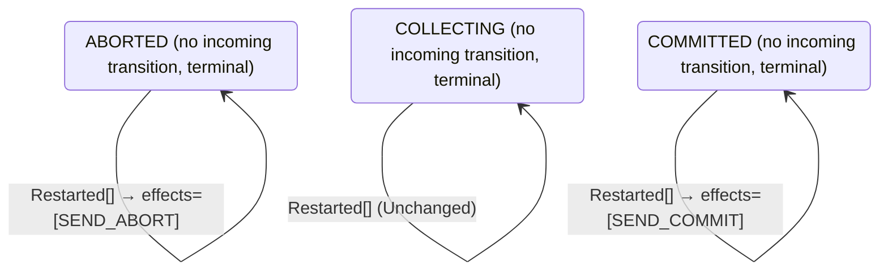

<!-- Generated by examples/demo/tools/build.py from example.json and the verifier's output. Edit example.json. -->
# 089 · A coordinator that resumes collecting votes on restart, proved safe and live

[← All examples](../README.md)

| Verdict | Categories | Severity if shipped | Change | Verified unit | Approach |
|---|---|---|---|---|---|
| **✓ Verified: all invariants and properties hold in 728 states, and under 4 more configurations** | functional, no-false-positive | none | feature, behaviour change intended | [`Recovery#decide`](../../../examples/demo/apps/quorum/src/main/java/net/terminalvalue/quorum/twopc/Recovery.java) | [D1: Protocol model checking](../../../examples/demo/apps/quorum/spec/README.md) |

> A restarted two-phase-commit coordinator without a logged decision aborts: presumed abort, the rule for a coordinator that cannot tell what it had counted. This coordinator logs its tally with each vote, so a developer has a restart in `COLLECTING` carry on instead, counting the votes still on their way and aborting on the timer if the rest never come, so that a crash no longer costs a transaction whose votes were all yes. The contract diff is one row. The model proves the change keeps the protocol safe and live under all four configurations: the two without crashes as before, and with crashes, every invariant in every reachable state, every participant deciding under the fairness conditions, every behaviour one transaction commit allows, and the inductive step closed under the new restart, with the changed row taken in both configurations that have a crash.

## The change

In `Recovery.decide`, a restart in `COLLECTING` is unchanged, with the reason that the votes counted so far are logged, and the comment that the timer restarts with the coordinator and still aborts if the rest never arrive, and that presumed abort is for a coordinator that cannot tell what it had counted. The restarts in the decided phases send the decision again as before. The contract diff is one row, `decide(COLLECTING, Restarted[])`, from a transition to `ABORTED` with `SEND_ABORT` to unchanged; the test for it is replaced.

**Before** ([`Recovery.java`](../../../examples/demo/apps/quorum/src/main/java/net/terminalvalue/quorum/twopc/Recovery.java), line 1):

```java
package net.terminalvalue.quorum.twopc;

import static net.terminalvalue.quorum.Decision.transition;
import static net.terminalvalue.quorum.twopc.CoordinatorEffect.SEND_ABORT;
import static net.terminalvalue.quorum.twopc.CoordinatorEffect.SEND_COMMIT;
import static net.terminalvalue.quorum.twopc.Phase.ABORTED;
    // ...
    public static Decision<Phase, CoordinatorEffect> decide(Phase logged, RecoveryEvent event) {
        return switch (event) {
            case Restarted _ -> switch (logged) {
                case COLLECTING -> transition(ABORTED, SEND_ABORT); // presumed abort
                case COMMITTED -> transition(COMMITTED, SEND_COMMIT);
                case ABORTED -> transition(ABORTED, SEND_ABORT);
            };
```

**After:**

```java
package net.terminalvalue.quorum.twopc;

import static net.terminalvalue.quorum.Decision.transition;
import static net.terminalvalue.quorum.Decision.unchanged;
import static net.terminalvalue.quorum.twopc.CoordinatorEffect.SEND_ABORT;
import static net.terminalvalue.quorum.twopc.CoordinatorEffect.SEND_COMMIT;
import static net.terminalvalue.quorum.twopc.Phase.ABORTED;
    // ...
    public static Decision<Phase, CoordinatorEffect> decide(Phase logged, RecoveryEvent event) {
        return switch (event) {
            case Restarted _ -> switch (logged) {
                // The tally is logged with each vote counted, so a restart loses no vote: the coordinator carries on
                // collecting, and the timer, which restarts with it, still aborts if the rest never arrive. Presumed
                // abort is for a coordinator that cannot tell what it had counted; this one can.
                case COLLECTING -> unchanged("the votes counted so far are logged; keep collecting");
                case COMMITTED -> transition(COMMITTED, SEND_COMMIT);
                case ABORTED -> transition(ABORTED, SEND_ABORT);
            };
```

<details><summary>Patch</summary>

```diff
--- a/examples/demo/apps/quorum/src/main/java/net/terminalvalue/quorum/twopc/Recovery.java
+++ b/examples/demo/apps/quorum/src/main/java/net/terminalvalue/quorum/twopc/Recovery.java
@@ -1,6 +1,7 @@
 package net.terminalvalue.quorum.twopc;
 
 import static net.terminalvalue.quorum.Decision.transition;
+import static net.terminalvalue.quorum.Decision.unchanged;
 import static net.terminalvalue.quorum.twopc.CoordinatorEffect.SEND_ABORT;
 import static net.terminalvalue.quorum.twopc.CoordinatorEffect.SEND_COMMIT;
 import static net.terminalvalue.quorum.twopc.Phase.ABORTED;
@@ -24,7 +25,10 @@
     public static Decision<Phase, CoordinatorEffect> decide(Phase logged, RecoveryEvent event) {
         return switch (event) {
             case Restarted _ -> switch (logged) {
-                case COLLECTING -> transition(ABORTED, SEND_ABORT); // presumed abort
+                // The tally is logged with each vote counted, so a restart loses no vote: the coordinator carries on
+                // collecting, and the timer, which restarts with it, still aborts if the rest never arrive. Presumed
+                // abort is for a coordinator that cannot tell what it had counted; this one can.
+                case COLLECTING -> unchanged("the votes counted so far are logged; keep collecting");
                 case COMMITTED -> transition(COMMITTED, SEND_COMMIT);
                 case ABORTED -> transition(ABORTED, SEND_ABORT);
             };
--- a/examples/demo/apps/quorum/src/test/java/net/terminalvalue/quorum/twopc/RecoveryTest.java
+++ b/examples/demo/apps/quorum/src/test/java/net/terminalvalue/quorum/twopc/RecoveryTest.java
@@ -1,8 +1,10 @@
 package net.terminalvalue.quorum.twopc;
 
+import static net.terminalvalue.quorum.Tests.check;
 import static net.terminalvalue.quorum.Tests.equal;
 
 import java.util.List;
+import net.terminalvalue.quorum.Decision;
 import net.terminalvalue.quorum.Decision.Transition;
 import net.terminalvalue.quorum.twopc.RecoveryEvent.Restarted;
 
@@ -20,8 +22,7 @@
                 Recovery.decide(Phase.ABORTED, new Restarted()));
     }
 
-    public static void presumesAbortWithoutALoggedDecision() {
-        equal(new Transition<>(Phase.ABORTED, List.of(CoordinatorEffect.SEND_ABORT)),
-                Recovery.decide(Phase.COLLECTING, new Restarted()));
+    public static void resumesCollectingWithoutALoggedDecision() {
+        check(Recovery.decide(Phase.COLLECTING, new Restarted()) instanceof Decision.Unchanged, "keeps collecting");
     }
 }
```

</details>

## What the verifier found

The model is checked under 5 configurations, and the verdict is the first that fails:

| Configuration | What it checks | Model | Result |
|---|---|---|---|
| three participants (`spec/TwoPhaseCommit.cfg`) | every run from the initial state, every interleaving within the configuration's bounds | Participants = {p1, p2, p3}, MaxCrashes = 0 | ✓ Verified: all invariants and properties hold in 728 states |
| the inductive step (`spec/TwoPhaseCommitInductive.cfg`) | that the invariant `Inductive` is inductive: TLC starts from every state the invariant admits, reachable or not, rather than from the initial state, takes one step, and checks the invariant again, conjunct by conjunct. No counterexample is a proof of atomicity by induction, for any run of the protocol however long; a counterexample is one step from a state that need not be reachable | Participants = {p1, p2, p3}, MaxCrashes = 0 | ✓ Verified: all invariants hold in 736 states |
| crashes (`spec/TwoPhaseCommitCrash.cfg`) | every run from the initial state in which the coordinator may crash, twice at most: between steps, or after logging a phase change and before the broadcast goes out, and restart on the recovery rule, generated from `Recovery#decide`; the same invariants and temporal properties, under the added fairness condition that a crashed coordinator restarts | Participants = {p1, p2, p3}, MaxCrashes = 2 | ✓ Verified: all invariants and properties hold in 4,072 states |
| the inductive step with crashes (`spec/TwoPhaseCommitCrashInductive.cfg`) | that the invariant `Inductive` is closed under a crash and a restart as well: TLC starts from every state the invariant admits, the coordinator up or down, takes one step, and checks the invariant again | Participants = {p1, p2, p3}, MaxCrashes = 1 | ✓ Verified: all invariants hold in 2,728 states |
| the recorded runs (`spec/TwoPhaseCommitTrace.cfg`) | the Java nodes against the model: the coordinator node, its log and its broadcast, and the participant nodes, run through eight scripted scenarios with crashes injected after a given I/O operation, the state after each step recorded in the model's variables (`TwoPhaseCommitTraces.tla`, regenerated from the patched classes); TLC walks each recorded run and checks that it starts in the model's initial state and that every step is a step of the model's next-state relation. A step the model has no action for is one the glue took that the model's verdicts do not cover | Participants = {"p1", "p2", "p3"}, MaxCrashes = 2 | ✓ Verified: all invariants and properties hold in 74 states |

Every invariant holds in every reachable state of the model, and every temporal property holds of every behaviour, the infinite ones included under three participants: 728 distinct states, which is every interleaving of the participants, the coordinator and the votes in flight within the model's bounds (Participants = {p1, p2, p3}, MaxCrashes = 0).

The coordinator's decision rule and its recovery rule inside the model are generated from the behavioural contracts of the patched code, so the model checks the decisions the coordinator really makes, on a vote, a timeout and a restart.

The other configurations hold too, as the table says: the inductive step, 736 states; crashes, 4,072 states; the inductive step with crashes, 2,728 states; the recorded runs, 74 states.

**What the verdict rests on.** TLC counted how often a step of the model took each row of the generated operators. A row no step takes is one the model says nothing about, whatever the verdict.

| Configuration | Rows of `Coordinator#decide` taken | Rows of `Recovery#decide` taken |
|---|---|---|
| three participants | 10 of 18 | 0 of 3 |
| the inductive step (from the states the invariant admits, not from a run) | 10 of 18 | 0 of 3 |
| crashes | 10 of 18 | 3 of 3 |
| the inductive step with crashes (from the states the invariant admits, not from a run) | 10 of 18 | 3 of 3 |

The change alters 1 row of the contract:

- `decide(COLLECTING, Restarted[])`: `Transition[next=ABORTED, effects=[SEND_ABORT]]` → `Unchanged[reason="the votes counted so far are logged; keep collecting"]`, taken under crashes, the inductive step with crashes

Runs of the model take every row the change alters: the verdict rests on the change.

<details><summary>Rows no step takes under three participants</summary>

`net.terminalvalue.quorum.twopc.Coordinator#decide`:

```
decide(COMMITTED, Tally[complete=false, unanimous=false]) => Unchanged
decide(COMMITTED, Tally[complete=false, unanimous=true]) => Unchanged
decide(COMMITTED, Tally[complete=true, unanimous=false]) => Unchanged
decide(COMMITTED, Tally[complete=true, unanimous=true]) => Unchanged
decide(COMMITTED, Timeout[unanimousSoFar=false]) => Unchanged
decide(COMMITTED, Timeout[unanimousSoFar=true]) => Unchanged
decide(ABORTED, Timeout[unanimousSoFar=false]) => Unchanged
decide(ABORTED, Timeout[unanimousSoFar=true]) => Unchanged
```

`net.terminalvalue.quorum.twopc.Recovery#decide`:

```
decide(COLLECTING, Restarted[]) => Unchanged
decide(COMMITTED, Restarted[]) => Transition[next=COMMITTED, effects=[SEND_COMMIT]]
decide(ABORTED, Restarted[]) => Transition[next=ABORTED, effects=[SEND_ABORT]]
```

</details>

The state machine the patched code implements, drawn from its derived contract (`jvmcontract statemachine`); a state with no way in or no way out is marked:



## Would the existing tests have caught it?

Every existing unit test passes, as it should (`java -ea net.terminalvalue.quorum.Tests`, run against the patched code).

## Why it matters

Low, and the model says so rather than the reviewer. Presumed abort is the textbook rule, and a reviewer who knows it will ask what the change gives up: whether a coordinator that carries on can commit a transaction a participant has already given up on, which would split the participants, and whether it can wait forever on votes that never come, which would block the ones that voted yes. Both are questions about every order of votes, timeouts, crashes and restarts, and the second is about infinite behaviours. The model's invariants, its liveness property under its fairness conditions, its refinement of transaction commit and its inductive step answer all of them.

## Why the verdict is right

The recovery rule in the model is generated from the regenerated contract, so the model runs the new rule. Under `TwoPhaseCommit.cfg` and `TwoPhaseCommitInductive.cfg` nothing crashes and nothing changes: 728 states and 736 as before. Under `TwoPhaseCommitCrash.cfg` the coordinator may crash twice in a run, between steps or after logging a phase change and before sending, and restarts on the recovery rule: TLC explores 4,072 states, more than the 3,448 of the committed rule, since a resumed collection is a run the abort cut short, and every invariant holds in each; every participant decides under the fairness conditions, because a resumed coordinator counts the votes that reach it and its timer fires while votes are missing, which the fairness conditions assume of it whether or not it has crashed; and every step is one transaction commit allows. `TwoPhaseCommitCrashInductive.cfg` checks the step the other way: from every state the invariant `Inductive` admits, the coordinator up or down, a restart on the new rule lands in a state it admits, the conjuncts about the broadcast included, since a coordinator that resumes collecting has nothing to broadcast and the invariant asks nothing of it. TLC's coverage, read back against the contract, shows the changed row taken under both configurations that have a crash, so the verdict rests on runs that restart while collecting and is not vacuous.

## What to do

Merge. The change is a different recovery rule from the textbook's, correct for a coordinator that logs its tally, and the four configurations are checked on every build, so the next change to a restart is held to the same invariants, liveness property and refinement.

## Evidence

How the verdict was reached: three participants: TLC 2.19 explored 728 distinct states to depth 11 in 0 s, for the model Participants = {p1, p2, p3}, MaxCrashes = 0; the inductive step: TLC 2.19 explored 736 distinct states to depth 1 in 0 s, for the model Participants = {p1, p2, p3}, MaxCrashes = 0; crashes: TLC 2.19 explored 4,072 distinct states to depth 13 in 1 s, for the model Participants = {p1, p2, p3}, MaxCrashes = 2; the inductive step with crashes: TLC 2.19 explored 2,728 distinct states to depth 1 in 0 s, for the model Participants = {p1, p2, p3}, MaxCrashes = 1; the recorded runs: TLC 2.19 explored 74 distinct states to depth 11 in 0 s, for the model Participants = {"p1", "p2", "p3"}, MaxCrashes = 2.

<details><summary>Verifier output</summary>

```text
== three participants: spec/TwoPhaseCommit.cfg ==
TLC2 Version 2.19 of 08 August 2024 (rev: 5a47802)
Running breadth-first search Model-Checking with fp 1 and seed 1 with 1 worker on 8 cores with 910MB heap and 64MB offheap memory [pid: 2825081] (Linux 6.6.87.2-microsoft-standard-WSL2 aarch64, Eclipse Adoptium 25.0.4.1 x86_64, MSBDiskFPSet, DiskStateQueue).
Parsing file examples/demo/apps/quorum/spec/TwoPhaseCommit.tla
Parsing file examples/demo/tools/tla/standard-modules/Naturals.tla
Parsing file examples/demo/tools/tla/standard-modules/Sequences.tla
Parsing file examples/demo/tools/tla/standard-modules/FiniteSets.tla
Parsing file examples/demo/apps/quorum/spec/CoordinatorContract.tla
Parsing file examples/demo/apps/quorum/spec/RecoveryContract.tla
Parsing file examples/demo/apps/quorum/spec/TCommit.tla
Semantic processing of module Naturals
Semantic processing of module Sequences
Semantic processing of module FiniteSets
Semantic processing of module CoordinatorContract
Semantic processing of module RecoveryContract
Semantic processing of module TCommit
Semantic processing of module TwoPhaseCommit
Starting... (2026-11-02 04:50:47)
Implied-temporal checking--satisfiability problem has 3 branches.
Computing initial states...
Finished computing initial states: 1 distinct state generated at 2026-11-02 04:50:47.
Checking 3 branches of temporal properties for the complete state space with 2184 total distinct states at (2026-11-02 04:50:48)
Finished checking temporal properties in 00s at 2026-11-02 04:50:48
Model checking completed. No error has been found.
  Estimates of the probability that TLC did not check all reachable states
  because two distinct states had the same fingerprint:
  calculated (optimistic):  val = 6.9E-14
Rows of net.terminalvalue.quorum.twopc.Coordinator#decide a step of the model takes: 10 of 18; never taken (8):
  decide(COMMITTED, Tally[complete=false, unanimous=false]) => Unchanged
  decide(COMMITTED, Tally[complete=false, unanimous=true]) => Unchanged
  decide(COMMITTED, Tally[complete=true, unanimous=false]) => Unchanged
  decide(COMMITTED, Tally[complete=true, unanimous=true]) => Unchanged
  decide(COMMITTED, Timeout[unanimousSoFar=false]) => Unchanged
  decide(COMMITTED, Timeout[unanimousSoFar=true]) => Unchanged
  decide(ABORTED, Timeout[unanimousSoFar=false]) => Unchanged
  decide(ABORTED, Timeout[unanimousSoFar=true]) => Unchanged
Rows of net.terminalvalue.quorum.twopc.Recovery#decide a step of the model takes: 0 of 3; never taken (3):
  decide(COLLECTING, Restarted[]) => Unchanged
  decide(COMMITTED, Restarted[]) => Transition[next=COMMITTED, effects=[SEND_COMMIT]]
  decide(ABORTED, Restarted[]) => Transition[next=ABORTED, effects=[SEND_ABORT]]
2489 states generated, 728 distinct states found, 0 states left on queue.
The depth of the complete state graph search is 11.
The average outdegree of the complete state graph is 1 (minimum is 0, the maximum 10 and the 95th percentile is 3).
Finished in 00s at (2026-11-02 04:50:48)

== the inductive step: spec/TwoPhaseCommitInductive.cfg ==
TLC2 Version 2.19 of 08 August 2024 (rev: 5a47802)
Running breadth-first search Model-Checking with fp 1 and seed 1 with 1 worker on 8 cores with 910MB heap and 64MB offheap memory [pid: 2825188] (Linux 6.6.87.2-microsoft-standard-WSL2 aarch64, Eclipse Adoptium 25.0.4.1 x86_64, MSBDiskFPSet, DiskStateQueue).
Parsing file examples/demo/apps/quorum/spec/TwoPhaseCommit.tla
Parsing file examples/demo/tools/tla/standard-modules/Naturals.tla
Parsing file examples/demo/tools/tla/standard-modules/Sequences.tla
Parsing file examples/demo/tools/tla/standard-modules/FiniteSets.tla
Parsing file examples/demo/apps/quorum/spec/CoordinatorContract.tla
Parsing file examples/demo/apps/quorum/spec/RecoveryContract.tla
Parsing file examples/demo/apps/quorum/spec/TCommit.tla
Semantic processing of module Naturals
Semantic processing of module Sequences
Semantic processing of module FiniteSets
Semantic processing of module CoordinatorContract
Semantic processing of module RecoveryContract
Semantic processing of module TCommit
Semantic processing of module TwoPhaseCommit
Starting... (2026-11-02 04:50:48)
Computing initial states...
Computed 2 initial states...
Computed 4 initial states...
Computed 8 initial states...
Computed 16 initial states...
Computed 32 initial states...
Computed 64 initial states...
Computed 128 initial states...
Computed 256 initial states...
Computed 512 initial states...
Finished computing initial states: 736 distinct states generated at 2026-11-02 04:50:49.
Model checking completed. No error has been found.
  Estimates of the probability that TLC did not check all reachable states
  because two distinct states had the same fingerprint:
  calculated (optimistic):  val = 9.9E-14
Rows of net.terminalvalue.quorum.twopc.Coordinator#decide a step of the model takes: 10 of 18; never taken (8):
  decide(COMMITTED, Tally[complete=false, unanimous=false]) => Unchanged
  decide(COMMITTED, Tally[complete=false, unanimous=true]) => Unchanged
  decide(COMMITTED, Tally[complete=true, unanimous=false]) => Unchanged
  decide(COMMITTED, Tally[complete=true, unanimous=true]) => Unchanged
  decide(COMMITTED, Timeout[unanimousSoFar=false]) => Unchanged
  decide(COMMITTED, Timeout[unanimousSoFar=true]) => Unchanged
  decide(ABORTED, Timeout[unanimousSoFar=false]) => Unchanged
  decide(ABORTED, Timeout[unanimousSoFar=true]) => Unchanged
Rows of net.terminalvalue.quorum.twopc.Recovery#decide a step of the model takes: 0 of 3; never taken (3):
  decide(COLLECTING, Restarted[]) => Unchanged
  decide(COMMITTED, Restarted[]) => Transition[next=COMMITTED, effects=[SEND_COMMIT]]
  decide(ABORTED, Restarted[]) => Transition[next=ABORTED, effects=[SEND_ABORT]]
3224 states generated, 736 distinct states found, 0 states left on queue.
The depth of the complete state graph search is 1.
The average outdegree of the complete state graph is 0 (minimum is 0, the maximum 0 and the 95th percentile is 0).
Finished in 00s at (2026-11-02 04:50:49)

== crashes: spec/TwoPhaseCommitCrash.cfg ==
TLC2 Version 2.19 of 08 August 2024 (rev: 5a47802)
Running breadth-first search Model-Checking with fp 1 and seed 1 with 1 worker on 8 cores with 910MB heap and 64MB offheap memory [pid: 2825254] (Linux 6.6.87.2-microsoft-standard-WSL2 aarch64, Eclipse Adoptium 25.0.4.1 x86_64, MSBDiskFPSet, DiskStateQueue).
Parsing file examples/demo/apps/quorum/spec/TwoPhaseCommit.tla
Parsing file examples/demo/tools/tla/standard-modules/Naturals.tla
Parsing file examples/demo/tools/tla/standard-modules/Sequences.tla
Parsing file examples/demo/tools/tla/standard-modules/FiniteSets.tla
Parsing file examples/demo/apps/quorum/spec/CoordinatorContract.tla
Parsing file examples/demo/apps/quorum/spec/RecoveryContract.tla
Parsing file examples/demo/apps/quorum/spec/TCommit.tla
Semantic processing of module Naturals
Semantic processing of module Sequences
Semantic processing of module FiniteSets
Semantic processing of module CoordinatorContract
Semantic processing of module RecoveryContract
Semantic processing of module TCommit
Semantic processing of module TwoPhaseCommit
Starting... (2026-11-02 04:50:50)
Implied-temporal checking--satisfiability problem has 3 branches.
Computing initial states...
Finished computing initial states: 1 distinct state generated at 2026-11-02 04:50:50.
Checking 3 branches of temporal properties for the complete state space with 12216 total distinct states at (2026-11-02 04:50:51)
Finished checking temporal properties in 00s at 2026-11-02 04:50:51
Model checking completed. No error has been found.
  Estimates of the probability that TLC did not check all reachable states
  because two distinct states had the same fingerprint:
  calculated (optimistic):  val = 2.9E-12
Rows of net.terminalvalue.quorum.twopc.Coordinator#decide a step of the model takes: 10 of 18; never taken (8):
  decide(COMMITTED, Tally[complete=false, unanimous=false]) => Unchanged
  decide(COMMITTED, Tally[complete=false, unanimous=true]) => Unchanged
  decide(COMMITTED, Tally[complete=true, unanimous=false]) => Unchanged
  decide(COMMITTED, Tally[complete=true, unanimous=true]) => Unchanged
  decide(COMMITTED, Timeout[unanimousSoFar=false]) => Unchanged
  decide(COMMITTED, Timeout[unanimousSoFar=true]) => Unchanged
  decide(ABORTED, Timeout[unanimousSoFar=false]) => Unchanged
  decide(ABORTED, Timeout[unanimousSoFar=true]) => Unchanged
Rows of net.terminalvalue.quorum.twopc.Recovery#decide a step of the model takes: 3 of 3.
17377 states generated, 4072 distinct states found, 0 states left on queue.
The depth of the complete state graph search is 13.
The average outdegree of the complete state graph is 1 (minimum is 0, the maximum 12 and the 95th percentile is 3).
Finished in 01s at (2026-11-02 04:50:51)

== the inductive step with crashes: spec/TwoPhaseCommitCrashInductive.cfg ==
TLC2 Version 2.19 of 08 August 2024 (rev: 5a47802)
Running breadth-first search Model-Checking with fp 1 and seed 1 with 1 worker on 8 cores with 910MB heap and 64MB offheap memory [pid: 2825505] (Linux 6.6.87.2-microsoft-standard-WSL2 aarch64, Eclipse Adoptium 25.0.4.1 x86_64, MSBDiskFPSet, DiskStateQueue).
Parsing file examples/demo/apps/quorum/spec/TwoPhaseCommit.tla
Parsing file examples/demo/tools/tla/standard-modules/Naturals.tla
Parsing file examples/demo/tools/tla/standard-modules/Sequences.tla
Parsing file examples/demo/tools/tla/standard-modules/FiniteSets.tla
Parsing file examples/demo/apps/quorum/spec/CoordinatorContract.tla
Parsing file examples/demo/apps/quorum/spec/RecoveryContract.tla
Parsing file examples/demo/apps/quorum/spec/TCommit.tla
Semantic processing of module Naturals
Semantic processing of module Sequences
Semantic processing of module FiniteSets
Semantic processing of module CoordinatorContract
Semantic processing of module RecoveryContract
Semantic processing of module TCommit
Semantic processing of module TwoPhaseCommit
Starting... (2026-11-02 04:50:52)
Computing initial states...
Computed 2 initial states...
Computed 4 initial states...
Computed 8 initial states...
Computed 16 initial states...
Computed 32 initial states...
Computed 64 initial states...
Computed 128 initial states...
Computed 256 initial states...
Computed 512 initial states...
Computed 1024 initial states...
Computed 2048 initial states...
Finished computing initial states: 2728 distinct states generated at 2026-11-02 04:50:52.
Model checking completed. No error has been found.
  Estimates of the probability that TLC did not check all reachable states
  because two distinct states had the same fingerprint:
  calculated (optimistic):  val = 1.5E-12
Rows of net.terminalvalue.quorum.twopc.Coordinator#decide a step of the model takes: 10 of 18; never taken (8):
  decide(COMMITTED, Tally[complete=false, unanimous=false]) => Unchanged
  decide(COMMITTED, Tally[complete=false, unanimous=true]) => Unchanged
  decide(COMMITTED, Tally[complete=true, unanimous=false]) => Unchanged
  decide(COMMITTED, Tally[complete=true, unanimous=true]) => Unchanged
  decide(COMMITTED, Timeout[unanimousSoFar=false]) => Unchanged
  decide(COMMITTED, Timeout[unanimousSoFar=true]) => Unchanged
  decide(ABORTED, Timeout[unanimousSoFar=false]) => Unchanged
  decide(ABORTED, Timeout[unanimousSoFar=true]) => Unchanged
Rows of net.terminalvalue.quorum.twopc.Recovery#decide a step of the model takes: 3 of 3.
12760 states generated, 2728 distinct states found, 0 states left on queue.
The depth of the complete state graph search is 1.
The average outdegree of the complete state graph is 0 (minimum is 0, the maximum 0 and the 95th percentile is 0).
Finished in 00s at (2026-11-02 04:50:53)

== the recorded runs: spec/TwoPhaseCommitTrace.cfg ==
TLC2 Version 2.19 of 08 August 2024 (rev: 5a47802)
Running breadth-first search Model-Checking with fp 1 and seed 1 with 1 worker on 8 cores with 910MB heap and 64MB offheap memory [pid: 2825666] (Linux 6.6.87.2-microsoft-standard-WSL2 aarch64, Eclipse Adoptium 25.0.4.1 x86_64, MSBDiskFPSet, DiskStateQueue).
Parsing file examples/demo/apps/quorum/spec/TwoPhaseCommitTrace.tla
Parsing file examples/demo/apps/quorum/spec/TwoPhaseCommit.tla
Parsing file examples/demo/apps/quorum/spec/TwoPhaseCommitTraces.tla
Parsing file examples/demo/tools/tla/standard-modules/Naturals.tla
Parsing file examples/demo/tools/tla/standard-modules/Sequences.tla
Parsing file examples/demo/tools/tla/standard-modules/FiniteSets.tla
Parsing file examples/demo/apps/quorum/spec/CoordinatorContract.tla
Parsing file examples/demo/apps/quorum/spec/RecoveryContract.tla
Parsing file examples/demo/apps/quorum/spec/TCommit.tla
Semantic processing of module Naturals
Semantic processing of module Sequences
Semantic processing of module FiniteSets
Semantic processing of module CoordinatorContract
Semantic processing of module RecoveryContract
Semantic processing of module TCommit
Semantic processing of module TwoPhaseCommit
Semantic processing of module TwoPhaseCommitTraces
Semantic processing of module TwoPhaseCommitTrace
Starting... (2026-11-02 04:50:53)
Computing initial states...
Computed 2 initial states...
Computed 4 initial states...
Finished computing initial states: 8 distinct states generated at 2026-11-02 04:50:54.
Model checking completed. No error has been found.
  Estimates of the probability that TLC did not check all reachable states
  because two distinct states had the same fingerprint:
  calculated (optimistic):  val = 0.0
74 states generated, 74 distinct states found, 0 states left on queue.
The depth of the complete state graph search is 11.
The average outdegree of the complete state graph is 1 (minimum is 0, the maximum 1 and the 95th percentile is 1).
Finished in 00s at (2026-11-02 04:50:54)
```

</details>

<details><summary>SARIF report (as uploaded to GitHub code scanning or SonarQube)</summary>

```json
{
  "version": "2.1.0",
  "$schema": "https://json.schemastore.org/sarif-2.1.0.json",
  "runs": [
    {
      "tool": {
        "driver": {
          "name": "jvmcontract tlc",
          "rules": [
            {
              "id": "invariant-violated",
              "shortDescription": {
                "text": "TLC found a behaviour of the model that violates an invariant or a temporal property, or ends in a deadlock."
              }
            },
            {
              "id": "unverifiable",
              "shortDescription": {
                "text": "TLC could not check the model."
              }
            }
          ]
        }
      },
      "results": []
    }
  ]
}
```

</details>

**Provenance:** Constructed as the improvement a developer makes once the model's assumption, that the coordinator logs its tally, is noticed, to pair with examples 087 and 088: the same row changed for a reason that holds, accepted on the strength of the model.

- [Mohan, Lindsay and Obermarck, Transaction Management in the R* Distributed Database Management System (1986): presumed abort, what a coordinator does on restart with and without a logged decision](https://dl.acm.org/doi/10.1145/7239.7266)
- [Bernstein, Hadzilacos and Goodman, Concurrency Control and Recovery in Database Systems (1987), chapter 7: the coordinator's and participants' recovery procedures in two-phase commit](https://www.microsoft.com/en-us/research/people/philbe/book/)
- [Lamport, Using TLC to Check Inductive Invariance: the invariant as the initial predicate](https://lamport.azurewebsites.net/tla/inductive-invariant.pdf)
- [TLC's coverage statistics (the -coverage option): how often each expression of the specification was evaluated](https://lamport.azurewebsites.net/tla/current-tools.pdf)
## Reproduce

```bash
python3 examples/demo/tools/build.py 089
```

This applies `change.patch` to a temporary copy of the repo, runs the verifier on it, and rewrites this page.
