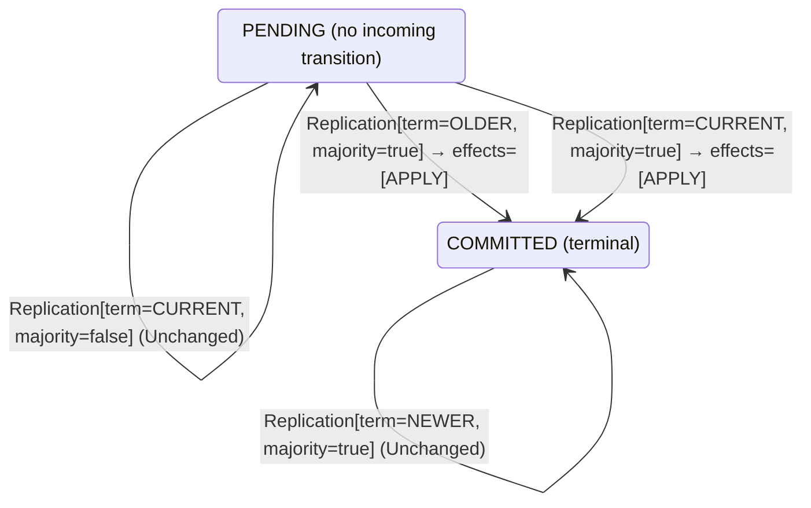

<!-- Generated by examples/demo/tools/build.py from example.json and the verifier's output. Edit example.json. -->
# 097 · A leader that commits an earlier term's entry by counting replicas loses it to a rival

[← All examples](../README.md)

| Verdict | Categories | Severity if shipped | Change | Verified unit | Approach |
|---|---|---|---|---|---|
| **✗ Violation: LeaderCompleteness, 16-step trace (figure 8)** | functional | critical | bug-fix, behaviour change intended | [`CommitRule#decide`](../../../examples/demo/apps/quorum/src/main/java/net/terminalvalue/quorum/raft/CommitRule.java) | [D1: Protocol model checking](../../../examples/demo/apps/quorum/spec/README.md) |

> A Raft leader marks an entry of its own term committed once a majority of the servers hold it, and an entry from an earlier term only along with one of its own after it, the rule of section 5.4.2. A developer has the leader commit any entry a majority holds, whatever its term, with the argument that a candidate without such an entry cannot win a majority. The tests pass, the contract diff is one row, and the model's first configuration, three terms, verifies the change in 25,666 states. The second, four terms and one entry per leader, the budget of figure 8 of the paper, finds in sixteen steps a leader of term 3 that commits an entry of term 1 while a rival whose log ends in term 2 has just been elected leader of term 4 without it.

## The change

In `CommitRule.decide`, the `OLDER` arm for a pending entry, which returned `unchanged` with the reason that an entry from an earlier term is committed only along with one of the current term, joins the `CURRENT` arm: a majority commits it, whatever its term, with the comment that a candidate without an entry a majority holds cannot win a majority. The Javadoc is rewritten to the same argument, and the test that such an entry is never committed by counting becomes one that it is. `AppendRule`, `RoleMachine` and `VoteRule` are untouched.

**Before** ([`CommitRule.java`](../../../examples/demo/apps/quorum/src/main/java/net/terminalvalue/quorum/raft/CommitRule.java), line 8):

```java
import net.terminalvalue.quorum.Decision;

/**
 * When a Raft leader marks an entry committed (Ongaro and Ousterhout, section 5.4.2): once a majority of the servers
 * hold it, and only if it is from the leader's own term. An entry from an earlier term is never committed by
 * counting the servers that hold it, however many: a later leader without it could still be elected and overwrite
 * it (figure 8 of the paper). It is committed, with everything before it, when an entry of the current term after
 * it is.
 */
public final class CommitRule {

    // ...
            case COMMITTED -> unchanged("already committed");
            case PENDING -> switch (replication.term()) {
                case NEWER -> throw new IllegalStateException("an entry from a term after the leader's");
                case OLDER -> unchanged("an entry from an earlier term is committed only along with one of the current term");
                case CURRENT -> replication.majority() ? transition(COMMITTED, APPLY) : unchanged("waiting for a majority");
            };
        };
    }
```

**After:**

```java
import net.terminalvalue.quorum.Decision;

/**
 * When a Raft leader marks an entry committed: once a majority of the servers hold it, whatever its term. An entry
 * from an earlier term that a new leader replicates to a majority is committed the moment the majority holds it,
 * rather than when an entry of the current term after it is: a candidate without it would need a vote from one of
 * the servers that hold it, and the election restriction refuses it that vote.
 */
public final class CommitRule {

    // ...
            case COMMITTED -> unchanged("already committed");
            case PENDING -> switch (replication.term()) {
                case NEWER -> throw new IllegalStateException("an entry from a term after the leader's");
                case OLDER, CURRENT -> replication.majority() ? transition(COMMITTED, APPLY) : unchanged("waiting for a majority"); // whatever the term: a candidate without an entry a majority holds cannot win a majority
            };
        };
    }
```

<details><summary>Patch</summary>

```diff
--- a/examples/demo/apps/quorum/src/main/java/net/terminalvalue/quorum/raft/CommitRule.java
+++ b/examples/demo/apps/quorum/src/main/java/net/terminalvalue/quorum/raft/CommitRule.java
@@ -8,11 +8,10 @@
 import net.terminalvalue.quorum.Decision;
 
 /**
- * When a Raft leader marks an entry committed (Ongaro and Ousterhout, section 5.4.2): once a majority of the servers
- * hold it, and only if it is from the leader's own term. An entry from an earlier term is never committed by
- * counting the servers that hold it, however many: a later leader without it could still be elected and overwrite
- * it (figure 8 of the paper). It is committed, with everything before it, when an entry of the current term after
- * it is.
+ * When a Raft leader marks an entry committed: once a majority of the servers hold it, whatever its term. An entry
+ * from an earlier term that a new leader replicates to a majority is committed the moment the majority holds it,
+ * rather than when an entry of the current term after it is: a candidate without it would need a vote from one of
+ * the servers that hold it, and the election restriction refuses it that vote.
  */
 public final class CommitRule {
 
@@ -23,8 +22,7 @@
             case COMMITTED -> unchanged("already committed");
             case PENDING -> switch (replication.term()) {
                 case NEWER -> throw new IllegalStateException("an entry from a term after the leader's");
-                case OLDER -> unchanged("an entry from an earlier term is committed only along with one of the current term");
-                case CURRENT -> replication.majority() ? transition(COMMITTED, APPLY) : unchanged("waiting for a majority");
+                case OLDER, CURRENT -> replication.majority() ? transition(COMMITTED, APPLY) : unchanged("waiting for a majority"); // whatever the term: a candidate without an entry a majority holds cannot win a majority
             };
         };
     }
--- a/examples/demo/apps/quorum/src/test/java/net/terminalvalue/quorum/raft/CommitRuleTest.java
+++ b/examples/demo/apps/quorum/src/test/java/net/terminalvalue/quorum/raft/CommitRuleTest.java
@@ -18,8 +18,9 @@
         check(CommitRule.decide(PENDING, new Replication(TermOrder.CURRENT, false)) instanceof Decision.Unchanged, "a minority");
     }
 
-    public static void neverCommitsAnEntryOfAnEarlierTermByCounting() {
-        check(CommitRule.decide(PENDING, new Replication(TermOrder.OLDER, true)) instanceof Decision.Unchanged, "figure 8");
+    public static void commitsAnEntryOfAnEarlierTermHeldByAMajority() {
+        equal(new Transition<>(COMMITTED, List.of(CommitEffect.APPLY)), CommitRule.decide(PENDING, new Replication(TermOrder.OLDER, true)));
+        check(CommitRule.decide(PENDING, new Replication(TermOrder.OLDER, false)) instanceof Decision.Unchanged, "a minority");
     }
 
     public static void aCommittedEntryStaysCommitted() {
```

</details>

## What the verifier found

The model is checked under 2 configurations, and the verdict is the first that fails:

| Configuration | What it checks | Model | Result |
|---|---|---|---|
| three terms, two entries (`spec/RaftReplication.cfg`) | every run from the initial state, every interleaving within the configuration's bounds | Servers = {s1, s2, s3}, MaxTerm = 3, MaxEntries = 2 | ✓ Verified: all invariants and properties hold in 25,666 states |
| figure 8 (`spec/RaftReplicationFigureEight.cfg`) | every run of three servers over four terms with one entry per leader's log, the budget of figure 8 of the paper: a leader of term 1 appends an entry it never gets to replicate, a leader of term 2 appends its own at the same index, the first comes back as the leader of term 3 and replicates its entry of term 1 to a majority, and the second, whose last entry is from the later term, can still be elected in term 4 without it; three terms cannot show this, and the same invariants and action properties are checked | Servers = {s1, s2, s3}, MaxTerm = 4, MaxEntries = 1 | ✗ Violation: LeaderCompleteness, 16-step trace |

TLC found a run of the system under figure 8, 16 steps long, that violates the invariant **LeaderCompleteness** (a leader holds every entry a server of its term or an earlier one knows committed (figure 3 of the paper); the election restriction and the commit rule together are what make it so). Each step is one action of one part of the system:

1. **Initial state**: every server a follower in term 0 with an empty log, no vote cast, nothing committed.
2. **Timeout**, `Server.onElectionTimeout`: a server's election timer fires, and the server acts on the role machine's decision. `currentTerm = (s1 :> 1 @@ s2 :> 0 @@ s3 :> 0)`, `role = (s1 :> "CANDIDATE" @@ s2 :> "FOLLOWER" @@ s3 :> "FOLLOWER")`, `votedFor = (s1 :> s1 @@ s2 :> "none" @@ s3 :> "none")`, `votes = (s1 :> {s1} @@ s2 :> {} @@ s3 :> {})`
3. **Canvass**, `Server.requestVote`: a candidate asks one server for its vote and gets the answer; the request and the reply each go through the role machine, then the vote rule on the voter, given its ballot and the candidate's term and log against its own, and the tally on the candidate. `currentTerm = (s1 :> 1 @@ s2 :> 1 @@ s3 :> 0)`, `nextIndex = ( s1 :> (s1 :> 1 @@ s2 :> 1 @@ s3 :> 1) @@ s2 :> (s1 :> 0 @@ s2 :> 0 @@ s3 :> 0) @@ s3 :> (s1 :> 0 @@ s2 :> 0 @@ s3 :> 0) )`, `role = (s1 :> "LEADER" @@ s2 :> "FOLLOWER" @@ s3 :> "FOLLOWER")`, `votedFor = (s1 :> s1 @@ s2 :> s1 @@ s3 :> "none")`, `votes = (s1 :> {s1, s2} @@ s2 :> {} @@ s3 :> {})`
4. **Timeout**, `Server.onElectionTimeout`: a server's election timer fires, and the server acts on the role machine's decision. `currentTerm = (s1 :> 1 @@ s2 :> 2 @@ s3 :> 0)`, `role = (s1 :> "LEADER" @@ s2 :> "CANDIDATE" @@ s3 :> "FOLLOWER")`, `votedFor = (s1 :> s1 @@ s2 :> s2 @@ s3 :> "none")`, `votes = (s1 :> {s1, s2} @@ s2 :> {s2} @@ s3 :> {})`
5. **Canvass**, `Server.requestVote`: a candidate asks one server for its vote and gets the answer; the request and the reply each go through the role machine, then the vote rule on the voter, given its ballot and the candidate's term and log against its own, and the tally on the candidate. `currentTerm = (s1 :> 1 @@ s2 :> 2 @@ s3 :> 2)`, `nextIndex = ( s1 :> (s1 :> 1 @@ s2 :> 1 @@ s3 :> 1) @@ s2 :> (s1 :> 1 @@ s2 :> 1 @@ s3 :> 1) @@ s3 :> (s1 :> 0 @@ s2 :> 0 @@ s3 :> 0) )`, `role = (s1 :> "LEADER" @@ s2 :> "LEADER" @@ s3 :> "FOLLOWER")`, `votedFor = (s1 :> s1 @@ s2 :> s2 @@ s3 :> s2)`, `votes = (s1 :> {s1, s2} @@ s2 :> {s2, s3} @@ s3 :> {})`
6. **ClientRequest**, `Server.onClientRequest`: a leader appends an entry of its term to its own log. `log = (s1 :> <<1>> @@ s2 :> <<>> @@ s3 :> <<>>)`
7. **ClientRequest**, `Server.onClientRequest`: a leader appends an entry of its term to its own log. `log = (s1 :> <<1>> @@ s2 :> <<2>> @@ s3 :> <<>>)`
8. **Replicate**, `Server.appendEntries`: a leader sends one server the entry at that server's next index, or a heartbeat if it is caught up, with the entry before it and the leader's commit index, and gets the answer; the request goes through the role machine, then the append rule on the follower's log as it stands against the leader's, and the reply through the role machine on the leader, which moves the server's next and match indices forward on success and backs the next index up by one on a refusal. `currentTerm = (s1 :> 2 @@ s2 :> 2 @@ s3 :> 2)`, `nextIndex = ( s1 :> (s1 :> 0 @@ s2 :> 0 @@ s3 :> 0) @@ s2 :> (s1 :> 1 @@ s2 :> 1 @@ s3 :> 1) @@ s3 :> (s1 :> 0 @@ s2 :> 0 @@ s3 :> 0) )`, `role = (s1 :> "FOLLOWER" @@ s2 :> "LEADER" @@ s3 :> "FOLLOWER")`, `votedFor = (s1 :> "none" @@ s2 :> s2 @@ s3 :> s2)`, `votes = (s1 :> {} @@ s2 :> {s2, s3} @@ s3 :> {})`
9. **Timeout**, `Server.onElectionTimeout`: a server's election timer fires, and the server acts on the role machine's decision. `currentTerm = (s1 :> 3 @@ s2 :> 2 @@ s3 :> 2)`, `role = (s1 :> "CANDIDATE" @@ s2 :> "LEADER" @@ s3 :> "FOLLOWER")`, `votedFor = (s1 :> s1 @@ s2 :> s2 @@ s3 :> s2)`, `votes = (s1 :> {s1} @@ s2 :> {s2, s3} @@ s3 :> {})`
10. **Canvass**, `Server.requestVote`: a candidate asks one server for its vote and gets the answer; the request and the reply each go through the role machine, then the vote rule on the voter, given its ballot and the candidate's term and log against its own, and the tally on the candidate. `currentTerm = (s1 :> 3 @@ s2 :> 3 @@ s3 :> 2)`, `nextIndex = ( s1 :> (s1 :> 0 @@ s2 :> 0 @@ s3 :> 0) @@ s2 :> (s1 :> 0 @@ s2 :> 0 @@ s3 :> 0) @@ s3 :> (s1 :> 0 @@ s2 :> 0 @@ s3 :> 0) )`, `role = (s1 :> "CANDIDATE" @@ s2 :> "FOLLOWER" @@ s3 :> "FOLLOWER")`, `votedFor = (s1 :> s1 @@ s2 :> "none" @@ s3 :> s2)`, `votes = (s1 :> {s1} @@ s2 :> {} @@ s3 :> {})`
11. **Timeout**, `Server.onElectionTimeout`: a server's election timer fires, and the server acts on the role machine's decision. `currentTerm = (s1 :> 3 @@ s2 :> 4 @@ s3 :> 2)`, `role = (s1 :> "CANDIDATE" @@ s2 :> "CANDIDATE" @@ s3 :> "FOLLOWER")`, `votedFor = (s1 :> s1 @@ s2 :> s2 @@ s3 :> s2)`, `votes = (s1 :> {s1} @@ s2 :> {s2} @@ s3 :> {})`
12. **Canvass**, `Server.requestVote`: a candidate asks one server for its vote and gets the answer; the request and the reply each go through the role machine, then the vote rule on the voter, given its ballot and the candidate's term and log against its own, and the tally on the candidate. `currentTerm = (s1 :> 3 @@ s2 :> 4 @@ s3 :> 3)`, `nextIndex = ( s1 :> (s1 :> 2 @@ s2 :> 2 @@ s3 :> 2) @@ s2 :> (s1 :> 0 @@ s2 :> 0 @@ s3 :> 0) @@ s3 :> (s1 :> 0 @@ s2 :> 0 @@ s3 :> 0) )`, `role = (s1 :> "LEADER" @@ s2 :> "CANDIDATE" @@ s3 :> "FOLLOWER")`, `votedFor = (s1 :> s1 @@ s2 :> s2 @@ s3 :> s1)`, `votes = (s1 :> {s1, s3} @@ s2 :> {s2} @@ s3 :> {})`
13. **Replicate**, `Server.appendEntries`: a leader sends one server the entry at that server's next index, or a heartbeat if it is caught up, with the entry before it and the leader's commit index, and gets the answer; the request goes through the role machine, then the append rule on the follower's log as it stands against the leader's, and the reply through the role machine on the leader, which moves the server's next and match indices forward on success and backs the next index up by one on a refusal. `nextIndex = ( s1 :> (s1 :> 2 @@ s2 :> 2 @@ s3 :> 1) @@ s2 :> (s1 :> 0 @@ s2 :> 0 @@ s3 :> 0) @@ s3 :> (s1 :> 0 @@ s2 :> 0 @@ s3 :> 0) )`
14. **Replicate**, `Server.appendEntries`: a leader sends one server the entry at that server's next index, or a heartbeat if it is caught up, with the entry before it and the leader's commit index, and gets the answer; the request goes through the role machine, then the append rule on the follower's log as it stands against the leader's, and the reply through the role machine on the leader, which moves the server's next and match indices forward on success and backs the next index up by one on a refusal. `log = (s1 :> <<1>> @@ s2 :> <<2>> @@ s3 :> <<1>>)`, `matchIndex = ( s1 :> (s1 :> 0 @@ s2 :> 0 @@ s3 :> 1) @@ s2 :> (s1 :> 0 @@ s2 :> 0 @@ s3 :> 0) @@ s3 :> (s1 :> 0 @@ s2 :> 0 @@ s3 :> 0) )`, `nextIndex = ( s1 :> (s1 :> 2 @@ s2 :> 2 @@ s3 :> 2) @@ s2 :> (s1 :> 0 @@ s2 :> 0 @@ s3 :> 0) @@ s3 :> (s1 :> 0 @@ s2 :> 0 @@ s3 :> 0) )`
15. **Canvass**, `Server.requestVote`: a candidate asks one server for its vote and gets the answer; the request and the reply each go through the role machine, then the vote rule on the voter, given its ballot and the candidate's term and log against its own, and the tally on the candidate. `currentTerm = (s1 :> 3 @@ s2 :> 4 @@ s3 :> 4)`, `nextIndex = ( s1 :> (s1 :> 2 @@ s2 :> 2 @@ s3 :> 2) @@ s2 :> (s1 :> 2 @@ s2 :> 2 @@ s3 :> 2) @@ s3 :> (s1 :> 0 @@ s2 :> 0 @@ s3 :> 0) )`, `role = (s1 :> "LEADER" @@ s2 :> "LEADER" @@ s3 :> "FOLLOWER")`, `votedFor = (s1 :> s1 @@ s2 :> s2 @@ s3 :> s2)`, `votes = (s1 :> {s1, s3} @@ s2 :> {s2, s3} @@ s3 :> {})`
16. **AdvanceCommit**, `Server.advanceCommitIndex`: a leader asks the commit rule about the first entry it has not marked committed, given the entry's term against its own and whether a majority of the servers hold it, and marks it committed on a transition. `commitIndex = (s1 :> 1 @@ s2 :> 0 @@ s3 :> 0)`

The model is small (Servers = {s1, s2, s3}, MaxTerm = 4, MaxEntries = 1), which is what keeps the trace readable. TLC explored every interleaving of the servers, their terms, votes and logs, and the AppendEntries RPCs between them within those bounds.

**What the verdict rests on.** TLC counted how often a step of the model took each row of the generated operators. A row no step takes is one the model says nothing about, whatever the verdict.

| Configuration | Rows of `RoleMachine#decide` taken | Rows of `VoteRule#decide` taken | Rows of `AppendRule#decide` taken | Rows of `CommitRule#decide` taken |
|---|---|---|---|---|
| three terms, two entries | 27 of 36 | 12 of 27 | 16 of 24 | 4 of 12 |
| figure 8 | stopped at the counterexample | stopped at the counterexample | stopped at the counterexample | stopped at the counterexample |

The change alters 1 row of the contract:

- `decide(PENDING, Replication[term=OLDER, majority=true])`: `Unchanged[reason="an entry from an earlier term is committed only along with one of the current term"]` → `Transition[next=COMMITTED, effects=[APPLY]]`, taken under three terms, two entries

The run under figure 8 stopped at its counterexample, the steps above, and its counts are left out: the verdict rests on the counterexample.

<details><summary>Rows no step takes under three terms, two entries</summary>

`net.terminalvalue.quorum.raft.RoleMachine#decide`:

```
decide(FOLLOWER, VotesCounted[majority=true]) => Unchanged
decide(FOLLOWER, Response[term=OLDER]) => Unchanged
decide(FOLLOWER, Response[term=CURRENT]) => Unchanged
decide(FOLLOWER, Response[term=NEWER]) => Transition[next=FOLLOWER, effects=[ADOPT_TERM]]
decide(CANDIDATE, Response[term=OLDER]) => Unchanged
decide(LEADER, VotesCounted[majority=false]) => Unchanged
decide(LEADER, VotesCounted[majority=true]) => Unchanged
decide(LEADER, AppendEntries[term=CURRENT]) => throws IllegalStateException
decide(LEADER, Response[term=OLDER]) => Unchanged
```

`net.terminalvalue.quorum.raft.VoteRule#decide`:

```
decide(OPEN, VoteRequest[term=NEWER, log=BEHIND]) => Rejected
decide(OPEN, VoteRequest[term=NEWER, log=EVEN]) => Transition[next=FOR_THE_CANDIDATE, effects=[GRANT]]
decide(OPEN, VoteRequest[term=NEWER, log=AHEAD]) => Transition[next=FOR_THE_CANDIDATE, effects=[GRANT]]
decide(FOR_THE_CANDIDATE, VoteRequest[term=OLDER, log=BEHIND]) => Rejected
decide(FOR_THE_CANDIDATE, VoteRequest[term=OLDER, log=EVEN]) => Rejected
decide(FOR_THE_CANDIDATE, VoteRequest[term=OLDER, log=AHEAD]) => Rejected
decide(FOR_THE_CANDIDATE, VoteRequest[term=CURRENT, log=BEHIND]) => Rejected
decide(FOR_THE_CANDIDATE, VoteRequest[term=CURRENT, log=EVEN]) => Transition[next=FOR_THE_CANDIDATE, effects=[GRANT]]
decide(FOR_THE_CANDIDATE, VoteRequest[term=CURRENT, log=AHEAD]) => Transition[next=FOR_THE_CANDIDATE, effects=[GRANT]]
decide(FOR_THE_CANDIDATE, VoteRequest[term=NEWER, log=BEHIND]) => Rejected
decide(FOR_THE_CANDIDATE, VoteRequest[term=NEWER, log=EVEN]) => Transition[next=FOR_THE_CANDIDATE, effects=[GRANT]]
decide(FOR_THE_CANDIDATE, VoteRequest[term=NEWER, log=AHEAD]) => Transition[next=FOR_THE_CANDIDATE, effects=[GRANT]]
decide(FOR_ANOTHER, VoteRequest[term=NEWER, log=BEHIND]) => Rejected
decide(FOR_ANOTHER, VoteRequest[term=NEWER, log=EVEN]) => Transition[next=FOR_THE_CANDIDATE, effects=[GRANT]]
decide(FOR_ANOTHER, VoteRequest[term=NEWER, log=AHEAD]) => Transition[next=FOR_THE_CANDIDATE, effects=[GRANT]]
```

`net.terminalvalue.quorum.raft.AppendRule#decide`:

```
decide(MISSING, AppendRequest[entry=SAME, commitAhead=false]) => Rejected
decide(MISSING, AppendRequest[entry=SAME, commitAhead=true]) => Rejected
decide(MISSING, AppendRequest[entry=CONFLICTING, commitAhead=false]) => Rejected
decide(MISSING, AppendRequest[entry=CONFLICTING, commitAhead=true]) => Rejected
decide(CONFLICTING, AppendRequest[entry=SAME, commitAhead=false]) => Rejected
decide(CONFLICTING, AppendRequest[entry=SAME, commitAhead=true]) => Rejected
decide(MATCHING, AppendRequest[entry=SAME, commitAhead=false]) => Unchanged
decide(MATCHING, AppendRequest[entry=SAME, commitAhead=true]) => Transition[next=MATCHING, effects=[ADVANCE_COMMIT]]
```

`net.terminalvalue.quorum.raft.CommitRule#decide`:

```
decide(PENDING, Replication[term=NEWER, majority=false]) => throws IllegalStateException
decide(PENDING, Replication[term=NEWER, majority=true]) => throws IllegalStateException
decide(COMMITTED, Replication[term=OLDER, majority=false]) => Unchanged
decide(COMMITTED, Replication[term=OLDER, majority=true]) => Unchanged
decide(COMMITTED, Replication[term=CURRENT, majority=false]) => Unchanged
decide(COMMITTED, Replication[term=CURRENT, majority=true]) => Unchanged
decide(COMMITTED, Replication[term=NEWER, majority=false]) => Unchanged
decide(COMMITTED, Replication[term=NEWER, majority=true]) => Unchanged
```

</details>

The state machine the patched code implements, drawn from its derived contract (`jvmcontract statemachine`); a state with no way in or no way out is marked:



## Would the existing tests have caught it?

No: every existing unit test passes (`java -ea net.terminalvalue.quorum.Tests`, run against the patched code).

## Why it matters

High. The change fixes something that looks like a bug: a new leader that has replicated an inherited entry to every server leaves it uncommitted until a client sends something new, and the argument in the comment is the one most people give for why that is unnecessary. It is wrong in a way that takes four terms to show, which is more than a test of the rule's inputs can see and more than the model's first configuration explores; the rule's contract has no term numbers in it, only `OLDER` and `CURRENT`.

## Why the verdict is right

The commit rule in the model is generated from the regenerated contract, so `AdvanceCommit` commits what the patched row says. The first configuration, three terms, verifies the change in 25,666 states, more than the committed rule's 19,338, since more gets committed: every entry a majority holds within three terms is one the next leader holds too. The second, `RaftReplicationFigureEight.cfg`, has four terms and one entry per leader, and TLC reports `LeaderCompleteness` violated after sixteen steps, the paper's figure 8 with three servers: s1 wins term 1 and appends an entry of term 1 that stays on s1 alone; s2 wins term 2 with s3's vote and appends an entry of term 2 that stays on s2 alone; s1 hears of term 2 from s2's refusal of its heartbeat, times out into term 3, wins it with s3's vote, backs up once against s3's empty log and replicates its entry of term 1 to s3, so that a majority holds it; s2 times out into term 4 and wins it with s3's vote, since s2's log ends in term 2 and s3's in term 1, and the election restriction compares last terms, not holdings; and s1, still the leader of term 3, marks its entry committed on the patched row, with a majority holding it and a leader of a later term elected without it. The next steps, which TLC does not need, are s2's entry of term 2 replacing the committed entry on s1 and s3. The committed rule leaves the entry pending in that state, and commits it only once an entry of term 3 after it reaches a majority, which s2 could not then have been elected over.

## What to do

Reject. An entry from an earlier term is committed by the entry of the current term that follows it, never by counting the servers that hold it (Ongaro and Ousterhout, section 5.4.2); the argument in the comment fails because a voter that holds the entry grants its vote on the candidate's last term, not on the candidate holding what the voter holds. A leader that wants its inherited entries committed appends a no-op entry of its own term on taking office, which the paper's section 8 and the thesis recommend and the model would verify. The second configuration exists for this row, and checks it on every build.

## Evidence

How the verdict was reached: three terms, two entries: TLC 2.19 explored 25,666 distinct states to depth 22 in 11 s, for the model Servers = {s1, s2, s3}, MaxTerm = 3, MaxEntries = 2; figure 8: TLC 2.19 explored 10,087 distinct states to depth 16 in 5 s, for the model Servers = {s1, s2, s3}, MaxTerm = 4, MaxEntries = 1.

<details><summary>Verifier output</summary>

```text
== three terms, two entries: spec/RaftReplication.cfg ==
TLC2 Version 2.19 of 08 August 2024 (rev: 5a47802)
Running breadth-first search Model-Checking with fp 1 and seed 1 with 1 worker on 8 cores with 910MB heap and 64MB offheap memory [pid: 3043421] (Linux 6.6.87.2-microsoft-standard-WSL2 aarch64, Eclipse Adoptium 25.0.4.1 x86_64, MSBDiskFPSet, DiskStateQueue).
Parsing file examples/demo/apps/quorum/spec/RaftReplication.tla
Parsing file examples/demo/tools/tla/standard-modules/Naturals.tla
Parsing file examples/demo/tools/tla/standard-modules/FiniteSets.tla
Parsing file examples/demo/tools/tla/standard-modules/Sequences.tla
Parsing file examples/demo/tools/tla/standard-modules/TLC.tla
Parsing file examples/demo/apps/quorum/spec/RoleMachineContract.tla
Parsing file examples/demo/apps/quorum/spec/VoteRuleContract.tla
Parsing file examples/demo/apps/quorum/spec/AppendRuleContract.tla
Parsing file examples/demo/apps/quorum/spec/CommitRuleContract.tla
Semantic processing of module Naturals
Semantic processing of module Sequences
Semantic processing of module FiniteSets
Semantic processing of module TLC
Semantic processing of module RoleMachineContract
Semantic processing of module VoteRuleContract
Semantic processing of module AppendRuleContract
Semantic processing of module CommitRuleContract
Semantic processing of module RaftReplication
Starting... (2026-11-02 06:06:40)
Computing initial states...
Finished computing initial states: 1 distinct state generated at 2026-11-02 06:06:40.
Model checking completed. No error has been found.
  Estimates of the probability that TLC did not check all reachable states
  because two distinct states had the same fingerprint:
  calculated (optimistic):  val = 1.5E-10
  based on the actual fingerprints:  val = 1.9E-11
Rows of net.terminalvalue.quorum.raft.RoleMachine#decide a step of the model takes: 27 of 36; never taken (9):
  decide(FOLLOWER, VotesCounted[majority=true]) => Unchanged
  decide(FOLLOWER, Response[term=OLDER]) => Unchanged
  decide(FOLLOWER, Response[term=CURRENT]) => Unchanged
  decide(FOLLOWER, Response[term=NEWER]) => Transition[next=FOLLOWER, effects=[ADOPT_TERM]]
  decide(CANDIDATE, Response[term=OLDER]) => Unchanged
  decide(LEADER, VotesCounted[majority=false]) => Unchanged
  decide(LEADER, VotesCounted[majority=true]) => Unchanged
  decide(LEADER, AppendEntries[term=CURRENT]) => throws IllegalStateException
  decide(LEADER, Response[term=OLDER]) => Unchanged
Rows of net.terminalvalue.quorum.raft.VoteRule#decide a step of the model takes: 12 of 27; never taken (15):
  decide(OPEN, VoteRequest[term=NEWER, log=BEHIND]) => Rejected
  decide(OPEN, VoteRequest[term=NEWER, log=EVEN]) => Transition[next=FOR_THE_CANDIDATE, effects=[GRANT]]
  decide(OPEN, VoteRequest[term=NEWER, log=AHEAD]) => Transition[next=FOR_THE_CANDIDATE, effects=[GRANT]]
  decide(FOR_THE_CANDIDATE, VoteRequest[term=OLDER, log=BEHIND]) => Rejected
  decide(FOR_THE_CANDIDATE, VoteRequest[term=OLDER, log=EVEN]) => Rejected
  decide(FOR_THE_CANDIDATE, VoteRequest[term=OLDER, log=AHEAD]) => Rejected
  decide(FOR_THE_CANDIDATE, VoteRequest[term=CURRENT, log=BEHIND]) => Rejected
  decide(FOR_THE_CANDIDATE, VoteRequest[term=CURRENT, log=EVEN]) => Transition[next=FOR_THE_CANDIDATE, effects=[GRANT]]
  decide(FOR_THE_CANDIDATE, VoteRequest[term=CURRENT, log=AHEAD]) => Transition[next=FOR_THE_CANDIDATE, effects=[GRANT]]
  decide(FOR_THE_CANDIDATE, VoteRequest[term=NEWER, log=BEHIND]) => Rejected
  decide(FOR_THE_CANDIDATE, VoteRequest[term=NEWER, log=EVEN]) => Transition[next=FOR_THE_CANDIDATE, effects=[GRANT]]
  decide(FOR_THE_CANDIDATE, VoteRequest[term=NEWER, log=AHEAD]) => Transition[next=FOR_THE_CANDIDATE, effects=[GRANT]]
  decide(FOR_ANOTHER, VoteRequest[term=NEWER, log=BEHIND]) => Rejected
  decide(FOR_ANOTHER, VoteRequest[term=NEWER, log=EVEN]) => Transition[next=FOR_THE_CANDIDATE, effects=[GRANT]]
  decide(FOR_ANOTHER, VoteRequest[term=NEWER, log=AHEAD]) => Transition[next=FOR_THE_CANDIDATE, effects=[GRANT]]
Rows of net.terminalvalue.quorum.raft.AppendRule#decide a step of the model takes: 16 of 24; never taken (8):
  decide(MISSING, AppendRequest[entry=SAME, commitAhead=false]) => Rejected
  decide(MISSING, AppendRequest[entry=SAME, commitAhead=true]) => Rejected
  decide(MISSING, AppendRequest[entry=CONFLICTING, commitAhead=false]) => Rejected
  decide(MISSING, AppendRequest[entry=CONFLICTING, commitAhead=true]) => Rejected
  decide(CONFLICTING, AppendRequest[entry=SAME, commitAhead=false]) => Rejected
  decide(CONFLICTING, AppendRequest[entry=SAME, commitAhead=true]) => Rejected
  decide(MATCHING, AppendRequest[entry=SAME, commitAhead=false]) => Unchanged
  decide(MATCHING, AppendRequest[entry=SAME, commitAhead=true]) => Transition[next=MATCHING, effects=[ADVANCE_COMMIT]]
Rows of net.terminalvalue.quorum.raft.CommitRule#decide a step of the model takes: 4 of 12; never taken (8):
  decide(PENDING, Replication[term=NEWER, majority=false]) => throws IllegalStateException
  decide(PENDING, Replication[term=NEWER, majority=true]) => throws IllegalStateException
  decide(COMMITTED, Replication[term=OLDER, majority=false]) => Unchanged
  decide(COMMITTED, Replication[term=OLDER, majority=true]) => Unchanged
  decide(COMMITTED, Replication[term=CURRENT, majority=false]) => Unchanged
  decide(COMMITTED, Replication[term=CURRENT, majority=true]) => Unchanged
  decide(COMMITTED, Replication[term=NEWER, majority=false]) => Unchanged
  decide(COMMITTED, Replication[term=NEWER, majority=true]) => Unchanged
132339 states generated, 25666 distinct states found, 0 states left on queue.
The depth of the complete state graph search is 22.
The average outdegree of the complete state graph is 1 (minimum is 0, the maximum 7 and the 95th percentile is 3).
Finished in 11s at (2026-11-02 06:06:51)

== figure 8: spec/RaftReplicationFigureEight.cfg ==
TLC2 Version 2.19 of 08 August 2024 (rev: 5a47802)
Running breadth-first search Model-Checking with fp 1 and seed 1 with 1 worker on 8 cores with 910MB heap and 64MB offheap memory [pid: 3044017] (Linux 6.6.87.2-microsoft-standard-WSL2 aarch64, Eclipse Adoptium 25.0.4.1 x86_64, MSBDiskFPSet, DiskStateQueue).
Parsing file examples/demo/apps/quorum/spec/RaftReplication.tla
Parsing file examples/demo/tools/tla/standard-modules/Naturals.tla
Parsing file examples/demo/tools/tla/standard-modules/FiniteSets.tla
Parsing file examples/demo/tools/tla/standard-modules/Sequences.tla
Parsing file examples/demo/tools/tla/standard-modules/TLC.tla
Parsing file examples/demo/apps/quorum/spec/RoleMachineContract.tla
Parsing file examples/demo/apps/quorum/spec/VoteRuleContract.tla
Parsing file examples/demo/apps/quorum/spec/AppendRuleContract.tla
Parsing file examples/demo/apps/quorum/spec/CommitRuleContract.tla
Semantic processing of module Naturals
Semantic processing of module Sequences
Semantic processing of module FiniteSets
Semantic processing of module TLC
Semantic processing of module RoleMachineContract
Semantic processing of module VoteRuleContract
Semantic processing of module AppendRuleContract
Semantic processing of module CommitRuleContract
Semantic processing of module RaftReplication
Starting... (2026-11-02 06:06:52)
Computing initial states...
Finished computing initial states: 1 distinct state generated at 2026-11-02 06:06:52.
Error: Invariant LeaderCompleteness is violated.
Error: The behavior up to this point is:
State 1: <Initial predicate>
/\ matchIndex = ( s1 :> (s1 :> 0 @@ s2 :> 0 @@ s3 :> 0) @@
  s2 :> (s1 :> 0 @@ s2 :> 0 @@ s3 :> 0) @@
  s3 :> (s1 :> 0 @@ s2 :> 0 @@ s3 :> 0) )
/\ log = (s1 :> <<>> @@ s2 :> <<>> @@ s3 :> <<>>)
/\ commitIndex = (s1 :> 0 @@ s2 :> 0 @@ s3 :> 0)
/\ currentTerm = (s1 :> 0 @@ s2 :> 0 @@ s3 :> 0)
/\ nextIndex = ( s1 :> (s1 :> 0 @@ s2 :> 0 @@ s3 :> 0) @@
  s2 :> (s1 :> 0 @@ s2 :> 0 @@ s3 :> 0) @@
  s3 :> (s1 :> 0 @@ s2 :> 0 @@ s3 :> 0) )
/\ votes = (s1 :> {} @@ s2 :> {} @@ s3 :> {})
/\ role = (s1 :> "FOLLOWER" @@ s2 :> "FOLLOWER" @@ s3 :> "FOLLOWER")
/\ votedFor = (s1 :> "none" @@ s2 :> "none" @@ s3 :> "none")

State 2: <Timeout line 129, col 15 to line 129, col 88 of module RaftReplication>
/\ matchIndex = ( s1 :> (s1 :> 0 @@ s2 :> 0 @@ s3 :> 0) @@
  s2 :> (s1 :> 0 @@ s2 :> 0 @@ s3 :> 0) @@
  s3 :> (s1 :> 0 @@ s2 :> 0 @@ s3 :> 0) )
/\ log = (s1 :> <<>> @@ s2 :> <<>> @@ s3 :> <<>>)
/\ commitIndex = (s1 :> 0 @@ s2 :> 0 @@ s3 :> 0)
/\ currentTerm = (s1 :> 1 @@ s2 :> 0 @@ s3 :> 0)
/\ nextIndex = ( s1 :> (s1 :> 0 @@ s2 :> 0 @@ s3 :> 0) @@
  s2 :> (s1 :> 0 @@ s2 :> 0 @@ s3 :> 0) @@
  s3 :> (s1 :> 0 @@ s2 :> 0 @@ s3 :> 0) )
/\ votes = (s1 :> {s1} @@ s2 :> {} @@ s3 :> {})
/\ role = (s1 :> "CANDIDATE" @@ s2 :> "FOLLOWER" @@ s3 :> "FOLLOWER")
/\ votedFor = (s1 :> s1 @@ s2 :> "none" @@ s3 :> "none")

State 3: <Canvass line 155, col 5 to line 158, col 30 of module RaftReplication>
/\ matchIndex = ( s1 :> (s1 :> 0 @@ s2 :> 0 @@ s3 :> 0) @@
  s2 :> (s1 :> 0 @@ s2 :> 0 @@ s3 :> 0) @@
  s3 :> (s1 :> 0 @@ s2 :> 0 @@ s3 :> 0) )
/\ log = (s1 :> <<>> @@ s2 :> <<>> @@ s3 :> <<>>)
/\ commitIndex = (s1 :> 0 @@ s2 :> 0 @@ s3 :> 0)
/\ currentTerm = (s1 :> 1 @@ s2 :> 1 @@ s3 :> 0)
/\ nextIndex = ( s1 :> (s1 :> 1 @@ s2 :> 1 @@ s3 :> 1) @@
  s2 :> (s1 :> 0 @@ s2 :> 0 @@ s3 :> 0) @@
  s3 :> (s1 :> 0 @@ s2 :> 0 @@ s3 :> 0) )
/\ votes = (s1 :> {s1, s2} @@ s2 :> {} @@ s3 :> {})
/\ role = (s1 :> "LEADER" @@ s2 :> "FOLLOWER" @@ s3 :> "FOLLOWER")
/\ votedFor = (s1 :> s1 @@ s2 :> s1 @@ s3 :> "none")

State 4: <Timeout line 129, col 15 to line 129, col 88 of module RaftReplication>
/\ matchIndex = ( s1 :> (s1 :> 0 @@ s2 :> 0 @@ s3 :> 0) @@
  s2 :> (s1 :> 0 @@ s2 :> 0 @@ s3 :> 0) @@
  s3 :> (s1 :> 0 @@ s2 :> 0 @@ s3 :> 0) )
/\ log = (s1 :> <<>> @@ s2 :> <<>> @@ s3 :> <<>>)
/\ commitIndex = (s1 :> 0 @@ s2 :> 0 @@ s3 :> 0)
/\ currentTerm = (s1 :> 1 @@ s2 :> 2 @@ s3 :> 0)
/\ nextIndex = ( s1 :> (s1 :> 1 @@ s2 :> 1 @@ s3 :> 1) @@
  s2 :> (s1 :> 0 @@ s2 :> 0 @@ s3 :> 0) @@
  s3 :> (s1 :> 0 @@ s2 :> 0 @@ s3 :> 0) )
/\ votes = (s1 :> {s1, s2} @@ s2 :> {s2} @@ s3 :> {})
/\ role = (s1 :> "LEADER" @@ s2 :> "CANDIDATE" @@ s3 :> "FOLLOWER")
/\ votedFor = (s1 :> s1 @@ s2 :> s2 @@ s3 :> "none")

State 5: <Canvass line 155, col 5 to line 158, col 30 of module RaftReplication>
/\ matchIndex = ( s1 :> (s1 :> 0 @@ s2 :> 0 @@ s3 :> 0) @@
  s2 :> (s1 :> 0 @@ s2 :> 0 @@ s3 :> 0) @@
  s3 :> (s1 :> 0 @@ s2 :> 0 @@ s3 :> 0) )
/\ log = (s1 :> <<>> @@ s2 :> <<>> @@ s3 :> <<>>)
/\ commitIndex = (s1 :> 0 @@ s2 :> 0 @@ s3 :> 0)
/\ currentTerm = (s1 :> 1 @@ s2 :> 2 @@ s3 :> 2)
/\ nextIndex = ( s1 :> (s1 :> 1 @@ s2 :> 1 @@ s3 :> 1) @@
  s2 :> (s1 :> 1 @@ s2 :> 1 @@ s3 :> 1) @@
  s3 :> (s1 :> 0 @@ s2 :> 0 @@ s3 :> 0) )
/\ votes = (s1 :> {s1, s2} @@ s2 :> {s2, s3} @@ s3 :> {})
/\ role = (s1 :> "LEADER" @@ s2 :> "LEADER" @@ s3 :> "FOLLOWER")
/\ votedFor = (s1 :> s1 @@ s2 :> s2 @@ s3 :> s2)

State 6: <ClientRequest line 167, col 5 to line 170, col 91 of module RaftReplication>
/\ matchIndex = ( s1 :> (s1 :> 0 @@ s2 :> 0 @@ s3 :> 0) @@
  s2 :> (s1 :> 0 @@ s2 :> 0 @@ s3 :> 0) @@
  s3 :> (s1 :> 0 @@ s2 :> 0 @@ s3 :> 0) )
/\ log = (s1 :> <<1>> @@ s2 :> <<>> @@ s3 :> <<>>)
/\ commitIndex = (s1 :> 0 @@ s2 :> 0 @@ s3 :> 0)
/\ currentTerm = (s1 :> 1 @@ s2 :> 2 @@ s3 :> 2)
/\ nextIndex = ( s1 :> (s1 :> 1 @@ s2 :> 1 @@ s3 :> 1) @@
  s2 :> (s1 :> 1 @@ s2 :> 1 @@ s3 :> 1) @@
  s3 :> (s1 :> 0 @@ s2 :> 0 @@ s3 :> 0) )
/\ votes = (s1 :> {s1, s2} @@ s2 :> {s2, s3} @@ s3 :> {})
/\ role = (s1 :> "LEADER" @@ s2 :> "LEADER" @@ s3 :> "FOLLOWER")
/\ votedFor = (s1 :> s1 @@ s2 :> s2 @@ s3 :> s2)

State 7: <ClientRequest line 167, col 5 to line 170, col 91 of module RaftReplication>
/\ matchIndex = ( s1 :> (s1 :> 0 @@ s2 :> 0 @@ s3 :> 0) @@
  s2 :> (s1 :> 0 @@ s2 :> 0 @@ s3 :> 0) @@
  s3 :> (s1 :> 0 @@ s2 :> 0 @@ s3 :> 0) )
/\ log = (s1 :> <<1>> @@ s2 :> <<2>> @@ s3 :> <<>>)
/\ commitIndex = (s1 :> 0 @@ s2 :> 0 @@ s3 :> 0)
/\ currentTerm = (s1 :> 1 @@ s2 :> 2 @@ s3 :> 2)
/\ nextIndex = ( s1 :> (s1 :> 1 @@ s2 :> 1 @@ s3 :> 1) @@
  s2 :> (s1 :> 1 @@ s2 :> 1 @@ s3 :> 1) @@
  s3 :> (s1 :> 0 @@ s2 :> 0 @@ s3 :> 0) )
/\ votes = (s1 :> {s1, s2} @@ s2 :> {s2, s3} @@ s3 :> {})
/\ role = (s1 :> "LEADER" @@ s2 :> "LEADER" @@ s3 :> "FOLLOWER")
/\ votedFor = (s1 :> s1 @@ s2 :> s2 @@ s3 :> s2)

State 8: <Replicate line 216, col 5 to line 219, col 32 of module RaftReplication>
/\ matchIndex = ( s1 :> (s1 :> 0 @@ s2 :> 0 @@ s3 :> 0) @@
  s2 :> (s1 :> 0 @@ s2 :> 0 @@ s3 :> 0) @@
  s3 :> (s1 :> 0 @@ s2 :> 0 @@ s3 :> 0) )
/\ log = (s1 :> <<1>> @@ s2 :> <<2>> @@ s3 :> <<>>)
/\ commitIndex = (s1 :> 0 @@ s2 :> 0 @@ s3 :> 0)
/\ currentTerm = (s1 :> 2 @@ s2 :> 2 @@ s3 :> 2)
/\ nextIndex = ( s1 :> (s1 :> 0 @@ s2 :> 0 @@ s3 :> 0) @@
  s2 :> (s1 :> 1 @@ s2 :> 1 @@ s3 :> 1) @@
  s3 :> (s1 :> 0 @@ s2 :> 0 @@ s3 :> 0) )
/\ votes = (s1 :> {} @@ s2 :> {s2, s3} @@ s3 :> {})
/\ role = (s1 :> "FOLLOWER" @@ s2 :> "LEADER" @@ s3 :> "FOLLOWER")
/\ votedFor = (s1 :> "none" @@ s2 :> s2 @@ s3 :> s2)

State 9: <Timeout line 129, col 15 to line 129, col 88 of module RaftReplication>
/\ matchIndex = ( s1 :> (s1 :> 0 @@ s2 :> 0 @@ s3 :> 0) @@
  s2 :> (s1 :> 0 @@ s2 :> 0 @@ s3 :> 0) @@
  s3 :> (s1 :> 0 @@ s2 :> 0 @@ s3 :> 0) )
/\ log = (s1 :> <<1>> @@ s2 :> <<2>> @@ s3 :> <<>>)
/\ commitIndex = (s1 :> 0 @@ s2 :> 0 @@ s3 :> 0)
/\ currentTerm = (s1 :> 3 @@ s2 :> 2 @@ s3 :> 2)
/\ nextIndex = ( s1 :> (s1 :> 0 @@ s2 :> 0 @@ s3 :> 0) @@
  s2 :> (s1 :> 1 @@ s2 :> 1 @@ s3 :> 1) @@
  s3 :> (s1 :> 0 @@ s2 :> 0 @@ s3 :> 0) )
/\ votes = (s1 :> {s1} @@ s2 :> {s2, s3} @@ s3 :> {})
/\ role = (s1 :> "CANDIDATE" @@ s2 :> "LEADER" @@ s3 :> "FOLLOWER")
/\ votedFor = (s1 :> s1 @@ s2 :> s2 @@ s3 :> s2)

State 10: <Canvass line 155, col 5 to line 158, col 30 of module RaftReplication>
/\ matchIndex = ( s1 :> (s1 :> 0 @@ s2 :> 0 @@ s3 :> 0) @@
  s2 :> (s1 :> 0 @@ s2 :> 0 @@ s3 :> 0) @@
  s3 :> (s1 :> 0 @@ s2 :> 0 @@ s3 :> 0) )
/\ log = (s1 :> <<1>> @@ s2 :> <<2>> @@ s3 :> <<>>)
/\ commitIndex = (s1 :> 0 @@ s2 :> 0 @@ s3 :> 0)
/\ currentTerm = (s1 :> 3 @@ s2 :> 3 @@ s3 :> 2)
/\ nextIndex = ( s1 :> (s1 :> 0 @@ s2 :> 0 @@ s3 :> 0) @@
  s2 :> (s1 :> 0 @@ s2 :> 0 @@ s3 :> 0) @@
  s3 :> (s1 :> 0 @@ s2 :> 0 @@ s3 :> 0) )
/\ votes = (s1 :> {s1} @@ s2 :> {} @@ s3 :> {})
/\ role = (s1 :> "CANDIDATE" @@ s2 :> "FOLLOWER" @@ s3 :> "FOLLOWER")
/\ votedFor = (s1 :> s1 @@ s2 :> "none" @@ s3 :> s2)

State 11: <Timeout line 129, col 15 to line 129, col 88 of module RaftReplication>
/\ matchIndex = ( s1 :> (s1 :> 0 @@ s2 :> 0 @@ s3 :> 0) @@
  s2 :> (s1 :> 0 @@ s2 :> 0 @@ s3 :> 0) @@
  s3 :> (s1 :> 0 @@ s2 :> 0 @@ s3 :> 0) )
/\ log = (s1 :> <<1>> @@ s2 :> <<2>> @@ s3 :> <<>>)
/\ commitIndex = (s1 :> 0 @@ s2 :> 0 @@ s3 :> 0)
/\ currentTerm = (s1 :> 3 @@ s2 :> 4 @@ s3 :> 2)
/\ nextIndex = ( s1 :> (s1 :> 0 @@ s2 :> 0 @@ s3 :> 0) @@
  s2 :> (s1 :> 0 @@ s2 :> 0 @@ s3 :> 0) @@
  s3 :> (s1 :> 0 @@ s2 :> 0 @@ s3 :> 0) )
/\ votes = (s1 :> {s1} @@ s2 :> {s2} @@ s3 :> {})
/\ role = (s1 :> "CANDIDATE" @@ s2 :> "CANDIDATE" @@ s3 :> "FOLLOWER")
/\ votedFor = (s1 :> s1 @@ s2 :> s2 @@ s3 :> s2)

State 12: <Canvass line 155, col 5 to line 158, col 30 of module RaftReplication>
/\ matchIndex = ( s1 :> (s1 :> 0 @@ s2 :> 0 @@ s3 :> 0) @@
  s2 :> (s1 :> 0 @@ s2 :> 0 @@ s3 :> 0) @@
  s3 :> (s1 :> 0 @@ s2 :> 0 @@ s3 :> 0) )
/\ log = (s1 :> <<1>> @@ s2 :> <<2>> @@ s3 :> <<>>)
/\ commitIndex = (s1 :> 0 @@ s2 :> 0 @@ s3 :> 0)
/\ currentTerm = (s1 :> 3 @@ s2 :> 4 @@ s3 :> 3)
/\ nextIndex = ( s1 :> (s1 :> 2 @@ s2 :> 2 @@ s3 :> 2) @@
  s2 :> (s1 :> 0 @@ s2 :> 0 @@ s3 :> 0) @@
  s3 :> (s1 :> 0 @@ s2 :> 0 @@ s3 :> 0) )
/\ votes = (s1 :> {s1, s3} @@ s2 :> {s2} @@ s3 :> {})
/\ role = (s1 :> "LEADER" @@ s2 :> "CANDIDATE" @@ s3 :> "FOLLOWER")
/\ votedFor = (s1 :> s1 @@ s2 :> s2 @@ s3 :> s1)

State 13: <Replicate line 216, col 5 to line 219, col 32 of module RaftReplication>
/\ matchIndex = ( s1 :> (s1 :> 0 @@ s2 :> 0 @@ s3 :> 0) @@
  s2 :> (s1 :> 0 @@ s2 :> 0 @@ s3 :> 0) @@
  s3 :> (s1 :> 0 @@ s2 :> 0 @@ s3 :> 0) )
/\ log = (s1 :> <<1>> @@ s2 :> <<2>> @@ s3 :> <<>>)
/\ commitIndex = (s1 :> 0 @@ s2 :> 0 @@ s3 :> 0)
/\ currentTerm = (s1 :> 3 @@ s2 :> 4 @@ s3 :> 3)
/\ nextIndex = ( s1 :> (s1 :> 2 @@ s2 :> 2 @@ s3 :> 1) @@
  s2 :> (s1 :> 0 @@ s2 :> 0 @@ s3 :> 0) @@
  s3 :> (s1 :> 0 @@ s2 :> 0 @@ s3 :> 0) )
/\ votes = (s1 :> {s1, s3} @@ s2 :> {s2} @@ s3 :> {})
/\ role = (s1 :> "LEADER" @@ s2 :> "CANDIDATE" @@ s3 :> "FOLLOWER")
/\ votedFor = (s1 :> s1 @@ s2 :> s2 @@ s3 :> s1)

State 14: <Replicate line 216, col 5 to line 219, col 32 of module RaftReplication>
/\ matchIndex = ( s1 :> (s1 :> 0 @@ s2 :> 0 @@ s3 :> 1) @@
  s2 :> (s1 :> 0 @@ s2 :> 0 @@ s3 :> 0) @@
  s3 :> (s1 :> 0 @@ s2 :> 0 @@ s3 :> 0) )
/\ log = (s1 :> <<1>> @@ s2 :> <<2>> @@ s3 :> <<1>>)
/\ commitIndex = (s1 :> 0 @@ s2 :> 0 @@ s3 :> 0)
/\ currentTerm = (s1 :> 3 @@ s2 :> 4 @@ s3 :> 3)
/\ nextIndex = ( s1 :> (s1 :> 2 @@ s2 :> 2 @@ s3 :> 2) @@
  s2 :> (s1 :> 0 @@ s2 :> 0 @@ s3 :> 0) @@
  s3 :> (s1 :> 0 @@ s2 :> 0 @@ s3 :> 0) )
/\ votes = (s1 :> {s1, s3} @@ s2 :> {s2} @@ s3 :> {})
/\ role = (s1 :> "LEADER" @@ s2 :> "CANDIDATE" @@ s3 :> "FOLLOWER")
/\ votedFor = (s1 :> s1 @@ s2 :> s2 @@ s3 :> s1)

State 15: <Canvass line 155, col 5 to line 158, col 30 of module RaftReplication>
/\ matchIndex = ( s1 :> (s1 :> 0 @@ s2 :> 0 @@ s3 :> 1) @@
  s2 :> (s1 :> 0 @@ s2 :> 0 @@ s3 :> 0) @@
  s3 :> (s1 :> 0 @@ s2 :> 0 @@ s3 :> 0) )
/\ log = (s1 :> <<1>> @@ s2 :> <<2>> @@ s3 :> <<1>>)
/\ commitIndex = (s1 :> 0 @@ s2 :> 0 @@ s3 :> 0)
/\ currentTerm = (s1 :> 3 @@ s2 :> 4 @@ s3 :> 4)
/\ nextIndex = ( s1 :> (s1 :> 2 @@ s2 :> 2 @@ s3 :> 2) @@
  s2 :> (s1 :> 2 @@ s2 :> 2 @@ s3 :> 2) @@
  s3 :> (s1 :> 0 @@ s2 :> 0 @@ s3 :> 0) )
/\ votes = (s1 :> {s1, s3} @@ s2 :> {s2, s3} @@ s3 :> {})
/\ role = (s1 :> "LEADER" @@ s2 :> "LEADER" @@ s3 :> "FOLLOWER")
/\ votedFor = (s1 :> s1 @@ s2 :> s2 @@ s3 :> s2)

State 16: <AdvanceCommit line 232, col 5 to line 237, col 83 of module RaftReplication>
/\ matchIndex = ( s1 :> (s1 :> 0 @@ s2 :> 0 @@ s3 :> 1) @@
  s2 :> (s1 :> 0 @@ s2 :> 0 @@ s3 :> 0) @@
  s3 :> (s1 :> 0 @@ s2 :> 0 @@ s3 :> 0) )
/\ log = (s1 :> <<1>> @@ s2 :> <<2>> @@ s3 :> <<1>>)
/\ commitIndex = (s1 :> 1 @@ s2 :> 0 @@ s3 :> 0)
/\ currentTerm = (s1 :> 3 @@ s2 :> 4 @@ s3 :> 4)
/\ nextIndex = ( s1 :> (s1 :> 2 @@ s2 :> 2 @@ s3 :> 2) @@
  s2 :> (s1 :> 2 @@ s2 :> 2 @@ s3 :> 2) @@
  s3 :> (s1 :> 0 @@ s2 :> 0 @@ s3 :> 0) )
/\ votes = (s1 :> {s1, s3} @@ s2 :> {s2, s3} @@ s3 :> {})
/\ role = (s1 :> "LEADER" @@ s2 :> "LEADER" @@ s3 :> "FOLLOWER")
/\ votedFor = (s1 :> s1 @@ s2 :> s2 @@ s3 :> s2)

Rows of net.terminalvalue.quorum.raft.RoleMachine#decide a step of the model takes: 27 of 36; never taken (9):
  decide(FOLLOWER, VotesCounted[majority=true]) => Unchanged
  decide(FOLLOWER, Response[term=OLDER]) => Unchanged
  decide(FOLLOWER, Response[term=CURRENT]) => Unchanged
  decide(FOLLOWER, Response[term=NEWER]) => Transition[next=FOLLOWER, effects=[ADOPT_TERM]]
  decide(CANDIDATE, Response[term=OLDER]) => Unchanged
  decide(LEADER, VotesCounted[majority=false]) => Unchanged
  decide(LEADER, VotesCounted[majority=true]) => Unchanged
  decide(LEADER, AppendEntries[term=CURRENT]) => throws IllegalStateException
  decide(LEADER, Response[term=OLDER]) => Unchanged
Rows of net.terminalvalue.quorum.raft.VoteRule#decide a step of the model takes: 12 of 27; never taken (15):
  decide(OPEN, VoteRequest[term=NEWER, log=BEHIND]) => Rejected
  decide(OPEN, VoteRequest[term=NEWER, log=EVEN]) => Transition[next=FOR_THE_CANDIDATE, effects=[GRANT]]
  decide(OPEN, VoteRequest[term=NEWER, log=AHEAD]) => Transition[next=FOR_THE_CANDIDATE, effects=[GRANT]]
  decide(FOR_THE_CANDIDATE, VoteRequest[term=OLDER, log=BEHIND]) => Rejected
  decide(FOR_THE_CANDIDATE, VoteRequest[term=OLDER, log=EVEN]) => Rejected
  decide(FOR_THE_CANDIDATE, VoteRequest[term=OLDER, log=AHEAD]) => Rejected
  decide(FOR_THE_CANDIDATE, VoteRequest[term=CURRENT, log=BEHIND]) => Rejected
  decide(FOR_THE_CANDIDATE, VoteRequest[term=CURRENT, log=EVEN]) => Transition[next=FOR_THE_CANDIDATE, effects=[GRANT]]
  decide(FOR_THE_CANDIDATE, VoteRequest[term=CURRENT, log=AHEAD]) => Transition[next=FOR_THE_CANDIDATE, effects=[GRANT]]
  decide(FOR_THE_CANDIDATE, VoteRequest[term=NEWER, log=BEHIND]) => Rejected
  decide(FOR_THE_CANDIDATE, VoteRequest[term=NEWER, log=EVEN]) => Transition[next=FOR_THE_CANDIDATE, effects=[GRANT]]
  decide(FOR_THE_CANDIDATE, VoteRequest[term=NEWER, log=AHEAD]) => Transition[next=FOR_THE_CANDIDATE, effects=[GRANT]]
  decide(FOR_ANOTHER, VoteRequest[term=NEWER, log=BEHIND]) => Rejected
  decide(FOR_ANOTHER, VoteRequest[term=NEWER, log=EVEN]) => Transition[next=FOR_THE_CANDIDATE, effects=[GRANT]]
  decide(FOR_ANOTHER, VoteRequest[term=NEWER, log=AHEAD]) => Transition[next=FOR_THE_CANDIDATE, effects=[GRANT]]
Rows of net.terminalvalue.quorum.raft.AppendRule#decide a step of the model takes: 10 of 24; never taken (14):
  decide(MISSING, AppendRequest[entry=ABSENT, commitAhead=false]) => Rejected
  decide(MISSING, AppendRequest[entry=ABSENT, commitAhead=true]) => Rejected
  decide(MISSING, AppendRequest[entry=SAME, commitAhead=false]) => Rejected
  decide(MISSING, AppendRequest[entry=SAME, commitAhead=true]) => Rejected
  decide(MISSING, AppendRequest[entry=CONFLICTING, commitAhead=false]) => Rejected
  decide(MISSING, AppendRequest[entry=CONFLICTING, commitAhead=true]) => Rejected
  decide(CONFLICTING, AppendRequest[entry=ABSENT, commitAhead=false]) => Rejected
  decide(CONFLICTING, AppendRequest[entry=ABSENT, commitAhead=true]) => Rejected
  decide(CONFLICTING, AppendRequest[entry=SAME, commitAhead=false]) => Rejected
  decide(CONFLICTING, AppendRequest[entry=SAME, commitAhead=true]) => Rejected
  decide(CONFLICTING, AppendRequest[entry=CONFLICTING, commitAhead=false]) => Rejected
  decide(CONFLICTING, AppendRequest[entry=CONFLICTING, commitAhead=true]) => Rejected
  decide(MATCHING, AppendRequest[entry=SAME, commitAhead=false]) => Unchanged
  decide(MATCHING, AppendRequest[entry=SAME, commitAhead=true]) => Transition[next=MATCHING, effects=[ADVANCE_COMMIT]]
Rows of net.terminalvalue.quorum.raft.CommitRule#decide a step of the model takes: 4 of 12; never taken (8):
  decide(PENDING, Replication[term=NEWER, majority=false]) => throws IllegalStateException
  decide(PENDING, Replication[term=NEWER, majority=true]) => throws IllegalStateException
  decide(COMMITTED, Replication[term=OLDER, majority=false]) => Unchanged
  decide(COMMITTED, Replication[term=OLDER, majority=true]) => Unchanged
  decide(COMMITTED, Replication[term=CURRENT, majority=false]) => Unchanged
  decide(COMMITTED, Replication[term=CURRENT, majority=true]) => Unchanged
  decide(COMMITTED, Replication[term=NEWER, majority=false]) => Unchanged
  decide(COMMITTED, Replication[term=NEWER, majority=true]) => Unchanged
55256 states generated, 10087 distinct states found, 466 states left on queue.
The depth of the complete state graph search is 16.
The average outdegree of the complete state graph is 1 (minimum is 0, the maximum 7 and the 95th percentile is 3).
Finished in 05s at (2026-11-02 06:06:57)
```

</details>

<details><summary>SARIF report (as uploaded to GitHub code scanning or SonarQube)</summary>

```json
{
  "version": "2.1.0",
  "$schema": "https://json.schemastore.org/sarif-2.1.0.json",
  "runs": [
    {
      "tool": {
        "driver": {
          "name": "jvmcontract tlc",
          "rules": [
            {
              "id": "invariant-violated",
              "shortDescription": {
                "text": "TLC found a behaviour of the model that violates an invariant or a temporal property, or ends in a deadlock."
              }
            },
            {
              "id": "unverifiable",
              "shortDescription": {
                "text": "TLC could not check the model."
              }
            }
          ]
        }
      },
      "results": [
        {
          "ruleId": "invariant-violated",
          "level": "error",
          "message": {
            "text": "Invariant LeaderCompleteness of spec/RaftReplication.tla (figure 8) is violated after 16 steps"
          },
          "locations": [
            {
              "physicalLocation": {
                "artifactLocation": {
                  "uri": "examples/demo/apps/quorum/src/main/java/net/terminalvalue/quorum/raft/CommitRule.java"
                },
                "region": {
                  "startLine": 8
                }
              }
            }
          ]
        }
      ]
    }
  ]
}
```

</details>

**Provenance:** Constructed as the second example of the Raft replication model, to pair with 096 and 098: the mistake figure 8 of the paper is drawn for, verified by a configuration too small to show it and found by the one sized for it.

- [Ongaro and Ousterhout, In Search of an Understandable Consensus Algorithm (extended version, 2014): section 5.3, log replication and the consistency check; section 5.4, the election restriction, committing entries from previous terms, and figure 8](https://raft.github.io/raft.pdf)
- [Ongaro, Consensus: Bridging Theory and Practice (2014): chapter 3, the log matching, leader completeness and state machine safety properties and their proof](https://web.stanford.edu/~ouster/cgi-bin/papers/OngaroPhD.pdf)
- [Ongaro, the TLA+ specification of Raft (raft.tla): AppendEntries, HandleAppendEntriesRequest and AdvanceCommitIndex, the actions this model's Replicate and AdvanceCommit stand for](https://github.com/ongardie/raft.tla)
## Reproduce

```bash
python3 examples/demo/tools/build.py 097
```

This applies `change.patch` to a temporary copy of the repo, runs the verifier on it, and rewrites this page.
