<!-- Generated by examples/demo/tools/build.py from example.json and the verifier's output. Edit example.json. -->
# 098 · A follower that drops a conflicting previous entry at once, proved safe

[← All examples](../README.md)

| Verdict | Categories | Severity if shipped | Change | Verified unit | Approach |
|---|---|---|---|---|---|
| **✓ Verified: all invariants and properties hold in 19,844 states, and under 3 more configurations** | functional, no-false-positive | none | feature, behaviour change intended | [`AppendRule#decide`](../../../examples/demo/apps/quorum/src/main/java/net/terminalvalue/quorum/raft/AppendRule.java) | [D1: Protocol model checking](../../../examples/demo/apps/quorum/spec/README.md) |

> A Raft follower that holds an entry of another term at the index before the entries a leader sends refuses the request and keeps the entry: the leader backs up, sends from one entry earlier, and the conflicting entry is replaced then. A developer has the follower drop the conflicting entry and everything after it the moment it refuses, so that the leader's next try finds the index free. The contract's eight rows change from a rejection to a transition that truncates, the model's `Replicate` carries the truncation out and backs the leader up as before, and TLC checks the rule under all three configurations: log matching, leader completeness and state machine safety hold in 19,844, 8,578 and 14,244 states, no committed entry is ever overwritten, the followers still catch up and learn every commit under fairness, and six of the eight changed rows are taken, the two left being for an entry the follower already holds, which a one-step RPC never sends.

## The change

In `AppendRule.decide`, the `CONFLICTING` arm changes from `rejected` to `transition(MISSING, TRUNCATE)`, with the comment that the conflicting entry and everything after it are dropped now so that the leader's next try finds the index free; the rule's Javadoc says that `MISSING` is what it returns once it has done so, and that the leader backs up on anything but a match. The test that such a request is refused becomes one that it truncates. `CommitRule`, `RoleMachine` and `VoteRule` are untouched.

**Before** ([`AppendRule.java`](../../../examples/demo/apps/quorum/src/main/java/net/terminalvalue/quorum/raft/AppendRule.java), line 7):

```java
import static net.terminalvalue.quorum.raft.AppendEffect.APPEND;
import static net.terminalvalue.quorum.raft.AppendEffect.TRUNCATE;
import static net.terminalvalue.quorum.raft.LogMatch.MATCHING;

import net.terminalvalue.quorum.Decision;

    // ...
 * rule, in {@link RoleMachine}: a stale leader's request is refused there.
 *
 * <p>The rule returns what the follower's log then is against the leader's: {@link LogMatch#MATCHING} through the
 * entry sent on a request it accepts, and a rejection otherwise.
 */
public final class AppendRule {

    // ...
    public static Decision<LogMatch, AppendEffect> decide(LogMatch previous, AppendRequest request) {
        return switch (previous) {
            case MISSING -> rejected("no entry at the previous index");
            case CONFLICTING -> rejected("another entry at the previous index");
            case MATCHING -> switch (request.entry()) {
                case NONE, SAME -> request.commitAhead()
                        ? transition(MATCHING, ADVANCE_COMMIT)
```

**After:**

```java
import static net.terminalvalue.quorum.raft.AppendEffect.APPEND;
import static net.terminalvalue.quorum.raft.AppendEffect.TRUNCATE;
import static net.terminalvalue.quorum.raft.LogMatch.MATCHING;
import static net.terminalvalue.quorum.raft.LogMatch.MISSING;

import net.terminalvalue.quorum.Decision;

    // ...
 * rule, in {@link RoleMachine}: a stale leader's request is refused there.
 *
 * <p>The rule returns what the follower's log then is against the leader's: {@link LogMatch#MATCHING} through the
 * entry sent on a request it accepts, {@link LogMatch#MISSING} once it has dropped a conflicting entry, and a
 * rejection otherwise; the leader backs up on anything but a match.
 */
public final class AppendRule {

    // ...
    public static Decision<LogMatch, AppendEffect> decide(LogMatch previous, AppendRequest request) {
        return switch (previous) {
            case MISSING -> rejected("no entry at the previous index");
            case CONFLICTING -> transition(MISSING, TRUNCATE); // another entry at the previous index: drop it and everything after it now, so that the leader's next try finds the index free
            case MATCHING -> switch (request.entry()) {
                case NONE, SAME -> request.commitAhead()
                        ? transition(MATCHING, ADVANCE_COMMIT)
```

<details><summary>Patch</summary>

```diff
--- a/examples/demo/apps/quorum/src/main/java/net/terminalvalue/quorum/raft/AppendRule.java
+++ b/examples/demo/apps/quorum/src/main/java/net/terminalvalue/quorum/raft/AppendRule.java
@@ -7,6 +7,7 @@
 import static net.terminalvalue.quorum.raft.AppendEffect.APPEND;
 import static net.terminalvalue.quorum.raft.AppendEffect.TRUNCATE;
 import static net.terminalvalue.quorum.raft.LogMatch.MATCHING;
+import static net.terminalvalue.quorum.raft.LogMatch.MISSING;
 
 import net.terminalvalue.quorum.Decision;
 
@@ -22,7 +23,8 @@
  * rule, in {@link RoleMachine}: a stale leader's request is refused there.
  *
  * <p>The rule returns what the follower's log then is against the leader's: {@link LogMatch#MATCHING} through the
- * entry sent on a request it accepts, and a rejection otherwise.
+ * entry sent on a request it accepts, {@link LogMatch#MISSING} once it has dropped a conflicting entry, and a
+ * rejection otherwise; the leader backs up on anything but a match.
  */
 public final class AppendRule {
 
@@ -31,7 +33,7 @@
     public static Decision<LogMatch, AppendEffect> decide(LogMatch previous, AppendRequest request) {
         return switch (previous) {
             case MISSING -> rejected("no entry at the previous index");
-            case CONFLICTING -> rejected("another entry at the previous index");
+            case CONFLICTING -> transition(MISSING, TRUNCATE); // another entry at the previous index: drop it and everything after it now, so that the leader's next try finds the index free
             case MATCHING -> switch (request.entry()) {
                 case NONE, SAME -> request.commitAhead()
                         ? transition(MATCHING, ADVANCE_COMMIT)
--- a/examples/demo/apps/quorum/src/test/java/net/terminalvalue/quorum/raft/AppendRuleTest.java
+++ b/examples/demo/apps/quorum/src/test/java/net/terminalvalue/quorum/raft/AppendRuleTest.java
@@ -19,7 +19,10 @@
 
     public static void refusesARequestWhosePreviousEntryItLacks() {
         check(AppendRule.decide(MISSING, new AppendRequest(NewEntry.ABSENT, false)) instanceof Decision.Rejected, "log ends before the previous index");
-        check(AppendRule.decide(CONFLICTING, new AppendRequest(NewEntry.ABSENT, true)) instanceof Decision.Rejected, "another entry at the previous index");
+    }
+
+    public static void dropsAConflictingPreviousEntryAtOnce() {
+        equal(new Transition<>(MISSING, List.of(TRUNCATE)), AppendRule.decide(CONFLICTING, new AppendRequest(NewEntry.ABSENT, true)));
     }
 
     public static void appendsAfterAMatchingEntry() {
```

</details>

## What the verifier found

The model is checked under 4 configurations, and the verdict is the first that fails:

| Configuration | What it checks | Model | Result |
|---|---|---|---|
| three terms, two entries (`spec/RaftReplication.cfg`) | every run from the initial state, every interleaving within the configuration's bounds | Servers = {s1, s2, s3}, MaxTerm = 3, MaxEntries = 2, DelayedReplies = FALSE | ✓ Verified: all invariants and properties hold in 19,844 states |
| figure 8 (`spec/RaftReplicationFigureEight.cfg`) | every run of three servers over four terms with one entry per leader's log, the budget of figure 8 of the paper: a leader of term 1 appends an entry it never gets to replicate, a leader of term 2 appends its own at the same index, the first comes back as the leader of term 3 and replicates its entry of term 1 to a majority, and the second, whose last entry is from the later term, can still be elected in term 4 without it; three terms cannot show this, and the same invariants and action properties are checked | Servers = {s1, s2, s3}, MaxTerm = 4, MaxEntries = 1, DelayedReplies = FALSE | ✓ Verified: all invariants and properties hold in 8,578 states |
| fairness (`spec/RaftReplicationLive.cfg`) | the three liveness properties, under the fairness conditions `Fairness`: a server whose timer nothing resets times out, a candidate asks for the votes it lacks, a leader sends every follower its next entry or a heartbeat and marks committed what the commit rule lets it; nothing is assumed of the clients, so the properties hold whether or not a request comes. Three servers, three terms and one entry per leader, without the symmetry set, since TLC's liveness checking is unsound under one. A counterexample is a run that goes on forever without satisfying a property: a prefix, then a state or a cycle the system never leaves | Servers = {s1, s2, s3}, MaxTerm = 3, MaxEntries = 1, DelayedReplies = FALSE | ✓ Verified: all invariants and properties hold in 14,244 states |
| delayed replies (`spec/RaftReplicationDelayed.cfg`) | every run of three servers over two terms with logs of up to two entries in which the reply to an AppendEntries request is a step of its own (`DelayedReplies = TRUE`): the leader may take it after it has sent the follower another request and taken its reply, been deposed, or been elected again in a later term, and the network may hand it the same reply twice, or never. The one-step RPC of the other configurations hands the reply rule nothing but the request just sent; this one hands it late and repeated replies, and checks the leader's record of its followers against what they hold, under the same invariants and action properties | Servers = {s1, s2, s3}, MaxTerm = 2, MaxEntries = 1, DelayedReplies = TRUE | ✓ Verified: all invariants and properties hold in 261,060 states |

Every invariant holds in every reachable state of the model, and every temporal property holds of every behaviour, the infinite ones included under three terms, two entries: 19,844 distinct states, which is every interleaving of the servers, their terms, votes and logs, and the AppendEntries RPCs between them within the model's bounds (Servers = {s1, s2, s3}, MaxTerm = 3, MaxEntries = 2, DelayedReplies = FALSE).

The follower's append rule, the leader's reply rule and commit rule, the role machine and the vote rule inside the model are generated from the behavioural contracts of the patched code, so the model checks the entries the followers really take, the record the leaders really keep of them, the commits the leaders really make, and the roles and votes behind them.

The other configurations hold too, as the table says: figure 8, 8,578 states; fairness, 14,244 states; delayed replies, 261,060 states.

**What the verdict rests on.** TLC counted how often a step of the model took each row of the generated operators. A row no step takes is one the model says nothing about, whatever the verdict.

| Configuration | Rows of `RoleMachine#decide` taken | Rows of `VoteRule#decide` taken | Rows of `AppendRule#decide` taken | Rows of `ReplyRule#decide` taken | Rows of `CommitRule#decide` taken |
|---|---|---|---|---|---|
| three terms, two entries | 27 of 36 | 12 of 27 | 16 of 24 | 3 of 4 | 4 of 12 |
| figure 8 | 27 of 36 | 12 of 27 | 10 of 24 | 3 of 4 | 4 of 12 |
| fairness | 27 of 36 | 12 of 27 | 10 of 24 | 3 of 4 | 4 of 12 |
| delayed replies | 29 of 36 | 10 of 27 | 10 of 24 | 4 of 4 | 4 of 12 |

The change alters 8 rows of the contract, and 1 with a null argument, which the model leaves out:

- `decide(CONFLICTING, AppendRequest[entry=NONE, commitAhead=false])`: `Rejected[reason="another entry at the previous index"]` → `Transition[next=MISSING, effects=[TRUNCATE]]`, taken under three terms, two entries, figure 8, fairness
- `decide(CONFLICTING, AppendRequest[entry=NONE, commitAhead=true])`: `Rejected[reason="another entry at the previous index"]` → `Transition[next=MISSING, effects=[TRUNCATE]]`, taken under three terms, two entries, figure 8, fairness
- `decide(CONFLICTING, AppendRequest[entry=ABSENT, commitAhead=false])`: `Rejected[reason="another entry at the previous index"]` → `Transition[next=MISSING, effects=[TRUNCATE]]`, taken under three terms, two entries
- `decide(CONFLICTING, AppendRequest[entry=ABSENT, commitAhead=true])`: `Rejected[reason="another entry at the previous index"]` → `Transition[next=MISSING, effects=[TRUNCATE]]`, taken under three terms, two entries
- `decide(CONFLICTING, AppendRequest[entry=SAME, commitAhead=false])`: `Rejected[reason="another entry at the previous index"]` → `Transition[next=MISSING, effects=[TRUNCATE]]`, taken by no run
- `decide(CONFLICTING, AppendRequest[entry=SAME, commitAhead=true])`: `Rejected[reason="another entry at the previous index"]` → `Transition[next=MISSING, effects=[TRUNCATE]]`, taken by no run
- `decide(CONFLICTING, AppendRequest[entry=CONFLICTING, commitAhead=false])`: `Rejected[reason="another entry at the previous index"]` → `Transition[next=MISSING, effects=[TRUNCATE]]`, taken under three terms, two entries
- `decide(CONFLICTING, AppendRequest[entry=CONFLICTING, commitAhead=true])`: `Rejected[reason="another entry at the previous index"]` → `Transition[next=MISSING, effects=[TRUNCATE]]`, taken under three terms, two entries

Runs of the model take 6 of the 8 rows the change alters; the verdict rests on those, and says nothing about the others.

<details><summary>Rows no step takes under three terms, two entries</summary>

`net.terminalvalue.quorum.raft.RoleMachine#decide`:

```
decide(FOLLOWER, VotesCounted[majority=true]) => Unchanged
decide(FOLLOWER, Response[term=OLDER]) => Unchanged
decide(FOLLOWER, Response[term=CURRENT]) => Unchanged
decide(FOLLOWER, Response[term=NEWER]) => Transition[next=FOLLOWER, effects=[ADOPT_TERM]]
decide(CANDIDATE, Response[term=OLDER]) => Unchanged
decide(LEADER, VotesCounted[majority=false]) => Unchanged
decide(LEADER, VotesCounted[majority=true]) => Unchanged
decide(LEADER, AppendEntries[term=CURRENT]) => throws IllegalStateException
decide(LEADER, Response[term=OLDER]) => Unchanged
```

`net.terminalvalue.quorum.raft.VoteRule#decide`:

```
decide(OPEN, VoteRequest[term=NEWER, log=BEHIND]) => Rejected
decide(OPEN, VoteRequest[term=NEWER, log=EVEN]) => Transition[next=FOR_THE_CANDIDATE, effects=[GRANT]]
decide(OPEN, VoteRequest[term=NEWER, log=AHEAD]) => Transition[next=FOR_THE_CANDIDATE, effects=[GRANT]]
decide(FOR_THE_CANDIDATE, VoteRequest[term=OLDER, log=BEHIND]) => Rejected
decide(FOR_THE_CANDIDATE, VoteRequest[term=OLDER, log=EVEN]) => Rejected
decide(FOR_THE_CANDIDATE, VoteRequest[term=OLDER, log=AHEAD]) => Rejected
decide(FOR_THE_CANDIDATE, VoteRequest[term=CURRENT, log=BEHIND]) => Rejected
decide(FOR_THE_CANDIDATE, VoteRequest[term=CURRENT, log=EVEN]) => Transition[next=FOR_THE_CANDIDATE, effects=[GRANT]]
decide(FOR_THE_CANDIDATE, VoteRequest[term=CURRENT, log=AHEAD]) => Transition[next=FOR_THE_CANDIDATE, effects=[GRANT]]
decide(FOR_THE_CANDIDATE, VoteRequest[term=NEWER, log=BEHIND]) => Rejected
decide(FOR_THE_CANDIDATE, VoteRequest[term=NEWER, log=EVEN]) => Transition[next=FOR_THE_CANDIDATE, effects=[GRANT]]
decide(FOR_THE_CANDIDATE, VoteRequest[term=NEWER, log=AHEAD]) => Transition[next=FOR_THE_CANDIDATE, effects=[GRANT]]
decide(FOR_ANOTHER, VoteRequest[term=NEWER, log=BEHIND]) => Rejected
decide(FOR_ANOTHER, VoteRequest[term=NEWER, log=EVEN]) => Transition[next=FOR_THE_CANDIDATE, effects=[GRANT]]
decide(FOR_ANOTHER, VoteRequest[term=NEWER, log=AHEAD]) => Transition[next=FOR_THE_CANDIDATE, effects=[GRANT]]
```

`net.terminalvalue.quorum.raft.AppendRule#decide`:

```
decide(MISSING, AppendRequest[entry=SAME, commitAhead=false]) => Rejected
decide(MISSING, AppendRequest[entry=SAME, commitAhead=true]) => Rejected
decide(MISSING, AppendRequest[entry=CONFLICTING, commitAhead=false]) => Rejected
decide(MISSING, AppendRequest[entry=CONFLICTING, commitAhead=true]) => Rejected
decide(CONFLICTING, AppendRequest[entry=SAME, commitAhead=false]) => Transition[next=MISSING, effects=[TRUNCATE]]
decide(CONFLICTING, AppendRequest[entry=SAME, commitAhead=true]) => Transition[next=MISSING, effects=[TRUNCATE]]
decide(MATCHING, AppendRequest[entry=SAME, commitAhead=false]) => Unchanged
decide(MATCHING, AppendRequest[entry=SAME, commitAhead=true]) => Transition[next=MATCHING, effects=[ADVANCE_COMMIT]]
```

`net.terminalvalue.quorum.raft.ReplyRule#decide`:

```
decide(ANSWERED, AppendReply[accepted=false]) => Unchanged
```

`net.terminalvalue.quorum.raft.CommitRule#decide`:

```
decide(PENDING, Replication[term=NEWER, majority=false]) => throws IllegalStateException
decide(PENDING, Replication[term=NEWER, majority=true]) => throws IllegalStateException
decide(COMMITTED, Replication[term=OLDER, majority=false]) => Unchanged
decide(COMMITTED, Replication[term=OLDER, majority=true]) => Unchanged
decide(COMMITTED, Replication[term=CURRENT, majority=false]) => Unchanged
decide(COMMITTED, Replication[term=CURRENT, majority=true]) => Unchanged
decide(COMMITTED, Replication[term=NEWER, majority=false]) => Unchanged
decide(COMMITTED, Replication[term=NEWER, majority=true]) => Unchanged
```

</details>

The state machine the patched code implements, drawn from its derived contract (`jvmcontract statemachine`); a state with no way in or no way out is marked:

```mermaid
stateDiagram-v2
    CONFLICTING: CONFLICTING (no incoming transition)
    MATCHING: MATCHING (no incoming transition, terminal)
    MISSING: MISSING (terminal)
    CONFLICTING --> MISSING: AppendRequest[entry=NONE, commitAhead=false] → effects=[TRUNCATE]
    CONFLICTING --> MISSING: AppendRequest[entry=NONE, commitAhead=true] → effects=[TRUNCATE]
    CONFLICTING --> MISSING: AppendRequest[entry=ABSENT, commitAhead=false] → effects=[TRUNCATE]
    CONFLICTING --> MISSING: AppendRequest[entry=ABSENT, commitAhead=true] → effects=[TRUNCATE]
    CONFLICTING --> MISSING: AppendRequest[entry=SAME, commitAhead=false] → effects=[TRUNCATE]
    CONFLICTING --> MISSING: AppendRequest[entry=SAME, commitAhead=true] → effects=[TRUNCATE]
    CONFLICTING --> MISSING: AppendRequest[entry=CONFLICTING, commitAhead=false] → effects=[TRUNCATE]
    CONFLICTING --> MISSING: AppendRequest[entry=CONFLICTING, commitAhead=true] → effects=[TRUNCATE]
    MATCHING --> MATCHING: AppendRequest[entry=NONE, commitAhead=true] → effects=[ADVANCE_COMMIT]
    MATCHING --> MATCHING: AppendRequest[entry=ABSENT, commitAhead=false] → effects=[APPEND]
    MATCHING --> MATCHING: AppendRequest[entry=ABSENT, commitAhead=true] → effects=[APPEND, ADVANCE_COMMIT]
    MATCHING --> MATCHING: AppendRequest[entry=SAME, commitAhead=true] → effects=[ADVANCE_COMMIT]
    MATCHING --> MATCHING: AppendRequest[entry=CONFLICTING, commitAhead=false] → effects=[TRUNCATE, APPEND]
    MATCHING --> MATCHING: AppendRequest[entry=CONFLICTING, commitAhead=true] → effects=[TRUNCATE, APPEND, ADVANCE_COMMIT]
    MISSING --> MISSING: AppendRequest[entry=NONE, commitAhead=false] (Rejected)
    MISSING --> MISSING: AppendRequest[entry=NONE, commitAhead=true] (Rejected)
    MISSING --> MISSING: AppendRequest[entry=ABSENT, commitAhead=false] (Rejected)
    MISSING --> MISSING: AppendRequest[entry=ABSENT, commitAhead=true] (Rejected)
    MISSING --> MISSING: AppendRequest[entry=SAME, commitAhead=false] (Rejected)
    MISSING --> MISSING: AppendRequest[entry=SAME, commitAhead=true] (Rejected)
    MISSING --> MISSING: AppendRequest[entry=CONFLICTING, commitAhead=false] (Rejected)
    MISSING --> MISSING: AppendRequest[entry=CONFLICTING, commitAhead=true] (Rejected)
    MATCHING --> MATCHING: AppendRequest[entry=NONE, commitAhead=false] (Unchanged)
    MATCHING --> MATCHING: AppendRequest[entry=SAME, commitAhead=false] (Unchanged)
```



## Would the existing tests have caught it?

Every existing unit test passes, as it should (`java -ea net.terminalvalue.quorum.Tests`, run against the patched code).

## Why it matters

Low, and the question a reviewer asks is whether an entry a follower drops on its own, before the leader has sent anything for its index, can be one that was committed: the follower does not know, and the paper's proof that it cannot be goes through leader completeness. The model has every run of three configurations with the rule as patched, and the figure 8 one is the configuration in which a leader of a later term overwrites what a stale one holds.

## Why the verdict is right

The append rule in the model is generated from the regenerated contract, so `Replicate` does what the eight patched rows say: on a transition with `TRUNCATE` and no `APPEND` the follower's log is cut to the entry before the conflicting one, and the rule's `MISSING` is no match, so the leader backs its next index up by one as it did on the rejection. Under the first configuration, 19,844 states, the second, 8,578, and the third, 14,244 under the fairness conditions, `LogMatching`, `LeaderCompleteness` and `StateMachineSafety` hold, and so does `CommittedEntriesNeverChange` on every step: the entry a follower drops is one at an index where the leader of a term no earlier than the follower's own holds a different entry, so by leader completeness it was never committed, and dropping it changes nothing a server has applied. The coverage shows six of the eight rows taken, with the entry sent absent or conflicting under the first configuration and as a heartbeat under all three, and the leader's next try landing on the `MISSING` rows, which refuse it as before; the two rows for an entry the follower already holds are ones no step takes, as under the committed rule, since an RPC that is one step is never duplicated or retried. The fourth configuration, with replies delayed and requests sent again, takes the rows for an entry the follower already holds, but with one entry per leader never a conflicting previous entry, so none of the eight; it verifies the change in 261,060 states, as many as the committed rule's.

## What to do

Merge. The truncation is one the committed rule performs a round trip later, when the leader's next try finds the previous entry matching and the entry sent conflicting, and doing it at once is safe by the same argument; the proof is leader completeness, which the model checks with the rule as changed. The rows are checked under all three configurations on every build, and the third says that a follower which drops entries on its own still catches up and still learns every commit.

## Evidence

How the verdict was reached: three terms, two entries: TLC 2.19 explored 19,844 distinct states to depth 20 in 12 s, for the model Servers = {s1, s2, s3}, MaxTerm = 3, MaxEntries = 2, DelayedReplies = FALSE; figure 8: TLC 2.19 explored 8,578 distinct states to depth 18 in 7 s, for the model Servers = {s1, s2, s3}, MaxTerm = 4, MaxEntries = 1, DelayedReplies = FALSE; fairness: TLC 2.19 explored 14,244 distinct states to depth 15, for the model Servers = {s1, s2, s3}, MaxTerm = 3, MaxEntries = 1, DelayedReplies = FALSE; delayed replies: TLC 2.19 explored 261,060 distinct states to depth 24, for the model Servers = {s1, s2, s3}, MaxTerm = 2, MaxEntries = 1, DelayedReplies = TRUE.

<details><summary>Verifier output</summary>

```text
== three terms, two entries: spec/RaftReplication.cfg ==
TLC2 Version 2.19 of 08 August 2024 (rev: 5a47802)
Running breadth-first search Model-Checking with fp 1 and seed 1 with 1 worker on 8 cores with 2222MB heap and 64MB offheap memory [pid: 3486778] (Linux 6.6.87.2-microsoft-standard-WSL2 aarch64, Eclipse Adoptium 25.0.4.1 x86_64, MSBDiskFPSet, DiskStateQueue).
Parsing file examples/demo/apps/quorum/spec/RaftReplication.tla
Parsing file examples/demo/tools/tla/standard-modules/Naturals.tla
Parsing file examples/demo/tools/tla/standard-modules/FiniteSets.tla
Parsing file examples/demo/tools/tla/standard-modules/Sequences.tla
Parsing file examples/demo/tools/tla/standard-modules/TLC.tla
Parsing file examples/demo/apps/quorum/spec/RoleMachineContract.tla
Parsing file examples/demo/apps/quorum/spec/VoteRuleContract.tla
Parsing file examples/demo/apps/quorum/spec/AppendRuleContract.tla
Parsing file examples/demo/apps/quorum/spec/ReplyRuleContract.tla
Parsing file examples/demo/apps/quorum/spec/CommitRuleContract.tla
Semantic processing of module Naturals
Semantic processing of module Sequences
Semantic processing of module FiniteSets
Semantic processing of module TLC
Semantic processing of module RoleMachineContract
Semantic processing of module VoteRuleContract
Semantic processing of module AppendRuleContract
Semantic processing of module ReplyRuleContract
Semantic processing of module CommitRuleContract
Semantic processing of module RaftReplication
Starting... (2026-11-02 08:48:50)
Computing initial states...
Finished computing initial states: 1 distinct state generated at 2026-11-02 08:48:51.
Model checking completed. No error has been found.
  Estimates of the probability that TLC did not check all reachable states
  because two distinct states had the same fingerprint:
  calculated (optimistic):  val = 8.5E-11
Rows of net.terminalvalue.quorum.raft.RoleMachine#decide a step of the model takes: 27 of 36; never taken (9):
  decide(FOLLOWER, VotesCounted[majority=true]) => Unchanged
  decide(FOLLOWER, Response[term=OLDER]) => Unchanged
  decide(FOLLOWER, Response[term=CURRENT]) => Unchanged
  decide(FOLLOWER, Response[term=NEWER]) => Transition[next=FOLLOWER, effects=[ADOPT_TERM]]
  decide(CANDIDATE, Response[term=OLDER]) => Unchanged
  decide(LEADER, VotesCounted[majority=false]) => Unchanged
  decide(LEADER, VotesCounted[majority=true]) => Unchanged
  decide(LEADER, AppendEntries[term=CURRENT]) => throws IllegalStateException
  decide(LEADER, Response[term=OLDER]) => Unchanged
Rows of net.terminalvalue.quorum.raft.VoteRule#decide a step of the model takes: 12 of 27; never taken (15):
  decide(OPEN, VoteRequest[term=NEWER, log=BEHIND]) => Rejected
  decide(OPEN, VoteRequest[term=NEWER, log=EVEN]) => Transition[next=FOR_THE_CANDIDATE, effects=[GRANT]]
  decide(OPEN, VoteRequest[term=NEWER, log=AHEAD]) => Transition[next=FOR_THE_CANDIDATE, effects=[GRANT]]
  decide(FOR_THE_CANDIDATE, VoteRequest[term=OLDER, log=BEHIND]) => Rejected
  decide(FOR_THE_CANDIDATE, VoteRequest[term=OLDER, log=EVEN]) => Rejected
  decide(FOR_THE_CANDIDATE, VoteRequest[term=OLDER, log=AHEAD]) => Rejected
  decide(FOR_THE_CANDIDATE, VoteRequest[term=CURRENT, log=BEHIND]) => Rejected
  decide(FOR_THE_CANDIDATE, VoteRequest[term=CURRENT, log=EVEN]) => Transition[next=FOR_THE_CANDIDATE, effects=[GRANT]]
  decide(FOR_THE_CANDIDATE, VoteRequest[term=CURRENT, log=AHEAD]) => Transition[next=FOR_THE_CANDIDATE, effects=[GRANT]]
  decide(FOR_THE_CANDIDATE, VoteRequest[term=NEWER, log=BEHIND]) => Rejected
  decide(FOR_THE_CANDIDATE, VoteRequest[term=NEWER, log=EVEN]) => Transition[next=FOR_THE_CANDIDATE, effects=[GRANT]]
  decide(FOR_THE_CANDIDATE, VoteRequest[term=NEWER, log=AHEAD]) => Transition[next=FOR_THE_CANDIDATE, effects=[GRANT]]
  decide(FOR_ANOTHER, VoteRequest[term=NEWER, log=BEHIND]) => Rejected
  decide(FOR_ANOTHER, VoteRequest[term=NEWER, log=EVEN]) => Transition[next=FOR_THE_CANDIDATE, effects=[GRANT]]
  decide(FOR_ANOTHER, VoteRequest[term=NEWER, log=AHEAD]) => Transition[next=FOR_THE_CANDIDATE, effects=[GRANT]]
Rows of net.terminalvalue.quorum.raft.AppendRule#decide a step of the model takes: 16 of 24; never taken (8):
  decide(MISSING, AppendRequest[entry=SAME, commitAhead=false]) => Rejected
  decide(MISSING, AppendRequest[entry=SAME, commitAhead=true]) => Rejected
  decide(MISSING, AppendRequest[entry=CONFLICTING, commitAhead=false]) => Rejected
  decide(MISSING, AppendRequest[entry=CONFLICTING, commitAhead=true]) => Rejected
  decide(CONFLICTING, AppendRequest[entry=SAME, commitAhead=false]) => Transition[next=MISSING, effects=[TRUNCATE]]
  decide(CONFLICTING, AppendRequest[entry=SAME, commitAhead=true]) => Transition[next=MISSING, effects=[TRUNCATE]]
  decide(MATCHING, AppendRequest[entry=SAME, commitAhead=false]) => Unchanged
  decide(MATCHING, AppendRequest[entry=SAME, commitAhead=true]) => Transition[next=MATCHING, effects=[ADVANCE_COMMIT]]
Rows of net.terminalvalue.quorum.raft.ReplyRule#decide a step of the model takes: 3 of 4; never taken (1):
  decide(ANSWERED, AppendReply[accepted=false]) => Unchanged
Rows of net.terminalvalue.quorum.raft.CommitRule#decide a step of the model takes: 4 of 12; never taken (8):
  decide(PENDING, Replication[term=NEWER, majority=false]) => throws IllegalStateException
  decide(PENDING, Replication[term=NEWER, majority=true]) => throws IllegalStateException
  decide(COMMITTED, Replication[term=OLDER, majority=false]) => Unchanged
  decide(COMMITTED, Replication[term=OLDER, majority=true]) => Unchanged
  decide(COMMITTED, Replication[term=CURRENT, majority=false]) => Unchanged
  decide(COMMITTED, Replication[term=CURRENT, majority=true]) => Unchanged
  decide(COMMITTED, Replication[term=NEWER, majority=false]) => Unchanged
  decide(COMMITTED, Replication[term=NEWER, majority=true]) => Unchanged
99013 states generated, 19844 distinct states found, 0 states left on queue.
The depth of the complete state graph search is 20.
The average outdegree of the complete state graph is 1 (minimum is 0, the maximum 8 and the 95th percentile is 3).
Finished in 12s at (2026-11-02 08:49:01)

== figure 8: spec/RaftReplicationFigureEight.cfg ==
TLC2 Version 2.19 of 08 August 2024 (rev: 5a47802)
Running breadth-first search Model-Checking with fp 1 and seed 1 with 1 worker on 8 cores with 2222MB heap and 64MB offheap memory [pid: 3487383] (Linux 6.6.87.2-microsoft-standard-WSL2 aarch64, Eclipse Adoptium 25.0.4.1 x86_64, MSBDiskFPSet, DiskStateQueue).
Parsing file examples/demo/apps/quorum/spec/RaftReplication.tla
Parsing file examples/demo/tools/tla/standard-modules/Naturals.tla
Parsing file examples/demo/tools/tla/standard-modules/FiniteSets.tla
Parsing file examples/demo/tools/tla/standard-modules/Sequences.tla
Parsing file examples/demo/tools/tla/standard-modules/TLC.tla
Parsing file examples/demo/apps/quorum/spec/RoleMachineContract.tla
Parsing file examples/demo/apps/quorum/spec/VoteRuleContract.tla
Parsing file examples/demo/apps/quorum/spec/AppendRuleContract.tla
Parsing file examples/demo/apps/quorum/spec/ReplyRuleContract.tla
Parsing file examples/demo/apps/quorum/spec/CommitRuleContract.tla
Semantic processing of module Naturals
Semantic processing of module Sequences
Semantic processing of module FiniteSets
Semantic processing of module TLC
Semantic processing of module RoleMachineContract
Semantic processing of module VoteRuleContract
Semantic processing of module AppendRuleContract
Semantic processing of module ReplyRuleContract
Semantic processing of module CommitRuleContract
Semantic processing of module RaftReplication
Starting... (2026-11-02 08:49:03)
Computing initial states...
Finished computing initial states: 1 distinct state generated at 2026-11-02 08:49:04.
Model checking completed. No error has been found.
  Estimates of the probability that TLC did not check all reachable states
  because two distinct states had the same fingerprint:
  calculated (optimistic):  val = 1.8E-11
Rows of net.terminalvalue.quorum.raft.RoleMachine#decide a step of the model takes: 27 of 36; never taken (9):
  decide(FOLLOWER, VotesCounted[majority=true]) => Unchanged
  decide(FOLLOWER, Response[term=OLDER]) => Unchanged
  decide(FOLLOWER, Response[term=CURRENT]) => Unchanged
  decide(FOLLOWER, Response[term=NEWER]) => Transition[next=FOLLOWER, effects=[ADOPT_TERM]]
  decide(CANDIDATE, Response[term=OLDER]) => Unchanged
  decide(LEADER, VotesCounted[majority=false]) => Unchanged
  decide(LEADER, VotesCounted[majority=true]) => Unchanged
  decide(LEADER, AppendEntries[term=CURRENT]) => throws IllegalStateException
  decide(LEADER, Response[term=OLDER]) => Unchanged
Rows of net.terminalvalue.quorum.raft.VoteRule#decide a step of the model takes: 12 of 27; never taken (15):
  decide(OPEN, VoteRequest[term=NEWER, log=BEHIND]) => Rejected
  decide(OPEN, VoteRequest[term=NEWER, log=EVEN]) => Transition[next=FOR_THE_CANDIDATE, effects=[GRANT]]
  decide(OPEN, VoteRequest[term=NEWER, log=AHEAD]) => Transition[next=FOR_THE_CANDIDATE, effects=[GRANT]]
  decide(FOR_THE_CANDIDATE, VoteRequest[term=OLDER, log=BEHIND]) => Rejected
  decide(FOR_THE_CANDIDATE, VoteRequest[term=OLDER, log=EVEN]) => Rejected
  decide(FOR_THE_CANDIDATE, VoteRequest[term=OLDER, log=AHEAD]) => Rejected
  decide(FOR_THE_CANDIDATE, VoteRequest[term=CURRENT, log=BEHIND]) => Rejected
  decide(FOR_THE_CANDIDATE, VoteRequest[term=CURRENT, log=EVEN]) => Transition[next=FOR_THE_CANDIDATE, effects=[GRANT]]
  decide(FOR_THE_CANDIDATE, VoteRequest[term=CURRENT, log=AHEAD]) => Transition[next=FOR_THE_CANDIDATE, effects=[GRANT]]
  decide(FOR_THE_CANDIDATE, VoteRequest[term=NEWER, log=BEHIND]) => Rejected
  decide(FOR_THE_CANDIDATE, VoteRequest[term=NEWER, log=EVEN]) => Transition[next=FOR_THE_CANDIDATE, effects=[GRANT]]
  decide(FOR_THE_CANDIDATE, VoteRequest[term=NEWER, log=AHEAD]) => Transition[next=FOR_THE_CANDIDATE, effects=[GRANT]]
  decide(FOR_ANOTHER, VoteRequest[term=NEWER, log=BEHIND]) => Rejected
  decide(FOR_ANOTHER, VoteRequest[term=NEWER, log=EVEN]) => Transition[next=FOR_THE_CANDIDATE, effects=[GRANT]]
  decide(FOR_ANOTHER, VoteRequest[term=NEWER, log=AHEAD]) => Transition[next=FOR_THE_CANDIDATE, effects=[GRANT]]
Rows of net.terminalvalue.quorum.raft.AppendRule#decide a step of the model takes: 10 of 24; never taken (14):
  decide(MISSING, AppendRequest[entry=ABSENT, commitAhead=false]) => Rejected
  decide(MISSING, AppendRequest[entry=ABSENT, commitAhead=true]) => Rejected
  decide(MISSING, AppendRequest[entry=SAME, commitAhead=false]) => Rejected
  decide(MISSING, AppendRequest[entry=SAME, commitAhead=true]) => Rejected
  decide(MISSING, AppendRequest[entry=CONFLICTING, commitAhead=false]) => Rejected
  decide(MISSING, AppendRequest[entry=CONFLICTING, commitAhead=true]) => Rejected
  decide(CONFLICTING, AppendRequest[entry=ABSENT, commitAhead=false]) => Transition[next=MISSING, effects=[TRUNCATE]]
  decide(CONFLICTING, AppendRequest[entry=ABSENT, commitAhead=true]) => Transition[next=MISSING, effects=[TRUNCATE]]
  decide(CONFLICTING, AppendRequest[entry=SAME, commitAhead=false]) => Transition[next=MISSING, effects=[TRUNCATE]]
  decide(CONFLICTING, AppendRequest[entry=SAME, commitAhead=true]) => Transition[next=MISSING, effects=[TRUNCATE]]
  decide(CONFLICTING, AppendRequest[entry=CONFLICTING, commitAhead=false]) => Transition[next=MISSING, effects=[TRUNCATE]]
  decide(CONFLICTING, AppendRequest[entry=CONFLICTING, commitAhead=true]) => Transition[next=MISSING, effects=[TRUNCATE]]
  decide(MATCHING, AppendRequest[entry=SAME, commitAhead=false]) => Unchanged
  decide(MATCHING, AppendRequest[entry=SAME, commitAhead=true]) => Transition[next=MATCHING, effects=[ADVANCE_COMMIT]]
Rows of net.terminalvalue.quorum.raft.ReplyRule#decide a step of the model takes: 3 of 4; never taken (1):
  decide(ANSWERED, AppendReply[accepted=false]) => Unchanged
Rows of net.terminalvalue.quorum.raft.CommitRule#decide a step of the model takes: 4 of 12; never taken (8):
  decide(PENDING, Replication[term=NEWER, majority=false]) => throws IllegalStateException
  decide(PENDING, Replication[term=NEWER, majority=true]) => throws IllegalStateException
  decide(COMMITTED, Replication[term=OLDER, majority=false]) => Unchanged
  decide(COMMITTED, Replication[term=OLDER, majority=true]) => Unchanged
  decide(COMMITTED, Replication[term=CURRENT, majority=false]) => Unchanged
  decide(COMMITTED, Replication[term=CURRENT, majority=true]) => Unchanged
  decide(COMMITTED, Replication[term=NEWER, majority=false]) => Unchanged
  decide(COMMITTED, Replication[term=NEWER, majority=true]) => Unchanged
47621 states generated, 8578 distinct states found, 0 states left on queue.
The depth of the complete state graph search is 18.
The average outdegree of the complete state graph is 1 (minimum is 0, the maximum 7 and the 95th percentile is 3).
Finished in 07s at (2026-11-02 08:49:09)

== fairness: spec/RaftReplicationLive.cfg ==
TLC2 Version 2.19 of 08 August 2024 (rev: 5a47802)
Running breadth-first search Model-Checking with fp 1 and seed 1 with 1 worker on 8 cores with 2222MB heap and 64MB offheap memory [pid: 3487762] (Linux 6.6.87.2-microsoft-standard-WSL2 aarch64, Eclipse Adoptium 25.0.4.1 x86_64, MSBDiskFPSet, DiskStateQueue).
Parsing file examples/demo/apps/quorum/spec/RaftReplication.tla
Parsing file examples/demo/tools/tla/standard-modules/Naturals.tla
Parsing file examples/demo/tools/tla/standard-modules/FiniteSets.tla
Parsing file examples/demo/tools/tla/standard-modules/Sequences.tla
Parsing file examples/demo/tools/tla/standard-modules/TLC.tla
Parsing file examples/demo/apps/quorum/spec/RoleMachineContract.tla
Parsing file examples/demo/apps/quorum/spec/VoteRuleContract.tla
Parsing file examples/demo/apps/quorum/spec/AppendRuleContract.tla
Parsing file examples/demo/apps/quorum/spec/ReplyRuleContract.tla
Parsing file examples/demo/apps/quorum/spec/CommitRuleContract.tla
Semantic processing of module Naturals
Semantic processing of module Sequences
Semantic processing of module FiniteSets
Semantic processing of module TLC
Semantic processing of module RoleMachineContract
Semantic processing of module VoteRuleContract
Semantic processing of module AppendRuleContract
Semantic processing of module ReplyRuleContract
Semantic processing of module CommitRuleContract
Semantic processing of module RaftReplication
Starting... (2026-11-02 08:49:10)
Implied-temporal checking--satisfiability problem has 5 branches.
Computing initial states...
Finished computing initial states: 1 distinct state generated at 2026-11-02 08:49:12.
Checking 5 branches of temporal properties for the current state space with 2875 total distinct states at (2026-11-02 08:49:15)
Finished checking temporal properties in 00s at 2026-11-02 08:49:15
Checking 5 branches of temporal properties for the current state space with 48300 total distinct states at (2026-11-02 08:50:15)
Finished checking temporal properties in 00s at 2026-11-02 08:50:15
Checking 5 branches of temporal properties for the complete state space with 71220 total distinct states at (2026-11-02 08:50:37)
Finished checking temporal properties in 00s at 2026-11-02 08:50:37
Model checking completed. No error has been found.
  Estimates of the probability that TLC did not check all reachable states
  because two distinct states had the same fingerprint:
  calculated (optimistic):  val = 4.4E-11
Rows of net.terminalvalue.quorum.raft.RoleMachine#decide a step of the model takes: 27 of 36; never taken (9):
  decide(FOLLOWER, VotesCounted[majority=true]) => Unchanged
  decide(FOLLOWER, Response[term=OLDER]) => Unchanged
  decide(FOLLOWER, Response[term=CURRENT]) => Unchanged
  decide(FOLLOWER, Response[term=NEWER]) => Transition[next=FOLLOWER, effects=[ADOPT_TERM]]
  decide(CANDIDATE, Response[term=OLDER]) => Unchanged
  decide(LEADER, VotesCounted[majority=false]) => Unchanged
  decide(LEADER, VotesCounted[majority=true]) => Unchanged
  decide(LEADER, AppendEntries[term=CURRENT]) => throws IllegalStateException
  decide(LEADER, Response[term=OLDER]) => Unchanged
Rows of net.terminalvalue.quorum.raft.VoteRule#decide a step of the model takes: 12 of 27; never taken (15):
  decide(OPEN, VoteRequest[term=NEWER, log=BEHIND]) => Rejected
  decide(OPEN, VoteRequest[term=NEWER, log=EVEN]) => Transition[next=FOR_THE_CANDIDATE, effects=[GRANT]]
  decide(OPEN, VoteRequest[term=NEWER, log=AHEAD]) => Transition[next=FOR_THE_CANDIDATE, effects=[GRANT]]
  decide(FOR_THE_CANDIDATE, VoteRequest[term=OLDER, log=BEHIND]) => Rejected
  decide(FOR_THE_CANDIDATE, VoteRequest[term=OLDER, log=EVEN]) => Rejected
  decide(FOR_THE_CANDIDATE, VoteRequest[term=OLDER, log=AHEAD]) => Rejected
  decide(FOR_THE_CANDIDATE, VoteRequest[term=CURRENT, log=BEHIND]) => Rejected
  decide(FOR_THE_CANDIDATE, VoteRequest[term=CURRENT, log=EVEN]) => Transition[next=FOR_THE_CANDIDATE, effects=[GRANT]]
  decide(FOR_THE_CANDIDATE, VoteRequest[term=CURRENT, log=AHEAD]) => Transition[next=FOR_THE_CANDIDATE, effects=[GRANT]]
  decide(FOR_THE_CANDIDATE, VoteRequest[term=NEWER, log=BEHIND]) => Rejected
  decide(FOR_THE_CANDIDATE, VoteRequest[term=NEWER, log=EVEN]) => Transition[next=FOR_THE_CANDIDATE, effects=[GRANT]]
  decide(FOR_THE_CANDIDATE, VoteRequest[term=NEWER, log=AHEAD]) => Transition[next=FOR_THE_CANDIDATE, effects=[GRANT]]
  decide(FOR_ANOTHER, VoteRequest[term=NEWER, log=BEHIND]) => Rejected
  decide(FOR_ANOTHER, VoteRequest[term=NEWER, log=EVEN]) => Transition[next=FOR_THE_CANDIDATE, effects=[GRANT]]
  decide(FOR_ANOTHER, VoteRequest[term=NEWER, log=AHEAD]) => Transition[next=FOR_THE_CANDIDATE, effects=[GRANT]]
Rows of net.terminalvalue.quorum.raft.AppendRule#decide a step of the model takes: 10 of 24; never taken (14):
  decide(MISSING, AppendRequest[entry=ABSENT, commitAhead=false]) => Rejected
  decide(MISSING, AppendRequest[entry=ABSENT, commitAhead=true]) => Rejected
  decide(MISSING, AppendRequest[entry=SAME, commitAhead=false]) => Rejected
  decide(MISSING, AppendRequest[entry=SAME, commitAhead=true]) => Rejected
  decide(MISSING, AppendRequest[entry=CONFLICTING, commitAhead=false]) => Rejected
  decide(MISSING, AppendRequest[entry=CONFLICTING, commitAhead=true]) => Rejected
  decide(CONFLICTING, AppendRequest[entry=ABSENT, commitAhead=false]) => Transition[next=MISSING, effects=[TRUNCATE]]
  decide(CONFLICTING, AppendRequest[entry=ABSENT, commitAhead=true]) => Transition[next=MISSING, effects=[TRUNCATE]]
  decide(CONFLICTING, AppendRequest[entry=SAME, commitAhead=false]) => Transition[next=MISSING, effects=[TRUNCATE]]
  decide(CONFLICTING, AppendRequest[entry=SAME, commitAhead=true]) => Transition[next=MISSING, effects=[TRUNCATE]]
  decide(CONFLICTING, AppendRequest[entry=CONFLICTING, commitAhead=false]) => Transition[next=MISSING, effects=[TRUNCATE]]
  decide(CONFLICTING, AppendRequest[entry=CONFLICTING, commitAhead=true]) => Transition[next=MISSING, effects=[TRUNCATE]]
  decide(MATCHING, AppendRequest[entry=SAME, commitAhead=false]) => Unchanged
  decide(MATCHING, AppendRequest[entry=SAME, commitAhead=true]) => Transition[next=MATCHING, effects=[ADVANCE_COMMIT]]
Rows of net.terminalvalue.quorum.raft.ReplyRule#decide a step of the model takes: 3 of 4; never taken (1):
  decide(ANSWERED, AppendReply[accepted=false]) => Unchanged
Rows of net.terminalvalue.quorum.raft.CommitRule#decide a step of the model takes: 4 of 12; never taken (8):
  decide(PENDING, Replication[term=NEWER, majority=false]) => throws IllegalStateException
  decide(PENDING, Replication[term=NEWER, majority=true]) => throws IllegalStateException
  decide(COMMITTED, Replication[term=OLDER, majority=false]) => Unchanged
  decide(COMMITTED, Replication[term=OLDER, majority=true]) => Unchanged
  decide(COMMITTED, Replication[term=CURRENT, majority=false]) => Unchanged
  decide(COMMITTED, Replication[term=CURRENT, majority=true]) => Unchanged
  decide(COMMITTED, Replication[term=NEWER, majority=false]) => Unchanged
  decide(COMMITTED, Replication[term=NEWER, majority=true]) => Unchanged
70837 states generated, 14244 distinct states found, 0 states left on queue.
The depth of the complete state graph search is 15.
The average outdegree of the complete state graph is 1 (minimum is 0, the maximum 7 and the 95th percentile is 3).
Finished in 01min 27s at (2026-11-02 08:50:38)

== delayed replies: spec/RaftReplicationDelayed.cfg ==
TLC2 Version 2.19 of 08 August 2024 (rev: 5a47802)
Running breadth-first search Model-Checking with fp 1 and seed 1 with 1 worker on 8 cores with 2222MB heap and 64MB offheap memory [pid: 3491719] (Linux 6.6.87.2-microsoft-standard-WSL2 aarch64, Eclipse Adoptium 25.0.4.1 x86_64, MSBDiskFPSet, DiskStateQueue).
Parsing file examples/demo/apps/quorum/spec/RaftReplication.tla
Parsing file examples/demo/tools/tla/standard-modules/Naturals.tla
Parsing file examples/demo/tools/tla/standard-modules/FiniteSets.tla
Parsing file examples/demo/tools/tla/standard-modules/Sequences.tla
Parsing file examples/demo/tools/tla/standard-modules/TLC.tla
Parsing file examples/demo/apps/quorum/spec/RoleMachineContract.tla
Parsing file examples/demo/apps/quorum/spec/VoteRuleContract.tla
Parsing file examples/demo/apps/quorum/spec/AppendRuleContract.tla
Parsing file examples/demo/apps/quorum/spec/ReplyRuleContract.tla
Parsing file examples/demo/apps/quorum/spec/CommitRuleContract.tla
Semantic processing of module Naturals
Semantic processing of module Sequences
Semantic processing of module FiniteSets
Semantic processing of module TLC
Semantic processing of module RoleMachineContract
Semantic processing of module VoteRuleContract
Semantic processing of module AppendRuleContract
Semantic processing of module ReplyRuleContract
Semantic processing of module CommitRuleContract
Semantic processing of module RaftReplication
Starting... (2026-11-02 08:50:39)
Computing initial states...
Finished computing initial states: 1 distinct state generated at 2026-11-02 08:50:40.
Model checking completed. No error has been found.
  Estimates of the probability that TLC did not check all reachable states
  because two distinct states had the same fingerprint:
  calculated (optimistic):  val = 4.4E-8
  based on the actual fingerprints:  val = 8.4E-9
Rows of net.terminalvalue.quorum.raft.RoleMachine#decide a step of the model takes: 29 of 36; never taken (7):
  decide(FOLLOWER, VotesCounted[majority=true]) => Unchanged
  decide(FOLLOWER, Response[term=NEWER]) => Transition[next=FOLLOWER, effects=[ADOPT_TERM]]
  decide(CANDIDATE, Response[term=OLDER]) => Unchanged
  decide(LEADER, VotesCounted[majority=false]) => Unchanged
  decide(LEADER, VotesCounted[majority=true]) => Unchanged
  decide(LEADER, AppendEntries[term=CURRENT]) => throws IllegalStateException
  decide(LEADER, Response[term=OLDER]) => Unchanged
Rows of net.terminalvalue.quorum.raft.VoteRule#decide a step of the model takes: 10 of 27; never taken (17):
  decide(OPEN, VoteRequest[term=OLDER, log=AHEAD]) => Rejected
  decide(OPEN, VoteRequest[term=NEWER, log=BEHIND]) => Rejected
  decide(OPEN, VoteRequest[term=NEWER, log=EVEN]) => Transition[next=FOR_THE_CANDIDATE, effects=[GRANT]]
  decide(OPEN, VoteRequest[term=NEWER, log=AHEAD]) => Transition[next=FOR_THE_CANDIDATE, effects=[GRANT]]
  decide(FOR_THE_CANDIDATE, VoteRequest[term=OLDER, log=BEHIND]) => Rejected
  decide(FOR_THE_CANDIDATE, VoteRequest[term=OLDER, log=EVEN]) => Rejected
  decide(FOR_THE_CANDIDATE, VoteRequest[term=OLDER, log=AHEAD]) => Rejected
  decide(FOR_THE_CANDIDATE, VoteRequest[term=CURRENT, log=BEHIND]) => Rejected
  decide(FOR_THE_CANDIDATE, VoteRequest[term=CURRENT, log=EVEN]) => Transition[next=FOR_THE_CANDIDATE, effects=[GRANT]]
  decide(FOR_THE_CANDIDATE, VoteRequest[term=CURRENT, log=AHEAD]) => Transition[next=FOR_THE_CANDIDATE, effects=[GRANT]]
  decide(FOR_THE_CANDIDATE, VoteRequest[term=NEWER, log=BEHIND]) => Rejected
  decide(FOR_THE_CANDIDATE, VoteRequest[term=NEWER, log=EVEN]) => Transition[next=FOR_THE_CANDIDATE, effects=[GRANT]]
  decide(FOR_THE_CANDIDATE, VoteRequest[term=NEWER, log=AHEAD]) => Transition[next=FOR_THE_CANDIDATE, effects=[GRANT]]
  decide(FOR_ANOTHER, VoteRequest[term=OLDER, log=AHEAD]) => Rejected
  decide(FOR_ANOTHER, VoteRequest[term=NEWER, log=BEHIND]) => Rejected
  decide(FOR_ANOTHER, VoteRequest[term=NEWER, log=EVEN]) => Transition[next=FOR_THE_CANDIDATE, effects=[GRANT]]
  decide(FOR_ANOTHER, VoteRequest[term=NEWER, log=AHEAD]) => Transition[next=FOR_THE_CANDIDATE, effects=[GRANT]]
Rows of net.terminalvalue.quorum.raft.AppendRule#decide a step of the model takes: 10 of 24; never taken (14):
  decide(MISSING, AppendRequest[entry=ABSENT, commitAhead=false]) => Rejected
  decide(MISSING, AppendRequest[entry=ABSENT, commitAhead=true]) => Rejected
  decide(MISSING, AppendRequest[entry=SAME, commitAhead=false]) => Rejected
  decide(MISSING, AppendRequest[entry=SAME, commitAhead=true]) => Rejected
  decide(MISSING, AppendRequest[entry=CONFLICTING, commitAhead=false]) => Rejected
  decide(MISSING, AppendRequest[entry=CONFLICTING, commitAhead=true]) => Rejected
  decide(CONFLICTING, AppendRequest[entry=NONE, commitAhead=false]) => Transition[next=MISSING, effects=[TRUNCATE]]
  decide(CONFLICTING, AppendRequest[entry=NONE, commitAhead=true]) => Transition[next=MISSING, effects=[TRUNCATE]]
  decide(CONFLICTING, AppendRequest[entry=ABSENT, commitAhead=false]) => Transition[next=MISSING, effects=[TRUNCATE]]
  decide(CONFLICTING, AppendRequest[entry=ABSENT, commitAhead=true]) => Transition[next=MISSING, effects=[TRUNCATE]]
  decide(CONFLICTING, AppendRequest[entry=SAME, commitAhead=false]) => Transition[next=MISSING, effects=[TRUNCATE]]
  decide(CONFLICTING, AppendRequest[entry=SAME, commitAhead=true]) => Transition[next=MISSING, effects=[TRUNCATE]]
  decide(CONFLICTING, AppendRequest[entry=CONFLICTING, commitAhead=false]) => Transition[next=MISSING, effects=[TRUNCATE]]
  decide(CONFLICTING, AppendRequest[entry=CONFLICTING, commitAhead=true]) => Transition[next=MISSING, effects=[TRUNCATE]]
Rows of net.terminalvalue.quorum.raft.ReplyRule#decide a step of the model takes: 4 of 4.
Rows of net.terminalvalue.quorum.raft.CommitRule#decide a step of the model takes: 4 of 12; never taken (8):
  decide(PENDING, Replication[term=NEWER, majority=false]) => throws IllegalStateException
  decide(PENDING, Replication[term=NEWER, majority=true]) => throws IllegalStateException
  decide(COMMITTED, Replication[term=OLDER, majority=false]) => Unchanged
  decide(COMMITTED, Replication[term=OLDER, majority=true]) => Unchanged
  decide(COMMITTED, Replication[term=CURRENT, majority=false]) => Unchanged
  decide(COMMITTED, Replication[term=CURRENT, majority=true]) => Unchanged
  decide(COMMITTED, Replication[term=NEWER, majority=false]) => Unchanged
  decide(COMMITTED, Replication[term=NEWER, majority=true]) => Unchanged
3364077 states generated, 261060 distinct states found, 0 states left on queue.
The depth of the complete state graph search is 24.
The average outdegree of the complete state graph is 1 (minimum is 0, the maximum 9 and the 95th percentile is 3).
Finished in 03min 24s at (2026-11-02 08:54:03)
```

</details>

<details><summary>SARIF report (as uploaded to GitHub code scanning or SonarQube)</summary>

```json
{
  "version": "2.1.0",
  "$schema": "https://json.schemastore.org/sarif-2.1.0.json",
  "runs": [
    {
      "tool": {
        "driver": {
          "name": "jvmcontract tlc",
          "rules": [
            {
              "id": "invariant-violated",
              "shortDescription": {
                "text": "TLC found a behaviour of the model that violates an invariant or a temporal property, or ends in a deadlock."
              }
            },
            {
              "id": "unverifiable",
              "shortDescription": {
                "text": "TLC could not check the model."
              }
            }
          ]
        }
      },
      "results": []
    }
  ]
}
```

</details>

**Provenance:** Constructed as the third example of the Raft replication model, to pair with 096 and 097: a change to the same rows as 096, correct this time, accepted on the strength of all three configurations and the coverage that shows the rows taken.

- [Ongaro and Ousterhout, In Search of an Understandable Consensus Algorithm (extended version, 2014): section 5.3, log replication and the consistency check; section 5.4, the election restriction, committing entries from previous terms, and figure 8](https://raft.github.io/raft.pdf)
- [Ongaro, Consensus: Bridging Theory and Practice (2014): chapter 3, the log matching, leader completeness and state machine safety properties and their proof](https://web.stanford.edu/~ouster/cgi-bin/papers/OngaroPhD.pdf)
- [Ongaro, the TLA+ specification of Raft (raft.tla): AppendEntries, HandleAppendEntriesRequest and AdvanceCommitIndex, the actions this model's Replicate and AdvanceCommit stand for](https://github.com/ongardie/raft.tla)
## Reproduce

```bash
python3 examples/demo/tools/build.py 098
```

This applies `change.patch` to a temporary copy of the repo, runs the verifier on it, and rewrites this page.
