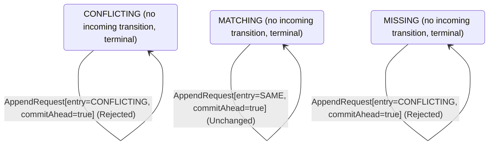

<!-- Generated by examples/demo/tools/build.py from example.json and the verifier's output. Edit example.json. -->
# 099 · A follower that leaves its commit index alone on a heartbeat never applies the last entry

[← All examples](../README.md)

| Verdict | Categories | Severity if shipped | Change | Verified unit | Approach |
|---|---|---|---|---|---|
| **✗ Violation: FollowersLearnCommits, 8-step trace then forever (fairness)** | functional | high | feature, behaviour change intended | [`AppendRule#decide`](../../../examples/demo/apps/quorum/src/main/java/net/terminalvalue/quorum/raft/AppendRule.java) | [D1: Protocol model checking](../../../examples/demo/apps/quorum/spec/README.md) |

> A Raft follower moves its commit index up to the leader's on every request it accepts, a heartbeat included, as far as its log is known to match the leader's. A developer makes a heartbeat a liveness signal and nothing more: the commit index moves with the entries, the comment says, and a request that carries nothing to apply changes nothing. The tests pass and both safety configurations verify the change: no committed entry is overwritten, the logs match, and a follower never applies what the leader has not. The replication model's fairness configuration reports a run that goes on forever after eight steps: the leader replicates its entry to both followers, marks it committed, and every heartbeat from then on is refused the commit index it carries, so the followers never apply it; the property that every follower learns the leader's commits is violated, and the run ends in a state the system never leaves.

## The change

In `AppendRule.decide`, the `NONE, SAME` arm, a heartbeat or an entry the follower already holds, no longer returns `transition(MATCHING, ADVANCE_COMMIT)` when the leader's commit index is ahead: it returns `unchanged` whatever the commit index, with the comment that a heartbeat or a duplicate is a liveness signal, not a write, and that the commit index moves with the entries. The Javadoc says the commit index follows the leader's on a request that carries an entry, and the test that the commit index follows the leader's on a heartbeat becomes one that a heartbeat changes nothing. The `ABSENT` and `CONFLICTING` arms, which append, still take the commit index.

**Before** ([`AppendRule.java`](../../../examples/demo/apps/quorum/src/main/java/net/terminalvalue/quorum/raft/AppendRule.java), line 15):

```java
* consistency check first, which refuses the request unless the follower holds the entry before the ones sent, so
* that the leader backs up and tries again from one entry earlier; then the entry sent goes in, in place of
* whatever the follower held at its index; and the follower's commit index follows the leader's, as far as the
* entries it now holds in common with it.
*
* <p>The check is what makes the log matching property hold: a follower accepts an entry only after the entry
* before it, so two logs that agree on an entry agree on everything before it. The term check comes before this
   // ...
           case MISSING -> rejected("no entry at the previous index");
           case CONFLICTING -> rejected("another entry at the previous index");
           case MATCHING -> switch (request.entry()) {
               case NONE, SAME -> request.commitAhead()
                       ? transition(MATCHING, ADVANCE_COMMIT)
                       : unchanged("holds what was sent, and nothing new to commit");
               case ABSENT -> request.commitAhead()
                       ? transition(MATCHING, APPEND, ADVANCE_COMMIT)
                       : transition(MATCHING, APPEND);
```

**After:**

```java
* consistency check first, which refuses the request unless the follower holds the entry before the ones sent, so
* that the leader backs up and tries again from one entry earlier; then the entry sent goes in, in place of
* whatever the follower held at its index; and the follower's commit index follows the leader's, as far as the
* entries it now holds in common with it, on a request that carries an entry: a heartbeat carries nothing to apply.
*
* <p>The check is what makes the log matching property hold: a follower accepts an entry only after the entry
* before it, so two logs that agree on an entry agree on everything before it. The term check comes before this
   // ...
           case MISSING -> rejected("no entry at the previous index");
           case CONFLICTING -> rejected("another entry at the previous index");
           case MATCHING -> switch (request.entry()) {
               case NONE, SAME -> unchanged("holds what was sent, and nothing new to apply"); // a heartbeat or a duplicate is a liveness signal, not a write: the commit index moves with the entries
               case ABSENT -> request.commitAhead()
                       ? transition(MATCHING, APPEND, ADVANCE_COMMIT)
                       : transition(MATCHING, APPEND);
```

<details><summary>Patch</summary>

```diff
--- a/examples/demo/apps/quorum/src/main/java/net/terminalvalue/quorum/raft/AppendRule.java
+++ b/examples/demo/apps/quorum/src/main/java/net/terminalvalue/quorum/raft/AppendRule.java
@@ -15,7 +15,7 @@
  * consistency check first, which refuses the request unless the follower holds the entry before the ones sent, so
  * that the leader backs up and tries again from one entry earlier; then the entry sent goes in, in place of
  * whatever the follower held at its index; and the follower's commit index follows the leader's, as far as the
- * entries it now holds in common with it.
+ * entries it now holds in common with it, on a request that carries an entry: a heartbeat carries nothing to apply.
  *
  * <p>The check is what makes the log matching property hold: a follower accepts an entry only after the entry
  * before it, so two logs that agree on an entry agree on everything before it. The term check comes before this
@@ -33,9 +33,7 @@
             case MISSING -> rejected("no entry at the previous index");
             case CONFLICTING -> rejected("another entry at the previous index");
             case MATCHING -> switch (request.entry()) {
-                case NONE, SAME -> request.commitAhead()
-                        ? transition(MATCHING, ADVANCE_COMMIT)
-                        : unchanged("holds what was sent, and nothing new to commit");
+                case NONE, SAME -> unchanged("holds what was sent, and nothing new to apply"); // a heartbeat or a duplicate is a liveness signal, not a write: the commit index moves with the entries
                 case ABSENT -> request.commitAhead()
                         ? transition(MATCHING, APPEND, ADVANCE_COMMIT)
                         : transition(MATCHING, APPEND);
--- a/examples/demo/apps/quorum/src/test/java/net/terminalvalue/quorum/raft/AppendRuleTest.java
+++ b/examples/demo/apps/quorum/src/test/java/net/terminalvalue/quorum/raft/AppendRuleTest.java
@@ -29,11 +29,12 @@
 
     public static void aHeartbeatOrADuplicateChangesNothing() {
         check(AppendRule.decide(MATCHING, new AppendRequest(NewEntry.NONE, false)) instanceof Decision.Unchanged, "heartbeat");
+        check(AppendRule.decide(MATCHING, new AppendRequest(NewEntry.NONE, true)) instanceof Decision.Unchanged, "heartbeat, nothing to apply");
         check(AppendRule.decide(MATCHING, new AppendRequest(NewEntry.SAME, false)) instanceof Decision.Unchanged, "already held");
+        check(AppendRule.decide(MATCHING, new AppendRequest(NewEntry.SAME, true)) instanceof Decision.Unchanged, "already held, nothing to apply");
     }
 
-    public static void theCommitIndexFollowsTheLeaders() {
-        equal(new Transition<>(MATCHING, List.of(ADVANCE_COMMIT)), AppendRule.decide(MATCHING, new AppendRequest(NewEntry.NONE, true)));
+    public static void theCommitIndexFollowsTheLeadersWithTheEntries() {
         equal(new Transition<>(MATCHING, List.of(APPEND, ADVANCE_COMMIT)), AppendRule.decide(MATCHING, new AppendRequest(NewEntry.ABSENT, true)));
         equal(new Transition<>(MATCHING, List.of(TRUNCATE, APPEND, ADVANCE_COMMIT)), AppendRule.decide(MATCHING, new AppendRequest(NewEntry.CONFLICTING, true)));
     }
```

</details>

## What the verifier found

The model is checked under 3 configurations, and the verdict is the first that fails:

| Configuration | What it checks | Model | Result |
|---|---|---|---|
| three terms, two entries (`spec/RaftReplication.cfg`) | every run from the initial state, every interleaving within the configuration's bounds | Servers = {s1, s2, s3}, MaxTerm = 3, MaxEntries = 2 | ✓ Verified: all invariants and properties hold in 17,221 states |
| figure 8 (`spec/RaftReplicationFigureEight.cfg`) | every run of three servers over four terms with one entry per leader's log, the budget of figure 8 of the paper: a leader of term 1 appends an entry it never gets to replicate, a leader of term 2 appends its own at the same index, the first comes back as the leader of term 3 and replicates its entry of term 1 to a majority, and the second, whose last entry is from the later term, can still be elected in term 4 without it; three terms cannot show this, and the same invariants and action properties are checked | Servers = {s1, s2, s3}, MaxTerm = 4, MaxEntries = 1 | ✓ Verified: all invariants and properties hold in 7,277 states |
| fairness (`spec/RaftReplicationLive.cfg`) | the three liveness properties, under the fairness conditions `Fairness`: a server whose timer nothing resets times out, a candidate asks for the votes it lacks, a leader sends every follower its next entry or a heartbeat and marks committed what the commit rule lets it; nothing is assumed of the clients, so the properties hold whether or not a request comes. Three servers, three terms and one entry per leader, without the symmetry set, since TLC's liveness checking is unsound under one. A counterexample is a run that goes on forever without satisfying a property: a prefix, then a state or a cycle the system never leaves | Servers = {s1, s2, s3}, MaxTerm = 3, MaxEntries = 1 | ✗ Violation: FollowersLearnCommits, 8-step trace then forever |

TLC found a run of the system under fairness that violates the temporal property **FollowersLearnCommits** (every follower learns what the leader has committed: from some point on, all commit indices agree, in every run that stays within the term budget): after the 8 steps below, the system stays in that state forever, and the property never comes true. The run respects every fairness condition the model assumes; the parts that could act, do. Each step is one action of one part of the system:

1. **Initial state**: every server a follower in term 0 with an empty log, no vote cast, nothing committed.
2. **Timeout**, `Server.onElectionTimeout`: a server's election timer fires, and the server acts on the role machine's decision. `currentTerm = (s1 :> 1 @@ s2 :> 0 @@ s3 :> 0)`, `role = (s1 :> "CANDIDATE" @@ s2 :> "FOLLOWER" @@ s3 :> "FOLLOWER")`, `votedFor = (s1 :> s1 @@ s2 :> "none" @@ s3 :> "none")`, `votes = (s1 :> {s1} @@ s2 :> {} @@ s3 :> {})`
3. **Timeout**, `Server.onElectionTimeout`: a server's election timer fires, and the server acts on the role machine's decision. `currentTerm = (s1 :> 2 @@ s2 :> 0 @@ s3 :> 0)`
4. **Canvass**, `Server.requestVote`: a candidate asks one server for its vote and gets the answer; the request and the reply each go through the role machine, then the vote rule on the voter, given its ballot and the candidate's term and log against its own, and the tally on the candidate. `currentTerm = (s1 :> 2 @@ s2 :> 2 @@ s3 :> 0)`, `nextIndex = ( s1 :> (s1 :> 1 @@ s2 :> 1 @@ s3 :> 1) @@ s2 :> (s1 :> 0 @@ s2 :> 0 @@ s3 :> 0) @@ s3 :> (s1 :> 0 @@ s2 :> 0 @@ s3 :> 0) )`, `role = (s1 :> "LEADER" @@ s2 :> "FOLLOWER" @@ s3 :> "FOLLOWER")`, `votedFor = (s1 :> s1 @@ s2 :> s1 @@ s3 :> "none")`, `votes = (s1 :> {s1, s2} @@ s2 :> {} @@ s3 :> {})`
5. **ClientRequest**, `Server.onClientRequest`: a leader appends an entry of its term to its own log. `log = (s1 :> <<2>> @@ s2 :> <<>> @@ s3 :> <<>>)`
6. **Replicate**, `Server.appendEntries`: a leader sends one server the entry at that server's next index, or a heartbeat if it is caught up, with the entry before it and the leader's commit index, and gets the answer; the request goes through the role machine, then the append rule on the follower's log as it stands against the leader's, and the reply through the role machine on the leader, which moves the server's next and match indices forward on success and backs the next index up by one on a refusal. `log = (s1 :> <<2>> @@ s2 :> <<2>> @@ s3 :> <<>>)`, `matchIndex = ( s1 :> (s1 :> 0 @@ s2 :> 1 @@ s3 :> 0) @@ s2 :> (s1 :> 0 @@ s2 :> 0 @@ s3 :> 0) @@ s3 :> (s1 :> 0 @@ s2 :> 0 @@ s3 :> 0) )`, `nextIndex = ( s1 :> (s1 :> 1 @@ s2 :> 2 @@ s3 :> 1) @@ s2 :> (s1 :> 0 @@ s2 :> 0 @@ s3 :> 0) @@ s3 :> (s1 :> 0 @@ s2 :> 0 @@ s3 :> 0) )`
7. **Replicate**, `Server.appendEntries`: a leader sends one server the entry at that server's next index, or a heartbeat if it is caught up, with the entry before it and the leader's commit index, and gets the answer; the request goes through the role machine, then the append rule on the follower's log as it stands against the leader's, and the reply through the role machine on the leader, which moves the server's next and match indices forward on success and backs the next index up by one on a refusal. `currentTerm = (s1 :> 2 @@ s2 :> 2 @@ s3 :> 2)`, `log = (s1 :> <<2>> @@ s2 :> <<2>> @@ s3 :> <<2>>)`, `matchIndex = ( s1 :> (s1 :> 0 @@ s2 :> 1 @@ s3 :> 1) @@ s2 :> (s1 :> 0 @@ s2 :> 0 @@ s3 :> 0) @@ s3 :> (s1 :> 0 @@ s2 :> 0 @@ s3 :> 0) )`, `nextIndex = ( s1 :> (s1 :> 1 @@ s2 :> 2 @@ s3 :> 2) @@ s2 :> (s1 :> 0 @@ s2 :> 0 @@ s3 :> 0) @@ s3 :> (s1 :> 0 @@ s2 :> 0 @@ s3 :> 0) )`
8. **AdvanceCommit**, `Server.advanceCommitIndex`: a leader asks the commit rule about an entry it has not marked committed, given the entry's term against its own and whether a majority of the servers hold it, and marks it committed on a transition, and with it everything before it. `commitIndex = (s1 :> 1 @@ s2 :> 0 @@ s3 :> 0)`

The model is small (Servers = {s1, s2, s3}, MaxTerm = 3, MaxEntries = 1), which is what keeps the trace readable. TLC explored every interleaving of the servers, their terms, votes and logs, and the AppendEntries RPCs between them within those bounds.

**What the verdict rests on.** TLC counted how often a step of the model took each row of the generated operators. A row no step takes is one the model says nothing about, whatever the verdict.

| Configuration | Rows of `RoleMachine#decide` taken | Rows of `VoteRule#decide` taken | Rows of `AppendRule#decide` taken | Rows of `CommitRule#decide` taken |
|---|---|---|---|---|
| three terms, two entries | 27 of 36 | 12 of 27 | 16 of 24 | 4 of 12 |
| figure 8 | 27 of 36 | 12 of 27 | 10 of 24 | 4 of 12 |
| fairness | stopped at the counterexample | stopped at the counterexample | stopped at the counterexample | stopped at the counterexample |

The change alters 2 rows of the contract:

- `decide(MATCHING, AppendRequest[entry=NONE, commitAhead=true])`: `Transition[next=MATCHING, effects=[ADVANCE_COMMIT]]` → `Unchanged[reason="holds what was sent, and nothing new to apply"]`, taken under three terms, two entries, figure 8
- `decide(MATCHING, AppendRequest[entry=SAME, commitAhead=true])`: `Transition[next=MATCHING, effects=[ADVANCE_COMMIT]]` → `Unchanged[reason="holds what was sent, and nothing new to apply"]`, taken by no run that finished

The run under fairness stopped at its counterexample, the steps above, and its counts are left out: the verdict rests on the counterexample.

<details><summary>Rows no step takes under three terms, two entries</summary>

`net.terminalvalue.quorum.raft.RoleMachine#decide`:

```
decide(FOLLOWER, VotesCounted[majority=true]) => Unchanged
decide(FOLLOWER, Response[term=OLDER]) => Unchanged
decide(FOLLOWER, Response[term=CURRENT]) => Unchanged
decide(FOLLOWER, Response[term=NEWER]) => Transition[next=FOLLOWER, effects=[ADOPT_TERM]]
decide(CANDIDATE, Response[term=OLDER]) => Unchanged
decide(LEADER, VotesCounted[majority=false]) => Unchanged
decide(LEADER, VotesCounted[majority=true]) => Unchanged
decide(LEADER, AppendEntries[term=CURRENT]) => throws IllegalStateException
decide(LEADER, Response[term=OLDER]) => Unchanged
```

`net.terminalvalue.quorum.raft.VoteRule#decide`:

```
decide(OPEN, VoteRequest[term=NEWER, log=BEHIND]) => Rejected
decide(OPEN, VoteRequest[term=NEWER, log=EVEN]) => Transition[next=FOR_THE_CANDIDATE, effects=[GRANT]]
decide(OPEN, VoteRequest[term=NEWER, log=AHEAD]) => Transition[next=FOR_THE_CANDIDATE, effects=[GRANT]]
decide(FOR_THE_CANDIDATE, VoteRequest[term=OLDER, log=BEHIND]) => Rejected
decide(FOR_THE_CANDIDATE, VoteRequest[term=OLDER, log=EVEN]) => Rejected
decide(FOR_THE_CANDIDATE, VoteRequest[term=OLDER, log=AHEAD]) => Rejected
decide(FOR_THE_CANDIDATE, VoteRequest[term=CURRENT, log=BEHIND]) => Rejected
decide(FOR_THE_CANDIDATE, VoteRequest[term=CURRENT, log=EVEN]) => Transition[next=FOR_THE_CANDIDATE, effects=[GRANT]]
decide(FOR_THE_CANDIDATE, VoteRequest[term=CURRENT, log=AHEAD]) => Transition[next=FOR_THE_CANDIDATE, effects=[GRANT]]
decide(FOR_THE_CANDIDATE, VoteRequest[term=NEWER, log=BEHIND]) => Rejected
decide(FOR_THE_CANDIDATE, VoteRequest[term=NEWER, log=EVEN]) => Transition[next=FOR_THE_CANDIDATE, effects=[GRANT]]
decide(FOR_THE_CANDIDATE, VoteRequest[term=NEWER, log=AHEAD]) => Transition[next=FOR_THE_CANDIDATE, effects=[GRANT]]
decide(FOR_ANOTHER, VoteRequest[term=NEWER, log=BEHIND]) => Rejected
decide(FOR_ANOTHER, VoteRequest[term=NEWER, log=EVEN]) => Transition[next=FOR_THE_CANDIDATE, effects=[GRANT]]
decide(FOR_ANOTHER, VoteRequest[term=NEWER, log=AHEAD]) => Transition[next=FOR_THE_CANDIDATE, effects=[GRANT]]
```

`net.terminalvalue.quorum.raft.AppendRule#decide`:

```
decide(MISSING, AppendRequest[entry=SAME, commitAhead=false]) => Rejected
decide(MISSING, AppendRequest[entry=SAME, commitAhead=true]) => Rejected
decide(MISSING, AppendRequest[entry=CONFLICTING, commitAhead=false]) => Rejected
decide(MISSING, AppendRequest[entry=CONFLICTING, commitAhead=true]) => Rejected
decide(CONFLICTING, AppendRequest[entry=SAME, commitAhead=false]) => Rejected
decide(CONFLICTING, AppendRequest[entry=SAME, commitAhead=true]) => Rejected
decide(MATCHING, AppendRequest[entry=SAME, commitAhead=false]) => Unchanged
decide(MATCHING, AppendRequest[entry=SAME, commitAhead=true]) => Unchanged
```

`net.terminalvalue.quorum.raft.CommitRule#decide`:

```
decide(PENDING, Replication[term=NEWER, majority=false]) => throws IllegalStateException
decide(PENDING, Replication[term=NEWER, majority=true]) => throws IllegalStateException
decide(COMMITTED, Replication[term=OLDER, majority=false]) => Unchanged
decide(COMMITTED, Replication[term=OLDER, majority=true]) => Unchanged
decide(COMMITTED, Replication[term=CURRENT, majority=false]) => Unchanged
decide(COMMITTED, Replication[term=CURRENT, majority=true]) => Unchanged
decide(COMMITTED, Replication[term=NEWER, majority=false]) => Unchanged
decide(COMMITTED, Replication[term=NEWER, majority=true]) => Unchanged
```

</details>

The state machine the patched code implements, drawn from its derived contract (`jvmcontract statemachine`); a state with no way in or no way out is marked:



## Would the existing tests have caught it?

No: every existing unit test passes (`java -ea net.terminalvalue.quorum.Tests`, run against the patched code).

## Why it matters

Medium. The change is safe in every sense a safety check can see: a follower that applies less than it could applies nothing wrong, and the two rows it alters are the rows under which nothing is written. What it breaks is a promise about the future, that a follower eventually applies what the leader committed, and the leader commits an entry only after a majority has appended it, which is after the request that appended it on each of them: the commit index can only reach the last entry on a request that carries nothing. The tests check single decisions, and a decision that changes nothing looks right.

## Why the verdict is right

The append rule in the model is generated from the regenerated contract, so `Replicate` does what the two patched rows say. The two safety configurations verify the change, in 17,221 and 7,277 states: the followers' commit indices stay behind, which breaks no invariant. The third configuration, three servers and three terms under the fairness conditions, reports the temporal property `FollowersLearnCommits` violated: after eight steps the system stutters forever. s1 times out twice and wins term 2 with s2's vote; it appends an entry of term 2 and sends it to s2 and then s3, each of which appends it with the commit index still at 0, since nothing is committed when the entry goes out; s1 marks the entry committed, a majority holding it. From then on every request s1 sends is a heartbeat, both followers being caught up, with a commit index of 1 against their 0, which the patched rule answers with `unchanged`: the heartbeat changes no variable, no step of the system is left that changes one, and the run goes on forever in that state, s1 having applied the entry and s2 and s3 never, until a client sends another. The last entry a leader appends is applied by the leader alone, for as long as the cluster is quiet. The fairness conditions are what make the run a counterexample: with a leader that sends every follower its heartbeats, the only runs are ones in which the followers hear the commit index again and again and never take it.

## What to do

Reject. The commit index is part of every AppendEntries request, and a follower takes it on every request it accepts, a heartbeat first among them (Ongaro and Ousterhout, section 5.3, and the leaderCommit rule of figure 2): the leader learns that a majority holds an entry only from the replies to the requests that carried it, so the request that tells the followers the entry is committed is always a later one, and for the last entry a leader appends that later request is a heartbeat. A follower that applies entries only when it appends is one that applies the last entry of every quiet period never, which a client reading from a follower sees as a write that is acknowledged and not there. The fairness configuration is the check that catches a rule that does too little rather than too much, and the counterexample it reports is the quiet period itself.

## Evidence

How the verdict was reached: three terms, two entries: TLC 2.19 explored 17,221 distinct states to depth 20 in 7 s, for the model Servers = {s1, s2, s3}, MaxTerm = 3, MaxEntries = 2; figure 8: TLC 2.19 explored 7,277 distinct states to depth 18 in 4 s, for the model Servers = {s1, s2, s3}, MaxTerm = 4, MaxEntries = 1; fairness: TLC 2.19 explored 2,689 distinct states in 3 s, for the model Servers = {s1, s2, s3}, MaxTerm = 3, MaxEntries = 1.

<details><summary>Verifier output</summary>

```text
== three terms, two entries: spec/RaftReplication.cfg ==
TLC2 Version 2.19 of 08 August 2024 (rev: 5a47802)
Running breadth-first search Model-Checking with fp 1 and seed 1 with 1 worker on 8 cores with 910MB heap and 64MB offheap memory [pid: 3247649] (Linux 6.6.87.2-microsoft-standard-WSL2 aarch64, Eclipse Adoptium 25.0.4.1 x86_64, MSBDiskFPSet, DiskStateQueue).
Parsing file examples/demo/apps/quorum/spec/RaftReplication.tla
Parsing file examples/demo/tools/tla/standard-modules/Naturals.tla
Parsing file examples/demo/tools/tla/standard-modules/FiniteSets.tla
Parsing file examples/demo/tools/tla/standard-modules/Sequences.tla
Parsing file examples/demo/tools/tla/standard-modules/TLC.tla
Parsing file examples/demo/apps/quorum/spec/RoleMachineContract.tla
Parsing file examples/demo/apps/quorum/spec/VoteRuleContract.tla
Parsing file examples/demo/apps/quorum/spec/AppendRuleContract.tla
Parsing file examples/demo/apps/quorum/spec/CommitRuleContract.tla
Semantic processing of module Naturals
Semantic processing of module Sequences
Semantic processing of module FiniteSets
Semantic processing of module TLC
Semantic processing of module RoleMachineContract
Semantic processing of module VoteRuleContract
Semantic processing of module AppendRuleContract
Semantic processing of module CommitRuleContract
Semantic processing of module RaftReplication
Starting... (2026-11-02 07:20:31)
Computing initial states...
Finished computing initial states: 1 distinct state generated at 2026-11-02 07:20:32.
Model checking completed. No error has been found.
  Estimates of the probability that TLC did not check all reachable states
  because two distinct states had the same fingerprint:
  calculated (optimistic):  val = 6.3E-11
Rows of net.terminalvalue.quorum.raft.RoleMachine#decide a step of the model takes: 27 of 36; never taken (9):
  decide(FOLLOWER, VotesCounted[majority=true]) => Unchanged
  decide(FOLLOWER, Response[term=OLDER]) => Unchanged
  decide(FOLLOWER, Response[term=CURRENT]) => Unchanged
  decide(FOLLOWER, Response[term=NEWER]) => Transition[next=FOLLOWER, effects=[ADOPT_TERM]]
  decide(CANDIDATE, Response[term=OLDER]) => Unchanged
  decide(LEADER, VotesCounted[majority=false]) => Unchanged
  decide(LEADER, VotesCounted[majority=true]) => Unchanged
  decide(LEADER, AppendEntries[term=CURRENT]) => throws IllegalStateException
  decide(LEADER, Response[term=OLDER]) => Unchanged
Rows of net.terminalvalue.quorum.raft.VoteRule#decide a step of the model takes: 12 of 27; never taken (15):
  decide(OPEN, VoteRequest[term=NEWER, log=BEHIND]) => Rejected
  decide(OPEN, VoteRequest[term=NEWER, log=EVEN]) => Transition[next=FOR_THE_CANDIDATE, effects=[GRANT]]
  decide(OPEN, VoteRequest[term=NEWER, log=AHEAD]) => Transition[next=FOR_THE_CANDIDATE, effects=[GRANT]]
  decide(FOR_THE_CANDIDATE, VoteRequest[term=OLDER, log=BEHIND]) => Rejected
  decide(FOR_THE_CANDIDATE, VoteRequest[term=OLDER, log=EVEN]) => Rejected
  decide(FOR_THE_CANDIDATE, VoteRequest[term=OLDER, log=AHEAD]) => Rejected
  decide(FOR_THE_CANDIDATE, VoteRequest[term=CURRENT, log=BEHIND]) => Rejected
  decide(FOR_THE_CANDIDATE, VoteRequest[term=CURRENT, log=EVEN]) => Transition[next=FOR_THE_CANDIDATE, effects=[GRANT]]
  decide(FOR_THE_CANDIDATE, VoteRequest[term=CURRENT, log=AHEAD]) => Transition[next=FOR_THE_CANDIDATE, effects=[GRANT]]
  decide(FOR_THE_CANDIDATE, VoteRequest[term=NEWER, log=BEHIND]) => Rejected
  decide(FOR_THE_CANDIDATE, VoteRequest[term=NEWER, log=EVEN]) => Transition[next=FOR_THE_CANDIDATE, effects=[GRANT]]
  decide(FOR_THE_CANDIDATE, VoteRequest[term=NEWER, log=AHEAD]) => Transition[next=FOR_THE_CANDIDATE, effects=[GRANT]]
  decide(FOR_ANOTHER, VoteRequest[term=NEWER, log=BEHIND]) => Rejected
  decide(FOR_ANOTHER, VoteRequest[term=NEWER, log=EVEN]) => Transition[next=FOR_THE_CANDIDATE, effects=[GRANT]]
  decide(FOR_ANOTHER, VoteRequest[term=NEWER, log=AHEAD]) => Transition[next=FOR_THE_CANDIDATE, effects=[GRANT]]
Rows of net.terminalvalue.quorum.raft.AppendRule#decide a step of the model takes: 16 of 24; never taken (8):
  decide(MISSING, AppendRequest[entry=SAME, commitAhead=false]) => Rejected
  decide(MISSING, AppendRequest[entry=SAME, commitAhead=true]) => Rejected
  decide(MISSING, AppendRequest[entry=CONFLICTING, commitAhead=false]) => Rejected
  decide(MISSING, AppendRequest[entry=CONFLICTING, commitAhead=true]) => Rejected
  decide(CONFLICTING, AppendRequest[entry=SAME, commitAhead=false]) => Rejected
  decide(CONFLICTING, AppendRequest[entry=SAME, commitAhead=true]) => Rejected
  decide(MATCHING, AppendRequest[entry=SAME, commitAhead=false]) => Unchanged
  decide(MATCHING, AppendRequest[entry=SAME, commitAhead=true]) => Unchanged
Rows of net.terminalvalue.quorum.raft.CommitRule#decide a step of the model takes: 4 of 12; never taken (8):
  decide(PENDING, Replication[term=NEWER, majority=false]) => throws IllegalStateException
  decide(PENDING, Replication[term=NEWER, majority=true]) => throws IllegalStateException
  decide(COMMITTED, Replication[term=OLDER, majority=false]) => Unchanged
  decide(COMMITTED, Replication[term=OLDER, majority=true]) => Unchanged
  decide(COMMITTED, Replication[term=CURRENT, majority=false]) => Unchanged
  decide(COMMITTED, Replication[term=CURRENT, majority=true]) => Unchanged
  decide(COMMITTED, Replication[term=NEWER, majority=false]) => Unchanged
  decide(COMMITTED, Replication[term=NEWER, majority=true]) => Unchanged
84538 states generated, 17221 distinct states found, 0 states left on queue.
The depth of the complete state graph search is 20.
The average outdegree of the complete state graph is 1 (minimum is 0, the maximum 8 and the 95th percentile is 3).
Finished in 07s at (2026-11-02 07:20:39)

== figure 8: spec/RaftReplicationFigureEight.cfg ==
TLC2 Version 2.19 of 08 August 2024 (rev: 5a47802)
Running breadth-first search Model-Checking with fp 1 and seed 1 with 1 worker on 8 cores with 910MB heap and 64MB offheap memory [pid: 3248085] (Linux 6.6.87.2-microsoft-standard-WSL2 aarch64, Eclipse Adoptium 25.0.4.1 x86_64, MSBDiskFPSet, DiskStateQueue).
Parsing file examples/demo/apps/quorum/spec/RaftReplication.tla
Parsing file examples/demo/tools/tla/standard-modules/Naturals.tla
Parsing file examples/demo/tools/tla/standard-modules/FiniteSets.tla
Parsing file examples/demo/tools/tla/standard-modules/Sequences.tla
Parsing file examples/demo/tools/tla/standard-modules/TLC.tla
Parsing file examples/demo/apps/quorum/spec/RoleMachineContract.tla
Parsing file examples/demo/apps/quorum/spec/VoteRuleContract.tla
Parsing file examples/demo/apps/quorum/spec/AppendRuleContract.tla
Parsing file examples/demo/apps/quorum/spec/CommitRuleContract.tla
Semantic processing of module Naturals
Semantic processing of module Sequences
Semantic processing of module FiniteSets
Semantic processing of module TLC
Semantic processing of module RoleMachineContract
Semantic processing of module VoteRuleContract
Semantic processing of module AppendRuleContract
Semantic processing of module CommitRuleContract
Semantic processing of module RaftReplication
Starting... (2026-11-02 07:20:40)
Computing initial states...
Finished computing initial states: 1 distinct state generated at 2026-11-02 07:20:40.
Model checking completed. No error has been found.
  Estimates of the probability that TLC did not check all reachable states
  because two distinct states had the same fingerprint:
  calculated (optimistic):  val = 1.3E-11
Rows of net.terminalvalue.quorum.raft.RoleMachine#decide a step of the model takes: 27 of 36; never taken (9):
  decide(FOLLOWER, VotesCounted[majority=true]) => Unchanged
  decide(FOLLOWER, Response[term=OLDER]) => Unchanged
  decide(FOLLOWER, Response[term=CURRENT]) => Unchanged
  decide(FOLLOWER, Response[term=NEWER]) => Transition[next=FOLLOWER, effects=[ADOPT_TERM]]
  decide(CANDIDATE, Response[term=OLDER]) => Unchanged
  decide(LEADER, VotesCounted[majority=false]) => Unchanged
  decide(LEADER, VotesCounted[majority=true]) => Unchanged
  decide(LEADER, AppendEntries[term=CURRENT]) => throws IllegalStateException
  decide(LEADER, Response[term=OLDER]) => Unchanged
Rows of net.terminalvalue.quorum.raft.VoteRule#decide a step of the model takes: 12 of 27; never taken (15):
  decide(OPEN, VoteRequest[term=NEWER, log=BEHIND]) => Rejected
  decide(OPEN, VoteRequest[term=NEWER, log=EVEN]) => Transition[next=FOR_THE_CANDIDATE, effects=[GRANT]]
  decide(OPEN, VoteRequest[term=NEWER, log=AHEAD]) => Transition[next=FOR_THE_CANDIDATE, effects=[GRANT]]
  decide(FOR_THE_CANDIDATE, VoteRequest[term=OLDER, log=BEHIND]) => Rejected
  decide(FOR_THE_CANDIDATE, VoteRequest[term=OLDER, log=EVEN]) => Rejected
  decide(FOR_THE_CANDIDATE, VoteRequest[term=OLDER, log=AHEAD]) => Rejected
  decide(FOR_THE_CANDIDATE, VoteRequest[term=CURRENT, log=BEHIND]) => Rejected
  decide(FOR_THE_CANDIDATE, VoteRequest[term=CURRENT, log=EVEN]) => Transition[next=FOR_THE_CANDIDATE, effects=[GRANT]]
  decide(FOR_THE_CANDIDATE, VoteRequest[term=CURRENT, log=AHEAD]) => Transition[next=FOR_THE_CANDIDATE, effects=[GRANT]]
  decide(FOR_THE_CANDIDATE, VoteRequest[term=NEWER, log=BEHIND]) => Rejected
  decide(FOR_THE_CANDIDATE, VoteRequest[term=NEWER, log=EVEN]) => Transition[next=FOR_THE_CANDIDATE, effects=[GRANT]]
  decide(FOR_THE_CANDIDATE, VoteRequest[term=NEWER, log=AHEAD]) => Transition[next=FOR_THE_CANDIDATE, effects=[GRANT]]
  decide(FOR_ANOTHER, VoteRequest[term=NEWER, log=BEHIND]) => Rejected
  decide(FOR_ANOTHER, VoteRequest[term=NEWER, log=EVEN]) => Transition[next=FOR_THE_CANDIDATE, effects=[GRANT]]
  decide(FOR_ANOTHER, VoteRequest[term=NEWER, log=AHEAD]) => Transition[next=FOR_THE_CANDIDATE, effects=[GRANT]]
Rows of net.terminalvalue.quorum.raft.AppendRule#decide a step of the model takes: 10 of 24; never taken (14):
  decide(MISSING, AppendRequest[entry=ABSENT, commitAhead=false]) => Rejected
  decide(MISSING, AppendRequest[entry=ABSENT, commitAhead=true]) => Rejected
  decide(MISSING, AppendRequest[entry=SAME, commitAhead=false]) => Rejected
  decide(MISSING, AppendRequest[entry=SAME, commitAhead=true]) => Rejected
  decide(MISSING, AppendRequest[entry=CONFLICTING, commitAhead=false]) => Rejected
  decide(MISSING, AppendRequest[entry=CONFLICTING, commitAhead=true]) => Rejected
  decide(CONFLICTING, AppendRequest[entry=ABSENT, commitAhead=false]) => Rejected
  decide(CONFLICTING, AppendRequest[entry=ABSENT, commitAhead=true]) => Rejected
  decide(CONFLICTING, AppendRequest[entry=SAME, commitAhead=false]) => Rejected
  decide(CONFLICTING, AppendRequest[entry=SAME, commitAhead=true]) => Rejected
  decide(CONFLICTING, AppendRequest[entry=CONFLICTING, commitAhead=false]) => Rejected
  decide(CONFLICTING, AppendRequest[entry=CONFLICTING, commitAhead=true]) => Rejected
  decide(MATCHING, AppendRequest[entry=SAME, commitAhead=false]) => Unchanged
  decide(MATCHING, AppendRequest[entry=SAME, commitAhead=true]) => Unchanged
Rows of net.terminalvalue.quorum.raft.CommitRule#decide a step of the model takes: 4 of 12; never taken (8):
  decide(PENDING, Replication[term=NEWER, majority=false]) => throws IllegalStateException
  decide(PENDING, Replication[term=NEWER, majority=true]) => throws IllegalStateException
  decide(COMMITTED, Replication[term=OLDER, majority=false]) => Unchanged
  decide(COMMITTED, Replication[term=OLDER, majority=true]) => Unchanged
  decide(COMMITTED, Replication[term=CURRENT, majority=false]) => Unchanged
  decide(COMMITTED, Replication[term=CURRENT, majority=true]) => Unchanged
  decide(COMMITTED, Replication[term=NEWER, majority=false]) => Unchanged
  decide(COMMITTED, Replication[term=NEWER, majority=true]) => Unchanged
40020 states generated, 7277 distinct states found, 0 states left on queue.
The depth of the complete state graph search is 18.
The average outdegree of the complete state graph is 1 (minimum is 0, the maximum 7 and the 95th percentile is 3).
Finished in 04s at (2026-11-02 07:20:44)

== fairness: spec/RaftReplicationLive.cfg ==
TLC2 Version 2.19 of 08 August 2024 (rev: 5a47802)
Running breadth-first search Model-Checking with fp 1 and seed 1 with 1 worker on 8 cores with 910MB heap and 64MB offheap memory [pid: 3252742] (Linux 6.6.87.2-microsoft-standard-WSL2 aarch64, Eclipse Adoptium 25.0.4.1 x86_64, MSBDiskFPSet, DiskStateQueue).
Parsing file examples/demo/apps/quorum/spec/RaftReplication.tla
Parsing file examples/demo/tools/tla/standard-modules/Naturals.tla
Parsing file examples/demo/tools/tla/standard-modules/FiniteSets.tla
Parsing file examples/demo/tools/tla/standard-modules/Sequences.tla
Parsing file examples/demo/tools/tla/standard-modules/TLC.tla
Parsing file examples/demo/apps/quorum/spec/RoleMachineContract.tla
Parsing file examples/demo/apps/quorum/spec/VoteRuleContract.tla
Parsing file examples/demo/apps/quorum/spec/AppendRuleContract.tla
Parsing file examples/demo/apps/quorum/spec/CommitRuleContract.tla
Semantic processing of module Naturals
Semantic processing of module Sequences
Semantic processing of module FiniteSets
Semantic processing of module TLC
Semantic processing of module RoleMachineContract
Semantic processing of module VoteRuleContract
Semantic processing of module AppendRuleContract
Semantic processing of module CommitRuleContract
Semantic processing of module RaftReplication
Starting... (2026-11-02 07:22:17)
Implied-temporal checking--satisfiability problem has 1 branches.
Computing initial states...
Finished computing initial states: 1 distinct state generated at 2026-11-02 07:22:18.
Checking temporal properties for the current state space with 1834 total distinct states at (2026-11-02 07:22:21)
Error: Temporal properties were violated.

Error: The following behavior constitutes a counter-example:

State 1: <Initial predicate>
/\ matchIndex = ( s1 :> (s1 :> 0 @@ s2 :> 0 @@ s3 :> 0) @@
  s2 :> (s1 :> 0 @@ s2 :> 0 @@ s3 :> 0) @@
  s3 :> (s1 :> 0 @@ s2 :> 0 @@ s3 :> 0) )
/\ log = (s1 :> <<>> @@ s2 :> <<>> @@ s3 :> <<>>)
/\ commitIndex = (s1 :> 0 @@ s2 :> 0 @@ s3 :> 0)
/\ currentTerm = (s1 :> 0 @@ s2 :> 0 @@ s3 :> 0)
/\ nextIndex = ( s1 :> (s1 :> 0 @@ s2 :> 0 @@ s3 :> 0) @@
  s2 :> (s1 :> 0 @@ s2 :> 0 @@ s3 :> 0) @@
  s3 :> (s1 :> 0 @@ s2 :> 0 @@ s3 :> 0) )
/\ votes = (s1 :> {} @@ s2 :> {} @@ s3 :> {})
/\ role = (s1 :> "FOLLOWER" @@ s2 :> "FOLLOWER" @@ s3 :> "FOLLOWER")
/\ votedFor = (s1 :> "none" @@ s2 :> "none" @@ s3 :> "none")

State 2: <Timeout line 131, col 15 to line 131, col 88 of module RaftReplication>
/\ matchIndex = ( s1 :> (s1 :> 0 @@ s2 :> 0 @@ s3 :> 0) @@
  s2 :> (s1 :> 0 @@ s2 :> 0 @@ s3 :> 0) @@
  s3 :> (s1 :> 0 @@ s2 :> 0 @@ s3 :> 0) )
/\ log = (s1 :> <<>> @@ s2 :> <<>> @@ s3 :> <<>>)
/\ commitIndex = (s1 :> 0 @@ s2 :> 0 @@ s3 :> 0)
/\ currentTerm = (s1 :> 1 @@ s2 :> 0 @@ s3 :> 0)
/\ nextIndex = ( s1 :> (s1 :> 0 @@ s2 :> 0 @@ s3 :> 0) @@
  s2 :> (s1 :> 0 @@ s2 :> 0 @@ s3 :> 0) @@
  s3 :> (s1 :> 0 @@ s2 :> 0 @@ s3 :> 0) )
/\ votes = (s1 :> {s1} @@ s2 :> {} @@ s3 :> {})
/\ role = (s1 :> "CANDIDATE" @@ s2 :> "FOLLOWER" @@ s3 :> "FOLLOWER")
/\ votedFor = (s1 :> s1 @@ s2 :> "none" @@ s3 :> "none")

State 3: <Timeout line 131, col 15 to line 131, col 88 of module RaftReplication>
/\ matchIndex = ( s1 :> (s1 :> 0 @@ s2 :> 0 @@ s3 :> 0) @@
  s2 :> (s1 :> 0 @@ s2 :> 0 @@ s3 :> 0) @@
  s3 :> (s1 :> 0 @@ s2 :> 0 @@ s3 :> 0) )
/\ log = (s1 :> <<>> @@ s2 :> <<>> @@ s3 :> <<>>)
/\ commitIndex = (s1 :> 0 @@ s2 :> 0 @@ s3 :> 0)
/\ currentTerm = (s1 :> 2 @@ s2 :> 0 @@ s3 :> 0)
/\ nextIndex = ( s1 :> (s1 :> 0 @@ s2 :> 0 @@ s3 :> 0) @@
  s2 :> (s1 :> 0 @@ s2 :> 0 @@ s3 :> 0) @@
  s3 :> (s1 :> 0 @@ s2 :> 0 @@ s3 :> 0) )
/\ votes = (s1 :> {s1} @@ s2 :> {} @@ s3 :> {})
/\ role = (s1 :> "CANDIDATE" @@ s2 :> "FOLLOWER" @@ s3 :> "FOLLOWER")
/\ votedFor = (s1 :> s1 @@ s2 :> "none" @@ s3 :> "none")

State 4: <Canvass line 157, col 5 to line 160, col 30 of module RaftReplication>
/\ matchIndex = ( s1 :> (s1 :> 0 @@ s2 :> 0 @@ s3 :> 0) @@
  s2 :> (s1 :> 0 @@ s2 :> 0 @@ s3 :> 0) @@
  s3 :> (s1 :> 0 @@ s2 :> 0 @@ s3 :> 0) )
/\ log = (s1 :> <<>> @@ s2 :> <<>> @@ s3 :> <<>>)
/\ commitIndex = (s1 :> 0 @@ s2 :> 0 @@ s3 :> 0)
/\ currentTerm = (s1 :> 2 @@ s2 :> 2 @@ s3 :> 0)
/\ nextIndex = ( s1 :> (s1 :> 1 @@ s2 :> 1 @@ s3 :> 1) @@
  s2 :> (s1 :> 0 @@ s2 :> 0 @@ s3 :> 0) @@
  s3 :> (s1 :> 0 @@ s2 :> 0 @@ s3 :> 0) )
/\ votes = (s1 :> {s1, s2} @@ s2 :> {} @@ s3 :> {})
/\ role = (s1 :> "LEADER" @@ s2 :> "FOLLOWER" @@ s3 :> "FOLLOWER")
/\ votedFor = (s1 :> s1 @@ s2 :> s1 @@ s3 :> "none")

State 5: <ClientRequest line 169, col 5 to line 172, col 91 of module RaftReplication>
/\ matchIndex = ( s1 :> (s1 :> 0 @@ s2 :> 0 @@ s3 :> 0) @@
  s2 :> (s1 :> 0 @@ s2 :> 0 @@ s3 :> 0) @@
  s3 :> (s1 :> 0 @@ s2 :> 0 @@ s3 :> 0) )
/\ log = (s1 :> <<2>> @@ s2 :> <<>> @@ s3 :> <<>>)
/\ commitIndex = (s1 :> 0 @@ s2 :> 0 @@ s3 :> 0)
/\ currentTerm = (s1 :> 2 @@ s2 :> 2 @@ s3 :> 0)
/\ nextIndex = ( s1 :> (s1 :> 1 @@ s2 :> 1 @@ s3 :> 1) @@
  s2 :> (s1 :> 0 @@ s2 :> 0 @@ s3 :> 0) @@
  s3 :> (s1 :> 0 @@ s2 :> 0 @@ s3 :> 0) )
/\ votes = (s1 :> {s1, s2} @@ s2 :> {} @@ s3 :> {})
/\ role = (s1 :> "LEADER" @@ s2 :> "FOLLOWER" @@ s3 :> "FOLLOWER")
/\ votedFor = (s1 :> s1 @@ s2 :> s1 @@ s3 :> "none")

State 6: <Replicate line 218, col 5 to line 221, col 32 of module RaftReplication>
/\ matchIndex = ( s1 :> (s1 :> 0 @@ s2 :> 1 @@ s3 :> 0) @@
  s2 :> (s1 :> 0 @@ s2 :> 0 @@ s3 :> 0) @@
  s3 :> (s1 :> 0 @@ s2 :> 0 @@ s3 :> 0) )
/\ log = (s1 :> <<2>> @@ s2 :> <<2>> @@ s3 :> <<>>)
/\ commitIndex = (s1 :> 0 @@ s2 :> 0 @@ s3 :> 0)
/\ currentTerm = (s1 :> 2 @@ s2 :> 2 @@ s3 :> 0)
/\ nextIndex = ( s1 :> (s1 :> 1 @@ s2 :> 2 @@ s3 :> 1) @@
  s2 :> (s1 :> 0 @@ s2 :> 0 @@ s3 :> 0) @@
  s3 :> (s1 :> 0 @@ s2 :> 0 @@ s3 :> 0) )
/\ votes = (s1 :> {s1, s2} @@ s2 :> {} @@ s3 :> {})
/\ role = (s1 :> "LEADER" @@ s2 :> "FOLLOWER" @@ s3 :> "FOLLOWER")
/\ votedFor = (s1 :> s1 @@ s2 :> s1 @@ s3 :> "none")

State 7: <Replicate line 218, col 5 to line 221, col 32 of module RaftReplication>
/\ matchIndex = ( s1 :> (s1 :> 0 @@ s2 :> 1 @@ s3 :> 1) @@
  s2 :> (s1 :> 0 @@ s2 :> 0 @@ s3 :> 0) @@
  s3 :> (s1 :> 0 @@ s2 :> 0 @@ s3 :> 0) )
/\ log = (s1 :> <<2>> @@ s2 :> <<2>> @@ s3 :> <<2>>)
/\ commitIndex = (s1 :> 0 @@ s2 :> 0 @@ s3 :> 0)
/\ currentTerm = (s1 :> 2 @@ s2 :> 2 @@ s3 :> 2)
/\ nextIndex = ( s1 :> (s1 :> 1 @@ s2 :> 2 @@ s3 :> 2) @@
  s2 :> (s1 :> 0 @@ s2 :> 0 @@ s3 :> 0) @@
  s3 :> (s1 :> 0 @@ s2 :> 0 @@ s3 :> 0) )
/\ votes = (s1 :> {s1, s2} @@ s2 :> {} @@ s3 :> {})
/\ role = (s1 :> "LEADER" @@ s2 :> "FOLLOWER" @@ s3 :> "FOLLOWER")
/\ votedFor = (s1 :> s1 @@ s2 :> s1 @@ s3 :> "none")

State 8: <AdvanceCommit line 236, col 5 to line 241, col 83 of module RaftReplication>
/\ matchIndex = ( s1 :> (s1 :> 0 @@ s2 :> 1 @@ s3 :> 1) @@
  s2 :> (s1 :> 0 @@ s2 :> 0 @@ s3 :> 0) @@
  s3 :> (s1 :> 0 @@ s2 :> 0 @@ s3 :> 0) )
/\ log = (s1 :> <<2>> @@ s2 :> <<2>> @@ s3 :> <<2>>)
/\ commitIndex = (s1 :> 1 @@ s2 :> 0 @@ s3 :> 0)
/\ currentTerm = (s1 :> 2 @@ s2 :> 2 @@ s3 :> 2)
/\ nextIndex = ( s1 :> (s1 :> 1 @@ s2 :> 2 @@ s3 :> 2) @@
  s2 :> (s1 :> 0 @@ s2 :> 0 @@ s3 :> 0) @@
  s3 :> (s1 :> 0 @@ s2 :> 0 @@ s3 :> 0) )
/\ votes = (s1 :> {s1, s2} @@ s2 :> {} @@ s3 :> {})
/\ role = (s1 :> "LEADER" @@ s2 :> "FOLLOWER" @@ s3 :> "FOLLOWER")
/\ votedFor = (s1 :> s1 @@ s2 :> s1 @@ s3 :> "none")

State 9: Stuttering
Finished checking temporal properties in 00s at 2026-11-02 07:22:21
The coverage statistics at 2026-11-02 07:22:21
<Init line 247, col 1 to line 247, col 4 of module RaftReplication>: 2:2
  line 248, col 5 to line 255, col 45 of module RaftReplication: 2
<Timeout line 131, col 1 to line 131, col 10 of module RaftReplication>: 609:3243
  line 131, col 15 to line 131, col 38 of module RaftReplication: 3243
  |line 131, col 15 to line 131, col 28 of module RaftReplication: 4322
  |line 131, col 32 to line 131, col 38 of module RaftReplication: 4322
  line 131, col 43 to line 131, col 64 of module RaftReplication: 6486
  |line 131, col 44 to line 131, col 64 of module RaftReplication: 3243
  ||line 131, col 44 to line 131, col 57 of module RaftReplication: 3243
  |||line 123, col 17 to line 123, col 64 of module RaftReplication: 3243
  ||||line 123, col 17 to line 123, col 37 of module RaftReplication: 3243
  ||||line 123, col 42 to line 123, col 64 of module RaftReplication: 2163
  |||||line 89, col 19 to line 89, col 68 of module RaftReplication: 2163
  ||||||line 89, col 48 to line 89, col 68 of module RaftReplication: 4326
  ||||||line 89, col 28 to line 89, col 44 of module RaftReplication: 2163
  |||line 122, col 14 to line 122, col 109 of module RaftReplication: 3243
  ||||line 122, col 17 to line 122, col 65 of module RaftReplication: 3243
  |||||line 122, col 17 to line 122, col 37 of module RaftReplication: 3243
  |||||line 122, col 42 to line 122, col 65 of module RaftReplication: 2163
  ||||line 122, col 72 to line 122, col 89 of module RaftReplication: 2163
  ||||line 122, col 96 to line 122, col 109 of module RaftReplication: 1080
  |||line 121, col 14 to line 121, col 58 of module RaftReplication: 3243
  ||||line 13, col 3 to line 48, col 119 of module RoleMachineContract: 3243
  |||||line 13, col 8 to line 13, col 95 of module RoleMachineContract: 3243
  ||||||line 13, col 8 to line 13, col 55 of module RoleMachineContract: 3243
  |||||||line 13, col 9 to line 13, col 31 of module RoleMachineContract: 3243
  ||||||||line 13, col 27 to line 13, col 31 of module RoleMachineContract: 6486
  ||||||||line 13, col 18 to line 13, col 23 of module RoleMachineContract: 3243:9729
  |||||||line 13, col 37 to line 13, col 55 of module RoleMachineContract: 3243
  ||||||line 13, col 60 to line 13, col 95 of module RoleMachineContract: 1486
  |||||line 13, col 100 to line 13, col 178 of module RoleMachineContract: 1486
  |||||line 14, col 8 to line 14, col 96 of module RoleMachineContract: 1757
  |||||line 15, col 8 to line 15, col 95 of module RoleMachineContract: 1757
  |||||line 16, col 8 to line 16, col 94 of module RoleMachineContract: 1757
  |||||line 17, col 8 to line 17, col 138 of module RoleMachineContract: 1757
  |||||line 18, col 8 to line 18, col 150 of module RoleMachineContract: 1757
  |||||line 19, col 8 to line 19, col 93 of module RoleMachineContract: 1757
  |||||line 20, col 8 to line 20, col 95 of module RoleMachineContract: 1757
  |||||line 21, col 8 to line 21, col 124 of module RoleMachineContract: 1757
  |||||line 22, col 8 to line 22, col 90 of module RoleMachineContract: 1757
  |||||line 23, col 8 to line 23, col 92 of module RoleMachineContract: 1757
  |||||line 24, col 8 to line 24, col 121 of module RoleMachineContract: 1757
  |||||line 25, col 8 to line 25, col 67 of module RoleMachineContract: 1757
  ||||||line 25, col 8 to line 25, col 27 of module RoleMachineContract: 1757
  ||||||line 25, col 32 to line 25, col 67 of module RoleMachineContract: 677
  |||||line 25, col 72 to line 25, col 150 of module RoleMachineContract: 677
  |||||line 26, col 8 to line 26, col 97 of module RoleMachineContract: 1080
  |||||line 27, col 8 to line 27, col 130 of module RoleMachineContract: 1080
  |||||line 28, col 8 to line 28, col 95 of module RoleMachineContract: 1080
  |||||line 29, col 8 to line 29, col 139 of module RoleMachineContract: 1080
  |||||line 30, col 8 to line 30, col 151 of module RoleMachineContract: 1080
  |||||line 31, col 8 to line 31, col 94 of module RoleMachineContract: 1080
  |||||line 32, col 8 to line 32, col 96 of module RoleMachineContract: 1080
  |||||line 33, col 8 to line 33, col 125 of module RoleMachineContract: 1080
  |||||line 34, col 8 to line 34, col 91 of module RoleMachineContract: 1080
  |||||line 35, col 8 to line 35, col 93 of module RoleMachineContract: 1080
  |||||line 36, col 8 to line 36, col 122 of module RoleMachineContract: 1080
  |||||line 37, col 8 to line 37, col 77 of module RoleMachineContract: 1080
  ||||line 121, col 21 to line 121, col 27 of module RaftReplication: 3243
  ||||line 121, col 30 to line 121, col 57 of module RaftReplication: 3243
  |||line 124, col 8 to line 129, col 101 of module RaftReplication: 3243
  ||||line 124, col 9 to line 124, col 36 of module RaftReplication: 3243
  ||||line 125, col 18 to line 125, col 53 of module RaftReplication: 3243
  |||||line 125, col 19 to line 125, col 22 of module RaftReplication: 3243
  |||||line 125, col 31 to line 125, col 52 of module RaftReplication: 3243
  |||||line 125, col 38 to line 125, col 52 of module RaftReplication: 3243
  ||||||line 94, col 20 to line 94, col 68 of module RaftReplication: 3243
  |||||||line 94, col 23 to line 94, col 43 of module RaftReplication: 3243
  |||||||line 94, col 50 to line 94, col 55 of module RaftReplication: 2163
  |||||||line 94, col 62 to line 94, col 68 of module RaftReplication: 1080
  ||||line 126, col 9 to line 126, col 53 of module RaftReplication: 3243
  ||||line 127, col 22 to line 127, col 106 of module RaftReplication: 3243
  |||||line 127, col 23 to line 127, col 30 of module RaftReplication: 3243
  |||||line 127, col 39 to line 127, col 105 of module RaftReplication: 3243
  |||||line 127, col 46 to line 127, col 105 of module RaftReplication: 3243
  ||||||line 127, col 49 to line 127, col 52 of module RaftReplication: 3243
  ||||||line 127, col 59 to line 127, col 59 of module RaftReplication: 2163
  ||||||line 127, col 66 to line 127, col 105 of module RaftReplication: 1080
  ||||line 128, col 19 to line 128, col 63 of module RaftReplication: 3243
  |||||line 128, col 20 to line 128, col 24 of module RaftReplication: 3243
  |||||line 128, col 33 to line 128, col 62 of module RaftReplication: 3243
  |||||line 128, col 40 to line 128, col 62 of module RaftReplication: 3243
  ||||||line 128, col 43 to line 128, col 46 of module RaftReplication: 3243
  ||||||line 128, col 53 to line 128, col 55 of module RaftReplication: 2163
  ||||line 129, col 9 to line 129, col 19 of module RaftReplication: 3243
  ||||line 129, col 22 to line 129, col 48 of module RaftReplication: 3243
  ||||line 129, col 51 to line 129, col 73 of module RaftReplication: 3243
  ||||line 129, col 76 to line 129, col 100 of module RaftReplication: 3243
  |||line 131, col 56 to line 131, col 56 of module RaftReplication: 3243
  line 108, col 5 to line 110, col 73 of module RaftReplication: 3243
  line 131, col 74 to line 131, col 87 of module RaftReplication: 3243
  |line 123, col 17 to line 123, col 64 of module RaftReplication: 3243
  ||line 123, col 17 to line 123, col 37 of module RaftReplication: 3243
  ||line 123, col 42 to line 123, col 64 of module RaftReplication: 2163
  |||line 89, col 19 to line 89, col 68 of module RaftReplication: 2163
  ||||line 89, col 48 to line 89, col 68 of module RaftReplication: 4326
  ||||line 89, col 28 to line 89, col 44 of module RaftReplication: 2163
  |line 122, col 14 to line 122, col 109 of module RaftReplication: 3243
  ||line 122, col 17 to line 122, col 65 of module RaftReplication: 3243
  |||line 122, col 17 to line 122, col 37 of module RaftReplication: 3243
  |||line 122, col 42 to line 122, col 65 of module RaftReplication: 2163
  ||line 122, col 72 to line 122, col 89 of module RaftReplication: 2163
  ||line 122, col 96 to line 122, col 109 of module RaftReplication: 1080
  |line 121, col 14 to line 121, col 58 of module RaftReplication: 3243
  ||line 13, col 3 to line 48, col 119 of module RoleMachineContract: 3243
  |||line 13, col 8 to line 13, col 95 of module RoleMachineContract: 3243
  ||||line 13, col 8 to line 13, col 55 of module RoleMachineContract: 3243
  |||||line 13, col 9 to line 13, col 31 of module RoleMachineContract: 3243
  ||||||line 13, col 27 to line 13, col 31 of module RoleMachineContract: 6486
  ||||||line 13, col 18 to line 13, col 23 of module RoleMachineContract: 3243:9729
  |||||line 13, col 37 to line 13, col 55 of module RoleMachineContract: 3243
  ||||line 13, col 60 to line 13, col 95 of module RoleMachineContract: 1486
  |||line 13, col 100 to line 13, col 178 of module RoleMachineContract: 1486
  |||line 14, col 8 to line 14, col 96 of module RoleMachineContract: 1757
  |||line 15, col 8 to line 15, col 95 of module RoleMachineContract: 1757
  |||line 16, col 8 to line 16, col 94 of module RoleMachineContract: 1757
  |||line 17, col 8 to line 17, col 138 of module RoleMachineContract: 1757
  |||line 18, col 8 to line 18, col 150 of module RoleMachineContract: 1757
  |||line 19, col 8 to line 19, col 93 of module RoleMachineContract: 1757
  |||line 20, col 8 to line 20, col 95 of module RoleMachineContract: 1757
  |||line 21, col 8 to line 21, col 124 of module RoleMachineContract: 1757
  |||line 22, col 8 to line 22, col 90 of module RoleMachineContract: 1757
  |||line 23, col 8 to line 23, col 92 of module RoleMachineContract: 1757
  |||line 24, col 8 to line 24, col 121 of module RoleMachineContract: 1757
  |||line 25, col 8 to line 25, col 67 of module RoleMachineContract: 1757
  ||||line 25, col 8 to line 25, col 27 of module RoleMachineContract: 1757
  ||||line 25, col 32 to line 25, col 67 of module RoleMachineContract: 677
  |||line 25, col 72 to line 25, col 150 of module RoleMachineContract: 677
  |||line 26, col 8 to line 26, col 97 of module RoleMachineContract: 1080
  |||line 27, col 8 to line 27, col 130 of module RoleMachineContract: 1080
  |||line 28, col 8 to line 28, col 95 of module RoleMachineContract: 1080
  |||line 29, col 8 to line 29, col 139 of module RoleMachineContract: 1080
  |||line 30, col 8 to line 30, col 151 of module RoleMachineContract: 1080
  |||line 31, col 8 to line 31, col 94 of module RoleMachineContract: 1080
  |||line 32, col 8 to line 32, col 96 of module RoleMachineContract: 1080
  |||line 33, col 8 to line 33, col 125 of module RoleMachineContract: 1080
  |||line 34, col 8 to line 34, col 91 of module RoleMachineContract: 1080
  |||line 35, col 8 to line 35, col 93 of module RoleMachineContract: 1080
  |||line 36, col 8 to line 36, col 122 of module RoleMachineContract: 1080
  |||line 37, col 8 to line 37, col 77 of module RoleMachineContract: 1080
  ||line 121, col 21 to line 121, col 27 of module RaftReplication: 3243
  ||line 121, col 30 to line 121, col 57 of module RaftReplication: 3243
  |line 124, col 8 to line 129, col 101 of module RaftReplication: 3243
  ||line 124, col 9 to line 124, col 36 of module RaftReplication: 3243
  ||line 125, col 18 to line 125, col 53 of module RaftReplication: 3243
  |||line 125, col 19 to line 125, col 22 of module RaftReplication: 3243
  |||line 125, col 31 to line 125, col 52 of module RaftReplication: 3243
  |||line 125, col 38 to line 125, col 52 of module RaftReplication: 3243
  ||||line 94, col 20 to line 94, col 68 of module RaftReplication: 3243
  |||||line 94, col 23 to line 94, col 43 of module RaftReplication: 3243
  |||||line 94, col 50 to line 94, col 55 of module RaftReplication: 2163
  |||||line 94, col 62 to line 94, col 68 of module RaftReplication: 1080
  ||line 126, col 9 to line 126, col 53 of module RaftReplication: 3243
  ||line 127, col 22 to line 127, col 106 of module RaftReplication: 3243
  |||line 127, col 23 to line 127, col 30 of module RaftReplication: 3243
  |||line 127, col 39 to line 127, col 105 of module RaftReplication: 3243
  |||line 127, col 46 to line 127, col 105 of module RaftReplication: 3243
  ||||line 127, col 49 to line 127, col 52 of module RaftReplication: 3243
  ||||line 127, col 59 to line 127, col 59 of module RaftReplication: 2163
  ||||line 127, col 66 to line 127, col 105 of module RaftReplication: 1080
  ||line 128, col 19 to line 128, col 63 of module RaftReplication: 3243
  |||line 128, col 20 to line 128, col 24 of module RaftReplication: 3243
  |||line 128, col 33 to line 128, col 62 of module RaftReplication: 3243
  |||line 128, col 40 to line 128, col 62 of module RaftReplication: 3243
  ||||line 128, col 43 to line 128, col 46 of module RaftReplication: 3243
  ||||line 128, col 53 to line 128, col 55 of module RaftReplication: 2163:5214
  ||line 129, col 9 to line 129, col 19 of module RaftReplication: 3243
  ||line 129, col 22 to line 129, col 48 of module RaftReplication: 3243
  ||line 129, col 51 to line 129, col 73 of module RaftReplication: 3243
  ||line 129, col 76 to line 129, col 100 of module RaftReplication: 3243
  |line 131, col 86 to line 131, col 86 of module RaftReplication: 3243
<Canvass line 156, col 1 to line 156, col 13 of module RaftReplication>: 676:2443
  line 157, col 8 to line 157, col 28 of module RaftReplication: 15398
  |line 157, col 8 to line 157, col 14 of module RaftReplication: 12955
  line 158, col 8 to line 158, col 33 of module RaftReplication: 6108
  |line 158, col 8 to line 158, col 8 of module RaftReplication: 3665
  |line 158, col 17 to line 158, col 33 of module RaftReplication: 3665
  line 159, col 8 to line 159, col 32 of module RaftReplication: 4886
  |line 159, col 9 to line 159, col 32 of module RaftReplication: 2443
  ||line 159, col 9 to line 159, col 25 of module RaftReplication: 2443
  |||line 140, col 15 to line 140, col 90 of module RaftReplication: 2443
  ||||line 13, col 3 to line 48, col 119 of module RoleMachineContract: 2443
  |||||line 13, col 8 to line 13, col 95 of module RoleMachineContract: 2443
  ||||||line 13, col 8 to line 13, col 55 of module RoleMachineContract: 2443
  |||||||line 13, col 9 to line 13, col 31 of module RoleMachineContract: 2443
  ||||||||line 13, col 27 to line 13, col 31 of module RoleMachineContract: 4886
  ||||||||line 13, col 18 to line 13, col 23 of module RoleMachineContract: 2443:7329
  |||||||line 13, col 37 to line 13, col 55 of module RoleMachineContract: 2443
  ||||||line 13, col 60 to line 13, col 95 of module RoleMachineContract: 1063
  |||||line 14, col 8 to line 14, col 83 of module RoleMachineContract: 2443
  ||||||line 14, col 8 to line 14, col 26 of module RoleMachineContract: 2443
  ||||||line 14, col 31 to line 14, col 83 of module RoleMachineContract: 1063
  |||||line 15, col 8 to line 15, col 82 of module RoleMachineContract: 2443
  ||||||line 15, col 8 to line 15, col 26 of module RoleMachineContract: 2443
  ||||||line 15, col 31 to line 15, col 82 of module RoleMachineContract: 1063
  |||||line 16, col 8 to line 16, col 82 of module RoleMachineContract: 2443
  ||||||line 16, col 8 to line 16, col 26 of module RoleMachineContract: 2443
  ||||||line 16, col 31 to line 16, col 82 of module RoleMachineContract: 1063
  |||||line 17, col 8 to line 17, col 84 of module RoleMachineContract: 2443
  ||||||line 17, col 8 to line 17, col 26 of module RoleMachineContract: 2443
  ||||||line 17, col 31 to line 17, col 84 of module RoleMachineContract: 1063
  |||||line 18, col 8 to line 18, col 82 of module RoleMachineContract: 2443
  ||||||line 18, col 8 to line 18, col 26 of module RoleMachineContract: 2443
  ||||||line 18, col 31 to line 18, col 82 of module RoleMachineContract: 1063
  |||||line 19, col 8 to line 19, col 80 of module RoleMachineContract: 2443
  ||||||line 19, col 8 to line 19, col 26 of module RoleMachineContract: 2443
  ||||||line 19, col 31 to line 19, col 80 of module RoleMachineContract: 1063
  |||||line 19, col 85 to line 19, col 93 of module RoleMachineContract: 96
  |||||line 20, col 8 to line 20, col 82 of module RoleMachineContract: 2347
  ||||||line 20, col 8 to line 20, col 26 of module RoleMachineContract: 2347
  ||||||line 20, col 31 to line 20, col 82 of module RoleMachineContract: 967
  |||||line 20, col 87 to line 20, col 95 of module RoleMachineContract: 310
  |||||line 21, col 8 to line 21, col 80 of module RoleMachineContract: 2037
  ||||||line 21, col 8 to line 21, col 26 of module RoleMachineContract: 2037
  ||||||line 21, col 31 to line 21, col 80 of module RoleMachineContract: 657
  |||||line 21, col 85 to line 21, col 124 of module RoleMachineContract: 657
  |||||line 22, col 8 to line 22, col 90 of module RoleMachineContract: 1380
  |||||line 23, col 8 to line 23, col 92 of module RoleMachineContract: 1380
  |||||line 24, col 8 to line 24, col 121 of module RoleMachineContract: 1380
  |||||line 25, col 8 to line 25, col 67 of module RoleMachineContract: 1380
  ||||||line 25, col 8 to line 25, col 27 of module RoleMachineContract: 1380
  ||||||line 25, col 32 to line 25, col 67 of module RoleMachineContract: 628
  |||||line 26, col 8 to line 26, col 84 of module RoleMachineContract: 1380
  ||||||line 26, col 8 to line 26, col 27 of module RoleMachineContract: 1380
  ||||||line 26, col 32 to line 26, col 84 of module RoleMachineContract: 628
  |||||line 27, col 8 to line 27, col 83 of module RoleMachineContract: 1380
  ||||||line 27, col 8 to line 27, col 27 of module RoleMachineContract: 1380
  ||||||line 27, col 32 to line 27, col 83 of module RoleMachineContract: 628
  |||||line 28, col 8 to line 28, col 83 of module RoleMachineContract: 1380
  ||||||line 28, col 8 to line 28, col 27 of module RoleMachineContract: 1380
  ||||||line 28, col 32 to line 28, col 83 of module RoleMachineContract: 628
  |||||line 29, col 8 to line 29, col 85 of module RoleMachineContract: 1380
  ||||||line 29, col 8 to line 29, col 27 of module RoleMachineContract: 1380
  ||||||line 29, col 32 to line 29, col 85 of module RoleMachineContract: 628
  |||||line 30, col 8 to line 30, col 83 of module RoleMachineContract: 1380
  ||||||line 30, col 8 to line 30, col 27 of module RoleMachineContract: 1380
  ||||||line 30, col 32 to line 30, col 83 of module RoleMachineContract: 628
  |||||line 31, col 8 to line 31, col 81 of module RoleMachineContract: 1380
  ||||||line 31, col 8 to line 31, col 27 of module RoleMachineContract: 1380
  ||||||line 31, col 32 to line 31, col 81 of module RoleMachineContract: 628
  |||||line 31, col 86 to line 31, col 94 of module RoleMachineContract: 237
  |||||line 32, col 8 to line 32, col 83 of module RoleMachineContract: 1143
  ||||||line 32, col 8 to line 32, col 27 of module RoleMachineContract: 1143
  ||||||line 32, col 32 to line 32, col 83 of module RoleMachineContract: 391
  |||||line 32, col 88 to line 32, col 96 of module RoleMachineContract: 154
  |||||line 33, col 8 to line 33, col 81 of module RoleMachineContract: 989
  ||||||line 33, col 8 to line 33, col 27 of module RoleMachineContract: 989
  ||||||line 33, col 32 to line 33, col 81 of module RoleMachineContract: 237
  |||||line 33, col 86 to line 33, col 125 of module RoleMachineContract: 237
  |||||line 34, col 8 to line 34, col 91 of module RoleMachineContract: 752
  |||||line 35, col 8 to line 35, col 93 of module RoleMachineContract: 752
  |||||line 36, col 8 to line 36, col 122 of module RoleMachineContract: 752
  |||||line 37, col 8 to line 37, col 77 of module RoleMachineContract: 752
  |||||line 38, col 8 to line 38, col 94 of module RoleMachineContract: 752
  |||||line 39, col 8 to line 39, col 93 of module RoleMachineContract: 752
  |||||line 40, col 8 to line 40, col 92 of module RoleMachineContract: 752
  |||||line 41, col 8 to line 41, col 163 of module RoleMachineContract: 752
  |||||line 42, col 8 to line 42, col 148 of module RoleMachineContract: 752
  |||||line 43, col 8 to line 43, col 78 of module RoleMachineContract: 752
  |||||line 43, col 83 to line 43, col 91 of module RoleMachineContract: 67
  |||||line 44, col 8 to line 44, col 80 of module RoleMachineContract: 685
  |||||line 44, col 85 to line 44, col 93 of module RoleMachineContract: 92
  |||||line 45, col 8 to line 45, col 122 of module RoleMachineContract: 593
  ||||line 140, col 22 to line 140, col 28 of module RaftReplication: 2443
  ||||line 140, col 31 to line 140, col 89 of module RaftReplication: 2443
  |||||line 140, col 65 to line 140, col 88 of module RaftReplication: 2443
  ||||||line 79, col 16 to line 79, col 41 of module RaftReplication: 2443
  |||||||line 78, col 20 to line 78, col 86 of module RaftReplication: 2443
  ||||||||line 78, col 23 to line 78, col 29 of module RaftReplication: 2443
  ||||||||line 78, col 49 to line 78, col 86 of module RaftReplication: 956
  |||||||line 79, col 24 to line 79, col 37 of module RaftReplication: 2443
  ||||||line 140, col 74 to line 140, col 87 of module RaftReplication: 2443
  |||line 148, col 15 to line 148, col 95 of module RaftReplication: 2443
  ||||line 13, col 3 to line 48, col 119 of module RoleMachineContract: 2443
  |||||line 13, col 8 to line 13, col 95 of module RoleMachineContract: 2443
  ||||||line 13, col 8 to line 13, col 55 of module RoleMachineContract: 2443
  |||||||line 13, col 9 to line 13, col 31 of module RoleMachineContract: 2443
  ||||||||line 13, col 27 to line 13, col 31 of module RoleMachineContract: 4886
  ||||||||line 13, col 18 to line 13, col 23 of module RoleMachineContract: 2443:7329
  |||||||line 13, col 37 to line 13, col 55 of module RoleMachineContract: 2443
  ||||||line 13, col 60 to line 13, col 95 of module RoleMachineContract: 400
  |||||line 14, col 8 to line 14, col 83 of module RoleMachineContract: 2443
  ||||||line 14, col 8 to line 14, col 26 of module RoleMachineContract: 2443
  ||||||line 14, col 31 to line 14, col 83 of module RoleMachineContract: 400
  |||||line 14, col 88 to line 14, col 96 of module RoleMachineContract: 400
  |||||line 15, col 8 to line 15, col 95 of module RoleMachineContract: 2043
  |||||line 16, col 8 to line 16, col 94 of module RoleMachineContract: 2043
  |||||line 17, col 8 to line 17, col 138 of module RoleMachineContract: 2043
  |||||line 18, col 8 to line 18, col 150 of module RoleMachineContract: 2043
  |||||line 19, col 8 to line 19, col 93 of module RoleMachineContract: 2043
  |||||line 20, col 8 to line 20, col 95 of module RoleMachineContract: 2043
  |||||line 21, col 8 to line 21, col 124 of module RoleMachineContract: 2043
  |||||line 22, col 8 to line 22, col 90 of module RoleMachineContract: 2043
  |||||line 23, col 8 to line 23, col 92 of module RoleMachineContract: 2043
  |||||line 24, col 8 to line 24, col 121 of module RoleMachineContract: 2043
  |||||line 25, col 8 to line 25, col 150 of module RoleMachineContract: 2043
  |||||line 26, col 8 to line 26, col 84 of module RoleMachineContract: 2043
  |||||line 26, col 89 to line 26, col 97 of module RoleMachineContract: 712
  |||||line 27, col 8 to line 27, col 130 of module RoleMachineContract: 1331
  ||||line 148, col 22 to line 148, col 37 of module RaftReplication: 2443
  |||||line 94, col 20 to line 94, col 68 of module RaftReplication: 2443
  ||||||line 94, col 23 to line 94, col 43 of module RaftReplication: 2443
  ||||||line 94, col 50 to line 94, col 55 of module RaftReplication: 400
  ||||||line 94, col 62 to line 94, col 68 of module RaftReplication: 2043
  ||||line 148, col 40 to line 148, col 94 of module RaftReplication: 2443
  |||line 147, col 18 to line 147, col 91 of module RaftReplication: 2443
  ||||line 147, col 21 to line 147, col 30 of module RaftReplication: 2443
  |||||line 90, col 14 to line 90, col 58 of module RaftReplication: 2443
  ||||||line 90, col 14 to line 90, col 34 of module RaftReplication: 2443
  ||||||line 90, col 39 to line 90, col 58 of module RaftReplication: 400
  ||||line 147, col 37 to line 147, col 38 of module RaftReplication: 400
  ||||line 147, col 45 to line 147, col 91 of module RaftReplication: 2043
  |||||line 147, col 48 to line 147, col 54 of module RaftReplication: 2043
  |||||line 147, col 61 to line 147, col 77 of module RaftReplication: 1331
  |||||line 147, col 84 to line 147, col 91 of module RaftReplication: 712
  |||line 143, col 19 to line 143, col 107 of module RaftReplication: 2443
  ||||line 143, col 22 to line 143, col 34 of module RaftReplication: 2443
  ||||line 143, col 53 to line 143, col 107 of module RaftReplication: 647
  |||line 141, col 15 to line 141, col 46 of module RaftReplication: 2443
  ||||line 95, col 23 to line 95, col 61 of module RaftReplication: 2443
  |||||line 95, col 26 to line 95, col 34 of module RaftReplication: 2443
  ||||||line 90, col 14 to line 90, col 58 of module RaftReplication: 2443
  |||||||line 90, col 14 to line 90, col 34 of module RaftReplication: 2443
  |||||||line 90, col 39 to line 90, col 58 of module RaftReplication: 1487
  |||||line 95, col 41 to line 95, col 41 of module RaftReplication: 1487
  |||||line 95, col 48 to line 95, col 61 of module RaftReplication: 956
  ||||line 141, col 32 to line 141, col 45 of module RaftReplication: 1487
  |||line 145, col 20 to line 145, col 61 of module RaftReplication: 2443
  ||||line 145, col 20 to line 145, col 41 of module RaftReplication: 2443
  ||||line 145, col 46 to line 145, col 61 of module RaftReplication: 1331
  |||line 142, col 17 to line 142, col 36 of module RaftReplication: 2443
  ||||line 96, col 24 to line 96, col 64 of module RaftReplication: 2443
  |||||line 96, col 27 to line 96, col 35 of module RaftReplication: 2443
  ||||||line 90, col 14 to line 90, col 58 of module RaftReplication: 2443
  |||||||line 90, col 14 to line 90, col 34 of module RaftReplication: 2443
  |||||||line 90, col 39 to line 90, col 58 of module RaftReplication: 1487
  |||||line 96, col 54 to line 96, col 64 of module RaftReplication: 956
  |||line 144, col 15 to line 144, col 121 of module RaftReplication: 2443
  ||||line 13, col 3 to line 39, col 148 of module VoteRuleContract: 2443
  |||||line 13, col 8 to line 13, col 123 of module VoteRuleContract: 2443
  ||||||line 13, col 8 to line 13, col 51 of module VoteRuleContract: 2443
  |||||||line 13, col 9 to line 13, col 31 of module VoteRuleContract: 2443
  ||||||||line 13, col 27 to line 13, col 31 of module VoteRuleContract: 4886
  ||||||||line 13, col 18 to line 13, col 23 of module VoteRuleContract: 2443:7329
  |||||||line 13, col 37 to line 13, col 51 of module VoteRuleContract: 2443
  ||||||line 13, col 56 to line 13, col 123 of module VoteRuleContract: 1796
  |||||line 13, col 128 to line 13, col 135 of module VoteRuleContract: 21
  |||||line 14, col 8 to line 14, col 92 of module VoteRuleContract: 2422
  ||||||line 14, col 8 to line 14, col 22 of module VoteRuleContract: 2422
  ||||||line 14, col 27 to line 14, col 92 of module VoteRuleContract: 1775
  |||||line 14, col 97 to line 14, col 104 of module VoteRuleContract: 24
  |||||line 15, col 8 to line 15, col 93 of module VoteRuleContract: 2398
  ||||||line 15, col 8 to line 15, col 22 of module VoteRuleContract: 2398
  ||||||line 15, col 27 to line 15, col 93 of module VoteRuleContract: 1751
  |||||line 16, col 8 to line 16, col 96 of module VoteRuleContract: 2398
  ||||||line 16, col 8 to line 16, col 22 of module VoteRuleContract: 2398
  ||||||line 16, col 27 to line 16, col 96 of module VoteRuleContract: 1751
  |||||line 16, col 101 to line 16, col 108 of module VoteRuleContract: 420
  |||||line 17, col 8 to line 17, col 94 of module VoteRuleContract: 1978
  ||||||line 17, col 8 to line 17, col 22 of module VoteRuleContract: 1978
  ||||||line 17, col 27 to line 17, col 94 of module VoteRuleContract: 1331
  |||||line 17, col 99 to line 17, col 142 of module VoteRuleContract: 1202
  |||||line 18, col 8 to line 18, col 95 of module VoteRuleContract: 776
  ||||||line 18, col 8 to line 18, col 22 of module VoteRuleContract: 776
  ||||||line 18, col 27 to line 18, col 95 of module VoteRuleContract: 129
  |||||line 18, col 100 to line 18, col 143 of module VoteRuleContract: 129
  |||||line 19, col 8 to line 19, col 106 of module VoteRuleContract: 647
  |||||line 20, col 8 to line 20, col 140 of module VoteRuleContract: 647
  |||||line 21, col 8 to line 21, col 141 of module VoteRuleContract: 647
  |||||line 22, col 8 to line 22, col 119 of module VoteRuleContract: 647
  |||||line 23, col 8 to line 23, col 117 of module VoteRuleContract: 647
  |||||line 24, col 8 to line 24, col 118 of module VoteRuleContract: 647
  |||||line 25, col 8 to line 25, col 121 of module VoteRuleContract: 647
  |||||line 26, col 8 to line 26, col 155 of module VoteRuleContract: 647
  |||||line 27, col 8 to line 27, col 156 of module VoteRuleContract: 647
  |||||line 28, col 8 to line 28, col 119 of module VoteRuleContract: 647
  |||||line 29, col 8 to line 29, col 153 of module VoteRuleContract: 647
  |||||line 30, col 8 to line 30, col 154 of module VoteRuleContract: 647
  |||||line 31, col 8 to line 31, col 101 of module VoteRuleContract: 647
  |||||line 31, col 106 to line 31, col 113 of module VoteRuleContract: 97
  |||||line 32, col 8 to line 32, col 99 of module VoteRuleContract: 550
  |||||line 32, col 104 to line 32, col 111 of module VoteRuleContract: 258
  |||||line 33, col 8 to line 33, col 112 of module VoteRuleContract: 292
  |||||line 34, col 8 to line 34, col 103 of module VoteRuleContract: 292
  |||||line 34, col 108 to line 34, col 115 of module VoteRuleContract: 84
  |||||line 35, col 8 to line 35, col 101 of module VoteRuleContract: 208
  |||||line 35, col 106 to line 35, col 113 of module VoteRuleContract: 196
  |||||line 36, col 8 to line 36, col 114 of module VoteRuleContract: 12
  ||||line 144, col 35 to line 144, col 120 of module RaftReplication: 2443
  |||||line 144, col 60 to line 144, col 95 of module RaftReplication: 2443
  |||||line 144, col 106 to line 144, col 119 of module RaftReplication: 2443
  ||||||line 86, col 5 to line 87, col 110 of module RaftReplication: 2443
  |||||||line 86, col 8 to line 86, col 42 of module RaftReplication: 2443
  ||||||||line 86, col 8 to line 86, col 23 of module RaftReplication: 2443
  |||||||||line 81, col 16 to line 81, col 50 of module RaftReplication: 2443
  ||||||||||line 81, col 19 to line 81, col 28 of module RaftReplication: 2443
  ||||||||||line 81, col 42 to line 81, col 50 of module RaftReplication: 292
  |||||||||line 86, col 17 to line 86, col 22 of module RaftReplication: 2443
  ||||||||line 86, col 27 to line 86, col 42 of module RaftReplication: 2443
  |||||||||line 81, col 16 to line 81, col 50 of module RaftReplication: 2443
  ||||||||||line 81, col 19 to line 81, col 28 of module RaftReplication: 2443
  ||||||||||line 81, col 42 to line 81, col 50 of module RaftReplication: 773
  |||||||||line 86, col 36 to line 86, col 41 of module RaftReplication: 2443
  |||||||line 86, col 50 to line 86, col 114 of module RaftReplication: 763
  ||||||||line 86, col 53 to line 86, col 87 of module RaftReplication: 763
  |||||||||line 86, col 53 to line 86, col 68 of module RaftReplication: 763
  ||||||||||line 81, col 16 to line 81, col 50 of module RaftReplication: 763
  |||||||||||line 81, col 19 to line 81, col 28 of module RaftReplication: 763
  |||||||||||line 81, col 42 to line 81, col 50 of module RaftReplication: 141
  ||||||||||line 86, col 62 to line 86, col 67 of module RaftReplication: 763
  |||||||||line 86, col 72 to line 86, col 87 of module RaftReplication: 763
  ||||||||||line 81, col 16 to line 81, col 50 of module RaftReplication: 763
  |||||||||||line 81, col 19 to line 81, col 28 of module RaftReplication: 763
  |||||||||||line 81, col 42 to line 81, col 50 of module RaftReplication: 622
  ||||||||||line 86, col 81 to line 86, col 86 of module RaftReplication: 763
  |||||||line 87, col 10 to line 87, col 110 of module RaftReplication: 1680
  |||line 146, col 15 to line 146, col 75 of module RaftReplication: 2443
  ||||line 13, col 3 to line 48, col 119 of module RoleMachineContract: 2443
  |||||line 13, col 8 to line 13, col 95 of module RoleMachineContract: 2443
  ||||||line 13, col 8 to line 13, col 55 of module RoleMachineContract: 2443
  |||||||line 13, col 9 to line 13, col 31 of module RoleMachineContract: 2443
  ||||||||line 13, col 27 to line 13, col 31 of module RoleMachineContract: 4886
  ||||||||line 13, col 18 to line 13, col 23 of module RoleMachineContract: 2443:7329
  |||||||line 13, col 37 to line 13, col 55 of module RoleMachineContract: 2443
  |||||line 14, col 8 to line 14, col 96 of module RoleMachineContract: 2443
  |||||line 15, col 8 to line 15, col 95 of module RoleMachineContract: 2443
  |||||line 16, col 8 to line 16, col 94 of module RoleMachineContract: 2443
  |||||line 17, col 8 to line 17, col 138 of module RoleMachineContract: 2443
  |||||line 18, col 8 to line 18, col 150 of module RoleMachineContract: 2443
  |||||line 19, col 8 to line 19, col 93 of module RoleMachineContract: 2443
  |||||line 20, col 8 to line 20, col 95 of module RoleMachineContract: 2443
  |||||line 21, col 8 to line 21, col 124 of module RoleMachineContract: 2443
  |||||line 22, col 8 to line 22, col 90 of module RoleMachineContract: 2443
  |||||line 23, col 8 to line 23, col 92 of module RoleMachineContract: 2443
  |||||line 24, col 8 to line 24, col 121 of module RoleMachineContract: 2443
  |||||line 25, col 8 to line 25, col 150 of module RoleMachineContract: 2443
  |||||line 26, col 8 to line 26, col 97 of module RoleMachineContract: 2443
  |||||line 27, col 8 to line 27, col 130 of module RoleMachineContract: 2443
  |||||line 28, col 8 to line 28, col 95 of module RoleMachineContract: 2443
  |||||line 29, col 8 to line 29, col 139 of module RoleMachineContract: 2443
  |||||line 30, col 8 to line 30, col 151 of module RoleMachineContract: 2443
  |||||line 31, col 8 to line 31, col 94 of module RoleMachineContract: 2443
  |||||line 32, col 8 to line 32, col 96 of module RoleMachineContract: 2443
  |||||line 33, col 8 to line 33, col 125 of module RoleMachineContract: 2443
  |||||line 34, col 8 to line 34, col 91 of module RoleMachineContract: 2443
  |||||line 35, col 8 to line 35, col 80 of module RoleMachineContract: 2443
  |||||line 35, col 85 to line 35, col 93 of module RoleMachineContract: 2043
  |||||line 36, col 8 to line 36, col 122 of module RoleMachineContract: 400
  ||||line 146, col 22 to line 146, col 28 of module RaftReplication: 2443
  ||||line 146, col 31 to line 146, col 74 of module RaftReplication: 2443
  |||||line 146, col 62 to line 146, col 73 of module RaftReplication: 2443
  ||||||line 79, col 16 to line 79, col 41 of module RaftReplication: 2443
  |||||||line 78, col 20 to line 78, col 86 of module RaftReplication: 2443
  ||||||||line 78, col 23 to line 78, col 29 of module RaftReplication: 2443
  ||||||||line 78, col 49 to line 78, col 86 of module RaftReplication: 2043
  |||||||line 79, col 24 to line 79, col 37 of module RaftReplication: 2443
  |||line 149, col 8 to line 154, col 101 of module RaftReplication: 2443
  ||||line 149, col 9 to line 149, col 103 of module RaftReplication: 2443
  ||||line 150, col 18 to line 150, col 123 of module RaftReplication: 2443
  |||||line 150, col 19 to line 150, col 22 of module RaftReplication: 2443
  |||||line 150, col 31 to line 150, col 53 of module RaftReplication: 2443
  |||||line 150, col 38 to line 150, col 53 of module RaftReplication: 2443
  ||||||line 94, col 20 to line 94, col 68 of module RaftReplication: 2443
  |||||||line 94, col 23 to line 94, col 43 of module RaftReplication: 2443
  |||||||line 94, col 50 to line 94, col 55 of module RaftReplication: 1487
  |||||||line 94, col 62 to line 94, col 68 of module RaftReplication: 956
  |||||line 150, col 56 to line 150, col 122 of module RaftReplication: 2443
  |||||line 150, col 63 to line 150, col 122 of module RaftReplication: 2443
  ||||||line 150, col 66 to line 150, col 87 of module RaftReplication: 2443
  ||||||line 150, col 94 to line 150, col 100 of module RaftReplication: 1331
  ||||||line 150, col 107 to line 150, col 122 of module RaftReplication: 1112
  |||||||line 94, col 20 to line 94, col 68 of module RaftReplication: 1112
  ||||||||line 94, col 23 to line 94, col 43 of module RaftReplication: 1112
  ||||||||line 94, col 50 to line 94, col 55 of module RaftReplication: 400
  ||||||||line 94, col 62 to line 94, col 68 of module RaftReplication: 712
  ||||line 151, col 25 to line 151, col 83 of module RaftReplication: 2443
  |||||line 151, col 26 to line 151, col 36 of module RaftReplication: 2443
  |||||line 151, col 45 to line 151, col 53 of module RaftReplication: 2443
  |||||line 151, col 56 to line 151, col 82 of module RaftReplication: 2443
  |||||line 151, col 63 to line 151, col 82 of module RaftReplication: 2443
  ||||||line 95, col 23 to line 95, col 61 of module RaftReplication: 2443
  |||||||line 95, col 26 to line 95, col 34 of module RaftReplication: 2443
  ||||||||line 90, col 14 to line 90, col 58 of module RaftReplication: 2443
  |||||||||line 90, col 14 to line 90, col 34 of module RaftReplication: 2443
  |||||||||line 90, col 39 to line 90, col 58 of module RaftReplication: 400
  |||||||line 95, col 41 to line 95, col 41 of module RaftReplication: 400
  |||||||line 95, col 48 to line 95, col 61 of module RaftReplication: 2043
  ||||line 152, col 22 to line 152, col 102 of module RaftReplication: 2443
  |||||line 152, col 23 to line 152, col 30 of module RaftReplication: 2443
  |||||line 152, col 39 to line 152, col 72 of module RaftReplication: 2443
  |||||line 152, col 46 to line 152, col 72 of module RaftReplication: 2443
  ||||||line 152, col 49 to line 152, col 55 of module RaftReplication: 2443
  ||||||line 152, col 62 to line 152, col 62 of module RaftReplication: 1331
  ||||||line 152, col 69 to line 152, col 72 of module RaftReplication: 1112
  |||||line 152, col 75 to line 152, col 101 of module RaftReplication: 2443
  |||||line 152, col 82 to line 152, col 101 of module RaftReplication: 2443
  ||||||line 96, col 24 to line 96, col 64 of module RaftReplication: 2443
  |||||||line 96, col 27 to line 96, col 35 of module RaftReplication: 2443
  ||||||||line 90, col 14 to line 90, col 58 of module RaftReplication: 2443
  |||||||||line 90, col 14 to line 90, col 34 of module RaftReplication: 2443
  |||||||||line 90, col 39 to line 90, col 58 of module RaftReplication: 400
  |||||||line 96, col 54 to line 96, col 64 of module RaftReplication: 2043
  ||||line 153, col 19 to line 153, col 71 of module RaftReplication: 2443
  |||||line 153, col 20 to line 153, col 24 of module RaftReplication: 2443
  |||||line 153, col 33 to line 153, col 56 of module RaftReplication: 2443
  |||||line 153, col 40 to line 153, col 56 of module RaftReplication: 2443
  ||||||line 97, col 21 to line 97, col 54 of module RaftReplication: 2443
  |||||||line 97, col 24 to line 97, col 32 of module RaftReplication: 2443
  ||||||||line 90, col 14 to line 90, col 58 of module RaftReplication: 2443
  |||||||||line 90, col 14 to line 90, col 34 of module RaftReplication: 2443
  |||||||||line 90, col 39 to line 90, col 58 of module RaftReplication: 1487
  |||||||line 97, col 39 to line 97, col 40 of module RaftReplication: 1487
  |||||||line 97, col 47 to line 97, col 54 of module RaftReplication: 956
  |||||line 153, col 59 to line 153, col 70 of module RaftReplication: 2443
  ||||line 154, col 9 to line 154, col 19 of module RaftReplication: 2443
  ||||line 154, col 22 to line 154, col 48 of module RaftReplication: 2443
  ||||line 154, col 51 to line 154, col 73 of module RaftReplication: 2443
  ||||line 154, col 76 to line 154, col 100 of module RaftReplication: 2443
  |||line 159, col 21 to line 159, col 21 of module RaftReplication: 2443
  |||line 159, col 24 to line 159, col 24 of module RaftReplication: 2443
  line 108, col 5 to line 110, col 73 of module RaftReplication: 2443
  line 160, col 13 to line 160, col 29 of module RaftReplication: 2443
  |line 140, col 15 to line 140, col 90 of module RaftReplication: 2443
  ||line 13, col 3 to line 48, col 119 of module RoleMachineContract: 2443
  |||line 13, col 8 to line 13, col 95 of module RoleMachineContract: 2443
  ||||line 13, col 8 to line 13, col 55 of module RoleMachineContract: 2443
  |||||line 13, col 9 to line 13, col 31 of module RoleMachineContract: 2443
  ||||||line 13, col 27 to line 13, col 31 of module RoleMachineContract: 4886
  ||||||line 13, col 18 to line 13, col 23 of module RoleMachineContract: 2443:7329
  |||||line 13, col 37 to line 13, col 55 of module RoleMachineContract: 2443
  ||||line 13, col 60 to line 13, col 95 of module RoleMachineContract: 1063
  |||line 14, col 8 to line 14, col 83 of module RoleMachineContract: 2443
  ||||line 14, col 8 to line 14, col 26 of module RoleMachineContract: 2443
  ||||line 14, col 31 to line 14, col 83 of module RoleMachineContract: 1063
  |||line 15, col 8 to line 15, col 82 of module RoleMachineContract: 2443
  ||||line 15, col 8 to line 15, col 26 of module RoleMachineContract: 2443
  ||||line 15, col 31 to line 15, col 82 of module RoleMachineContract: 1063
  |||line 16, col 8 to line 16, col 82 of module RoleMachineContract: 2443
  ||||line 16, col 8 to line 16, col 26 of module RoleMachineContract: 2443
  ||||line 16, col 31 to line 16, col 82 of module RoleMachineContract: 1063
  |||line 17, col 8 to line 17, col 84 of module RoleMachineContract: 2443
  ||||line 17, col 8 to line 17, col 26 of module RoleMachineContract: 2443
  ||||line 17, col 31 to line 17, col 84 of module RoleMachineContract: 1063
  |||line 18, col 8 to line 18, col 82 of module RoleMachineContract: 2443
  ||||line 18, col 8 to line 18, col 26 of module RoleMachineContract: 2443
  ||||line 18, col 31 to line 18, col 82 of module RoleMachineContract: 1063
  |||line 19, col 8 to line 19, col 80 of module RoleMachineContract: 2443
  ||||line 19, col 8 to line 19, col 26 of module RoleMachineContract: 2443
  ||||line 19, col 31 to line 19, col 80 of module RoleMachineContract: 1063
  |||line 19, col 85 to line 19, col 93 of module RoleMachineContract: 96
  |||line 20, col 8 to line 20, col 82 of module RoleMachineContract: 2347
  ||||line 20, col 8 to line 20, col 26 of module RoleMachineContract: 2347
  ||||line 20, col 31 to line 20, col 82 of module RoleMachineContract: 967
  |||line 20, col 87 to line 20, col 95 of module RoleMachineContract: 310
  |||line 21, col 8 to line 21, col 80 of module RoleMachineContract: 2037
  ||||line 21, col 8 to line 21, col 26 of module RoleMachineContract: 2037
  ||||line 21, col 31 to line 21, col 80 of module RoleMachineContract: 657
  |||line 21, col 85 to line 21, col 124 of module RoleMachineContract: 657
  |||line 22, col 8 to line 22, col 90 of module RoleMachineContract: 1380
  |||line 23, col 8 to line 23, col 92 of module RoleMachineContract: 1380
  |||line 24, col 8 to line 24, col 121 of module RoleMachineContract: 1380
  |||line 25, col 8 to line 25, col 67 of module RoleMachineContract: 1380
  ||||line 25, col 8 to line 25, col 27 of module RoleMachineContract: 1380
  ||||line 25, col 32 to line 25, col 67 of module RoleMachineContract: 628
  |||line 26, col 8 to line 26, col 84 of module RoleMachineContract: 1380
  ||||line 26, col 8 to line 26, col 27 of module RoleMachineContract: 1380
  ||||line 26, col 32 to line 26, col 84 of module RoleMachineContract: 628
  |||line 27, col 8 to line 27, col 83 of module RoleMachineContract: 1380
  ||||line 27, col 8 to line 27, col 27 of module RoleMachineContract: 1380
  ||||line 27, col 32 to line 27, col 83 of module RoleMachineContract: 628
  |||line 28, col 8 to line 28, col 83 of module RoleMachineContract: 1380
  ||||line 28, col 8 to line 28, col 27 of module RoleMachineContract: 1380
  ||||line 28, col 32 to line 28, col 83 of module RoleMachineContract: 628
  |||line 29, col 8 to line 29, col 85 of module RoleMachineContract: 1380
  ||||line 29, col 8 to line 29, col 27 of module RoleMachineContract: 1380
  ||||line 29, col 32 to line 29, col 85 of module RoleMachineContract: 628
  |||line 30, col 8 to line 30, col 83 of module RoleMachineContract: 1380
  ||||line 30, col 8 to line 30, col 27 of module RoleMachineContract: 1380
  ||||line 30, col 32 to line 30, col 83 of module RoleMachineContract: 628
  |||line 31, col 8 to line 31, col 81 of module RoleMachineContract: 1380
  ||||line 31, col 8 to line 31, col 27 of module RoleMachineContract: 1380
  ||||line 31, col 32 to line 31, col 81 of module RoleMachineContract: 628
  |||line 31, col 86 to line 31, col 94 of module RoleMachineContract: 237
  |||line 32, col 8 to line 32, col 83 of module RoleMachineContract: 1143
  ||||line 32, col 8 to line 32, col 27 of module RoleMachineContract: 1143
  ||||line 32, col 32 to line 32, col 83 of module RoleMachineContract: 391
  |||line 32, col 88 to line 32, col 96 of module RoleMachineContract: 154
  |||line 33, col 8 to line 33, col 81 of module RoleMachineContract: 989
  ||||line 33, col 8 to line 33, col 27 of module RoleMachineContract: 989
  ||||line 33, col 32 to line 33, col 81 of module RoleMachineContract: 237
  |||line 33, col 86 to line 33, col 125 of module RoleMachineContract: 237
  |||line 34, col 8 to line 34, col 91 of module RoleMachineContract: 752
  |||line 35, col 8 to line 35, col 93 of module RoleMachineContract: 752
  |||line 36, col 8 to line 36, col 122 of module RoleMachineContract: 752
  |||line 37, col 8 to line 37, col 77 of module RoleMachineContract: 752
  |||line 38, col 8 to line 38, col 94 of module RoleMachineContract: 752
  |||line 39, col 8 to line 39, col 93 of module RoleMachineContract: 752
  |||line 40, col 8 to line 40, col 92 of module RoleMachineContract: 752
  |||line 41, col 8 to line 41, col 163 of module RoleMachineContract: 752
  |||line 42, col 8 to line 42, col 148 of module RoleMachineContract: 752
  |||line 43, col 8 to line 43, col 78 of module RoleMachineContract: 752
  |||line 43, col 83 to line 43, col 91 of module RoleMachineContract: 67
  |||line 44, col 8 to line 44, col 80 of module RoleMachineContract: 685
  |||line 44, col 85 to line 44, col 93 of module RoleMachineContract: 92
  |||line 45, col 8 to line 45, col 122 of module RoleMachineContract: 593
  ||line 140, col 22 to line 140, col 28 of module RaftReplication: 2443
  ||line 140, col 31 to line 140, col 89 of module RaftReplication: 2443
  |||line 140, col 65 to line 140, col 88 of module RaftReplication: 2443
  ||||line 79, col 16 to line 79, col 41 of module RaftReplication: 2443
  |||||line 78, col 20 to line 78, col 86 of module RaftReplication: 2443
  ||||||line 78, col 23 to line 78, col 29 of module RaftReplication: 2443
  ||||||line 78, col 49 to line 78, col 86 of module RaftReplication: 956
  |||||line 79, col 24 to line 79, col 37 of module RaftReplication: 2443
  ||||line 140, col 74 to line 140, col 87 of module RaftReplication: 2443
  |line 148, col 15 to line 148, col 95 of module RaftReplication: 2443
  ||line 13, col 3 to line 48, col 119 of module RoleMachineContract: 2443
  |||line 13, col 8 to line 13, col 95 of module RoleMachineContract: 2443
  ||||line 13, col 8 to line 13, col 55 of module RoleMachineContract: 2443
  |||||line 13, col 9 to line 13, col 31 of module RoleMachineContract: 2443
  ||||||line 13, col 27 to line 13, col 31 of module RoleMachineContract: 4886
  ||||||line 13, col 18 to line 13, col 23 of module RoleMachineContract: 2443:7329
  |||||line 13, col 37 to line 13, col 55 of module RoleMachineContract: 2443
  ||||line 13, col 60 to line 13, col 95 of module RoleMachineContract: 400
  |||line 14, col 8 to line 14, col 83 of module RoleMachineContract: 2443
  ||||line 14, col 8 to line 14, col 26 of module RoleMachineContract: 2443
  ||||line 14, col 31 to line 14, col 83 of module RoleMachineContract: 400
  |||line 14, col 88 to line 14, col 96 of module RoleMachineContract: 400
  |||line 15, col 8 to line 15, col 95 of module RoleMachineContract: 2043
  |||line 16, col 8 to line 16, col 94 of module RoleMachineContract: 2043
  |||line 17, col 8 to line 17, col 138 of module RoleMachineContract: 2043
  |||line 18, col 8 to line 18, col 150 of module RoleMachineContract: 2043
  |||line 19, col 8 to line 19, col 93 of module RoleMachineContract: 2043
  |||line 20, col 8 to line 20, col 95 of module RoleMachineContract: 2043
  |||line 21, col 8 to line 21, col 124 of module RoleMachineContract: 2043
  |||line 22, col 8 to line 22, col 90 of module RoleMachineContract: 2043
  |||line 23, col 8 to line 23, col 92 of module RoleMachineContract: 2043
  |||line 24, col 8 to line 24, col 121 of module RoleMachineContract: 2043
  |||line 25, col 8 to line 25, col 150 of module RoleMachineContract: 2043
  |||line 26, col 8 to line 26, col 84 of module RoleMachineContract: 2043
  |||line 26, col 89 to line 26, col 97 of module RoleMachineContract: 712
  |||line 27, col 8 to line 27, col 130 of module RoleMachineContract: 1331
  ||line 148, col 22 to line 148, col 37 of module RaftReplication: 2443
  |||line 94, col 20 to line 94, col 68 of module RaftReplication: 2443
  ||||line 94, col 23 to line 94, col 43 of module RaftReplication: 2443
  ||||line 94, col 50 to line 94, col 55 of module RaftReplication: 400
  ||||line 94, col 62 to line 94, col 68 of module RaftReplication: 2043
  ||line 148, col 40 to line 148, col 94 of module RaftReplication: 2443
  |line 147, col 18 to line 147, col 91 of module RaftReplication: 2443
  ||line 147, col 21 to line 147, col 30 of module RaftReplication: 2443
  |||line 90, col 14 to line 90, col 58 of module RaftReplication: 2443
  ||||line 90, col 14 to line 90, col 34 of module RaftReplication: 2443
  ||||line 90, col 39 to line 90, col 58 of module RaftReplication: 400
  ||line 147, col 37 to line 147, col 38 of module RaftReplication: 400:194
  ||line 147, col 45 to line 147, col 91 of module RaftReplication: 2043
  |||line 147, col 48 to line 147, col 54 of module RaftReplication: 2043
  |||line 147, col 61 to line 147, col 77 of module RaftReplication: 1331
  |||line 147, col 84 to line 147, col 91 of module RaftReplication: 712
  |line 143, col 19 to line 143, col 107 of module RaftReplication: 2443
  ||line 143, col 22 to line 143, col 34 of module RaftReplication: 2443
  ||line 143, col 53 to line 143, col 107 of module RaftReplication: 647
  |line 141, col 15 to line 141, col 46 of module RaftReplication: 2443
  ||line 95, col 23 to line 95, col 61 of module RaftReplication: 2443
  |||line 95, col 26 to line 95, col 34 of module RaftReplication: 2443
  ||||line 90, col 14 to line 90, col 58 of module RaftReplication: 2443
  |||||line 90, col 14 to line 90, col 34 of module RaftReplication: 2443
  |||||line 90, col 39 to line 90, col 58 of module RaftReplication: 1487
  |||line 95, col 41 to line 95, col 41 of module RaftReplication: 1487
  |||line 95, col 48 to line 95, col 61 of module RaftReplication: 956
  ||line 141, col 32 to line 141, col 45 of module RaftReplication: 1487
  |line 145, col 20 to line 145, col 61 of module RaftReplication: 2443
  ||line 145, col 20 to line 145, col 41 of module RaftReplication: 2443
  ||line 145, col 46 to line 145, col 61 of module RaftReplication: 1331
  |line 142, col 17 to line 142, col 36 of module RaftReplication: 2443
  ||line 96, col 24 to line 96, col 64 of module RaftReplication: 2443
  |||line 96, col 27 to line 96, col 35 of module RaftReplication: 2443
  ||||line 90, col 14 to line 90, col 58 of module RaftReplication: 2443
  |||||line 90, col 14 to line 90, col 34 of module RaftReplication: 2443
  |||||line 90, col 39 to line 90, col 58 of module RaftReplication: 1487
  |||line 96, col 54 to line 96, col 64 of module RaftReplication: 956
  |line 144, col 15 to line 144, col 121 of module RaftReplication: 2443
  ||line 13, col 3 to line 39, col 148 of module VoteRuleContract: 2443
  |||line 13, col 8 to line 13, col 123 of module VoteRuleContract: 2443
  ||||line 13, col 8 to line 13, col 51 of module VoteRuleContract: 2443
  |||||line 13, col 9 to line 13, col 31 of module VoteRuleContract: 2443
  ||||||line 13, col 27 to line 13, col 31 of module VoteRuleContract: 4886
  ||||||line 13, col 18 to line 13, col 23 of module VoteRuleContract: 2443:7329
  |||||line 13, col 37 to line 13, col 51 of module VoteRuleContract: 2443
  ||||line 13, col 56 to line 13, col 123 of module VoteRuleContract: 1796
  |||line 13, col 128 to line 13, col 135 of module VoteRuleContract: 21
  |||line 14, col 8 to line 14, col 92 of module VoteRuleContract: 2422
  ||||line 14, col 8 to line 14, col 22 of module VoteRuleContract: 2422
  ||||line 14, col 27 to line 14, col 92 of module VoteRuleContract: 1775
  |||line 14, col 97 to line 14, col 104 of module VoteRuleContract: 24
  |||line 15, col 8 to line 15, col 93 of module VoteRuleContract: 2398
  ||||line 15, col 8 to line 15, col 22 of module VoteRuleContract: 2398
  ||||line 15, col 27 to line 15, col 93 of module VoteRuleContract: 1751
  |||line 16, col 8 to line 16, col 96 of module VoteRuleContract: 2398
  ||||line 16, col 8 to line 16, col 22 of module VoteRuleContract: 2398
  ||||line 16, col 27 to line 16, col 96 of module VoteRuleContract: 1751
  |||line 16, col 101 to line 16, col 108 of module VoteRuleContract: 420
  |||line 17, col 8 to line 17, col 94 of module VoteRuleContract: 1978
  ||||line 17, col 8 to line 17, col 22 of module VoteRuleContract: 1978
  ||||line 17, col 27 to line 17, col 94 of module VoteRuleContract: 1331
  |||line 17, col 99 to line 17, col 142 of module VoteRuleContract: 1202
  |||line 18, col 8 to line 18, col 95 of module VoteRuleContract: 776
  ||||line 18, col 8 to line 18, col 22 of module VoteRuleContract: 776
  ||||line 18, col 27 to line 18, col 95 of module VoteRuleContract: 129
  |||line 18, col 100 to line 18, col 143 of module VoteRuleContract: 129
  |||line 19, col 8 to line 19, col 106 of module VoteRuleContract: 647
  |||line 20, col 8 to line 20, col 140 of module VoteRuleContract: 647
  |||line 21, col 8 to line 21, col 141 of module VoteRuleContract: 647
  |||line 22, col 8 to line 22, col 119 of module VoteRuleContract: 647
  |||line 23, col 8 to line 23, col 117 of module VoteRuleContract: 647
  |||line 24, col 8 to line 24, col 118 of module VoteRuleContract: 647
  |||line 25, col 8 to line 25, col 121 of module VoteRuleContract: 647
  |||line 26, col 8 to line 26, col 155 of module VoteRuleContract: 647
  |||line 27, col 8 to line 27, col 156 of module VoteRuleContract: 647
  |||line 28, col 8 to line 28, col 119 of module VoteRuleContract: 647
  |||line 29, col 8 to line 29, col 153 of module VoteRuleContract: 647
  |||line 30, col 8 to line 30, col 154 of module VoteRuleContract: 647
  |||line 31, col 8 to line 31, col 101 of module VoteRuleContract: 647
  |||line 31, col 106 to line 31, col 113 of module VoteRuleContract: 97
  |||line 32, col 8 to line 32, col 99 of module VoteRuleContract: 550
  |||line 32, col 104 to line 32, col 111 of module VoteRuleContract: 258
  |||line 33, col 8 to line 33, col 112 of module VoteRuleContract: 292
  |||line 34, col 8 to line 34, col 103 of module VoteRuleContract: 292
  |||line 34, col 108 to line 34, col 115 of module VoteRuleContract: 84
  |||line 35, col 8 to line 35, col 101 of module VoteRuleContract: 208
  |||line 35, col 106 to line 35, col 113 of module VoteRuleContract: 196
  |||line 36, col 8 to line 36, col 114 of module VoteRuleContract: 12
  ||line 144, col 35 to line 144, col 120 of module RaftReplication: 2443
  |||line 144, col 60 to line 144, col 95 of module RaftReplication: 2443
  |||line 144, col 106 to line 144, col 119 of module RaftReplication: 2443
  ||||line 86, col 5 to line 87, col 110 of module RaftReplication: 2443
  |||||line 86, col 8 to line 86, col 42 of module RaftReplication: 2443
  ||||||line 86, col 8 to line 86, col 23 of module RaftReplication: 2443
  |||||||line 81, col 16 to line 81, col 50 of module RaftReplication: 2443
  ||||||||line 81, col 19 to line 81, col 28 of module RaftReplication: 2443
  ||||||||line 81, col 42 to line 81, col 50 of module RaftReplication: 292
  |||||||line 86, col 17 to line 86, col 22 of module RaftReplication: 2443
  ||||||line 86, col 27 to line 86, col 42 of module RaftReplication: 2443
  |||||||line 81, col 16 to line 81, col 50 of module RaftReplication: 2443
  ||||||||line 81, col 19 to line 81, col 28 of module RaftReplication: 2443
  ||||||||line 81, col 42 to line 81, col 50 of module RaftReplication: 773
  |||||||line 86, col 36 to line 86, col 41 of module RaftReplication: 2443
  |||||line 86, col 50 to line 86, col 114 of module RaftReplication: 763
  ||||||line 86, col 53 to line 86, col 87 of module RaftReplication: 763
  |||||||line 86, col 53 to line 86, col 68 of module RaftReplication: 763
  ||||||||line 81, col 16 to line 81, col 50 of module RaftReplication: 763
  |||||||||line 81, col 19 to line 81, col 28 of module RaftReplication: 763
  |||||||||line 81, col 42 to line 81, col 50 of module RaftReplication: 141
  ||||||||line 86, col 62 to line 86, col 67 of module RaftReplication: 763
  |||||||line 86, col 72 to line 86, col 87 of module RaftReplication: 763
  ||||||||line 81, col 16 to line 81, col 50 of module RaftReplication: 763
  |||||||||line 81, col 19 to line 81, col 28 of module RaftReplication: 763
  |||||||||line 81, col 42 to line 81, col 50 of module RaftReplication: 622
  ||||||||line 86, col 81 to line 86, col 86 of module RaftReplication: 763
  |||||line 87, col 10 to line 87, col 110 of module RaftReplication: 1680
  |line 146, col 15 to line 146, col 75 of module RaftReplication: 2443
  ||line 13, col 3 to line 48, col 119 of module RoleMachineContract: 2443
  |||line 13, col 8 to line 13, col 95 of module RoleMachineContract: 2443
  ||||line 13, col 8 to line 13, col 55 of module RoleMachineContract: 2443
  |||||line 13, col 9 to line 13, col 31 of module RoleMachineContract: 2443
  ||||||line 13, col 27 to line 13, col 31 of module RoleMachineContract: 4886
  ||||||line 13, col 18 to line 13, col 23 of module RoleMachineContract: 2443:7329
  |||||line 13, col 37 to line 13, col 55 of module RoleMachineContract: 2443
  |||line 14, col 8 to line 14, col 96 of module RoleMachineContract: 2443
  |||line 15, col 8 to line 15, col 95 of module RoleMachineContract: 2443
  |||line 16, col 8 to line 16, col 94 of module RoleMachineContract: 2443
  |||line 17, col 8 to line 17, col 138 of module RoleMachineContract: 2443
  |||line 18, col 8 to line 18, col 150 of module RoleMachineContract: 2443
  |||line 19, col 8 to line 19, col 93 of module RoleMachineContract: 2443
  |||line 20, col 8 to line 20, col 95 of module RoleMachineContract: 2443
  |||line 21, col 8 to line 21, col 124 of module RoleMachineContract: 2443
  |||line 22, col 8 to line 22, col 90 of module RoleMachineContract: 2443
  |||line 23, col 8 to line 23, col 92 of module RoleMachineContract: 2443
  |||line 24, col 8 to line 24, col 121 of module RoleMachineContract: 2443
  |||line 25, col 8 to line 25, col 150 of module RoleMachineContract: 2443
  |||line 26, col 8 to line 26, col 97 of module RoleMachineContract: 2443
  |||line 27, col 8 to line 27, col 130 of module RoleMachineContract: 2443
  |||line 28, col 8 to line 28, col 95 of module RoleMachineContract: 2443
  |||line 29, col 8 to line 29, col 139 of module RoleMachineContract: 2443
  |||line 30, col 8 to line 30, col 151 of module RoleMachineContract: 2443
  |||line 31, col 8 to line 31, col 94 of module RoleMachineContract: 2443
  |||line 32, col 8 to line 32, col 96 of module RoleMachineContract: 2443
  |||line 33, col 8 to line 33, col 125 of module RoleMachineContract: 2443
  |||line 34, col 8 to line 34, col 91 of module RoleMachineContract: 2443
  |||line 35, col 8 to line 35, col 80 of module RoleMachineContract: 2443
  |||line 35, col 85 to line 35, col 93 of module RoleMachineContract: 2043
  |||line 36, col 8 to line 36, col 122 of module RoleMachineContract: 400
  ||line 146, col 22 to line 146, col 28 of module RaftReplication: 2443
  ||line 146, col 31 to line 146, col 74 of module RaftReplication: 2443
  |||line 146, col 62 to line 146, col 73 of module RaftReplication: 2443
  ||||line 79, col 16 to line 79, col 41 of module RaftReplication: 2443
  |||||line 78, col 20 to line 78, col 86 of module RaftReplication: 2443
  ||||||line 78, col 23 to line 78, col 29 of module RaftReplication: 2443
  ||||||line 78, col 49 to line 78, col 86 of module RaftReplication: 2043
  |||||line 79, col 24 to line 79, col 37 of module RaftReplication: 2443
  |line 149, col 8 to line 154, col 101 of module RaftReplication: 2443
  ||line 149, col 9 to line 149, col 103 of module RaftReplication: 2443
  ||line 150, col 18 to line 150, col 123 of module RaftReplication: 2443
  |||line 150, col 19 to line 150, col 22 of module RaftReplication: 2443
  |||line 150, col 31 to line 150, col 53 of module RaftReplication: 2443
  |||line 150, col 38 to line 150, col 53 of module RaftReplication: 2443
  ||||line 94, col 20 to line 94, col 68 of module RaftReplication: 2443
  |||||line 94, col 23 to line 94, col 43 of module RaftReplication: 2443
  |||||line 94, col 50 to line 94, col 55 of module RaftReplication: 1487
  |||||line 94, col 62 to line 94, col 68 of module RaftReplication: 956
  |||line 150, col 56 to line 150, col 122 of module RaftReplication: 2443
  |||line 150, col 63 to line 150, col 122 of module RaftReplication: 2443
  ||||line 150, col 66 to line 150, col 87 of module RaftReplication: 2443
  ||||line 150, col 94 to line 150, col 100 of module RaftReplication: 1331
  ||||line 150, col 107 to line 150, col 122 of module RaftReplication: 1112
  |||||line 94, col 20 to line 94, col 68 of module RaftReplication: 1112
  ||||||line 94, col 23 to line 94, col 43 of module RaftReplication: 1112
  ||||||line 94, col 50 to line 94, col 55 of module RaftReplication: 400
  ||||||line 94, col 62 to line 94, col 68 of module RaftReplication: 712
  ||line 151, col 25 to line 151, col 83 of module RaftReplication: 2443
  |||line 151, col 26 to line 151, col 36 of module RaftReplication: 2443
  |||line 151, col 45 to line 151, col 53 of module RaftReplication: 2443
  |||line 151, col 56 to line 151, col 82 of module RaftReplication: 2443
  |||line 151, col 63 to line 151, col 82 of module RaftReplication: 2443
  ||||line 95, col 23 to line 95, col 61 of module RaftReplication: 2443
  |||||line 95, col 26 to line 95, col 34 of module RaftReplication: 2443
  ||||||line 90, col 14 to line 90, col 58 of module RaftReplication: 2443
  |||||||line 90, col 14 to line 90, col 34 of module RaftReplication: 2443
  |||||||line 90, col 39 to line 90, col 58 of module RaftReplication: 400
  |||||line 95, col 41 to line 95, col 41 of module RaftReplication: 400
  |||||line 95, col 48 to line 95, col 61 of module RaftReplication: 2043
  ||line 152, col 22 to line 152, col 102 of module RaftReplication: 2443
  |||line 152, col 23 to line 152, col 30 of module RaftReplication: 2443
  |||line 152, col 39 to line 152, col 72 of module RaftReplication: 2443
  |||line 152, col 46 to line 152, col 72 of module RaftReplication: 2443
  ||||line 152, col 49 to line 152, col 55 of module RaftReplication: 2443
  ||||line 152, col 62 to line 152, col 62 of module RaftReplication: 1331
  ||||line 152, col 69 to line 152, col 72 of module RaftReplication: 1112
  |||line 152, col 75 to line 152, col 101 of module RaftReplication: 2443
  |||line 152, col 82 to line 152, col 101 of module RaftReplication: 2443
  ||||line 96, col 24 to line 96, col 64 of module RaftReplication: 2443
  |||||line 96, col 27 to line 96, col 35 of module RaftReplication: 2443
  ||||||line 90, col 14 to line 90, col 58 of module RaftReplication: 2443
  |||||||line 90, col 14 to line 90, col 34 of module RaftReplication: 2443
  |||||||line 90, col 39 to line 90, col 58 of module RaftReplication: 400
  |||||line 96, col 54 to line 96, col 64 of module RaftReplication: 2043
  ||line 153, col 19 to line 153, col 71 of module RaftReplication: 2443
  |||line 153, col 20 to line 153, col 24 of module RaftReplication: 2443
  |||line 153, col 33 to line 153, col 56 of module RaftReplication: 2443
  |||line 153, col 40 to line 153, col 56 of module RaftReplication: 2443
  ||||line 97, col 21 to line 97, col 54 of module RaftReplication: 2443
  |||||line 97, col 24 to line 97, col 32 of module RaftReplication: 2443
  ||||||line 90, col 14 to line 90, col 58 of module RaftReplication: 2443
  |||||||line 90, col 14 to line 90, col 34 of module RaftReplication: 2443
  |||||||line 90, col 39 to line 90, col 58 of module RaftReplication: 1487
  |||||line 97, col 39 to line 97, col 40 of module RaftReplication: 1487:1824
  |||||line 97, col 47 to line 97, col 54 of module RaftReplication: 956
  |||line 153, col 59 to line 153, col 70 of module RaftReplication: 2443
  ||line 154, col 9 to line 154, col 19 of module RaftReplication: 2443
  ||line 154, col 22 to line 154, col 48 of module RaftReplication: 2443
  ||line 154, col 51 to line 154, col 73 of module RaftReplication: 2443
  ||line 154, col 76 to line 154, col 100 of module RaftReplication: 2443
  |line 160, col 25 to line 160, col 25 of module RaftReplication: 2443
  |line 160, col 28 to line 160, col 28 of module RaftReplication: 2443
<ClientRequest line 168, col 1 to line 168, col 16 of module RaftReplication>: 432:499
  line 169, col 8 to line 169, col 25 of module RaftReplication: 4812
  |line 169, col 8 to line 169, col 14 of module RaftReplication: 4313
  line 170, col 8 to line 170, col 31 of module RaftReplication: 499
  |line 170, col 8 to line 170, col 18 of module RaftReplication: 1274
  |line 170, col 22 to line 170, col 31 of module RaftReplication: 1274
  line 171, col 8 to line 171, col 59 of module RaftReplication: 499
  line 172, col 8 to line 172, col 91 of module RaftReplication: 499
<Replicate line 217, col 1 to line 217, col 15 of module RaftReplication>: 687:2543
  line 218, col 8 to line 218, col 25 of module RaftReplication: 15469
  |line 218, col 8 to line 218, col 14 of module RaftReplication: 12926
  line 219, col 8 to line 219, col 12 of module RaftReplication: 6358
  |line 219, col 8 to line 219, col 8 of module RaftReplication: 3815
  |line 219, col 12 to line 219, col 12 of module RaftReplication: 3815
  line 220, col 8 to line 220, col 34 of module RaftReplication: 5086
  |line 220, col 9 to line 220, col 34 of module RaftReplication: 2543
  ||line 220, col 9 to line 220, col 27 of module RaftReplication: 2543
  |||line 201, col 17 to line 204, col 27 of module RaftReplication: 2543
  ||||line 201, col 20 to line 201, col 41 of module RaftReplication: 2543
  ||||line 201, col 48 to line 201, col 53 of module RaftReplication: 1917
  ||||line 202, col 22 to line 204, col 27 of module RaftReplication: 626
  |||||line 202, col 25 to line 202, col 41 of module RaftReplication: 626
  ||||||line 89, col 19 to line 89, col 68 of module RaftReplication: 626
  |||||||line 89, col 48 to line 89, col 68 of module RaftReplication: 638
  |||||||line 89, col 28 to line 89, col 44 of module RaftReplication: 626
  |||||line 202, col 48 to line 202, col 78 of module RaftReplication: 626
  |||line 186, col 15 to line 186, col 92 of module RaftReplication: 2543
  ||||line 13, col 3 to line 48, col 119 of module RoleMachineContract: 2543
  |||||line 13, col 8 to line 13, col 95 of module RoleMachineContract: 2543
  ||||||line 13, col 8 to line 13, col 55 of module RoleMachineContract: 2543
  |||||||line 13, col 9 to line 13, col 31 of module RoleMachineContract: 2543
  ||||||||line 13, col 27 to line 13, col 31 of module RoleMachineContract: 5086
  ||||||||line 13, col 18 to line 13, col 23 of module RoleMachineContract: 2543:7629
  |||||||line 13, col 37 to line 13, col 55 of module RoleMachineContract: 2543
  ||||||line 13, col 60 to line 13, col 95 of module RoleMachineContract: 1455
  |||||line 14, col 8 to line 14, col 83 of module RoleMachineContract: 2543
  ||||||line 14, col 8 to line 14, col 26 of module RoleMachineContract: 2543
  ||||||line 14, col 31 to line 14, col 83 of module RoleMachineContract: 1455
  |||||line 15, col 8 to line 15, col 82 of module RoleMachineContract: 2543
  ||||||line 15, col 8 to line 15, col 26 of module RoleMachineContract: 2543
  ||||||line 15, col 31 to line 15, col 82 of module RoleMachineContract: 1455
  |||||line 16, col 8 to line 16, col 82 of module RoleMachineContract: 2543
  ||||||line 16, col 8 to line 16, col 26 of module RoleMachineContract: 2543
  ||||||line 16, col 31 to line 16, col 82 of module RoleMachineContract: 1455
  |||||line 16, col 87 to line 16, col 94 of module RoleMachineContract: 199
  |||||line 17, col 8 to line 17, col 84 of module RoleMachineContract: 2344
  ||||||line 17, col 8 to line 17, col 26 of module RoleMachineContract: 2344
  ||||||line 17, col 31 to line 17, col 84 of module RoleMachineContract: 1256
  |||||line 17, col 89 to line 17, col 138 of module RoleMachineContract: 1007
  |||||line 18, col 8 to line 18, col 82 of module RoleMachineContract: 1337
  ||||||line 18, col 8 to line 18, col 26 of module RoleMachineContract: 1337
  ||||||line 18, col 31 to line 18, col 82 of module RoleMachineContract: 249
  |||||line 18, col 87 to line 18, col 150 of module RoleMachineContract: 249
  |||||line 19, col 8 to line 19, col 93 of module RoleMachineContract: 1088
  |||||line 20, col 8 to line 20, col 95 of module RoleMachineContract: 1088
  |||||line 21, col 8 to line 21, col 124 of module RoleMachineContract: 1088
  |||||line 22, col 8 to line 22, col 90 of module RoleMachineContract: 1088
  |||||line 23, col 8 to line 23, col 92 of module RoleMachineContract: 1088
  |||||line 24, col 8 to line 24, col 121 of module RoleMachineContract: 1088
  |||||line 25, col 8 to line 25, col 67 of module RoleMachineContract: 1088
  ||||||line 25, col 8 to line 25, col 27 of module RoleMachineContract: 1088
  ||||||line 25, col 32 to line 25, col 67 of module RoleMachineContract: 752
  |||||line 26, col 8 to line 26, col 84 of module RoleMachineContract: 1088
  ||||||line 26, col 8 to line 26, col 27 of module RoleMachineContract: 1088
  ||||||line 26, col 32 to line 26, col 84 of module RoleMachineContract: 752
  |||||line 27, col 8 to line 27, col 83 of module RoleMachineContract: 1088
  ||||||line 27, col 8 to line 27, col 27 of module RoleMachineContract: 1088
  ||||||line 27, col 32 to line 27, col 83 of module RoleMachineContract: 752
  |||||line 28, col 8 to line 28, col 83 of module RoleMachineContract: 1088
  ||||||line 28, col 8 to line 28, col 27 of module RoleMachineContract: 1088
  ||||||line 28, col 32 to line 28, col 83 of module RoleMachineContract: 752
  |||||line 28, col 88 to line 28, col 95 of module RoleMachineContract: 593
  |||||line 29, col 8 to line 29, col 85 of module RoleMachineContract: 495
  ||||||line 29, col 8 to line 29, col 27 of module RoleMachineContract: 495
  ||||||line 29, col 32 to line 29, col 85 of module RoleMachineContract: 159
  |||||line 29, col 90 to line 29, col 139 of module RoleMachineContract: 92
  |||||line 30, col 8 to line 30, col 83 of module RoleMachineContract: 403
  ||||||line 30, col 8 to line 30, col 27 of module RoleMachineContract: 403
  ||||||line 30, col 32 to line 30, col 83 of module RoleMachineContract: 67
  |||||line 30, col 88 to line 30, col 151 of module RoleMachineContract: 67
  |||||line 31, col 8 to line 31, col 94 of module RoleMachineContract: 336
  |||||line 32, col 8 to line 32, col 96 of module RoleMachineContract: 336
  |||||line 33, col 8 to line 33, col 125 of module RoleMachineContract: 336
  |||||line 34, col 8 to line 34, col 91 of module RoleMachineContract: 336
  |||||line 35, col 8 to line 35, col 93 of module RoleMachineContract: 336
  |||||line 36, col 8 to line 36, col 122 of module RoleMachineContract: 336
  |||||line 37, col 8 to line 37, col 77 of module RoleMachineContract: 336
  |||||line 38, col 8 to line 38, col 94 of module RoleMachineContract: 336
  |||||line 39, col 8 to line 39, col 93 of module RoleMachineContract: 336
  |||||line 40, col 8 to line 40, col 80 of module RoleMachineContract: 336
  |||||line 40, col 85 to line 40, col 92 of module RoleMachineContract: 168
  |||||line 41, col 8 to line 41, col 163 of module RoleMachineContract: 168
  |||||line 42, col 8 to line 42, col 148 of module RoleMachineContract: 168
  ||||line 186, col 22 to line 186, col 28 of module RaftReplication: 2543
  ||||line 186, col 31 to line 186, col 91 of module RaftReplication: 2543
  |||||line 186, col 67 to line 186, col 90 of module RaftReplication: 2543
  ||||||line 79, col 16 to line 79, col 41 of module RaftReplication: 2543
  |||||||line 78, col 20 to line 78, col 86 of module RaftReplication: 2543
  ||||||||line 78, col 23 to line 78, col 29 of module RaftReplication: 2543
  ||||||||line 78, col 49 to line 78, col 86 of module RaftReplication: 2059
  |||||||line 79, col 24 to line 79, col 37 of module RaftReplication: 2543
  ||||||line 186, col 76 to line 186, col 89 of module RaftReplication: 2543
  |||line 190, col 15 to line 191, col 74 of module RaftReplication: 1583
  ||||line 190, col 18 to line 190, col 81 of module RaftReplication: 1583
  |||||line 190, col 18 to line 190, col 25 of module RaftReplication: 1583
  |||||line 190, col 31 to line 190, col 80 of module RaftReplication: 409
  ||||||line 190, col 31 to line 190, col 49 of module RaftReplication: 409
  ||||||line 190, col 54 to line 190, col 80 of module RaftReplication: 374
  ||||line 191, col 20 to line 191, col 74 of module RaftReplication: 35
  |||line 189, col 17 to line 189, col 35 of module RaftReplication: 1583
  |||line 197, col 19 to line 197, col 43 of module RaftReplication: 1583
  ||||line 71, col 14 to line 71, col 35 of module RaftReplication: 1583
  |||||line 71, col 17 to line 71, col 21 of module RaftReplication: 1583
  |||||line 71, col 28 to line 71, col 28 of module RaftReplication: 824
  |||||line 71, col 35 to line 71, col 35 of module RaftReplication: 759
  ||||line 197, col 23 to line 197, col 36 of module RaftReplication: 1583
  |||line 206, col 15 to line 206, col 75 of module RaftReplication: 2543
  ||||line 13, col 3 to line 48, col 119 of module RoleMachineContract: 2543
  |||||line 13, col 8 to line 13, col 95 of module RoleMachineContract: 2543
  ||||||line 13, col 8 to line 13, col 55 of module RoleMachineContract: 2543
  |||||||line 13, col 9 to line 13, col 31 of module RoleMachineContract: 2543
  ||||||||line 13, col 27 to line 13, col 31 of module RoleMachineContract: 5086
  ||||||||line 13, col 18 to line 13, col 23 of module RoleMachineContract: 2543:7629
  |||||||line 13, col 37 to line 13, col 55 of module RoleMachineContract: 2543
  |||||line 14, col 8 to line 14, col 96 of module RoleMachineContract: 2543
  |||||line 15, col 8 to line 15, col 95 of module RoleMachineContract: 2543
  |||||line 16, col 8 to line 16, col 94 of module RoleMachineContract: 2543
  |||||line 17, col 8 to line 17, col 138 of module RoleMachineContract: 2543
  |||||line 18, col 8 to line 18, col 150 of module RoleMachineContract: 2543
  |||||line 19, col 8 to line 19, col 93 of module RoleMachineContract: 2543
  |||||line 20, col 8 to line 20, col 95 of module RoleMachineContract: 2543
  |||||line 21, col 8 to line 21, col 124 of module RoleMachineContract: 2543
  |||||line 22, col 8 to line 22, col 90 of module RoleMachineContract: 2543
  |||||line 23, col 8 to line 23, col 92 of module RoleMachineContract: 2543
  |||||line 24, col 8 to line 24, col 121 of module RoleMachineContract: 2543
  |||||line 25, col 8 to line 25, col 150 of module RoleMachineContract: 2543
  |||||line 26, col 8 to line 26, col 97 of module RoleMachineContract: 2543
  |||||line 27, col 8 to line 27, col 130 of module RoleMachineContract: 2543
  |||||line 28, col 8 to line 28, col 95 of module RoleMachineContract: 2543
  |||||line 29, col 8 to line 29, col 139 of module RoleMachineContract: 2543
  |||||line 30, col 8 to line 30, col 151 of module RoleMachineContract: 2543
  |||||line 31, col 8 to line 31, col 94 of module RoleMachineContract: 2543
  |||||line 32, col 8 to line 32, col 96 of module RoleMachineContract: 2543
  |||||line 33, col 8 to line 33, col 125 of module RoleMachineContract: 2543
  |||||line 34, col 8 to line 34, col 91 of module RoleMachineContract: 2543
  |||||line 35, col 8 to line 35, col 93 of module RoleMachineContract: 2543
  |||||line 36, col 8 to line 36, col 122 of module RoleMachineContract: 2543
  |||||line 37, col 8 to line 37, col 77 of module RoleMachineContract: 2543
  |||||line 38, col 8 to line 38, col 94 of module RoleMachineContract: 2543
  |||||line 39, col 8 to line 39, col 93 of module RoleMachineContract: 2543
  |||||line 40, col 8 to line 40, col 92 of module RoleMachineContract: 2543
  |||||line 41, col 8 to line 41, col 163 of module RoleMachineContract: 2543
  |||||line 42, col 8 to line 42, col 148 of module RoleMachineContract: 2543
  |||||line 43, col 8 to line 43, col 91 of module RoleMachineContract: 2543
  |||||line 44, col 8 to line 44, col 93 of module RoleMachineContract: 2543
  |||||line 45, col 8 to line 45, col 122 of module RoleMachineContract: 2543
  |||||line 46, col 8 to line 46, col 88 of module RoleMachineContract: 2543
  |||||line 47, col 8 to line 47, col 77 of module RoleMachineContract: 2543
  |||||line 47, col 82 to line 47, col 90 of module RoleMachineContract: 1583
  |||||line 48, col 8 to line 48, col 119 of module RoleMachineContract: 960
  ||||line 206, col 22 to line 206, col 28 of module RaftReplication: 2543
  ||||line 206, col 31 to line 206, col 74 of module RaftReplication: 2543
  |||||line 206, col 62 to line 206, col 73 of module RaftReplication: 2543
  ||||||line 79, col 16 to line 79, col 41 of module RaftReplication: 2543
  |||||||line 78, col 20 to line 78, col 86 of module RaftReplication: 2543
  ||||||||line 78, col 23 to line 78, col 29 of module RaftReplication: 2543
  ||||||||line 78, col 49 to line 78, col 86 of module RaftReplication: 1583
  |||||||line 79, col 24 to line 79, col 37 of module RaftReplication: 2543
  |||line 205, col 15 to line 205, col 100 of module RaftReplication: 2543
  ||||line 205, col 18 to line 205, col 68 of module RaftReplication: 2543
  |||||line 205, col 18 to line 205, col 39 of module RaftReplication: 2543
  |||||line 205, col 44 to line 205, col 68 of module RaftReplication: 626
  ||||||line 89, col 19 to line 89, col 68 of module RaftReplication: 626
  |||||||line 89, col 48 to line 89, col 68 of module RaftReplication: 712
  |||||||line 89, col 28 to line 89, col 44 of module RaftReplication: 626
  ||||line 205, col 75 to line 205, col 80 of module RaftReplication: 74
  ||||line 205, col 87 to line 205, col 100 of module RaftReplication: 2469
  |||line 187, col 15 to line 187, col 46 of module RaftReplication: 2543
  ||||line 95, col 23 to line 95, col 61 of module RaftReplication: 2543
  |||||line 95, col 26 to line 95, col 34 of module RaftReplication: 2543
  ||||||line 90, col 14 to line 90, col 58 of module RaftReplication: 2543
  |||||||line 90, col 14 to line 90, col 34 of module RaftReplication: 2543
  |||||||line 90, col 39 to line 90, col 58 of module RaftReplication: 1583
  |||||line 95, col 41 to line 95, col 41 of module RaftReplication: 484
  |||||line 95, col 48 to line 95, col 61 of module RaftReplication: 2059
  ||||line 187, col 32 to line 187, col 45 of module RaftReplication: 484
  |||line 192, col 17 to line 192, col 73 of module RaftReplication: 1583
  ||||line 192, col 20 to line 192, col 37 of module RaftReplication: 1583
  ||||line 192, col 44 to line 192, col 63 of module RaftReplication: 626
  ||||line 192, col 70 to line 192, col 73 of module RaftReplication: 957
  |||line 188, col 18 to line 188, col 39 of module RaftReplication: 2543
  |||line 193, col 18 to line 195, col 82 of module RaftReplication: 1583
  ||||line 193, col 21 to line 193, col 31 of module RaftReplication: 1583
  ||||line 194, col 23 to line 195, col 82 of module RaftReplication: 626
  |||||line 194, col 26 to line 194, col 47 of module RaftReplication: 626
  |||||line 195, col 23 to line 195, col 82 of module RaftReplication: 12
  |||line 196, col 17 to line 196, col 32 of module RaftReplication: 1583
  |||line 200, col 20 to line 200, col 92 of module RaftReplication: 2543
  ||||line 200, col 20 to line 200, col 40 of module RaftReplication: 2543
  ||||line 200, col 46 to line 200, col 91 of module RaftReplication: 1621
  |||||line 200, col 46 to line 200, col 67 of module RaftReplication: 1621
  |||||line 200, col 72 to line 200, col 91 of module RaftReplication: 626
  |||line 198, col 15 to line 199, col 35 of module RaftReplication: 2543
  ||||line 198, col 18 to line 198, col 22 of module RaftReplication: 2543
  ||||line 198, col 29 to line 198, col 132 of module RaftReplication: 1583
  |||||line 13, col 3 to line 36, col 181 of module AppendRuleContract: 1583
  ||||||line 13, col 8 to line 13, col 133 of module AppendRuleContract: 1583
  |||||||line 13, col 8 to line 13, col 54 of module AppendRuleContract: 1583
  ||||||||line 13, col 9 to line 13, col 31 of module AppendRuleContract: 1583
  |||||||||line 13, col 27 to line 13, col 31 of module AppendRuleContract: 3166
  |||||||||line 13, col 18 to line 13, col 23 of module AppendRuleContract: 1583:4749
  ||||||||line 13, col 37 to line 13, col 54 of module AppendRuleContract: 1583
  |||||||line 13, col 59 to line 13, col 133 of module AppendRuleContract: 35
  ||||||line 13, col 138 to line 13, col 145 of module AppendRuleContract: 35
  ||||||line 14, col 8 to line 14, col 115 of module AppendRuleContract: 1548
  ||||||line 15, col 8 to line 15, col 118 of module AppendRuleContract: 1548
  ||||||line 16, col 8 to line 16, col 117 of module AppendRuleContract: 1548
  ||||||line 17, col 8 to line 17, col 116 of module AppendRuleContract: 1548
  ||||||line 18, col 8 to line 18, col 115 of module AppendRuleContract: 1548
  ||||||line 19, col 8 to line 19, col 123 of module AppendRuleContract: 1548
  ||||||line 20, col 8 to line 20, col 122 of module AppendRuleContract: 1548
  ||||||line 21, col 8 to line 21, col 120 of module AppendRuleContract: 1548
  ||||||line 22, col 8 to line 22, col 119 of module AppendRuleContract: 1548
  ||||||line 23, col 8 to line 23, col 122 of module AppendRuleContract: 1548
  ||||||line 24, col 8 to line 24, col 121 of module AppendRuleContract: 1548
  ||||||line 25, col 8 to line 25, col 120 of module AppendRuleContract: 1548
  ||||||line 26, col 8 to line 26, col 119 of module AppendRuleContract: 1548
  ||||||line 27, col 8 to line 27, col 127 of module AppendRuleContract: 1548
  ||||||line 28, col 8 to line 28, col 126 of module AppendRuleContract: 1548
  ||||||line 29, col 8 to line 29, col 105 of module AppendRuleContract: 1548
  ||||||line 29, col 110 to line 29, col 118 of module AppendRuleContract: 807
  ||||||line 30, col 8 to line 30, col 104 of module AppendRuleContract: 741
  ||||||line 30, col 109 to line 30, col 117 of module AppendRuleContract: 115
  ||||||line 31, col 8 to line 31, col 107 of module AppendRuleContract: 626
  ||||||line 31, col 112 to line 31, col 147 of module AppendRuleContract: 540
  ||||||line 32, col 8 to line 32, col 106 of module AppendRuleContract: 86
  ||||||line 32, col 111 to line 32, col 164 of module AppendRuleContract: 74
  ||||||line 33, col 8 to line 33, col 118 of module AppendRuleContract: 12
  ||||||line 34, col 8 to line 34, col 117 of module AppendRuleContract: 12
  ||||||line 35, col 8 to line 35, col 164 of module AppendRuleContract: 12
  |||||line 198, col 48 to line 198, col 131 of module RaftReplication: 1583
  ||||line 199, col 20 to line 199, col 35 of module RaftReplication: 960
  |||line 207, col 8 to line 215, col 81 of module RaftReplication: 2543
  ||||line 207, col 9 to line 207, col 81 of module RaftReplication: 2543
  ||||line 208, col 18 to line 208, col 79 of module RaftReplication: 2543
  |||||line 208, col 19 to line 208, col 22 of module RaftReplication: 2543
  |||||line 208, col 31 to line 208, col 53 of module RaftReplication: 2543
  |||||line 208, col 38 to line 208, col 53 of module RaftReplication: 2543
  ||||||line 94, col 20 to line 94, col 68 of module RaftReplication: 2543
  |||||||line 94, col 23 to line 94, col 43 of module RaftReplication: 2543
  |||||||line 94, col 50 to line 94, col 55 of module RaftReplication: 1583
  |||||||line 94, col 62 to line 94, col 68 of module RaftReplication: 960
  |||||line 208, col 56 to line 208, col 78 of module RaftReplication: 2543
  |||||line 208, col 63 to line 208, col 78 of module RaftReplication: 2543
  ||||||line 94, col 20 to line 94, col 68 of module RaftReplication: 2543
  |||||||line 94, col 23 to line 94, col 43 of module RaftReplication: 2543
  |||||||line 94, col 50 to line 94, col 55 of module RaftReplication: 960
  |||||||line 94, col 62 to line 94, col 68 of module RaftReplication: 1583
  ||||line 209, col 25 to line 209, col 83 of module RaftReplication: 2543
  |||||line 209, col 26 to line 209, col 36 of module RaftReplication: 2543
  |||||line 209, col 45 to line 209, col 53 of module RaftReplication: 2543
  |||||line 209, col 56 to line 209, col 82 of module RaftReplication: 2543
  |||||line 209, col 63 to line 209, col 82 of module RaftReplication: 2543
  ||||||line 95, col 23 to line 95, col 61 of module RaftReplication: 2543
  |||||||line 95, col 26 to line 95, col 34 of module RaftReplication: 2543
  ||||||||line 90, col 14 to line 90, col 58 of module RaftReplication: 2543
  |||||||||line 90, col 14 to line 90, col 34 of module RaftReplication: 2543
  |||||||||line 90, col 39 to line 90, col 58 of module RaftReplication: 960
  |||||||line 95, col 41 to line 95, col 41 of module RaftReplication: 960
  |||||||line 95, col 48 to line 95, col 61 of module RaftReplication: 1583
  ||||line 210, col 22 to line 210, col 95 of module RaftReplication: 2543
  |||||line 210, col 23 to line 210, col 30 of module RaftReplication: 2543
  |||||line 210, col 39 to line 210, col 65 of module RaftReplication: 2543
  |||||line 210, col 46 to line 210, col 65 of module RaftReplication: 2543
  ||||||line 96, col 24 to line 96, col 64 of module RaftReplication: 2543
  |||||||line 96, col 27 to line 96, col 35 of module RaftReplication: 2543
  ||||||||line 90, col 14 to line 90, col 58 of module RaftReplication: 2543
  |||||||||line 90, col 14 to line 90, col 34 of module RaftReplication: 2543
  |||||||||line 90, col 39 to line 90, col 58 of module RaftReplication: 1583
  |||||||line 96, col 54 to line 96, col 64 of module RaftReplication: 2059
  |||||line 210, col 68 to line 210, col 94 of module RaftReplication: 2543
  |||||line 210, col 75 to line 210, col 94 of module RaftReplication: 2543
  ||||||line 96, col 24 to line 96, col 64 of module RaftReplication: 2543
  |||||||line 96, col 27 to line 96, col 35 of module RaftReplication: 2543
  ||||||||line 90, col 14 to line 90, col 58 of module RaftReplication: 2543
  |||||||||line 90, col 14 to line 90, col 34 of module RaftReplication: 2543
  |||||||||line 90, col 39 to line 90, col 58 of module RaftReplication: 960
  |||||||line 96, col 54 to line 96, col 64 of module RaftReplication: 1583
  ||||line 211, col 19 to line 211, col 83 of module RaftReplication: 2543
  |||||line 211, col 20 to line 211, col 24 of module RaftReplication: 2543
  |||||line 211, col 33 to line 211, col 56 of module RaftReplication: 2543
  |||||line 211, col 40 to line 211, col 56 of module RaftReplication: 2543
  ||||||line 97, col 21 to line 97, col 54 of module RaftReplication: 2543
  |||||||line 97, col 24 to line 97, col 32 of module RaftReplication: 2543
  ||||||||line 90, col 14 to line 90, col 58 of module RaftReplication: 2543
  |||||||||line 90, col 14 to line 90, col 34 of module RaftReplication: 2543
  |||||||||line 90, col 39 to line 90, col 58 of module RaftReplication: 1583
  |||||||line 97, col 39 to line 97, col 40 of module RaftReplication: 484
  |||||||line 97, col 47 to line 97, col 54 of module RaftReplication: 2059
  |||||line 211, col 59 to line 211, col 82 of module RaftReplication: 2543
  |||||line 211, col 66 to line 211, col 82 of module RaftReplication: 2543
  ||||||line 97, col 21 to line 97, col 54 of module RaftReplication: 2543
  |||||||line 97, col 24 to line 97, col 32 of module RaftReplication: 2543
  ||||||||line 90, col 14 to line 90, col 58 of module RaftReplication: 2543
  |||||||||line 90, col 14 to line 90, col 34 of module RaftReplication: 2543
  |||||||||line 90, col 39 to line 90, col 58 of module RaftReplication: 960
  |||||||line 97, col 39 to line 97, col 40 of module RaftReplication: 960
  |||||||line 97, col 47 to line 97, col 54 of module RaftReplication: 1583
  ||||line 212, col 9 to line 212, col 40 of module RaftReplication: 2543
  ||||line 213, col 9 to line 213, col 54 of module RaftReplication: 2543
  ||||line 214, col 23 to line 214, col 107 of module RaftReplication: 2543
  |||||line 214, col 24 to line 214, col 32 of module RaftReplication: 2543
  |||||line 214, col 41 to line 214, col 106 of module RaftReplication: 2543
  |||||line 214, col 51 to line 214, col 106 of module RaftReplication: 2543
  ||||||line 214, col 54 to line 214, col 60 of module RaftReplication: 2543
  ||||||line 214, col 67 to line 214, col 74 of module RaftReplication: 1548
  ||||||line 214, col 81 to line 214, col 106 of module RaftReplication: 995
  |||||||line 214, col 84 to line 214, col 88 of module RaftReplication: 995
  |||||||line 214, col 95 to line 214, col 99 of module RaftReplication: 176
  ||||line 215, col 24 to line 215, col 80 of module RaftReplication: 2543
  |||||line 215, col 25 to line 215, col 34 of module RaftReplication: 2543
  |||||line 215, col 43 to line 215, col 79 of module RaftReplication: 2543
  |||||line 215, col 53 to line 215, col 79 of module RaftReplication: 2543
  ||||||line 215, col 56 to line 215, col 62 of module RaftReplication: 2543
  ||||||line 215, col 69 to line 215, col 72 of module RaftReplication: 1548
  |||line 220, col 23 to line 220, col 23 of module RaftReplication: 2543
  |||line 220, col 26 to line 220, col 26 of module RaftReplication: 2543
  line 108, col 5 to line 110, col 73 of module RaftReplication: 2543
  line 221, col 13 to line 221, col 31 of module RaftReplication: 2543
  |line 201, col 17 to line 204, col 27 of module RaftReplication: 2543
  ||line 201, col 20 to line 201, col 41 of module RaftReplication: 2543
  ||line 201, col 48 to line 201, col 53 of module RaftReplication: 1917
  ||line 202, col 22 to line 204, col 27 of module RaftReplication: 626
  |||line 202, col 25 to line 202, col 41 of module RaftReplication: 626
  ||||line 89, col 19 to line 89, col 68 of module RaftReplication: 626
  |||||line 89, col 48 to line 89, col 68 of module RaftReplication: 638
  |||||line 89, col 28 to line 89, col 44 of module RaftReplication: 626
  |||line 202, col 48 to line 202, col 78 of module RaftReplication: 626
  |line 186, col 15 to line 186, col 92 of module RaftReplication: 2543
  ||line 13, col 3 to line 48, col 119 of module RoleMachineContract: 2543
  |||line 13, col 8 to line 13, col 95 of module RoleMachineContract: 2543
  ||||line 13, col 8 to line 13, col 55 of module RoleMachineContract: 2543
  |||||line 13, col 9 to line 13, col 31 of module RoleMachineContract: 2543
  ||||||line 13, col 27 to line 13, col 31 of module RoleMachineContract: 5086
  ||||||line 13, col 18 to line 13, col 23 of module RoleMachineContract: 2543:7629
  |||||line 13, col 37 to line 13, col 55 of module RoleMachineContract: 2543
  ||||line 13, col 60 to line 13, col 95 of module RoleMachineContract: 1455
  |||line 14, col 8 to line 14, col 83 of module RoleMachineContract: 2543
  ||||line 14, col 8 to line 14, col 26 of module RoleMachineContract: 2543
  ||||line 14, col 31 to line 14, col 83 of module RoleMachineContract: 1455
  |||line 15, col 8 to line 15, col 82 of module RoleMachineContract: 2543
  ||||line 15, col 8 to line 15, col 26 of module RoleMachineContract: 2543
  ||||line 15, col 31 to line 15, col 82 of module RoleMachineContract: 1455
  |||line 16, col 8 to line 16, col 82 of module RoleMachineContract: 2543
  ||||line 16, col 8 to line 16, col 26 of module RoleMachineContract: 2543
  ||||line 16, col 31 to line 16, col 82 of module RoleMachineContract: 1455
  |||line 16, col 87 to line 16, col 94 of module RoleMachineContract: 199
  |||line 17, col 8 to line 17, col 84 of module RoleMachineContract: 2344
  ||||line 17, col 8 to line 17, col 26 of module RoleMachineContract: 2344
  ||||line 17, col 31 to line 17, col 84 of module RoleMachineContract: 1256
  |||line 17, col 89 to line 17, col 138 of module RoleMachineContract: 1007
  |||line 18, col 8 to line 18, col 82 of module RoleMachineContract: 1337
  ||||line 18, col 8 to line 18, col 26 of module RoleMachineContract: 1337
  ||||line 18, col 31 to line 18, col 82 of module RoleMachineContract: 249
  |||line 18, col 87 to line 18, col 150 of module RoleMachineContract: 249
  |||line 19, col 8 to line 19, col 93 of module RoleMachineContract: 1088
  |||line 20, col 8 to line 20, col 95 of module RoleMachineContract: 1088
  |||line 21, col 8 to line 21, col 124 of module RoleMachineContract: 1088
  |||line 22, col 8 to line 22, col 90 of module RoleMachineContract: 1088
  |||line 23, col 8 to line 23, col 92 of module RoleMachineContract: 1088
  |||line 24, col 8 to line 24, col 121 of module RoleMachineContract: 1088
  |||line 25, col 8 to line 25, col 67 of module RoleMachineContract: 1088
  ||||line 25, col 8 to line 25, col 27 of module RoleMachineContract: 1088
  ||||line 25, col 32 to line 25, col 67 of module RoleMachineContract: 752
  |||line 26, col 8 to line 26, col 84 of module RoleMachineContract: 1088
  ||||line 26, col 8 to line 26, col 27 of module RoleMachineContract: 1088
  ||||line 26, col 32 to line 26, col 84 of module RoleMachineContract: 752
  |||line 27, col 8 to line 27, col 83 of module RoleMachineContract: 1088
  ||||line 27, col 8 to line 27, col 27 of module RoleMachineContract: 1088
  ||||line 27, col 32 to line 27, col 83 of module RoleMachineContract: 752
  |||line 28, col 8 to line 28, col 83 of module RoleMachineContract: 1088
  ||||line 28, col 8 to line 28, col 27 of module RoleMachineContract: 1088
  ||||line 28, col 32 to line 28, col 83 of module RoleMachineContract: 752
  |||line 28, col 88 to line 28, col 95 of module RoleMachineContract: 593
  |||line 29, col 8 to line 29, col 85 of module RoleMachineContract: 495
  ||||line 29, col 8 to line 29, col 27 of module RoleMachineContract: 495
  ||||line 29, col 32 to line 29, col 85 of module RoleMachineContract: 159
  |||line 29, col 90 to line 29, col 139 of module RoleMachineContract: 92
  |||line 30, col 8 to line 30, col 83 of module RoleMachineContract: 403
  ||||line 30, col 8 to line 30, col 27 of module RoleMachineContract: 403
  ||||line 30, col 32 to line 30, col 83 of module RoleMachineContract: 67
  |||line 30, col 88 to line 30, col 151 of module RoleMachineContract: 67
  |||line 31, col 8 to line 31, col 94 of module RoleMachineContract: 336
  |||line 32, col 8 to line 32, col 96 of module RoleMachineContract: 336
  |||line 33, col 8 to line 33, col 125 of module RoleMachineContract: 336
  |||line 34, col 8 to line 34, col 91 of module RoleMachineContract: 336
  |||line 35, col 8 to line 35, col 93 of module RoleMachineContract: 336
  |||line 36, col 8 to line 36, col 122 of module RoleMachineContract: 336
  |||line 37, col 8 to line 37, col 77 of module RoleMachineContract: 336
  |||line 38, col 8 to line 38, col 94 of module RoleMachineContract: 336
  |||line 39, col 8 to line 39, col 93 of module RoleMachineContract: 336
  |||line 40, col 8 to line 40, col 80 of module RoleMachineContract: 336
  |||line 40, col 85 to line 40, col 92 of module RoleMachineContract: 168
  |||line 41, col 8 to line 41, col 163 of module RoleMachineContract: 168
  |||line 42, col 8 to line 42, col 148 of module RoleMachineContract: 168
  ||line 186, col 22 to line 186, col 28 of module RaftReplication: 2543
  ||line 186, col 31 to line 186, col 91 of module RaftReplication: 2543
  |||line 186, col 67 to line 186, col 90 of module RaftReplication: 2543
  ||||line 79, col 16 to line 79, col 41 of module RaftReplication: 2543
  |||||line 78, col 20 to line 78, col 86 of module RaftReplication: 2543
  ||||||line 78, col 23 to line 78, col 29 of module RaftReplication: 2543
  ||||||line 78, col 49 to line 78, col 86 of module RaftReplication: 2059
  |||||line 79, col 24 to line 79, col 37 of module RaftReplication: 2543
  ||||line 186, col 76 to line 186, col 89 of module RaftReplication: 2543
  |line 190, col 15 to line 191, col 74 of module RaftReplication: 1583
  ||line 190, col 18 to line 190, col 81 of module RaftReplication: 1583
  |||line 190, col 18 to line 190, col 25 of module RaftReplication: 1583
  |||line 190, col 31 to line 190, col 80 of module RaftReplication: 409
  ||||line 190, col 31 to line 190, col 49 of module RaftReplication: 409
  ||||line 190, col 54 to line 190, col 80 of module RaftReplication: 374
  ||line 191, col 20 to line 191, col 74 of module RaftReplication: 35
  |line 189, col 17 to line 189, col 35 of module RaftReplication: 1583
  |line 197, col 19 to line 197, col 43 of module RaftReplication: 1583
  ||line 71, col 14 to line 71, col 35 of module RaftReplication: 1583
  |||line 71, col 17 to line 71, col 21 of module RaftReplication: 1583
  |||line 71, col 28 to line 71, col 28 of module RaftReplication: 824
  |||line 71, col 35 to line 71, col 35 of module RaftReplication: 759
  ||line 197, col 23 to line 197, col 36 of module RaftReplication: 1583
  |line 206, col 15 to line 206, col 75 of module RaftReplication: 2543
  ||line 13, col 3 to line 48, col 119 of module RoleMachineContract: 2543
  |||line 13, col 8 to line 13, col 95 of module RoleMachineContract: 2543
  ||||line 13, col 8 to line 13, col 55 of module RoleMachineContract: 2543
  |||||line 13, col 9 to line 13, col 31 of module RoleMachineContract: 2543
  ||||||line 13, col 27 to line 13, col 31 of module RoleMachineContract: 5086
  ||||||line 13, col 18 to line 13, col 23 of module RoleMachineContract: 2543:7629
  |||||line 13, col 37 to line 13, col 55 of module RoleMachineContract: 2543
  |||line 14, col 8 to line 14, col 96 of module RoleMachineContract: 2543
  |||line 15, col 8 to line 15, col 95 of module RoleMachineContract: 2543
  |||line 16, col 8 to line 16, col 94 of module RoleMachineContract: 2543
  |||line 17, col 8 to line 17, col 138 of module RoleMachineContract: 2543
  |||line 18, col 8 to line 18, col 150 of module RoleMachineContract: 2543
  |||line 19, col 8 to line 19, col 93 of module RoleMachineContract: 2543
  |||line 20, col 8 to line 20, col 95 of module RoleMachineContract: 2543
  |||line 21, col 8 to line 21, col 124 of module RoleMachineContract: 2543
  |||line 22, col 8 to line 22, col 90 of module RoleMachineContract: 2543
  |||line 23, col 8 to line 23, col 92 of module RoleMachineContract: 2543
  |||line 24, col 8 to line 24, col 121 of module RoleMachineContract: 2543
  |||line 25, col 8 to line 25, col 150 of module RoleMachineContract: 2543
  |||line 26, col 8 to line 26, col 97 of module RoleMachineContract: 2543
  |||line 27, col 8 to line 27, col 130 of module RoleMachineContract: 2543
  |||line 28, col 8 to line 28, col 95 of module RoleMachineContract: 2543
  |||line 29, col 8 to line 29, col 139 of module RoleMachineContract: 2543
  |||line 30, col 8 to line 30, col 151 of module RoleMachineContract: 2543
  |||line 31, col 8 to line 31, col 94 of module RoleMachineContract: 2543
  |||line 32, col 8 to line 32, col 96 of module RoleMachineContract: 2543
  |||line 33, col 8 to line 33, col 125 of module RoleMachineContract: 2543
  |||line 34, col 8 to line 34, col 91 of module RoleMachineContract: 2543
  |||line 35, col 8 to line 35, col 93 of module RoleMachineContract: 2543
  |||line 36, col 8 to line 36, col 122 of module RoleMachineContract: 2543
  |||line 37, col 8 to line 37, col 77 of module RoleMachineContract: 2543
  |||line 38, col 8 to line 38, col 94 of module RoleMachineContract: 2543
  |||line 39, col 8 to line 39, col 93 of module RoleMachineContract: 2543
  |||line 40, col 8 to line 40, col 92 of module RoleMachineContract: 2543
  |||line 41, col 8 to line 41, col 163 of module RoleMachineContract: 2543
  |||line 42, col 8 to line 42, col 148 of module RoleMachineContract: 2543
  |||line 43, col 8 to line 43, col 91 of module RoleMachineContract: 2543
  |||line 44, col 8 to line 44, col 93 of module RoleMachineContract: 2543
  |||line 45, col 8 to line 45, col 122 of module RoleMachineContract: 2543
  |||line 46, col 8 to line 46, col 88 of module RoleMachineContract: 2543
  |||line 47, col 8 to line 47, col 77 of module RoleMachineContract: 2543
  |||line 47, col 82 to line 47, col 90 of module RoleMachineContract: 1583
  |||line 48, col 8 to line 48, col 119 of module RoleMachineContract: 960
  ||line 206, col 22 to line 206, col 28 of module RaftReplication: 2543
  ||line 206, col 31 to line 206, col 74 of module RaftReplication: 2543
  |||line 206, col 62 to line 206, col 73 of module RaftReplication: 2543
  ||||line 79, col 16 to line 79, col 41 of module RaftReplication: 2543
  |||||line 78, col 20 to line 78, col 86 of module RaftReplication: 2543
  ||||||line 78, col 23 to line 78, col 29 of module RaftReplication: 2543
  ||||||line 78, col 49 to line 78, col 86 of module RaftReplication: 1583
  |||||line 79, col 24 to line 79, col 37 of module RaftReplication: 2543
  |line 205, col 15 to line 205, col 100 of module RaftReplication: 2543
  ||line 205, col 18 to line 205, col 68 of module RaftReplication: 2543
  |||line 205, col 18 to line 205, col 39 of module RaftReplication: 2543
  |||line 205, col 44 to line 205, col 68 of module RaftReplication: 626
  ||||line 89, col 19 to line 89, col 68 of module RaftReplication: 626
  |||||line 89, col 48 to line 89, col 68 of module RaftReplication: 712
  |||||line 89, col 28 to line 89, col 44 of module RaftReplication: 626
  ||line 205, col 75 to line 205, col 80 of module RaftReplication: 74
  ||line 205, col 87 to line 205, col 100 of module RaftReplication: 2469
  |line 187, col 15 to line 187, col 46 of module RaftReplication: 2543
  ||line 95, col 23 to line 95, col 61 of module RaftReplication: 2543
  |||line 95, col 26 to line 95, col 34 of module RaftReplication: 2543
  ||||line 90, col 14 to line 90, col 58 of module RaftReplication: 2543
  |||||line 90, col 14 to line 90, col 34 of module RaftReplication: 2543
  |||||line 90, col 39 to line 90, col 58 of module RaftReplication: 1583
  |||line 95, col 41 to line 95, col 41 of module RaftReplication: 484
  |||line 95, col 48 to line 95, col 61 of module RaftReplication: 2059
  ||line 187, col 32 to line 187, col 45 of module RaftReplication: 484
  |line 192, col 17 to line 192, col 73 of module RaftReplication: 1583
  ||line 192, col 20 to line 192, col 37 of module RaftReplication: 1583
  ||line 192, col 44 to line 192, col 63 of module RaftReplication: 626:3182
  ||line 192, col 70 to line 192, col 73 of module RaftReplication: 957
  |line 188, col 18 to line 188, col 39 of module RaftReplication: 2543
  |line 193, col 18 to line 195, col 82 of module RaftReplication: 1583
  ||line 193, col 21 to line 193, col 31 of module RaftReplication: 1583
  ||line 194, col 23 to line 195, col 82 of module RaftReplication: 626
  |||line 194, col 26 to line 194, col 47 of module RaftReplication: 626
  |||line 195, col 23 to line 195, col 82 of module RaftReplication: 12
  |line 196, col 17 to line 196, col 32 of module RaftReplication: 1583
  |line 200, col 20 to line 200, col 92 of module RaftReplication: 2543
  ||line 200, col 20 to line 200, col 40 of module RaftReplication: 2543
  ||line 200, col 46 to line 200, col 91 of module RaftReplication: 1621
  |||line 200, col 46 to line 200, col 67 of module RaftReplication: 1621
  |||line 200, col 72 to line 200, col 91 of module RaftReplication: 626
  |line 198, col 15 to line 199, col 35 of module RaftReplication: 2543
  ||line 198, col 18 to line 198, col 22 of module RaftReplication: 2543
  ||line 198, col 29 to line 198, col 132 of module RaftReplication: 1583
  |||line 13, col 3 to line 36, col 181 of module AppendRuleContract: 1583
  ||||line 13, col 8 to line 13, col 133 of module AppendRuleContract: 1583
  |||||line 13, col 8 to line 13, col 54 of module AppendRuleContract: 1583
  ||||||line 13, col 9 to line 13, col 31 of module AppendRuleContract: 1583
  |||||||line 13, col 27 to line 13, col 31 of module AppendRuleContract: 3166
  |||||||line 13, col 18 to line 13, col 23 of module AppendRuleContract: 1583:4749
  ||||||line 13, col 37 to line 13, col 54 of module AppendRuleContract: 1583
  |||||line 13, col 59 to line 13, col 133 of module AppendRuleContract: 35
  ||||line 13, col 138 to line 13, col 145 of module AppendRuleContract: 35
  ||||line 14, col 8 to line 14, col 115 of module AppendRuleContract: 1548
  ||||line 15, col 8 to line 15, col 118 of module AppendRuleContract: 1548
  ||||line 16, col 8 to line 16, col 117 of module AppendRuleContract: 1548
  ||||line 17, col 8 to line 17, col 116 of module AppendRuleContract: 1548
  ||||line 18, col 8 to line 18, col 115 of module AppendRuleContract: 1548
  ||||line 19, col 8 to line 19, col 123 of module AppendRuleContract: 1548
  ||||line 20, col 8 to line 20, col 122 of module AppendRuleContract: 1548
  ||||line 21, col 8 to line 21, col 120 of module AppendRuleContract: 1548
  ||||line 22, col 8 to line 22, col 119 of module AppendRuleContract: 1548
  ||||line 23, col 8 to line 23, col 122 of module AppendRuleContract: 1548
  ||||line 24, col 8 to line 24, col 121 of module AppendRuleContract: 1548
  ||||line 25, col 8 to line 25, col 120 of module AppendRuleContract: 1548
  ||||line 26, col 8 to line 26, col 119 of module AppendRuleContract: 1548
  ||||line 27, col 8 to line 27, col 127 of module AppendRuleContract: 1548
  ||||line 28, col 8 to line 28, col 126 of module AppendRuleContract: 1548
  ||||line 29, col 8 to line 29, col 105 of module AppendRuleContract: 1548
  ||||line 29, col 110 to line 29, col 118 of module AppendRuleContract: 807
  ||||line 30, col 8 to line 30, col 104 of module AppendRuleContract: 741
  ||||line 30, col 109 to line 30, col 117 of module AppendRuleContract: 115
  ||||line 31, col 8 to line 31, col 107 of module AppendRuleContract: 626
  ||||line 31, col 112 to line 31, col 147 of module AppendRuleContract: 540
  ||||line 32, col 8 to line 32, col 106 of module AppendRuleContract: 86
  ||||line 32, col 111 to line 32, col 164 of module AppendRuleContract: 74
  ||||line 33, col 8 to line 33, col 118 of module AppendRuleContract: 12
  ||||line 34, col 8 to line 34, col 117 of module AppendRuleContract: 12
  ||||line 35, col 8 to line 35, col 164 of module AppendRuleContract: 12
  |||line 198, col 48 to line 198, col 131 of module RaftReplication: 1583
  ||line 199, col 20 to line 199, col 35 of module RaftReplication: 960
  |line 207, col 8 to line 215, col 81 of module RaftReplication: 2543
  ||line 207, col 9 to line 207, col 81 of module RaftReplication: 2543
  ||line 208, col 18 to line 208, col 79 of module RaftReplication: 2543
  |||line 208, col 19 to line 208, col 22 of module RaftReplication: 2543
  |||line 208, col 31 to line 208, col 53 of module RaftReplication: 2543
  |||line 208, col 38 to line 208, col 53 of module RaftReplication: 2543
  ||||line 94, col 20 to line 94, col 68 of module RaftReplication: 2543
  |||||line 94, col 23 to line 94, col 43 of module RaftReplication: 2543
  |||||line 94, col 50 to line 94, col 55 of module RaftReplication: 1583
  |||||line 94, col 62 to line 94, col 68 of module RaftReplication: 960
  |||line 208, col 56 to line 208, col 78 of module RaftReplication: 2543
  |||line 208, col 63 to line 208, col 78 of module RaftReplication: 2543
  ||||line 94, col 20 to line 94, col 68 of module RaftReplication: 2543
  |||||line 94, col 23 to line 94, col 43 of module RaftReplication: 2543
  |||||line 94, col 50 to line 94, col 55 of module RaftReplication: 960
  |||||line 94, col 62 to line 94, col 68 of module RaftReplication: 1583
  ||line 209, col 25 to line 209, col 83 of module RaftReplication: 2543
  |||line 209, col 26 to line 209, col 36 of module RaftReplication: 2543
  |||line 209, col 45 to line 209, col 53 of module RaftReplication: 2543
  |||line 209, col 56 to line 209, col 82 of module RaftReplication: 2543
  |||line 209, col 63 to line 209, col 82 of module RaftReplication: 2543
  ||||line 95, col 23 to line 95, col 61 of module RaftReplication: 2543
  |||||line 95, col 26 to line 95, col 34 of module RaftReplication: 2543
  ||||||line 90, col 14 to line 90, col 58 of module RaftReplication: 2543
  |||||||line 90, col 14 to line 90, col 34 of module RaftReplication: 2543
  |||||||line 90, col 39 to line 90, col 58 of module RaftReplication: 960
  |||||line 95, col 41 to line 95, col 41 of module RaftReplication: 960
  |||||line 95, col 48 to line 95, col 61 of module RaftReplication: 1583
  ||line 210, col 22 to line 210, col 95 of module RaftReplication: 2543
  |||line 210, col 23 to line 210, col 30 of module RaftReplication: 2543
  |||line 210, col 39 to line 210, col 65 of module RaftReplication: 2543
  |||line 210, col 46 to line 210, col 65 of module RaftReplication: 2543
  ||||line 96, col 24 to line 96, col 64 of module RaftReplication: 2543
  |||||line 96, col 27 to line 96, col 35 of module RaftReplication: 2543
  ||||||line 90, col 14 to line 90, col 58 of module RaftReplication: 2543
  |||||||line 90, col 14 to line 90, col 34 of module RaftReplication: 2543
  |||||||line 90, col 39 to line 90, col 58 of module RaftReplication: 1583
  |||||line 96, col 54 to line 96, col 64 of module RaftReplication: 2059
  |||line 210, col 68 to line 210, col 94 of module RaftReplication: 2543
  |||line 210, col 75 to line 210, col 94 of module RaftReplication: 2543
  ||||line 96, col 24 to line 96, col 64 of module RaftReplication: 2543
  |||||line 96, col 27 to line 96, col 35 of module RaftReplication: 2543
  ||||||line 90, col 14 to line 90, col 58 of module RaftReplication: 2543
  |||||||line 90, col 14 to line 90, col 34 of module RaftReplication: 2543
  |||||||line 90, col 39 to line 90, col 58 of module RaftReplication: 960
  |||||line 96, col 54 to line 96, col 64 of module RaftReplication: 1583
  ||line 211, col 19 to line 211, col 83 of module RaftReplication: 2543
  |||line 211, col 20 to line 211, col 24 of module RaftReplication: 2543
  |||line 211, col 33 to line 211, col 56 of module RaftReplication: 2543
  |||line 211, col 40 to line 211, col 56 of module RaftReplication: 2543
  ||||line 97, col 21 to line 97, col 54 of module RaftReplication: 2543
  |||||line 97, col 24 to line 97, col 32 of module RaftReplication: 2543
  ||||||line 90, col 14 to line 90, col 58 of module RaftReplication: 2543
  |||||||line 90, col 14 to line 90, col 34 of module RaftReplication: 2543
  |||||||line 90, col 39 to line 90, col 58 of module RaftReplication: 1583
  |||||line 97, col 39 to line 97, col 40 of module RaftReplication: 484:510
  |||||line 97, col 47 to line 97, col 54 of module RaftReplication: 2059
  |||line 211, col 59 to line 211, col 82 of module RaftReplication: 2543
  |||line 211, col 66 to line 211, col 82 of module RaftReplication: 2543
  ||||line 97, col 21 to line 97, col 54 of module RaftReplication: 2543
  |||||line 97, col 24 to line 97, col 32 of module RaftReplication: 2543
  ||||||line 90, col 14 to line 90, col 58 of module RaftReplication: 2543
  |||||||line 90, col 14 to line 90, col 34 of module RaftReplication: 2543
  |||||||line 90, col 39 to line 90, col 58 of module RaftReplication: 960
  |||||line 97, col 39 to line 97, col 40 of module RaftReplication: 960:253
  |||||line 97, col 47 to line 97, col 54 of module RaftReplication: 1583
  ||line 212, col 9 to line 212, col 40 of module RaftReplication: 2543
  ||line 213, col 9 to line 213, col 54 of module RaftReplication: 2543
  ||line 214, col 23 to line 214, col 107 of module RaftReplication: 2543
  |||line 214, col 24 to line 214, col 32 of module RaftReplication: 2543
  |||line 214, col 41 to line 214, col 106 of module RaftReplication: 2543
  |||line 214, col 51 to line 214, col 106 of module RaftReplication: 2543
  ||||line 214, col 54 to line 214, col 60 of module RaftReplication: 2543
  ||||line 214, col 67 to line 214, col 74 of module RaftReplication: 1548
  ||||line 214, col 81 to line 214, col 106 of module RaftReplication: 995
  |||||line 214, col 84 to line 214, col 88 of module RaftReplication: 995
  |||||line 214, col 95 to line 214, col 99 of module RaftReplication: 176
  ||line 215, col 24 to line 215, col 80 of module RaftReplication: 2543
  |||line 215, col 25 to line 215, col 34 of module RaftReplication: 2543
  |||line 215, col 43 to line 215, col 79 of module RaftReplication: 2543
  |||line 215, col 53 to line 215, col 79 of module RaftReplication: 2543
  ||||line 215, col 56 to line 215, col 62 of module RaftReplication: 2543
  ||||line 215, col 69 to line 215, col 72 of module RaftReplication: 1548
  |line 221, col 27 to line 221, col 27 of module RaftReplication: 2543
  |line 221, col 30 to line 221, col 30 of module RaftReplication: 2543
<AdvanceCommit line 235, col 1 to line 235, col 16 of module RaftReplication>: 284:286
  line 236, col 8 to line 236, col 25 of module RaftReplication: 4598
  |line 236, col 8 to line 236, col 14 of module RaftReplication: 4312
  line 238, col 12 to line 238, col 35 of module RaftReplication: 938
  |line 238, col 13 to line 238, col 35 of module RaftReplication: 652
  ||line 238, col 13 to line 238, col 28 of module RaftReplication: 652
  |||line 232, col 14 to line 232, col 131 of module RaftReplication: 652
  ||||line 13, col 3 to line 24, col 113 of module CommitRuleContract: 652
  |||||line 13, col 8 to line 13, col 128 of module CommitRuleContract: 652
  ||||||line 13, col 8 to line 13, col 54 of module CommitRuleContract: 652
  |||||||line 13, col 9 to line 13, col 31 of module CommitRuleContract: 652
  ||||||||line 13, col 27 to line 13, col 31 of module CommitRuleContract: 1304
  ||||||||line 13, col 18 to line 13, col 23 of module CommitRuleContract: 652:1956
  |||||||line 13, col 37 to line 13, col 54 of module CommitRuleContract: 652
  ||||||line 13, col 59 to line 13, col 128 of module CommitRuleContract: 652
  |||||line 13, col 133 to line 13, col 141 of module CommitRuleContract: 35
  |||||line 14, col 8 to line 14, col 111 of module CommitRuleContract: 617
  |||||line 15, col 8 to line 15, col 101 of module CommitRuleContract: 617
  |||||line 15, col 106 to line 15, col 114 of module CommitRuleContract: 331
  |||||line 16, col 8 to line 16, col 140 of module CommitRuleContract: 286
  ||||line 232, col 39 to line 232, col 130 of module RaftReplication: 652
  |||||line 232, col 64 to line 232, col 91 of module RaftReplication: 652
  |||||line 232, col 107 to line 232, col 129 of module RaftReplication: 652
  ||||||line 70, col 16 to line 70, col 56 of module RaftReplication: 652
  ||||||line 232, col 116 to line 232, col 128 of module RaftReplication: 652
  |||||||line 230, col 18 to line 230, col 65 of module RaftReplication: 652
  ||||||||line 230, col 18 to line 230, col 56 of module RaftReplication: 652
  |||||||||line 230, col 35 to line 230, col 55 of module RaftReplication: 1956
  |||||||||line 230, col 25 to line 230, col 31 of module RaftReplication: 652
  ||||||||line 230, col 63 to line 230, col 65 of module RaftReplication: 652:572
  |||line 233, col 8 to line 233, col 96 of module RaftReplication: 652
  ||||line 233, col 9 to line 233, col 36 of module RaftReplication: 652
  ||||line 233, col 51 to line 233, col 95 of module RaftReplication: 652
  |||||line 233, col 51 to line 233, col 71 of module RaftReplication: 652
  |||||line 233, col 76 to line 233, col 95 of module RaftReplication: 286
  |||line 238, col 24 to line 238, col 24 of module RaftReplication: 652
  |||line 238, col 27 to line 238, col 27 of module RaftReplication: 652
  line 239, col 12 to line 239, col 35 of module RaftReplication: 938
  |line 239, col 12 to line 239, col 27 of module RaftReplication: 652
  ||line 232, col 14 to line 232, col 131 of module RaftReplication: 652
  |||line 13, col 3 to line 24, col 113 of module CommitRuleContract: 652
  ||||line 13, col 8 to line 13, col 128 of module CommitRuleContract: 652
  |||||line 13, col 8 to line 13, col 54 of module CommitRuleContract: 652
  ||||||line 13, col 9 to line 13, col 31 of module CommitRuleContract: 652
  |||||||line 13, col 27 to line 13, col 31 of module CommitRuleContract: 1304
  |||||||line 13, col 18 to line 13, col 23 of module CommitRuleContract: 652:1956
  ||||||line 13, col 37 to line 13, col 54 of module CommitRuleContract: 652
  |||||line 13, col 59 to line 13, col 128 of module CommitRuleContract: 652
  ||||line 13, col 133 to line 13, col 141 of module CommitRuleContract: 35
  ||||line 14, col 8 to line 14, col 111 of module CommitRuleContract: 617
  ||||line 15, col 8 to line 15, col 101 of module CommitRuleContract: 617
  ||||line 15, col 106 to line 15, col 114 of module CommitRuleContract: 331
  ||||line 16, col 8 to line 16, col 140 of module CommitRuleContract: 286
  |||line 232, col 39 to line 232, col 130 of module RaftReplication: 652
  ||||line 232, col 64 to line 232, col 91 of module RaftReplication: 652
  ||||line 232, col 107 to line 232, col 129 of module RaftReplication: 652
  |||||line 70, col 16 to line 70, col 56 of module RaftReplication: 652
  |||||line 232, col 116 to line 232, col 128 of module RaftReplication: 652
  ||||||line 230, col 18 to line 230, col 65 of module RaftReplication: 652
  |||||||line 230, col 18 to line 230, col 56 of module RaftReplication: 652
  ||||||||line 230, col 35 to line 230, col 55 of module RaftReplication: 1956
  ||||||||line 230, col 25 to line 230, col 31 of module RaftReplication: 652
  |||||||line 230, col 63 to line 230, col 65 of module RaftReplication: 652:572
  ||line 233, col 8 to line 233, col 96 of module RaftReplication: 652
  |||line 233, col 9 to line 233, col 36 of module RaftReplication: 652
  |||line 233, col 51 to line 233, col 95 of module RaftReplication: 652
  ||||line 233, col 51 to line 233, col 71 of module RaftReplication: 652
  ||||line 233, col 76 to line 233, col 95 of module RaftReplication: 286
  ||line 239, col 23 to line 239, col 23 of module RaftReplication: 652
  ||line 239, col 26 to line 239, col 26 of module RaftReplication: 652
  line 240, col 12 to line 240, col 55 of module RaftReplication: 286
  line 237, col 17 to line 237, col 47 of module RaftReplication: 1273
  line 241, col 8 to line 241, col 83 of module RaftReplication: 286
<TypeOK line 271, col 1 to line 271, col 6 of module RaftReplication>
  line 272, col 5 to line 280, col 93 of module RaftReplication: 2689
  |line 272, col 8 to line 272, col 64 of module RaftReplication: 2689
  |line 273, col 8 to line 273, col 46 of module RaftReplication: 2689
  |line 274, col 8 to line 274, col 54 of module RaftReplication: 2689
  |line 275, col 8 to line 275, col 44 of module RaftReplication: 2689
  |line 276, col 8 to line 276, col 32 of module RaftReplication: 2689
  |line 277, col 8 to line 277, col 59 of module RaftReplication: 2689
  ||line 277, col 27 to line 277, col 59 of module RaftReplication: 8067
  ||line 277, col 17 to line 277, col 23 of module RaftReplication: 2689
  |line 278, col 8 to line 278, col 64 of module RaftReplication: 2689
  |line 279, col 8 to line 279, col 61 of module RaftReplication: 2689
  |line 280, col 8 to line 280, col 93 of module RaftReplication: 2689
  ||line 280, col 27 to line 280, col 93 of module RaftReplication: 8067
  |||line 280, col 27 to line 280, col 44 of module RaftReplication: 8067
  |||line 280, col 49 to line 280, col 93 of module RaftReplication: 5724
  ||line 280, col 17 to line 280, col 23 of module RaftReplication: 2689
<KernelNeverThrows line 286, col 1 to line 286, col 17 of module RaftReplication>
  line 287, col 5 to line 290, col 115 of module RaftReplication: 2689
  |line 287, col 8 to line 287, col 76 of module RaftReplication: 2689
  ||line 287, col 27 to line 287, col 76 of module RaftReplication: 8067
  |||line 287, col 27 to line 287, col 50 of module RaftReplication: 8067
  |||line 287, col 55 to line 287, col 76 of module RaftReplication: 5566
  ||||line 287, col 56 to line 287, col 76 of module RaftReplication: 5566
  |||||line 287, col 56 to line 287, col 69 of module RaftReplication: 5566
  ||||||line 123, col 17 to line 123, col 64 of module RaftReplication: 5566
  |||||||line 123, col 17 to line 123, col 37 of module RaftReplication: 5566
  |||||||line 123, col 42 to line 123, col 64 of module RaftReplication: 3672
  ||||||||line 89, col 19 to line 89, col 68 of module RaftReplication: 3672
  |||||||||line 89, col 48 to line 89, col 68 of module RaftReplication: 7344
  |||||||||line 89, col 28 to line 89, col 44 of module RaftReplication: 3672
  ||||||line 122, col 14 to line 122, col 109 of module RaftReplication: 5566
  |||||||line 122, col 17 to line 122, col 65 of module RaftReplication: 5566
  ||||||||line 122, col 17 to line 122, col 37 of module RaftReplication: 5566
  ||||||||line 122, col 42 to line 122, col 65 of module RaftReplication: 3672
  |||||||line 122, col 72 to line 122, col 89 of module RaftReplication: 3672
  |||||||line 122, col 96 to line 122, col 109 of module RaftReplication: 1894
  ||||||line 121, col 14 to line 121, col 58 of module RaftReplication: 5566
  |||||||line 13, col 3 to line 48, col 119 of module RoleMachineContract: 5566
  ||||||||line 13, col 8 to line 13, col 95 of module RoleMachineContract: 5566
  |||||||||line 13, col 8 to line 13, col 55 of module RoleMachineContract: 5566
  ||||||||||line 13, col 9 to line 13, col 31 of module RoleMachineContract: 5566
  |||||||||||line 13, col 27 to line 13, col 31 of module RoleMachineContract: 11132
  |||||||||||line 13, col 18 to line 13, col 23 of module RoleMachineContract: 5566:16698
  ||||||||||line 13, col 37 to line 13, col 55 of module RoleMachineContract: 5566
  |||||||||line 13, col 60 to line 13, col 95 of module RoleMachineContract: 2581
  ||||||||line 13, col 100 to line 13, col 178 of module RoleMachineContract: 2581
  ||||||||line 14, col 8 to line 14, col 96 of module RoleMachineContract: 2985
  ||||||||line 15, col 8 to line 15, col 95 of module RoleMachineContract: 2985
  ||||||||line 16, col 8 to line 16, col 94 of module RoleMachineContract: 2985
  ||||||||line 17, col 8 to line 17, col 138 of module RoleMachineContract: 2985
  ||||||||line 18, col 8 to line 18, col 150 of module RoleMachineContract: 2985
  ||||||||line 19, col 8 to line 19, col 93 of module RoleMachineContract: 2985
  ||||||||line 20, col 8 to line 20, col 95 of module RoleMachineContract: 2985
  ||||||||line 21, col 8 to line 21, col 124 of module RoleMachineContract: 2985
  ||||||||line 22, col 8 to line 22, col 90 of module RoleMachineContract: 2985
  ||||||||line 23, col 8 to line 23, col 92 of module RoleMachineContract: 2985
  ||||||||line 24, col 8 to line 24, col 121 of module RoleMachineContract: 2985
  ||||||||line 25, col 8 to line 25, col 67 of module RoleMachineContract: 2985
  |||||||||line 25, col 8 to line 25, col 27 of module RoleMachineContract: 2985
  |||||||||line 25, col 32 to line 25, col 67 of module RoleMachineContract: 1091
  ||||||||line 25, col 72 to line 25, col 150 of module RoleMachineContract: 1091
  ||||||||line 26, col 8 to line 26, col 97 of module RoleMachineContract: 1894
  ||||||||line 27, col 8 to line 27, col 130 of module RoleMachineContract: 1894
  ||||||||line 28, col 8 to line 28, col 95 of module RoleMachineContract: 1894
  ||||||||line 29, col 8 to line 29, col 139 of module RoleMachineContract: 1894
  ||||||||line 30, col 8 to line 30, col 151 of module RoleMachineContract: 1894
  ||||||||line 31, col 8 to line 31, col 94 of module RoleMachineContract: 1894
  ||||||||line 32, col 8 to line 32, col 96 of module RoleMachineContract: 1894
  ||||||||line 33, col 8 to line 33, col 125 of module RoleMachineContract: 1894
  ||||||||line 34, col 8 to line 34, col 91 of module RoleMachineContract: 1894
  ||||||||line 35, col 8 to line 35, col 93 of module RoleMachineContract: 1894
  ||||||||line 36, col 8 to line 36, col 122 of module RoleMachineContract: 1894
  ||||||||line 37, col 8 to line 37, col 77 of module RoleMachineContract: 1894
  |||||||line 121, col 21 to line 121, col 27 of module RaftReplication: 5566
  |||||||line 121, col 30 to line 121, col 57 of module RaftReplication: 5566
  ||||||line 124, col 8 to line 129, col 101 of module RaftReplication: 5566
  |||||||line 124, col 9 to line 124, col 36 of module RaftReplication: 5566
  |||||||line 125, col 18 to line 125, col 53 of module RaftReplication: 5566
  ||||||||line 125, col 19 to line 125, col 22 of module RaftReplication: 5566
  ||||||||line 125, col 31 to line 125, col 52 of module RaftReplication: 5566
  ||||||||line 125, col 38 to line 125, col 52 of module RaftReplication: 5566
  |||||||||line 94, col 20 to line 94, col 68 of module RaftReplication: 5566
  ||||||||||line 94, col 23 to line 94, col 43 of module RaftReplication: 5566
  ||||||||||line 94, col 50 to line 94, col 55 of module RaftReplication: 3672
  ||||||||||line 94, col 62 to line 94, col 68 of module RaftReplication: 1894
  |||||||line 126, col 9 to line 126, col 53 of module RaftReplication: 5566
  |||||||line 127, col 22 to line 127, col 106 of module RaftReplication: 5566
  ||||||||line 127, col 23 to line 127, col 30 of module RaftReplication: 5566
  ||||||||line 127, col 39 to line 127, col 105 of module RaftReplication: 5566
  ||||||||line 127, col 46 to line 127, col 105 of module RaftReplication: 5566
  |||||||||line 127, col 49 to line 127, col 52 of module RaftReplication: 5566
  |||||||||line 127, col 59 to line 127, col 59 of module RaftReplication: 3672
  |||||||||line 127, col 66 to line 127, col 105 of module RaftReplication: 1894
  |||||||line 128, col 19 to line 128, col 63 of module RaftReplication: 5566
  ||||||||line 128, col 20 to line 128, col 24 of module RaftReplication: 5566
  ||||||||line 128, col 33 to line 128, col 62 of module RaftReplication: 5566
  ||||||||line 128, col 40 to line 128, col 62 of module RaftReplication: 5566
  |||||||||line 128, col 43 to line 128, col 46 of module RaftReplication: 5566
  |||||||||line 128, col 53 to line 128, col 55 of module RaftReplication: 3672
  |||||||line 129, col 9 to line 129, col 19 of module RaftReplication: 5566
  |||||||line 129, col 22 to line 129, col 48 of module RaftReplication: 5566
  |||||||line 129, col 51 to line 129, col 73 of module RaftReplication: 5566
  |||||||line 129, col 76 to line 129, col 100 of module RaftReplication: 5566
  ||||||line 287, col 68 to line 287, col 68 of module RaftReplication: 5566
  ||line 287, col 17 to line 287, col 23 of module RaftReplication: 2689
  |line 288, col 8 to line 288, col 109 of module RaftReplication: 2689
  ||line 288, col 30 to line 288, col 109 of module RaftReplication: 24201
  |||line 288, col 30 to line 288, col 80 of module RaftReplication: 24201
  ||||line 288, col 30 to line 288, col 50 of module RaftReplication: 24201
  ||||line 288, col 55 to line 288, col 80 of module RaftReplication: 6894
  |||line 288, col 85 to line 288, col 109 of module RaftReplication: 4596
  ||||line 288, col 86 to line 288, col 109 of module RaftReplication: 4596
  |||||line 288, col 86 to line 288, col 102 of module RaftReplication: 4596
  ||||||line 140, col 15 to line 140, col 90 of module RaftReplication: 4596
  |||||||line 13, col 3 to line 48, col 119 of module RoleMachineContract: 4596
  ||||||||line 13, col 8 to line 13, col 95 of module RoleMachineContract: 4596
  |||||||||line 13, col 8 to line 13, col 55 of module RoleMachineContract: 4596
  ||||||||||line 13, col 9 to line 13, col 31 of module RoleMachineContract: 4596
  |||||||||||line 13, col 27 to line 13, col 31 of module RoleMachineContract: 9192
  |||||||||||line 13, col 18 to line 13, col 23 of module RoleMachineContract: 4596:13788
  ||||||||||line 13, col 37 to line 13, col 55 of module RoleMachineContract: 4596
  |||||||||line 13, col 60 to line 13, col 95 of module RoleMachineContract: 2106
  ||||||||line 14, col 8 to line 14, col 83 of module RoleMachineContract: 4596
  |||||||||line 14, col 8 to line 14, col 26 of module RoleMachineContract: 4596
  |||||||||line 14, col 31 to line 14, col 83 of module RoleMachineContract: 2106
  ||||||||line 15, col 8 to line 15, col 82 of module RoleMachineContract: 4596
  |||||||||line 15, col 8 to line 15, col 26 of module RoleMachineContract: 4596
  |||||||||line 15, col 31 to line 15, col 82 of module RoleMachineContract: 2106
  ||||||||line 16, col 8 to line 16, col 82 of module RoleMachineContract: 4596
  |||||||||line 16, col 8 to line 16, col 26 of module RoleMachineContract: 4596
  |||||||||line 16, col 31 to line 16, col 82 of module RoleMachineContract: 2106
  ||||||||line 17, col 8 to line 17, col 84 of module RoleMachineContract: 4596
  |||||||||line 17, col 8 to line 17, col 26 of module RoleMachineContract: 4596
  |||||||||line 17, col 31 to line 17, col 84 of module RoleMachineContract: 2106
  ||||||||line 18, col 8 to line 18, col 82 of module RoleMachineContract: 4596
  |||||||||line 18, col 8 to line 18, col 26 of module RoleMachineContract: 4596
  |||||||||line 18, col 31 to line 18, col 82 of module RoleMachineContract: 2106
  ||||||||line 19, col 8 to line 19, col 80 of module RoleMachineContract: 4596
  |||||||||line 19, col 8 to line 19, col 26 of module RoleMachineContract: 4596
  |||||||||line 19, col 31 to line 19, col 80 of module RoleMachineContract: 2106
  ||||||||line 19, col 85 to line 19, col 93 of module RoleMachineContract: 176
  ||||||||line 20, col 8 to line 20, col 82 of module RoleMachineContract: 4420
  |||||||||line 20, col 8 to line 20, col 26 of module RoleMachineContract: 4420
  |||||||||line 20, col 31 to line 20, col 82 of module RoleMachineContract: 1930
  ||||||||line 20, col 87 to line 20, col 95 of module RoleMachineContract: 660
  ||||||||line 21, col 8 to line 21, col 80 of module RoleMachineContract: 3760
  |||||||||line 21, col 8 to line 21, col 26 of module RoleMachineContract: 3760
  |||||||||line 21, col 31 to line 21, col 80 of module RoleMachineContract: 1270
  ||||||||line 21, col 85 to line 21, col 124 of module RoleMachineContract: 1270
  ||||||||line 22, col 8 to line 22, col 90 of module RoleMachineContract: 2490
  ||||||||line 23, col 8 to line 23, col 92 of module RoleMachineContract: 2490
  ||||||||line 24, col 8 to line 24, col 121 of module RoleMachineContract: 2490
  ||||||||line 25, col 8 to line 25, col 67 of module RoleMachineContract: 2490
  |||||||||line 25, col 8 to line 25, col 27 of module RoleMachineContract: 2490
  |||||||||line 25, col 32 to line 25, col 67 of module RoleMachineContract: 1134
  ||||||||line 26, col 8 to line 26, col 84 of module RoleMachineContract: 2490
  |||||||||line 26, col 8 to line 26, col 27 of module RoleMachineContract: 2490
  |||||||||line 26, col 32 to line 26, col 84 of module RoleMachineContract: 1134
  ||||||||line 27, col 8 to line 27, col 83 of module RoleMachineContract: 2490
  |||||||||line 27, col 8 to line 27, col 27 of module RoleMachineContract: 2490
  |||||||||line 27, col 32 to line 27, col 83 of module RoleMachineContract: 1134
  ||||||||line 28, col 8 to line 28, col 83 of module RoleMachineContract: 2490
  |||||||||line 28, col 8 to line 28, col 27 of module RoleMachineContract: 2490
  |||||||||line 28, col 32 to line 28, col 83 of module RoleMachineContract: 1134
  ||||||||line 29, col 8 to line 29, col 85 of module RoleMachineContract: 2490
  |||||||||line 29, col 8 to line 29, col 27 of module RoleMachineContract: 2490
  |||||||||line 29, col 32 to line 29, col 85 of module RoleMachineContract: 1134
  ||||||||line 30, col 8 to line 30, col 83 of module RoleMachineContract: 2490
  |||||||||line 30, col 8 to line 30, col 27 of module RoleMachineContract: 2490
  |||||||||line 30, col 32 to line 30, col 83 of module RoleMachineContract: 1134
  ||||||||line 31, col 8 to line 31, col 81 of module RoleMachineContract: 2490
  |||||||||line 31, col 8 to line 31, col 27 of module RoleMachineContract: 2490
  |||||||||line 31, col 32 to line 31, col 81 of module RoleMachineContract: 1134
  ||||||||line 31, col 86 to line 31, col 94 of module RoleMachineContract: 410
  ||||||||line 32, col 8 to line 32, col 83 of module RoleMachineContract: 2080
  |||||||||line 32, col 8 to line 32, col 27 of module RoleMachineContract: 2080
  |||||||||line 32, col 32 to line 32, col 83 of module RoleMachineContract: 724
  ||||||||line 32, col 88 to line 32, col 96 of module RoleMachineContract: 314
  ||||||||line 33, col 8 to line 33, col 81 of module RoleMachineContract: 1766
  |||||||||line 33, col 8 to line 33, col 27 of module RoleMachineContract: 1766
  |||||||||line 33, col 32 to line 33, col 81 of module RoleMachineContract: 410
  ||||||||line 33, col 86 to line 33, col 125 of module RoleMachineContract: 410
  ||||||||line 34, col 8 to line 34, col 91 of module RoleMachineContract: 1356
  ||||||||line 35, col 8 to line 35, col 93 of module RoleMachineContract: 1356
  ||||||||line 36, col 8 to line 36, col 122 of module RoleMachineContract: 1356
  ||||||||line 37, col 8 to line 37, col 77 of module RoleMachineContract: 1356
  ||||||||line 38, col 8 to line 38, col 94 of module RoleMachineContract: 1356
  ||||||||line 39, col 8 to line 39, col 93 of module RoleMachineContract: 1356
  ||||||||line 40, col 8 to line 40, col 92 of module RoleMachineContract: 1356
  ||||||||line 41, col 8 to line 41, col 163 of module RoleMachineContract: 1356
  ||||||||line 42, col 8 to line 42, col 148 of module RoleMachineContract: 1356
  ||||||||line 43, col 8 to line 43, col 78 of module RoleMachineContract: 1356
  ||||||||line 43, col 83 to line 43, col 91 of module RoleMachineContract: 116
  ||||||||line 44, col 8 to line 44, col 80 of module RoleMachineContract: 1240
  ||||||||line 44, col 85 to line 44, col 93 of module RoleMachineContract: 127
  ||||||||line 45, col 8 to line 45, col 122 of module RoleMachineContract: 1113
  |||||||line 140, col 22 to line 140, col 28 of module RaftReplication: 4596
  |||||||line 140, col 31 to line 140, col 89 of module RaftReplication: 4596
  ||||||||line 140, col 65 to line 140, col 88 of module RaftReplication: 4596
  |||||||||line 79, col 16 to line 79, col 41 of module RaftReplication: 4596
  ||||||||||line 78, col 20 to line 78, col 86 of module RaftReplication: 4596
  |||||||||||line 78, col 23 to line 78, col 29 of module RaftReplication: 4596
  |||||||||||line 78, col 49 to line 78, col 86 of module RaftReplication: 1803
  ||||||||||line 79, col 24 to line 79, col 37 of module RaftReplication: 4596
  |||||||||line 140, col 74 to line 140, col 87 of module RaftReplication: 4596
  ||||||line 148, col 15 to line 148, col 95 of module RaftReplication: 4596
  |||||||line 13, col 3 to line 48, col 119 of module RoleMachineContract: 4596
  ||||||||line 13, col 8 to line 13, col 95 of module RoleMachineContract: 4596
  |||||||||line 13, col 8 to line 13, col 55 of module RoleMachineContract: 4596
  ||||||||||line 13, col 9 to line 13, col 31 of module RoleMachineContract: 4596
  |||||||||||line 13, col 27 to line 13, col 31 of module RoleMachineContract: 9192
  |||||||||||line 13, col 18 to line 13, col 23 of module RoleMachineContract: 4596:13788
  ||||||||||line 13, col 37 to line 13, col 55 of module RoleMachineContract: 4596
  |||||||||line 13, col 60 to line 13, col 95 of module RoleMachineContract: 702
  ||||||||line 14, col 8 to line 14, col 83 of module RoleMachineContract: 4596
  |||||||||line 14, col 8 to line 14, col 26 of module RoleMachineContract: 4596
  |||||||||line 14, col 31 to line 14, col 83 of module RoleMachineContract: 702
  ||||||||line 14, col 88 to line 14, col 96 of module RoleMachineContract: 702
  ||||||||line 15, col 8 to line 15, col 95 of module RoleMachineContract: 3894
  ||||||||line 16, col 8 to line 16, col 94 of module RoleMachineContract: 3894
  ||||||||line 17, col 8 to line 17, col 138 of module RoleMachineContract: 3894
  ||||||||line 18, col 8 to line 18, col 150 of module RoleMachineContract: 3894
  ||||||||line 19, col 8 to line 19, col 93 of module RoleMachineContract: 3894
  ||||||||line 20, col 8 to line 20, col 95 of module RoleMachineContract: 3894
  ||||||||line 21, col 8 to line 21, col 124 of module RoleMachineContract: 3894
  ||||||||line 22, col 8 to line 22, col 90 of module RoleMachineContract: 3894
  ||||||||line 23, col 8 to line 23, col 92 of module RoleMachineContract: 3894
  ||||||||line 24, col 8 to line 24, col 121 of module RoleMachineContract: 3894
  ||||||||line 25, col 8 to line 25, col 150 of module RoleMachineContract: 3894
  ||||||||line 26, col 8 to line 26, col 84 of module RoleMachineContract: 3894
  ||||||||line 26, col 89 to line 26, col 97 of module RoleMachineContract: 1485
  ||||||||line 27, col 8 to line 27, col 130 of module RoleMachineContract: 2409
  |||||||line 148, col 22 to line 148, col 37 of module RaftReplication: 4596
  ||||||||line 94, col 20 to line 94, col 68 of module RaftReplication: 4596
  |||||||||line 94, col 23 to line 94, col 43 of module RaftReplication: 4596
  |||||||||line 94, col 50 to line 94, col 55 of module RaftReplication: 702
  |||||||||line 94, col 62 to line 94, col 68 of module RaftReplication: 3894
  |||||||line 148, col 40 to line 148, col 94 of module RaftReplication: 4596
  ||||||line 147, col 18 to line 147, col 91 of module RaftReplication: 4596
  |||||||line 147, col 21 to line 147, col 30 of module RaftReplication: 4596
  ||||||||line 90, col 14 to line 90, col 58 of module RaftReplication: 4596
  |||||||||line 90, col 14 to line 90, col 34 of module RaftReplication: 4596
  |||||||||line 90, col 39 to line 90, col 58 of module RaftReplication: 702
  |||||||line 147, col 37 to line 147, col 38 of module RaftReplication: 702
  |||||||line 147, col 45 to line 147, col 91 of module RaftReplication: 3894
  ||||||||line 147, col 48 to line 147, col 54 of module RaftReplication: 3894
  ||||||||line 147, col 61 to line 147, col 77 of module RaftReplication: 2409
  ||||||||line 147, col 84 to line 147, col 91 of module RaftReplication: 1485
  ||||||line 143, col 19 to line 143, col 107 of module RaftReplication: 4596
  |||||||line 143, col 22 to line 143, col 34 of module RaftReplication: 4596
  |||||||line 143, col 53 to line 143, col 107 of module RaftReplication: 1124
  ||||||line 141, col 15 to line 141, col 46 of module RaftReplication: 4596
  |||||||line 95, col 23 to line 95, col 61 of module RaftReplication: 4596
  ||||||||line 95, col 26 to line 95, col 34 of module RaftReplication: 4596
  |||||||||line 90, col 14 to line 90, col 58 of module RaftReplication: 4596
  ||||||||||line 90, col 14 to line 90, col 34 of module RaftReplication: 4596
  ||||||||||line 90, col 39 to line 90, col 58 of module RaftReplication: 2793
  ||||||||line 95, col 41 to line 95, col 41 of module RaftReplication: 2793
  ||||||||line 95, col 48 to line 95, col 61 of module RaftReplication: 1803
  |||||||line 141, col 32 to line 141, col 45 of module RaftReplication: 2793
  ||||||line 145, col 20 to line 145, col 61 of module RaftReplication: 4596
  |||||||line 145, col 20 to line 145, col 41 of module RaftReplication: 4596
  |||||||line 145, col 46 to line 145, col 61 of module RaftReplication: 2409
  ||||||line 142, col 17 to line 142, col 36 of module RaftReplication: 4596
  |||||||line 96, col 24 to line 96, col 64 of module RaftReplication: 4596
  ||||||||line 96, col 27 to line 96, col 35 of module RaftReplication: 4596
  |||||||||line 90, col 14 to line 90, col 58 of module RaftReplication: 4596
  ||||||||||line 90, col 14 to line 90, col 34 of module RaftReplication: 4596
  ||||||||||line 90, col 39 to line 90, col 58 of module RaftReplication: 2793
  ||||||||line 96, col 54 to line 96, col 64 of module RaftReplication: 1803
  ||||||line 144, col 15 to line 144, col 121 of module RaftReplication: 4596
  |||||||line 13, col 3 to line 39, col 148 of module VoteRuleContract: 4596
  ||||||||line 13, col 8 to line 13, col 123 of module VoteRuleContract: 4596
  |||||||||line 13, col 8 to line 13, col 51 of module VoteRuleContract: 4596
  ||||||||||line 13, col 9 to line 13, col 31 of module VoteRuleContract: 4596
  |||||||||||line 13, col 27 to line 13, col 31 of module VoteRuleContract: 9192
  |||||||||||line 13, col 18 to line 13, col 23 of module VoteRuleContract: 4596:13788
  ||||||||||line 13, col 37 to line 13, col 51 of module VoteRuleContract: 4596
  |||||||||line 13, col 56 to line 13, col 123 of module VoteRuleContract: 3472
  ||||||||line 13, col 128 to line 13, col 135 of module VoteRuleContract: 53
  ||||||||line 14, col 8 to line 14, col 92 of module VoteRuleContract: 4543
  |||||||||line 14, col 8 to line 14, col 22 of module VoteRuleContract: 4543
  |||||||||line 14, col 27 to line 14, col 92 of module VoteRuleContract: 3419
  ||||||||line 14, col 97 to line 14, col 104 of module VoteRuleContract: 32
  ||||||||line 15, col 8 to line 15, col 93 of module VoteRuleContract: 4511
  |||||||||line 15, col 8 to line 15, col 22 of module VoteRuleContract: 4511
  |||||||||line 15, col 27 to line 15, col 93 of module VoteRuleContract: 3387
  ||||||||line 16, col 8 to line 16, col 96 of module VoteRuleContract: 4511
  |||||||||line 16, col 8 to line 16, col 22 of module VoteRuleContract: 4511
  |||||||||line 16, col 27 to line 16, col 96 of module VoteRuleContract: 3387
  ||||||||line 16, col 101 to line 16, col 108 of module VoteRuleContract: 978
  ||||||||line 17, col 8 to line 17, col 94 of module VoteRuleContract: 3533
  |||||||||line 17, col 8 to line 17, col 22 of module VoteRuleContract: 3533
  |||||||||line 17, col 27 to line 17, col 94 of module VoteRuleContract: 2409
  ||||||||line 17, col 99 to line 17, col 142 of module VoteRuleContract: 1933
  ||||||||line 18, col 8 to line 18, col 95 of module VoteRuleContract: 1600
  |||||||||line 18, col 8 to line 18, col 22 of module VoteRuleContract: 1600
  |||||||||line 18, col 27 to line 18, col 95 of module VoteRuleContract: 476
  ||||||||line 18, col 100 to line 18, col 143 of module VoteRuleContract: 476
  ||||||||line 19, col 8 to line 19, col 106 of module VoteRuleContract: 1124
  ||||||||line 20, col 8 to line 20, col 140 of module VoteRuleContract: 1124
  ||||||||line 21, col 8 to line 21, col 141 of module VoteRuleContract: 1124
  ||||||||line 22, col 8 to line 22, col 119 of module VoteRuleContract: 1124
  ||||||||line 23, col 8 to line 23, col 117 of module VoteRuleContract: 1124
  ||||||||line 24, col 8 to line 24, col 118 of module VoteRuleContract: 1124
  ||||||||line 25, col 8 to line 25, col 121 of module VoteRuleContract: 1124
  ||||||||line 26, col 8 to line 26, col 155 of module VoteRuleContract: 1124
  ||||||||line 27, col 8 to line 27, col 156 of module VoteRuleContract: 1124
  ||||||||line 28, col 8 to line 28, col 119 of module VoteRuleContract: 1124
  ||||||||line 29, col 8 to line 29, col 153 of module VoteRuleContract: 1124
  ||||||||line 30, col 8 to line 30, col 154 of module VoteRuleContract: 1124
  ||||||||line 31, col 8 to line 31, col 101 of module VoteRuleContract: 1124
  ||||||||line 31, col 106 to line 31, col 113 of module VoteRuleContract: 280
  ||||||||line 32, col 8 to line 32, col 99 of module VoteRuleContract: 844
  ||||||||line 32, col 104 to line 32, col 111 of module VoteRuleContract: 327
  ||||||||line 33, col 8 to line 33, col 100 of module VoteRuleContract: 517
  ||||||||line 33, col 105 to line 33, col 112 of module VoteRuleContract: 10
  ||||||||line 34, col 8 to line 34, col 103 of module VoteRuleContract: 507
  ||||||||line 34, col 108 to line 34, col 115 of module VoteRuleContract: 175
  ||||||||line 35, col 8 to line 35, col 101 of module VoteRuleContract: 332
  ||||||||line 35, col 106 to line 35, col 113 of module VoteRuleContract: 278
  ||||||||line 36, col 8 to line 36, col 114 of module VoteRuleContract: 54
  |||||||line 144, col 35 to line 144, col 120 of module RaftReplication: 4596
  ||||||||line 144, col 60 to line 144, col 95 of module RaftReplication: 4596
  ||||||||line 144, col 106 to line 144, col 119 of module RaftReplication: 4596
  |||||||||line 86, col 5 to line 87, col 110 of module RaftReplication: 4596
  ||||||||||line 86, col 8 to line 86, col 42 of module RaftReplication: 4596
  |||||||||||line 86, col 8 to line 86, col 23 of module RaftReplication: 4596
  ||||||||||||line 81, col 16 to line 81, col 50 of module RaftReplication: 4596
  |||||||||||||line 81, col 19 to line 81, col 28 of module RaftReplication: 4596
  |||||||||||||line 81, col 42 to line 81, col 50 of module RaftReplication: 1208
  ||||||||||||line 86, col 17 to line 86, col 22 of module RaftReplication: 4596
  |||||||||||line 86, col 27 to line 86, col 42 of module RaftReplication: 4596
  ||||||||||||line 81, col 16 to line 81, col 50 of module RaftReplication: 4596
  |||||||||||||line 81, col 19 to line 81, col 28 of module RaftReplication: 4596
  |||||||||||||line 81, col 42 to line 81, col 50 of module RaftReplication: 2154
  ||||||||||||line 86, col 36 to line 86, col 41 of module RaftReplication: 4596
  ||||||||||line 86, col 50 to line 86, col 114 of module RaftReplication: 2026
  |||||||||||line 86, col 53 to line 86, col 87 of module RaftReplication: 2026
  ||||||||||||line 86, col 53 to line 86, col 68 of module RaftReplication: 2026
  |||||||||||||line 81, col 16 to line 81, col 50 of module RaftReplication: 2026
  ||||||||||||||line 81, col 19 to line 81, col 28 of module RaftReplication: 2026
  ||||||||||||||line 81, col 42 to line 81, col 50 of module RaftReplication: 540
  |||||||||||||line 86, col 62 to line 86, col 67 of module RaftReplication: 2026
  ||||||||||||line 86, col 72 to line 86, col 87 of module RaftReplication: 2026
  |||||||||||||line 81, col 16 to line 81, col 50 of module RaftReplication: 2026
  ||||||||||||||line 81, col 19 to line 81, col 28 of module RaftReplication: 2026
  ||||||||||||||line 81, col 42 to line 81, col 50 of module RaftReplication: 1486
  |||||||||||||line 86, col 81 to line 86, col 86 of module RaftReplication: 2026
  ||||||||||line 87, col 10 to line 87, col 110 of module RaftReplication: 2570
  ||||||line 146, col 15 to line 146, col 75 of module RaftReplication: 4596
  |||||||line 13, col 3 to line 48, col 119 of module RoleMachineContract: 4596
  ||||||||line 13, col 8 to line 13, col 95 of module RoleMachineContract: 4596
  |||||||||line 13, col 8 to line 13, col 55 of module RoleMachineContract: 4596
  ||||||||||line 13, col 9 to line 13, col 31 of module RoleMachineContract: 4596
  |||||||||||line 13, col 27 to line 13, col 31 of module RoleMachineContract: 9192
  |||||||||||line 13, col 18 to line 13, col 23 of module RoleMachineContract: 4596:13788
  ||||||||||line 13, col 37 to line 13, col 55 of module RoleMachineContract: 4596
  ||||||||line 14, col 8 to line 14, col 96 of module RoleMachineContract: 4596
  ||||||||line 15, col 8 to line 15, col 95 of module RoleMachineContract: 4596
  ||||||||line 16, col 8 to line 16, col 94 of module RoleMachineContract: 4596
  ||||||||line 17, col 8 to line 17, col 138 of module RoleMachineContract: 4596
  ||||||||line 18, col 8 to line 18, col 150 of module RoleMachineContract: 4596
  ||||||||line 19, col 8 to line 19, col 93 of module RoleMachineContract: 4596
  ||||||||line 20, col 8 to line 20, col 95 of module RoleMachineContract: 4596
  ||||||||line 21, col 8 to line 21, col 124 of module RoleMachineContract: 4596
  ||||||||line 22, col 8 to line 22, col 90 of module RoleMachineContract: 4596
  ||||||||line 23, col 8 to line 23, col 92 of module RoleMachineContract: 4596
  ||||||||line 24, col 8 to line 24, col 121 of module RoleMachineContract: 4596
  ||||||||line 25, col 8 to line 25, col 150 of module RoleMachineContract: 4596
  ||||||||line 26, col 8 to line 26, col 97 of module RoleMachineContract: 4596
  ||||||||line 27, col 8 to line 27, col 130 of module RoleMachineContract: 4596
  ||||||||line 28, col 8 to line 28, col 95 of module RoleMachineContract: 4596
  ||||||||line 29, col 8 to line 29, col 139 of module RoleMachineContract: 4596
  ||||||||line 30, col 8 to line 30, col 151 of module RoleMachineContract: 4596
  ||||||||line 31, col 8 to line 31, col 94 of module RoleMachineContract: 4596
  ||||||||line 32, col 8 to line 32, col 96 of module RoleMachineContract: 4596
  ||||||||line 33, col 8 to line 33, col 125 of module RoleMachineContract: 4596
  ||||||||line 34, col 8 to line 34, col 91 of module RoleMachineContract: 4596
  ||||||||line 35, col 8 to line 35, col 80 of module RoleMachineContract: 4596
  ||||||||line 35, col 85 to line 35, col 93 of module RoleMachineContract: 3894
  ||||||||line 36, col 8 to line 36, col 122 of module RoleMachineContract: 702
  |||||||line 146, col 22 to line 146, col 28 of module RaftReplication: 4596
  |||||||line 146, col 31 to line 146, col 74 of module RaftReplication: 4596
  ||||||||line 146, col 62 to line 146, col 73 of module RaftReplication: 4596
  |||||||||line 79, col 16 to line 79, col 41 of module RaftReplication: 4596
  ||||||||||line 78, col 20 to line 78, col 86 of module RaftReplication: 4596
  |||||||||||line 78, col 23 to line 78, col 29 of module RaftReplication: 4596
  |||||||||||line 78, col 49 to line 78, col 86 of module RaftReplication: 3894
  ||||||||||line 79, col 24 to line 79, col 37 of module RaftReplication: 4596
  ||||||line 149, col 8 to line 154, col 101 of module RaftReplication: 4596
  |||||||line 149, col 9 to line 149, col 103 of module RaftReplication: 4596
  |||||||line 150, col 18 to line 150, col 123 of module RaftReplication: 4596
  ||||||||line 150, col 19 to line 150, col 22 of module RaftReplication: 4596
  ||||||||line 150, col 31 to line 150, col 53 of module RaftReplication: 4596
  ||||||||line 150, col 38 to line 150, col 53 of module RaftReplication: 4596
  |||||||||line 94, col 20 to line 94, col 68 of module RaftReplication: 4596
  ||||||||||line 94, col 23 to line 94, col 43 of module RaftReplication: 4596
  ||||||||||line 94, col 50 to line 94, col 55 of module RaftReplication: 2793
  ||||||||||line 94, col 62 to line 94, col 68 of module RaftReplication: 1803
  ||||||||line 150, col 56 to line 150, col 122 of module RaftReplication: 4596
  ||||||||line 150, col 63 to line 150, col 122 of module RaftReplication: 4596
  |||||||||line 150, col 66 to line 150, col 87 of module RaftReplication: 4596
  |||||||||line 150, col 94 to line 150, col 100 of module RaftReplication: 2409
  |||||||||line 150, col 107 to line 150, col 122 of module RaftReplication: 2187
  ||||||||||line 94, col 20 to line 94, col 68 of module RaftReplication: 2187
  |||||||||||line 94, col 23 to line 94, col 43 of module RaftReplication: 2187
  |||||||||||line 94, col 50 to line 94, col 55 of module RaftReplication: 702
  |||||||||||line 94, col 62 to line 94, col 68 of module RaftReplication: 1485
  |||||||line 151, col 25 to line 151, col 83 of module RaftReplication: 4596
  ||||||||line 151, col 26 to line 151, col 36 of module RaftReplication: 4596
  ||||||||line 151, col 45 to line 151, col 53 of module RaftReplication: 4596
  ||||||||line 151, col 56 to line 151, col 82 of module RaftReplication: 4596
  ||||||||line 151, col 63 to line 151, col 82 of module RaftReplication: 4596
  |||||||||line 95, col 23 to line 95, col 61 of module RaftReplication: 4596
  ||||||||||line 95, col 26 to line 95, col 34 of module RaftReplication: 4596
  |||||||||||line 90, col 14 to line 90, col 58 of module RaftReplication: 4596
  ||||||||||||line 90, col 14 to line 90, col 34 of module RaftReplication: 4596
  ||||||||||||line 90, col 39 to line 90, col 58 of module RaftReplication: 702
  ||||||||||line 95, col 41 to line 95, col 41 of module RaftReplication: 702
  ||||||||||line 95, col 48 to line 95, col 61 of module RaftReplication: 3894
  |||||||line 152, col 22 to line 152, col 102 of module RaftReplication: 4596
  ||||||||line 152, col 23 to line 152, col 30 of module RaftReplication: 4596
  ||||||||line 152, col 39 to line 152, col 72 of module RaftReplication: 4596
  ||||||||line 152, col 46 to line 152, col 72 of module RaftReplication: 4596
  |||||||||line 152, col 49 to line 152, col 55 of module RaftReplication: 4596
  |||||||||line 152, col 62 to line 152, col 62 of module RaftReplication: 2409
  |||||||||line 152, col 69 to line 152, col 72 of module RaftReplication: 2187
  ||||||||line 152, col 75 to line 152, col 101 of module RaftReplication: 4596
  ||||||||line 152, col 82 to line 152, col 101 of module RaftReplication: 4596
  |||||||||line 96, col 24 to line 96, col 64 of module RaftReplication: 4596
  ||||||||||line 96, col 27 to line 96, col 35 of module RaftReplication: 4596
  |||||||||||line 90, col 14 to line 90, col 58 of module RaftReplication: 4596
  ||||||||||||line 90, col 14 to line 90, col 34 of module RaftReplication: 4596
  ||||||||||||line 90, col 39 to line 90, col 58 of module RaftReplication: 702
  ||||||||||line 96, col 54 to line 96, col 64 of module RaftReplication: 3894
  |||||||line 153, col 19 to line 153, col 71 of module RaftReplication: 4596
  ||||||||line 153, col 20 to line 153, col 24 of module RaftReplication: 4596
  ||||||||line 153, col 33 to line 153, col 56 of module RaftReplication: 4596
  ||||||||line 153, col 40 to line 153, col 56 of module RaftReplication: 4596
  |||||||||line 97, col 21 to line 97, col 54 of module RaftReplication: 4596
  ||||||||||line 97, col 24 to line 97, col 32 of module RaftReplication: 4596
  |||||||||||line 90, col 14 to line 90, col 58 of module RaftReplication: 4596
  ||||||||||||line 90, col 14 to line 90, col 34 of module RaftReplication: 4596
  ||||||||||||line 90, col 39 to line 90, col 58 of module RaftReplication: 2793
  ||||||||||line 97, col 39 to line 97, col 40 of module RaftReplication: 2793
  ||||||||||line 97, col 47 to line 97, col 54 of module RaftReplication: 1803
  ||||||||line 153, col 59 to line 153, col 70 of module RaftReplication: 4596
  |||||||line 154, col 9 to line 154, col 19 of module RaftReplication: 4596
  |||||||line 154, col 22 to line 154, col 48 of module RaftReplication: 4596
  |||||||line 154, col 51 to line 154, col 73 of module RaftReplication: 4596
  |||||||line 154, col 76 to line 154, col 100 of module RaftReplication: 4596
  ||||||line 288, col 98 to line 288, col 98 of module RaftReplication: 4596
  ||||||line 288, col 101 to line 288, col 101 of module RaftReplication: 4596
  ||line 288, col 20 to line 288, col 26 of module RaftReplication: 2689
  |line 289, col 8 to line 289, col 87 of module RaftReplication: 2689
  ||line 289, col 30 to line 289, col 87 of module RaftReplication: 24201
  |||line 289, col 30 to line 289, col 56 of module RaftReplication: 24201
  ||||line 289, col 30 to line 289, col 47 of module RaftReplication: 24201
  ||||line 289, col 52 to line 289, col 56 of module RaftReplication: 7029
  |||line 289, col 61 to line 289, col 87 of module RaftReplication: 4686
  ||||line 289, col 62 to line 289, col 87 of module RaftReplication: 4686
  |||||line 289, col 62 to line 289, col 80 of module RaftReplication: 4686
  ||||||line 201, col 17 to line 204, col 27 of module RaftReplication: 4686
  |||||||line 201, col 20 to line 201, col 41 of module RaftReplication: 4686
  |||||||line 201, col 48 to line 201, col 53 of module RaftReplication: 3679
  |||||||line 202, col 22 to line 204, col 27 of module RaftReplication: 1007
  ||||||||line 202, col 25 to line 202, col 41 of module RaftReplication: 1007
  |||||||||line 89, col 19 to line 89, col 68 of module RaftReplication: 1007
  ||||||||||line 89, col 48 to line 89, col 68 of module RaftReplication: 1067
  ||||||||||line 89, col 28 to line 89, col 44 of module RaftReplication: 1007
  ||||||||line 202, col 48 to line 202, col 78 of module RaftReplication: 1007
  ||||||line 186, col 15 to line 186, col 92 of module RaftReplication: 4686
  |||||||line 13, col 3 to line 48, col 119 of module RoleMachineContract: 4686
  ||||||||line 13, col 8 to line 13, col 95 of module RoleMachineContract: 4686
  |||||||||line 13, col 8 to line 13, col 55 of module RoleMachineContract: 4686
  ||||||||||line 13, col 9 to line 13, col 31 of module RoleMachineContract: 4686
  |||||||||||line 13, col 27 to line 13, col 31 of module RoleMachineContract: 9372
  |||||||||||line 13, col 18 to line 13, col 23 of module RoleMachineContract: 4686:14058
  ||||||||||line 13, col 37 to line 13, col 55 of module RoleMachineContract: 4686
  |||||||||line 13, col 60 to line 13, col 95 of module RoleMachineContract: 2642
  ||||||||line 14, col 8 to line 14, col 83 of module RoleMachineContract: 4686
  |||||||||line 14, col 8 to line 14, col 26 of module RoleMachineContract: 4686
  |||||||||line 14, col 31 to line 14, col 83 of module RoleMachineContract: 2642
  ||||||||line 15, col 8 to line 15, col 82 of module RoleMachineContract: 4686
  |||||||||line 15, col 8 to line 15, col 26 of module RoleMachineContract: 4686
  |||||||||line 15, col 31 to line 15, col 82 of module RoleMachineContract: 2642
  ||||||||line 16, col 8 to line 16, col 82 of module RoleMachineContract: 4686
  |||||||||line 16, col 8 to line 16, col 26 of module RoleMachineContract: 4686
  |||||||||line 16, col 31 to line 16, col 82 of module RoleMachineContract: 2642
  ||||||||line 16, col 87 to line 16, col 94 of module RoleMachineContract: 423
  ||||||||line 17, col 8 to line 17, col 84 of module RoleMachineContract: 4263
  |||||||||line 17, col 8 to line 17, col 26 of module RoleMachineContract: 4263
  |||||||||line 17, col 31 to line 17, col 84 of module RoleMachineContract: 2219
  ||||||||line 17, col 89 to line 17, col 138 of module RoleMachineContract: 1771
  ||||||||line 18, col 8 to line 18, col 82 of module RoleMachineContract: 2492
  |||||||||line 18, col 8 to line 18, col 26 of module RoleMachineContract: 2492
  |||||||||line 18, col 31 to line 18, col 82 of module RoleMachineContract: 448
  ||||||||line 18, col 87 to line 18, col 150 of module RoleMachineContract: 448
  ||||||||line 19, col 8 to line 19, col 93 of module RoleMachineContract: 2044
  ||||||||line 20, col 8 to line 20, col 95 of module RoleMachineContract: 2044
  ||||||||line 21, col 8 to line 21, col 124 of module RoleMachineContract: 2044
  ||||||||line 22, col 8 to line 22, col 90 of module RoleMachineContract: 2044
  ||||||||line 23, col 8 to line 23, col 92 of module RoleMachineContract: 2044
  ||||||||line 24, col 8 to line 24, col 121 of module RoleMachineContract: 2044
  ||||||||line 25, col 8 to line 25, col 67 of module RoleMachineContract: 2044
  |||||||||line 25, col 8 to line 25, col 27 of module RoleMachineContract: 2044
  |||||||||line 25, col 32 to line 25, col 67 of module RoleMachineContract: 1356
  ||||||||line 26, col 8 to line 26, col 84 of module RoleMachineContract: 2044
  |||||||||line 26, col 8 to line 26, col 27 of module RoleMachineContract: 2044
  |||||||||line 26, col 32 to line 26, col 84 of module RoleMachineContract: 1356
  ||||||||line 27, col 8 to line 27, col 83 of module RoleMachineContract: 2044
  |||||||||line 27, col 8 to line 27, col 27 of module RoleMachineContract: 2044
  |||||||||line 27, col 32 to line 27, col 83 of module RoleMachineContract: 1356
  ||||||||line 28, col 8 to line 28, col 83 of module RoleMachineContract: 2044
  |||||||||line 28, col 8 to line 28, col 27 of module RoleMachineContract: 2044
  |||||||||line 28, col 32 to line 28, col 83 of module RoleMachineContract: 1356
  ||||||||line 28, col 88 to line 28, col 95 of module RoleMachineContract: 1113
  ||||||||line 29, col 8 to line 29, col 85 of module RoleMachineContract: 931
  |||||||||line 29, col 8 to line 29, col 27 of module RoleMachineContract: 931
  |||||||||line 29, col 32 to line 29, col 85 of module RoleMachineContract: 243
  ||||||||line 29, col 90 to line 29, col 139 of module RoleMachineContract: 127
  ||||||||line 30, col 8 to line 30, col 83 of module RoleMachineContract: 804
  |||||||||line 30, col 8 to line 30, col 27 of module RoleMachineContract: 804
  |||||||||line 30, col 32 to line 30, col 83 of module RoleMachineContract: 116
  ||||||||line 30, col 88 to line 30, col 151 of module RoleMachineContract: 116
  ||||||||line 31, col 8 to line 31, col 94 of module RoleMachineContract: 688
  ||||||||line 32, col 8 to line 32, col 96 of module RoleMachineContract: 688
  ||||||||line 33, col 8 to line 33, col 125 of module RoleMachineContract: 688
  ||||||||line 34, col 8 to line 34, col 91 of module RoleMachineContract: 688
  ||||||||line 35, col 8 to line 35, col 93 of module RoleMachineContract: 688
  ||||||||line 36, col 8 to line 36, col 122 of module RoleMachineContract: 688
  ||||||||line 37, col 8 to line 37, col 77 of module RoleMachineContract: 688
  ||||||||line 38, col 8 to line 38, col 94 of module RoleMachineContract: 688
  ||||||||line 39, col 8 to line 39, col 93 of module RoleMachineContract: 688
  ||||||||line 40, col 8 to line 40, col 80 of module RoleMachineContract: 688
  ||||||||line 40, col 85 to line 40, col 92 of module RoleMachineContract: 344
  ||||||||line 41, col 8 to line 41, col 163 of module RoleMachineContract: 344
  ||||||||line 42, col 8 to line 42, col 148 of module RoleMachineContract: 344
  |||||||line 186, col 22 to line 186, col 28 of module RaftReplication: 4686
  |||||||line 186, col 31 to line 186, col 91 of module RaftReplication: 4686
  ||||||||line 186, col 67 to line 186, col 90 of module RaftReplication: 4686
  |||||||||line 79, col 16 to line 79, col 41 of module RaftReplication: 4686
  ||||||||||line 78, col 20 to line 78, col 86 of module RaftReplication: 4686
  |||||||||||line 78, col 23 to line 78, col 29 of module RaftReplication: 4686
  |||||||||||line 78, col 49 to line 78, col 86 of module RaftReplication: 3778
  ||||||||||line 79, col 24 to line 79, col 37 of module RaftReplication: 4686
  |||||||||line 186, col 76 to line 186, col 89 of module RaftReplication: 4686
  ||||||line 190, col 15 to line 191, col 74 of module RaftReplication: 2806
  |||||||line 190, col 18 to line 190, col 81 of module RaftReplication: 2806
  ||||||||line 190, col 18 to line 190, col 25 of module RaftReplication: 2806
  ||||||||line 190, col 31 to line 190, col 80 of module RaftReplication: 1161
  |||||||||line 190, col 31 to line 190, col 49 of module RaftReplication: 1161
  |||||||||line 190, col 54 to line 190, col 80 of module RaftReplication: 929
  |||||||line 191, col 20 to line 191, col 74 of module RaftReplication: 232
  ||||||line 189, col 17 to line 189, col 35 of module RaftReplication: 2806
  ||||||line 197, col 19 to line 197, col 43 of module RaftReplication: 2806
  |||||||line 71, col 14 to line 71, col 35 of module RaftReplication: 2806
  ||||||||line 71, col 17 to line 71, col 21 of module RaftReplication: 2806
  ||||||||line 71, col 28 to line 71, col 28 of module RaftReplication: 1687
  ||||||||line 71, col 35 to line 71, col 35 of module RaftReplication: 1119
  |||||||line 197, col 23 to line 197, col 36 of module RaftReplication: 2806
  ||||||line 206, col 15 to line 206, col 75 of module RaftReplication: 4686
  |||||||line 13, col 3 to line 48, col 119 of module RoleMachineContract: 4686
  ||||||||line 13, col 8 to line 13, col 95 of module RoleMachineContract: 4686
  |||||||||line 13, col 8 to line 13, col 55 of module RoleMachineContract: 4686
  ||||||||||line 13, col 9 to line 13, col 31 of module RoleMachineContract: 4686
  |||||||||||line 13, col 27 to line 13, col 31 of module RoleMachineContract: 9372
  |||||||||||line 13, col 18 to line 13, col 23 of module RoleMachineContract: 4686:14058
  ||||||||||line 13, col 37 to line 13, col 55 of module RoleMachineContract: 4686
  ||||||||line 14, col 8 to line 14, col 96 of module RoleMachineContract: 4686
  ||||||||line 15, col 8 to line 15, col 95 of module RoleMachineContract: 4686
  ||||||||line 16, col 8 to line 16, col 94 of module RoleMachineContract: 4686
  ||||||||line 17, col 8 to line 17, col 138 of module RoleMachineContract: 4686
  ||||||||line 18, col 8 to line 18, col 150 of module RoleMachineContract: 4686
  ||||||||line 19, col 8 to line 19, col 93 of module RoleMachineContract: 4686
  ||||||||line 20, col 8 to line 20, col 95 of module RoleMachineContract: 4686
  ||||||||line 21, col 8 to line 21, col 124 of module RoleMachineContract: 4686
  ||||||||line 22, col 8 to line 22, col 90 of module RoleMachineContract: 4686
  ||||||||line 23, col 8 to line 23, col 92 of module RoleMachineContract: 4686
  ||||||||line 24, col 8 to line 24, col 121 of module RoleMachineContract: 4686
  ||||||||line 25, col 8 to line 25, col 150 of module RoleMachineContract: 4686
  ||||||||line 26, col 8 to line 26, col 97 of module RoleMachineContract: 4686
  ||||||||line 27, col 8 to line 27, col 130 of module RoleMachineContract: 4686
  ||||||||line 28, col 8 to line 28, col 95 of module RoleMachineContract: 4686
  ||||||||line 29, col 8 to line 29, col 139 of module RoleMachineContract: 4686
  ||||||||line 30, col 8 to line 30, col 151 of module RoleMachineContract: 4686
  ||||||||line 31, col 8 to line 31, col 94 of module RoleMachineContract: 4686
  ||||||||line 32, col 8 to line 32, col 96 of module RoleMachineContract: 4686
  ||||||||line 33, col 8 to line 33, col 125 of module RoleMachineContract: 4686
  ||||||||line 34, col 8 to line 34, col 91 of module RoleMachineContract: 4686
  ||||||||line 35, col 8 to line 35, col 93 of module RoleMachineContract: 4686
  ||||||||line 36, col 8 to line 36, col 122 of module RoleMachineContract: 4686
  ||||||||line 37, col 8 to line 37, col 77 of module RoleMachineContract: 4686
  ||||||||line 38, col 8 to line 38, col 94 of module RoleMachineContract: 4686
  ||||||||line 39, col 8 to line 39, col 93 of module RoleMachineContract: 4686
  ||||||||line 40, col 8 to line 40, col 92 of module RoleMachineContract: 4686
  ||||||||line 41, col 8 to line 41, col 163 of module RoleMachineContract: 4686
  ||||||||line 42, col 8 to line 42, col 148 of module RoleMachineContract: 4686
  ||||||||line 43, col 8 to line 43, col 91 of module RoleMachineContract: 4686
  ||||||||line 44, col 8 to line 44, col 93 of module RoleMachineContract: 4686
  ||||||||line 45, col 8 to line 45, col 122 of module RoleMachineContract: 4686
  ||||||||line 46, col 8 to line 46, col 88 of module RoleMachineContract: 4686
  ||||||||line 47, col 8 to line 47, col 77 of module RoleMachineContract: 4686
  ||||||||line 47, col 82 to line 47, col 90 of module RoleMachineContract: 2806
  ||||||||line 48, col 8 to line 48, col 119 of module RoleMachineContract: 1880
  |||||||line 206, col 22 to line 206, col 28 of module RaftReplication: 4686
  |||||||line 206, col 31 to line 206, col 74 of module RaftReplication: 4686
  ||||||||line 206, col 62 to line 206, col 73 of module RaftReplication: 4686
  |||||||||line 79, col 16 to line 79, col 41 of module RaftReplication: 4686
  ||||||||||line 78, col 20 to line 78, col 86 of module RaftReplication: 4686
  |||||||||||line 78, col 23 to line 78, col 29 of module RaftReplication: 4686
  |||||||||||line 78, col 49 to line 78, col 86 of module RaftReplication: 2806
  ||||||||||line 79, col 24 to line 79, col 37 of module RaftReplication: 4686
  ||||||line 205, col 15 to line 205, col 100 of module RaftReplication: 4686
  |||||||line 205, col 18 to line 205, col 68 of module RaftReplication: 4686
  ||||||||line 205, col 18 to line 205, col 39 of module RaftReplication: 4686
  ||||||||line 205, col 44 to line 205, col 68 of module RaftReplication: 1007
  |||||||||line 89, col 19 to line 89, col 68 of module RaftReplication: 1007
  ||||||||||line 89, col 48 to line 89, col 68 of module RaftReplication: 1229
  ||||||||||line 89, col 28 to line 89, col 44 of module RaftReplication: 1007
  |||||||line 205, col 75 to line 205, col 80 of module RaftReplication: 162
  |||||||line 205, col 87 to line 205, col 100 of module RaftReplication: 4524
  ||||||line 187, col 15 to line 187, col 46 of module RaftReplication: 4686
  |||||||line 95, col 23 to line 95, col 61 of module RaftReplication: 4686
  ||||||||line 95, col 26 to line 95, col 34 of module RaftReplication: 4686
  |||||||||line 90, col 14 to line 90, col 58 of module RaftReplication: 4686
  ||||||||||line 90, col 14 to line 90, col 34 of module RaftReplication: 4686
  ||||||||||line 90, col 39 to line 90, col 58 of module RaftReplication: 2806
  ||||||||line 95, col 41 to line 95, col 41 of module RaftReplication: 908
  ||||||||line 95, col 48 to line 95, col 61 of module RaftReplication: 3778
  |||||||line 187, col 32 to line 187, col 45 of module RaftReplication: 908
  ||||||line 192, col 17 to line 192, col 73 of module RaftReplication: 2806
  |||||||line 192, col 20 to line 192, col 37 of module RaftReplication: 2806
  |||||||line 192, col 44 to line 192, col 63 of module RaftReplication: 1007
  |||||||line 192, col 70 to line 192, col 73 of module RaftReplication: 1799
  ||||||line 188, col 18 to line 188, col 39 of module RaftReplication: 4686
  ||||||line 193, col 18 to line 195, col 82 of module RaftReplication: 2806
  |||||||line 193, col 21 to line 193, col 31 of module RaftReplication: 2806
  |||||||line 194, col 23 to line 195, col 82 of module RaftReplication: 1007
  ||||||||line 194, col 26 to line 194, col 47 of module RaftReplication: 1007
  ||||||||line 195, col 23 to line 195, col 82 of module RaftReplication: 60
  ||||||line 196, col 17 to line 196, col 32 of module RaftReplication: 2806
  ||||||line 200, col 20 to line 200, col 92 of module RaftReplication: 4686
  |||||||line 200, col 20 to line 200, col 40 of module RaftReplication: 4686
  |||||||line 200, col 46 to line 200, col 91 of module RaftReplication: 3119
  ||||||||line 200, col 46 to line 200, col 67 of module RaftReplication: 3119
  ||||||||line 200, col 72 to line 200, col 91 of module RaftReplication: 1007
  ||||||line 198, col 15 to line 199, col 35 of module RaftReplication: 4686
  |||||||line 198, col 18 to line 198, col 22 of module RaftReplication: 4686
  |||||||line 198, col 29 to line 198, col 132 of module RaftReplication: 2806
  ||||||||line 13, col 3 to line 36, col 181 of module AppendRuleContract: 2806
  |||||||||line 13, col 8 to line 13, col 133 of module AppendRuleContract: 2806
  ||||||||||line 13, col 8 to line 13, col 54 of module AppendRuleContract: 2806
  |||||||||||line 13, col 9 to line 13, col 31 of module AppendRuleContract: 2806
  ||||||||||||line 13, col 27 to line 13, col 31 of module AppendRuleContract: 5612
  ||||||||||||line 13, col 18 to line 13, col 23 of module AppendRuleContract: 2806:8418
  |||||||||||line 13, col 37 to line 13, col 54 of module AppendRuleContract: 2806
  ||||||||||line 13, col 59 to line 13, col 133 of module AppendRuleContract: 232
  |||||||||line 13, col 138 to line 13, col 145 of module AppendRuleContract: 232
  |||||||||line 14, col 8 to line 14, col 115 of module AppendRuleContract: 2574
  |||||||||line 15, col 8 to line 15, col 118 of module AppendRuleContract: 2574
  |||||||||line 16, col 8 to line 16, col 117 of module AppendRuleContract: 2574
  |||||||||line 17, col 8 to line 17, col 116 of module AppendRuleContract: 2574
  |||||||||line 18, col 8 to line 18, col 115 of module AppendRuleContract: 2574
  |||||||||line 19, col 8 to line 19, col 123 of module AppendRuleContract: 2574
  |||||||||line 20, col 8 to line 20, col 122 of module AppendRuleContract: 2574
  |||||||||line 21, col 8 to line 21, col 120 of module AppendRuleContract: 2574
  |||||||||line 22, col 8 to line 22, col 119 of module AppendRuleContract: 2574
  |||||||||line 23, col 8 to line 23, col 122 of module AppendRuleContract: 2574
  |||||||||line 24, col 8 to line 24, col 121 of module AppendRuleContract: 2574
  |||||||||line 25, col 8 to line 25, col 120 of module AppendRuleContract: 2574
  |||||||||line 26, col 8 to line 26, col 119 of module AppendRuleContract: 2574
  |||||||||line 27, col 8 to line 27, col 127 of module AppendRuleContract: 2574
  |||||||||line 28, col 8 to line 28, col 126 of module AppendRuleContract: 2574
  |||||||||line 29, col 8 to line 29, col 105 of module AppendRuleContract: 2574
  |||||||||line 29, col 110 to line 29, col 118 of module AppendRuleContract: 1307
  |||||||||line 30, col 8 to line 30, col 104 of module AppendRuleContract: 1267
  |||||||||line 30, col 109 to line 30, col 117 of module AppendRuleContract: 260
  |||||||||line 31, col 8 to line 31, col 107 of module AppendRuleContract: 1007
  |||||||||line 31, col 112 to line 31, col 147 of module AppendRuleContract: 785
  |||||||||line 32, col 8 to line 32, col 106 of module AppendRuleContract: 222
  |||||||||line 32, col 111 to line 32, col 164 of module AppendRuleContract: 162
  |||||||||line 33, col 8 to line 33, col 118 of module AppendRuleContract: 60
  |||||||||line 34, col 8 to line 34, col 117 of module AppendRuleContract: 60
  |||||||||line 35, col 8 to line 35, col 164 of module AppendRuleContract: 60
  ||||||||line 198, col 48 to line 198, col 131 of module RaftReplication: 2806
  |||||||line 199, col 20 to line 199, col 35 of module RaftReplication: 1880
  ||||||line 207, col 8 to line 215, col 81 of module RaftReplication: 4686
  |||||||line 207, col 9 to line 207, col 81 of module RaftReplication: 4686
  |||||||line 208, col 18 to line 208, col 79 of module RaftReplication: 4686
  ||||||||line 208, col 19 to line 208, col 22 of module RaftReplication: 4686
  ||||||||line 208, col 31 to line 208, col 53 of module RaftReplication: 4686
  ||||||||line 208, col 38 to line 208, col 53 of module RaftReplication: 4686
  |||||||||line 94, col 20 to line 94, col 68 of module RaftReplication: 4686
  ||||||||||line 94, col 23 to line 94, col 43 of module RaftReplication: 4686
  ||||||||||line 94, col 50 to line 94, col 55 of module RaftReplication: 2806
  ||||||||||line 94, col 62 to line 94, col 68 of module RaftReplication: 1880
  ||||||||line 208, col 56 to line 208, col 78 of module RaftReplication: 4686
  ||||||||line 208, col 63 to line 208, col 78 of module RaftReplication: 4686
  |||||||||line 94, col 20 to line 94, col 68 of module RaftReplication: 4686
  ||||||||||line 94, col 23 to line 94, col 43 of module RaftReplication: 4686
  ||||||||||line 94, col 50 to line 94, col 55 of module RaftReplication: 1880
  ||||||||||line 94, col 62 to line 94, col 68 of module RaftReplication: 2806
  |||||||line 209, col 25 to line 209, col 83 of module RaftReplication: 4686
  ||||||||line 209, col 26 to line 209, col 36 of module RaftReplication: 4686
  ||||||||line 209, col 45 to line 209, col 53 of module RaftReplication: 4686
  ||||||||line 209, col 56 to line 209, col 82 of module RaftReplication: 4686
  ||||||||line 209, col 63 to line 209, col 82 of module RaftReplication: 4686
  |||||||||line 95, col 23 to line 95, col 61 of module RaftReplication: 4686
  ||||||||||line 95, col 26 to line 95, col 34 of module RaftReplication: 4686
  |||||||||||line 90, col 14 to line 90, col 58 of module RaftReplication: 4686
  ||||||||||||line 90, col 14 to line 90, col 34 of module RaftReplication: 4686
  ||||||||||||line 90, col 39 to line 90, col 58 of module RaftReplication: 1880
  ||||||||||line 95, col 41 to line 95, col 41 of module RaftReplication: 1880
  ||||||||||line 95, col 48 to line 95, col 61 of module RaftReplication: 2806
  |||||||line 210, col 22 to line 210, col 95 of module RaftReplication: 4686
  ||||||||line 210, col 23 to line 210, col 30 of module RaftReplication: 4686
  ||||||||line 210, col 39 to line 210, col 65 of module RaftReplication: 4686
  ||||||||line 210, col 46 to line 210, col 65 of module RaftReplication: 4686
  |||||||||line 96, col 24 to line 96, col 64 of module RaftReplication: 4686
  ||||||||||line 96, col 27 to line 96, col 35 of module RaftReplication: 4686
  |||||||||||line 90, col 14 to line 90, col 58 of module RaftReplication: 4686
  ||||||||||||line 90, col 14 to line 90, col 34 of module RaftReplication: 4686
  ||||||||||||line 90, col 39 to line 90, col 58 of module RaftReplication: 2806
  ||||||||||line 96, col 54 to line 96, col 64 of module RaftReplication: 3778
  ||||||||line 210, col 68 to line 210, col 94 of module RaftReplication: 4686
  ||||||||line 210, col 75 to line 210, col 94 of module RaftReplication: 4686
  |||||||||line 96, col 24 to line 96, col 64 of module RaftReplication: 4686
  ||||||||||line 96, col 27 to line 96, col 35 of module RaftReplication: 4686
  |||||||||||line 90, col 14 to line 90, col 58 of module RaftReplication: 4686
  ||||||||||||line 90, col 14 to line 90, col 34 of module RaftReplication: 4686
  ||||||||||||line 90, col 39 to line 90, col 58 of module RaftReplication: 1880
  ||||||||||line 96, col 54 to line 96, col 64 of module RaftReplication: 2806
  |||||||line 211, col 19 to line 211, col 83 of module RaftReplication: 4686
  ||||||||line 211, col 20 to line 211, col 24 of module RaftReplication: 4686
  ||||||||line 211, col 33 to line 211, col 56 of module RaftReplication: 4686
  ||||||||line 211, col 40 to line 211, col 56 of module RaftReplication: 4686
  |||||||||line 97, col 21 to line 97, col 54 of module RaftReplication: 4686
  ||||||||||line 97, col 24 to line 97, col 32 of module RaftReplication: 4686
  |||||||||||line 90, col 14 to line 90, col 58 of module RaftReplication: 4686
  ||||||||||||line 90, col 14 to line 90, col 34 of module RaftReplication: 4686
  ||||||||||||line 90, col 39 to line 90, col 58 of module RaftReplication: 2806
  ||||||||||line 97, col 39 to line 97, col 40 of module RaftReplication: 908
  ||||||||||line 97, col 47 to line 97, col 54 of module RaftReplication: 3778
  ||||||||line 211, col 59 to line 211, col 82 of module RaftReplication: 4686
  ||||||||line 211, col 66 to line 211, col 82 of module RaftReplication: 4686
  |||||||||line 97, col 21 to line 97, col 54 of module RaftReplication: 4686
  ||||||||||line 97, col 24 to line 97, col 32 of module RaftReplication: 4686
  |||||||||||line 90, col 14 to line 90, col 58 of module RaftReplication: 4686
  ||||||||||||line 90, col 14 to line 90, col 34 of module RaftReplication: 4686
  ||||||||||||line 90, col 39 to line 90, col 58 of module RaftReplication: 1880
  ||||||||||line 97, col 39 to line 97, col 40 of module RaftReplication: 1880
  ||||||||||line 97, col 47 to line 97, col 54 of module RaftReplication: 2806
  |||||||line 212, col 9 to line 212, col 40 of module RaftReplication: 4686
  |||||||line 213, col 9 to line 213, col 54 of module RaftReplication: 4686
  |||||||line 214, col 23 to line 214, col 107 of module RaftReplication: 4686
  ||||||||line 214, col 24 to line 214, col 32 of module RaftReplication: 4686
  ||||||||line 214, col 41 to line 214, col 106 of module RaftReplication: 4686
  ||||||||line 214, col 51 to line 214, col 106 of module RaftReplication: 4686
  |||||||||line 214, col 54 to line 214, col 60 of module RaftReplication: 4686
  |||||||||line 214, col 67 to line 214, col 74 of module RaftReplication: 2574
  |||||||||line 214, col 81 to line 214, col 106 of module RaftReplication: 2112
  ||||||||||line 214, col 84 to line 214, col 88 of module RaftReplication: 2112
  ||||||||||line 214, col 95 to line 214, col 99 of module RaftReplication: 771
  |||||||line 215, col 24 to line 215, col 80 of module RaftReplication: 4686
  ||||||||line 215, col 25 to line 215, col 34 of module RaftReplication: 4686
  ||||||||line 215, col 43 to line 215, col 79 of module RaftReplication: 4686
  ||||||||line 215, col 53 to line 215, col 79 of module RaftReplication: 4686
  |||||||||line 215, col 56 to line 215, col 62 of module RaftReplication: 4686
  |||||||||line 215, col 69 to line 215, col 72 of module RaftReplication: 2574
  ||||||line 289, col 76 to line 289, col 76 of module RaftReplication: 4686
  ||||||line 289, col 79 to line 289, col 79 of module RaftReplication: 4686
  ||line 289, col 20 to line 289, col 26 of module RaftReplication: 2689
  |line 290, col 8 to line 290, col 115 of module RaftReplication: 2689
  ||line 290, col 27 to line 290, col 115 of module RaftReplication: 8067
  |||line 290, col 27 to line 290, col 44 of module RaftReplication: 8067
  |||line 290, col 49 to line 290, col 115 of module RaftReplication: 2343
  ||||line 290, col 92 to line 290, col 115 of module RaftReplication: 1363
  |||||line 290, col 93 to line 290, col 115 of module RaftReplication: 1363
  ||||||line 290, col 93 to line 290, col 108 of module RaftReplication: 1363
  |||||||line 232, col 14 to line 232, col 131 of module RaftReplication: 1363
  ||||||||line 13, col 3 to line 24, col 113 of module CommitRuleContract: 1363
  |||||||||line 13, col 8 to line 13, col 128 of module CommitRuleContract: 1363
  ||||||||||line 13, col 8 to line 13, col 54 of module CommitRuleContract: 1363
  |||||||||||line 13, col 9 to line 13, col 31 of module CommitRuleContract: 1363
  ||||||||||||line 13, col 27 to line 13, col 31 of module CommitRuleContract: 2726
  ||||||||||||line 13, col 18 to line 13, col 23 of module CommitRuleContract: 1363:4089
  |||||||||||line 13, col 37 to line 13, col 54 of module CommitRuleContract: 1363
  ||||||||||line 13, col 59 to line 13, col 128 of module CommitRuleContract: 1363
  |||||||||line 13, col 133 to line 13, col 141 of module CommitRuleContract: 256
  |||||||||line 14, col 8 to line 14, col 98 of module CommitRuleContract: 1107
  |||||||||line 14, col 103 to line 14, col 111 of module CommitRuleContract: 27
  |||||||||line 15, col 8 to line 15, col 101 of module CommitRuleContract: 1080
  |||||||||line 15, col 106 to line 15, col 114 of module CommitRuleContract: 498
  |||||||||line 16, col 8 to line 16, col 140 of module CommitRuleContract: 582
  ||||||||line 232, col 39 to line 232, col 130 of module RaftReplication: 1363
  |||||||||line 232, col 64 to line 232, col 91 of module RaftReplication: 1363
  |||||||||line 232, col 107 to line 232, col 129 of module RaftReplication: 1363
  ||||||||||line 70, col 16 to line 70, col 56 of module RaftReplication: 1363
  ||||||||||line 232, col 116 to line 232, col 128 of module RaftReplication: 1363
  |||||||||||line 230, col 18 to line 230, col 65 of module RaftReplication: 1363
  ||||||||||||line 230, col 18 to line 230, col 56 of module RaftReplication: 1363
  |||||||||||||line 230, col 35 to line 230, col 55 of module RaftReplication: 4089
  |||||||||||||line 230, col 25 to line 230, col 31 of module RaftReplication: 1363
  ||||||||||||line 230, col 63 to line 230, col 65 of module RaftReplication: 1363:1218
  |||||||line 233, col 8 to line 233, col 96 of module RaftReplication: 1363
  ||||||||line 233, col 9 to line 233, col 36 of module RaftReplication: 1363
  ||||||||line 233, col 51 to line 233, col 95 of module RaftReplication: 1363
  |||||||||line 233, col 51 to line 233, col 71 of module RaftReplication: 1363
  |||||||||line 233, col 76 to line 233, col 95 of module RaftReplication: 582
  |||||||line 290, col 104 to line 290, col 104 of module RaftReplication: 1363
  |||||||line 290, col 107 to line 290, col 107 of module RaftReplication: 1363
  ||||line 290, col 58 to line 290, col 88 of module RaftReplication: 2343
  ||line 290, col 17 to line 290, col 23 of module RaftReplication: 2689
<ElectionSafety line 293, col 1 to line 293, col 14 of module RaftReplication>
  line 294, col 5 to line 294, col 110 of module RaftReplication: 2689
  |line 294, col 27 to line 294, col 110 of module RaftReplication: 24201
  ||line 294, col 27 to line 294, col 101 of module RaftReplication: 24201
  |||line 294, col 27 to line 294, col 66 of module RaftReplication: 24201
  ||||line 294, col 27 to line 294, col 44 of module RaftReplication: 24201
  ||||line 294, col 49 to line 294, col 66 of module RaftReplication: 7029
  |||line 294, col 71 to line 294, col 101 of module RaftReplication: 3031
  ||line 294, col 106 to line 294, col 110 of module RaftReplication: 2343
  |line 294, col 17 to line 294, col 23 of module RaftReplication: 2689
<LogMatching line 299, col 1 to line 299, col 11 of module RaftReplication>
  line 300, col 5 to line 301, col 70 of module RaftReplication: 2689
  |line 300, col 27 to line 301, col 70 of module RaftReplication: 24201
  ||line 301, col 9 to line 301, col 70 of module RaftReplication: 7565
  |||line 301, col 9 to line 301, col 29 of module RaftReplication: 7565
  |||line 301, col 34 to line 301, col 70 of module RaftReplication: 7421
  ||line 300, col 36 to line 300, col 67 of module RaftReplication: 24201
  |||line 300, col 39 to line 300, col 67 of module RaftReplication: 24201
  ||||line 71, col 14 to line 71, col 35 of module RaftReplication: 24201
  |||||line 71, col 17 to line 71, col 21 of module RaftReplication: 24201
  |||||line 71, col 28 to line 71, col 28 of module RaftReplication: 3640
  |||||line 71, col 35 to line 71, col 35 of module RaftReplication: 20561
  ||||line 300, col 43 to line 300, col 53 of module RaftReplication: 24201
  ||||line 300, col 56 to line 300, col 66 of module RaftReplication: 24201
  |line 300, col 17 to line 300, col 23 of module RaftReplication: 2689
<LeaderCompleteness line 307, col 1 to line 307, col 18 of module RaftReplication>
  line 308, col 5 to line 309, col 78 of module RaftReplication: 2689
  |line 308, col 27 to line 309, col 78 of module RaftReplication: 24201
  ||line 308, col 27 to line 308, col 80 of module RaftReplication: 24201
  |||line 308, col 27 to line 308, col 44 of module RaftReplication: 24201
  |||line 308, col 49 to line 308, col 80 of module RaftReplication: 7029
  ||line 309, col 9 to line 309, col 78 of module RaftReplication: 5149
  |||line 309, col 38 to line 309, col 78 of module RaftReplication: 456
  |||line 309, col 18 to line 309, col 34 of module RaftReplication: 5149
  |line 308, col 17 to line 308, col 23 of module RaftReplication: 2689
<StateMachineSafety line 313, col 1 to line 313, col 18 of module RaftReplication>
  line 314, col 5 to line 314, col 97 of module RaftReplication: 2689
  |line 314, col 27 to line 314, col 97 of module RaftReplication: 24201
  ||line 314, col 77 to line 314, col 97 of module RaftReplication: 650
  ||line 314, col 36 to line 314, col 73 of module RaftReplication: 24201
  |||line 314, col 39 to line 314, col 73 of module RaftReplication: 24201
  ||||line 71, col 14 to line 71, col 35 of module RaftReplication: 24201
  |||||line 71, col 17 to line 71, col 21 of module RaftReplication: 24201
  |||||line 71, col 28 to line 71, col 28 of module RaftReplication: 832
  |||||line 71, col 35 to line 71, col 35 of module RaftReplication: 23369
  ||||line 314, col 43 to line 314, col 56 of module RaftReplication: 24201
  ||||line 314, col 59 to line 314, col 72 of module RaftReplication: 24201
  |line 314, col 17 to line 314, col 23 of module RaftReplication: 2689
End of statistics.
8991 states generated, 2689 distinct states found, 1254 states left on queue.
Finished in 03s at (2026-11-02 07:22:21)
(jvmcontract checked the temporal properties one at a time to name the violated one: FollowersLearnCommits)
```

</details>

<details><summary>SARIF report (as uploaded to GitHub code scanning or SonarQube)</summary>

```json
{
  "version": "2.1.0",
  "$schema": "https://json.schemastore.org/sarif-2.1.0.json",
  "runs": [
    {
      "tool": {
        "driver": {
          "name": "jvmcontract tlc",
          "rules": [
            {
              "id": "invariant-violated",
              "shortDescription": {
                "text": "TLC found a behaviour of the model that violates an invariant or a temporal property, or ends in a deadlock."
              }
            },
            {
              "id": "unverifiable",
              "shortDescription": {
                "text": "TLC could not check the model."
              }
            }
          ]
        }
      },
      "results": [
        {
          "ruleId": "invariant-violated",
          "level": "error",
          "message": {
            "text": "Temporal property FollowersLearnCommits of spec/RaftReplication.tla (fairness) is violated: after 8 steps the system stays in that state forever"
          },
          "locations": [
            {
              "physicalLocation": {
                "artifactLocation": {
                  "uri": "examples/demo/apps/quorum/src/main/java/net/terminalvalue/quorum/raft/AppendRule.java"
                },
                "region": {
                  "startLine": 15
                }
              }
            }
          ]
        }
      ]
    }
  ]
}
```

</details>

**Provenance:** Constructed as the first example of the replication model's liveness configuration, to pair with 100 and 101: a change that no invariant can object to, since a follower that applies nothing applies nothing wrong, caught as a run that goes on forever.

- [Ongaro and Ousterhout, In Search of an Understandable Consensus Algorithm (extended version, 2014): section 5.3, log replication, the consistency check and the commit index in AppendEntries; section 8, the no-op entry a leader commits at the start of its term](https://raft.github.io/raft.pdf)
- [Ongaro, the TLA+ specification of Raft (raft.tla): HandleAppendEntriesRequest, which takes the leader's commit index on every accepted request, and AdvanceCommitIndex over every index a majority agrees on](https://github.com/ongardie/raft.tla)
- [Lamport, Specifying Systems (2002): chapter 8, liveness and fairness; weak fairness WF_v(A) and the leads-to operator](https://lamport.azurewebsites.net/tla/book.html)
- [TLC's liveness checking: a temporal property's counterexample is a run that goes on forever, a prefix then a state (Stuttering) or a cycle (Back to state N) the system never leaves; unsound under a symmetry set](https://lamport.azurewebsites.net/tla/current-tools.pdf)
## Reproduce

```bash
python3 examples/demo/tools/build.py 099
```

This applies `change.patch` to a temporary copy of the repo, runs the verifier on it, and rewrites this page.
