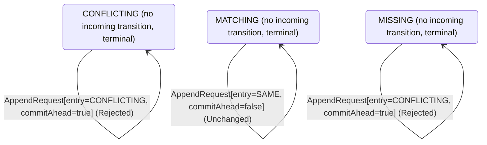

<!-- Generated by examples/demo/tools/build.py from example.json and the verifier's output. Edit example.json. -->
# 101 · A follower that takes the commit index on the heartbeat after an entry, proved live

[← All examples](../README.md)

| Verdict | Categories | Severity if shipped | Change | Verified unit | Approach |
|---|---|---|---|---|---|
| **✓ Verified: all invariants and properties hold in 21,551 states, and under 2 more configurations** | functional, no-false-positive | none | refactor, behaviour change intended | [`AppendRule#decide`](../../../examples/demo/apps/quorum/src/main/java/net/terminalvalue/quorum/raft/AppendRule.java) | [D1: Protocol model checking](../../../examples/demo/apps/quorum/spec/README.md) |

> A Raft follower that appends an entry takes the leader's commit index in the same request, as far as the entries it now holds. A developer has it take the commit index only on a request that appends nothing, the heartbeat that follows, once the entry is on disk: a request that appends is a write, and the commit index moves on the next one. The change is verified under all three configurations, the two safety ones in 21,551 and 9,269 states, and the fairness one in 14,958: every entry still reaches every follower, every follower still learns the leader's commits, a leader's own entries are still committed, and the coverage shows both rows the change alters taken under each.

## The change

In `AppendRule.decide`, the `ABSENT` and `CONFLICTING` arms for the entry sent no longer add `ADVANCE_COMMIT` when the leader's commit index is ahead: they return `transition(MATCHING, APPEND)` and `transition(MATCHING, TRUNCATE, APPEND)` whatever the commit index, with the comment that the commit index moves on the next heartbeat, once the entry is on disk. The `NONE, SAME` arm still takes it. The Javadoc says the commit index follows the leader's on a request that carries no entry, and the test of the commit index splits into one for the heartbeat and one that an entry is appended before its commit is taken.

**Before** ([`AppendRule.java`](../../../examples/demo/apps/quorum/src/main/java/net/terminalvalue/quorum/raft/AppendRule.java), line 15):

```java
* consistency check first, which refuses the request unless the follower holds the entry before the ones sent, so
* that the leader backs up and tries again from one entry earlier; then the entry sent goes in, in place of
* whatever the follower held at its index; and the follower's commit index follows the leader's, as far as the
* entries it now holds in common with it.
*
* <p>The check is what makes the log matching property hold: a follower accepts an entry only after the entry
* before it, so two logs that agree on an entry agree on everything before it. The term check comes before this
   // ...
               case NONE, SAME -> request.commitAhead()
                       ? transition(MATCHING, ADVANCE_COMMIT)
                       : unchanged("holds what was sent, and nothing new to commit");
               case ABSENT -> request.commitAhead()
                       ? transition(MATCHING, APPEND, ADVANCE_COMMIT)
                       : transition(MATCHING, APPEND);
               case CONFLICTING -> request.commitAhead()
                       ? transition(MATCHING, TRUNCATE, APPEND, ADVANCE_COMMIT)
                       : transition(MATCHING, TRUNCATE, APPEND);
           };
       };
   }
```

**After:**

```java
* consistency check first, which refuses the request unless the follower holds the entry before the ones sent, so
* that the leader backs up and tries again from one entry earlier; then the entry sent goes in, in place of
* whatever the follower held at its index; and the follower's commit index follows the leader's, as far as the
* entries it holds in common with it, on a request that carries no entry: a request that appends is a write, and
* the commit index moves on the heartbeat that follows it, once the entry is on disk.
*
* <p>The check is what makes the log matching property hold: a follower accepts an entry only after the entry
* before it, so two logs that agree on an entry agree on everything before it. The term check comes before this
   // ...
               case NONE, SAME -> request.commitAhead()
                       ? transition(MATCHING, ADVANCE_COMMIT)
                       : unchanged("holds what was sent, and nothing new to commit");
               case ABSENT -> transition(MATCHING, APPEND); // the commit index moves on the next heartbeat, once the entry is on disk
               case CONFLICTING -> transition(MATCHING, TRUNCATE, APPEND);
           };
       };
   }
```

<details><summary>Patch</summary>

```diff
--- a/examples/demo/apps/quorum/src/main/java/net/terminalvalue/quorum/raft/AppendRule.java
+++ b/examples/demo/apps/quorum/src/main/java/net/terminalvalue/quorum/raft/AppendRule.java
@@ -15,7 +15,8 @@
  * consistency check first, which refuses the request unless the follower holds the entry before the ones sent, so
  * that the leader backs up and tries again from one entry earlier; then the entry sent goes in, in place of
  * whatever the follower held at its index; and the follower's commit index follows the leader's, as far as the
- * entries it now holds in common with it.
+ * entries it holds in common with it, on a request that carries no entry: a request that appends is a write, and
+ * the commit index moves on the heartbeat that follows it, once the entry is on disk.
  *
  * <p>The check is what makes the log matching property hold: a follower accepts an entry only after the entry
  * before it, so two logs that agree on an entry agree on everything before it. The term check comes before this
@@ -36,12 +37,8 @@
                 case NONE, SAME -> request.commitAhead()
                         ? transition(MATCHING, ADVANCE_COMMIT)
                         : unchanged("holds what was sent, and nothing new to commit");
-                case ABSENT -> request.commitAhead()
-                        ? transition(MATCHING, APPEND, ADVANCE_COMMIT)
-                        : transition(MATCHING, APPEND);
-                case CONFLICTING -> request.commitAhead()
-                        ? transition(MATCHING, TRUNCATE, APPEND, ADVANCE_COMMIT)
-                        : transition(MATCHING, TRUNCATE, APPEND);
+                case ABSENT -> transition(MATCHING, APPEND); // the commit index moves on the next heartbeat, once the entry is on disk
+                case CONFLICTING -> transition(MATCHING, TRUNCATE, APPEND);
             };
         };
     }
--- a/examples/demo/apps/quorum/src/test/java/net/terminalvalue/quorum/raft/AppendRuleTest.java
+++ b/examples/demo/apps/quorum/src/test/java/net/terminalvalue/quorum/raft/AppendRuleTest.java
@@ -32,9 +32,13 @@
         check(AppendRule.decide(MATCHING, new AppendRequest(NewEntry.SAME, false)) instanceof Decision.Unchanged, "already held");
     }
 
-    public static void theCommitIndexFollowsTheLeaders() {
+    public static void theCommitIndexFollowsTheLeadersOnAHeartbeat() {
         equal(new Transition<>(MATCHING, List.of(ADVANCE_COMMIT)), AppendRule.decide(MATCHING, new AppendRequest(NewEntry.NONE, true)));
-        equal(new Transition<>(MATCHING, List.of(APPEND, ADVANCE_COMMIT)), AppendRule.decide(MATCHING, new AppendRequest(NewEntry.ABSENT, true)));
-        equal(new Transition<>(MATCHING, List.of(TRUNCATE, APPEND, ADVANCE_COMMIT)), AppendRule.decide(MATCHING, new AppendRequest(NewEntry.CONFLICTING, true)));
+        equal(new Transition<>(MATCHING, List.of(ADVANCE_COMMIT)), AppendRule.decide(MATCHING, new AppendRequest(NewEntry.SAME, true)));
+    }
+
+    public static void anEntryIsAppendedBeforeItsCommitIsTaken() {
+        equal(new Transition<>(MATCHING, List.of(APPEND)), AppendRule.decide(MATCHING, new AppendRequest(NewEntry.ABSENT, true)));
+        equal(new Transition<>(MATCHING, List.of(TRUNCATE, APPEND)), AppendRule.decide(MATCHING, new AppendRequest(NewEntry.CONFLICTING, true)));
     }
 }
```

</details>

## What the verifier found

The model is checked under 3 configurations, and the verdict is the first that fails:

| Configuration | What it checks | Model | Result |
|---|---|---|---|
| three terms, two entries (`spec/RaftReplication.cfg`) | every run from the initial state, every interleaving within the configuration's bounds | Servers = {s1, s2, s3}, MaxTerm = 3, MaxEntries = 2 | ✓ Verified: all invariants and properties hold in 21,551 states |
| figure 8 (`spec/RaftReplicationFigureEight.cfg`) | every run of three servers over four terms with one entry per leader's log, the budget of figure 8 of the paper: a leader of term 1 appends an entry it never gets to replicate, a leader of term 2 appends its own at the same index, the first comes back as the leader of term 3 and replicates its entry of term 1 to a majority, and the second, whose last entry is from the later term, can still be elected in term 4 without it; three terms cannot show this, and the same invariants and action properties are checked | Servers = {s1, s2, s3}, MaxTerm = 4, MaxEntries = 1 | ✓ Verified: all invariants and properties hold in 9,269 states |
| fairness (`spec/RaftReplicationLive.cfg`) | the three liveness properties, under the fairness conditions `Fairness`: a server whose timer nothing resets times out, a candidate asks for the votes it lacks, a leader sends every follower its next entry or a heartbeat and marks committed what the commit rule lets it; nothing is assumed of the clients, so the properties hold whether or not a request comes. Three servers, three terms and one entry per leader, without the symmetry set, since TLC's liveness checking is unsound under one. A counterexample is a run that goes on forever without satisfying a property: a prefix, then a state or a cycle the system never leaves | Servers = {s1, s2, s3}, MaxTerm = 3, MaxEntries = 1 | ✓ Verified: all invariants and properties hold in 14,958 states |

Every invariant holds in every reachable state of the model, and every temporal property holds of every behaviour, the infinite ones included under three terms, two entries: 21,551 distinct states, which is every interleaving of the servers, their terms, votes and logs, and the AppendEntries RPCs between them within the model's bounds (Servers = {s1, s2, s3}, MaxTerm = 3, MaxEntries = 2).

The follower's append rule, the leader's commit rule, the role machine and the vote rule inside the model are generated from the behavioural contracts of the patched code, so the model checks the entries the followers really take, the commits the leaders really make, and the roles and votes behind them.

The other configurations hold too, as the table says: figure 8, 9,269 states; fairness, 14,958 states.

**What the verdict rests on.** TLC counted how often a step of the model took each row of the generated operators. A row no step takes is one the model says nothing about, whatever the verdict.

| Configuration | Rows of `RoleMachine#decide` taken | Rows of `VoteRule#decide` taken | Rows of `AppendRule#decide` taken | Rows of `CommitRule#decide` taken |
|---|---|---|---|---|
| three terms, two entries | 27 of 36 | 12 of 27 | 16 of 24 | 4 of 12 |
| figure 8 | 27 of 36 | 12 of 27 | 10 of 24 | 4 of 12 |
| fairness | 27 of 36 | 12 of 27 | 10 of 24 | 4 of 12 |

The change alters 2 rows of the contract:

- `decide(MATCHING, AppendRequest[entry=ABSENT, commitAhead=true])`: `Transition[next=MATCHING, effects=[APPEND, ADVANCE_COMMIT]]` → `Transition[next=MATCHING, effects=[APPEND]]`, taken under three terms, two entries, figure 8, fairness
- `decide(MATCHING, AppendRequest[entry=CONFLICTING, commitAhead=true])`: `Transition[next=MATCHING, effects=[TRUNCATE, APPEND, ADVANCE_COMMIT]]` → `Transition[next=MATCHING, effects=[TRUNCATE, APPEND]]`, taken under three terms, two entries, figure 8, fairness

Runs of the model take every row the change alters: the verdict rests on the change.

<details><summary>Rows no step takes under three terms, two entries</summary>

`net.terminalvalue.quorum.raft.RoleMachine#decide`:

```
decide(FOLLOWER, VotesCounted[majority=true]) => Unchanged
decide(FOLLOWER, Response[term=OLDER]) => Unchanged
decide(FOLLOWER, Response[term=CURRENT]) => Unchanged
decide(FOLLOWER, Response[term=NEWER]) => Transition[next=FOLLOWER, effects=[ADOPT_TERM]]
decide(CANDIDATE, Response[term=OLDER]) => Unchanged
decide(LEADER, VotesCounted[majority=false]) => Unchanged
decide(LEADER, VotesCounted[majority=true]) => Unchanged
decide(LEADER, AppendEntries[term=CURRENT]) => throws IllegalStateException
decide(LEADER, Response[term=OLDER]) => Unchanged
```

`net.terminalvalue.quorum.raft.VoteRule#decide`:

```
decide(OPEN, VoteRequest[term=NEWER, log=BEHIND]) => Rejected
decide(OPEN, VoteRequest[term=NEWER, log=EVEN]) => Transition[next=FOR_THE_CANDIDATE, effects=[GRANT]]
decide(OPEN, VoteRequest[term=NEWER, log=AHEAD]) => Transition[next=FOR_THE_CANDIDATE, effects=[GRANT]]
decide(FOR_THE_CANDIDATE, VoteRequest[term=OLDER, log=BEHIND]) => Rejected
decide(FOR_THE_CANDIDATE, VoteRequest[term=OLDER, log=EVEN]) => Rejected
decide(FOR_THE_CANDIDATE, VoteRequest[term=OLDER, log=AHEAD]) => Rejected
decide(FOR_THE_CANDIDATE, VoteRequest[term=CURRENT, log=BEHIND]) => Rejected
decide(FOR_THE_CANDIDATE, VoteRequest[term=CURRENT, log=EVEN]) => Transition[next=FOR_THE_CANDIDATE, effects=[GRANT]]
decide(FOR_THE_CANDIDATE, VoteRequest[term=CURRENT, log=AHEAD]) => Transition[next=FOR_THE_CANDIDATE, effects=[GRANT]]
decide(FOR_THE_CANDIDATE, VoteRequest[term=NEWER, log=BEHIND]) => Rejected
decide(FOR_THE_CANDIDATE, VoteRequest[term=NEWER, log=EVEN]) => Transition[next=FOR_THE_CANDIDATE, effects=[GRANT]]
decide(FOR_THE_CANDIDATE, VoteRequest[term=NEWER, log=AHEAD]) => Transition[next=FOR_THE_CANDIDATE, effects=[GRANT]]
decide(FOR_ANOTHER, VoteRequest[term=NEWER, log=BEHIND]) => Rejected
decide(FOR_ANOTHER, VoteRequest[term=NEWER, log=EVEN]) => Transition[next=FOR_THE_CANDIDATE, effects=[GRANT]]
decide(FOR_ANOTHER, VoteRequest[term=NEWER, log=AHEAD]) => Transition[next=FOR_THE_CANDIDATE, effects=[GRANT]]
```

`net.terminalvalue.quorum.raft.AppendRule#decide`:

```
decide(MISSING, AppendRequest[entry=SAME, commitAhead=false]) => Rejected
decide(MISSING, AppendRequest[entry=SAME, commitAhead=true]) => Rejected
decide(MISSING, AppendRequest[entry=CONFLICTING, commitAhead=false]) => Rejected
decide(MISSING, AppendRequest[entry=CONFLICTING, commitAhead=true]) => Rejected
decide(CONFLICTING, AppendRequest[entry=SAME, commitAhead=false]) => Rejected
decide(CONFLICTING, AppendRequest[entry=SAME, commitAhead=true]) => Rejected
decide(MATCHING, AppendRequest[entry=SAME, commitAhead=false]) => Unchanged
decide(MATCHING, AppendRequest[entry=SAME, commitAhead=true]) => Transition[next=MATCHING, effects=[ADVANCE_COMMIT]]
```

`net.terminalvalue.quorum.raft.CommitRule#decide`:

```
decide(PENDING, Replication[term=NEWER, majority=false]) => throws IllegalStateException
decide(PENDING, Replication[term=NEWER, majority=true]) => throws IllegalStateException
decide(COMMITTED, Replication[term=OLDER, majority=false]) => Unchanged
decide(COMMITTED, Replication[term=OLDER, majority=true]) => Unchanged
decide(COMMITTED, Replication[term=CURRENT, majority=false]) => Unchanged
decide(COMMITTED, Replication[term=CURRENT, majority=true]) => Unchanged
decide(COMMITTED, Replication[term=NEWER, majority=false]) => Unchanged
decide(COMMITTED, Replication[term=NEWER, majority=true]) => Unchanged
```

</details>

The state machine the patched code implements, drawn from its derived contract (`jvmcontract statemachine`); a state with no way in or no way out is marked:



## Would the existing tests have caught it?

Every existing unit test passes, as it should (`java -ea net.terminalvalue.quorum.Tests`, run against the patched code).

## Why it matters

Low, and the question a reviewer asks is the one example 099 answers in the negative: whether a follower that takes the commit index later takes it at all. Here the rows that take it are the heartbeat's, which the leader sends as long as it leads, and the rows that no longer take it are followed by a heartbeat as soon as the follower is caught up. The safety configurations cannot tell this change from 099, since both move the commit index later; the fairness one can.

## Why the verdict is right

The append rule in the model is generated from the regenerated contract, so `Replicate` does what the two patched rows say, the two of the four edited whose decision changes: a request that appends leaves the follower's commit index where it was, and the heartbeat after it, with nothing to append and the leader's commit index ahead, moves it. TLC verifies the change under all three configurations: 21,551 states of three terms and two entries, 9,269 of figure 8, and 14,958 of the fairness configuration, under which every follower's log comes to hold the leader's, every follower's commit index comes to be no less than the leader's, and every entry a leader appends in its term is committed unless the leader is deposed. The coverage shows both rows the change alters taken by a step of the model under each configuration, so the verdict rests on runs in which a follower appends an entry the leader has already committed and takes the commit index on the request after. What the fairness condition on `Replicate` provides is the heartbeat: a leader that sends every follower its next entry or a heartbeat as long as it leads is the assumption under which postponing the commit index by one request costs nothing but the request.

## What to do

Merge. Taking the commit index on the heartbeat after an entry rather than with it is a reordering the protocol allows, since the commit index is carried by every request and a follower applies the leader's as far as its log matches; what the change costs is a round trip of staleness on a follower, which the fairness configuration shows to be a round trip and not forever, where example 099's change, which also postpones the commit index, postpones it for good. The rows are checked under all three configurations on every build, and the liveness properties are what distinguish the two changes.

## Evidence

How the verdict was reached: three terms, two entries: TLC 2.19 explored 21,551 distinct states to depth 22 in 9 s, for the model Servers = {s1, s2, s3}, MaxTerm = 3, MaxEntries = 2; figure 8: TLC 2.19 explored 9,269 distinct states to depth 19 in 4 s, for the model Servers = {s1, s2, s3}, MaxTerm = 4, MaxEntries = 1; fairness: TLC 2.19 explored 14,958 distinct states to depth 16, for the model Servers = {s1, s2, s3}, MaxTerm = 3, MaxEntries = 1.

<details><summary>Verifier output</summary>

```text
== three terms, two entries: spec/RaftReplication.cfg ==
TLC2 Version 2.19 of 08 August 2024 (rev: 5a47802)
Running breadth-first search Model-Checking with fp 1 and seed 1 with 1 worker on 8 cores with 910MB heap and 64MB offheap memory [pid: 3259137] (Linux 6.6.87.2-microsoft-standard-WSL2 aarch64, Eclipse Adoptium 25.0.4.1 x86_64, MSBDiskFPSet, DiskStateQueue).
Parsing file examples/demo/apps/quorum/spec/RaftReplication.tla
Parsing file examples/demo/tools/tla/standard-modules/Naturals.tla
Parsing file examples/demo/tools/tla/standard-modules/FiniteSets.tla
Parsing file examples/demo/tools/tla/standard-modules/Sequences.tla
Parsing file examples/demo/tools/tla/standard-modules/TLC.tla
Parsing file examples/demo/apps/quorum/spec/RoleMachineContract.tla
Parsing file examples/demo/apps/quorum/spec/VoteRuleContract.tla
Parsing file examples/demo/apps/quorum/spec/AppendRuleContract.tla
Parsing file examples/demo/apps/quorum/spec/CommitRuleContract.tla
Semantic processing of module Naturals
Semantic processing of module Sequences
Semantic processing of module FiniteSets
Semantic processing of module TLC
Semantic processing of module RoleMachineContract
Semantic processing of module VoteRuleContract
Semantic processing of module AppendRuleContract
Semantic processing of module CommitRuleContract
Semantic processing of module RaftReplication
Starting... (2026-11-02 07:24:28)
Computing initial states...
Finished computing initial states: 1 distinct state generated at 2026-11-02 07:24:29.
Model checking completed. No error has been found.
  Estimates of the probability that TLC did not check all reachable states
  because two distinct states had the same fingerprint:
  calculated (optimistic):  val = 9.9E-11
Rows of net.terminalvalue.quorum.raft.RoleMachine#decide a step of the model takes: 27 of 36; never taken (9):
  decide(FOLLOWER, VotesCounted[majority=true]) => Unchanged
  decide(FOLLOWER, Response[term=OLDER]) => Unchanged
  decide(FOLLOWER, Response[term=CURRENT]) => Unchanged
  decide(FOLLOWER, Response[term=NEWER]) => Transition[next=FOLLOWER, effects=[ADOPT_TERM]]
  decide(CANDIDATE, Response[term=OLDER]) => Unchanged
  decide(LEADER, VotesCounted[majority=false]) => Unchanged
  decide(LEADER, VotesCounted[majority=true]) => Unchanged
  decide(LEADER, AppendEntries[term=CURRENT]) => throws IllegalStateException
  decide(LEADER, Response[term=OLDER]) => Unchanged
Rows of net.terminalvalue.quorum.raft.VoteRule#decide a step of the model takes: 12 of 27; never taken (15):
  decide(OPEN, VoteRequest[term=NEWER, log=BEHIND]) => Rejected
  decide(OPEN, VoteRequest[term=NEWER, log=EVEN]) => Transition[next=FOR_THE_CANDIDATE, effects=[GRANT]]
  decide(OPEN, VoteRequest[term=NEWER, log=AHEAD]) => Transition[next=FOR_THE_CANDIDATE, effects=[GRANT]]
  decide(FOR_THE_CANDIDATE, VoteRequest[term=OLDER, log=BEHIND]) => Rejected
  decide(FOR_THE_CANDIDATE, VoteRequest[term=OLDER, log=EVEN]) => Rejected
  decide(FOR_THE_CANDIDATE, VoteRequest[term=OLDER, log=AHEAD]) => Rejected
  decide(FOR_THE_CANDIDATE, VoteRequest[term=CURRENT, log=BEHIND]) => Rejected
  decide(FOR_THE_CANDIDATE, VoteRequest[term=CURRENT, log=EVEN]) => Transition[next=FOR_THE_CANDIDATE, effects=[GRANT]]
  decide(FOR_THE_CANDIDATE, VoteRequest[term=CURRENT, log=AHEAD]) => Transition[next=FOR_THE_CANDIDATE, effects=[GRANT]]
  decide(FOR_THE_CANDIDATE, VoteRequest[term=NEWER, log=BEHIND]) => Rejected
  decide(FOR_THE_CANDIDATE, VoteRequest[term=NEWER, log=EVEN]) => Transition[next=FOR_THE_CANDIDATE, effects=[GRANT]]
  decide(FOR_THE_CANDIDATE, VoteRequest[term=NEWER, log=AHEAD]) => Transition[next=FOR_THE_CANDIDATE, effects=[GRANT]]
  decide(FOR_ANOTHER, VoteRequest[term=NEWER, log=BEHIND]) => Rejected
  decide(FOR_ANOTHER, VoteRequest[term=NEWER, log=EVEN]) => Transition[next=FOR_THE_CANDIDATE, effects=[GRANT]]
  decide(FOR_ANOTHER, VoteRequest[term=NEWER, log=AHEAD]) => Transition[next=FOR_THE_CANDIDATE, effects=[GRANT]]
Rows of net.terminalvalue.quorum.raft.AppendRule#decide a step of the model takes: 16 of 24; never taken (8):
  decide(MISSING, AppendRequest[entry=SAME, commitAhead=false]) => Rejected
  decide(MISSING, AppendRequest[entry=SAME, commitAhead=true]) => Rejected
  decide(MISSING, AppendRequest[entry=CONFLICTING, commitAhead=false]) => Rejected
  decide(MISSING, AppendRequest[entry=CONFLICTING, commitAhead=true]) => Rejected
  decide(CONFLICTING, AppendRequest[entry=SAME, commitAhead=false]) => Rejected
  decide(CONFLICTING, AppendRequest[entry=SAME, commitAhead=true]) => Rejected
  decide(MATCHING, AppendRequest[entry=SAME, commitAhead=false]) => Unchanged
  decide(MATCHING, AppendRequest[entry=SAME, commitAhead=true]) => Transition[next=MATCHING, effects=[ADVANCE_COMMIT]]
Rows of net.terminalvalue.quorum.raft.CommitRule#decide a step of the model takes: 4 of 12; never taken (8):
  decide(PENDING, Replication[term=NEWER, majority=false]) => throws IllegalStateException
  decide(PENDING, Replication[term=NEWER, majority=true]) => throws IllegalStateException
  decide(COMMITTED, Replication[term=OLDER, majority=false]) => Unchanged
  decide(COMMITTED, Replication[term=OLDER, majority=true]) => Unchanged
  decide(COMMITTED, Replication[term=CURRENT, majority=false]) => Unchanged
  decide(COMMITTED, Replication[term=CURRENT, majority=true]) => Unchanged
  decide(COMMITTED, Replication[term=NEWER, majority=false]) => Unchanged
  decide(COMMITTED, Replication[term=NEWER, majority=true]) => Unchanged
106472 states generated, 21551 distinct states found, 0 states left on queue.
The depth of the complete state graph search is 22.
The average outdegree of the complete state graph is 1 (minimum is 0, the maximum 7 and the 95th percentile is 3).
Finished in 09s at (2026-11-02 07:24:38)

== figure 8: spec/RaftReplicationFigureEight.cfg ==
TLC2 Version 2.19 of 08 August 2024 (rev: 5a47802)
Running breadth-first search Model-Checking with fp 1 and seed 1 with 1 worker on 8 cores with 910MB heap and 64MB offheap memory [pid: 3259675] (Linux 6.6.87.2-microsoft-standard-WSL2 aarch64, Eclipse Adoptium 25.0.4.1 x86_64, MSBDiskFPSet, DiskStateQueue).
Parsing file examples/demo/apps/quorum/spec/RaftReplication.tla
Parsing file examples/demo/tools/tla/standard-modules/Naturals.tla
Parsing file examples/demo/tools/tla/standard-modules/FiniteSets.tla
Parsing file examples/demo/tools/tla/standard-modules/Sequences.tla
Parsing file examples/demo/tools/tla/standard-modules/TLC.tla
Parsing file examples/demo/apps/quorum/spec/RoleMachineContract.tla
Parsing file examples/demo/apps/quorum/spec/VoteRuleContract.tla
Parsing file examples/demo/apps/quorum/spec/AppendRuleContract.tla
Parsing file examples/demo/apps/quorum/spec/CommitRuleContract.tla
Semantic processing of module Naturals
Semantic processing of module Sequences
Semantic processing of module FiniteSets
Semantic processing of module TLC
Semantic processing of module RoleMachineContract
Semantic processing of module VoteRuleContract
Semantic processing of module AppendRuleContract
Semantic processing of module CommitRuleContract
Semantic processing of module RaftReplication
Starting... (2026-11-02 07:24:38)
Computing initial states...
Finished computing initial states: 1 distinct state generated at 2026-11-02 07:24:39.
Model checking completed. No error has been found.
  Estimates of the probability that TLC did not check all reachable states
  because two distinct states had the same fingerprint:
  calculated (optimistic):  val = 2.1E-11
Rows of net.terminalvalue.quorum.raft.RoleMachine#decide a step of the model takes: 27 of 36; never taken (9):
  decide(FOLLOWER, VotesCounted[majority=true]) => Unchanged
  decide(FOLLOWER, Response[term=OLDER]) => Unchanged
  decide(FOLLOWER, Response[term=CURRENT]) => Unchanged
  decide(FOLLOWER, Response[term=NEWER]) => Transition[next=FOLLOWER, effects=[ADOPT_TERM]]
  decide(CANDIDATE, Response[term=OLDER]) => Unchanged
  decide(LEADER, VotesCounted[majority=false]) => Unchanged
  decide(LEADER, VotesCounted[majority=true]) => Unchanged
  decide(LEADER, AppendEntries[term=CURRENT]) => throws IllegalStateException
  decide(LEADER, Response[term=OLDER]) => Unchanged
Rows of net.terminalvalue.quorum.raft.VoteRule#decide a step of the model takes: 12 of 27; never taken (15):
  decide(OPEN, VoteRequest[term=NEWER, log=BEHIND]) => Rejected
  decide(OPEN, VoteRequest[term=NEWER, log=EVEN]) => Transition[next=FOR_THE_CANDIDATE, effects=[GRANT]]
  decide(OPEN, VoteRequest[term=NEWER, log=AHEAD]) => Transition[next=FOR_THE_CANDIDATE, effects=[GRANT]]
  decide(FOR_THE_CANDIDATE, VoteRequest[term=OLDER, log=BEHIND]) => Rejected
  decide(FOR_THE_CANDIDATE, VoteRequest[term=OLDER, log=EVEN]) => Rejected
  decide(FOR_THE_CANDIDATE, VoteRequest[term=OLDER, log=AHEAD]) => Rejected
  decide(FOR_THE_CANDIDATE, VoteRequest[term=CURRENT, log=BEHIND]) => Rejected
  decide(FOR_THE_CANDIDATE, VoteRequest[term=CURRENT, log=EVEN]) => Transition[next=FOR_THE_CANDIDATE, effects=[GRANT]]
  decide(FOR_THE_CANDIDATE, VoteRequest[term=CURRENT, log=AHEAD]) => Transition[next=FOR_THE_CANDIDATE, effects=[GRANT]]
  decide(FOR_THE_CANDIDATE, VoteRequest[term=NEWER, log=BEHIND]) => Rejected
  decide(FOR_THE_CANDIDATE, VoteRequest[term=NEWER, log=EVEN]) => Transition[next=FOR_THE_CANDIDATE, effects=[GRANT]]
  decide(FOR_THE_CANDIDATE, VoteRequest[term=NEWER, log=AHEAD]) => Transition[next=FOR_THE_CANDIDATE, effects=[GRANT]]
  decide(FOR_ANOTHER, VoteRequest[term=NEWER, log=BEHIND]) => Rejected
  decide(FOR_ANOTHER, VoteRequest[term=NEWER, log=EVEN]) => Transition[next=FOR_THE_CANDIDATE, effects=[GRANT]]
  decide(FOR_ANOTHER, VoteRequest[term=NEWER, log=AHEAD]) => Transition[next=FOR_THE_CANDIDATE, effects=[GRANT]]
Rows of net.terminalvalue.quorum.raft.AppendRule#decide a step of the model takes: 10 of 24; never taken (14):
  decide(MISSING, AppendRequest[entry=ABSENT, commitAhead=false]) => Rejected
  decide(MISSING, AppendRequest[entry=ABSENT, commitAhead=true]) => Rejected
  decide(MISSING, AppendRequest[entry=SAME, commitAhead=false]) => Rejected
  decide(MISSING, AppendRequest[entry=SAME, commitAhead=true]) => Rejected
  decide(MISSING, AppendRequest[entry=CONFLICTING, commitAhead=false]) => Rejected
  decide(MISSING, AppendRequest[entry=CONFLICTING, commitAhead=true]) => Rejected
  decide(CONFLICTING, AppendRequest[entry=ABSENT, commitAhead=false]) => Rejected
  decide(CONFLICTING, AppendRequest[entry=ABSENT, commitAhead=true]) => Rejected
  decide(CONFLICTING, AppendRequest[entry=SAME, commitAhead=false]) => Rejected
  decide(CONFLICTING, AppendRequest[entry=SAME, commitAhead=true]) => Rejected
  decide(CONFLICTING, AppendRequest[entry=CONFLICTING, commitAhead=false]) => Rejected
  decide(CONFLICTING, AppendRequest[entry=CONFLICTING, commitAhead=true]) => Rejected
  decide(MATCHING, AppendRequest[entry=SAME, commitAhead=false]) => Unchanged
  decide(MATCHING, AppendRequest[entry=SAME, commitAhead=true]) => Transition[next=MATCHING, effects=[ADVANCE_COMMIT]]
Rows of net.terminalvalue.quorum.raft.CommitRule#decide a step of the model takes: 4 of 12; never taken (8):
  decide(PENDING, Replication[term=NEWER, majority=false]) => throws IllegalStateException
  decide(PENDING, Replication[term=NEWER, majority=true]) => throws IllegalStateException
  decide(COMMITTED, Replication[term=OLDER, majority=false]) => Unchanged
  decide(COMMITTED, Replication[term=OLDER, majority=true]) => Unchanged
  decide(COMMITTED, Replication[term=CURRENT, majority=false]) => Unchanged
  decide(COMMITTED, Replication[term=CURRENT, majority=true]) => Unchanged
  decide(COMMITTED, Replication[term=NEWER, majority=false]) => Unchanged
  decide(COMMITTED, Replication[term=NEWER, majority=true]) => Unchanged
51097 states generated, 9269 distinct states found, 0 states left on queue.
The depth of the complete state graph search is 19.
The average outdegree of the complete state graph is 1 (minimum is 0, the maximum 6 and the 95th percentile is 3).
Finished in 04s at (2026-11-02 07:24:43)

== fairness: spec/RaftReplicationLive.cfg ==
TLC2 Version 2.19 of 08 August 2024 (rev: 5a47802)
Running breadth-first search Model-Checking with fp 1 and seed 1 with 1 worker on 8 cores with 910MB heap and 64MB offheap memory [pid: 3259929] (Linux 6.6.87.2-microsoft-standard-WSL2 aarch64, Eclipse Adoptium 25.0.4.1 x86_64, MSBDiskFPSet, DiskStateQueue).
Parsing file examples/demo/apps/quorum/spec/RaftReplication.tla
Parsing file examples/demo/tools/tla/standard-modules/Naturals.tla
Parsing file examples/demo/tools/tla/standard-modules/FiniteSets.tla
Parsing file examples/demo/tools/tla/standard-modules/Sequences.tla
Parsing file examples/demo/tools/tla/standard-modules/TLC.tla
Parsing file examples/demo/apps/quorum/spec/RoleMachineContract.tla
Parsing file examples/demo/apps/quorum/spec/VoteRuleContract.tla
Parsing file examples/demo/apps/quorum/spec/AppendRuleContract.tla
Parsing file examples/demo/apps/quorum/spec/CommitRuleContract.tla
Semantic processing of module Naturals
Semantic processing of module Sequences
Semantic processing of module FiniteSets
Semantic processing of module TLC
Semantic processing of module RoleMachineContract
Semantic processing of module VoteRuleContract
Semantic processing of module AppendRuleContract
Semantic processing of module CommitRuleContract
Semantic processing of module RaftReplication
Starting... (2026-11-02 07:24:44)
Implied-temporal checking--satisfiability problem has 5 branches.
Computing initial states...
Finished computing initial states: 1 distinct state generated at 2026-11-02 07:24:44.
Checking 5 branches of temporal properties for the current state space with 3095 total distinct states at (2026-11-02 07:24:47)
Finished checking temporal properties in 00s at 2026-11-02 07:24:47
Checking 5 branches of temporal properties for the current state space with 60965 total distinct states at (2026-11-02 07:25:47)
Finished checking temporal properties in 00s at 2026-11-02 07:25:48
Checking 5 branches of temporal properties for the complete state space with 74790 total distinct states at (2026-11-02 07:26:00)
Finished checking temporal properties in 00s at 2026-11-02 07:26:00
Model checking completed. No error has been found.
  Estimates of the probability that TLC did not check all reachable states
  because two distinct states had the same fingerprint:
  calculated (optimistic):  val = 4.8E-11
Rows of net.terminalvalue.quorum.raft.RoleMachine#decide a step of the model takes: 27 of 36; never taken (9):
  decide(FOLLOWER, VotesCounted[majority=true]) => Unchanged
  decide(FOLLOWER, Response[term=OLDER]) => Unchanged
  decide(FOLLOWER, Response[term=CURRENT]) => Unchanged
  decide(FOLLOWER, Response[term=NEWER]) => Transition[next=FOLLOWER, effects=[ADOPT_TERM]]
  decide(CANDIDATE, Response[term=OLDER]) => Unchanged
  decide(LEADER, VotesCounted[majority=false]) => Unchanged
  decide(LEADER, VotesCounted[majority=true]) => Unchanged
  decide(LEADER, AppendEntries[term=CURRENT]) => throws IllegalStateException
  decide(LEADER, Response[term=OLDER]) => Unchanged
Rows of net.terminalvalue.quorum.raft.VoteRule#decide a step of the model takes: 12 of 27; never taken (15):
  decide(OPEN, VoteRequest[term=NEWER, log=BEHIND]) => Rejected
  decide(OPEN, VoteRequest[term=NEWER, log=EVEN]) => Transition[next=FOR_THE_CANDIDATE, effects=[GRANT]]
  decide(OPEN, VoteRequest[term=NEWER, log=AHEAD]) => Transition[next=FOR_THE_CANDIDATE, effects=[GRANT]]
  decide(FOR_THE_CANDIDATE, VoteRequest[term=OLDER, log=BEHIND]) => Rejected
  decide(FOR_THE_CANDIDATE, VoteRequest[term=OLDER, log=EVEN]) => Rejected
  decide(FOR_THE_CANDIDATE, VoteRequest[term=OLDER, log=AHEAD]) => Rejected
  decide(FOR_THE_CANDIDATE, VoteRequest[term=CURRENT, log=BEHIND]) => Rejected
  decide(FOR_THE_CANDIDATE, VoteRequest[term=CURRENT, log=EVEN]) => Transition[next=FOR_THE_CANDIDATE, effects=[GRANT]]
  decide(FOR_THE_CANDIDATE, VoteRequest[term=CURRENT, log=AHEAD]) => Transition[next=FOR_THE_CANDIDATE, effects=[GRANT]]
  decide(FOR_THE_CANDIDATE, VoteRequest[term=NEWER, log=BEHIND]) => Rejected
  decide(FOR_THE_CANDIDATE, VoteRequest[term=NEWER, log=EVEN]) => Transition[next=FOR_THE_CANDIDATE, effects=[GRANT]]
  decide(FOR_THE_CANDIDATE, VoteRequest[term=NEWER, log=AHEAD]) => Transition[next=FOR_THE_CANDIDATE, effects=[GRANT]]
  decide(FOR_ANOTHER, VoteRequest[term=NEWER, log=BEHIND]) => Rejected
  decide(FOR_ANOTHER, VoteRequest[term=NEWER, log=EVEN]) => Transition[next=FOR_THE_CANDIDATE, effects=[GRANT]]
  decide(FOR_ANOTHER, VoteRequest[term=NEWER, log=AHEAD]) => Transition[next=FOR_THE_CANDIDATE, effects=[GRANT]]
Rows of net.terminalvalue.quorum.raft.AppendRule#decide a step of the model takes: 10 of 24; never taken (14):
  decide(MISSING, AppendRequest[entry=ABSENT, commitAhead=false]) => Rejected
  decide(MISSING, AppendRequest[entry=ABSENT, commitAhead=true]) => Rejected
  decide(MISSING, AppendRequest[entry=SAME, commitAhead=false]) => Rejected
  decide(MISSING, AppendRequest[entry=SAME, commitAhead=true]) => Rejected
  decide(MISSING, AppendRequest[entry=CONFLICTING, commitAhead=false]) => Rejected
  decide(MISSING, AppendRequest[entry=CONFLICTING, commitAhead=true]) => Rejected
  decide(CONFLICTING, AppendRequest[entry=ABSENT, commitAhead=false]) => Rejected
  decide(CONFLICTING, AppendRequest[entry=ABSENT, commitAhead=true]) => Rejected
  decide(CONFLICTING, AppendRequest[entry=SAME, commitAhead=false]) => Rejected
  decide(CONFLICTING, AppendRequest[entry=SAME, commitAhead=true]) => Rejected
  decide(CONFLICTING, AppendRequest[entry=CONFLICTING, commitAhead=false]) => Rejected
  decide(CONFLICTING, AppendRequest[entry=CONFLICTING, commitAhead=true]) => Rejected
  decide(MATCHING, AppendRequest[entry=SAME, commitAhead=false]) => Unchanged
  decide(MATCHING, AppendRequest[entry=SAME, commitAhead=true]) => Transition[next=MATCHING, effects=[ADVANCE_COMMIT]]
Rows of net.terminalvalue.quorum.raft.CommitRule#decide a step of the model takes: 4 of 12; never taken (8):
  decide(PENDING, Replication[term=NEWER, majority=false]) => throws IllegalStateException
  decide(PENDING, Replication[term=NEWER, majority=true]) => throws IllegalStateException
  decide(COMMITTED, Replication[term=OLDER, majority=false]) => Unchanged
  decide(COMMITTED, Replication[term=OLDER, majority=true]) => Unchanged
  decide(COMMITTED, Replication[term=CURRENT, majority=false]) => Unchanged
  decide(COMMITTED, Replication[term=CURRENT, majority=true]) => Unchanged
  decide(COMMITTED, Replication[term=NEWER, majority=false]) => Unchanged
  decide(COMMITTED, Replication[term=NEWER, majority=true]) => Unchanged
73759 states generated, 14958 distinct states found, 0 states left on queue.
The depth of the complete state graph search is 16.
The average outdegree of the complete state graph is 1 (minimum is 0, the maximum 6 and the 95th percentile is 3).
Finished in 01min 16s at (2026-11-02 07:26:00)
```

</details>

<details><summary>SARIF report (as uploaded to GitHub code scanning or SonarQube)</summary>

```json
{
  "version": "2.1.0",
  "$schema": "https://json.schemastore.org/sarif-2.1.0.json",
  "runs": [
    {
      "tool": {
        "driver": {
          "name": "jvmcontract tlc",
          "rules": [
            {
              "id": "invariant-violated",
              "shortDescription": {
                "text": "TLC found a behaviour of the model that violates an invariant or a temporal property, or ends in a deadlock."
              }
            },
            {
              "id": "unverifiable",
              "shortDescription": {
                "text": "TLC could not check the model."
              }
            }
          ]
        }
      },
      "results": []
    }
  ]
}
```

</details>

**Provenance:** Constructed as the third example of the replication model's liveness configuration, to pair with 099 and 100: a change to the rows next to 099's, correct this time, which the safety configurations cannot tell apart from 099 and the fairness one accepts.

- [Ongaro and Ousterhout, In Search of an Understandable Consensus Algorithm (extended version, 2014): section 5.3, log replication, the consistency check and the commit index in AppendEntries; section 8, the no-op entry a leader commits at the start of its term](https://raft.github.io/raft.pdf)
- [Ongaro, the TLA+ specification of Raft (raft.tla): HandleAppendEntriesRequest, which takes the leader's commit index on every accepted request, and AdvanceCommitIndex over every index a majority agrees on](https://github.com/ongardie/raft.tla)
- [Lamport, Specifying Systems (2002): chapter 8, liveness and fairness; weak fairness WF_v(A) and the leads-to operator](https://lamport.azurewebsites.net/tla/book.html)
- [TLC's liveness checking: a temporal property's counterexample is a run that goes on forever, a prefix then a state (Stuttering) or a cycle (Back to state N) the system never leaves; unsound under a symmetry set](https://lamport.azurewebsites.net/tla/current-tools.pdf)
## Reproduce

```bash
python3 examples/demo/tools/build.py 101
```

This applies `change.patch` to a temporary copy of the repo, runs the verifier on it, and rewrites this page.
