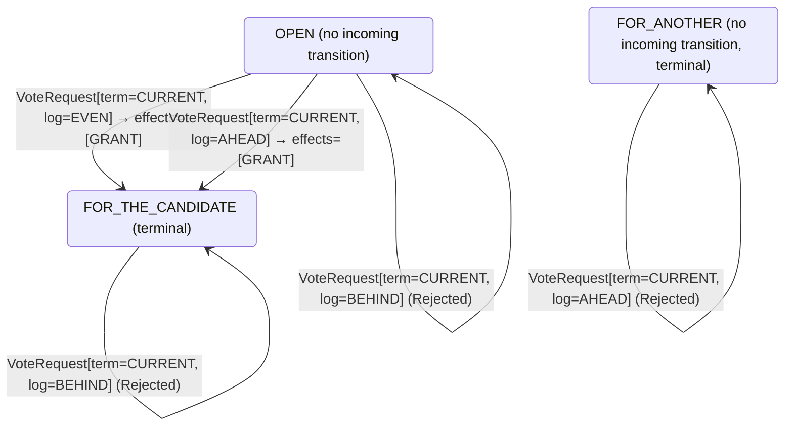

<!-- Generated by examples/tools/build.py from example.json and the verifier's output. Edit example.json. -->
# 073 · A vote rule that throws on a term not adopted, and the model shows the term always is

[← All examples](../README.md)

| Verdict | Categories | Severity if shipped | Change | Verified unit | Approach |
|---|---|---|---|---|---|
| **✓ Verified: all invariants and properties hold in 610 states, and under 6 more configurations** | functional | low | cleanup, behaviour change intended | [`VoteRule#decide`](../../examples/apps/quorum/src/main/java/net/terminalvalue/quorum/raft/VoteRule.java) | [D1: Protocol model checking](../../examples/apps/quorum/spec/README.md) |

> A Raft server adopts a candidate's newer term before it decides the vote, so the vote rule only ever sees a candidate of the current or an older term; its nine rows for a newer term are a courtesy to callers that skip the adoption. A developer makes them throw instead, so that a server which skips the step fails loudly rather than vote in a term it has not entered, and rewrites the tests that relied on the courtesy. The contract changes in nine rows, every one of them to an exception, and the election model verifies the change under all five configurations: its invariant `KernelNeverThrows` asks of every reachable state whether any RPC the state allows would make a kernel throw, and none does, because the role machine adopts the candidate's term in the same step, before the vote rule is asked. Coverage shows the nine rows taken by no run, which for rows that throw is the point, and the tool does not call the verdict vacuous: a row that throws is meant never to be taken, and whether no run can take it is what the invariant checked.

Tags: [consensus](../README.md#tag-consensus), [leader-election](../README.md#tag-leader-election), [exceptions](../README.md#tag-exceptions), [tla-coverage](../README.md#tag-tla-coverage), [tla-unreachable-exception](../README.md#tag-tla-unreachable-exception), [generated-operator](../README.md#tag-generated-operator), [multiple-configurations](../README.md#tag-multiple-configurations)

## The change

Throw `IllegalStateException` for a request of a newer term, before any other check, with the reasoning in a comment: the role machine adopts a newer term before the vote is decided, so a request reaches the rule as one of the current term, and a newer one is a server that skipped that step. The contract of `VoteRule#decide` is regenerated: the nine rows of a newer term, which granted or refused by the ballot and the log, now throw. The tests that voted in a newer term now adopt it first, and the test of the kernel expects the exception.

**Before** ([`VoteRule.java`](../../examples/apps/quorum/src/main/java/net/terminalvalue/quorum/raft/VoteRule.java), line 30):

```java
private VoteRule() {}

/**
 * The vote rule proper: a candidate from the past is refused; a newer term is a new vote, and in the current
 * term the vote is one per server, which the same candidate may collect again; and a candidate whose log is
 * behind the voter's is refused whatever its term.
 */
public static Decision<Ballot, VoteEffect> decide(Ballot ballot, VoteRequest request) {
    if (request.term() == OLDER) {
        return rejected("a candidate from the past");
    }
```

**After:**

```java
private VoteRule() {}

/**
 * The vote rule proper: a candidate from the past is refused; a newer term is a protocol error, since the role
 * machine adopts it before the vote is decided; in the current term the vote is one per server, which the same
 * candidate may collect again; and a candidate whose log is behind the voter's is refused.
 */
public static Decision<Ballot, VoteEffect> decide(Ballot ballot, VoteRequest request) {
    if (request.term() == NEWER) {
        // The role machine adopts a newer term before the vote is decided, so a request reaches the rule as one
        // of the current term; a newer one here is a server that skipped that step.
        throw new IllegalStateException("a term the voter has not adopted");
    }
    if (request.term() == OLDER) {
        return rejected("a candidate from the past");
    }
```

<details><summary>Patch</summary>

```diff
--- a/examples/apps/quorum/src/main/java/net/terminalvalue/quorum/raft/VoteRule.java
+++ b/examples/apps/quorum/src/main/java/net/terminalvalue/quorum/raft/VoteRule.java
@@ -30,11 +30,16 @@
     private VoteRule() {}
 
     /**
-     * The vote rule proper: a candidate from the past is refused; a newer term is a new vote, and in the current
-     * term the vote is one per server, which the same candidate may collect again; and a candidate whose log is
-     * behind the voter's is refused whatever its term.
+     * The vote rule proper: a candidate from the past is refused; a newer term is a protocol error, since the role
+     * machine adopts it before the vote is decided; in the current term the vote is one per server, which the same
+     * candidate may collect again; and a candidate whose log is behind the voter's is refused.
      */
     public static Decision<Ballot, VoteEffect> decide(Ballot ballot, VoteRequest request) {
+        if (request.term() == NEWER) {
+            // The role machine adopts a newer term before the vote is decided, so a request reaches the rule as one
+            // of the current term; a newer one here is a server that skipped that step.
+            throw new IllegalStateException("a term the voter has not adopted");
+        }
         if (request.term() == OLDER) {
             return rejected("a candidate from the past");
         }
--- a/examples/apps/quorum/src/test/java/net/terminalvalue/quorum/raft/VoteRuleTest.java
+++ b/examples/apps/quorum/src/test/java/net/terminalvalue/quorum/raft/VoteRuleTest.java
@@ -13,8 +13,8 @@
     private VoteRuleTest() {}
 
     public static void grantsToAnUpToDateCandidate() {
-        check(VoteRule.grant(3, NO_VOTE, 3, 10, 7, 4, 3, 10), "same log, newer term");
-        check(VoteRule.grant(3, NO_VOTE, 3, 10, 7, 4, 3, 12), "longer log, newer term");
+        check(VoteRule.grant(4, NO_VOTE, 3, 10, 7, 4, 3, 10), "same log, the candidate's term adopted");
+        check(VoteRule.grant(4, NO_VOTE, 3, 10, 7, 4, 3, 12), "longer log, the candidate's term adopted");
     }
 
     public static void refusesACandidateFromThePast() {
@@ -24,11 +24,11 @@
     public static void oneVotePerTerm() {
         check(!VoteRule.grant(4, 2, 3, 10, 7, 4, 3, 10), "already voted for 2 in term 4");
         check(VoteRule.grant(4, 7, 3, 10, 7, 4, 3, 10), "the same candidate may ask again");
-        check(VoteRule.grant(4, 2, 3, 10, 7, 5, 3, 10), "a new term is a new vote");
+        check(VoteRule.grant(5, NO_VOTE, 3, 10, 7, 5, 3, 10), "a new term, adopted, is a new vote");
     }
 
     public static void refusesAShorterLogOfTheSameTerm() {
-        check(!VoteRule.grant(3, NO_VOTE, 3, 10, 7, 4, 3, 9), "shorter log");
+        check(!VoteRule.grant(4, NO_VOTE, 3, 10, 7, 4, 3, 9), "shorter log");
     }
 
     public static void theRuleGrantsOneVotePerTerm() {
@@ -37,11 +37,16 @@
         equal(new Transition<>(Ballot.FOR_THE_CANDIDATE, List.of(VoteEffect.GRANT)),
                 VoteRule.decide(Ballot.FOR_THE_CANDIDATE, new VoteRequest(TermOrder.CURRENT, LogOrder.EVEN)));
         check(VoteRule.decide(Ballot.FOR_ANOTHER, new VoteRequest(TermOrder.CURRENT, LogOrder.AHEAD)) instanceof Decision.Rejected, "voted for another");
-        check(VoteRule.decide(Ballot.FOR_ANOTHER, new VoteRequest(TermOrder.NEWER, LogOrder.EVEN)) instanceof Decision.Transition, "a new term is a new vote");
+        try {
+            VoteRule.decide(Ballot.FOR_ANOTHER, new VoteRequest(TermOrder.NEWER, LogOrder.EVEN));
+            check(false, "a term the voter has not adopted must throw");
+        } catch (IllegalStateException expected) {
+            // the role machine adopts the term first
+        }
     }
 
     public static void theRuleRefusesThePastAndALogBehind() {
         check(VoteRule.decide(Ballot.OPEN, new VoteRequest(TermOrder.OLDER, LogOrder.AHEAD)) instanceof Decision.Rejected, "older term");
-        check(VoteRule.decide(Ballot.OPEN, new VoteRequest(TermOrder.NEWER, LogOrder.BEHIND)) instanceof Decision.Rejected, "log behind");
+        check(VoteRule.decide(Ballot.OPEN, new VoteRequest(TermOrder.CURRENT, LogOrder.BEHIND)) instanceof Decision.Rejected, "log behind");
     }
 }
```

</details>

## What the verifier found

The model is checked under 7 configurations, and the verdict is the first that fails:

| Configuration | What it checks | Model | Result |
|---|---|---|---|
| three servers (`spec/RaftElection.cfg`) | every run from the initial state, every interleaving within the configuration's bounds | Servers = {s1, s2, s3}, MaxTerm = 3, LeftBehind = {}, DelayedReplies = FALSE, History = FALSE | ✓ Verified: all invariants and properties hold in 610 states |
| the inductive step (`spec/RaftElectionInductive.cfg`) | that the invariant `Inductive` is inductive: TLC starts from every state the invariant admits, reachable or not, rather than from the initial state, takes one step, and checks the invariant again, conjunct by conjunct. No counterexample is a proof of election safety by induction, for any run of the cluster however long; a counterexample is one step from a state that need not be reachable | Servers = {s1, s2, s3}, MaxTerm = 3, LeftBehind = {}, DelayedReplies = FALSE, History = FALSE | ✓ Verified: all invariants and properties hold in 17,470 states |
| four servers (`spec/RaftElectionFour.cfg`) | every run with four servers, a cluster in which a candidate can hold a vote besides its own and still be short of a majority, which three servers never show; under a symmetry set, so that of the states that differ only by the servers' names TLC explores one | Servers = {s1, s2, s3, s4}, MaxTerm = 3, LeftBehind = {}, DelayedReplies = FALSE, History = FALSE | ✓ Verified: all invariants and properties hold in 829 states |
| fairness (`spec/RaftElectionLive.cfg`) | the two liveness properties, under the fairness conditions `Fairness`: a server whose timer nothing resets times out, a candidate asks for the votes it lacks, a leader sends its heartbeats. A counterexample is a run that goes on forever without satisfying a property: a prefix, then a state or a cycle the system never leaves | Servers = {s1, s2, s3}, MaxTerm = 3, LeftBehind = {}, DelayedReplies = FALSE, History = FALSE | ✓ Verified: all invariants and properties hold in 610 states |
| a server left behind (`spec/RaftElectionLogs.cfg`) | the election restriction: one server holds the log a deposed leader of term 1 left behind, three entries of its term, while the other two hold an entry of term 2 that a majority holds and is therefore committed, so that the longer log is the one behind; every run with these logs, which nothing changes, under the invariant `LeaderCompleteness` besides the usual ones | Servers = {s1, s2, s3}, MaxTerm = 3, LeftBehind = {s1}, DelayedReplies = FALSE, History = FALSE | ✓ Verified: all invariants and properties hold in 461 states |
| delayed replies (`spec/RaftElectionDelayed.cfg`) | every run of three servers and two terms in which the reply to a vote request is a step of its own, which the candidate may take after it has timed out into a newer term, stepped down, or won; the one-step RPC of the other configurations never hands the role machine a reply from an older term than the server's own, and this one does, under the usual invariants and action properties | Servers = {s1, s2, s3}, MaxTerm = 2, LeftBehind = {}, DelayedReplies = TRUE, History = FALSE | ✓ Verified: all invariants and properties hold in 20,351 states |
| history (`spec/RaftElectionHistory.cfg`) | every run of three servers and three terms with the two history variables recording, `elected`, every term a server has led, and `voted`, every vote cast, under the two invariants that are about a run rather than a state: at most one leader elected per term and at most one vote per server per term, as the paper states them. The state invariants of the other configurations hold in a run in which a term's leader steps down and the term then elects another; these do not | Servers = {s1, s2, s3}, MaxTerm = 3, LeftBehind = {}, DelayedReplies = FALSE, History = TRUE | ✓ Verified: all invariants hold in 4,798 states |

Every invariant holds in every reachable state of the model, and every temporal property holds of every behaviour, the infinite ones included under three servers: 610 distinct states, which is every interleaving of the servers, their terms and votes, and the RPCs between them within the model's bounds (Servers = {s1, s2, s3}, MaxTerm = 3, LeftBehind = {}, DelayedReplies = FALSE, History = FALSE).

The servers' role machine and vote rule inside the model are generated from the behavioural contracts of the patched code, so the model checks the role transitions the servers really make and the votes they really grant.

The other configurations hold too, as the table says: the inductive step, 17,470 states; four servers, 829 states; fairness, 610 states; a server left behind, 461 states; delayed replies, 20,351 states; history, 4,798 states.

**What the verdict rests on.** TLC counted how often a step of the model took each row of the generated operators. A row no step takes is one the model says nothing about, whatever the verdict.

| Configuration | Rows of `RoleMachine#decide` taken | Rows of `VoteRule#decide` taken |
|---|---|---|
| three servers | 27 of 36 | 4 of 27 |
| the inductive step (from the states the invariant admits, not from a run) | 27 of 36 | 6 of 27 |
| four servers | 27 of 36 | 4 of 27 |
| fairness | 27 of 36 | 4 of 27 |
| a server left behind | 27 of 36 | 12 of 27 |
| delayed replies | 33 of 36 | 4 of 27 |
| history | 27 of 36 | 4 of 27 |

The change alters 9 rows of the contract, and 3 with a null argument, which the model leaves out:

- `decide(OPEN, VoteRequest[term=NEWER, log=BEHIND])`: `Rejected[reason="a log behind the voter's"]` → `throws IllegalStateException("a term the voter has not adopted")`, taken by no run
- `decide(OPEN, VoteRequest[term=NEWER, log=EVEN])`: `Transition[next=FOR_THE_CANDIDATE, effects=[GRANT]]` → `throws IllegalStateException("a term the voter has not adopted")`, taken by no run
- `decide(OPEN, VoteRequest[term=NEWER, log=AHEAD])`: `Transition[next=FOR_THE_CANDIDATE, effects=[GRANT]]` → `throws IllegalStateException("a term the voter has not adopted")`, taken by no run
- `decide(FOR_THE_CANDIDATE, VoteRequest[term=NEWER, log=BEHIND])`: `Rejected[reason="a log behind the voter's"]` → `throws IllegalStateException("a term the voter has not adopted")`, taken by no run
- `decide(FOR_THE_CANDIDATE, VoteRequest[term=NEWER, log=EVEN])`: `Transition[next=FOR_THE_CANDIDATE, effects=[GRANT]]` → `throws IllegalStateException("a term the voter has not adopted")`, taken by no run
- `decide(FOR_THE_CANDIDATE, VoteRequest[term=NEWER, log=AHEAD])`: `Transition[next=FOR_THE_CANDIDATE, effects=[GRANT]]` → `throws IllegalStateException("a term the voter has not adopted")`, taken by no run
- `decide(FOR_ANOTHER, VoteRequest[term=NEWER, log=BEHIND])`: `Rejected[reason="a log behind the voter's"]` → `throws IllegalStateException("a term the voter has not adopted")`, taken by no run
- `decide(FOR_ANOTHER, VoteRequest[term=NEWER, log=EVEN])`: `Transition[next=FOR_THE_CANDIDATE, effects=[GRANT]]` → `throws IllegalStateException("a term the voter has not adopted")`, taken by no run
- `decide(FOR_ANOTHER, VoteRequest[term=NEWER, log=AHEAD])`: `Transition[next=FOR_THE_CANDIDATE, effects=[GRANT]]` → `throws IllegalStateException("a term the voter has not adopted")`, taken by no run

All rows the change alters throw, and no run takes them: that is what a row that throws asks. Whether no run can is for an invariant over the model's events to say, not for coverage, which counts the steps taken.

<details><summary>Rows no step takes under three servers</summary>

`net.terminalvalue.quorum.raft.RoleMachine#decide`:

```
decide(FOLLOWER, VotesCounted[majority=true]) => Unchanged
decide(FOLLOWER, Response[term=OLDER]) => Unchanged
decide(FOLLOWER, Response[term=CURRENT]) => Unchanged
decide(FOLLOWER, Response[term=NEWER]) => Transition[next=FOLLOWER, effects=[ADOPT_TERM]]
decide(CANDIDATE, Response[term=OLDER]) => Unchanged
decide(LEADER, VotesCounted[majority=false]) => Unchanged
decide(LEADER, VotesCounted[majority=true]) => Unchanged
decide(LEADER, AppendEntries[term=CURRENT]) => throws IllegalStateException
decide(LEADER, Response[term=OLDER]) => Unchanged
```

`net.terminalvalue.quorum.raft.VoteRule#decide`:

```
decide(OPEN, VoteRequest[term=OLDER, log=BEHIND]) => Rejected
decide(OPEN, VoteRequest[term=OLDER, log=AHEAD]) => Rejected
decide(OPEN, VoteRequest[term=CURRENT, log=BEHIND]) => Rejected
decide(OPEN, VoteRequest[term=CURRENT, log=AHEAD]) => Transition[next=FOR_THE_CANDIDATE, effects=[GRANT]]
decide(OPEN, VoteRequest[term=NEWER, log=BEHIND]) => throws IllegalStateException
decide(OPEN, VoteRequest[term=NEWER, log=EVEN]) => throws IllegalStateException
decide(OPEN, VoteRequest[term=NEWER, log=AHEAD]) => throws IllegalStateException
decide(FOR_THE_CANDIDATE, VoteRequest[term=OLDER, log=BEHIND]) => Rejected
decide(FOR_THE_CANDIDATE, VoteRequest[term=OLDER, log=EVEN]) => Rejected
decide(FOR_THE_CANDIDATE, VoteRequest[term=OLDER, log=AHEAD]) => Rejected
decide(FOR_THE_CANDIDATE, VoteRequest[term=CURRENT, log=BEHIND]) => Rejected
decide(FOR_THE_CANDIDATE, VoteRequest[term=CURRENT, log=EVEN]) => Transition[next=FOR_THE_CANDIDATE, effects=[GRANT]]
decide(FOR_THE_CANDIDATE, VoteRequest[term=CURRENT, log=AHEAD]) => Transition[next=FOR_THE_CANDIDATE, effects=[GRANT]]
decide(FOR_THE_CANDIDATE, VoteRequest[term=NEWER, log=BEHIND]) => throws IllegalStateException
decide(FOR_THE_CANDIDATE, VoteRequest[term=NEWER, log=EVEN]) => throws IllegalStateException
decide(FOR_THE_CANDIDATE, VoteRequest[term=NEWER, log=AHEAD]) => throws IllegalStateException
decide(FOR_ANOTHER, VoteRequest[term=OLDER, log=BEHIND]) => Rejected
decide(FOR_ANOTHER, VoteRequest[term=OLDER, log=AHEAD]) => Rejected
decide(FOR_ANOTHER, VoteRequest[term=CURRENT, log=BEHIND]) => Rejected
decide(FOR_ANOTHER, VoteRequest[term=CURRENT, log=AHEAD]) => Rejected
decide(FOR_ANOTHER, VoteRequest[term=NEWER, log=BEHIND]) => throws IllegalStateException
decide(FOR_ANOTHER, VoteRequest[term=NEWER, log=EVEN]) => throws IllegalStateException
decide(FOR_ANOTHER, VoteRequest[term=NEWER, log=AHEAD]) => throws IllegalStateException
```

</details>

The state machine the patched code implements, drawn from its derived contract (`jvmcontract statemachine`); a state with no way in or no way out is marked:



## Would the existing tests have caught it?

Every existing unit test passes, as it should (`java -ea net.terminalvalue.quorum.Tests`, run against the patched code).

## Why it matters

The rule now trusts its callers to adopt the term first. If any path in a server reached it without, a request from a candidate of a newer term would crash the server's handler instead of being answered, once per retry, and the server would be the one that never votes in a new term. The order, adopt then decide, is a property of the server's RequestVote handler and of everything else that calls the rule, not of the rule itself, so this is the kind of change a reviewer accepts on the strength of the current callers and regrets when a new one appears. The tests pass: the developer rewrote the ones that voted in a term not yet adopted.

## Why the verdict is right

Under every configuration the generated vote rule now has nine arms whose outcome is `Throws`, and the model's `Canvass` action is disabled when any decision it goes through throws, so a run could not take them even if it reached them; what says that it never reaches them is `KernelNeverThrows`, an invariant over every timer and RPC a state allows rather than over the steps taken, which asks whether any would make the role machine or the vote rule throw. It holds in all 610 states, and under the inductive step, four servers, fairness and a server left behind, because the `Canvass` step gives the vote rule the voter's term as it stands after the role machine's decision on the candidate's, and the role machine adopts a newer term in every role. Coverage reports the nine rows as taken by no run, as it reported the rows of example 072, and the difference is in what the rows are: a row that decides and is never taken is a gap in the model, a row that throws and is never taken is what the change asked for. The tool tells them apart by the outcome and does not call this verdict vacuous; whether no run can take a throwing row is for an invariant to say, and this model has one. The order of the checks in the Java is what makes the rows throw rather than refuse, and the contract records it: a candidate of a newer term from the past is a contradiction, so the term check comes first.

## What to do

Keep it: an exception for a term the voter has not adopted is cheaper than nine contract rows nobody exercises, and the model now proves that the protocol's three events never throw it. Mind what the proof covers, the model's events and not every path in a server's code, and keep `KernelNeverThrows` in every configuration: it is the invariant that turns a dead row into a theorem.

## Notes

- The Raft election model (`apps/quorum/spec/RaftElection.tla`) is built around the role machine, generated from its contract, with election safety as an invariant and two action properties, `[][A]_v` formulas that constrain each step: terms never decrease, a leader never campaigns. An example is checked under all of the model's configurations, and its verdict is the first that fails.
- The invariant that no reachable state lets the generated kernel throw (`KernelNeverThrows`) turns the kernel's `IllegalStateException`, a claim that an input never occurs, into a checked theorem.
- Every model-checking verdict comes with what it rests on: `jvmcontract tlc --coverage` reads TLC's coverage back against the generated operators row by row, and a verified verdict whose changed rows no run takes is labelled vacuous. Every model-checking page lists the rows no step takes.
- Nine rows no run takes, which the `KernelNeverThrows` invariant turns into the theorem the change asked for.

## Evidence

How the verdict was reached: three servers: TLC 2.19 explored 610 distinct states to depth 10 in 1 s, for the model Servers = {s1, s2, s3}, MaxTerm = 3, LeftBehind = {}, DelayedReplies = FALSE, History = FALSE; the inductive step: TLC 2.19 explored 17,470 distinct states to depth 1 in 8 s, for the model Servers = {s1, s2, s3}, MaxTerm = 3, LeftBehind = {}, DelayedReplies = FALSE, History = FALSE; four servers: TLC 2.19 explored 829 distinct states to depth 12 in 1 s, for the model Servers = {s1, s2, s3, s4}, MaxTerm = 3, LeftBehind = {}, DelayedReplies = FALSE, History = FALSE; fairness: TLC 2.19 explored 610 distinct states to depth 10 in 3 s, for the model Servers = {s1, s2, s3}, MaxTerm = 3, LeftBehind = {}, DelayedReplies = FALSE, History = FALSE; a server left behind: TLC 2.19 explored 461 distinct states to depth 9 in 1 s, for the model Servers = {s1, s2, s3}, MaxTerm = 3, LeftBehind = {s1}, DelayedReplies = FALSE, History = FALSE; delayed replies: TLC 2.19 explored 20,351 distinct states to depth 14 in 7 s, for the model Servers = {s1, s2, s3}, MaxTerm = 2, LeftBehind = {}, DelayedReplies = TRUE, History = FALSE; history: TLC 2.19 explored 4,798 distinct states to depth 11 in 1 s, for the model Servers = {s1, s2, s3}, MaxTerm = 3, LeftBehind = {}, DelayedReplies = FALSE, History = TRUE.

<details><summary>Verifier output</summary>

```text
== three servers: spec/RaftElection.cfg ==
TLC2 Version 2.19 of 08 August 2024 (rev: 5a47802)
Running breadth-first search Model-Checking with fp 1 and seed 1 with 1 worker on 2 cores with 2185MB heap and 64MB offheap memory [pid: 1308627] (Linux 6.6.87.2-microsoft-standard-WSL2 aarch64, Eclipse Adoptium 25.0.4.1 x86_64, MSBDiskFPSet, DiskStateQueue).
Parsing file examples/apps/quorum/spec/RaftElection.tla
Parsing file examples/tools/tla/standard-modules/Naturals.tla
Parsing file examples/tools/tla/standard-modules/FiniteSets.tla
Parsing file examples/tools/tla/standard-modules/Sequences.tla
Parsing file examples/tools/tla/standard-modules/TLC.tla
Parsing file examples/apps/quorum/spec/RoleMachineContract.tla
Parsing file examples/apps/quorum/spec/VoteRuleContract.tla
Semantic processing of module Naturals
Semantic processing of module Sequences
Semantic processing of module FiniteSets
Semantic processing of module TLC
Semantic processing of module RoleMachineContract
Semantic processing of module VoteRuleContract
Semantic processing of module RaftElection
Starting... (2026-11-04 01:00:49)
Computing initial states...
Finished computing initial states: 1 distinct state generated at 2026-11-04 01:00:50.
Model checking completed. No error has been found.
  Estimates of the probability that TLC did not check all reachable states
  because two distinct states had the same fingerprint:
  calculated (optimistic):  val = 9.0E-14
Rows of net.terminalvalue.quorum.raft.RoleMachine#decide a step of the model takes: 27 of 36; never taken (9):
  decide(FOLLOWER, VotesCounted[majority=true]) => Unchanged
  decide(FOLLOWER, Response[term=OLDER]) => Unchanged
  decide(FOLLOWER, Response[term=CURRENT]) => Unchanged
  decide(FOLLOWER, Response[term=NEWER]) => Transition[next=FOLLOWER, effects=[ADOPT_TERM]]
  decide(CANDIDATE, Response[term=OLDER]) => Unchanged
  decide(LEADER, VotesCounted[majority=false]) => Unchanged
  decide(LEADER, VotesCounted[majority=true]) => Unchanged
  decide(LEADER, AppendEntries[term=CURRENT]) => throws IllegalStateException
  decide(LEADER, Response[term=OLDER]) => Unchanged
Rows of net.terminalvalue.quorum.raft.VoteRule#decide a step of the model takes: 4 of 27; never taken (23):
  decide(OPEN, VoteRequest[term=OLDER, log=BEHIND]) => Rejected
  decide(OPEN, VoteRequest[term=OLDER, log=AHEAD]) => Rejected
  decide(OPEN, VoteRequest[term=CURRENT, log=BEHIND]) => Rejected
  decide(OPEN, VoteRequest[term=CURRENT, log=AHEAD]) => Transition[next=FOR_THE_CANDIDATE, effects=[GRANT]]
  decide(OPEN, VoteRequest[term=NEWER, log=BEHIND]) => throws IllegalStateException
  decide(OPEN, VoteRequest[term=NEWER, log=EVEN]) => throws IllegalStateException
  decide(OPEN, VoteRequest[term=NEWER, log=AHEAD]) => throws IllegalStateException
  decide(FOR_THE_CANDIDATE, VoteRequest[term=OLDER, log=BEHIND]) => Rejected
  decide(FOR_THE_CANDIDATE, VoteRequest[term=OLDER, log=EVEN]) => Rejected
  decide(FOR_THE_CANDIDATE, VoteRequest[term=OLDER, log=AHEAD]) => Rejected
  decide(FOR_THE_CANDIDATE, VoteRequest[term=CURRENT, log=BEHIND]) => Rejected
  decide(FOR_THE_CANDIDATE, VoteRequest[term=CURRENT, log=EVEN]) => Transition[next=FOR_THE_CANDIDATE, effects=[GRANT]]
  decide(FOR_THE_CANDIDATE, VoteRequest[term=CURRENT, log=AHEAD]) => Transition[next=FOR_THE_CANDIDATE, effects=[GRANT]]
  decide(FOR_THE_CANDIDATE, VoteRequest[term=NEWER, log=BEHIND]) => throws IllegalStateException
  decide(FOR_THE_CANDIDATE, VoteRequest[term=NEWER, log=EVEN]) => throws IllegalStateException
  decide(FOR_THE_CANDIDATE, VoteRequest[term=NEWER, log=AHEAD]) => throws IllegalStateException
  decide(FOR_ANOTHER, VoteRequest[term=OLDER, log=BEHIND]) => Rejected
  decide(FOR_ANOTHER, VoteRequest[term=OLDER, log=AHEAD]) => Rejected
  decide(FOR_ANOTHER, VoteRequest[term=CURRENT, log=BEHIND]) => Rejected
  decide(FOR_ANOTHER, VoteRequest[term=CURRENT, log=AHEAD]) => Rejected
  decide(FOR_ANOTHER, VoteRequest[term=NEWER, log=BEHIND]) => throws IllegalStateException
  decide(FOR_ANOTHER, VoteRequest[term=NEWER, log=EVEN]) => throws IllegalStateException
  decide(FOR_ANOTHER, VoteRequest[term=NEWER, log=AHEAD]) => throws IllegalStateException
3328 states generated, 610 distinct states found, 0 states left on queue.
The depth of the complete state graph search is 10.
The average outdegree of the complete state graph is 1 (minimum is 0, the maximum 5 and the 95th percentile is 3).
Finished in 01s at (2026-11-04 01:00:51)

== the inductive step: spec/RaftElectionInductive.cfg ==
TLC2 Version 2.19 of 08 August 2024 (rev: 5a47802)
Running breadth-first search Model-Checking with fp 1 and seed 1 with 1 worker on 2 cores with 2185MB heap and 64MB offheap memory [pid: 1308751] (Linux 6.6.87.2-microsoft-standard-WSL2 aarch64, Eclipse Adoptium 25.0.4.1 x86_64, MSBDiskFPSet, DiskStateQueue).
Parsing file examples/apps/quorum/spec/RaftElection.tla
Parsing file examples/tools/tla/standard-modules/Naturals.tla
Parsing file examples/tools/tla/standard-modules/FiniteSets.tla
Parsing file examples/tools/tla/standard-modules/Sequences.tla
Parsing file examples/tools/tla/standard-modules/TLC.tla
Parsing file examples/apps/quorum/spec/RoleMachineContract.tla
Parsing file examples/apps/quorum/spec/VoteRuleContract.tla
Semantic processing of module Naturals
Semantic processing of module Sequences
Semantic processing of module FiniteSets
Semantic processing of module TLC
Semantic processing of module RoleMachineContract
Semantic processing of module VoteRuleContract
Semantic processing of module RaftElection
Starting... (2026-11-04 01:00:52)
Computing initial states...
Computed 2 initial states...
Computed 4 initial states...
Computed 8 initial states...
Computed 16 initial states...
Computed 32 initial states...
Computed 64 initial states...
Computed 128 initial states...
Computed 256 initial states...
Computed 512 initial states...
Computed 1024 initial states...
Computed 2048 initial states...
Computed 4096 initial states...
Computed 8192 initial states...
Computed 16384 initial states...
Finished computing initial states: 17470 distinct states generated at 2026-11-04 01:00:58.
Model checking completed. No error has been found.
  Estimates of the probability that TLC did not check all reachable states
  because two distinct states had the same fingerprint:
  calculated (optimistic):  val = 5.6E-11
Rows of net.terminalvalue.quorum.raft.RoleMachine#decide a step of the model takes: 27 of 36; never taken (9):
  decide(FOLLOWER, VotesCounted[majority=true]) => Unchanged
  decide(FOLLOWER, Response[term=OLDER]) => Unchanged
  decide(FOLLOWER, Response[term=CURRENT]) => Unchanged
  decide(FOLLOWER, Response[term=NEWER]) => Transition[next=FOLLOWER, effects=[ADOPT_TERM]]
  decide(CANDIDATE, Response[term=OLDER]) => Unchanged
  decide(LEADER, VotesCounted[majority=false]) => Unchanged
  decide(LEADER, VotesCounted[majority=true]) => Unchanged
  decide(LEADER, AppendEntries[term=CURRENT]) => throws IllegalStateException
  decide(LEADER, Response[term=OLDER]) => Unchanged
Rows of net.terminalvalue.quorum.raft.VoteRule#decide a step of the model takes: 6 of 27; never taken (21):
  decide(OPEN, VoteRequest[term=OLDER, log=BEHIND]) => Rejected
  decide(OPEN, VoteRequest[term=OLDER, log=AHEAD]) => Rejected
  decide(OPEN, VoteRequest[term=CURRENT, log=BEHIND]) => Rejected
  decide(OPEN, VoteRequest[term=CURRENT, log=AHEAD]) => Transition[next=FOR_THE_CANDIDATE, effects=[GRANT]]
  decide(OPEN, VoteRequest[term=NEWER, log=BEHIND]) => throws IllegalStateException
  decide(OPEN, VoteRequest[term=NEWER, log=EVEN]) => throws IllegalStateException
  decide(OPEN, VoteRequest[term=NEWER, log=AHEAD]) => throws IllegalStateException
  decide(FOR_THE_CANDIDATE, VoteRequest[term=OLDER, log=BEHIND]) => Rejected
  decide(FOR_THE_CANDIDATE, VoteRequest[term=OLDER, log=AHEAD]) => Rejected
  decide(FOR_THE_CANDIDATE, VoteRequest[term=CURRENT, log=BEHIND]) => Rejected
  decide(FOR_THE_CANDIDATE, VoteRequest[term=CURRENT, log=AHEAD]) => Transition[next=FOR_THE_CANDIDATE, effects=[GRANT]]
  decide(FOR_THE_CANDIDATE, VoteRequest[term=NEWER, log=BEHIND]) => throws IllegalStateException
  decide(FOR_THE_CANDIDATE, VoteRequest[term=NEWER, log=EVEN]) => throws IllegalStateException
  decide(FOR_THE_CANDIDATE, VoteRequest[term=NEWER, log=AHEAD]) => throws IllegalStateException
  decide(FOR_ANOTHER, VoteRequest[term=OLDER, log=BEHIND]) => Rejected
  decide(FOR_ANOTHER, VoteRequest[term=OLDER, log=AHEAD]) => Rejected
  decide(FOR_ANOTHER, VoteRequest[term=CURRENT, log=BEHIND]) => Rejected
  decide(FOR_ANOTHER, VoteRequest[term=CURRENT, log=AHEAD]) => Rejected
  decide(FOR_ANOTHER, VoteRequest[term=NEWER, log=BEHIND]) => throws IllegalStateException
  decide(FOR_ANOTHER, VoteRequest[term=NEWER, log=EVEN]) => throws IllegalStateException
  decide(FOR_ANOTHER, VoteRequest[term=NEWER, log=AHEAD]) => throws IllegalStateException
76099 states generated, 17470 distinct states found, 0 states left on queue.
The depth of the complete state graph search is 1.
The average outdegree of the complete state graph is 0 (minimum is 0, the maximum 0 and the 95th percentile is 0).
Finished in 08s at (2026-11-04 01:01:00)

== four servers: spec/RaftElectionFour.cfg ==
TLC2 Version 2.19 of 08 August 2024 (rev: 5a47802)
Running breadth-first search Model-Checking with fp 1 and seed 1 with 1 worker on 2 cores with 2185MB heap and 64MB offheap memory [pid: 1309190] (Linux 6.6.87.2-microsoft-standard-WSL2 aarch64, Eclipse Adoptium 25.0.4.1 x86_64, MSBDiskFPSet, DiskStateQueue).
Parsing file examples/apps/quorum/spec/RaftElection.tla
Parsing file examples/tools/tla/standard-modules/Naturals.tla
Parsing file examples/tools/tla/standard-modules/FiniteSets.tla
Parsing file examples/tools/tla/standard-modules/Sequences.tla
Parsing file examples/tools/tla/standard-modules/TLC.tla
Parsing file examples/apps/quorum/spec/RoleMachineContract.tla
Parsing file examples/apps/quorum/spec/VoteRuleContract.tla
Semantic processing of module Naturals
Semantic processing of module Sequences
Semantic processing of module FiniteSets
Semantic processing of module TLC
Semantic processing of module RoleMachineContract
Semantic processing of module VoteRuleContract
Semantic processing of module RaftElection
Starting... (2026-11-04 01:01:01)
Computing initial states...
Finished computing initial states: 1 distinct state generated at 2026-11-04 01:01:01.
Model checking completed. No error has been found.
  Estimates of the probability that TLC did not check all reachable states
  because two distinct states had the same fingerprint:
  calculated (optimistic):  val = 2.8E-13
Rows of net.terminalvalue.quorum.raft.RoleMachine#decide a step of the model takes: 27 of 36; never taken (9):
  decide(FOLLOWER, VotesCounted[majority=true]) => Unchanged
  decide(FOLLOWER, Response[term=OLDER]) => Unchanged
  decide(FOLLOWER, Response[term=CURRENT]) => Unchanged
  decide(FOLLOWER, Response[term=NEWER]) => Transition[next=FOLLOWER, effects=[ADOPT_TERM]]
  decide(CANDIDATE, Response[term=OLDER]) => Unchanged
  decide(LEADER, VotesCounted[majority=false]) => Unchanged
  decide(LEADER, VotesCounted[majority=true]) => Unchanged
  decide(LEADER, AppendEntries[term=CURRENT]) => throws IllegalStateException
  decide(LEADER, Response[term=OLDER]) => Unchanged
Rows of net.terminalvalue.quorum.raft.VoteRule#decide a step of the model takes: 4 of 27; never taken (23):
  decide(OPEN, VoteRequest[term=OLDER, log=BEHIND]) => Rejected
  decide(OPEN, VoteRequest[term=OLDER, log=AHEAD]) => Rejected
  decide(OPEN, VoteRequest[term=CURRENT, log=BEHIND]) => Rejected
  decide(OPEN, VoteRequest[term=CURRENT, log=AHEAD]) => Transition[next=FOR_THE_CANDIDATE, effects=[GRANT]]
  decide(OPEN, VoteRequest[term=NEWER, log=BEHIND]) => throws IllegalStateException
  decide(OPEN, VoteRequest[term=NEWER, log=EVEN]) => throws IllegalStateException
  decide(OPEN, VoteRequest[term=NEWER, log=AHEAD]) => throws IllegalStateException
  decide(FOR_THE_CANDIDATE, VoteRequest[term=OLDER, log=BEHIND]) => Rejected
  decide(FOR_THE_CANDIDATE, VoteRequest[term=OLDER, log=EVEN]) => Rejected
  decide(FOR_THE_CANDIDATE, VoteRequest[term=OLDER, log=AHEAD]) => Rejected
  decide(FOR_THE_CANDIDATE, VoteRequest[term=CURRENT, log=BEHIND]) => Rejected
  decide(FOR_THE_CANDIDATE, VoteRequest[term=CURRENT, log=EVEN]) => Transition[next=FOR_THE_CANDIDATE, effects=[GRANT]]
  decide(FOR_THE_CANDIDATE, VoteRequest[term=CURRENT, log=AHEAD]) => Transition[next=FOR_THE_CANDIDATE, effects=[GRANT]]
  decide(FOR_THE_CANDIDATE, VoteRequest[term=NEWER, log=BEHIND]) => throws IllegalStateException
  decide(FOR_THE_CANDIDATE, VoteRequest[term=NEWER, log=EVEN]) => throws IllegalStateException
  decide(FOR_THE_CANDIDATE, VoteRequest[term=NEWER, log=AHEAD]) => throws IllegalStateException
  decide(FOR_ANOTHER, VoteRequest[term=OLDER, log=BEHIND]) => Rejected
  decide(FOR_ANOTHER, VoteRequest[term=OLDER, log=AHEAD]) => Rejected
  decide(FOR_ANOTHER, VoteRequest[term=CURRENT, log=BEHIND]) => Rejected
  decide(FOR_ANOTHER, VoteRequest[term=CURRENT, log=AHEAD]) => Rejected
  decide(FOR_ANOTHER, VoteRequest[term=NEWER, log=BEHIND]) => throws IllegalStateException
  decide(FOR_ANOTHER, VoteRequest[term=NEWER, log=EVEN]) => throws IllegalStateException
  decide(FOR_ANOTHER, VoteRequest[term=NEWER, log=AHEAD]) => throws IllegalStateException
7125 states generated, 829 distinct states found, 0 states left on queue.
The depth of the complete state graph search is 12.
The average outdegree of the complete state graph is 1 (minimum is 0, the maximum 8 and the 95th percentile is 4).
Finished in 01s at (2026-11-04 01:01:02)

== fairness: spec/RaftElectionLive.cfg ==
TLC2 Version 2.19 of 08 August 2024 (rev: 5a47802)
Running breadth-first search Model-Checking with fp 1 and seed 1 with 1 worker on 2 cores with 2185MB heap and 64MB offheap memory [pid: 1309335] (Linux 6.6.87.2-microsoft-standard-WSL2 aarch64, Eclipse Adoptium 25.0.4.1 x86_64, MSBDiskFPSet, DiskStateQueue).
Parsing file examples/apps/quorum/spec/RaftElection.tla
Parsing file examples/tools/tla/standard-modules/Naturals.tla
Parsing file examples/tools/tla/standard-modules/FiniteSets.tla
Parsing file examples/tools/tla/standard-modules/Sequences.tla
Parsing file examples/tools/tla/standard-modules/TLC.tla
Parsing file examples/apps/quorum/spec/RoleMachineContract.tla
Parsing file examples/apps/quorum/spec/VoteRuleContract.tla
Semantic processing of module Naturals
Semantic processing of module Sequences
Semantic processing of module FiniteSets
Semantic processing of module TLC
Semantic processing of module RoleMachineContract
Semantic processing of module VoteRuleContract
Semantic processing of module RaftElection
Starting... (2026-11-04 01:01:03)
Implied-temporal checking--satisfiability problem has 4 branches.
Computing initial states...
Finished computing initial states: 1 distinct state generated at 2026-11-04 01:01:04.
Checking 4 branches of temporal properties for the complete state space with 2440 total distinct states at (2026-11-04 01:01:06)
Finished checking temporal properties in 00s at 2026-11-04 01:01:06
Model checking completed. No error has been found.
  Estimates of the probability that TLC did not check all reachable states
  because two distinct states had the same fingerprint:
  calculated (optimistic):  val = 9.0E-14
Rows of net.terminalvalue.quorum.raft.RoleMachine#decide a step of the model takes: 27 of 36; never taken (9):
  decide(FOLLOWER, VotesCounted[majority=true]) => Unchanged
  decide(FOLLOWER, Response[term=OLDER]) => Unchanged
  decide(FOLLOWER, Response[term=CURRENT]) => Unchanged
  decide(FOLLOWER, Response[term=NEWER]) => Transition[next=FOLLOWER, effects=[ADOPT_TERM]]
  decide(CANDIDATE, Response[term=OLDER]) => Unchanged
  decide(LEADER, VotesCounted[majority=false]) => Unchanged
  decide(LEADER, VotesCounted[majority=true]) => Unchanged
  decide(LEADER, AppendEntries[term=CURRENT]) => throws IllegalStateException
  decide(LEADER, Response[term=OLDER]) => Unchanged
Rows of net.terminalvalue.quorum.raft.VoteRule#decide a step of the model takes: 4 of 27; never taken (23):
  decide(OPEN, VoteRequest[term=OLDER, log=BEHIND]) => Rejected
  decide(OPEN, VoteRequest[term=OLDER, log=AHEAD]) => Rejected
  decide(OPEN, VoteRequest[term=CURRENT, log=BEHIND]) => Rejected
  decide(OPEN, VoteRequest[term=CURRENT, log=AHEAD]) => Transition[next=FOR_THE_CANDIDATE, effects=[GRANT]]
  decide(OPEN, VoteRequest[term=NEWER, log=BEHIND]) => throws IllegalStateException
  decide(OPEN, VoteRequest[term=NEWER, log=EVEN]) => throws IllegalStateException
  decide(OPEN, VoteRequest[term=NEWER, log=AHEAD]) => throws IllegalStateException
  decide(FOR_THE_CANDIDATE, VoteRequest[term=OLDER, log=BEHIND]) => Rejected
  decide(FOR_THE_CANDIDATE, VoteRequest[term=OLDER, log=EVEN]) => Rejected
  decide(FOR_THE_CANDIDATE, VoteRequest[term=OLDER, log=AHEAD]) => Rejected
  decide(FOR_THE_CANDIDATE, VoteRequest[term=CURRENT, log=BEHIND]) => Rejected
  decide(FOR_THE_CANDIDATE, VoteRequest[term=CURRENT, log=EVEN]) => Transition[next=FOR_THE_CANDIDATE, effects=[GRANT]]
  decide(FOR_THE_CANDIDATE, VoteRequest[term=CURRENT, log=AHEAD]) => Transition[next=FOR_THE_CANDIDATE, effects=[GRANT]]
  decide(FOR_THE_CANDIDATE, VoteRequest[term=NEWER, log=BEHIND]) => throws IllegalStateException
  decide(FOR_THE_CANDIDATE, VoteRequest[term=NEWER, log=EVEN]) => throws IllegalStateException
  decide(FOR_THE_CANDIDATE, VoteRequest[term=NEWER, log=AHEAD]) => throws IllegalStateException
  decide(FOR_ANOTHER, VoteRequest[term=OLDER, log=BEHIND]) => Rejected
  decide(FOR_ANOTHER, VoteRequest[term=OLDER, log=AHEAD]) => Rejected
  decide(FOR_ANOTHER, VoteRequest[term=CURRENT, log=BEHIND]) => Rejected
  decide(FOR_ANOTHER, VoteRequest[term=CURRENT, log=AHEAD]) => Rejected
  decide(FOR_ANOTHER, VoteRequest[term=NEWER, log=BEHIND]) => throws IllegalStateException
  decide(FOR_ANOTHER, VoteRequest[term=NEWER, log=EVEN]) => throws IllegalStateException
  decide(FOR_ANOTHER, VoteRequest[term=NEWER, log=AHEAD]) => throws IllegalStateException
3328 states generated, 610 distinct states found, 0 states left on queue.
The depth of the complete state graph search is 10.
The average outdegree of the complete state graph is 1 (minimum is 0, the maximum 5 and the 95th percentile is 3).
Finished in 03s at (2026-11-04 01:01:06)

== a server left behind: spec/RaftElectionLogs.cfg ==
TLC2 Version 2.19 of 08 August 2024 (rev: 5a47802)
Running breadth-first search Model-Checking with fp 1 and seed 1 with 1 worker on 2 cores with 2185MB heap and 64MB offheap memory [pid: 1309537] (Linux 6.6.87.2-microsoft-standard-WSL2 aarch64, Eclipse Adoptium 25.0.4.1 x86_64, MSBDiskFPSet, DiskStateQueue).
Parsing file examples/apps/quorum/spec/RaftElection.tla
Parsing file examples/tools/tla/standard-modules/Naturals.tla
Parsing file examples/tools/tla/standard-modules/FiniteSets.tla
Parsing file examples/tools/tla/standard-modules/Sequences.tla
Parsing file examples/tools/tla/standard-modules/TLC.tla
Parsing file examples/apps/quorum/spec/RoleMachineContract.tla
Parsing file examples/apps/quorum/spec/VoteRuleContract.tla
Semantic processing of module Naturals
Semantic processing of module Sequences
Semantic processing of module FiniteSets
Semantic processing of module TLC
Semantic processing of module RoleMachineContract
Semantic processing of module VoteRuleContract
Semantic processing of module RaftElection
Starting... (2026-11-04 01:01:07)
Computing initial states...
Finished computing initial states: 1 distinct state generated at 2026-11-04 01:01:08.
Model checking completed. No error has been found.
  Estimates of the probability that TLC did not check all reachable states
  because two distinct states had the same fingerprint:
  calculated (optimistic):  val = 5.2E-14
Rows of net.terminalvalue.quorum.raft.RoleMachine#decide a step of the model takes: 27 of 36; never taken (9):
  decide(FOLLOWER, VotesCounted[majority=true]) => Unchanged
  decide(FOLLOWER, Response[term=OLDER]) => Unchanged
  decide(FOLLOWER, Response[term=CURRENT]) => Unchanged
  decide(FOLLOWER, Response[term=NEWER]) => Transition[next=FOLLOWER, effects=[ADOPT_TERM]]
  decide(CANDIDATE, Response[term=OLDER]) => Unchanged
  decide(LEADER, VotesCounted[majority=false]) => Unchanged
  decide(LEADER, VotesCounted[majority=true]) => Unchanged
  decide(LEADER, AppendEntries[term=CURRENT]) => throws IllegalStateException
  decide(LEADER, Response[term=OLDER]) => Unchanged
Rows of net.terminalvalue.quorum.raft.VoteRule#decide a step of the model takes: 12 of 27; never taken (15):
  decide(OPEN, VoteRequest[term=NEWER, log=BEHIND]) => throws IllegalStateException
  decide(OPEN, VoteRequest[term=NEWER, log=EVEN]) => throws IllegalStateException
  decide(OPEN, VoteRequest[term=NEWER, log=AHEAD]) => throws IllegalStateException
  decide(FOR_THE_CANDIDATE, VoteRequest[term=OLDER, log=BEHIND]) => Rejected
  decide(FOR_THE_CANDIDATE, VoteRequest[term=OLDER, log=EVEN]) => Rejected
  decide(FOR_THE_CANDIDATE, VoteRequest[term=OLDER, log=AHEAD]) => Rejected
  decide(FOR_THE_CANDIDATE, VoteRequest[term=CURRENT, log=BEHIND]) => Rejected
  decide(FOR_THE_CANDIDATE, VoteRequest[term=CURRENT, log=EVEN]) => Transition[next=FOR_THE_CANDIDATE, effects=[GRANT]]
  decide(FOR_THE_CANDIDATE, VoteRequest[term=CURRENT, log=AHEAD]) => Transition[next=FOR_THE_CANDIDATE, effects=[GRANT]]
  decide(FOR_THE_CANDIDATE, VoteRequest[term=NEWER, log=BEHIND]) => throws IllegalStateException
  decide(FOR_THE_CANDIDATE, VoteRequest[term=NEWER, log=EVEN]) => throws IllegalStateException
  decide(FOR_THE_CANDIDATE, VoteRequest[term=NEWER, log=AHEAD]) => throws IllegalStateException
  decide(FOR_ANOTHER, VoteRequest[term=NEWER, log=BEHIND]) => throws IllegalStateException
  decide(FOR_ANOTHER, VoteRequest[term=NEWER, log=EVEN]) => throws IllegalStateException
  decide(FOR_ANOTHER, VoteRequest[term=NEWER, log=AHEAD]) => throws IllegalStateException
2526 states generated, 461 distinct states found, 0 states left on queue.
The depth of the complete state graph search is 9.
The average outdegree of the complete state graph is 1 (minimum is 0, the maximum 5 and the 95th percentile is 3).
Finished in 01s at (2026-11-04 01:01:08)

== delayed replies: spec/RaftElectionDelayed.cfg ==
TLC2 Version 2.19 of 08 August 2024 (rev: 5a47802)
Running breadth-first search Model-Checking with fp 1 and seed 1 with 1 worker on 2 cores with 2185MB heap and 64MB offheap memory [pid: 1309683] (Linux 6.6.87.2-microsoft-standard-WSL2 aarch64, Eclipse Adoptium 25.0.4.1 x86_64, MSBDiskFPSet, DiskStateQueue).
Parsing file examples/apps/quorum/spec/RaftElection.tla
Parsing file examples/tools/tla/standard-modules/Naturals.tla
Parsing file examples/tools/tla/standard-modules/FiniteSets.tla
Parsing file examples/tools/tla/standard-modules/Sequences.tla
Parsing file examples/tools/tla/standard-modules/TLC.tla
Parsing file examples/apps/quorum/spec/RoleMachineContract.tla
Parsing file examples/apps/quorum/spec/VoteRuleContract.tla
Semantic processing of module Naturals
Semantic processing of module Sequences
Semantic processing of module FiniteSets
Semantic processing of module TLC
Semantic processing of module RoleMachineContract
Semantic processing of module VoteRuleContract
Semantic processing of module RaftElection
Starting... (2026-11-04 01:01:09)
Computing initial states...
Finished computing initial states: 1 distinct state generated at 2026-11-04 01:01:10.
Model checking completed. No error has been found.
  Estimates of the probability that TLC did not check all reachable states
  because two distinct states had the same fingerprint:
  calculated (optimistic):  val = 1.1E-10
  based on the actual fingerprints:  val = 5.0E-11
Rows of net.terminalvalue.quorum.raft.RoleMachine#decide a step of the model takes: 33 of 36; never taken (3):
  decide(FOLLOWER, VotesCounted[majority=true]) => Unchanged
  decide(LEADER, VotesCounted[majority=false]) => Unchanged
  decide(LEADER, AppendEntries[term=CURRENT]) => throws IllegalStateException
Rows of net.terminalvalue.quorum.raft.VoteRule#decide a step of the model takes: 4 of 27; never taken (23):
  decide(OPEN, VoteRequest[term=OLDER, log=BEHIND]) => Rejected
  decide(OPEN, VoteRequest[term=OLDER, log=AHEAD]) => Rejected
  decide(OPEN, VoteRequest[term=CURRENT, log=BEHIND]) => Rejected
  decide(OPEN, VoteRequest[term=CURRENT, log=AHEAD]) => Transition[next=FOR_THE_CANDIDATE, effects=[GRANT]]
  decide(OPEN, VoteRequest[term=NEWER, log=BEHIND]) => throws IllegalStateException
  decide(OPEN, VoteRequest[term=NEWER, log=EVEN]) => throws IllegalStateException
  decide(OPEN, VoteRequest[term=NEWER, log=AHEAD]) => throws IllegalStateException
  decide(FOR_THE_CANDIDATE, VoteRequest[term=OLDER, log=BEHIND]) => Rejected
  decide(FOR_THE_CANDIDATE, VoteRequest[term=OLDER, log=EVEN]) => Rejected
  decide(FOR_THE_CANDIDATE, VoteRequest[term=OLDER, log=AHEAD]) => Rejected
  decide(FOR_THE_CANDIDATE, VoteRequest[term=CURRENT, log=BEHIND]) => Rejected
  decide(FOR_THE_CANDIDATE, VoteRequest[term=CURRENT, log=EVEN]) => Transition[next=FOR_THE_CANDIDATE, effects=[GRANT]]
  decide(FOR_THE_CANDIDATE, VoteRequest[term=CURRENT, log=AHEAD]) => Transition[next=FOR_THE_CANDIDATE, effects=[GRANT]]
  decide(FOR_THE_CANDIDATE, VoteRequest[term=NEWER, log=BEHIND]) => throws IllegalStateException
  decide(FOR_THE_CANDIDATE, VoteRequest[term=NEWER, log=EVEN]) => throws IllegalStateException
  decide(FOR_THE_CANDIDATE, VoteRequest[term=NEWER, log=AHEAD]) => throws IllegalStateException
  decide(FOR_ANOTHER, VoteRequest[term=OLDER, log=BEHIND]) => Rejected
  decide(FOR_ANOTHER, VoteRequest[term=OLDER, log=AHEAD]) => Rejected
  decide(FOR_ANOTHER, VoteRequest[term=CURRENT, log=BEHIND]) => Rejected
  decide(FOR_ANOTHER, VoteRequest[term=CURRENT, log=AHEAD]) => Rejected
  decide(FOR_ANOTHER, VoteRequest[term=NEWER, log=BEHIND]) => throws IllegalStateException
  decide(FOR_ANOTHER, VoteRequest[term=NEWER, log=EVEN]) => throws IllegalStateException
  decide(FOR_ANOTHER, VoteRequest[term=NEWER, log=AHEAD]) => throws IllegalStateException
115864 states generated, 20351 distinct states found, 0 states left on queue.
The depth of the complete state graph search is 14.
The average outdegree of the complete state graph is 1 (minimum is 0, the maximum 7 and the 95th percentile is 3).
Finished in 07s at (2026-11-04 01:01:16)

== history: spec/RaftElectionHistory.cfg ==
TLC2 Version 2.19 of 08 August 2024 (rev: 5a47802)
Running breadth-first search Model-Checking with fp 1 and seed 1 with 1 worker on 2 cores with 2185MB heap and 64MB offheap memory [pid: 1310019] (Linux 6.6.87.2-microsoft-standard-WSL2 aarch64, Eclipse Adoptium 25.0.4.1 x86_64, MSBDiskFPSet, DiskStateQueue).
Parsing file examples/apps/quorum/spec/RaftElection.tla
Parsing file examples/tools/tla/standard-modules/Naturals.tla
Parsing file examples/tools/tla/standard-modules/FiniteSets.tla
Parsing file examples/tools/tla/standard-modules/Sequences.tla
Parsing file examples/tools/tla/standard-modules/TLC.tla
Parsing file examples/apps/quorum/spec/RoleMachineContract.tla
Parsing file examples/apps/quorum/spec/VoteRuleContract.tla
Semantic processing of module Naturals
Semantic processing of module Sequences
Semantic processing of module FiniteSets
Semantic processing of module TLC
Semantic processing of module RoleMachineContract
Semantic processing of module VoteRuleContract
Semantic processing of module RaftElection
Starting... (2026-11-04 01:01:17)
Computing initial states...
Finished computing initial states: 1 distinct state generated at 2026-11-04 01:01:18.
Model checking completed. No error has been found.
  Estimates of the probability that TLC did not check all reachable states
  because two distinct states had the same fingerprint:
  calculated (optimistic):  val = 3.8E-12
Rows of net.terminalvalue.quorum.raft.RoleMachine#decide a step of the model takes: 27 of 36; never taken (9):
  decide(FOLLOWER, VotesCounted[majority=true]) => Unchanged
  decide(FOLLOWER, Response[term=OLDER]) => Unchanged
  decide(FOLLOWER, Response[term=CURRENT]) => Unchanged
  decide(FOLLOWER, Response[term=NEWER]) => Transition[next=FOLLOWER, effects=[ADOPT_TERM]]
  decide(CANDIDATE, Response[term=OLDER]) => Unchanged
  decide(LEADER, VotesCounted[majority=false]) => Unchanged
  decide(LEADER, VotesCounted[majority=true]) => Unchanged
  decide(LEADER, AppendEntries[term=CURRENT]) => throws IllegalStateException
  decide(LEADER, Response[term=OLDER]) => Unchanged
Rows of net.terminalvalue.quorum.raft.VoteRule#decide a step of the model takes: 4 of 27; never taken (23):
  decide(OPEN, VoteRequest[term=OLDER, log=BEHIND]) => Rejected
  decide(OPEN, VoteRequest[term=OLDER, log=AHEAD]) => Rejected
  decide(OPEN, VoteRequest[term=CURRENT, log=BEHIND]) => Rejected
  decide(OPEN, VoteRequest[term=CURRENT, log=AHEAD]) => Transition[next=FOR_THE_CANDIDATE, effects=[GRANT]]
  decide(OPEN, VoteRequest[term=NEWER, log=BEHIND]) => throws IllegalStateException
  decide(OPEN, VoteRequest[term=NEWER, log=EVEN]) => throws IllegalStateException
  decide(OPEN, VoteRequest[term=NEWER, log=AHEAD]) => throws IllegalStateException
  decide(FOR_THE_CANDIDATE, VoteRequest[term=OLDER, log=BEHIND]) => Rejected
  decide(FOR_THE_CANDIDATE, VoteRequest[term=OLDER, log=EVEN]) => Rejected
  decide(FOR_THE_CANDIDATE, VoteRequest[term=OLDER, log=AHEAD]) => Rejected
  decide(FOR_THE_CANDIDATE, VoteRequest[term=CURRENT, log=BEHIND]) => Rejected
  decide(FOR_THE_CANDIDATE, VoteRequest[term=CURRENT, log=EVEN]) => Transition[next=FOR_THE_CANDIDATE, effects=[GRANT]]
  decide(FOR_THE_CANDIDATE, VoteRequest[term=CURRENT, log=AHEAD]) => Transition[next=FOR_THE_CANDIDATE, effects=[GRANT]]
  decide(FOR_THE_CANDIDATE, VoteRequest[term=NEWER, log=BEHIND]) => throws IllegalStateException
  decide(FOR_THE_CANDIDATE, VoteRequest[term=NEWER, log=EVEN]) => throws IllegalStateException
  decide(FOR_THE_CANDIDATE, VoteRequest[term=NEWER, log=AHEAD]) => throws IllegalStateException
  decide(FOR_ANOTHER, VoteRequest[term=OLDER, log=BEHIND]) => Rejected
  decide(FOR_ANOTHER, VoteRequest[term=OLDER, log=AHEAD]) => Rejected
  decide(FOR_ANOTHER, VoteRequest[term=CURRENT, log=BEHIND]) => Rejected
  decide(FOR_ANOTHER, VoteRequest[term=CURRENT, log=AHEAD]) => Rejected
  decide(FOR_ANOTHER, VoteRequest[term=NEWER, log=BEHIND]) => throws IllegalStateException
  decide(FOR_ANOTHER, VoteRequest[term=NEWER, log=EVEN]) => throws IllegalStateException
  decide(FOR_ANOTHER, VoteRequest[term=NEWER, log=AHEAD]) => throws IllegalStateException
19537 states generated, 4798 distinct states found, 0 states left on queue.
The depth of the complete state graph search is 11.
The average outdegree of the complete state graph is 1 (minimum is 0, the maximum 7 and the 95th percentile is 4).
Finished in 01s at (2026-11-04 01:01:19)
```

</details>

<details><summary>SARIF report (as uploaded to GitHub code scanning or SonarQube)</summary>

```json
{
  "version": "2.1.0",
  "$schema": "https://json.schemastore.org/sarif-2.1.0.json",
  "runs": [
    {
      "tool": {
        "driver": {
          "name": "jvmcontract tlc",
          "rules": [
            {
              "id": "invariant-violated",
              "shortDescription": {
                "text": "TLC found a behaviour of the model that violates an invariant or a temporal property, or ends in a deadlock."
              }
            },
            {
              "id": "unverifiable",
              "shortDescription": {
                "text": "TLC could not check the model."
              }
            }
          ]
        }
      },
      "results": []
    }
  ]
}
```

</details>

**Provenance:** Constructed from the order of operations in a Raft server's RequestVote handler, rule 2 for all servers in figure 2 of the paper (a newer term is adopted on receipt) before the vote condition, made a precondition of the rule.

- [Ongaro and Ousterhout, In Search of an Understandable Consensus Algorithm (2014): section 5.2, leader election, and figure 2, the RequestVote RPC](https://raft.github.io/raft.pdf)
- [TLC's coverage statistics (the -coverage option): how often each expression of the specification was evaluated](https://lamport.azurewebsites.net/tla/current-tools.pdf)
## Reproduce

```bash
python3 examples/tools/build.py 073
```

This applies `change.patch` to a temporary copy of the repo, runs the verifier on it, and rewrites this page.
