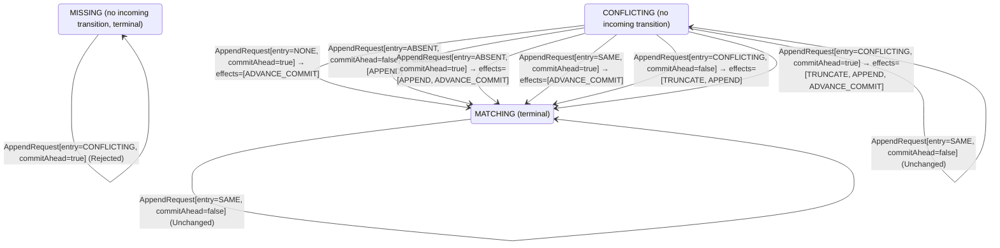

<!-- Generated by examples/tools/build.py from example.json and the verifier's output. Edit example.json. -->
# 096 · A follower that takes entries after a conflicting previous entry breaks log matching

[← All examples](../README.md)

| Verdict | Categories | Severity if shipped | Change | Verified unit | Approach |
|---|---|---|---|---|---|
| **✗ Violation: LogMatching, 12-step trace** | functional | critical | feature, behaviour change intended | [`AppendRule#decide`](../../examples/apps/quorum/src/main/java/net/terminalvalue/quorum/raft/AppendRule.java) | [D1: Protocol model checking](../../examples/apps/quorum/spec/README.md) |

> A Raft follower refuses a leader's entries unless it holds the entry before them, the consistency check of section 5.3, so that the leader backs up one entry at a time until the logs agree. A developer relaxes the check to the previous index existing, whatever entry is there: the leader's later entries overwrite the conflict in due course, the comment says, and a round trip is saved. The tests pass and the contract diff is eight rows. The replication model's first configuration, three servers, three terms and two entries, finds in twelve steps two logs that hold the same entry of term 3 at index 2 over different entries at index 1, which is what the log matching property forbids and what the check exists to prevent; the second, figure 8 of the paper, finds a follower that applies an entry nobody else committed, and the third, three terms and one entry under fairness, the same.

Tags: [consensus](../README.md#tag-consensus), [log-replication](../README.md#tag-log-replication), [lost-committed-data](../README.md#tag-lost-committed-data), [tla-action-property](../README.md#tag-tla-action-property), [generated-operator](../README.md#tag-generated-operator), [multiple-configurations](../README.md#tag-multiple-configurations)

## The change

In `AppendRule.decide`, the `CONFLICTING` arm, a follower that holds an entry of another term at the previous index, no longer returns `rejected`: it joins the `MATCHING` arm, so that the entry sent is appended after the conflicting one, with the comment that the leader's later entries overwrite the conflict in due course and a round trip is saved. The Javadoc's statement of the check is weakened to match, and the test that such a request is refused becomes one that it is taken. `CommitRule`, `RoleMachine` and `VoteRule` are untouched.

**Before** ([`AppendRule.java`](../../examples/apps/quorum/src/main/java/net/terminalvalue/quorum/raft/AppendRule.java), line 12):

```java

/**
 * What a Raft follower does with a leader's AppendEntries request (Ongaro and Ousterhout, section 5.3): the
 * consistency check first, which refuses the request unless the follower holds the entry before the ones sent, so
 * that the leader backs up and tries again from one entry earlier; then the entry sent goes in, in place of
 * whatever the follower held at its index; and the follower's commit index follows the leader's, as far as the
 * entries it now holds in common with it.
 *
    // ...
    public static Decision<LogMatch, AppendEffect> decide(LogMatch previous, AppendRequest request) {
        return switch (previous) {
            case MISSING -> rejected("no entry at the previous index");
            case CONFLICTING -> rejected("another entry at the previous index");
            case MATCHING -> switch (request.entry()) {
                case NONE, SAME -> request.commitAhead()
                        ? transition(MATCHING, ADVANCE_COMMIT)
                        : unchanged("holds what was sent, and nothing new to commit");
```

**After:**

```java

/**
 * What a Raft follower does with a leader's AppendEntries request (Ongaro and Ousterhout, section 5.3): the
 * consistency check first, which refuses the request unless the follower's log reaches the entry before the ones
 * sent, so that the leader backs up and tries again from one entry earlier; then the entry sent goes in, in place of
 * whatever the follower held at its index; and the follower's commit index follows the leader's, as far as the
 * entries it now holds in common with it.
 *
    // ...
    public static Decision<LogMatch, AppendEffect> decide(LogMatch previous, AppendRequest request) {
        return switch (previous) {
            case MISSING -> rejected("no entry at the previous index");
            case CONFLICTING, MATCHING -> switch (request.entry()) { // an entry of another term at the previous index is overwritten by the leader's later entries in due course: no round trip to back up
                case NONE, SAME -> request.commitAhead()
                        ? transition(MATCHING, ADVANCE_COMMIT)
                        : unchanged("holds what was sent, and nothing new to commit");
```

<details><summary>Patch</summary>

```diff
--- a/examples/apps/quorum/src/main/java/net/terminalvalue/quorum/raft/AppendRule.java
+++ b/examples/apps/quorum/src/main/java/net/terminalvalue/quorum/raft/AppendRule.java
@@ -12,8 +12,8 @@
 
 /**
  * What a Raft follower does with a leader's AppendEntries request (Ongaro and Ousterhout, section 5.3): the
- * consistency check first, which refuses the request unless the follower holds the entry before the ones sent, so
- * that the leader backs up and tries again from one entry earlier; then the entry sent goes in, in place of
+ * consistency check first, which refuses the request unless the follower's log reaches the entry before the ones
+ * sent, so that the leader backs up and tries again from one entry earlier; then the entry sent goes in, in place of
  * whatever the follower held at its index; and the follower's commit index follows the leader's, as far as the
  * entries it now holds in common with it.
  *
@@ -31,8 +31,7 @@
     public static Decision<LogMatch, AppendEffect> decide(LogMatch previous, AppendRequest request) {
         return switch (previous) {
             case MISSING -> rejected("no entry at the previous index");
-            case CONFLICTING -> rejected("another entry at the previous index");
-            case MATCHING -> switch (request.entry()) {
+            case CONFLICTING, MATCHING -> switch (request.entry()) { // an entry of another term at the previous index is overwritten by the leader's later entries in due course: no round trip to back up
                 case NONE, SAME -> request.commitAhead()
                         ? transition(MATCHING, ADVANCE_COMMIT)
                         : unchanged("holds what was sent, and nothing new to commit");
--- a/examples/apps/quorum/src/test/java/net/terminalvalue/quorum/raft/AppendRuleTest.java
+++ b/examples/apps/quorum/src/test/java/net/terminalvalue/quorum/raft/AppendRuleTest.java
@@ -19,7 +19,10 @@
 
     public static void refusesARequestWhosePreviousEntryItLacks() {
         check(AppendRule.decide(MISSING, new AppendRequest(NewEntry.ABSENT, false)) instanceof Decision.Rejected, "log ends before the previous index");
-        check(AppendRule.decide(CONFLICTING, new AppendRequest(NewEntry.ABSENT, true)) instanceof Decision.Rejected, "another entry at the previous index");
+    }
+
+    public static void takesTheEntriesAfterAConflictingPreviousEntry() {
+        equal(new Transition<>(MATCHING, List.of(APPEND, ADVANCE_COMMIT)), AppendRule.decide(CONFLICTING, new AppendRequest(NewEntry.ABSENT, true)));
     }
 
     public static void appendsAfterAMatchingEntry() {
```

</details>

## What the verifier found

The model is checked under 4 configurations, and the verdict is the first that fails:

| Configuration | What it checks | Model | Result |
|---|---|---|---|
| three terms, two entries (`spec/RaftReplication.cfg`) | every run from the initial state, every interleaving within the configuration's bounds | Servers = {s1, s2, s3}, MaxTerm = 3, MaxEntries = 2, DelayedReplies = FALSE | ✗ Violation: LogMatching, 12-step trace |
| figure 8 (`spec/RaftReplicationFigureEight.cfg`) | every run of three servers over four terms with one entry per leader's log, the budget of figure 8 of the paper: a leader of term 1 appends an entry it never gets to replicate, a leader of term 2 appends its own at the same index, the first comes back as the leader of term 3 and replicates its entry of term 1 to a majority, and the second, whose last entry is from the later term, can still be elected in term 4 without it; three terms cannot show this, and the same invariants and action properties are checked | Servers = {s1, s2, s3}, MaxTerm = 4, MaxEntries = 1, DelayedReplies = FALSE | ✗ Violation: LeaderCompleteness, 13-step trace |
| fairness (`spec/RaftReplicationLive.cfg`) | the three liveness properties, under the fairness conditions `Fairness`: a server whose timer nothing resets times out, a candidate asks for the votes it lacks, a leader sends every follower its next entry or a heartbeat and marks committed what the commit rule lets it; nothing is assumed of the clients, so the properties hold whether or not a request comes. Three servers, three terms and one entry per leader, without the symmetry set, since TLC's liveness checking is unsound under one. A counterexample is a run that goes on forever without satisfying a property: a prefix, then a state or a cycle the system never leaves | Servers = {s1, s2, s3}, MaxTerm = 3, MaxEntries = 1, DelayedReplies = FALSE | ✗ Violation: LeaderCompleteness, 13-step trace |
| delayed replies (`spec/RaftReplicationDelayed.cfg`) | every run of three servers over two terms with logs of up to two entries in which the reply to an AppendEntries request is a step of its own (`DelayedReplies = TRUE`): the leader may take it after it has sent the follower another request and taken its reply, been deposed, or been elected again in a later term, and the network may hand it the same reply twice, or never. The one-step RPC of the other configurations hands the reply rule nothing but the request just sent; this one hands it late and repeated replies, and checks the leader's record of its followers against what they hold, under the same invariants and action properties | Servers = {s1, s2, s3}, MaxTerm = 2, MaxEntries = 1, DelayedReplies = TRUE | ✓ Verified: all invariants and properties hold in 261,060 states |

TLC found a run of the system under three terms, two entries, 12 steps long, that violates the invariant **LogMatching** (if two logs hold an entry of the same term at the same index, they are the same through that index (figure 3 of the paper); the append rule's consistency check is what makes it so). Each step is one action of one part of the system:

1. **Initial state**: every server a follower in term 0 with an empty log, no vote cast, nothing committed.
2. **Timeout**, `Server.onElectionTimeout`: a server's election timer fires, and the server acts on the role machine's decision. `currentTerm = (s1 :> 1 @@ s2 :> 0 @@ s3 :> 0)`, `role = (s1 :> "CANDIDATE" @@ s2 :> "FOLLOWER" @@ s3 :> "FOLLOWER")`, `votedFor = (s1 :> s1 @@ s2 :> "none" @@ s3 :> "none")`, `votes = (s1 :> {s1} @@ s2 :> {} @@ s3 :> {})`
3. **Canvass**, `Server.requestVote`: a candidate asks one server for its vote and gets the answer; the request and the reply each go through the role machine, then the vote rule on the voter, given its ballot and the candidate's term and log against its own, and the tally on the candidate. `currentTerm = (s1 :> 1 @@ s2 :> 1 @@ s3 :> 0)`, `nextIndex = ( s1 :> (s1 :> 1 @@ s2 :> 1 @@ s3 :> 1) @@ s2 :> (s1 :> 0 @@ s2 :> 0 @@ s3 :> 0) @@ s3 :> (s1 :> 0 @@ s2 :> 0 @@ s3 :> 0) )`, `role = (s1 :> "LEADER" @@ s2 :> "FOLLOWER" @@ s3 :> "FOLLOWER")`, `votedFor = (s1 :> s1 @@ s2 :> s1 @@ s3 :> "none")`, `votes = (s1 :> {s1, s2} @@ s2 :> {} @@ s3 :> {})`
4. **Timeout**, `Server.onElectionTimeout`: a server's election timer fires, and the server acts on the role machine's decision. `currentTerm = (s1 :> 1 @@ s2 :> 2 @@ s3 :> 0)`, `role = (s1 :> "LEADER" @@ s2 :> "CANDIDATE" @@ s3 :> "FOLLOWER")`, `votedFor = (s1 :> s1 @@ s2 :> s2 @@ s3 :> "none")`, `votes = (s1 :> {s1, s2} @@ s2 :> {s2} @@ s3 :> {})`
5. **Canvass**, `Server.requestVote`: a candidate asks one server for its vote and gets the answer; the request and the reply each go through the role machine, then the vote rule on the voter, given its ballot and the candidate's term and log against its own, and the tally on the candidate. `currentTerm = (s1 :> 1 @@ s2 :> 2 @@ s3 :> 2)`, `nextIndex = ( s1 :> (s1 :> 1 @@ s2 :> 1 @@ s3 :> 1) @@ s2 :> (s1 :> 1 @@ s2 :> 1 @@ s3 :> 1) @@ s3 :> (s1 :> 0 @@ s2 :> 0 @@ s3 :> 0) )`, `role = (s1 :> "LEADER" @@ s2 :> "LEADER" @@ s3 :> "FOLLOWER")`, `votedFor = (s1 :> s1 @@ s2 :> s2 @@ s3 :> s2)`, `votes = (s1 :> {s1, s2} @@ s2 :> {s2, s3} @@ s3 :> {})`
6. **ClientRequest**, `Server.onClientRequest`: a leader appends an entry of its term to its own log. `log = (s1 :> <<1>> @@ s2 :> <<>> @@ s3 :> <<>>)`
7. **ClientRequest**, `Server.onClientRequest`: a leader appends an entry of its term to its own log. `log = (s1 :> <<1>> @@ s2 :> <<2>> @@ s3 :> <<>>)`
8. **Replicate**, `Server.appendEntries`: a leader sends one server the entry at that server's next index, or a heartbeat if it is caught up, with the entry before it and the leader's commit index, and gets the answer; the request goes through the role machine, then the append rule on the follower's log as it stands against the leader's, and the reply through the role machine on the leader, then the reply rule on the request as it stands against the leader's record of the server, awaited or answered already, which moves the server's match index up through the entries sent and its next index past them on an acceptance and backs the next index up by one on a refusal. `currentTerm = (s1 :> 2 @@ s2 :> 2 @@ s3 :> 2)`, `nextIndex = ( s1 :> (s1 :> 0 @@ s2 :> 0 @@ s3 :> 0) @@ s2 :> (s1 :> 1 @@ s2 :> 1 @@ s3 :> 1) @@ s3 :> (s1 :> 0 @@ s2 :> 0 @@ s3 :> 0) )`, `role = (s1 :> "FOLLOWER" @@ s2 :> "LEADER" @@ s3 :> "FOLLOWER")`, `votedFor = (s1 :> "none" @@ s2 :> s2 @@ s3 :> s2)`, `votes = (s1 :> {} @@ s2 :> {s2, s3} @@ s3 :> {})`
9. **Timeout**, `Server.onElectionTimeout`: a server's election timer fires, and the server acts on the role machine's decision. `currentTerm = (s1 :> 3 @@ s2 :> 2 @@ s3 :> 2)`, `role = (s1 :> "CANDIDATE" @@ s2 :> "LEADER" @@ s3 :> "FOLLOWER")`, `votedFor = (s1 :> s1 @@ s2 :> s2 @@ s3 :> s2)`, `votes = (s1 :> {s1} @@ s2 :> {s2, s3} @@ s3 :> {})`
10. **Canvass**, `Server.requestVote`: a candidate asks one server for its vote and gets the answer; the request and the reply each go through the role machine, then the vote rule on the voter, given its ballot and the candidate's term and log against its own, and the tally on the candidate. `currentTerm = (s1 :> 3 @@ s2 :> 2 @@ s3 :> 3)`, `nextIndex = ( s1 :> (s1 :> 2 @@ s2 :> 2 @@ s3 :> 2) @@ s2 :> (s1 :> 1 @@ s2 :> 1 @@ s3 :> 1) @@ s3 :> (s1 :> 0 @@ s2 :> 0 @@ s3 :> 0) )`, `role = (s1 :> "LEADER" @@ s2 :> "LEADER" @@ s3 :> "FOLLOWER")`, `votedFor = (s1 :> s1 @@ s2 :> s2 @@ s3 :> s1)`, `votes = (s1 :> {s1, s3} @@ s2 :> {s2, s3} @@ s3 :> {})`
11. **ClientRequest**, `Server.onClientRequest`: a leader appends an entry of its term to its own log. `log = (s1 :> <<1, 3>> @@ s2 :> <<2>> @@ s3 :> <<>>)`
12. **Replicate**, `Server.appendEntries`: a leader sends one server the entry at that server's next index, or a heartbeat if it is caught up, with the entry before it and the leader's commit index, and gets the answer; the request goes through the role machine, then the append rule on the follower's log as it stands against the leader's, and the reply through the role machine on the leader, then the reply rule on the request as it stands against the leader's record of the server, awaited or answered already, which moves the server's match index up through the entries sent and its next index past them on an acceptance and backs the next index up by one on a refusal. `currentTerm = (s1 :> 3 @@ s2 :> 3 @@ s3 :> 3)`, `log = (s1 :> <<1, 3>> @@ s2 :> <<2, 3>> @@ s3 :> <<>>)`, `matchIndex = ( s1 :> (s1 :> 0 @@ s2 :> 2 @@ s3 :> 0) @@ s2 :> (s1 :> 0 @@ s2 :> 0 @@ s3 :> 0) @@ s3 :> (s1 :> 0 @@ s2 :> 0 @@ s3 :> 0) )`, `nextIndex = ( s1 :> (s1 :> 2 @@ s2 :> 3 @@ s3 :> 2) @@ s2 :> (s1 :> 0 @@ s2 :> 0 @@ s3 :> 0) @@ s3 :> (s1 :> 0 @@ s2 :> 0 @@ s3 :> 0) )`, `role = (s1 :> "LEADER" @@ s2 :> "FOLLOWER" @@ s3 :> "FOLLOWER")`, `votedFor = (s1 :> s1 @@ s2 :> "none" @@ s3 :> s1)`, `votes = (s1 :> {s1, s3} @@ s2 :> {} @@ s3 :> {})`

The model is small (Servers = {s1, s2, s3}, MaxTerm = 3, MaxEntries = 2, DelayedReplies = FALSE), which is what keeps the trace readable. TLC explored every interleaving of the servers, their terms, votes and logs, and the AppendEntries RPCs between them within those bounds.

<details><summary>The counterexample under figure 8: invariant <b>LeaderCompleteness</b>, 13 steps</summary>

Invariant **LeaderCompleteness**: a leader holds every entry a server of its term or an earlier one knows committed (figure 3 of the paper); the election restriction and the commit rule together are what make it so.

1. **Initial state**: every server a follower in term 0 with an empty log, no vote cast, nothing committed.
2. **Timeout**, `Server.onElectionTimeout`: a server's election timer fires, and the server acts on the role machine's decision. `currentTerm = (s1 :> 1 @@ s2 :> 0 @@ s3 :> 0)`, `role = (s1 :> "CANDIDATE" @@ s2 :> "FOLLOWER" @@ s3 :> "FOLLOWER")`, `votedFor = (s1 :> s1 @@ s2 :> "none" @@ s3 :> "none")`, `votes = (s1 :> {s1} @@ s2 :> {} @@ s3 :> {})`
3. **Canvass**, `Server.requestVote`: a candidate asks one server for its vote and gets the answer; the request and the reply each go through the role machine, then the vote rule on the voter, given its ballot and the candidate's term and log against its own, and the tally on the candidate. `currentTerm = (s1 :> 1 @@ s2 :> 1 @@ s3 :> 0)`, `nextIndex = ( s1 :> (s1 :> 1 @@ s2 :> 1 @@ s3 :> 1) @@ s2 :> (s1 :> 0 @@ s2 :> 0 @@ s3 :> 0) @@ s3 :> (s1 :> 0 @@ s2 :> 0 @@ s3 :> 0) )`, `role = (s1 :> "LEADER" @@ s2 :> "FOLLOWER" @@ s3 :> "FOLLOWER")`, `votedFor = (s1 :> s1 @@ s2 :> s1 @@ s3 :> "none")`, `votes = (s1 :> {s1, s2} @@ s2 :> {} @@ s3 :> {})`
4. **Timeout**, `Server.onElectionTimeout`: a server's election timer fires, and the server acts on the role machine's decision. `currentTerm = (s1 :> 1 @@ s2 :> 2 @@ s3 :> 0)`, `role = (s1 :> "LEADER" @@ s2 :> "CANDIDATE" @@ s3 :> "FOLLOWER")`, `votedFor = (s1 :> s1 @@ s2 :> s2 @@ s3 :> "none")`, `votes = (s1 :> {s1, s2} @@ s2 :> {s2} @@ s3 :> {})`
5. **Canvass**, `Server.requestVote`: a candidate asks one server for its vote and gets the answer; the request and the reply each go through the role machine, then the vote rule on the voter, given its ballot and the candidate's term and log against its own, and the tally on the candidate. `currentTerm = (s1 :> 1 @@ s2 :> 2 @@ s3 :> 2)`, `nextIndex = ( s1 :> (s1 :> 1 @@ s2 :> 1 @@ s3 :> 1) @@ s2 :> (s1 :> 1 @@ s2 :> 1 @@ s3 :> 1) @@ s3 :> (s1 :> 0 @@ s2 :> 0 @@ s3 :> 0) )`, `role = (s1 :> "LEADER" @@ s2 :> "LEADER" @@ s3 :> "FOLLOWER")`, `votedFor = (s1 :> s1 @@ s2 :> s2 @@ s3 :> s2)`, `votes = (s1 :> {s1, s2} @@ s2 :> {s2, s3} @@ s3 :> {})`
6. **ClientRequest**, `Server.onClientRequest`: a leader appends an entry of its term to its own log. `log = (s1 :> <<1>> @@ s2 :> <<>> @@ s3 :> <<>>)`
7. **ClientRequest**, `Server.onClientRequest`: a leader appends an entry of its term to its own log. `log = (s1 :> <<1>> @@ s2 :> <<2>> @@ s3 :> <<>>)`
8. **Replicate**, `Server.appendEntries`: a leader sends one server the entry at that server's next index, or a heartbeat if it is caught up, with the entry before it and the leader's commit index, and gets the answer; the request goes through the role machine, then the append rule on the follower's log as it stands against the leader's, and the reply through the role machine on the leader, then the reply rule on the request as it stands against the leader's record of the server, awaited or answered already, which moves the server's match index up through the entries sent and its next index past them on an acceptance and backs the next index up by one on a refusal. `log = (s1 :> <<1>> @@ s2 :> <<2>> @@ s3 :> <<2>>)`, `matchIndex = ( s1 :> (s1 :> 0 @@ s2 :> 0 @@ s3 :> 0) @@ s2 :> (s1 :> 0 @@ s2 :> 0 @@ s3 :> 1) @@ s3 :> (s1 :> 0 @@ s2 :> 0 @@ s3 :> 0) )`, `nextIndex = ( s1 :> (s1 :> 1 @@ s2 :> 1 @@ s3 :> 1) @@ s2 :> (s1 :> 1 @@ s2 :> 1 @@ s3 :> 2) @@ s3 :> (s1 :> 0 @@ s2 :> 0 @@ s3 :> 0) )`
9. **AdvanceCommit**, `Server.advanceCommitIndex`: a leader asks the commit rule about an entry it has not marked committed, given the entry's term against its own and whether a majority of the servers hold it, and marks it committed on a transition, and with it everything before it. `commitIndex = (s1 :> 0 @@ s2 :> 1 @@ s3 :> 0)`
10. **Replicate**, `Server.appendEntries`: a leader sends one server the entry at that server's next index, or a heartbeat if it is caught up, with the entry before it and the leader's commit index, and gets the answer; the request goes through the role machine, then the append rule on the follower's log as it stands against the leader's, and the reply through the role machine on the leader, then the reply rule on the request as it stands against the leader's record of the server, awaited or answered already, which moves the server's match index up through the entries sent and its next index past them on an acceptance and backs the next index up by one on a refusal. `commitIndex = (s1 :> 0 @@ s2 :> 1 @@ s3 :> 1)`
11. **Timeout**, `Server.onElectionTimeout`: a server's election timer fires, and the server acts on the role machine's decision. `currentTerm = (s1 :> 1 @@ s2 :> 2 @@ s3 :> 3)`, `role = (s1 :> "LEADER" @@ s2 :> "LEADER" @@ s3 :> "CANDIDATE")`, `votedFor = (s1 :> s1 @@ s2 :> s2 @@ s3 :> s3)`, `votes = (s1 :> {s1, s2} @@ s2 :> {s2, s3} @@ s3 :> {s3})`
12. **Canvass**, `Server.requestVote`: a candidate asks one server for its vote and gets the answer; the request and the reply each go through the role machine, then the vote rule on the voter, given its ballot and the candidate's term and log against its own, and the tally on the candidate. `currentTerm = (s1 :> 3 @@ s2 :> 2 @@ s3 :> 3)`, `nextIndex = ( s1 :> (s1 :> 0 @@ s2 :> 0 @@ s3 :> 0) @@ s2 :> (s1 :> 1 @@ s2 :> 1 @@ s3 :> 2) @@ s3 :> (s1 :> 2 @@ s2 :> 2 @@ s3 :> 2) )`, `role = (s1 :> "FOLLOWER" @@ s2 :> "LEADER" @@ s3 :> "LEADER")`, `votedFor = (s1 :> s3 @@ s2 :> s2 @@ s3 :> s3)`, `votes = (s1 :> {} @@ s2 :> {s2, s3} @@ s3 :> {s1, s3})`
13. **Replicate**, `Server.appendEntries`: a leader sends one server the entry at that server's next index, or a heartbeat if it is caught up, with the entry before it and the leader's commit index, and gets the answer; the request goes through the role machine, then the append rule on the follower's log as it stands against the leader's, and the reply through the role machine on the leader, then the reply rule on the request as it stands against the leader's record of the server, awaited or answered already, which moves the server's match index up through the entries sent and its next index past them on an acceptance and backs the next index up by one on a refusal. `commitIndex = (s1 :> 1 @@ s2 :> 1 @@ s3 :> 1)`, `matchIndex = ( s1 :> (s1 :> 0 @@ s2 :> 0 @@ s3 :> 0) @@ s2 :> (s1 :> 0 @@ s2 :> 0 @@ s3 :> 1) @@ s3 :> (s1 :> 1 @@ s2 :> 0 @@ s3 :> 0) )`

</details>

<details><summary>The counterexample under fairness: invariant <b>LeaderCompleteness</b>, 13 steps</summary>

Invariant **LeaderCompleteness**: a leader holds every entry a server of its term or an earlier one knows committed (figure 3 of the paper); the election restriction and the commit rule together are what make it so.

1. **Initial state**: every server a follower in term 0 with an empty log, no vote cast, nothing committed.
2. **Timeout**, `Server.onElectionTimeout`: a server's election timer fires, and the server acts on the role machine's decision. `currentTerm = (s1 :> 1 @@ s2 :> 0 @@ s3 :> 0)`, `role = (s1 :> "CANDIDATE" @@ s2 :> "FOLLOWER" @@ s3 :> "FOLLOWER")`, `votedFor = (s1 :> s1 @@ s2 :> "none" @@ s3 :> "none")`, `votes = (s1 :> {s1} @@ s2 :> {} @@ s3 :> {})`
3. **Canvass**, `Server.requestVote`: a candidate asks one server for its vote and gets the answer; the request and the reply each go through the role machine, then the vote rule on the voter, given its ballot and the candidate's term and log against its own, and the tally on the candidate. `currentTerm = (s1 :> 1 @@ s2 :> 1 @@ s3 :> 0)`, `nextIndex = ( s1 :> (s1 :> 1 @@ s2 :> 1 @@ s3 :> 1) @@ s2 :> (s1 :> 0 @@ s2 :> 0 @@ s3 :> 0) @@ s3 :> (s1 :> 0 @@ s2 :> 0 @@ s3 :> 0) )`, `role = (s1 :> "LEADER" @@ s2 :> "FOLLOWER" @@ s3 :> "FOLLOWER")`, `votedFor = (s1 :> s1 @@ s2 :> s1 @@ s3 :> "none")`, `votes = (s1 :> {s1, s2} @@ s2 :> {} @@ s3 :> {})`
4. **Timeout**, `Server.onElectionTimeout`: a server's election timer fires, and the server acts on the role machine's decision. `currentTerm = (s1 :> 1 @@ s2 :> 2 @@ s3 :> 0)`, `role = (s1 :> "LEADER" @@ s2 :> "CANDIDATE" @@ s3 :> "FOLLOWER")`, `votedFor = (s1 :> s1 @@ s2 :> s2 @@ s3 :> "none")`, `votes = (s1 :> {s1, s2} @@ s2 :> {s2} @@ s3 :> {})`
5. **Canvass**, `Server.requestVote`: a candidate asks one server for its vote and gets the answer; the request and the reply each go through the role machine, then the vote rule on the voter, given its ballot and the candidate's term and log against its own, and the tally on the candidate. `currentTerm = (s1 :> 1 @@ s2 :> 2 @@ s3 :> 2)`, `nextIndex = ( s1 :> (s1 :> 1 @@ s2 :> 1 @@ s3 :> 1) @@ s2 :> (s1 :> 1 @@ s2 :> 1 @@ s3 :> 1) @@ s3 :> (s1 :> 0 @@ s2 :> 0 @@ s3 :> 0) )`, `role = (s1 :> "LEADER" @@ s2 :> "LEADER" @@ s3 :> "FOLLOWER")`, `votedFor = (s1 :> s1 @@ s2 :> s2 @@ s3 :> s2)`, `votes = (s1 :> {s1, s2} @@ s2 :> {s2, s3} @@ s3 :> {})`
6. **ClientRequest**, `Server.onClientRequest`: a leader appends an entry of its term to its own log. `log = (s1 :> <<1>> @@ s2 :> <<>> @@ s3 :> <<>>)`
7. **ClientRequest**, `Server.onClientRequest`: a leader appends an entry of its term to its own log. `log = (s1 :> <<1>> @@ s2 :> <<2>> @@ s3 :> <<>>)`
8. **Replicate**, `Server.appendEntries`: a leader sends one server the entry at that server's next index, or a heartbeat if it is caught up, with the entry before it and the leader's commit index, and gets the answer; the request goes through the role machine, then the append rule on the follower's log as it stands against the leader's, and the reply through the role machine on the leader, then the reply rule on the request as it stands against the leader's record of the server, awaited or answered already, which moves the server's match index up through the entries sent and its next index past them on an acceptance and backs the next index up by one on a refusal. `log = (s1 :> <<1>> @@ s2 :> <<2>> @@ s3 :> <<2>>)`, `matchIndex = ( s1 :> (s1 :> 0 @@ s2 :> 0 @@ s3 :> 0) @@ s2 :> (s1 :> 0 @@ s2 :> 0 @@ s3 :> 1) @@ s3 :> (s1 :> 0 @@ s2 :> 0 @@ s3 :> 0) )`, `nextIndex = ( s1 :> (s1 :> 1 @@ s2 :> 1 @@ s3 :> 1) @@ s2 :> (s1 :> 1 @@ s2 :> 1 @@ s3 :> 2) @@ s3 :> (s1 :> 0 @@ s2 :> 0 @@ s3 :> 0) )`
9. **AdvanceCommit**, `Server.advanceCommitIndex`: a leader asks the commit rule about an entry it has not marked committed, given the entry's term against its own and whether a majority of the servers hold it, and marks it committed on a transition, and with it everything before it. `commitIndex = (s1 :> 0 @@ s2 :> 1 @@ s3 :> 0)`
10. **Replicate**, `Server.appendEntries`: a leader sends one server the entry at that server's next index, or a heartbeat if it is caught up, with the entry before it and the leader's commit index, and gets the answer; the request goes through the role machine, then the append rule on the follower's log as it stands against the leader's, and the reply through the role machine on the leader, then the reply rule on the request as it stands against the leader's record of the server, awaited or answered already, which moves the server's match index up through the entries sent and its next index past them on an acceptance and backs the next index up by one on a refusal. `commitIndex = (s1 :> 0 @@ s2 :> 1 @@ s3 :> 1)`
11. **Timeout**, `Server.onElectionTimeout`: a server's election timer fires, and the server acts on the role machine's decision. `currentTerm = (s1 :> 1 @@ s2 :> 2 @@ s3 :> 3)`, `role = (s1 :> "LEADER" @@ s2 :> "LEADER" @@ s3 :> "CANDIDATE")`, `votedFor = (s1 :> s1 @@ s2 :> s2 @@ s3 :> s3)`, `votes = (s1 :> {s1, s2} @@ s2 :> {s2, s3} @@ s3 :> {s3})`
12. **Canvass**, `Server.requestVote`: a candidate asks one server for its vote and gets the answer; the request and the reply each go through the role machine, then the vote rule on the voter, given its ballot and the candidate's term and log against its own, and the tally on the candidate. `currentTerm = (s1 :> 3 @@ s2 :> 2 @@ s3 :> 3)`, `nextIndex = ( s1 :> (s1 :> 0 @@ s2 :> 0 @@ s3 :> 0) @@ s2 :> (s1 :> 1 @@ s2 :> 1 @@ s3 :> 2) @@ s3 :> (s1 :> 2 @@ s2 :> 2 @@ s3 :> 2) )`, `role = (s1 :> "FOLLOWER" @@ s2 :> "LEADER" @@ s3 :> "LEADER")`, `votedFor = (s1 :> s3 @@ s2 :> s2 @@ s3 :> s3)`, `votes = (s1 :> {} @@ s2 :> {s2, s3} @@ s3 :> {s1, s3})`
13. **Replicate**, `Server.appendEntries`: a leader sends one server the entry at that server's next index, or a heartbeat if it is caught up, with the entry before it and the leader's commit index, and gets the answer; the request goes through the role machine, then the append rule on the follower's log as it stands against the leader's, and the reply through the role machine on the leader, then the reply rule on the request as it stands against the leader's record of the server, awaited or answered already, which moves the server's match index up through the entries sent and its next index past them on an acceptance and backs the next index up by one on a refusal. `commitIndex = (s1 :> 1 @@ s2 :> 1 @@ s3 :> 1)`, `matchIndex = ( s1 :> (s1 :> 0 @@ s2 :> 0 @@ s3 :> 0) @@ s2 :> (s1 :> 0 @@ s2 :> 0 @@ s3 :> 1) @@ s3 :> (s1 :> 1 @@ s2 :> 0 @@ s3 :> 0) )`

</details>

**What the verdict rests on.** TLC counted how often a step of the model took each row of the generated operators. A row no step takes is one the model says nothing about, whatever the verdict.

| Configuration | Rows of `RoleMachine#decide` taken | Rows of `VoteRule#decide` taken | Rows of `AppendRule#decide` taken | Rows of `ReplyRule#decide` taken | Rows of `CommitRule#decide` taken |
|---|---|---|---|---|---|
| three terms, two entries | stopped at the counterexample | stopped at the counterexample | stopped at the counterexample | stopped at the counterexample | stopped at the counterexample |
| figure 8 | stopped at the counterexample | stopped at the counterexample | stopped at the counterexample | stopped at the counterexample | stopped at the counterexample |
| fairness | stopped at the counterexample | stopped at the counterexample | stopped at the counterexample | stopped at the counterexample | stopped at the counterexample |
| delayed replies | 29 of 36 | 10 of 27 | 10 of 24 | 4 of 4 | 4 of 12 |

The change alters 8 rows of the contract, and 1 with a null argument, which the model leaves out:

- `decide(CONFLICTING, AppendRequest[entry=NONE, commitAhead=false])`: `Rejected[reason="another entry at the previous index"]` → `Unchanged[reason="holds what was sent, and nothing new to commit"]`, taken by no run that finished
- `decide(CONFLICTING, AppendRequest[entry=NONE, commitAhead=true])`: `Rejected[reason="another entry at the previous index"]` → `Transition[next=MATCHING, effects=[ADVANCE_COMMIT]]`, taken by no run that finished
- `decide(CONFLICTING, AppendRequest[entry=ABSENT, commitAhead=false])`: `Rejected[reason="another entry at the previous index"]` → `Transition[next=MATCHING, effects=[APPEND]]`, taken by no run that finished
- `decide(CONFLICTING, AppendRequest[entry=ABSENT, commitAhead=true])`: `Rejected[reason="another entry at the previous index"]` → `Transition[next=MATCHING, effects=[APPEND, ADVANCE_COMMIT]]`, taken by no run that finished
- `decide(CONFLICTING, AppendRequest[entry=SAME, commitAhead=false])`: `Rejected[reason="another entry at the previous index"]` → `Unchanged[reason="holds what was sent, and nothing new to commit"]`, taken by no run that finished
- `decide(CONFLICTING, AppendRequest[entry=SAME, commitAhead=true])`: `Rejected[reason="another entry at the previous index"]` → `Transition[next=MATCHING, effects=[ADVANCE_COMMIT]]`, taken by no run that finished
- `decide(CONFLICTING, AppendRequest[entry=CONFLICTING, commitAhead=false])`: `Rejected[reason="another entry at the previous index"]` → `Transition[next=MATCHING, effects=[TRUNCATE, APPEND]]`, taken by no run that finished
- `decide(CONFLICTING, AppendRequest[entry=CONFLICTING, commitAhead=true])`: `Rejected[reason="another entry at the previous index"]` → `Transition[next=MATCHING, effects=[TRUNCATE, APPEND, ADVANCE_COMMIT]]`, taken by no run that finished

The run under three terms, two entries, figure 8, fairness stopped at its counterexample, the steps above, and its counts are left out: the verdict rests on the counterexample.

<details><summary>Rows no step takes under delayed replies</summary>

`net.terminalvalue.quorum.raft.RoleMachine#decide`:

```
decide(FOLLOWER, VotesCounted[majority=true]) => Unchanged
decide(FOLLOWER, Response[term=NEWER]) => Transition[next=FOLLOWER, effects=[ADOPT_TERM]]
decide(CANDIDATE, Response[term=OLDER]) => Unchanged
decide(LEADER, VotesCounted[majority=false]) => Unchanged
decide(LEADER, VotesCounted[majority=true]) => Unchanged
decide(LEADER, AppendEntries[term=CURRENT]) => throws IllegalStateException
decide(LEADER, Response[term=OLDER]) => Unchanged
```

`net.terminalvalue.quorum.raft.VoteRule#decide`:

```
decide(OPEN, VoteRequest[term=OLDER, log=AHEAD]) => Rejected
decide(OPEN, VoteRequest[term=NEWER, log=BEHIND]) => Rejected
decide(OPEN, VoteRequest[term=NEWER, log=EVEN]) => Transition[next=FOR_THE_CANDIDATE, effects=[GRANT]]
decide(OPEN, VoteRequest[term=NEWER, log=AHEAD]) => Transition[next=FOR_THE_CANDIDATE, effects=[GRANT]]
decide(FOR_THE_CANDIDATE, VoteRequest[term=OLDER, log=BEHIND]) => Rejected
decide(FOR_THE_CANDIDATE, VoteRequest[term=OLDER, log=EVEN]) => Rejected
decide(FOR_THE_CANDIDATE, VoteRequest[term=OLDER, log=AHEAD]) => Rejected
decide(FOR_THE_CANDIDATE, VoteRequest[term=CURRENT, log=BEHIND]) => Rejected
decide(FOR_THE_CANDIDATE, VoteRequest[term=CURRENT, log=EVEN]) => Transition[next=FOR_THE_CANDIDATE, effects=[GRANT]]
decide(FOR_THE_CANDIDATE, VoteRequest[term=CURRENT, log=AHEAD]) => Transition[next=FOR_THE_CANDIDATE, effects=[GRANT]]
decide(FOR_THE_CANDIDATE, VoteRequest[term=NEWER, log=BEHIND]) => Rejected
decide(FOR_THE_CANDIDATE, VoteRequest[term=NEWER, log=EVEN]) => Transition[next=FOR_THE_CANDIDATE, effects=[GRANT]]
decide(FOR_THE_CANDIDATE, VoteRequest[term=NEWER, log=AHEAD]) => Transition[next=FOR_THE_CANDIDATE, effects=[GRANT]]
decide(FOR_ANOTHER, VoteRequest[term=OLDER, log=AHEAD]) => Rejected
decide(FOR_ANOTHER, VoteRequest[term=NEWER, log=BEHIND]) => Rejected
decide(FOR_ANOTHER, VoteRequest[term=NEWER, log=EVEN]) => Transition[next=FOR_THE_CANDIDATE, effects=[GRANT]]
decide(FOR_ANOTHER, VoteRequest[term=NEWER, log=AHEAD]) => Transition[next=FOR_THE_CANDIDATE, effects=[GRANT]]
```

`net.terminalvalue.quorum.raft.AppendRule#decide`:

```
decide(MISSING, AppendRequest[entry=ABSENT, commitAhead=false]) => Rejected
decide(MISSING, AppendRequest[entry=ABSENT, commitAhead=true]) => Rejected
decide(MISSING, AppendRequest[entry=SAME, commitAhead=false]) => Rejected
decide(MISSING, AppendRequest[entry=SAME, commitAhead=true]) => Rejected
decide(MISSING, AppendRequest[entry=CONFLICTING, commitAhead=false]) => Rejected
decide(MISSING, AppendRequest[entry=CONFLICTING, commitAhead=true]) => Rejected
decide(CONFLICTING, AppendRequest[entry=NONE, commitAhead=false]) => Unchanged
decide(CONFLICTING, AppendRequest[entry=NONE, commitAhead=true]) => Transition[next=MATCHING, effects=[ADVANCE_COMMIT]]
decide(CONFLICTING, AppendRequest[entry=ABSENT, commitAhead=false]) => Transition[next=MATCHING, effects=[APPEND]]
decide(CONFLICTING, AppendRequest[entry=ABSENT, commitAhead=true]) => Transition[next=MATCHING, effects=[APPEND, ADVANCE_COMMIT]]
decide(CONFLICTING, AppendRequest[entry=SAME, commitAhead=false]) => Unchanged
decide(CONFLICTING, AppendRequest[entry=SAME, commitAhead=true]) => Transition[next=MATCHING, effects=[ADVANCE_COMMIT]]
decide(CONFLICTING, AppendRequest[entry=CONFLICTING, commitAhead=false]) => Transition[next=MATCHING, effects=[TRUNCATE, APPEND]]
decide(CONFLICTING, AppendRequest[entry=CONFLICTING, commitAhead=true]) => Transition[next=MATCHING, effects=[TRUNCATE, APPEND, ADVANCE_COMMIT]]
```

`net.terminalvalue.quorum.raft.CommitRule#decide`:

```
decide(PENDING, Replication[term=NEWER, majority=false]) => throws IllegalStateException
decide(PENDING, Replication[term=NEWER, majority=true]) => throws IllegalStateException
decide(COMMITTED, Replication[term=OLDER, majority=false]) => Unchanged
decide(COMMITTED, Replication[term=OLDER, majority=true]) => Unchanged
decide(COMMITTED, Replication[term=CURRENT, majority=false]) => Unchanged
decide(COMMITTED, Replication[term=CURRENT, majority=true]) => Unchanged
decide(COMMITTED, Replication[term=NEWER, majority=false]) => Unchanged
decide(COMMITTED, Replication[term=NEWER, majority=true]) => Unchanged
```

</details>

The state machine the patched code implements, drawn from its derived contract (`jvmcontract statemachine`); a state with no way in or no way out is marked:



## Would the existing tests have caught it?

No: every existing unit test passes (`java -ea net.terminalvalue.quorum.Tests`, run against the patched code).

## Why it matters

High. The change reads as an optimisation of the slow path: a follower that has fallen behind a term's worth of entries is brought up to date in one round trip fewer, and the comment's claim that later entries overwrite the conflict is true of the entry sent, which does replace what the follower held at its own index. What it leaves in place is the entry before it, which is the one the check was about, and nothing in the module's tests holds two logs side by side.

## Why the verdict is right

The append rule in the model is generated from the regenerated contract, so `Replicate` does what the eight patched rows say. Under the first configuration, TLC reports `LogMatching` violated after twelve steps: s1 wins term 1 with s2's vote and s2 wins term 2 with s3's, each a leader while the other's term is unknown to it; s1 appends an entry of term 1 and s2 one of term 2, each at index 1 of its own log; s1's heartbeat to s2 is refused as a stale leader's and s1 steps down, times out into term 3, and wins it with s3's vote, since its log is ahead of s3's empty one; s1 appends an entry of term 3 at index 2 and sends it to s2 with index 1 as the previous entry. s2 holds its own entry of term 2 there, a conflict the committed rule refuses so that s1 backs up to index 1 and replaces it; the patched rule takes the entry of term 3 instead, and s2's log reads term 2 then term 3 against s1's term 1 then term 3: the same entry at index 2 over different entries at index 1. The second configuration, figure 8 of the paper, has one entry per log and cannot hold two at once, and finds the row another way, `LeaderCompleteness` after thirteen steps: s2, the leader of term 2, replicates its entry to s3, commits it, a majority holding an entry of its own term, and tells s3; s3 wins term 3 with s1's vote and sends s1 a heartbeat with index 1 as the previous entry, which s1 holds its own entry of term 1 at; the patched rule accepts the heartbeat and, since the leader's commit index is ahead, moves s1's commit index over the entry s1 holds there, an entry no other server has and the leader does not hold, which `StateMachineSafety` forbids as well. The committed rule refuses the heartbeat, s3 backs up, and the next one replaces the entry before anything is committed on s1. The third configuration, three terms and one entry under the fairness conditions, reports `LeaderCompleteness` after thirteen steps as well: the run is one of its safety invariants failing, before any question of liveness arises. The fourth configuration, two terms and one entry per leader with replies delayed, verifies the change in 261,060 states: within that budget the only request a follower can get after an entry it lacks is a heartbeat, which carries nothing for the dropped check to let through.

## What to do

Reject. The consistency check is the induction step of the log matching property (Ongaro and Ousterhout, section 5.3): a follower takes an entry only after the entry before it, so two logs that agree on an entry agree on everything before it, back to the start. The round trip the change saves is the one that finds where the logs diverge, and a leader that wants fewer of them keeps the check and backs up by more than one entry at a time, the optimisation the paper suggests in the same section. Both configurations check the eight rows on every build.

## Notes

- The Raft replication model (`apps/quorum/spec/RaftReplication.tla`) has the logs live, around the follower's append rule and the leader's commit rule as generated operators beside the role machine and the vote rule, and checks log matching, leader completeness and state machine safety, with an action property that no committed entry is ever overwritten. Its configurations are three terms with two entries, and the four terms of the paper's figure 8.
- The consistency check relaxed to save a round trip: two logs end up sharing an entry over different histories, log matching broken in twelve steps.

## Evidence

How the verdict was reached: three terms, two entries: TLC 2.19 explored 5,636 distinct states to depth 12 in 5 s, for the model Servers = {s1, s2, s3}, MaxTerm = 3, MaxEntries = 2, DelayedReplies = FALSE; figure 8: TLC 2.19 explored 6,611 distinct states to depth 13 in 6 s, for the model Servers = {s1, s2, s3}, MaxTerm = 4, MaxEntries = 1, DelayedReplies = FALSE; fairness: TLC 2.19 explored 13,203 distinct states to depth 13, for the model Servers = {s1, s2, s3}, MaxTerm = 3, MaxEntries = 1, DelayedReplies = FALSE; delayed replies: TLC 2.19 explored 261,060 distinct states to depth 24, for the model Servers = {s1, s2, s3}, MaxTerm = 2, MaxEntries = 1, DelayedReplies = TRUE.

<details><summary>Verifier output</summary>

```text
== three terms, two entries: spec/RaftReplication.cfg ==
TLC2 Version 2.19 of 08 August 2024 (rev: 5a47802)
Running breadth-first search Model-Checking with fp 1 and seed 1 with 1 worker on 2 cores with 2185MB heap and 64MB offheap memory [pid: 1341304] (Linux 6.6.87.2-microsoft-standard-WSL2 aarch64, Eclipse Adoptium 25.0.4.1 x86_64, MSBDiskFPSet, DiskStateQueue).
Parsing file examples/apps/quorum/spec/RaftReplication.tla
Parsing file examples/tools/tla/standard-modules/Naturals.tla
Parsing file examples/tools/tla/standard-modules/FiniteSets.tla
Parsing file examples/tools/tla/standard-modules/Sequences.tla
Parsing file examples/tools/tla/standard-modules/TLC.tla
Parsing file examples/apps/quorum/spec/RoleMachineContract.tla
Parsing file examples/apps/quorum/spec/VoteRuleContract.tla
Parsing file examples/apps/quorum/spec/AppendRuleContract.tla
Parsing file examples/apps/quorum/spec/ReplyRuleContract.tla
Parsing file examples/apps/quorum/spec/CommitRuleContract.tla
Semantic processing of module Naturals
Semantic processing of module Sequences
Semantic processing of module FiniteSets
Semantic processing of module TLC
Semantic processing of module RoleMachineContract
Semantic processing of module VoteRuleContract
Semantic processing of module AppendRuleContract
Semantic processing of module ReplyRuleContract
Semantic processing of module CommitRuleContract
Semantic processing of module RaftReplication
Starting... (2026-11-04 01:09:46)
Computing initial states...
Finished computing initial states: 1 distinct state generated at 2026-11-04 01:09:48.
Error: Invariant LogMatching is violated.
Error: The behavior up to this point is:
State 1: <Initial predicate>
/\ matchIndex = ( s1 :> (s1 :> 0 @@ s2 :> 0 @@ s3 :> 0) @@
  s2 :> (s1 :> 0 @@ s2 :> 0 @@ s3 :> 0) @@
  s3 :> (s1 :> 0 @@ s2 :> 0 @@ s3 :> 0) )
/\ log = (s1 :> <<>> @@ s2 :> <<>> @@ s3 :> <<>>)
/\ commitIndex = (s1 :> 0 @@ s2 :> 0 @@ s3 :> 0)
/\ replies = {}
/\ currentTerm = (s1 :> 0 @@ s2 :> 0 @@ s3 :> 0)
/\ nextIndex = ( s1 :> (s1 :> 0 @@ s2 :> 0 @@ s3 :> 0) @@
  s2 :> (s1 :> 0 @@ s2 :> 0 @@ s3 :> 0) @@
  s3 :> (s1 :> 0 @@ s2 :> 0 @@ s3 :> 0) )
/\ votes = (s1 :> {} @@ s2 :> {} @@ s3 :> {})
/\ role = (s1 :> "FOLLOWER" @@ s2 :> "FOLLOWER" @@ s3 :> "FOLLOWER")
/\ votedFor = (s1 :> "none" @@ s2 :> "none" @@ s3 :> "none")

State 2: <Timeout line 150, col 15 to line 150, col 79 of module RaftReplication>
/\ matchIndex = ( s1 :> (s1 :> 0 @@ s2 :> 0 @@ s3 :> 0) @@
  s2 :> (s1 :> 0 @@ s2 :> 0 @@ s3 :> 0) @@
  s3 :> (s1 :> 0 @@ s2 :> 0 @@ s3 :> 0) )
/\ log = (s1 :> <<>> @@ s2 :> <<>> @@ s3 :> <<>>)
/\ commitIndex = (s1 :> 0 @@ s2 :> 0 @@ s3 :> 0)
/\ replies = {}
/\ currentTerm = (s1 :> 1 @@ s2 :> 0 @@ s3 :> 0)
/\ nextIndex = ( s1 :> (s1 :> 0 @@ s2 :> 0 @@ s3 :> 0) @@
  s2 :> (s1 :> 0 @@ s2 :> 0 @@ s3 :> 0) @@
  s3 :> (s1 :> 0 @@ s2 :> 0 @@ s3 :> 0) )
/\ votes = (s1 :> {s1} @@ s2 :> {} @@ s3 :> {})
/\ role = (s1 :> "CANDIDATE" @@ s2 :> "FOLLOWER" @@ s3 :> "FOLLOWER")
/\ votedFor = (s1 :> s1 @@ s2 :> "none" @@ s3 :> "none")

State 3: <Canvass line 178, col 5 to line 180, col 30 of module RaftReplication>
/\ matchIndex = ( s1 :> (s1 :> 0 @@ s2 :> 0 @@ s3 :> 0) @@
  s2 :> (s1 :> 0 @@ s2 :> 0 @@ s3 :> 0) @@
  s3 :> (s1 :> 0 @@ s2 :> 0 @@ s3 :> 0) )
/\ log = (s1 :> <<>> @@ s2 :> <<>> @@ s3 :> <<>>)
/\ commitIndex = (s1 :> 0 @@ s2 :> 0 @@ s3 :> 0)
/\ replies = {}
/\ currentTerm = (s1 :> 1 @@ s2 :> 1 @@ s3 :> 0)
/\ nextIndex = ( s1 :> (s1 :> 1 @@ s2 :> 1 @@ s3 :> 1) @@
  s2 :> (s1 :> 0 @@ s2 :> 0 @@ s3 :> 0) @@
  s3 :> (s1 :> 0 @@ s2 :> 0 @@ s3 :> 0) )
/\ votes = (s1 :> {s1, s2} @@ s2 :> {} @@ s3 :> {})
/\ role = (s1 :> "LEADER" @@ s2 :> "FOLLOWER" @@ s3 :> "FOLLOWER")
/\ votedFor = (s1 :> s1 @@ s2 :> s1 @@ s3 :> "none")

State 4: <Timeout line 150, col 15 to line 150, col 79 of module RaftReplication>
/\ matchIndex = ( s1 :> (s1 :> 0 @@ s2 :> 0 @@ s3 :> 0) @@
  s2 :> (s1 :> 0 @@ s2 :> 0 @@ s3 :> 0) @@
  s3 :> (s1 :> 0 @@ s2 :> 0 @@ s3 :> 0) )
/\ log = (s1 :> <<>> @@ s2 :> <<>> @@ s3 :> <<>>)
/\ commitIndex = (s1 :> 0 @@ s2 :> 0 @@ s3 :> 0)
/\ replies = {}
/\ currentTerm = (s1 :> 1 @@ s2 :> 2 @@ s3 :> 0)
/\ nextIndex = ( s1 :> (s1 :> 1 @@ s2 :> 1 @@ s3 :> 1) @@
  s2 :> (s1 :> 0 @@ s2 :> 0 @@ s3 :> 0) @@
  s3 :> (s1 :> 0 @@ s2 :> 0 @@ s3 :> 0) )
/\ votes = (s1 :> {s1, s2} @@ s2 :> {s2} @@ s3 :> {})
/\ role = (s1 :> "LEADER" @@ s2 :> "CANDIDATE" @@ s3 :> "FOLLOWER")
/\ votedFor = (s1 :> s1 @@ s2 :> s2 @@ s3 :> "none")

State 5: <Canvass line 178, col 5 to line 180, col 30 of module RaftReplication>
/\ matchIndex = ( s1 :> (s1 :> 0 @@ s2 :> 0 @@ s3 :> 0) @@
  s2 :> (s1 :> 0 @@ s2 :> 0 @@ s3 :> 0) @@
  s3 :> (s1 :> 0 @@ s2 :> 0 @@ s3 :> 0) )
/\ log = (s1 :> <<>> @@ s2 :> <<>> @@ s3 :> <<>>)
/\ commitIndex = (s1 :> 0 @@ s2 :> 0 @@ s3 :> 0)
/\ replies = {}
/\ currentTerm = (s1 :> 1 @@ s2 :> 2 @@ s3 :> 2)
/\ nextIndex = ( s1 :> (s1 :> 1 @@ s2 :> 1 @@ s3 :> 1) @@
  s2 :> (s1 :> 1 @@ s2 :> 1 @@ s3 :> 1) @@
  s3 :> (s1 :> 0 @@ s2 :> 0 @@ s3 :> 0) )
/\ votes = (s1 :> {s1, s2} @@ s2 :> {s2, s3} @@ s3 :> {})
/\ role = (s1 :> "LEADER" @@ s2 :> "LEADER" @@ s3 :> "FOLLOWER")
/\ votedFor = (s1 :> s1 @@ s2 :> s2 @@ s3 :> s2)

State 6: <ClientRequest line 189, col 5 to line 192, col 100 of module RaftReplication>
/\ matchIndex = ( s1 :> (s1 :> 0 @@ s2 :> 0 @@ s3 :> 0) @@
  s2 :> (s1 :> 0 @@ s2 :> 0 @@ s3 :> 0) @@
  s3 :> (s1 :> 0 @@ s2 :> 0 @@ s3 :> 0) )
/\ log = (s1 :> <<1>> @@ s2 :> <<>> @@ s3 :> <<>>)
/\ commitIndex = (s1 :> 0 @@ s2 :> 0 @@ s3 :> 0)
/\ replies = {}
/\ currentTerm = (s1 :> 1 @@ s2 :> 2 @@ s3 :> 2)
/\ nextIndex = ( s1 :> (s1 :> 1 @@ s2 :> 1 @@ s3 :> 1) @@
  s2 :> (s1 :> 1 @@ s2 :> 1 @@ s3 :> 1) @@
  s3 :> (s1 :> 0 @@ s2 :> 0 @@ s3 :> 0) )
/\ votes = (s1 :> {s1, s2} @@ s2 :> {s2, s3} @@ s3 :> {})
/\ role = (s1 :> "LEADER" @@ s2 :> "LEADER" @@ s3 :> "FOLLOWER")
/\ votedFor = (s1 :> s1 @@ s2 :> s2 @@ s3 :> s2)

State 7: <ClientRequest line 189, col 5 to line 192, col 100 of module RaftReplication>
/\ matchIndex = ( s1 :> (s1 :> 0 @@ s2 :> 0 @@ s3 :> 0) @@
  s2 :> (s1 :> 0 @@ s2 :> 0 @@ s3 :> 0) @@
  s3 :> (s1 :> 0 @@ s2 :> 0 @@ s3 :> 0) )
/\ log = (s1 :> <<1>> @@ s2 :> <<2>> @@ s3 :> <<>>)
/\ commitIndex = (s1 :> 0 @@ s2 :> 0 @@ s3 :> 0)
/\ replies = {}
/\ currentTerm = (s1 :> 1 @@ s2 :> 2 @@ s3 :> 2)
/\ nextIndex = ( s1 :> (s1 :> 1 @@ s2 :> 1 @@ s3 :> 1) @@
  s2 :> (s1 :> 1 @@ s2 :> 1 @@ s3 :> 1) @@
  s3 :> (s1 :> 0 @@ s2 :> 0 @@ s3 :> 0) )
/\ votes = (s1 :> {s1, s2} @@ s2 :> {s2, s3} @@ s3 :> {})
/\ role = (s1 :> "LEADER" @@ s2 :> "LEADER" @@ s3 :> "FOLLOWER")
/\ votedFor = (s1 :> s1 @@ s2 :> s2 @@ s3 :> s2)

State 8: <Replicate line 281, col 5 to line 283, col 32 of module RaftReplication>
/\ matchIndex = ( s1 :> (s1 :> 0 @@ s2 :> 0 @@ s3 :> 0) @@
  s2 :> (s1 :> 0 @@ s2 :> 0 @@ s3 :> 0) @@
  s3 :> (s1 :> 0 @@ s2 :> 0 @@ s3 :> 0) )
/\ log = (s1 :> <<1>> @@ s2 :> <<2>> @@ s3 :> <<>>)
/\ commitIndex = (s1 :> 0 @@ s2 :> 0 @@ s3 :> 0)
/\ replies = {}
/\ currentTerm = (s1 :> 2 @@ s2 :> 2 @@ s3 :> 2)
/\ nextIndex = ( s1 :> (s1 :> 0 @@ s2 :> 0 @@ s3 :> 0) @@
  s2 :> (s1 :> 1 @@ s2 :> 1 @@ s3 :> 1) @@
  s3 :> (s1 :> 0 @@ s2 :> 0 @@ s3 :> 0) )
/\ votes = (s1 :> {} @@ s2 :> {s2, s3} @@ s3 :> {})
/\ role = (s1 :> "FOLLOWER" @@ s2 :> "LEADER" @@ s3 :> "FOLLOWER")
/\ votedFor = (s1 :> "none" @@ s2 :> s2 @@ s3 :> s2)

State 9: <Timeout line 150, col 15 to line 150, col 79 of module RaftReplication>
/\ matchIndex = ( s1 :> (s1 :> 0 @@ s2 :> 0 @@ s3 :> 0) @@
  s2 :> (s1 :> 0 @@ s2 :> 0 @@ s3 :> 0) @@
  s3 :> (s1 :> 0 @@ s2 :> 0 @@ s3 :> 0) )
/\ log = (s1 :> <<1>> @@ s2 :> <<2>> @@ s3 :> <<>>)
/\ commitIndex = (s1 :> 0 @@ s2 :> 0 @@ s3 :> 0)
/\ replies = {}
/\ currentTerm = (s1 :> 3 @@ s2 :> 2 @@ s3 :> 2)
/\ nextIndex = ( s1 :> (s1 :> 0 @@ s2 :> 0 @@ s3 :> 0) @@
  s2 :> (s1 :> 1 @@ s2 :> 1 @@ s3 :> 1) @@
  s3 :> (s1 :> 0 @@ s2 :> 0 @@ s3 :> 0) )
/\ votes = (s1 :> {s1} @@ s2 :> {s2, s3} @@ s3 :> {})
/\ role = (s1 :> "CANDIDATE" @@ s2 :> "LEADER" @@ s3 :> "FOLLOWER")
/\ votedFor = (s1 :> s1 @@ s2 :> s2 @@ s3 :> s2)

State 10: <Canvass line 178, col 5 to line 180, col 30 of module RaftReplication>
/\ matchIndex = ( s1 :> (s1 :> 0 @@ s2 :> 0 @@ s3 :> 0) @@
  s2 :> (s1 :> 0 @@ s2 :> 0 @@ s3 :> 0) @@
  s3 :> (s1 :> 0 @@ s2 :> 0 @@ s3 :> 0) )
/\ log = (s1 :> <<1>> @@ s2 :> <<2>> @@ s3 :> <<>>)
/\ commitIndex = (s1 :> 0 @@ s2 :> 0 @@ s3 :> 0)
/\ replies = {}
/\ currentTerm = (s1 :> 3 @@ s2 :> 2 @@ s3 :> 3)
/\ nextIndex = ( s1 :> (s1 :> 2 @@ s2 :> 2 @@ s3 :> 2) @@
  s2 :> (s1 :> 1 @@ s2 :> 1 @@ s3 :> 1) @@
  s3 :> (s1 :> 0 @@ s2 :> 0 @@ s3 :> 0) )
/\ votes = (s1 :> {s1, s3} @@ s2 :> {s2, s3} @@ s3 :> {})
/\ role = (s1 :> "LEADER" @@ s2 :> "LEADER" @@ s3 :> "FOLLOWER")
/\ votedFor = (s1 :> s1 @@ s2 :> s2 @@ s3 :> s1)

State 11: <ClientRequest line 189, col 5 to line 192, col 100 of module RaftReplication>
/\ matchIndex = ( s1 :> (s1 :> 0 @@ s2 :> 0 @@ s3 :> 0) @@
  s2 :> (s1 :> 0 @@ s2 :> 0 @@ s3 :> 0) @@
  s3 :> (s1 :> 0 @@ s2 :> 0 @@ s3 :> 0) )
/\ log = (s1 :> <<1, 3>> @@ s2 :> <<2>> @@ s3 :> <<>>)
/\ commitIndex = (s1 :> 0 @@ s2 :> 0 @@ s3 :> 0)
/\ replies = {}
/\ currentTerm = (s1 :> 3 @@ s2 :> 2 @@ s3 :> 3)
/\ nextIndex = ( s1 :> (s1 :> 2 @@ s2 :> 2 @@ s3 :> 2) @@
  s2 :> (s1 :> 1 @@ s2 :> 1 @@ s3 :> 1) @@
  s3 :> (s1 :> 0 @@ s2 :> 0 @@ s3 :> 0) )
/\ votes = (s1 :> {s1, s3} @@ s2 :> {s2, s3} @@ s3 :> {})
/\ role = (s1 :> "LEADER" @@ s2 :> "LEADER" @@ s3 :> "FOLLOWER")
/\ votedFor = (s1 :> s1 @@ s2 :> s2 @@ s3 :> s1)

State 12: <Replicate line 281, col 5 to line 283, col 32 of module RaftReplication>
/\ matchIndex = ( s1 :> (s1 :> 0 @@ s2 :> 2 @@ s3 :> 0) @@
  s2 :> (s1 :> 0 @@ s2 :> 0 @@ s3 :> 0) @@
  s3 :> (s1 :> 0 @@ s2 :> 0 @@ s3 :> 0) )
/\ log = (s1 :> <<1, 3>> @@ s2 :> <<2, 3>> @@ s3 :> <<>>)
/\ commitIndex = (s1 :> 0 @@ s2 :> 0 @@ s3 :> 0)
/\ replies = {}
/\ currentTerm = (s1 :> 3 @@ s2 :> 3 @@ s3 :> 3)
/\ nextIndex = ( s1 :> (s1 :> 2 @@ s2 :> 3 @@ s3 :> 2) @@
  s2 :> (s1 :> 0 @@ s2 :> 0 @@ s3 :> 0) @@
  s3 :> (s1 :> 0 @@ s2 :> 0 @@ s3 :> 0) )
/\ votes = (s1 :> {s1, s3} @@ s2 :> {} @@ s3 :> {})
/\ role = (s1 :> "LEADER" @@ s2 :> "FOLLOWER" @@ s3 :> "FOLLOWER")
/\ votedFor = (s1 :> s1 @@ s2 :> "none" @@ s3 :> s1)

Rows of net.terminalvalue.quorum.raft.RoleMachine#decide a step of the model takes: 27 of 36; never taken (9):
  decide(FOLLOWER, VotesCounted[majority=true]) => Unchanged
  decide(FOLLOWER, Response[term=OLDER]) => Unchanged
  decide(FOLLOWER, Response[term=CURRENT]) => Unchanged
  decide(FOLLOWER, Response[term=NEWER]) => Transition[next=FOLLOWER, effects=[ADOPT_TERM]]
  decide(CANDIDATE, Response[term=OLDER]) => Unchanged
  decide(LEADER, VotesCounted[majority=false]) => Unchanged
  decide(LEADER, VotesCounted[majority=true]) => Unchanged
  decide(LEADER, AppendEntries[term=CURRENT]) => throws IllegalStateException
  decide(LEADER, Response[term=OLDER]) => Unchanged
Rows of net.terminalvalue.quorum.raft.VoteRule#decide a step of the model takes: 12 of 27; never taken (15):
  decide(OPEN, VoteRequest[term=NEWER, log=BEHIND]) => Rejected
  decide(OPEN, VoteRequest[term=NEWER, log=EVEN]) => Transition[next=FOR_THE_CANDIDATE, effects=[GRANT]]
  decide(OPEN, VoteRequest[term=NEWER, log=AHEAD]) => Transition[next=FOR_THE_CANDIDATE, effects=[GRANT]]
  decide(FOR_THE_CANDIDATE, VoteRequest[term=OLDER, log=BEHIND]) => Rejected
  decide(FOR_THE_CANDIDATE, VoteRequest[term=OLDER, log=EVEN]) => Rejected
  decide(FOR_THE_CANDIDATE, VoteRequest[term=OLDER, log=AHEAD]) => Rejected
  decide(FOR_THE_CANDIDATE, VoteRequest[term=CURRENT, log=BEHIND]) => Rejected
  decide(FOR_THE_CANDIDATE, VoteRequest[term=CURRENT, log=EVEN]) => Transition[next=FOR_THE_CANDIDATE, effects=[GRANT]]
  decide(FOR_THE_CANDIDATE, VoteRequest[term=CURRENT, log=AHEAD]) => Transition[next=FOR_THE_CANDIDATE, effects=[GRANT]]
  decide(FOR_THE_CANDIDATE, VoteRequest[term=NEWER, log=BEHIND]) => Rejected
  decide(FOR_THE_CANDIDATE, VoteRequest[term=NEWER, log=EVEN]) => Transition[next=FOR_THE_CANDIDATE, effects=[GRANT]]
  decide(FOR_THE_CANDIDATE, VoteRequest[term=NEWER, log=AHEAD]) => Transition[next=FOR_THE_CANDIDATE, effects=[GRANT]]
  decide(FOR_ANOTHER, VoteRequest[term=NEWER, log=BEHIND]) => Rejected
  decide(FOR_ANOTHER, VoteRequest[term=NEWER, log=EVEN]) => Transition[next=FOR_THE_CANDIDATE, effects=[GRANT]]
  decide(FOR_ANOTHER, VoteRequest[term=NEWER, log=AHEAD]) => Transition[next=FOR_THE_CANDIDATE, effects=[GRANT]]
Rows of net.terminalvalue.quorum.raft.AppendRule#decide a step of the model takes: 12 of 24; never taken (12):
  decide(MISSING, AppendRequest[entry=SAME, commitAhead=false]) => Rejected
  decide(MISSING, AppendRequest[entry=SAME, commitAhead=true]) => Rejected
  decide(MISSING, AppendRequest[entry=CONFLICTING, commitAhead=false]) => Rejected
  decide(MISSING, AppendRequest[entry=CONFLICTING, commitAhead=true]) => Rejected
  decide(CONFLICTING, AppendRequest[entry=NONE, commitAhead=true]) => Transition[next=MATCHING, effects=[ADVANCE_COMMIT]]
  decide(CONFLICTING, AppendRequest[entry=ABSENT, commitAhead=true]) => Transition[next=MATCHING, effects=[APPEND, ADVANCE_COMMIT]]
  decide(CONFLICTING, AppendRequest[entry=SAME, commitAhead=false]) => Unchanged
  decide(CONFLICTING, AppendRequest[entry=SAME, commitAhead=true]) => Transition[next=MATCHING, effects=[ADVANCE_COMMIT]]
  decide(CONFLICTING, AppendRequest[entry=CONFLICTING, commitAhead=false]) => Transition[next=MATCHING, effects=[TRUNCATE, APPEND]]
  decide(CONFLICTING, AppendRequest[entry=CONFLICTING, commitAhead=true]) => Transition[next=MATCHING, effects=[TRUNCATE, APPEND, ADVANCE_COMMIT]]
  decide(MATCHING, AppendRequest[entry=SAME, commitAhead=false]) => Unchanged
  decide(MATCHING, AppendRequest[entry=SAME, commitAhead=true]) => Transition[next=MATCHING, effects=[ADVANCE_COMMIT]]
Rows of net.terminalvalue.quorum.raft.ReplyRule#decide a step of the model takes: 3 of 4; never taken (1):
  decide(ANSWERED, AppendReply[accepted=false]) => Unchanged
Rows of net.terminalvalue.quorum.raft.CommitRule#decide a step of the model takes: 4 of 12; never taken (8):
  decide(PENDING, Replication[term=NEWER, majority=false]) => throws IllegalStateException
  decide(PENDING, Replication[term=NEWER, majority=true]) => throws IllegalStateException
  decide(COMMITTED, Replication[term=OLDER, majority=false]) => Unchanged
  decide(COMMITTED, Replication[term=OLDER, majority=true]) => Unchanged
  decide(COMMITTED, Replication[term=CURRENT, majority=false]) => Unchanged
  decide(COMMITTED, Replication[term=CURRENT, majority=true]) => Unchanged
  decide(COMMITTED, Replication[term=NEWER, majority=false]) => Unchanged
  decide(COMMITTED, Replication[term=NEWER, majority=true]) => Unchanged
19363 states generated, 5636 distinct states found, 2395 states left on queue.
The depth of the complete state graph search is 12.
The average outdegree of the complete state graph is 2 (minimum is 0, the maximum 7 and the 95th percentile is 4).
Finished in 05s at (2026-11-04 01:09:51)

== figure 8: spec/RaftReplicationFigureEight.cfg ==
TLC2 Version 2.19 of 08 August 2024 (rev: 5a47802)
Running breadth-first search Model-Checking with fp 1 and seed 1 with 1 worker on 2 cores with 2185MB heap and 64MB offheap memory [pid: 1341636] (Linux 6.6.87.2-microsoft-standard-WSL2 aarch64, Eclipse Adoptium 25.0.4.1 x86_64, MSBDiskFPSet, DiskStateQueue).
Parsing file examples/apps/quorum/spec/RaftReplication.tla
Parsing file examples/tools/tla/standard-modules/Naturals.tla
Parsing file examples/tools/tla/standard-modules/FiniteSets.tla
Parsing file examples/tools/tla/standard-modules/Sequences.tla
Parsing file examples/tools/tla/standard-modules/TLC.tla
Parsing file examples/apps/quorum/spec/RoleMachineContract.tla
Parsing file examples/apps/quorum/spec/VoteRuleContract.tla
Parsing file examples/apps/quorum/spec/AppendRuleContract.tla
Parsing file examples/apps/quorum/spec/ReplyRuleContract.tla
Parsing file examples/apps/quorum/spec/CommitRuleContract.tla
Semantic processing of module Naturals
Semantic processing of module Sequences
Semantic processing of module FiniteSets
Semantic processing of module TLC
Semantic processing of module RoleMachineContract
Semantic processing of module VoteRuleContract
Semantic processing of module AppendRuleContract
Semantic processing of module ReplyRuleContract
Semantic processing of module CommitRuleContract
Semantic processing of module RaftReplication
Starting... (2026-11-04 01:09:52)
Computing initial states...
Finished computing initial states: 1 distinct state generated at 2026-11-04 01:09:55.
Error: Invariant LeaderCompleteness is violated.
Error: The behavior up to this point is:
State 1: <Initial predicate>
/\ matchIndex = ( s1 :> (s1 :> 0 @@ s2 :> 0 @@ s3 :> 0) @@
  s2 :> (s1 :> 0 @@ s2 :> 0 @@ s3 :> 0) @@
  s3 :> (s1 :> 0 @@ s2 :> 0 @@ s3 :> 0) )
/\ log = (s1 :> <<>> @@ s2 :> <<>> @@ s3 :> <<>>)
/\ commitIndex = (s1 :> 0 @@ s2 :> 0 @@ s3 :> 0)
/\ replies = {}
/\ currentTerm = (s1 :> 0 @@ s2 :> 0 @@ s3 :> 0)
/\ nextIndex = ( s1 :> (s1 :> 0 @@ s2 :> 0 @@ s3 :> 0) @@
  s2 :> (s1 :> 0 @@ s2 :> 0 @@ s3 :> 0) @@
  s3 :> (s1 :> 0 @@ s2 :> 0 @@ s3 :> 0) )
/\ votes = (s1 :> {} @@ s2 :> {} @@ s3 :> {})
/\ role = (s1 :> "FOLLOWER" @@ s2 :> "FOLLOWER" @@ s3 :> "FOLLOWER")
/\ votedFor = (s1 :> "none" @@ s2 :> "none" @@ s3 :> "none")

State 2: <Timeout line 150, col 15 to line 150, col 79 of module RaftReplication>
/\ matchIndex = ( s1 :> (s1 :> 0 @@ s2 :> 0 @@ s3 :> 0) @@
  s2 :> (s1 :> 0 @@ s2 :> 0 @@ s3 :> 0) @@
  s3 :> (s1 :> 0 @@ s2 :> 0 @@ s3 :> 0) )
/\ log = (s1 :> <<>> @@ s2 :> <<>> @@ s3 :> <<>>)
/\ commitIndex = (s1 :> 0 @@ s2 :> 0 @@ s3 :> 0)
/\ replies = {}
/\ currentTerm = (s1 :> 1 @@ s2 :> 0 @@ s3 :> 0)
/\ nextIndex = ( s1 :> (s1 :> 0 @@ s2 :> 0 @@ s3 :> 0) @@
  s2 :> (s1 :> 0 @@ s2 :> 0 @@ s3 :> 0) @@
  s3 :> (s1 :> 0 @@ s2 :> 0 @@ s3 :> 0) )
/\ votes = (s1 :> {s1} @@ s2 :> {} @@ s3 :> {})
/\ role = (s1 :> "CANDIDATE" @@ s2 :> "FOLLOWER" @@ s3 :> "FOLLOWER")
/\ votedFor = (s1 :> s1 @@ s2 :> "none" @@ s3 :> "none")

State 3: <Canvass line 178, col 5 to line 180, col 30 of module RaftReplication>
/\ matchIndex = ( s1 :> (s1 :> 0 @@ s2 :> 0 @@ s3 :> 0) @@
  s2 :> (s1 :> 0 @@ s2 :> 0 @@ s3 :> 0) @@
  s3 :> (s1 :> 0 @@ s2 :> 0 @@ s3 :> 0) )
/\ log = (s1 :> <<>> @@ s2 :> <<>> @@ s3 :> <<>>)
/\ commitIndex = (s1 :> 0 @@ s2 :> 0 @@ s3 :> 0)
/\ replies = {}
/\ currentTerm = (s1 :> 1 @@ s2 :> 1 @@ s3 :> 0)
/\ nextIndex = ( s1 :> (s1 :> 1 @@ s2 :> 1 @@ s3 :> 1) @@
  s2 :> (s1 :> 0 @@ s2 :> 0 @@ s3 :> 0) @@
  s3 :> (s1 :> 0 @@ s2 :> 0 @@ s3 :> 0) )
/\ votes = (s1 :> {s1, s2} @@ s2 :> {} @@ s3 :> {})
/\ role = (s1 :> "LEADER" @@ s2 :> "FOLLOWER" @@ s3 :> "FOLLOWER")
/\ votedFor = (s1 :> s1 @@ s2 :> s1 @@ s3 :> "none")

State 4: <Timeout line 150, col 15 to line 150, col 79 of module RaftReplication>
/\ matchIndex = ( s1 :> (s1 :> 0 @@ s2 :> 0 @@ s3 :> 0) @@
  s2 :> (s1 :> 0 @@ s2 :> 0 @@ s3 :> 0) @@
  s3 :> (s1 :> 0 @@ s2 :> 0 @@ s3 :> 0) )
/\ log = (s1 :> <<>> @@ s2 :> <<>> @@ s3 :> <<>>)
/\ commitIndex = (s1 :> 0 @@ s2 :> 0 @@ s3 :> 0)
/\ replies = {}
/\ currentTerm = (s1 :> 1 @@ s2 :> 2 @@ s3 :> 0)
/\ nextIndex = ( s1 :> (s1 :> 1 @@ s2 :> 1 @@ s3 :> 1) @@
  s2 :> (s1 :> 0 @@ s2 :> 0 @@ s3 :> 0) @@
  s3 :> (s1 :> 0 @@ s2 :> 0 @@ s3 :> 0) )
/\ votes = (s1 :> {s1, s2} @@ s2 :> {s2} @@ s3 :> {})
/\ role = (s1 :> "LEADER" @@ s2 :> "CANDIDATE" @@ s3 :> "FOLLOWER")
/\ votedFor = (s1 :> s1 @@ s2 :> s2 @@ s3 :> "none")

State 5: <Canvass line 178, col 5 to line 180, col 30 of module RaftReplication>
/\ matchIndex = ( s1 :> (s1 :> 0 @@ s2 :> 0 @@ s3 :> 0) @@
  s2 :> (s1 :> 0 @@ s2 :> 0 @@ s3 :> 0) @@
  s3 :> (s1 :> 0 @@ s2 :> 0 @@ s3 :> 0) )
/\ log = (s1 :> <<>> @@ s2 :> <<>> @@ s3 :> <<>>)
/\ commitIndex = (s1 :> 0 @@ s2 :> 0 @@ s3 :> 0)
/\ replies = {}
/\ currentTerm = (s1 :> 1 @@ s2 :> 2 @@ s3 :> 2)
/\ nextIndex = ( s1 :> (s1 :> 1 @@ s2 :> 1 @@ s3 :> 1) @@
  s2 :> (s1 :> 1 @@ s2 :> 1 @@ s3 :> 1) @@
  s3 :> (s1 :> 0 @@ s2 :> 0 @@ s3 :> 0) )
/\ votes = (s1 :> {s1, s2} @@ s2 :> {s2, s3} @@ s3 :> {})
/\ role = (s1 :> "LEADER" @@ s2 :> "LEADER" @@ s3 :> "FOLLOWER")
/\ votedFor = (s1 :> s1 @@ s2 :> s2 @@ s3 :> s2)

State 6: <ClientRequest line 189, col 5 to line 192, col 100 of module RaftReplication>
/\ matchIndex = ( s1 :> (s1 :> 0 @@ s2 :> 0 @@ s3 :> 0) @@
  s2 :> (s1 :> 0 @@ s2 :> 0 @@ s3 :> 0) @@
  s3 :> (s1 :> 0 @@ s2 :> 0 @@ s3 :> 0) )
/\ log = (s1 :> <<1>> @@ s2 :> <<>> @@ s3 :> <<>>)
/\ commitIndex = (s1 :> 0 @@ s2 :> 0 @@ s3 :> 0)
/\ replies = {}
/\ currentTerm = (s1 :> 1 @@ s2 :> 2 @@ s3 :> 2)
/\ nextIndex = ( s1 :> (s1 :> 1 @@ s2 :> 1 @@ s3 :> 1) @@
  s2 :> (s1 :> 1 @@ s2 :> 1 @@ s3 :> 1) @@
  s3 :> (s1 :> 0 @@ s2 :> 0 @@ s3 :> 0) )
/\ votes = (s1 :> {s1, s2} @@ s2 :> {s2, s3} @@ s3 :> {})
/\ role = (s1 :> "LEADER" @@ s2 :> "LEADER" @@ s3 :> "FOLLOWER")
/\ votedFor = (s1 :> s1 @@ s2 :> s2 @@ s3 :> s2)

State 7: <ClientRequest line 189, col 5 to line 192, col 100 of module RaftReplication>
/\ matchIndex = ( s1 :> (s1 :> 0 @@ s2 :> 0 @@ s3 :> 0) @@
  s2 :> (s1 :> 0 @@ s2 :> 0 @@ s3 :> 0) @@
  s3 :> (s1 :> 0 @@ s2 :> 0 @@ s3 :> 0) )
/\ log = (s1 :> <<1>> @@ s2 :> <<2>> @@ s3 :> <<>>)
/\ commitIndex = (s1 :> 0 @@ s2 :> 0 @@ s3 :> 0)
/\ replies = {}
/\ currentTerm = (s1 :> 1 @@ s2 :> 2 @@ s3 :> 2)
/\ nextIndex = ( s1 :> (s1 :> 1 @@ s2 :> 1 @@ s3 :> 1) @@
  s2 :> (s1 :> 1 @@ s2 :> 1 @@ s3 :> 1) @@
  s3 :> (s1 :> 0 @@ s2 :> 0 @@ s3 :> 0) )
/\ votes = (s1 :> {s1, s2} @@ s2 :> {s2, s3} @@ s3 :> {})
/\ role = (s1 :> "LEADER" @@ s2 :> "LEADER" @@ s3 :> "FOLLOWER")
/\ votedFor = (s1 :> s1 @@ s2 :> s2 @@ s3 :> s2)

State 8: <Replicate line 281, col 5 to line 283, col 32 of module RaftReplication>
/\ matchIndex = ( s1 :> (s1 :> 0 @@ s2 :> 0 @@ s3 :> 0) @@
  s2 :> (s1 :> 0 @@ s2 :> 0 @@ s3 :> 1) @@
  s3 :> (s1 :> 0 @@ s2 :> 0 @@ s3 :> 0) )
/\ log = (s1 :> <<1>> @@ s2 :> <<2>> @@ s3 :> <<2>>)
/\ commitIndex = (s1 :> 0 @@ s2 :> 0 @@ s3 :> 0)
/\ replies = {}
/\ currentTerm = (s1 :> 1 @@ s2 :> 2 @@ s3 :> 2)
/\ nextIndex = ( s1 :> (s1 :> 1 @@ s2 :> 1 @@ s3 :> 1) @@
  s2 :> (s1 :> 1 @@ s2 :> 1 @@ s3 :> 2) @@
  s3 :> (s1 :> 0 @@ s2 :> 0 @@ s3 :> 0) )
/\ votes = (s1 :> {s1, s2} @@ s2 :> {s2, s3} @@ s3 :> {})
/\ role = (s1 :> "LEADER" @@ s2 :> "LEADER" @@ s3 :> "FOLLOWER")
/\ votedFor = (s1 :> s1 @@ s2 :> s2 @@ s3 :> s2)

State 9: <AdvanceCommit line 338, col 5 to line 343, col 92 of module RaftReplication>
/\ matchIndex = ( s1 :> (s1 :> 0 @@ s2 :> 0 @@ s3 :> 0) @@
  s2 :> (s1 :> 0 @@ s2 :> 0 @@ s3 :> 1) @@
  s3 :> (s1 :> 0 @@ s2 :> 0 @@ s3 :> 0) )
/\ log = (s1 :> <<1>> @@ s2 :> <<2>> @@ s3 :> <<2>>)
/\ commitIndex = (s1 :> 0 @@ s2 :> 1 @@ s3 :> 0)
/\ replies = {}
/\ currentTerm = (s1 :> 1 @@ s2 :> 2 @@ s3 :> 2)
/\ nextIndex = ( s1 :> (s1 :> 1 @@ s2 :> 1 @@ s3 :> 1) @@
  s2 :> (s1 :> 1 @@ s2 :> 1 @@ s3 :> 2) @@
  s3 :> (s1 :> 0 @@ s2 :> 0 @@ s3 :> 0) )
/\ votes = (s1 :> {s1, s2} @@ s2 :> {s2, s3} @@ s3 :> {})
/\ role = (s1 :> "LEADER" @@ s2 :> "LEADER" @@ s3 :> "FOLLOWER")
/\ votedFor = (s1 :> s1 @@ s2 :> s2 @@ s3 :> s2)

State 10: <Replicate line 281, col 5 to line 283, col 32 of module RaftReplication>
/\ matchIndex = ( s1 :> (s1 :> 0 @@ s2 :> 0 @@ s3 :> 0) @@
  s2 :> (s1 :> 0 @@ s2 :> 0 @@ s3 :> 1) @@
  s3 :> (s1 :> 0 @@ s2 :> 0 @@ s3 :> 0) )
/\ log = (s1 :> <<1>> @@ s2 :> <<2>> @@ s3 :> <<2>>)
/\ commitIndex = (s1 :> 0 @@ s2 :> 1 @@ s3 :> 1)
/\ replies = {}
/\ currentTerm = (s1 :> 1 @@ s2 :> 2 @@ s3 :> 2)
/\ nextIndex = ( s1 :> (s1 :> 1 @@ s2 :> 1 @@ s3 :> 1) @@
  s2 :> (s1 :> 1 @@ s2 :> 1 @@ s3 :> 2) @@
  s3 :> (s1 :> 0 @@ s2 :> 0 @@ s3 :> 0) )
/\ votes = (s1 :> {s1, s2} @@ s2 :> {s2, s3} @@ s3 :> {})
/\ role = (s1 :> "LEADER" @@ s2 :> "LEADER" @@ s3 :> "FOLLOWER")
/\ votedFor = (s1 :> s1 @@ s2 :> s2 @@ s3 :> s2)

State 11: <Timeout line 150, col 15 to line 150, col 79 of module RaftReplication>
/\ matchIndex = ( s1 :> (s1 :> 0 @@ s2 :> 0 @@ s3 :> 0) @@
  s2 :> (s1 :> 0 @@ s2 :> 0 @@ s3 :> 1) @@
  s3 :> (s1 :> 0 @@ s2 :> 0 @@ s3 :> 0) )
/\ log = (s1 :> <<1>> @@ s2 :> <<2>> @@ s3 :> <<2>>)
/\ commitIndex = (s1 :> 0 @@ s2 :> 1 @@ s3 :> 1)
/\ replies = {}
/\ currentTerm = (s1 :> 1 @@ s2 :> 2 @@ s3 :> 3)
/\ nextIndex = ( s1 :> (s1 :> 1 @@ s2 :> 1 @@ s3 :> 1) @@
  s2 :> (s1 :> 1 @@ s2 :> 1 @@ s3 :> 2) @@
  s3 :> (s1 :> 0 @@ s2 :> 0 @@ s3 :> 0) )
/\ votes = (s1 :> {s1, s2} @@ s2 :> {s2, s3} @@ s3 :> {s3})
/\ role = (s1 :> "LEADER" @@ s2 :> "LEADER" @@ s3 :> "CANDIDATE")
/\ votedFor = (s1 :> s1 @@ s2 :> s2 @@ s3 :> s3)

State 12: <Canvass line 178, col 5 to line 180, col 30 of module RaftReplication>
/\ matchIndex = ( s1 :> (s1 :> 0 @@ s2 :> 0 @@ s3 :> 0) @@
  s2 :> (s1 :> 0 @@ s2 :> 0 @@ s3 :> 1) @@
  s3 :> (s1 :> 0 @@ s2 :> 0 @@ s3 :> 0) )
/\ log = (s1 :> <<1>> @@ s2 :> <<2>> @@ s3 :> <<2>>)
/\ commitIndex = (s1 :> 0 @@ s2 :> 1 @@ s3 :> 1)
/\ replies = {}
/\ currentTerm = (s1 :> 3 @@ s2 :> 2 @@ s3 :> 3)
/\ nextIndex = ( s1 :> (s1 :> 0 @@ s2 :> 0 @@ s3 :> 0) @@
  s2 :> (s1 :> 1 @@ s2 :> 1 @@ s3 :> 2) @@
  s3 :> (s1 :> 2 @@ s2 :> 2 @@ s3 :> 2) )
/\ votes = (s1 :> {} @@ s2 :> {s2, s3} @@ s3 :> {s1, s3})
/\ role = (s1 :> "FOLLOWER" @@ s2 :> "LEADER" @@ s3 :> "LEADER")
/\ votedFor = (s1 :> s3 @@ s2 :> s2 @@ s3 :> s3)

State 13: <Replicate line 281, col 5 to line 283, col 32 of module RaftReplication>
/\ matchIndex = ( s1 :> (s1 :> 0 @@ s2 :> 0 @@ s3 :> 0) @@
  s2 :> (s1 :> 0 @@ s2 :> 0 @@ s3 :> 1) @@
  s3 :> (s1 :> 1 @@ s2 :> 0 @@ s3 :> 0) )
/\ log = (s1 :> <<1>> @@ s2 :> <<2>> @@ s3 :> <<2>>)
/\ commitIndex = (s1 :> 1 @@ s2 :> 1 @@ s3 :> 1)
/\ replies = {}
/\ currentTerm = (s1 :> 3 @@ s2 :> 2 @@ s3 :> 3)
/\ nextIndex = ( s1 :> (s1 :> 0 @@ s2 :> 0 @@ s3 :> 0) @@
  s2 :> (s1 :> 1 @@ s2 :> 1 @@ s3 :> 2) @@
  s3 :> (s1 :> 2 @@ s2 :> 2 @@ s3 :> 2) )
/\ votes = (s1 :> {} @@ s2 :> {s2, s3} @@ s3 :> {s1, s3})
/\ role = (s1 :> "FOLLOWER" @@ s2 :> "LEADER" @@ s3 :> "LEADER")
/\ votedFor = (s1 :> s3 @@ s2 :> s2 @@ s3 :> s3)

Rows of net.terminalvalue.quorum.raft.RoleMachine#decide a step of the model takes: 27 of 36; never taken (9):
  decide(FOLLOWER, VotesCounted[majority=true]) => Unchanged
  decide(FOLLOWER, Response[term=OLDER]) => Unchanged
  decide(FOLLOWER, Response[term=CURRENT]) => Unchanged
  decide(FOLLOWER, Response[term=NEWER]) => Transition[next=FOLLOWER, effects=[ADOPT_TERM]]
  decide(CANDIDATE, Response[term=OLDER]) => Unchanged
  decide(LEADER, VotesCounted[majority=false]) => Unchanged
  decide(LEADER, VotesCounted[majority=true]) => Unchanged
  decide(LEADER, AppendEntries[term=CURRENT]) => throws IllegalStateException
  decide(LEADER, Response[term=OLDER]) => Unchanged
Rows of net.terminalvalue.quorum.raft.VoteRule#decide a step of the model takes: 12 of 27; never taken (15):
  decide(OPEN, VoteRequest[term=NEWER, log=BEHIND]) => Rejected
  decide(OPEN, VoteRequest[term=NEWER, log=EVEN]) => Transition[next=FOR_THE_CANDIDATE, effects=[GRANT]]
  decide(OPEN, VoteRequest[term=NEWER, log=AHEAD]) => Transition[next=FOR_THE_CANDIDATE, effects=[GRANT]]
  decide(FOR_THE_CANDIDATE, VoteRequest[term=OLDER, log=BEHIND]) => Rejected
  decide(FOR_THE_CANDIDATE, VoteRequest[term=OLDER, log=EVEN]) => Rejected
  decide(FOR_THE_CANDIDATE, VoteRequest[term=OLDER, log=AHEAD]) => Rejected
  decide(FOR_THE_CANDIDATE, VoteRequest[term=CURRENT, log=BEHIND]) => Rejected
  decide(FOR_THE_CANDIDATE, VoteRequest[term=CURRENT, log=EVEN]) => Transition[next=FOR_THE_CANDIDATE, effects=[GRANT]]
  decide(FOR_THE_CANDIDATE, VoteRequest[term=CURRENT, log=AHEAD]) => Transition[next=FOR_THE_CANDIDATE, effects=[GRANT]]
  decide(FOR_THE_CANDIDATE, VoteRequest[term=NEWER, log=BEHIND]) => Rejected
  decide(FOR_THE_CANDIDATE, VoteRequest[term=NEWER, log=EVEN]) => Transition[next=FOR_THE_CANDIDATE, effects=[GRANT]]
  decide(FOR_THE_CANDIDATE, VoteRequest[term=NEWER, log=AHEAD]) => Transition[next=FOR_THE_CANDIDATE, effects=[GRANT]]
  decide(FOR_ANOTHER, VoteRequest[term=NEWER, log=BEHIND]) => Rejected
  decide(FOR_ANOTHER, VoteRequest[term=NEWER, log=EVEN]) => Transition[next=FOR_THE_CANDIDATE, effects=[GRANT]]
  decide(FOR_ANOTHER, VoteRequest[term=NEWER, log=AHEAD]) => Transition[next=FOR_THE_CANDIDATE, effects=[GRANT]]
Rows of net.terminalvalue.quorum.raft.AppendRule#decide a step of the model takes: 10 of 24; never taken (14):
  decide(MISSING, AppendRequest[entry=ABSENT, commitAhead=false]) => Rejected
  decide(MISSING, AppendRequest[entry=ABSENT, commitAhead=true]) => Rejected
  decide(MISSING, AppendRequest[entry=SAME, commitAhead=false]) => Rejected
  decide(MISSING, AppendRequest[entry=SAME, commitAhead=true]) => Rejected
  decide(MISSING, AppendRequest[entry=CONFLICTING, commitAhead=false]) => Rejected
  decide(MISSING, AppendRequest[entry=CONFLICTING, commitAhead=true]) => Rejected
  decide(CONFLICTING, AppendRequest[entry=ABSENT, commitAhead=false]) => Transition[next=MATCHING, effects=[APPEND]]
  decide(CONFLICTING, AppendRequest[entry=ABSENT, commitAhead=true]) => Transition[next=MATCHING, effects=[APPEND, ADVANCE_COMMIT]]
  decide(CONFLICTING, AppendRequest[entry=SAME, commitAhead=false]) => Unchanged
  decide(CONFLICTING, AppendRequest[entry=SAME, commitAhead=true]) => Transition[next=MATCHING, effects=[ADVANCE_COMMIT]]
  decide(CONFLICTING, AppendRequest[entry=CONFLICTING, commitAhead=false]) => Transition[next=MATCHING, effects=[TRUNCATE, APPEND]]
  decide(CONFLICTING, AppendRequest[entry=CONFLICTING, commitAhead=true]) => Transition[next=MATCHING, effects=[TRUNCATE, APPEND, ADVANCE_COMMIT]]
  decide(MATCHING, AppendRequest[entry=SAME, commitAhead=false]) => Unchanged
  decide(MATCHING, AppendRequest[entry=SAME, commitAhead=true]) => Transition[next=MATCHING, effects=[ADVANCE_COMMIT]]
Rows of net.terminalvalue.quorum.raft.ReplyRule#decide a step of the model takes: 3 of 4; never taken (1):
  decide(ANSWERED, AppendReply[accepted=false]) => Unchanged
Rows of net.terminalvalue.quorum.raft.CommitRule#decide a step of the model takes: 4 of 12; never taken (8):
  decide(PENDING, Replication[term=NEWER, majority=false]) => throws IllegalStateException
  decide(PENDING, Replication[term=NEWER, majority=true]) => throws IllegalStateException
  decide(COMMITTED, Replication[term=OLDER, majority=false]) => Unchanged
  decide(COMMITTED, Replication[term=OLDER, majority=true]) => Unchanged
  decide(COMMITTED, Replication[term=CURRENT, majority=false]) => Unchanged
  decide(COMMITTED, Replication[term=CURRENT, majority=true]) => Unchanged
  decide(COMMITTED, Replication[term=NEWER, majority=false]) => Unchanged
  decide(COMMITTED, Replication[term=NEWER, majority=true]) => Unchanged
28215 states generated, 6611 distinct states found, 1715 states left on queue.
The depth of the complete state graph search is 13.
The average outdegree of the complete state graph is 1 (minimum is 0, the maximum 7 and the 95th percentile is 4).
Finished in 06s at (2026-11-04 01:09:59)

== fairness: spec/RaftReplicationLive.cfg ==
TLC2 Version 2.19 of 08 August 2024 (rev: 5a47802)
Running breadth-first search Model-Checking with fp 1 and seed 1 with 1 worker on 2 cores with 2185MB heap and 64MB offheap memory [pid: 1342014] (Linux 6.6.87.2-microsoft-standard-WSL2 aarch64, Eclipse Adoptium 25.0.4.1 x86_64, MSBDiskFPSet, DiskStateQueue).
Parsing file examples/apps/quorum/spec/RaftReplication.tla
Parsing file examples/tools/tla/standard-modules/Naturals.tla
Parsing file examples/tools/tla/standard-modules/FiniteSets.tla
Parsing file examples/tools/tla/standard-modules/Sequences.tla
Parsing file examples/tools/tla/standard-modules/TLC.tla
Parsing file examples/apps/quorum/spec/RoleMachineContract.tla
Parsing file examples/apps/quorum/spec/VoteRuleContract.tla
Parsing file examples/apps/quorum/spec/AppendRuleContract.tla
Parsing file examples/apps/quorum/spec/ReplyRuleContract.tla
Parsing file examples/apps/quorum/spec/CommitRuleContract.tla
Semantic processing of module Naturals
Semantic processing of module Sequences
Semantic processing of module FiniteSets
Semantic processing of module TLC
Semantic processing of module RoleMachineContract
Semantic processing of module VoteRuleContract
Semantic processing of module AppendRuleContract
Semantic processing of module ReplyRuleContract
Semantic processing of module CommitRuleContract
Semantic processing of module RaftReplication
Starting... (2026-11-04 01:10:00)
Implied-temporal checking--satisfiability problem has 5 branches.
Computing initial states...
Finished computing initial states: 1 distinct state generated at 2026-11-04 01:10:02.
Checking 5 branches of temporal properties for the current state space with 2735 total distinct states at (2026-11-04 01:10:05)
Finished checking temporal properties in 00s at 2026-11-04 01:10:05
Error: Invariant LeaderCompleteness is violated.
Error: The behavior up to this point is:
State 1: <Initial predicate>
/\ matchIndex = ( s1 :> (s1 :> 0 @@ s2 :> 0 @@ s3 :> 0) @@
  s2 :> (s1 :> 0 @@ s2 :> 0 @@ s3 :> 0) @@
  s3 :> (s1 :> 0 @@ s2 :> 0 @@ s3 :> 0) )
/\ log = (s1 :> <<>> @@ s2 :> <<>> @@ s3 :> <<>>)
/\ commitIndex = (s1 :> 0 @@ s2 :> 0 @@ s3 :> 0)
/\ replies = {}
/\ currentTerm = (s1 :> 0 @@ s2 :> 0 @@ s3 :> 0)
/\ nextIndex = ( s1 :> (s1 :> 0 @@ s2 :> 0 @@ s3 :> 0) @@
  s2 :> (s1 :> 0 @@ s2 :> 0 @@ s3 :> 0) @@
  s3 :> (s1 :> 0 @@ s2 :> 0 @@ s3 :> 0) )
/\ votes = (s1 :> {} @@ s2 :> {} @@ s3 :> {})
/\ role = (s1 :> "FOLLOWER" @@ s2 :> "FOLLOWER" @@ s3 :> "FOLLOWER")
/\ votedFor = (s1 :> "none" @@ s2 :> "none" @@ s3 :> "none")

State 2: <Timeout line 150, col 15 to line 150, col 79 of module RaftReplication>
/\ matchIndex = ( s1 :> (s1 :> 0 @@ s2 :> 0 @@ s3 :> 0) @@
  s2 :> (s1 :> 0 @@ s2 :> 0 @@ s3 :> 0) @@
  s3 :> (s1 :> 0 @@ s2 :> 0 @@ s3 :> 0) )
/\ log = (s1 :> <<>> @@ s2 :> <<>> @@ s3 :> <<>>)
/\ commitIndex = (s1 :> 0 @@ s2 :> 0 @@ s3 :> 0)
/\ replies = {}
/\ currentTerm = (s1 :> 1 @@ s2 :> 0 @@ s3 :> 0)
/\ nextIndex = ( s1 :> (s1 :> 0 @@ s2 :> 0 @@ s3 :> 0) @@
  s2 :> (s1 :> 0 @@ s2 :> 0 @@ s3 :> 0) @@
  s3 :> (s1 :> 0 @@ s2 :> 0 @@ s3 :> 0) )
/\ votes = (s1 :> {s1} @@ s2 :> {} @@ s3 :> {})
/\ role = (s1 :> "CANDIDATE" @@ s2 :> "FOLLOWER" @@ s3 :> "FOLLOWER")
/\ votedFor = (s1 :> s1 @@ s2 :> "none" @@ s3 :> "none")

State 3: <Canvass line 178, col 5 to line 180, col 30 of module RaftReplication>
/\ matchIndex = ( s1 :> (s1 :> 0 @@ s2 :> 0 @@ s3 :> 0) @@
  s2 :> (s1 :> 0 @@ s2 :> 0 @@ s3 :> 0) @@
  s3 :> (s1 :> 0 @@ s2 :> 0 @@ s3 :> 0) )
/\ log = (s1 :> <<>> @@ s2 :> <<>> @@ s3 :> <<>>)
/\ commitIndex = (s1 :> 0 @@ s2 :> 0 @@ s3 :> 0)
/\ replies = {}
/\ currentTerm = (s1 :> 1 @@ s2 :> 1 @@ s3 :> 0)
/\ nextIndex = ( s1 :> (s1 :> 1 @@ s2 :> 1 @@ s3 :> 1) @@
  s2 :> (s1 :> 0 @@ s2 :> 0 @@ s3 :> 0) @@
  s3 :> (s1 :> 0 @@ s2 :> 0 @@ s3 :> 0) )
/\ votes = (s1 :> {s1, s2} @@ s2 :> {} @@ s3 :> {})
/\ role = (s1 :> "LEADER" @@ s2 :> "FOLLOWER" @@ s3 :> "FOLLOWER")
/\ votedFor = (s1 :> s1 @@ s2 :> s1 @@ s3 :> "none")

State 4: <Timeout line 150, col 15 to line 150, col 79 of module RaftReplication>
/\ matchIndex = ( s1 :> (s1 :> 0 @@ s2 :> 0 @@ s3 :> 0) @@
  s2 :> (s1 :> 0 @@ s2 :> 0 @@ s3 :> 0) @@
  s3 :> (s1 :> 0 @@ s2 :> 0 @@ s3 :> 0) )
/\ log = (s1 :> <<>> @@ s2 :> <<>> @@ s3 :> <<>>)
/\ commitIndex = (s1 :> 0 @@ s2 :> 0 @@ s3 :> 0)
/\ replies = {}
/\ currentTerm = (s1 :> 1 @@ s2 :> 2 @@ s3 :> 0)
/\ nextIndex = ( s1 :> (s1 :> 1 @@ s2 :> 1 @@ s3 :> 1) @@
  s2 :> (s1 :> 0 @@ s2 :> 0 @@ s3 :> 0) @@
  s3 :> (s1 :> 0 @@ s2 :> 0 @@ s3 :> 0) )
/\ votes = (s1 :> {s1, s2} @@ s2 :> {s2} @@ s3 :> {})
/\ role = (s1 :> "LEADER" @@ s2 :> "CANDIDATE" @@ s3 :> "FOLLOWER")
/\ votedFor = (s1 :> s1 @@ s2 :> s2 @@ s3 :> "none")

State 5: <Canvass line 178, col 5 to line 180, col 30 of module RaftReplication>
/\ matchIndex = ( s1 :> (s1 :> 0 @@ s2 :> 0 @@ s3 :> 0) @@
  s2 :> (s1 :> 0 @@ s2 :> 0 @@ s3 :> 0) @@
  s3 :> (s1 :> 0 @@ s2 :> 0 @@ s3 :> 0) )
/\ log = (s1 :> <<>> @@ s2 :> <<>> @@ s3 :> <<>>)
/\ commitIndex = (s1 :> 0 @@ s2 :> 0 @@ s3 :> 0)
/\ replies = {}
/\ currentTerm = (s1 :> 1 @@ s2 :> 2 @@ s3 :> 2)
/\ nextIndex = ( s1 :> (s1 :> 1 @@ s2 :> 1 @@ s3 :> 1) @@
  s2 :> (s1 :> 1 @@ s2 :> 1 @@ s3 :> 1) @@
  s3 :> (s1 :> 0 @@ s2 :> 0 @@ s3 :> 0) )
/\ votes = (s1 :> {s1, s2} @@ s2 :> {s2, s3} @@ s3 :> {})
/\ role = (s1 :> "LEADER" @@ s2 :> "LEADER" @@ s3 :> "FOLLOWER")
/\ votedFor = (s1 :> s1 @@ s2 :> s2 @@ s3 :> s2)

State 6: <ClientRequest line 189, col 5 to line 192, col 100 of module RaftReplication>
/\ matchIndex = ( s1 :> (s1 :> 0 @@ s2 :> 0 @@ s3 :> 0) @@
  s2 :> (s1 :> 0 @@ s2 :> 0 @@ s3 :> 0) @@
  s3 :> (s1 :> 0 @@ s2 :> 0 @@ s3 :> 0) )
/\ log = (s1 :> <<1>> @@ s2 :> <<>> @@ s3 :> <<>>)
/\ commitIndex = (s1 :> 0 @@ s2 :> 0 @@ s3 :> 0)
/\ replies = {}
/\ currentTerm = (s1 :> 1 @@ s2 :> 2 @@ s3 :> 2)
/\ nextIndex = ( s1 :> (s1 :> 1 @@ s2 :> 1 @@ s3 :> 1) @@
  s2 :> (s1 :> 1 @@ s2 :> 1 @@ s3 :> 1) @@
  s3 :> (s1 :> 0 @@ s2 :> 0 @@ s3 :> 0) )
/\ votes = (s1 :> {s1, s2} @@ s2 :> {s2, s3} @@ s3 :> {})
/\ role = (s1 :> "LEADER" @@ s2 :> "LEADER" @@ s3 :> "FOLLOWER")
/\ votedFor = (s1 :> s1 @@ s2 :> s2 @@ s3 :> s2)

State 7: <ClientRequest line 189, col 5 to line 192, col 100 of module RaftReplication>
/\ matchIndex = ( s1 :> (s1 :> 0 @@ s2 :> 0 @@ s3 :> 0) @@
  s2 :> (s1 :> 0 @@ s2 :> 0 @@ s3 :> 0) @@
  s3 :> (s1 :> 0 @@ s2 :> 0 @@ s3 :> 0) )
/\ log = (s1 :> <<1>> @@ s2 :> <<2>> @@ s3 :> <<>>)
/\ commitIndex = (s1 :> 0 @@ s2 :> 0 @@ s3 :> 0)
/\ replies = {}
/\ currentTerm = (s1 :> 1 @@ s2 :> 2 @@ s3 :> 2)
/\ nextIndex = ( s1 :> (s1 :> 1 @@ s2 :> 1 @@ s3 :> 1) @@
  s2 :> (s1 :> 1 @@ s2 :> 1 @@ s3 :> 1) @@
  s3 :> (s1 :> 0 @@ s2 :> 0 @@ s3 :> 0) )
/\ votes = (s1 :> {s1, s2} @@ s2 :> {s2, s3} @@ s3 :> {})
/\ role = (s1 :> "LEADER" @@ s2 :> "LEADER" @@ s3 :> "FOLLOWER")
/\ votedFor = (s1 :> s1 @@ s2 :> s2 @@ s3 :> s2)

State 8: <Replicate line 281, col 5 to line 283, col 32 of module RaftReplication>
/\ matchIndex = ( s1 :> (s1 :> 0 @@ s2 :> 0 @@ s3 :> 0) @@
  s2 :> (s1 :> 0 @@ s2 :> 0 @@ s3 :> 1) @@
  s3 :> (s1 :> 0 @@ s2 :> 0 @@ s3 :> 0) )
/\ log = (s1 :> <<1>> @@ s2 :> <<2>> @@ s3 :> <<2>>)
/\ commitIndex = (s1 :> 0 @@ s2 :> 0 @@ s3 :> 0)
/\ replies = {}
/\ currentTerm = (s1 :> 1 @@ s2 :> 2 @@ s3 :> 2)
/\ nextIndex = ( s1 :> (s1 :> 1 @@ s2 :> 1 @@ s3 :> 1) @@
  s2 :> (s1 :> 1 @@ s2 :> 1 @@ s3 :> 2) @@
  s3 :> (s1 :> 0 @@ s2 :> 0 @@ s3 :> 0) )
/\ votes = (s1 :> {s1, s2} @@ s2 :> {s2, s3} @@ s3 :> {})
/\ role = (s1 :> "LEADER" @@ s2 :> "LEADER" @@ s3 :> "FOLLOWER")
/\ votedFor = (s1 :> s1 @@ s2 :> s2 @@ s3 :> s2)

State 9: <AdvanceCommit line 338, col 5 to line 343, col 92 of module RaftReplication>
/\ matchIndex = ( s1 :> (s1 :> 0 @@ s2 :> 0 @@ s3 :> 0) @@
  s2 :> (s1 :> 0 @@ s2 :> 0 @@ s3 :> 1) @@
  s3 :> (s1 :> 0 @@ s2 :> 0 @@ s3 :> 0) )
/\ log = (s1 :> <<1>> @@ s2 :> <<2>> @@ s3 :> <<2>>)
/\ commitIndex = (s1 :> 0 @@ s2 :> 1 @@ s3 :> 0)
/\ replies = {}
/\ currentTerm = (s1 :> 1 @@ s2 :> 2 @@ s3 :> 2)
/\ nextIndex = ( s1 :> (s1 :> 1 @@ s2 :> 1 @@ s3 :> 1) @@
  s2 :> (s1 :> 1 @@ s2 :> 1 @@ s3 :> 2) @@
  s3 :> (s1 :> 0 @@ s2 :> 0 @@ s3 :> 0) )
/\ votes = (s1 :> {s1, s2} @@ s2 :> {s2, s3} @@ s3 :> {})
/\ role = (s1 :> "LEADER" @@ s2 :> "LEADER" @@ s3 :> "FOLLOWER")
/\ votedFor = (s1 :> s1 @@ s2 :> s2 @@ s3 :> s2)

State 10: <Replicate line 281, col 5 to line 283, col 32 of module RaftReplication>
/\ matchIndex = ( s1 :> (s1 :> 0 @@ s2 :> 0 @@ s3 :> 0) @@
  s2 :> (s1 :> 0 @@ s2 :> 0 @@ s3 :> 1) @@
  s3 :> (s1 :> 0 @@ s2 :> 0 @@ s3 :> 0) )
/\ log = (s1 :> <<1>> @@ s2 :> <<2>> @@ s3 :> <<2>>)
/\ commitIndex = (s1 :> 0 @@ s2 :> 1 @@ s3 :> 1)
/\ replies = {}
/\ currentTerm = (s1 :> 1 @@ s2 :> 2 @@ s3 :> 2)
/\ nextIndex = ( s1 :> (s1 :> 1 @@ s2 :> 1 @@ s3 :> 1) @@
  s2 :> (s1 :> 1 @@ s2 :> 1 @@ s3 :> 2) @@
  s3 :> (s1 :> 0 @@ s2 :> 0 @@ s3 :> 0) )
/\ votes = (s1 :> {s1, s2} @@ s2 :> {s2, s3} @@ s3 :> {})
/\ role = (s1 :> "LEADER" @@ s2 :> "LEADER" @@ s3 :> "FOLLOWER")
/\ votedFor = (s1 :> s1 @@ s2 :> s2 @@ s3 :> s2)

State 11: <Timeout line 150, col 15 to line 150, col 79 of module RaftReplication>
/\ matchIndex = ( s1 :> (s1 :> 0 @@ s2 :> 0 @@ s3 :> 0) @@
  s2 :> (s1 :> 0 @@ s2 :> 0 @@ s3 :> 1) @@
  s3 :> (s1 :> 0 @@ s2 :> 0 @@ s3 :> 0) )
/\ log = (s1 :> <<1>> @@ s2 :> <<2>> @@ s3 :> <<2>>)
/\ commitIndex = (s1 :> 0 @@ s2 :> 1 @@ s3 :> 1)
/\ replies = {}
/\ currentTerm = (s1 :> 1 @@ s2 :> 2 @@ s3 :> 3)
/\ nextIndex = ( s1 :> (s1 :> 1 @@ s2 :> 1 @@ s3 :> 1) @@
  s2 :> (s1 :> 1 @@ s2 :> 1 @@ s3 :> 2) @@
  s3 :> (s1 :> 0 @@ s2 :> 0 @@ s3 :> 0) )
/\ votes = (s1 :> {s1, s2} @@ s2 :> {s2, s3} @@ s3 :> {s3})
/\ role = (s1 :> "LEADER" @@ s2 :> "LEADER" @@ s3 :> "CANDIDATE")
/\ votedFor = (s1 :> s1 @@ s2 :> s2 @@ s3 :> s3)

State 12: <Canvass line 178, col 5 to line 180, col 30 of module RaftReplication>
/\ matchIndex = ( s1 :> (s1 :> 0 @@ s2 :> 0 @@ s3 :> 0) @@
  s2 :> (s1 :> 0 @@ s2 :> 0 @@ s3 :> 1) @@
  s3 :> (s1 :> 0 @@ s2 :> 0 @@ s3 :> 0) )
/\ log = (s1 :> <<1>> @@ s2 :> <<2>> @@ s3 :> <<2>>)
/\ commitIndex = (s1 :> 0 @@ s2 :> 1 @@ s3 :> 1)
/\ replies = {}
/\ currentTerm = (s1 :> 3 @@ s2 :> 2 @@ s3 :> 3)
/\ nextIndex = ( s1 :> (s1 :> 0 @@ s2 :> 0 @@ s3 :> 0) @@
  s2 :> (s1 :> 1 @@ s2 :> 1 @@ s3 :> 2) @@
  s3 :> (s1 :> 2 @@ s2 :> 2 @@ s3 :> 2) )
/\ votes = (s1 :> {} @@ s2 :> {s2, s3} @@ s3 :> {s1, s3})
/\ role = (s1 :> "FOLLOWER" @@ s2 :> "LEADER" @@ s3 :> "LEADER")
/\ votedFor = (s1 :> s3 @@ s2 :> s2 @@ s3 :> s3)

State 13: <Replicate line 281, col 5 to line 283, col 32 of module RaftReplication>
/\ matchIndex = ( s1 :> (s1 :> 0 @@ s2 :> 0 @@ s3 :> 0) @@
  s2 :> (s1 :> 0 @@ s2 :> 0 @@ s3 :> 1) @@
  s3 :> (s1 :> 1 @@ s2 :> 0 @@ s3 :> 0) )
/\ log = (s1 :> <<1>> @@ s2 :> <<2>> @@ s3 :> <<2>>)
/\ commitIndex = (s1 :> 1 @@ s2 :> 1 @@ s3 :> 1)
/\ replies = {}
/\ currentTerm = (s1 :> 3 @@ s2 :> 2 @@ s3 :> 3)
/\ nextIndex = ( s1 :> (s1 :> 0 @@ s2 :> 0 @@ s3 :> 0) @@
  s2 :> (s1 :> 1 @@ s2 :> 1 @@ s3 :> 2) @@
  s3 :> (s1 :> 2 @@ s2 :> 2 @@ s3 :> 2) )
/\ votes = (s1 :> {} @@ s2 :> {s2, s3} @@ s3 :> {s1, s3})
/\ role = (s1 :> "FOLLOWER" @@ s2 :> "LEADER" @@ s3 :> "LEADER")
/\ votedFor = (s1 :> s3 @@ s2 :> s2 @@ s3 :> s3)

Rows of net.terminalvalue.quorum.raft.RoleMachine#decide a step of the model takes: 27 of 36; never taken (9):
  decide(FOLLOWER, VotesCounted[majority=true]) => Unchanged
  decide(FOLLOWER, Response[term=OLDER]) => Unchanged
  decide(FOLLOWER, Response[term=CURRENT]) => Unchanged
  decide(FOLLOWER, Response[term=NEWER]) => Transition[next=FOLLOWER, effects=[ADOPT_TERM]]
  decide(CANDIDATE, Response[term=OLDER]) => Unchanged
  decide(LEADER, VotesCounted[majority=false]) => Unchanged
  decide(LEADER, VotesCounted[majority=true]) => Unchanged
  decide(LEADER, AppendEntries[term=CURRENT]) => throws IllegalStateException
  decide(LEADER, Response[term=OLDER]) => Unchanged
Rows of net.terminalvalue.quorum.raft.VoteRule#decide a step of the model takes: 12 of 27; never taken (15):
  decide(OPEN, VoteRequest[term=NEWER, log=BEHIND]) => Rejected
  decide(OPEN, VoteRequest[term=NEWER, log=EVEN]) => Transition[next=FOR_THE_CANDIDATE, effects=[GRANT]]
  decide(OPEN, VoteRequest[term=NEWER, log=AHEAD]) => Transition[next=FOR_THE_CANDIDATE, effects=[GRANT]]
  decide(FOR_THE_CANDIDATE, VoteRequest[term=OLDER, log=BEHIND]) => Rejected
  decide(FOR_THE_CANDIDATE, VoteRequest[term=OLDER, log=EVEN]) => Rejected
  decide(FOR_THE_CANDIDATE, VoteRequest[term=OLDER, log=AHEAD]) => Rejected
  decide(FOR_THE_CANDIDATE, VoteRequest[term=CURRENT, log=BEHIND]) => Rejected
  decide(FOR_THE_CANDIDATE, VoteRequest[term=CURRENT, log=EVEN]) => Transition[next=FOR_THE_CANDIDATE, effects=[GRANT]]
  decide(FOR_THE_CANDIDATE, VoteRequest[term=CURRENT, log=AHEAD]) => Transition[next=FOR_THE_CANDIDATE, effects=[GRANT]]
  decide(FOR_THE_CANDIDATE, VoteRequest[term=NEWER, log=BEHIND]) => Rejected
  decide(FOR_THE_CANDIDATE, VoteRequest[term=NEWER, log=EVEN]) => Transition[next=FOR_THE_CANDIDATE, effects=[GRANT]]
  decide(FOR_THE_CANDIDATE, VoteRequest[term=NEWER, log=AHEAD]) => Transition[next=FOR_THE_CANDIDATE, effects=[GRANT]]
  decide(FOR_ANOTHER, VoteRequest[term=NEWER, log=BEHIND]) => Rejected
  decide(FOR_ANOTHER, VoteRequest[term=NEWER, log=EVEN]) => Transition[next=FOR_THE_CANDIDATE, effects=[GRANT]]
  decide(FOR_ANOTHER, VoteRequest[term=NEWER, log=AHEAD]) => Transition[next=FOR_THE_CANDIDATE, effects=[GRANT]]
Rows of net.terminalvalue.quorum.raft.AppendRule#decide a step of the model takes: 10 of 24; never taken (14):
  decide(MISSING, AppendRequest[entry=ABSENT, commitAhead=false]) => Rejected
  decide(MISSING, AppendRequest[entry=ABSENT, commitAhead=true]) => Rejected
  decide(MISSING, AppendRequest[entry=SAME, commitAhead=false]) => Rejected
  decide(MISSING, AppendRequest[entry=SAME, commitAhead=true]) => Rejected
  decide(MISSING, AppendRequest[entry=CONFLICTING, commitAhead=false]) => Rejected
  decide(MISSING, AppendRequest[entry=CONFLICTING, commitAhead=true]) => Rejected
  decide(CONFLICTING, AppendRequest[entry=ABSENT, commitAhead=false]) => Transition[next=MATCHING, effects=[APPEND]]
  decide(CONFLICTING, AppendRequest[entry=ABSENT, commitAhead=true]) => Transition[next=MATCHING, effects=[APPEND, ADVANCE_COMMIT]]
  decide(CONFLICTING, AppendRequest[entry=SAME, commitAhead=false]) => Unchanged
  decide(CONFLICTING, AppendRequest[entry=SAME, commitAhead=true]) => Transition[next=MATCHING, effects=[ADVANCE_COMMIT]]
  decide(CONFLICTING, AppendRequest[entry=CONFLICTING, commitAhead=false]) => Transition[next=MATCHING, effects=[TRUNCATE, APPEND]]
  decide(CONFLICTING, AppendRequest[entry=CONFLICTING, commitAhead=true]) => Transition[next=MATCHING, effects=[TRUNCATE, APPEND, ADVANCE_COMMIT]]
  decide(MATCHING, AppendRequest[entry=SAME, commitAhead=false]) => Unchanged
  decide(MATCHING, AppendRequest[entry=SAME, commitAhead=true]) => Transition[next=MATCHING, effects=[ADVANCE_COMMIT]]
Rows of net.terminalvalue.quorum.raft.ReplyRule#decide a step of the model takes: 3 of 4; never taken (1):
  decide(ANSWERED, AppendReply[accepted=false]) => Unchanged
Rows of net.terminalvalue.quorum.raft.CommitRule#decide a step of the model takes: 4 of 12; never taken (8):
  decide(PENDING, Replication[term=NEWER, majority=false]) => throws IllegalStateException
  decide(PENDING, Replication[term=NEWER, majority=true]) => throws IllegalStateException
  decide(COMMITTED, Replication[term=OLDER, majority=false]) => Unchanged
  decide(COMMITTED, Replication[term=OLDER, majority=true]) => Unchanged
  decide(COMMITTED, Replication[term=CURRENT, majority=false]) => Unchanged
  decide(COMMITTED, Replication[term=CURRENT, majority=true]) => Unchanged
  decide(COMMITTED, Replication[term=NEWER, majority=false]) => Unchanged
  decide(COMMITTED, Replication[term=NEWER, majority=true]) => Unchanged
57072 states generated, 13203 distinct states found, 2105 states left on queue.
The depth of the complete state graph search is 13.
The average outdegree of the complete state graph is 1 (minimum is 0, the maximum 7 and the 95th percentile is 4).
Finished in 01min 04s at (2026-11-04 01:11:04)

== delayed replies: spec/RaftReplicationDelayed.cfg ==
TLC2 Version 2.19 of 08 August 2024 (rev: 5a47802)
Running breadth-first search Model-Checking with fp 1 and seed 1 with 1 worker on 2 cores with 2185MB heap and 64MB offheap memory [pid: 1345064] (Linux 6.6.87.2-microsoft-standard-WSL2 aarch64, Eclipse Adoptium 25.0.4.1 x86_64, MSBDiskFPSet, DiskStateQueue).
Parsing file examples/apps/quorum/spec/RaftReplication.tla
Parsing file examples/tools/tla/standard-modules/Naturals.tla
Parsing file examples/tools/tla/standard-modules/FiniteSets.tla
Parsing file examples/tools/tla/standard-modules/Sequences.tla
Parsing file examples/tools/tla/standard-modules/TLC.tla
Parsing file examples/apps/quorum/spec/RoleMachineContract.tla
Parsing file examples/apps/quorum/spec/VoteRuleContract.tla
Parsing file examples/apps/quorum/spec/AppendRuleContract.tla
Parsing file examples/apps/quorum/spec/ReplyRuleContract.tla
Parsing file examples/apps/quorum/spec/CommitRuleContract.tla
Semantic processing of module Naturals
Semantic processing of module Sequences
Semantic processing of module FiniteSets
Semantic processing of module TLC
Semantic processing of module RoleMachineContract
Semantic processing of module VoteRuleContract
Semantic processing of module AppendRuleContract
Semantic processing of module ReplyRuleContract
Semantic processing of module CommitRuleContract
Semantic processing of module RaftReplication
Starting... (2026-11-04 01:11:05)
Computing initial states...
Finished computing initial states: 1 distinct state generated at 2026-11-04 01:11:07.
Model checking completed. No error has been found.
  Estimates of the probability that TLC did not check all reachable states
  because two distinct states had the same fingerprint:
  calculated (optimistic):  val = 4.4E-8
  based on the actual fingerprints:  val = 8.4E-9
Rows of net.terminalvalue.quorum.raft.RoleMachine#decide a step of the model takes: 29 of 36; never taken (7):
  decide(FOLLOWER, VotesCounted[majority=true]) => Unchanged
  decide(FOLLOWER, Response[term=NEWER]) => Transition[next=FOLLOWER, effects=[ADOPT_TERM]]
  decide(CANDIDATE, Response[term=OLDER]) => Unchanged
  decide(LEADER, VotesCounted[majority=false]) => Unchanged
  decide(LEADER, VotesCounted[majority=true]) => Unchanged
  decide(LEADER, AppendEntries[term=CURRENT]) => throws IllegalStateException
  decide(LEADER, Response[term=OLDER]) => Unchanged
Rows of net.terminalvalue.quorum.raft.VoteRule#decide a step of the model takes: 10 of 27; never taken (17):
  decide(OPEN, VoteRequest[term=OLDER, log=AHEAD]) => Rejected
  decide(OPEN, VoteRequest[term=NEWER, log=BEHIND]) => Rejected
  decide(OPEN, VoteRequest[term=NEWER, log=EVEN]) => Transition[next=FOR_THE_CANDIDATE, effects=[GRANT]]
  decide(OPEN, VoteRequest[term=NEWER, log=AHEAD]) => Transition[next=FOR_THE_CANDIDATE, effects=[GRANT]]
  decide(FOR_THE_CANDIDATE, VoteRequest[term=OLDER, log=BEHIND]) => Rejected
  decide(FOR_THE_CANDIDATE, VoteRequest[term=OLDER, log=EVEN]) => Rejected
  decide(FOR_THE_CANDIDATE, VoteRequest[term=OLDER, log=AHEAD]) => Rejected
  decide(FOR_THE_CANDIDATE, VoteRequest[term=CURRENT, log=BEHIND]) => Rejected
  decide(FOR_THE_CANDIDATE, VoteRequest[term=CURRENT, log=EVEN]) => Transition[next=FOR_THE_CANDIDATE, effects=[GRANT]]
  decide(FOR_THE_CANDIDATE, VoteRequest[term=CURRENT, log=AHEAD]) => Transition[next=FOR_THE_CANDIDATE, effects=[GRANT]]
  decide(FOR_THE_CANDIDATE, VoteRequest[term=NEWER, log=BEHIND]) => Rejected
  decide(FOR_THE_CANDIDATE, VoteRequest[term=NEWER, log=EVEN]) => Transition[next=FOR_THE_CANDIDATE, effects=[GRANT]]
  decide(FOR_THE_CANDIDATE, VoteRequest[term=NEWER, log=AHEAD]) => Transition[next=FOR_THE_CANDIDATE, effects=[GRANT]]
  decide(FOR_ANOTHER, VoteRequest[term=OLDER, log=AHEAD]) => Rejected
  decide(FOR_ANOTHER, VoteRequest[term=NEWER, log=BEHIND]) => Rejected
  decide(FOR_ANOTHER, VoteRequest[term=NEWER, log=EVEN]) => Transition[next=FOR_THE_CANDIDATE, effects=[GRANT]]
  decide(FOR_ANOTHER, VoteRequest[term=NEWER, log=AHEAD]) => Transition[next=FOR_THE_CANDIDATE, effects=[GRANT]]
Rows of net.terminalvalue.quorum.raft.AppendRule#decide a step of the model takes: 10 of 24; never taken (14):
  decide(MISSING, AppendRequest[entry=ABSENT, commitAhead=false]) => Rejected
  decide(MISSING, AppendRequest[entry=ABSENT, commitAhead=true]) => Rejected
  decide(MISSING, AppendRequest[entry=SAME, commitAhead=false]) => Rejected
  decide(MISSING, AppendRequest[entry=SAME, commitAhead=true]) => Rejected
  decide(MISSING, AppendRequest[entry=CONFLICTING, commitAhead=false]) => Rejected
  decide(MISSING, AppendRequest[entry=CONFLICTING, commitAhead=true]) => Rejected
  decide(CONFLICTING, AppendRequest[entry=NONE, commitAhead=false]) => Unchanged
  decide(CONFLICTING, AppendRequest[entry=NONE, commitAhead=true]) => Transition[next=MATCHING, effects=[ADVANCE_COMMIT]]
  decide(CONFLICTING, AppendRequest[entry=ABSENT, commitAhead=false]) => Transition[next=MATCHING, effects=[APPEND]]
  decide(CONFLICTING, AppendRequest[entry=ABSENT, commitAhead=true]) => Transition[next=MATCHING, effects=[APPEND, ADVANCE_COMMIT]]
  decide(CONFLICTING, AppendRequest[entry=SAME, commitAhead=false]) => Unchanged
  decide(CONFLICTING, AppendRequest[entry=SAME, commitAhead=true]) => Transition[next=MATCHING, effects=[ADVANCE_COMMIT]]
  decide(CONFLICTING, AppendRequest[entry=CONFLICTING, commitAhead=false]) => Transition[next=MATCHING, effects=[TRUNCATE, APPEND]]
  decide(CONFLICTING, AppendRequest[entry=CONFLICTING, commitAhead=true]) => Transition[next=MATCHING, effects=[TRUNCATE, APPEND, ADVANCE_COMMIT]]
Rows of net.terminalvalue.quorum.raft.ReplyRule#decide a step of the model takes: 4 of 4.
Rows of net.terminalvalue.quorum.raft.CommitRule#decide a step of the model takes: 4 of 12; never taken (8):
  decide(PENDING, Replication[term=NEWER, majority=false]) => throws IllegalStateException
  decide(PENDING, Replication[term=NEWER, majority=true]) => throws IllegalStateException
  decide(COMMITTED, Replication[term=OLDER, majority=false]) => Unchanged
  decide(COMMITTED, Replication[term=OLDER, majority=true]) => Unchanged
  decide(COMMITTED, Replication[term=CURRENT, majority=false]) => Unchanged
  decide(COMMITTED, Replication[term=CURRENT, majority=true]) => Unchanged
  decide(COMMITTED, Replication[term=NEWER, majority=false]) => Unchanged
  decide(COMMITTED, Replication[term=NEWER, majority=true]) => Unchanged
3364077 states generated, 261060 distinct states found, 0 states left on queue.
The depth of the complete state graph search is 24.
The average outdegree of the complete state graph is 1 (minimum is 0, the maximum 9 and the 95th percentile is 3).
Finished in 03min 03s at (2026-11-04 01:14:08)
```

</details>

<details><summary>SARIF report (as uploaded to GitHub code scanning or SonarQube)</summary>

```json
{
  "version": "2.1.0",
  "$schema": "https://json.schemastore.org/sarif-2.1.0.json",
  "runs": [
    {
      "tool": {
        "driver": {
          "name": "jvmcontract tlc",
          "rules": [
            {
              "id": "invariant-violated",
              "shortDescription": {
                "text": "TLC found a behaviour of the model that violates an invariant or a temporal property, or ends in a deadlock."
              }
            },
            {
              "id": "unverifiable",
              "shortDescription": {
                "text": "TLC could not check the model."
              }
            }
          ]
        }
      },
      "results": [
        {
          "ruleId": "invariant-violated",
          "level": "error",
          "message": {
            "text": "Invariant LogMatching of spec/RaftReplication.tla (three terms, two entries) is violated after 12 steps"
          },
          "locations": [
            {
              "physicalLocation": {
                "artifactLocation": {
                  "uri": "examples/apps/quorum/src/main/java/net/terminalvalue/quorum/raft/AppendRule.java"
                },
                "region": {
                  "startLine": 12
                }
              }
            }
          ]
        },
        {
          "ruleId": "invariant-violated",
          "level": "error",
          "message": {
            "text": "Invariant LeaderCompleteness of spec/RaftReplication.tla (figure 8) is violated after 13 steps"
          },
          "locations": [
            {
              "physicalLocation": {
                "artifactLocation": {
                  "uri": "examples/apps/quorum/src/main/java/net/terminalvalue/quorum/raft/AppendRule.java"
                },
                "region": {
                  "startLine": 12
                }
              }
            }
          ]
        },
        {
          "ruleId": "invariant-violated",
          "level": "error",
          "message": {
            "text": "Invariant LeaderCompleteness of spec/RaftReplication.tla (fairness) is violated after 13 steps"
          },
          "locations": [
            {
              "physicalLocation": {
                "artifactLocation": {
                  "uri": "examples/apps/quorum/src/main/java/net/terminalvalue/quorum/raft/AppendRule.java"
                },
                "region": {
                  "startLine": 12
                }
              }
            }
          ]
        }
      ]
    }
  ]
}
```

</details>

**Provenance:** Constructed as the first example of the Raft replication model, to pair with 097 and 098: the textbook mistake on the follower's side, the consistency check dropped, found as a run of the smallest configuration that can hold two entries.

- [Ongaro and Ousterhout, In Search of an Understandable Consensus Algorithm (extended version, 2014): section 5.3, log replication and the consistency check; section 5.4, the election restriction, committing entries from previous terms, and figure 8](https://raft.github.io/raft.pdf)
- [Ongaro, Consensus: Bridging Theory and Practice (2014): chapter 3, the log matching, leader completeness and state machine safety properties and their proof](https://web.stanford.edu/~ouster/cgi-bin/papers/OngaroPhD.pdf)
- [Ongaro, the TLA+ specification of Raft (raft.tla): AppendEntries, HandleAppendEntriesRequest and AdvanceCommitIndex, the actions this model's Replicate and AdvanceCommit stand for](https://github.com/ongardie/raft.tla)
## Reproduce

```bash
python3 examples/tools/build.py 096
```

This applies `change.patch` to a temporary copy of the repo, runs the verifier on it, and rewrites this page.
