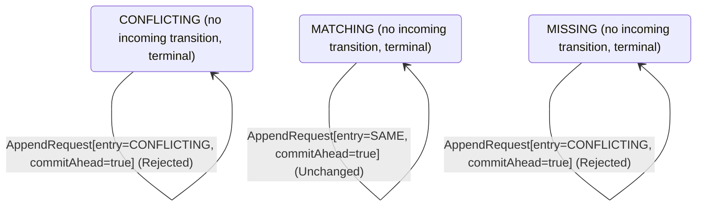

<!-- Generated by examples/tools/build.py from example.json and the verifier's output. Edit example.json. -->
# 099 · A follower that leaves its commit index alone on a heartbeat never applies the last entry

[← All examples](../README.md)

| Verdict | Categories | Severity if shipped | Change | Verified unit | Approach |
|---|---|---|---|---|---|
| **✗ Violation: FollowersLearnCommits, 8-step trace then forever (fairness)** | functional | high | feature, behaviour change intended | [`AppendRule#decide`](../../examples/apps/quorum/src/main/java/net/terminalvalue/quorum/raft/AppendRule.java) | [D1: Protocol model checking](../../examples/apps/quorum/spec/README.md) |

> A Raft follower moves its commit index up to the leader's on every request it accepts, a heartbeat included, as far as its log is known to match the leader's. A developer makes a heartbeat a liveness signal and nothing more: the commit index moves with the entries, the comment says, and a request that carries nothing to apply changes nothing. The tests pass and both safety configurations verify the change: no committed entry is overwritten, the logs match, and a follower never applies what the leader has not. The replication model's fairness configuration reports a run that goes on forever after eight steps: the leader replicates its entry to both followers, marks it committed, and every heartbeat from then on is refused the commit index it carries, so the followers never apply it; the property that every follower learns the leader's commits is violated, and the run ends in a state the system never leaves.

Tags: [consensus](../README.md#tag-consensus), [log-replication](../README.md#tag-log-replication), [liveness](../README.md#tag-liveness), [tla-liveness](../README.md#tag-tla-liveness), [generated-operator](../README.md#tag-generated-operator), [multiple-configurations](../README.md#tag-multiple-configurations)

## The change

In `AppendRule.decide`, the `NONE, SAME` arm, a heartbeat or an entry the follower already holds, no longer returns `transition(MATCHING, ADVANCE_COMMIT)` when the leader's commit index is ahead: it returns `unchanged` whatever the commit index, with the comment that a heartbeat or a duplicate is a liveness signal, not a write, and that the commit index moves with the entries. The Javadoc says the commit index follows the leader's on a request that carries an entry, and the test that the commit index follows the leader's on a heartbeat becomes one that a heartbeat changes nothing. The `ABSENT` and `CONFLICTING` arms, which append, still take the commit index.

**Before** ([`AppendRule.java`](../../examples/apps/quorum/src/main/java/net/terminalvalue/quorum/raft/AppendRule.java), line 15):

```java
* consistency check first, which refuses the request unless the follower holds the entry before the ones sent, so
* that the leader backs up and tries again from one entry earlier; then the entry sent goes in, in place of
* whatever the follower held at its index; and the follower's commit index follows the leader's, as far as the
* entries it now holds in common with it.
*
* <p>The check is what makes the log matching property hold: a follower accepts an entry only after the entry
* before it, so two logs that agree on an entry agree on everything before it. The term check comes before this
   // ...
           case MISSING -> rejected("no entry at the previous index");
           case CONFLICTING -> rejected("another entry at the previous index");
           case MATCHING -> switch (request.entry()) {
               case NONE, SAME -> request.commitAhead()
                       ? transition(MATCHING, ADVANCE_COMMIT)
                       : unchanged("holds what was sent, and nothing new to commit");
               case ABSENT -> request.commitAhead()
                       ? transition(MATCHING, APPEND, ADVANCE_COMMIT)
                       : transition(MATCHING, APPEND);
```

**After:**

```java
* consistency check first, which refuses the request unless the follower holds the entry before the ones sent, so
* that the leader backs up and tries again from one entry earlier; then the entry sent goes in, in place of
* whatever the follower held at its index; and the follower's commit index follows the leader's, as far as the
* entries it now holds in common with it, on a request that carries an entry: a heartbeat carries nothing to apply.
*
* <p>The check is what makes the log matching property hold: a follower accepts an entry only after the entry
* before it, so two logs that agree on an entry agree on everything before it. The term check comes before this
   // ...
           case MISSING -> rejected("no entry at the previous index");
           case CONFLICTING -> rejected("another entry at the previous index");
           case MATCHING -> switch (request.entry()) {
               case NONE, SAME -> unchanged("holds what was sent, and nothing new to apply"); // a heartbeat or a duplicate is a liveness signal, not a write: the commit index moves with the entries
               case ABSENT -> request.commitAhead()
                       ? transition(MATCHING, APPEND, ADVANCE_COMMIT)
                       : transition(MATCHING, APPEND);
```

<details><summary>Patch</summary>

```diff
--- a/examples/apps/quorum/src/main/java/net/terminalvalue/quorum/raft/AppendRule.java
+++ b/examples/apps/quorum/src/main/java/net/terminalvalue/quorum/raft/AppendRule.java
@@ -15,7 +15,7 @@
  * consistency check first, which refuses the request unless the follower holds the entry before the ones sent, so
  * that the leader backs up and tries again from one entry earlier; then the entry sent goes in, in place of
  * whatever the follower held at its index; and the follower's commit index follows the leader's, as far as the
- * entries it now holds in common with it.
+ * entries it now holds in common with it, on a request that carries an entry: a heartbeat carries nothing to apply.
  *
  * <p>The check is what makes the log matching property hold: a follower accepts an entry only after the entry
  * before it, so two logs that agree on an entry agree on everything before it. The term check comes before this
@@ -33,9 +33,7 @@
             case MISSING -> rejected("no entry at the previous index");
             case CONFLICTING -> rejected("another entry at the previous index");
             case MATCHING -> switch (request.entry()) {
-                case NONE, SAME -> request.commitAhead()
-                        ? transition(MATCHING, ADVANCE_COMMIT)
-                        : unchanged("holds what was sent, and nothing new to commit");
+                case NONE, SAME -> unchanged("holds what was sent, and nothing new to apply"); // a heartbeat or a duplicate is a liveness signal, not a write: the commit index moves with the entries
                 case ABSENT -> request.commitAhead()
                         ? transition(MATCHING, APPEND, ADVANCE_COMMIT)
                         : transition(MATCHING, APPEND);
--- a/examples/apps/quorum/src/test/java/net/terminalvalue/quorum/raft/AppendRuleTest.java
+++ b/examples/apps/quorum/src/test/java/net/terminalvalue/quorum/raft/AppendRuleTest.java
@@ -29,11 +29,12 @@
 
     public static void aHeartbeatOrADuplicateChangesNothing() {
         check(AppendRule.decide(MATCHING, new AppendRequest(NewEntry.NONE, false)) instanceof Decision.Unchanged, "heartbeat");
+        check(AppendRule.decide(MATCHING, new AppendRequest(NewEntry.NONE, true)) instanceof Decision.Unchanged, "heartbeat, nothing to apply");
         check(AppendRule.decide(MATCHING, new AppendRequest(NewEntry.SAME, false)) instanceof Decision.Unchanged, "already held");
+        check(AppendRule.decide(MATCHING, new AppendRequest(NewEntry.SAME, true)) instanceof Decision.Unchanged, "already held, nothing to apply");
     }
 
-    public static void theCommitIndexFollowsTheLeaders() {
-        equal(new Transition<>(MATCHING, List.of(ADVANCE_COMMIT)), AppendRule.decide(MATCHING, new AppendRequest(NewEntry.NONE, true)));
+    public static void theCommitIndexFollowsTheLeadersWithTheEntries() {
         equal(new Transition<>(MATCHING, List.of(APPEND, ADVANCE_COMMIT)), AppendRule.decide(MATCHING, new AppendRequest(NewEntry.ABSENT, true)));
         equal(new Transition<>(MATCHING, List.of(TRUNCATE, APPEND, ADVANCE_COMMIT)), AppendRule.decide(MATCHING, new AppendRequest(NewEntry.CONFLICTING, true)));
     }
```

</details>

## What the verifier found

The model is checked under 4 configurations, and the verdict is the first that fails:

| Configuration | What it checks | Model | Result |
|---|---|---|---|
| three terms, two entries (`spec/RaftReplication.cfg`) | every run from the initial state, every interleaving within the configuration's bounds | Servers = {s1, s2, s3}, MaxTerm = 3, MaxEntries = 2, DelayedReplies = FALSE | ✓ Verified: all invariants and properties hold in 17,221 states |
| figure 8 (`spec/RaftReplicationFigureEight.cfg`) | every run of three servers over four terms with one entry per leader's log, the budget of figure 8 of the paper: a leader of term 1 appends an entry it never gets to replicate, a leader of term 2 appends its own at the same index, the first comes back as the leader of term 3 and replicates its entry of term 1 to a majority, and the second, whose last entry is from the later term, can still be elected in term 4 without it; three terms cannot show this, and the same invariants and action properties are checked | Servers = {s1, s2, s3}, MaxTerm = 4, MaxEntries = 1, DelayedReplies = FALSE | ✓ Verified: all invariants and properties hold in 7,277 states |
| fairness (`spec/RaftReplicationLive.cfg`) | the three liveness properties, under the fairness conditions `Fairness`: a server whose timer nothing resets times out, a candidate asks for the votes it lacks, a leader sends every follower its next entry or a heartbeat and marks committed what the commit rule lets it; nothing is assumed of the clients, so the properties hold whether or not a request comes. Three servers, three terms and one entry per leader, without the symmetry set, since TLC's liveness checking is unsound under one. A counterexample is a run that goes on forever without satisfying a property: a prefix, then a state or a cycle the system never leaves | Servers = {s1, s2, s3}, MaxTerm = 3, MaxEntries = 1, DelayedReplies = FALSE | ✗ Violation: FollowersLearnCommits, 8-step trace then forever |
| delayed replies (`spec/RaftReplicationDelayed.cfg`) | every run of three servers over two terms with logs of up to two entries in which the reply to an AppendEntries request is a step of its own (`DelayedReplies = TRUE`): the leader may take it after it has sent the follower another request and taken its reply, been deposed, or been elected again in a later term, and the network may hand it the same reply twice, or never. The one-step RPC of the other configurations hands the reply rule nothing but the request just sent; this one hands it late and repeated replies, and checks the leader's record of its followers against what they hold, under the same invariants and action properties | Servers = {s1, s2, s3}, MaxTerm = 2, MaxEntries = 1, DelayedReplies = TRUE | ✓ Verified: all invariants and properties hold in 214,040 states |

TLC found a run of the system under fairness that violates the temporal property **FollowersLearnCommits** (every follower learns what the leader has committed: from some point on, no follower's commit index is behind the leader's, in every run that stays within the term budget): after the 8 steps below, the system stays in that state forever, and the property never comes true. The run respects every fairness condition the model assumes; the parts that could act, do. Each step is one action of one part of the system:

1. **Initial state**: every server a follower in term 0 with an empty log, no vote cast, nothing committed.
2. **Timeout**, `Server.onElectionTimeout`: a server's election timer fires, and the server acts on the role machine's decision. `currentTerm = (s1 :> 1 @@ s2 :> 0 @@ s3 :> 0)`, `role = (s1 :> "CANDIDATE" @@ s2 :> "FOLLOWER" @@ s3 :> "FOLLOWER")`, `votedFor = (s1 :> s1 @@ s2 :> "none" @@ s3 :> "none")`, `votes = (s1 :> {s1} @@ s2 :> {} @@ s3 :> {})`
3. **Timeout**, `Server.onElectionTimeout`: a server's election timer fires, and the server acts on the role machine's decision. `currentTerm = (s1 :> 2 @@ s2 :> 0 @@ s3 :> 0)`
4. **Canvass**, `Server.requestVote`: a candidate asks one server for its vote and gets the answer; the request and the reply each go through the role machine, then the vote rule on the voter, given its ballot and the candidate's term and log against its own, and the tally on the candidate. `currentTerm = (s1 :> 2 @@ s2 :> 2 @@ s3 :> 0)`, `nextIndex = ( s1 :> (s1 :> 1 @@ s2 :> 1 @@ s3 :> 1) @@ s2 :> (s1 :> 0 @@ s2 :> 0 @@ s3 :> 0) @@ s3 :> (s1 :> 0 @@ s2 :> 0 @@ s3 :> 0) )`, `role = (s1 :> "LEADER" @@ s2 :> "FOLLOWER" @@ s3 :> "FOLLOWER")`, `votedFor = (s1 :> s1 @@ s2 :> s1 @@ s3 :> "none")`, `votes = (s1 :> {s1, s2} @@ s2 :> {} @@ s3 :> {})`
5. **ClientRequest**, `Server.onClientRequest`: a leader appends an entry of its term to its own log. `log = (s1 :> <<2>> @@ s2 :> <<>> @@ s3 :> <<>>)`
6. **Replicate**, `Server.appendEntries`: a leader sends one server the entry at that server's next index, or a heartbeat if it is caught up, with the entry before it and the leader's commit index, and gets the answer; the request goes through the role machine, then the append rule on the follower's log as it stands against the leader's, and the reply through the role machine on the leader, then the reply rule on the request as it stands against the leader's record of the server, awaited or answered already, which moves the server's match index up through the entries sent and its next index past them on an acceptance and backs the next index up by one on a refusal. `currentTerm = (s1 :> 2 @@ s2 :> 2 @@ s3 :> 2)`, `log = (s1 :> <<2>> @@ s2 :> <<>> @@ s3 :> <<2>>)`, `matchIndex = ( s1 :> (s1 :> 0 @@ s2 :> 0 @@ s3 :> 1) @@ s2 :> (s1 :> 0 @@ s2 :> 0 @@ s3 :> 0) @@ s3 :> (s1 :> 0 @@ s2 :> 0 @@ s3 :> 0) )`, `nextIndex = ( s1 :> (s1 :> 1 @@ s2 :> 1 @@ s3 :> 2) @@ s2 :> (s1 :> 0 @@ s2 :> 0 @@ s3 :> 0) @@ s3 :> (s1 :> 0 @@ s2 :> 0 @@ s3 :> 0) )`
7. **AdvanceCommit**, `Server.advanceCommitIndex`: a leader asks the commit rule about an entry it has not marked committed, given the entry's term against its own and whether a majority of the servers hold it, and marks it committed on a transition, and with it everything before it. `commitIndex = (s1 :> 1 @@ s2 :> 0 @@ s3 :> 0)`
8. **Replicate**, `Server.appendEntries`: a leader sends one server the entry at that server's next index, or a heartbeat if it is caught up, with the entry before it and the leader's commit index, and gets the answer; the request goes through the role machine, then the append rule on the follower's log as it stands against the leader's, and the reply through the role machine on the leader, then the reply rule on the request as it stands against the leader's record of the server, awaited or answered already, which moves the server's match index up through the entries sent and its next index past them on an acceptance and backs the next index up by one on a refusal. `commitIndex = (s1 :> 1 @@ s2 :> 1 @@ s3 :> 0)`, `log = (s1 :> <<2>> @@ s2 :> <<2>> @@ s3 :> <<2>>)`, `matchIndex = ( s1 :> (s1 :> 0 @@ s2 :> 1 @@ s3 :> 1) @@ s2 :> (s1 :> 0 @@ s2 :> 0 @@ s3 :> 0) @@ s3 :> (s1 :> 0 @@ s2 :> 0 @@ s3 :> 0) )`, `nextIndex = ( s1 :> (s1 :> 1 @@ s2 :> 2 @@ s3 :> 2) @@ s2 :> (s1 :> 0 @@ s2 :> 0 @@ s3 :> 0) @@ s3 :> (s1 :> 0 @@ s2 :> 0 @@ s3 :> 0) )`

The model is small (Servers = {s1, s2, s3}, MaxTerm = 3, MaxEntries = 1, DelayedReplies = FALSE), which is what keeps the trace readable. TLC explored every interleaving of the servers, their terms, votes and logs, and the AppendEntries RPCs between them within those bounds.

**What the verdict rests on.** TLC counted how often a step of the model took each row of the generated operators. A row no step takes is one the model says nothing about, whatever the verdict.

| Configuration | Rows of `RoleMachine#decide` taken | Rows of `VoteRule#decide` taken | Rows of `AppendRule#decide` taken | Rows of `ReplyRule#decide` taken | Rows of `CommitRule#decide` taken |
|---|---|---|---|---|---|
| three terms, two entries | 27 of 36 | 12 of 27 | 16 of 24 | 3 of 4 | 4 of 12 |
| figure 8 | 27 of 36 | 12 of 27 | 10 of 24 | 3 of 4 | 4 of 12 |
| fairness | stopped at the counterexample | stopped at the counterexample | stopped at the counterexample | stopped at the counterexample | stopped at the counterexample |
| delayed replies | 29 of 36 | 10 of 27 | 9 of 24 | 4 of 4 | 4 of 12 |

The change alters 2 rows of the contract:

- `decide(MATCHING, AppendRequest[entry=NONE, commitAhead=true])`: `Transition[next=MATCHING, effects=[ADVANCE_COMMIT]]` → `Unchanged[reason="holds what was sent, and nothing new to apply"]`, taken under three terms, two entries, figure 8, delayed replies
- `decide(MATCHING, AppendRequest[entry=SAME, commitAhead=true])`: `Transition[next=MATCHING, effects=[ADVANCE_COMMIT]]` → `Unchanged[reason="holds what was sent, and nothing new to apply"]`, taken under delayed replies

The run under fairness stopped at its counterexample, the steps above, and its counts are left out: the verdict rests on the counterexample.

<details><summary>Rows no step takes under three terms, two entries</summary>

`net.terminalvalue.quorum.raft.RoleMachine#decide`:

```
decide(FOLLOWER, VotesCounted[majority=true]) => Unchanged
decide(FOLLOWER, Response[term=OLDER]) => Unchanged
decide(FOLLOWER, Response[term=CURRENT]) => Unchanged
decide(FOLLOWER, Response[term=NEWER]) => Transition[next=FOLLOWER, effects=[ADOPT_TERM]]
decide(CANDIDATE, Response[term=OLDER]) => Unchanged
decide(LEADER, VotesCounted[majority=false]) => Unchanged
decide(LEADER, VotesCounted[majority=true]) => Unchanged
decide(LEADER, AppendEntries[term=CURRENT]) => throws IllegalStateException
decide(LEADER, Response[term=OLDER]) => Unchanged
```

`net.terminalvalue.quorum.raft.VoteRule#decide`:

```
decide(OPEN, VoteRequest[term=NEWER, log=BEHIND]) => Rejected
decide(OPEN, VoteRequest[term=NEWER, log=EVEN]) => Transition[next=FOR_THE_CANDIDATE, effects=[GRANT]]
decide(OPEN, VoteRequest[term=NEWER, log=AHEAD]) => Transition[next=FOR_THE_CANDIDATE, effects=[GRANT]]
decide(FOR_THE_CANDIDATE, VoteRequest[term=OLDER, log=BEHIND]) => Rejected
decide(FOR_THE_CANDIDATE, VoteRequest[term=OLDER, log=EVEN]) => Rejected
decide(FOR_THE_CANDIDATE, VoteRequest[term=OLDER, log=AHEAD]) => Rejected
decide(FOR_THE_CANDIDATE, VoteRequest[term=CURRENT, log=BEHIND]) => Rejected
decide(FOR_THE_CANDIDATE, VoteRequest[term=CURRENT, log=EVEN]) => Transition[next=FOR_THE_CANDIDATE, effects=[GRANT]]
decide(FOR_THE_CANDIDATE, VoteRequest[term=CURRENT, log=AHEAD]) => Transition[next=FOR_THE_CANDIDATE, effects=[GRANT]]
decide(FOR_THE_CANDIDATE, VoteRequest[term=NEWER, log=BEHIND]) => Rejected
decide(FOR_THE_CANDIDATE, VoteRequest[term=NEWER, log=EVEN]) => Transition[next=FOR_THE_CANDIDATE, effects=[GRANT]]
decide(FOR_THE_CANDIDATE, VoteRequest[term=NEWER, log=AHEAD]) => Transition[next=FOR_THE_CANDIDATE, effects=[GRANT]]
decide(FOR_ANOTHER, VoteRequest[term=NEWER, log=BEHIND]) => Rejected
decide(FOR_ANOTHER, VoteRequest[term=NEWER, log=EVEN]) => Transition[next=FOR_THE_CANDIDATE, effects=[GRANT]]
decide(FOR_ANOTHER, VoteRequest[term=NEWER, log=AHEAD]) => Transition[next=FOR_THE_CANDIDATE, effects=[GRANT]]
```

`net.terminalvalue.quorum.raft.AppendRule#decide`:

```
decide(MISSING, AppendRequest[entry=SAME, commitAhead=false]) => Rejected
decide(MISSING, AppendRequest[entry=SAME, commitAhead=true]) => Rejected
decide(MISSING, AppendRequest[entry=CONFLICTING, commitAhead=false]) => Rejected
decide(MISSING, AppendRequest[entry=CONFLICTING, commitAhead=true]) => Rejected
decide(CONFLICTING, AppendRequest[entry=SAME, commitAhead=false]) => Rejected
decide(CONFLICTING, AppendRequest[entry=SAME, commitAhead=true]) => Rejected
decide(MATCHING, AppendRequest[entry=SAME, commitAhead=false]) => Unchanged
decide(MATCHING, AppendRequest[entry=SAME, commitAhead=true]) => Unchanged
```

`net.terminalvalue.quorum.raft.ReplyRule#decide`:

```
decide(ANSWERED, AppendReply[accepted=false]) => Unchanged
```

`net.terminalvalue.quorum.raft.CommitRule#decide`:

```
decide(PENDING, Replication[term=NEWER, majority=false]) => throws IllegalStateException
decide(PENDING, Replication[term=NEWER, majority=true]) => throws IllegalStateException
decide(COMMITTED, Replication[term=OLDER, majority=false]) => Unchanged
decide(COMMITTED, Replication[term=OLDER, majority=true]) => Unchanged
decide(COMMITTED, Replication[term=CURRENT, majority=false]) => Unchanged
decide(COMMITTED, Replication[term=CURRENT, majority=true]) => Unchanged
decide(COMMITTED, Replication[term=NEWER, majority=false]) => Unchanged
decide(COMMITTED, Replication[term=NEWER, majority=true]) => Unchanged
```

</details>

**Where the model's rules come from.** Each operator the model checks is generated from the contract derived from the patched classes in this run:

- `AppendRule#decide` (`spec/AppendRuleContract.tla`): the regenerated contract, 4 rows from the committed one, as the change intends
- `ReplyRule#decide` (`spec/ReplyRuleContract.tla`): the committed contract, which the patched classes still match
- `CommitRule#decide` (`spec/CommitRuleContract.tla`): the committed contract, which the patched classes still match
- `RoleMachine#decide` (`spec/RoleMachineContract.tla`): the committed contract, which the patched classes still match
- `VoteRule#decide` (`spec/VoteRuleContract.tla`): the committed contract, which the patched classes still match

**Results reused.** Under three terms, two entries, TLC was not run again: the result is the one recorded at 2026-11-06T17:05:41+00:00 by an earlier run whose inputs, the model's modules and configurations, the generated operators, the standard modules, the command and the tools, were the same (fingerprint `4aa7be0b3ba8`); Under figure 8, TLC was not run again: the result is the one recorded at 2026-11-06T17:05:48+00:00 by an earlier run whose inputs, the model's modules and configurations, the generated operators, the standard modules, the command and the tools, were the same (fingerprint `016fd15eb2c2`); Under fairness, TLC was not run again: the result is the one recorded at 2026-11-06T17:07:09+00:00 by an earlier run whose inputs, the model's modules and configurations, the generated operators, the standard modules, the command and the tools, were the same (fingerprint `db13a629e940`); Under delayed replies, TLC was not run again: the result is the one recorded at 2026-11-06T17:09:00+00:00 by an earlier run whose inputs, the model's modules and configurations, the generated operators, the standard modules, the command and the tools, were the same (fingerprint `c01618f8b70e`).

The state machine the patched code implements, drawn from its derived contract (`jvmcontract statemachine`); a state with no way in or no way out is marked:



## Would the existing tests have caught it?

No: every existing unit test passes (`java -ea net.terminalvalue.quorum.Tests`, run against the patched code).

## Why it matters

Medium. The change is safe in every sense a safety check can see: a follower that applies less than it could applies nothing wrong, and the two rows it alters are the rows under which nothing is written. What it breaks is a promise about the future, that a follower eventually applies what the leader committed, and the leader commits an entry only after a majority has appended it, which is after the request that appended it on each of them: the commit index can only reach the last entry on a request that carries nothing. The tests check single decisions, and a decision that changes nothing looks right.

## Why the verdict is right

The append rule in the model is generated from the regenerated contract, so `Replicate` does what the two patched rows say. The two safety configurations verify the change, in 17,221 and 7,277 states: the followers' commit indices stay behind, which breaks no invariant. The third configuration, three servers and three terms under the fairness conditions, reports the temporal property `FollowersLearnCommits` violated: after eight steps the system stutters forever. s1 times out twice and wins term 2 with s2's vote; it appends an entry of term 2 and sends it to s2 and then s3, each of which appends it with the commit index still at 0, since nothing is committed when the entry goes out; s1 marks the entry committed, a majority holding it. From then on every request s1 sends is a heartbeat, both followers being caught up, with a commit index of 1 against their 0, which the patched rule answers with `unchanged`: the heartbeat changes no variable, no step of the system is left that changes one, and the run goes on forever in that state, s1 having applied the entry and s2 and s3 never, until a client sends another. The last entry a leader appends is applied by the leader alone, for as long as the cluster is quiet. The fairness conditions are what make the run a counterexample: with a leader that sends every follower its heartbeats, the only runs are ones in which the followers hear the commit index again and again and never take it. The fourth configuration, two terms and one entry per leader with replies delayed, verifies the change in 214,040 states: it checks no liveness, and a commit index that stays behind breaks no invariant.

## What to do

Reject. The commit index is part of every AppendEntries request, and a follower takes it on every request it accepts, a heartbeat first among them (Ongaro and Ousterhout, section 5.3, and the leaderCommit rule of figure 2): the leader learns that a majority holds an entry only from the replies to the requests that carried it, so the request that tells the followers the entry is committed is always a later one, and for the last entry a leader appends that later request is a heartbeat. A follower that applies entries only when it appends is one that applies the last entry of every quiet period never, which a client reading from a follower sees as a write that is acknowledged and not there. The fairness configuration is the check that catches a rule that does too little rather than too much, and the counterexample it reports is the quiet period itself.

## Notes

- The Raft replication model (`apps/quorum/spec/RaftReplication.tla`) has the logs live, around the follower's append rule and the leader's commit rule as generated operators beside the role machine and the vote rule, and checks log matching, leader completeness and state machine safety, with an action property that no committed entry is ever overwritten. Its configurations are three terms with two entries, and the four terms of the paper's figure 8.
- `RaftReplicationLive.cfg` checks three temporal properties for runs within the term budget: every entry in a leader's log reaches every follower, every follower learns the leader's commits, and an entry a leader appends in its term is committed unless the leader is deposed.
- A heartbeat treated as a liveness signal rather than a write: the followers stay behind the leader for good, in a run that goes on forever.

## Evidence

How the verdict was reached: three terms, two entries: TLC 2.19 explored 17,221 distinct states to depth 20 in 10 s, for the model Servers = {s1, s2, s3}, MaxTerm = 3, MaxEntries = 2, DelayedReplies = FALSE; figure 8: TLC 2.19 explored 7,277 distinct states to depth 18 in 6 s, for the model Servers = {s1, s2, s3}, MaxTerm = 4, MaxEntries = 1, DelayedReplies = FALSE; fairness: TLC 2.19 explored 3,081 distinct states in 5 s, for the model Servers = {s1, s2, s3}, MaxTerm = 3, MaxEntries = 1, DelayedReplies = FALSE; delayed replies: TLC 2.19 explored 214,040 distinct states to depth 23, for the model Servers = {s1, s2, s3}, MaxTerm = 2, MaxEntries = 1, DelayedReplies = TRUE.

<details><summary>Verifier output</summary>

```text
== three terms, two entries: spec/RaftReplication.cfg ==
TLC2 Version 2.19 of 08 August 2024 (rev: 5a47802)
Running breadth-first search Model-Checking with fp 1 and seed 1 with 1 worker on 2 cores with 3276MB heap and 64MB offheap memory [pid: 27440] (Linux 7.0.0-43-generic amd64, Eclipse Adoptium 25.0.5 x86_64, MSBDiskFPSet, DiskStateQueue).
Parsing file examples/apps/quorum/spec/RaftReplication.tla
Parsing file examples/tools/tla/standard-modules/Naturals.tla
Parsing file examples/tools/tla/standard-modules/FiniteSets.tla
Parsing file examples/tools/tla/standard-modules/Sequences.tla
Parsing file examples/tools/tla/standard-modules/TLC.tla
Parsing file examples/apps/quorum/spec/RoleMachineContract.tla
Parsing file examples/apps/quorum/spec/VoteRuleContract.tla
Parsing file examples/apps/quorum/spec/AppendRuleContract.tla
Parsing file examples/apps/quorum/spec/ReplyRuleContract.tla
Parsing file examples/apps/quorum/spec/CommitRuleContract.tla
Semantic processing of module Naturals
Semantic processing of module Sequences
Semantic processing of module FiniteSets
Semantic processing of module TLC
Semantic processing of module RoleMachineContract
Semantic processing of module VoteRuleContract
Semantic processing of module AppendRuleContract
Semantic processing of module ReplyRuleContract
Semantic processing of module CommitRuleContract
Semantic processing of module RaftReplication
Starting... (2026-11-06 17:05:31)
Computing initial states...
Finished computing initial states: 1 distinct state generated at 2026-11-06 17:05:33.
Model checking completed. No error has been found.
  Estimates of the probability that TLC did not check all reachable states
  because two distinct states had the same fingerprint:
  calculated (optimistic):  val = 6.3E-11
Rows of net.terminalvalue.quorum.raft.RoleMachine#decide a step of the model takes: 27 of 36; never taken (9):
  decide(FOLLOWER, VotesCounted[majority=true]) => Unchanged
  decide(FOLLOWER, Response[term=OLDER]) => Unchanged
  decide(FOLLOWER, Response[term=CURRENT]) => Unchanged
  decide(FOLLOWER, Response[term=NEWER]) => Transition[next=FOLLOWER, effects=[ADOPT_TERM]]
  decide(CANDIDATE, Response[term=OLDER]) => Unchanged
  decide(LEADER, VotesCounted[majority=false]) => Unchanged
  decide(LEADER, VotesCounted[majority=true]) => Unchanged
  decide(LEADER, AppendEntries[term=CURRENT]) => throws IllegalStateException
  decide(LEADER, Response[term=OLDER]) => Unchanged
Rows of net.terminalvalue.quorum.raft.VoteRule#decide a step of the model takes: 12 of 27; never taken (15):
  decide(OPEN, VoteRequest[term=NEWER, log=BEHIND]) => Rejected
  decide(OPEN, VoteRequest[term=NEWER, log=EVEN]) => Transition[next=FOR_THE_CANDIDATE, effects=[GRANT]]
  decide(OPEN, VoteRequest[term=NEWER, log=AHEAD]) => Transition[next=FOR_THE_CANDIDATE, effects=[GRANT]]
  decide(FOR_THE_CANDIDATE, VoteRequest[term=OLDER, log=BEHIND]) => Rejected
  decide(FOR_THE_CANDIDATE, VoteRequest[term=OLDER, log=EVEN]) => Rejected
  decide(FOR_THE_CANDIDATE, VoteRequest[term=OLDER, log=AHEAD]) => Rejected
  decide(FOR_THE_CANDIDATE, VoteRequest[term=CURRENT, log=BEHIND]) => Rejected
  decide(FOR_THE_CANDIDATE, VoteRequest[term=CURRENT, log=EVEN]) => Transition[next=FOR_THE_CANDIDATE, effects=[GRANT]]
  decide(FOR_THE_CANDIDATE, VoteRequest[term=CURRENT, log=AHEAD]) => Transition[next=FOR_THE_CANDIDATE, effects=[GRANT]]
  decide(FOR_THE_CANDIDATE, VoteRequest[term=NEWER, log=BEHIND]) => Rejected
  decide(FOR_THE_CANDIDATE, VoteRequest[term=NEWER, log=EVEN]) => Transition[next=FOR_THE_CANDIDATE, effects=[GRANT]]
  decide(FOR_THE_CANDIDATE, VoteRequest[term=NEWER, log=AHEAD]) => Transition[next=FOR_THE_CANDIDATE, effects=[GRANT]]
  decide(FOR_ANOTHER, VoteRequest[term=NEWER, log=BEHIND]) => Rejected
  decide(FOR_ANOTHER, VoteRequest[term=NEWER, log=EVEN]) => Transition[next=FOR_THE_CANDIDATE, effects=[GRANT]]
  decide(FOR_ANOTHER, VoteRequest[term=NEWER, log=AHEAD]) => Transition[next=FOR_THE_CANDIDATE, effects=[GRANT]]
Rows of net.terminalvalue.quorum.raft.AppendRule#decide a step of the model takes: 16 of 24; never taken (8):
  decide(MISSING, AppendRequest[entry=SAME, commitAhead=false]) => Rejected
  decide(MISSING, AppendRequest[entry=SAME, commitAhead=true]) => Rejected
  decide(MISSING, AppendRequest[entry=CONFLICTING, commitAhead=false]) => Rejected
  decide(MISSING, AppendRequest[entry=CONFLICTING, commitAhead=true]) => Rejected
  decide(CONFLICTING, AppendRequest[entry=SAME, commitAhead=false]) => Rejected
  decide(CONFLICTING, AppendRequest[entry=SAME, commitAhead=true]) => Rejected
  decide(MATCHING, AppendRequest[entry=SAME, commitAhead=false]) => Unchanged
  decide(MATCHING, AppendRequest[entry=SAME, commitAhead=true]) => Unchanged
Rows of net.terminalvalue.quorum.raft.ReplyRule#decide a step of the model takes: 3 of 4; never taken (1):
  decide(ANSWERED, AppendReply[accepted=false]) => Unchanged
Rows of net.terminalvalue.quorum.raft.CommitRule#decide a step of the model takes: 4 of 12; never taken (8):
  decide(PENDING, Replication[term=NEWER, majority=false]) => throws IllegalStateException
  decide(PENDING, Replication[term=NEWER, majority=true]) => throws IllegalStateException
  decide(COMMITTED, Replication[term=OLDER, majority=false]) => Unchanged
  decide(COMMITTED, Replication[term=OLDER, majority=true]) => Unchanged
  decide(COMMITTED, Replication[term=CURRENT, majority=false]) => Unchanged
  decide(COMMITTED, Replication[term=CURRENT, majority=true]) => Unchanged
  decide(COMMITTED, Replication[term=NEWER, majority=false]) => Unchanged
  decide(COMMITTED, Replication[term=NEWER, majority=true]) => Unchanged
84538 states generated, 17221 distinct states found, 0 states left on queue.
The depth of the complete state graph search is 20.
The average outdegree of the complete state graph is 1 (minimum is 0, the maximum 8 and the 95th percentile is 3).
Finished in 10s at (2026-11-06 17:05:41)

== figure 8: spec/RaftReplicationFigureEight.cfg ==
TLC2 Version 2.19 of 08 August 2024 (rev: 5a47802)
Running breadth-first search Model-Checking with fp 1 and seed 1 with 1 worker on 2 cores with 3276MB heap and 64MB offheap memory [pid: 27791] (Linux 7.0.0-43-generic amd64, Eclipse Adoptium 25.0.5 x86_64, MSBDiskFPSet, DiskStateQueue).
Parsing file examples/apps/quorum/spec/RaftReplication.tla
Parsing file examples/tools/tla/standard-modules/Naturals.tla
Parsing file examples/tools/tla/standard-modules/FiniteSets.tla
Parsing file examples/tools/tla/standard-modules/Sequences.tla
Parsing file examples/tools/tla/standard-modules/TLC.tla
Parsing file examples/apps/quorum/spec/RoleMachineContract.tla
Parsing file examples/apps/quorum/spec/VoteRuleContract.tla
Parsing file examples/apps/quorum/spec/AppendRuleContract.tla
Parsing file examples/apps/quorum/spec/ReplyRuleContract.tla
Parsing file examples/apps/quorum/spec/CommitRuleContract.tla
Semantic processing of module Naturals
Semantic processing of module Sequences
Semantic processing of module FiniteSets
Semantic processing of module TLC
Semantic processing of module RoleMachineContract
Semantic processing of module VoteRuleContract
Semantic processing of module AppendRuleContract
Semantic processing of module ReplyRuleContract
Semantic processing of module CommitRuleContract
Semantic processing of module RaftReplication
Starting... (2026-11-06 17:05:42)
Computing initial states...
Finished computing initial states: 1 distinct state generated at 2026-11-06 17:05:44.
Model checking completed. No error has been found.
  Estimates of the probability that TLC did not check all reachable states
  because two distinct states had the same fingerprint:
  calculated (optimistic):  val = 1.3E-11
Rows of net.terminalvalue.quorum.raft.RoleMachine#decide a step of the model takes: 27 of 36; never taken (9):
  decide(FOLLOWER, VotesCounted[majority=true]) => Unchanged
  decide(FOLLOWER, Response[term=OLDER]) => Unchanged
  decide(FOLLOWER, Response[term=CURRENT]) => Unchanged
  decide(FOLLOWER, Response[term=NEWER]) => Transition[next=FOLLOWER, effects=[ADOPT_TERM]]
  decide(CANDIDATE, Response[term=OLDER]) => Unchanged
  decide(LEADER, VotesCounted[majority=false]) => Unchanged
  decide(LEADER, VotesCounted[majority=true]) => Unchanged
  decide(LEADER, AppendEntries[term=CURRENT]) => throws IllegalStateException
  decide(LEADER, Response[term=OLDER]) => Unchanged
Rows of net.terminalvalue.quorum.raft.VoteRule#decide a step of the model takes: 12 of 27; never taken (15):
  decide(OPEN, VoteRequest[term=NEWER, log=BEHIND]) => Rejected
  decide(OPEN, VoteRequest[term=NEWER, log=EVEN]) => Transition[next=FOR_THE_CANDIDATE, effects=[GRANT]]
  decide(OPEN, VoteRequest[term=NEWER, log=AHEAD]) => Transition[next=FOR_THE_CANDIDATE, effects=[GRANT]]
  decide(FOR_THE_CANDIDATE, VoteRequest[term=OLDER, log=BEHIND]) => Rejected
  decide(FOR_THE_CANDIDATE, VoteRequest[term=OLDER, log=EVEN]) => Rejected
  decide(FOR_THE_CANDIDATE, VoteRequest[term=OLDER, log=AHEAD]) => Rejected
  decide(FOR_THE_CANDIDATE, VoteRequest[term=CURRENT, log=BEHIND]) => Rejected
  decide(FOR_THE_CANDIDATE, VoteRequest[term=CURRENT, log=EVEN]) => Transition[next=FOR_THE_CANDIDATE, effects=[GRANT]]
  decide(FOR_THE_CANDIDATE, VoteRequest[term=CURRENT, log=AHEAD]) => Transition[next=FOR_THE_CANDIDATE, effects=[GRANT]]
  decide(FOR_THE_CANDIDATE, VoteRequest[term=NEWER, log=BEHIND]) => Rejected
  decide(FOR_THE_CANDIDATE, VoteRequest[term=NEWER, log=EVEN]) => Transition[next=FOR_THE_CANDIDATE, effects=[GRANT]]
  decide(FOR_THE_CANDIDATE, VoteRequest[term=NEWER, log=AHEAD]) => Transition[next=FOR_THE_CANDIDATE, effects=[GRANT]]
  decide(FOR_ANOTHER, VoteRequest[term=NEWER, log=BEHIND]) => Rejected
  decide(FOR_ANOTHER, VoteRequest[term=NEWER, log=EVEN]) => Transition[next=FOR_THE_CANDIDATE, effects=[GRANT]]
  decide(FOR_ANOTHER, VoteRequest[term=NEWER, log=AHEAD]) => Transition[next=FOR_THE_CANDIDATE, effects=[GRANT]]
Rows of net.terminalvalue.quorum.raft.AppendRule#decide a step of the model takes: 10 of 24; never taken (14):
  decide(MISSING, AppendRequest[entry=ABSENT, commitAhead=false]) => Rejected
  decide(MISSING, AppendRequest[entry=ABSENT, commitAhead=true]) => Rejected
  decide(MISSING, AppendRequest[entry=SAME, commitAhead=false]) => Rejected
  decide(MISSING, AppendRequest[entry=SAME, commitAhead=true]) => Rejected
  decide(MISSING, AppendRequest[entry=CONFLICTING, commitAhead=false]) => Rejected
  decide(MISSING, AppendRequest[entry=CONFLICTING, commitAhead=true]) => Rejected
  decide(CONFLICTING, AppendRequest[entry=ABSENT, commitAhead=false]) => Rejected
  decide(CONFLICTING, AppendRequest[entry=ABSENT, commitAhead=true]) => Rejected
  decide(CONFLICTING, AppendRequest[entry=SAME, commitAhead=false]) => Rejected
  decide(CONFLICTING, AppendRequest[entry=SAME, commitAhead=true]) => Rejected
  decide(CONFLICTING, AppendRequest[entry=CONFLICTING, commitAhead=false]) => Rejected
  decide(CONFLICTING, AppendRequest[entry=CONFLICTING, commitAhead=true]) => Rejected
  decide(MATCHING, AppendRequest[entry=SAME, commitAhead=false]) => Unchanged
  decide(MATCHING, AppendRequest[entry=SAME, commitAhead=true]) => Unchanged
Rows of net.terminalvalue.quorum.raft.ReplyRule#decide a step of the model takes: 3 of 4; never taken (1):
  decide(ANSWERED, AppendReply[accepted=false]) => Unchanged
Rows of net.terminalvalue.quorum.raft.CommitRule#decide a step of the model takes: 4 of 12; never taken (8):
  decide(PENDING, Replication[term=NEWER, majority=false]) => throws IllegalStateException
  decide(PENDING, Replication[term=NEWER, majority=true]) => throws IllegalStateException
  decide(COMMITTED, Replication[term=OLDER, majority=false]) => Unchanged
  decide(COMMITTED, Replication[term=OLDER, majority=true]) => Unchanged
  decide(COMMITTED, Replication[term=CURRENT, majority=false]) => Unchanged
  decide(COMMITTED, Replication[term=CURRENT, majority=true]) => Unchanged
  decide(COMMITTED, Replication[term=NEWER, majority=false]) => Unchanged
  decide(COMMITTED, Replication[term=NEWER, majority=true]) => Unchanged
40020 states generated, 7277 distinct states found, 0 states left on queue.
The depth of the complete state graph search is 18.
The average outdegree of the complete state graph is 1 (minimum is 0, the maximum 7 and the 95th percentile is 3).
Finished in 06s at (2026-11-06 17:05:48)

== fairness: spec/RaftReplicationLive.cfg ==
TLC2 Version 2.19 of 08 August 2024 (rev: 5a47802)
Running breadth-first search Model-Checking with fp 1 and seed 1 with 1 worker on 2 cores with 3276MB heap and 64MB offheap memory [pid: 30940] (Linux 7.0.0-43-generic amd64, Eclipse Adoptium 25.0.5 x86_64, MSBDiskFPSet, DiskStateQueue).
Parsing file examples/apps/quorum/spec/RaftReplication.tla
Parsing file examples/tools/tla/standard-modules/Naturals.tla
Parsing file examples/tools/tla/standard-modules/FiniteSets.tla
Parsing file examples/tools/tla/standard-modules/Sequences.tla
Parsing file examples/tools/tla/standard-modules/TLC.tla
Parsing file examples/apps/quorum/spec/RoleMachineContract.tla
Parsing file examples/apps/quorum/spec/VoteRuleContract.tla
Parsing file examples/apps/quorum/spec/AppendRuleContract.tla
Parsing file examples/apps/quorum/spec/ReplyRuleContract.tla
Parsing file examples/apps/quorum/spec/CommitRuleContract.tla
Semantic processing of module Naturals
Semantic processing of module Sequences
Semantic processing of module FiniteSets
Semantic processing of module TLC
Semantic processing of module RoleMachineContract
Semantic processing of module VoteRuleContract
Semantic processing of module AppendRuleContract
Semantic processing of module ReplyRuleContract
Semantic processing of module CommitRuleContract
Semantic processing of module RaftReplication
Starting... (2026-11-06 17:07:03)
Implied-temporal checking--satisfiability problem has 1 branches.
Computing initial states...
Finished computing initial states: 1 distinct state generated at 2026-11-06 17:07:05.
Checking temporal properties for the current state space with 2069 total distinct states at (2026-11-06 17:07:08)
Error: Temporal properties were violated.

Error: The following behavior constitutes a counter-example:

State 1: <Initial predicate>
/\ matchIndex = ( s1 :> (s1 :> 0 @@ s2 :> 0 @@ s3 :> 0) @@
  s2 :> (s1 :> 0 @@ s2 :> 0 @@ s3 :> 0) @@
  s3 :> (s1 :> 0 @@ s2 :> 0 @@ s3 :> 0) )
/\ log = (s1 :> <<>> @@ s2 :> <<>> @@ s3 :> <<>>)
/\ commitIndex = (s1 :> 0 @@ s2 :> 0 @@ s3 :> 0)
/\ replies = {}
/\ currentTerm = (s1 :> 0 @@ s2 :> 0 @@ s3 :> 0)
/\ nextIndex = ( s1 :> (s1 :> 0 @@ s2 :> 0 @@ s3 :> 0) @@
  s2 :> (s1 :> 0 @@ s2 :> 0 @@ s3 :> 0) @@
  s3 :> (s1 :> 0 @@ s2 :> 0 @@ s3 :> 0) )
/\ votes = (s1 :> {} @@ s2 :> {} @@ s3 :> {})
/\ role = (s1 :> "FOLLOWER" @@ s2 :> "FOLLOWER" @@ s3 :> "FOLLOWER")
/\ votedFor = (s1 :> "none" @@ s2 :> "none" @@ s3 :> "none")

State 2: <Timeout line 150, col 15 to line 150, col 79 of module RaftReplication>
/\ matchIndex = ( s1 :> (s1 :> 0 @@ s2 :> 0 @@ s3 :> 0) @@
  s2 :> (s1 :> 0 @@ s2 :> 0 @@ s3 :> 0) @@
  s3 :> (s1 :> 0 @@ s2 :> 0 @@ s3 :> 0) )
/\ log = (s1 :> <<>> @@ s2 :> <<>> @@ s3 :> <<>>)
/\ commitIndex = (s1 :> 0 @@ s2 :> 0 @@ s3 :> 0)
/\ replies = {}
/\ currentTerm = (s1 :> 1 @@ s2 :> 0 @@ s3 :> 0)
/\ nextIndex = ( s1 :> (s1 :> 0 @@ s2 :> 0 @@ s3 :> 0) @@
  s2 :> (s1 :> 0 @@ s2 :> 0 @@ s3 :> 0) @@
  s3 :> (s1 :> 0 @@ s2 :> 0 @@ s3 :> 0) )
/\ votes = (s1 :> {s1} @@ s2 :> {} @@ s3 :> {})
/\ role = (s1 :> "CANDIDATE" @@ s2 :> "FOLLOWER" @@ s3 :> "FOLLOWER")
/\ votedFor = (s1 :> s1 @@ s2 :> "none" @@ s3 :> "none")

State 3: <Timeout line 150, col 15 to line 150, col 79 of module RaftReplication>
/\ matchIndex = ( s1 :> (s1 :> 0 @@ s2 :> 0 @@ s3 :> 0) @@
  s2 :> (s1 :> 0 @@ s2 :> 0 @@ s3 :> 0) @@
  s3 :> (s1 :> 0 @@ s2 :> 0 @@ s3 :> 0) )
/\ log = (s1 :> <<>> @@ s2 :> <<>> @@ s3 :> <<>>)
/\ commitIndex = (s1 :> 0 @@ s2 :> 0 @@ s3 :> 0)
/\ replies = {}
/\ currentTerm = (s1 :> 2 @@ s2 :> 0 @@ s3 :> 0)
/\ nextIndex = ( s1 :> (s1 :> 0 @@ s2 :> 0 @@ s3 :> 0) @@
  s2 :> (s1 :> 0 @@ s2 :> 0 @@ s3 :> 0) @@
  s3 :> (s1 :> 0 @@ s2 :> 0 @@ s3 :> 0) )
/\ votes = (s1 :> {s1} @@ s2 :> {} @@ s3 :> {})
/\ role = (s1 :> "CANDIDATE" @@ s2 :> "FOLLOWER" @@ s3 :> "FOLLOWER")
/\ votedFor = (s1 :> s1 @@ s2 :> "none" @@ s3 :> "none")

State 4: <Canvass line 178, col 5 to line 180, col 30 of module RaftReplication>
/\ matchIndex = ( s1 :> (s1 :> 0 @@ s2 :> 0 @@ s3 :> 0) @@
  s2 :> (s1 :> 0 @@ s2 :> 0 @@ s3 :> 0) @@
  s3 :> (s1 :> 0 @@ s2 :> 0 @@ s3 :> 0) )
/\ log = (s1 :> <<>> @@ s2 :> <<>> @@ s3 :> <<>>)
/\ commitIndex = (s1 :> 0 @@ s2 :> 0 @@ s3 :> 0)
/\ replies = {}
/\ currentTerm = (s1 :> 2 @@ s2 :> 2 @@ s3 :> 0)
/\ nextIndex = ( s1 :> (s1 :> 1 @@ s2 :> 1 @@ s3 :> 1) @@
  s2 :> (s1 :> 0 @@ s2 :> 0 @@ s3 :> 0) @@
  s3 :> (s1 :> 0 @@ s2 :> 0 @@ s3 :> 0) )
/\ votes = (s1 :> {s1, s2} @@ s2 :> {} @@ s3 :> {})
/\ role = (s1 :> "LEADER" @@ s2 :> "FOLLOWER" @@ s3 :> "FOLLOWER")
/\ votedFor = (s1 :> s1 @@ s2 :> s1 @@ s3 :> "none")

State 5: <ClientRequest line 189, col 5 to line 192, col 100 of module RaftReplication>
/\ matchIndex = ( s1 :> (s1 :> 0 @@ s2 :> 0 @@ s3 :> 0) @@
  s2 :> (s1 :> 0 @@ s2 :> 0 @@ s3 :> 0) @@
  s3 :> (s1 :> 0 @@ s2 :> 0 @@ s3 :> 0) )
/\ log = (s1 :> <<2>> @@ s2 :> <<>> @@ s3 :> <<>>)
/\ commitIndex = (s1 :> 0 @@ s2 :> 0 @@ s3 :> 0)
/\ replies = {}
/\ currentTerm = (s1 :> 2 @@ s2 :> 2 @@ s3 :> 0)
/\ nextIndex = ( s1 :> (s1 :> 1 @@ s2 :> 1 @@ s3 :> 1) @@
  s2 :> (s1 :> 0 @@ s2 :> 0 @@ s3 :> 0) @@
  s3 :> (s1 :> 0 @@ s2 :> 0 @@ s3 :> 0) )
/\ votes = (s1 :> {s1, s2} @@ s2 :> {} @@ s3 :> {})
/\ role = (s1 :> "LEADER" @@ s2 :> "FOLLOWER" @@ s3 :> "FOLLOWER")
/\ votedFor = (s1 :> s1 @@ s2 :> s1 @@ s3 :> "none")

State 6: <Replicate line 281, col 5 to line 283, col 32 of module RaftReplication>
/\ matchIndex = ( s1 :> (s1 :> 0 @@ s2 :> 0 @@ s3 :> 1) @@
  s2 :> (s1 :> 0 @@ s2 :> 0 @@ s3 :> 0) @@
  s3 :> (s1 :> 0 @@ s2 :> 0 @@ s3 :> 0) )
/\ log = (s1 :> <<2>> @@ s2 :> <<>> @@ s3 :> <<2>>)
/\ commitIndex = (s1 :> 0 @@ s2 :> 0 @@ s3 :> 0)
/\ replies = {}
/\ currentTerm = (s1 :> 2 @@ s2 :> 2 @@ s3 :> 2)
/\ nextIndex = ( s1 :> (s1 :> 1 @@ s2 :> 1 @@ s3 :> 2) @@
  s2 :> (s1 :> 0 @@ s2 :> 0 @@ s3 :> 0) @@
  s3 :> (s1 :> 0 @@ s2 :> 0 @@ s3 :> 0) )
/\ votes = (s1 :> {s1, s2} @@ s2 :> {} @@ s3 :> {})
/\ role = (s1 :> "LEADER" @@ s2 :> "FOLLOWER" @@ s3 :> "FOLLOWER")
/\ votedFor = (s1 :> s1 @@ s2 :> s1 @@ s3 :> "none")

State 7: <AdvanceCommit line 338, col 5 to line 343, col 92 of module RaftReplication>
/\ matchIndex = ( s1 :> (s1 :> 0 @@ s2 :> 0 @@ s3 :> 1) @@
  s2 :> (s1 :> 0 @@ s2 :> 0 @@ s3 :> 0) @@
  s3 :> (s1 :> 0 @@ s2 :> 0 @@ s3 :> 0) )
/\ log = (s1 :> <<2>> @@ s2 :> <<>> @@ s3 :> <<2>>)
/\ commitIndex = (s1 :> 1 @@ s2 :> 0 @@ s3 :> 0)
/\ replies = {}
/\ currentTerm = (s1 :> 2 @@ s2 :> 2 @@ s3 :> 2)
/\ nextIndex = ( s1 :> (s1 :> 1 @@ s2 :> 1 @@ s3 :> 2) @@
  s2 :> (s1 :> 0 @@ s2 :> 0 @@ s3 :> 0) @@
  s3 :> (s1 :> 0 @@ s2 :> 0 @@ s3 :> 0) )
/\ votes = (s1 :> {s1, s2} @@ s2 :> {} @@ s3 :> {})
/\ role = (s1 :> "LEADER" @@ s2 :> "FOLLOWER" @@ s3 :> "FOLLOWER")
/\ votedFor = (s1 :> s1 @@ s2 :> s1 @@ s3 :> "none")

State 8: <Replicate line 281, col 5 to line 283, col 32 of module RaftReplication>
/\ matchIndex = ( s1 :> (s1 :> 0 @@ s2 :> 1 @@ s3 :> 1) @@
  s2 :> (s1 :> 0 @@ s2 :> 0 @@ s3 :> 0) @@
  s3 :> (s1 :> 0 @@ s2 :> 0 @@ s3 :> 0) )
/\ log = (s1 :> <<2>> @@ s2 :> <<2>> @@ s3 :> <<2>>)
/\ commitIndex = (s1 :> 1 @@ s2 :> 1 @@ s3 :> 0)
/\ replies = {}
/\ currentTerm = (s1 :> 2 @@ s2 :> 2 @@ s3 :> 2)
/\ nextIndex = ( s1 :> (s1 :> 1 @@ s2 :> 2 @@ s3 :> 2) @@
  s2 :> (s1 :> 0 @@ s2 :> 0 @@ s3 :> 0) @@
  s3 :> (s1 :> 0 @@ s2 :> 0 @@ s3 :> 0) )
/\ votes = (s1 :> {s1, s2} @@ s2 :> {} @@ s3 :> {})
/\ role = (s1 :> "LEADER" @@ s2 :> "FOLLOWER" @@ s3 :> "FOLLOWER")
/\ votedFor = (s1 :> s1 @@ s2 :> s1 @@ s3 :> "none")

State 9: Stuttering
Finished checking temporal properties in 00s at 2026-11-06 17:07:08
The coverage statistics at 2026-11-06 17:07:08
<Init line 349, col 1 to line 349, col 4 of module RaftReplication>: 2:2
  line 350, col 5 to line 358, col 19 of module RaftReplication: 2
<Timeout line 150, col 1 to line 150, col 10 of module RaftReplication>: 705:3671
  line 148, col 20 to line 148, col 43 of module RaftReplication: 3671
  |line 148, col 20 to line 148, col 33 of module RaftReplication: 4934
  |line 148, col 37 to line 148, col 43 of module RaftReplication: 4934
  line 150, col 28 to line 150, col 28 of module RaftReplication: 4934
  line 150, col 34 to line 150, col 55 of module RaftReplication: 7342
  |line 150, col 35 to line 150, col 55 of module RaftReplication: 3671
  ||line 150, col 35 to line 150, col 48 of module RaftReplication: 3671
  |||line 138, col 17 to line 138, col 64 of module RaftReplication: 3671
  ||||line 138, col 17 to line 138, col 37 of module RaftReplication: 3671
  ||||line 138, col 42 to line 138, col 64 of module RaftReplication: 2437
  |||||line 103, col 19 to line 103, col 68 of module RaftReplication: 2437
  ||||||line 103, col 48 to line 103, col 68 of module RaftReplication: 4874
  ||||||line 103, col 28 to line 103, col 44 of module RaftReplication: 2437
  |||line 137, col 14 to line 137, col 109 of module RaftReplication: 3671
  ||||line 137, col 17 to line 137, col 65 of module RaftReplication: 3671
  |||||line 137, col 17 to line 137, col 37 of module RaftReplication: 3671
  |||||line 137, col 42 to line 137, col 65 of module RaftReplication: 2437
  ||||line 137, col 72 to line 137, col 89 of module RaftReplication: 2437
  ||||line 137, col 96 to line 137, col 109 of module RaftReplication: 1234
  |||line 136, col 14 to line 136, col 58 of module RaftReplication: 3671
  ||||line 13, col 3 to line 48, col 119 of module RoleMachineContract: 3671
  |||||line 13, col 8 to line 13, col 95 of module RoleMachineContract: 3671
  ||||||line 13, col 8 to line 13, col 55 of module RoleMachineContract: 3671
  |||||||line 13, col 9 to line 13, col 31 of module RoleMachineContract: 3671
  ||||||||line 13, col 27 to line 13, col 31 of module RoleMachineContract: 7342
  ||||||||line 13, col 18 to line 13, col 23 of module RoleMachineContract: 3671:11013
  |||||||line 13, col 37 to line 13, col 55 of module RoleMachineContract: 3671
  ||||||line 13, col 60 to line 13, col 95 of module RoleMachineContract: 1688
  |||||line 13, col 100 to line 13, col 178 of module RoleMachineContract: 1688
  |||||line 14, col 8 to line 14, col 96 of module RoleMachineContract: 1983
  |||||line 15, col 8 to line 15, col 95 of module RoleMachineContract: 1983
  |||||line 16, col 8 to line 16, col 94 of module RoleMachineContract: 1983
  |||||line 17, col 8 to line 17, col 138 of module RoleMachineContract: 1983
  |||||line 18, col 8 to line 18, col 150 of module RoleMachineContract: 1983
  |||||line 19, col 8 to line 19, col 93 of module RoleMachineContract: 1983
  |||||line 20, col 8 to line 20, col 95 of module RoleMachineContract: 1983
  |||||line 21, col 8 to line 21, col 124 of module RoleMachineContract: 1983
  |||||line 22, col 8 to line 22, col 90 of module RoleMachineContract: 1983
  |||||line 23, col 8 to line 23, col 92 of module RoleMachineContract: 1983
  |||||line 24, col 8 to line 24, col 121 of module RoleMachineContract: 1983
  |||||line 25, col 8 to line 25, col 67 of module RoleMachineContract: 1983
  ||||||line 25, col 8 to line 25, col 27 of module RoleMachineContract: 1983
  ||||||line 25, col 32 to line 25, col 67 of module RoleMachineContract: 749
  |||||line 25, col 72 to line 25, col 150 of module RoleMachineContract: 749
  |||||line 26, col 8 to line 26, col 97 of module RoleMachineContract: 1234
  |||||line 27, col 8 to line 27, col 130 of module RoleMachineContract: 1234
  |||||line 28, col 8 to line 28, col 95 of module RoleMachineContract: 1234
  |||||line 29, col 8 to line 29, col 139 of module RoleMachineContract: 1234
  |||||line 30, col 8 to line 30, col 151 of module RoleMachineContract: 1234
  |||||line 31, col 8 to line 31, col 94 of module RoleMachineContract: 1234
  |||||line 32, col 8 to line 32, col 96 of module RoleMachineContract: 1234
  |||||line 33, col 8 to line 33, col 125 of module RoleMachineContract: 1234
  |||||line 34, col 8 to line 34, col 91 of module RoleMachineContract: 1234
  |||||line 35, col 8 to line 35, col 93 of module RoleMachineContract: 1234
  |||||line 36, col 8 to line 36, col 122 of module RoleMachineContract: 1234
  |||||line 37, col 8 to line 37, col 77 of module RoleMachineContract: 1234
  ||||line 136, col 21 to line 136, col 27 of module RaftReplication: 3671
  ||||line 136, col 30 to line 136, col 57 of module RaftReplication: 3671
  |||line 139, col 8 to line 144, col 122 of module RaftReplication: 3671
  ||||line 139, col 9 to line 139, col 36 of module RaftReplication: 3671
  ||||line 140, col 18 to line 140, col 53 of module RaftReplication: 3671
  |||||line 140, col 19 to line 140, col 22 of module RaftReplication: 3671
  |||||line 140, col 31 to line 140, col 52 of module RaftReplication: 3671
  |||||line 140, col 38 to line 140, col 52 of module RaftReplication: 3671
  ||||||line 108, col 20 to line 108, col 68 of module RaftReplication: 3671
  |||||||line 108, col 23 to line 108, col 43 of module RaftReplication: 3671
  |||||||line 108, col 50 to line 108, col 55 of module RaftReplication: 2437
  |||||||line 108, col 62 to line 108, col 68 of module RaftReplication: 1234
  ||||line 141, col 9 to line 141, col 53 of module RaftReplication: 3671
  ||||line 142, col 22 to line 142, col 106 of module RaftReplication: 3671
  |||||line 142, col 23 to line 142, col 30 of module RaftReplication: 3671
  |||||line 142, col 39 to line 142, col 105 of module RaftReplication: 3671
  |||||line 142, col 46 to line 142, col 105 of module RaftReplication: 3671
  ||||||line 142, col 49 to line 142, col 52 of module RaftReplication: 3671
  ||||||line 142, col 59 to line 142, col 59 of module RaftReplication: 2437
  ||||||line 142, col 66 to line 142, col 105 of module RaftReplication: 1234
  ||||line 143, col 19 to line 143, col 63 of module RaftReplication: 3671
  |||||line 143, col 20 to line 143, col 24 of module RaftReplication: 3671
  |||||line 143, col 33 to line 143, col 62 of module RaftReplication: 3671
  |||||line 143, col 40 to line 143, col 62 of module RaftReplication: 3671
  ||||||line 143, col 43 to line 143, col 46 of module RaftReplication: 3671
  ||||||line 143, col 53 to line 143, col 55 of module RaftReplication: 2437
  ||||line 144, col 9 to line 144, col 19 of module RaftReplication: 3671
  ||||line 144, col 22 to line 144, col 48 of module RaftReplication: 3671
  ||||line 144, col 51 to line 144, col 73 of module RaftReplication: 3671
  ||||line 144, col 76 to line 144, col 100 of module RaftReplication: 3671
  ||||line 144, col 103 to line 144, col 121 of module RaftReplication: 3671
  |||line 150, col 47 to line 150, col 47 of module RaftReplication: 3671
  line 122, col 5 to line 125, col 27 of module RaftReplication: 3671
  line 150, col 65 to line 150, col 78 of module RaftReplication: 3671
  |line 138, col 17 to line 138, col 64 of module RaftReplication: 3671
  ||line 138, col 17 to line 138, col 37 of module RaftReplication: 3671
  ||line 138, col 42 to line 138, col 64 of module RaftReplication: 2437
  |||line 103, col 19 to line 103, col 68 of module RaftReplication: 2437
  ||||line 103, col 48 to line 103, col 68 of module RaftReplication: 4874
  ||||line 103, col 28 to line 103, col 44 of module RaftReplication: 2437
  |line 137, col 14 to line 137, col 109 of module RaftReplication: 3671
  ||line 137, col 17 to line 137, col 65 of module RaftReplication: 3671
  |||line 137, col 17 to line 137, col 37 of module RaftReplication: 3671
  |||line 137, col 42 to line 137, col 65 of module RaftReplication: 2437
  ||line 137, col 72 to line 137, col 89 of module RaftReplication: 2437
  ||line 137, col 96 to line 137, col 109 of module RaftReplication: 1234
  |line 136, col 14 to line 136, col 58 of module RaftReplication: 3671
  ||line 13, col 3 to line 48, col 119 of module RoleMachineContract: 3671
  |||line 13, col 8 to line 13, col 95 of module RoleMachineContract: 3671
  ||||line 13, col 8 to line 13, col 55 of module RoleMachineContract: 3671
  |||||line 13, col 9 to line 13, col 31 of module RoleMachineContract: 3671
  ||||||line 13, col 27 to line 13, col 31 of module RoleMachineContract: 7342
  ||||||line 13, col 18 to line 13, col 23 of module RoleMachineContract: 3671:11013
  |||||line 13, col 37 to line 13, col 55 of module RoleMachineContract: 3671
  ||||line 13, col 60 to line 13, col 95 of module RoleMachineContract: 1688
  |||line 13, col 100 to line 13, col 178 of module RoleMachineContract: 1688
  |||line 14, col 8 to line 14, col 96 of module RoleMachineContract: 1983
  |||line 15, col 8 to line 15, col 95 of module RoleMachineContract: 1983
  |||line 16, col 8 to line 16, col 94 of module RoleMachineContract: 1983
  |||line 17, col 8 to line 17, col 138 of module RoleMachineContract: 1983
  |||line 18, col 8 to line 18, col 150 of module RoleMachineContract: 1983
  |||line 19, col 8 to line 19, col 93 of module RoleMachineContract: 1983
  |||line 20, col 8 to line 20, col 95 of module RoleMachineContract: 1983
  |||line 21, col 8 to line 21, col 124 of module RoleMachineContract: 1983
  |||line 22, col 8 to line 22, col 90 of module RoleMachineContract: 1983
  |||line 23, col 8 to line 23, col 92 of module RoleMachineContract: 1983
  |||line 24, col 8 to line 24, col 121 of module RoleMachineContract: 1983
  |||line 25, col 8 to line 25, col 67 of module RoleMachineContract: 1983
  ||||line 25, col 8 to line 25, col 27 of module RoleMachineContract: 1983
  ||||line 25, col 32 to line 25, col 67 of module RoleMachineContract: 749
  |||line 25, col 72 to line 25, col 150 of module RoleMachineContract: 749
  |||line 26, col 8 to line 26, col 97 of module RoleMachineContract: 1234
  |||line 27, col 8 to line 27, col 130 of module RoleMachineContract: 1234
  |||line 28, col 8 to line 28, col 95 of module RoleMachineContract: 1234
  |||line 29, col 8 to line 29, col 139 of module RoleMachineContract: 1234
  |||line 30, col 8 to line 30, col 151 of module RoleMachineContract: 1234
  |||line 31, col 8 to line 31, col 94 of module RoleMachineContract: 1234
  |||line 32, col 8 to line 32, col 96 of module RoleMachineContract: 1234
  |||line 33, col 8 to line 33, col 125 of module RoleMachineContract: 1234
  |||line 34, col 8 to line 34, col 91 of module RoleMachineContract: 1234
  |||line 35, col 8 to line 35, col 93 of module RoleMachineContract: 1234
  |||line 36, col 8 to line 36, col 122 of module RoleMachineContract: 1234
  |||line 37, col 8 to line 37, col 77 of module RoleMachineContract: 1234
  ||line 136, col 21 to line 136, col 27 of module RaftReplication: 3671
  ||line 136, col 30 to line 136, col 57 of module RaftReplication: 3671
  |line 139, col 8 to line 144, col 122 of module RaftReplication: 3671
  ||line 139, col 9 to line 139, col 36 of module RaftReplication: 3671
  ||line 140, col 18 to line 140, col 53 of module RaftReplication: 3671
  |||line 140, col 19 to line 140, col 22 of module RaftReplication: 3671
  |||line 140, col 31 to line 140, col 52 of module RaftReplication: 3671
  |||line 140, col 38 to line 140, col 52 of module RaftReplication: 3671
  ||||line 108, col 20 to line 108, col 68 of module RaftReplication: 3671
  |||||line 108, col 23 to line 108, col 43 of module RaftReplication: 3671
  |||||line 108, col 50 to line 108, col 55 of module RaftReplication: 2437
  |||||line 108, col 62 to line 108, col 68 of module RaftReplication: 1234
  ||line 141, col 9 to line 141, col 53 of module RaftReplication: 3671
  ||line 142, col 22 to line 142, col 106 of module RaftReplication: 3671
  |||line 142, col 23 to line 142, col 30 of module RaftReplication: 3671
  |||line 142, col 39 to line 142, col 105 of module RaftReplication: 3671
  |||line 142, col 46 to line 142, col 105 of module RaftReplication: 3671
  ||||line 142, col 49 to line 142, col 52 of module RaftReplication: 3671
  ||||line 142, col 59 to line 142, col 59 of module RaftReplication: 2437
  ||||line 142, col 66 to line 142, col 105 of module RaftReplication: 1234
  ||line 143, col 19 to line 143, col 63 of module RaftReplication: 3671
  |||line 143, col 20 to line 143, col 24 of module RaftReplication: 3671
  |||line 143, col 33 to line 143, col 62 of module RaftReplication: 3671
  |||line 143, col 40 to line 143, col 62 of module RaftReplication: 3671
  ||||line 143, col 43 to line 143, col 46 of module RaftReplication: 3671
  ||||line 143, col 53 to line 143, col 55 of module RaftReplication: 2437:5854
  ||line 144, col 9 to line 144, col 19 of module RaftReplication: 3671
  ||line 144, col 22 to line 144, col 48 of module RaftReplication: 3671
  ||line 144, col 51 to line 144, col 73 of module RaftReplication: 3671
  ||line 144, col 76 to line 144, col 100 of module RaftReplication: 3671
  ||line 144, col 103 to line 144, col 121 of module RaftReplication: 3671
  |line 150, col 77 to line 150, col 77 of module RaftReplication: 3671
<Canvass line 177, col 1 to line 177, col 13 of module RaftReplication>: 785:2757
  line 175, col 23 to line 175, col 43 of module RaftReplication: 17548
  |line 175, col 23 to line 175, col 29 of module RaftReplication: 14791
  line 175, col 48 to line 175, col 73 of module RaftReplication: 6893
  |line 175, col 48 to line 175, col 48 of module RaftReplication: 4136
  |line 175, col 57 to line 175, col 73 of module RaftReplication: 4136
  line 178, col 21 to line 178, col 21 of module RaftReplication: 14791
  line 178, col 24 to line 178, col 24 of module RaftReplication: 4136
  line 179, col 8 to line 179, col 32 of module RaftReplication: 5514
  |line 179, col 9 to line 179, col 32 of module RaftReplication: 2757
  ||line 179, col 9 to line 179, col 25 of module RaftReplication: 2757
  |||line 159, col 15 to line 159, col 90 of module RaftReplication: 2757
  ||||line 13, col 3 to line 48, col 119 of module RoleMachineContract: 2757
  |||||line 13, col 8 to line 13, col 95 of module RoleMachineContract: 2757
  ||||||line 13, col 8 to line 13, col 55 of module RoleMachineContract: 2757
  |||||||line 13, col 9 to line 13, col 31 of module RoleMachineContract: 2757
  ||||||||line 13, col 27 to line 13, col 31 of module RoleMachineContract: 5514
  ||||||||line 13, col 18 to line 13, col 23 of module RoleMachineContract: 2757:8271
  |||||||line 13, col 37 to line 13, col 55 of module RoleMachineContract: 2757
  ||||||line 13, col 60 to line 13, col 95 of module RoleMachineContract: 1219
  |||||line 14, col 8 to line 14, col 83 of module RoleMachineContract: 2757
  ||||||line 14, col 8 to line 14, col 26 of module RoleMachineContract: 2757
  ||||||line 14, col 31 to line 14, col 83 of module RoleMachineContract: 1219
  |||||line 15, col 8 to line 15, col 82 of module RoleMachineContract: 2757
  ||||||line 15, col 8 to line 15, col 26 of module RoleMachineContract: 2757
  ||||||line 15, col 31 to line 15, col 82 of module RoleMachineContract: 1219
  |||||line 16, col 8 to line 16, col 82 of module RoleMachineContract: 2757
  ||||||line 16, col 8 to line 16, col 26 of module RoleMachineContract: 2757
  ||||||line 16, col 31 to line 16, col 82 of module RoleMachineContract: 1219
  |||||line 17, col 8 to line 17, col 84 of module RoleMachineContract: 2757
  ||||||line 17, col 8 to line 17, col 26 of module RoleMachineContract: 2757
  ||||||line 17, col 31 to line 17, col 84 of module RoleMachineContract: 1219
  |||||line 18, col 8 to line 18, col 82 of module RoleMachineContract: 2757
  ||||||line 18, col 8 to line 18, col 26 of module RoleMachineContract: 2757
  ||||||line 18, col 31 to line 18, col 82 of module RoleMachineContract: 1219
  |||||line 19, col 8 to line 19, col 80 of module RoleMachineContract: 2757
  ||||||line 19, col 8 to line 19, col 26 of module RoleMachineContract: 2757
  ||||||line 19, col 31 to line 19, col 80 of module RoleMachineContract: 1219
  |||||line 19, col 85 to line 19, col 93 of module RoleMachineContract: 103
  |||||line 20, col 8 to line 20, col 82 of module RoleMachineContract: 2654
  ||||||line 20, col 8 to line 20, col 26 of module RoleMachineContract: 2654
  ||||||line 20, col 31 to line 20, col 82 of module RoleMachineContract: 1116
  |||||line 20, col 87 to line 20, col 95 of module RoleMachineContract: 355
  |||||line 21, col 8 to line 21, col 80 of module RoleMachineContract: 2299
  ||||||line 21, col 8 to line 21, col 26 of module RoleMachineContract: 2299
  ||||||line 21, col 31 to line 21, col 80 of module RoleMachineContract: 761
  |||||line 21, col 85 to line 21, col 124 of module RoleMachineContract: 761
  |||||line 22, col 8 to line 22, col 90 of module RoleMachineContract: 1538
  |||||line 23, col 8 to line 23, col 92 of module RoleMachineContract: 1538
  |||||line 24, col 8 to line 24, col 121 of module RoleMachineContract: 1538
  |||||line 25, col 8 to line 25, col 67 of module RoleMachineContract: 1538
  ||||||line 25, col 8 to line 25, col 27 of module RoleMachineContract: 1538
  ||||||line 25, col 32 to line 25, col 67 of module RoleMachineContract: 684
  |||||line 26, col 8 to line 26, col 84 of module RoleMachineContract: 1538
  ||||||line 26, col 8 to line 26, col 27 of module RoleMachineContract: 1538
  ||||||line 26, col 32 to line 26, col 84 of module RoleMachineContract: 684
  |||||line 27, col 8 to line 27, col 83 of module RoleMachineContract: 1538
  ||||||line 27, col 8 to line 27, col 27 of module RoleMachineContract: 1538
  ||||||line 27, col 32 to line 27, col 83 of module RoleMachineContract: 684
  |||||line 28, col 8 to line 28, col 83 of module RoleMachineContract: 1538
  ||||||line 28, col 8 to line 28, col 27 of module RoleMachineContract: 1538
  ||||||line 28, col 32 to line 28, col 83 of module RoleMachineContract: 684
  |||||line 29, col 8 to line 29, col 85 of module RoleMachineContract: 1538
  ||||||line 29, col 8 to line 29, col 27 of module RoleMachineContract: 1538
  ||||||line 29, col 32 to line 29, col 85 of module RoleMachineContract: 684
  |||||line 30, col 8 to line 30, col 83 of module RoleMachineContract: 1538
  ||||||line 30, col 8 to line 30, col 27 of module RoleMachineContract: 1538
  ||||||line 30, col 32 to line 30, col 83 of module RoleMachineContract: 684
  |||||line 31, col 8 to line 31, col 81 of module RoleMachineContract: 1538
  ||||||line 31, col 8 to line 31, col 27 of module RoleMachineContract: 1538
  ||||||line 31, col 32 to line 31, col 81 of module RoleMachineContract: 684
  |||||line 31, col 86 to line 31, col 94 of module RoleMachineContract: 254
  |||||line 32, col 8 to line 32, col 83 of module RoleMachineContract: 1284
  ||||||line 32, col 8 to line 32, col 27 of module RoleMachineContract: 1284
  ||||||line 32, col 32 to line 32, col 83 of module RoleMachineContract: 430
  |||||line 32, col 88 to line 32, col 96 of module RoleMachineContract: 176
  |||||line 33, col 8 to line 33, col 81 of module RoleMachineContract: 1108
  ||||||line 33, col 8 to line 33, col 27 of module RoleMachineContract: 1108
  ||||||line 33, col 32 to line 33, col 81 of module RoleMachineContract: 254
  |||||line 33, col 86 to line 33, col 125 of module RoleMachineContract: 254
  |||||line 34, col 8 to line 34, col 91 of module RoleMachineContract: 854
  |||||line 35, col 8 to line 35, col 93 of module RoleMachineContract: 854
  |||||line 36, col 8 to line 36, col 122 of module RoleMachineContract: 854
  |||||line 37, col 8 to line 37, col 77 of module RoleMachineContract: 854
  |||||line 38, col 8 to line 38, col 94 of module RoleMachineContract: 854
  |||||line 39, col 8 to line 39, col 93 of module RoleMachineContract: 854
  |||||line 40, col 8 to line 40, col 92 of module RoleMachineContract: 854
  |||||line 41, col 8 to line 41, col 163 of module RoleMachineContract: 854
  |||||line 42, col 8 to line 42, col 148 of module RoleMachineContract: 854
  |||||line 43, col 8 to line 43, col 78 of module RoleMachineContract: 854
  |||||line 43, col 83 to line 43, col 91 of module RoleMachineContract: 73
  |||||line 44, col 8 to line 44, col 80 of module RoleMachineContract: 781
  |||||line 44, col 85 to line 44, col 93 of module RoleMachineContract: 97
  |||||line 45, col 8 to line 45, col 122 of module RoleMachineContract: 684
  ||||line 159, col 22 to line 159, col 28 of module RaftReplication: 2757
  ||||line 159, col 31 to line 159, col 89 of module RaftReplication: 2757
  |||||line 159, col 65 to line 159, col 88 of module RaftReplication: 2757
  ||||||line 93, col 16 to line 93, col 41 of module RaftReplication: 2757
  |||||||line 92, col 20 to line 92, col 86 of module RaftReplication: 2757
  ||||||||line 92, col 23 to line 92, col 29 of module RaftReplication: 2757
  ||||||||line 92, col 49 to line 92, col 86 of module RaftReplication: 1058
  |||||||line 93, col 24 to line 93, col 37 of module RaftReplication: 2757
  ||||||line 159, col 74 to line 159, col 87 of module RaftReplication: 2757
  |||line 167, col 15 to line 167, col 95 of module RaftReplication: 2757
  ||||line 13, col 3 to line 48, col 119 of module RoleMachineContract: 2757
  |||||line 13, col 8 to line 13, col 95 of module RoleMachineContract: 2757
  ||||||line 13, col 8 to line 13, col 55 of module RoleMachineContract: 2757
  |||||||line 13, col 9 to line 13, col 31 of module RoleMachineContract: 2757
  ||||||||line 13, col 27 to line 13, col 31 of module RoleMachineContract: 5514
  ||||||||line 13, col 18 to line 13, col 23 of module RoleMachineContract: 2757:8271
  |||||||line 13, col 37 to line 13, col 55 of module RoleMachineContract: 2757
  ||||||line 13, col 60 to line 13, col 95 of module RoleMachineContract: 430
  |||||line 14, col 8 to line 14, col 83 of module RoleMachineContract: 2757
  ||||||line 14, col 8 to line 14, col 26 of module RoleMachineContract: 2757
  ||||||line 14, col 31 to line 14, col 83 of module RoleMachineContract: 430
  |||||line 14, col 88 to line 14, col 96 of module RoleMachineContract: 430
  |||||line 15, col 8 to line 15, col 95 of module RoleMachineContract: 2327
  |||||line 16, col 8 to line 16, col 94 of module RoleMachineContract: 2327
  |||||line 17, col 8 to line 17, col 138 of module RoleMachineContract: 2327
  |||||line 18, col 8 to line 18, col 150 of module RoleMachineContract: 2327
  |||||line 19, col 8 to line 19, col 93 of module RoleMachineContract: 2327
  |||||line 20, col 8 to line 20, col 95 of module RoleMachineContract: 2327
  |||||line 21, col 8 to line 21, col 124 of module RoleMachineContract: 2327
  |||||line 22, col 8 to line 22, col 90 of module RoleMachineContract: 2327
  |||||line 23, col 8 to line 23, col 92 of module RoleMachineContract: 2327
  |||||line 24, col 8 to line 24, col 121 of module RoleMachineContract: 2327
  |||||line 25, col 8 to line 25, col 150 of module RoleMachineContract: 2327
  |||||line 26, col 8 to line 26, col 84 of module RoleMachineContract: 2327
  |||||line 26, col 89 to line 26, col 97 of module RoleMachineContract: 817
  |||||line 27, col 8 to line 27, col 130 of module RoleMachineContract: 1510
  ||||line 167, col 22 to line 167, col 37 of module RaftReplication: 2757
  |||||line 108, col 20 to line 108, col 68 of module RaftReplication: 2757
  ||||||line 108, col 23 to line 108, col 43 of module RaftReplication: 2757
  ||||||line 108, col 50 to line 108, col 55 of module RaftReplication: 430
  ||||||line 108, col 62 to line 108, col 68 of module RaftReplication: 2327
  ||||line 167, col 40 to line 167, col 94 of module RaftReplication: 2757
  |||line 166, col 18 to line 166, col 91 of module RaftReplication: 2757
  ||||line 166, col 21 to line 166, col 30 of module RaftReplication: 2757
  |||||line 104, col 14 to line 104, col 58 of module RaftReplication: 2757
  ||||||line 104, col 14 to line 104, col 34 of module RaftReplication: 2757
  ||||||line 104, col 39 to line 104, col 58 of module RaftReplication: 430
  ||||line 166, col 37 to line 166, col 38 of module RaftReplication: 430
  ||||line 166, col 45 to line 166, col 91 of module RaftReplication: 2327
  |||||line 166, col 48 to line 166, col 54 of module RaftReplication: 2327
  |||||line 166, col 61 to line 166, col 77 of module RaftReplication: 1510
  |||||line 166, col 84 to line 166, col 91 of module RaftReplication: 817
  |||line 162, col 19 to line 162, col 107 of module RaftReplication: 2757
  ||||line 162, col 22 to line 162, col 34 of module RaftReplication: 2757
  ||||line 162, col 53 to line 162, col 107 of module RaftReplication: 705
  |||line 160, col 15 to line 160, col 46 of module RaftReplication: 2757
  ||||line 109, col 23 to line 109, col 61 of module RaftReplication: 2757
  |||||line 109, col 26 to line 109, col 34 of module RaftReplication: 2757
  ||||||line 104, col 14 to line 104, col 58 of module RaftReplication: 2757
  |||||||line 104, col 14 to line 104, col 34 of module RaftReplication: 2757
  |||||||line 104, col 39 to line 104, col 58 of module RaftReplication: 1699
  |||||line 109, col 41 to line 109, col 41 of module RaftReplication: 1699
  |||||line 109, col 48 to line 109, col 61 of module RaftReplication: 1058
  ||||line 160, col 32 to line 160, col 45 of module RaftReplication: 1699
  |||line 164, col 20 to line 164, col 61 of module RaftReplication: 2757
  ||||line 164, col 20 to line 164, col 41 of module RaftReplication: 2757
  ||||line 164, col 46 to line 164, col 61 of module RaftReplication: 1510
  |||line 161, col 17 to line 161, col 36 of module RaftReplication: 2757
  ||||line 110, col 24 to line 110, col 64 of module RaftReplication: 2757
  |||||line 110, col 27 to line 110, col 35 of module RaftReplication: 2757
  ||||||line 104, col 14 to line 104, col 58 of module RaftReplication: 2757
  |||||||line 104, col 14 to line 104, col 34 of module RaftReplication: 2757
  |||||||line 104, col 39 to line 104, col 58 of module RaftReplication: 1699
  |||||line 110, col 54 to line 110, col 64 of module RaftReplication: 1058
  |||line 163, col 15 to line 163, col 121 of module RaftReplication: 2757
  ||||line 13, col 3 to line 39, col 148 of module VoteRuleContract: 2757
  |||||line 13, col 8 to line 13, col 123 of module VoteRuleContract: 2757
  ||||||line 13, col 8 to line 13, col 51 of module VoteRuleContract: 2757
  |||||||line 13, col 9 to line 13, col 31 of module VoteRuleContract: 2757
  ||||||||line 13, col 27 to line 13, col 31 of module VoteRuleContract: 5514
  ||||||||line 13, col 18 to line 13, col 23 of module VoteRuleContract: 2757:8271
  |||||||line 13, col 37 to line 13, col 51 of module VoteRuleContract: 2757
  ||||||line 13, col 56 to line 13, col 123 of module VoteRuleContract: 2052
  |||||line 13, col 128 to line 13, col 135 of module VoteRuleContract: 22
  |||||line 14, col 8 to line 14, col 92 of module VoteRuleContract: 2735
  ||||||line 14, col 8 to line 14, col 22 of module VoteRuleContract: 2735
  ||||||line 14, col 27 to line 14, col 92 of module VoteRuleContract: 2030
  |||||line 14, col 97 to line 14, col 104 of module VoteRuleContract: 24
  |||||line 15, col 8 to line 15, col 93 of module VoteRuleContract: 2711
  ||||||line 15, col 8 to line 15, col 22 of module VoteRuleContract: 2711
  ||||||line 15, col 27 to line 15, col 93 of module VoteRuleContract: 2006
  |||||line 16, col 8 to line 16, col 96 of module VoteRuleContract: 2711
  ||||||line 16, col 8 to line 16, col 22 of module VoteRuleContract: 2711
  ||||||line 16, col 27 to line 16, col 96 of module VoteRuleContract: 2006
  |||||line 16, col 101 to line 16, col 108 of module VoteRuleContract: 496
  |||||line 17, col 8 to line 17, col 94 of module VoteRuleContract: 2215
  ||||||line 17, col 8 to line 17, col 22 of module VoteRuleContract: 2215
  ||||||line 17, col 27 to line 17, col 94 of module VoteRuleContract: 1510
  |||||line 17, col 99 to line 17, col 142 of module VoteRuleContract: 1322
  |||||line 18, col 8 to line 18, col 95 of module VoteRuleContract: 893
  ||||||line 18, col 8 to line 18, col 22 of module VoteRuleContract: 893
  ||||||line 18, col 27 to line 18, col 95 of module VoteRuleContract: 188
  |||||line 18, col 100 to line 18, col 143 of module VoteRuleContract: 188
  |||||line 19, col 8 to line 19, col 106 of module VoteRuleContract: 705
  |||||line 20, col 8 to line 20, col 140 of module VoteRuleContract: 705
  |||||line 21, col 8 to line 21, col 141 of module VoteRuleContract: 705
  |||||line 22, col 8 to line 22, col 119 of module VoteRuleContract: 705
  |||||line 23, col 8 to line 23, col 117 of module VoteRuleContract: 705
  |||||line 24, col 8 to line 24, col 118 of module VoteRuleContract: 705
  |||||line 25, col 8 to line 25, col 121 of module VoteRuleContract: 705
  |||||line 26, col 8 to line 26, col 155 of module VoteRuleContract: 705
  |||||line 27, col 8 to line 27, col 156 of module VoteRuleContract: 705
  |||||line 28, col 8 to line 28, col 119 of module VoteRuleContract: 705
  |||||line 29, col 8 to line 29, col 153 of module VoteRuleContract: 705
  |||||line 30, col 8 to line 30, col 154 of module VoteRuleContract: 705
  |||||line 31, col 8 to line 31, col 101 of module VoteRuleContract: 705
  |||||line 31, col 106 to line 31, col 113 of module VoteRuleContract: 114
  |||||line 32, col 8 to line 32, col 99 of module VoteRuleContract: 591
  |||||line 32, col 104 to line 32, col 111 of module VoteRuleContract: 268
  |||||line 33, col 8 to line 33, col 100 of module VoteRuleContract: 323
  |||||line 33, col 105 to line 33, col 112 of module VoteRuleContract: 2
  |||||line 34, col 8 to line 34, col 103 of module VoteRuleContract: 321
  |||||line 34, col 108 to line 34, col 115 of module VoteRuleContract: 97
  |||||line 35, col 8 to line 35, col 101 of module VoteRuleContract: 224
  |||||line 35, col 106 to line 35, col 113 of module VoteRuleContract: 206
  |||||line 36, col 8 to line 36, col 114 of module VoteRuleContract: 18
  ||||line 163, col 35 to line 163, col 120 of module RaftReplication: 2757
  |||||line 163, col 60 to line 163, col 95 of module RaftReplication: 2757
  |||||line 163, col 106 to line 163, col 119 of module RaftReplication: 2757
  ||||||line 100, col 5 to line 101, col 110 of module RaftReplication: 2757
  |||||||line 100, col 8 to line 100, col 42 of module RaftReplication: 2757
  ||||||||line 100, col 8 to line 100, col 23 of module RaftReplication: 2757
  |||||||||line 95, col 16 to line 95, col 50 of module RaftReplication: 2757
  ||||||||||line 95, col 19 to line 95, col 28 of module RaftReplication: 2757
  ||||||||||line 95, col 42 to line 95, col 50 of module RaftReplication: 460
  |||||||||line 100, col 17 to line 100, col 22 of module RaftReplication: 2757
  ||||||||line 100, col 27 to line 100, col 42 of module RaftReplication: 2757
  |||||||||line 95, col 16 to line 95, col 50 of module RaftReplication: 2757
  ||||||||||line 95, col 19 to line 95, col 28 of module RaftReplication: 2757
  ||||||||||line 95, col 42 to line 95, col 50 of module RaftReplication: 981
  |||||||||line 100, col 36 to line 100, col 41 of module RaftReplication: 2757
  |||||||line 100, col 50 to line 100, col 114 of module RaftReplication: 937
  ||||||||line 100, col 53 to line 100, col 87 of module RaftReplication: 937
  |||||||||line 100, col 53 to line 100, col 68 of module RaftReplication: 937
  ||||||||||line 95, col 16 to line 95, col 50 of module RaftReplication: 937
  |||||||||||line 95, col 19 to line 95, col 28 of module RaftReplication: 937
  |||||||||||line 95, col 42 to line 95, col 50 of module RaftReplication: 208
  ||||||||||line 100, col 62 to line 100, col 67 of module RaftReplication: 937
  |||||||||line 100, col 72 to line 100, col 87 of module RaftReplication: 937
  ||||||||||line 95, col 16 to line 95, col 50 of module RaftReplication: 937
  |||||||||||line 95, col 19 to line 95, col 28 of module RaftReplication: 937
  |||||||||||line 95, col 42 to line 95, col 50 of module RaftReplication: 729
  ||||||||||line 100, col 81 to line 100, col 86 of module RaftReplication: 937
  |||||||line 101, col 10 to line 101, col 110 of module RaftReplication: 1820
  |||line 165, col 15 to line 165, col 75 of module RaftReplication: 2757
  ||||line 13, col 3 to line 48, col 119 of module RoleMachineContract: 2757
  |||||line 13, col 8 to line 13, col 95 of module RoleMachineContract: 2757
  ||||||line 13, col 8 to line 13, col 55 of module RoleMachineContract: 2757
  |||||||line 13, col 9 to line 13, col 31 of module RoleMachineContract: 2757
  ||||||||line 13, col 27 to line 13, col 31 of module RoleMachineContract: 5514
  ||||||||line 13, col 18 to line 13, col 23 of module RoleMachineContract: 2757:8271
  |||||||line 13, col 37 to line 13, col 55 of module RoleMachineContract: 2757
  |||||line 14, col 8 to line 14, col 96 of module RoleMachineContract: 2757
  |||||line 15, col 8 to line 15, col 95 of module RoleMachineContract: 2757
  |||||line 16, col 8 to line 16, col 94 of module RoleMachineContract: 2757
  |||||line 17, col 8 to line 17, col 138 of module RoleMachineContract: 2757
  |||||line 18, col 8 to line 18, col 150 of module RoleMachineContract: 2757
  |||||line 19, col 8 to line 19, col 93 of module RoleMachineContract: 2757
  |||||line 20, col 8 to line 20, col 95 of module RoleMachineContract: 2757
  |||||line 21, col 8 to line 21, col 124 of module RoleMachineContract: 2757
  |||||line 22, col 8 to line 22, col 90 of module RoleMachineContract: 2757
  |||||line 23, col 8 to line 23, col 92 of module RoleMachineContract: 2757
  |||||line 24, col 8 to line 24, col 121 of module RoleMachineContract: 2757
  |||||line 25, col 8 to line 25, col 150 of module RoleMachineContract: 2757
  |||||line 26, col 8 to line 26, col 97 of module RoleMachineContract: 2757
  |||||line 27, col 8 to line 27, col 130 of module RoleMachineContract: 2757
  |||||line 28, col 8 to line 28, col 95 of module RoleMachineContract: 2757
  |||||line 29, col 8 to line 29, col 139 of module RoleMachineContract: 2757
  |||||line 30, col 8 to line 30, col 151 of module RoleMachineContract: 2757
  |||||line 31, col 8 to line 31, col 94 of module RoleMachineContract: 2757
  |||||line 32, col 8 to line 32, col 96 of module RoleMachineContract: 2757
  |||||line 33, col 8 to line 33, col 125 of module RoleMachineContract: 2757
  |||||line 34, col 8 to line 34, col 91 of module RoleMachineContract: 2757
  |||||line 35, col 8 to line 35, col 80 of module RoleMachineContract: 2757
  |||||line 35, col 85 to line 35, col 93 of module RoleMachineContract: 2327
  |||||line 36, col 8 to line 36, col 122 of module RoleMachineContract: 430
  ||||line 165, col 22 to line 165, col 28 of module RaftReplication: 2757
  ||||line 165, col 31 to line 165, col 74 of module RaftReplication: 2757
  |||||line 165, col 62 to line 165, col 73 of module RaftReplication: 2757
  ||||||line 93, col 16 to line 93, col 41 of module RaftReplication: 2757
  |||||||line 92, col 20 to line 92, col 86 of module RaftReplication: 2757
  ||||||||line 92, col 23 to line 92, col 29 of module RaftReplication: 2757
  ||||||||line 92, col 49 to line 92, col 86 of module RaftReplication: 2327
  |||||||line 93, col 24 to line 93, col 37 of module RaftReplication: 2757
  |||line 168, col 8 to line 173, col 122 of module RaftReplication: 2757
  ||||line 168, col 9 to line 168, col 103 of module RaftReplication: 2757
  ||||line 169, col 18 to line 169, col 123 of module RaftReplication: 2757
  |||||line 169, col 19 to line 169, col 22 of module RaftReplication: 2757
  |||||line 169, col 31 to line 169, col 53 of module RaftReplication: 2757
  |||||line 169, col 38 to line 169, col 53 of module RaftReplication: 2757
  ||||||line 108, col 20 to line 108, col 68 of module RaftReplication: 2757
  |||||||line 108, col 23 to line 108, col 43 of module RaftReplication: 2757
  |||||||line 108, col 50 to line 108, col 55 of module RaftReplication: 1699
  |||||||line 108, col 62 to line 108, col 68 of module RaftReplication: 1058
  |||||line 169, col 56 to line 169, col 122 of module RaftReplication: 2757
  |||||line 169, col 63 to line 169, col 122 of module RaftReplication: 2757
  ||||||line 169, col 66 to line 169, col 87 of module RaftReplication: 2757
  ||||||line 169, col 94 to line 169, col 100 of module RaftReplication: 1510
  ||||||line 169, col 107 to line 169, col 122 of module RaftReplication: 1247
  |||||||line 108, col 20 to line 108, col 68 of module RaftReplication: 1247
  ||||||||line 108, col 23 to line 108, col 43 of module RaftReplication: 1247
  ||||||||line 108, col 50 to line 108, col 55 of module RaftReplication: 430
  ||||||||line 108, col 62 to line 108, col 68 of module RaftReplication: 817
  ||||line 170, col 25 to line 170, col 83 of module RaftReplication: 2757
  |||||line 170, col 26 to line 170, col 36 of module RaftReplication: 2757
  |||||line 170, col 45 to line 170, col 53 of module RaftReplication: 2757
  |||||line 170, col 56 to line 170, col 82 of module RaftReplication: 2757
  |||||line 170, col 63 to line 170, col 82 of module RaftReplication: 2757
  ||||||line 109, col 23 to line 109, col 61 of module RaftReplication: 2757
  |||||||line 109, col 26 to line 109, col 34 of module RaftReplication: 2757
  ||||||||line 104, col 14 to line 104, col 58 of module RaftReplication: 2757
  |||||||||line 104, col 14 to line 104, col 34 of module RaftReplication: 2757
  |||||||||line 104, col 39 to line 104, col 58 of module RaftReplication: 430
  |||||||line 109, col 41 to line 109, col 41 of module RaftReplication: 430
  |||||||line 109, col 48 to line 109, col 61 of module RaftReplication: 2327
  ||||line 171, col 22 to line 171, col 102 of module RaftReplication: 2757
  |||||line 171, col 23 to line 171, col 30 of module RaftReplication: 2757
  |||||line 171, col 39 to line 171, col 72 of module RaftReplication: 2757
  |||||line 171, col 46 to line 171, col 72 of module RaftReplication: 2757
  ||||||line 171, col 49 to line 171, col 55 of module RaftReplication: 2757
  ||||||line 171, col 62 to line 171, col 62 of module RaftReplication: 1510
  ||||||line 171, col 69 to line 171, col 72 of module RaftReplication: 1247
  |||||line 171, col 75 to line 171, col 101 of module RaftReplication: 2757
  |||||line 171, col 82 to line 171, col 101 of module RaftReplication: 2757
  ||||||line 110, col 24 to line 110, col 64 of module RaftReplication: 2757
  |||||||line 110, col 27 to line 110, col 35 of module RaftReplication: 2757
  ||||||||line 104, col 14 to line 104, col 58 of module RaftReplication: 2757
  |||||||||line 104, col 14 to line 104, col 34 of module RaftReplication: 2757
  |||||||||line 104, col 39 to line 104, col 58 of module RaftReplication: 430
  |||||||line 110, col 54 to line 110, col 64 of module RaftReplication: 2327
  ||||line 172, col 19 to line 172, col 71 of module RaftReplication: 2757
  |||||line 172, col 20 to line 172, col 24 of module RaftReplication: 2757
  |||||line 172, col 33 to line 172, col 56 of module RaftReplication: 2757
  |||||line 172, col 40 to line 172, col 56 of module RaftReplication: 2757
  ||||||line 111, col 21 to line 111, col 54 of module RaftReplication: 2757
  |||||||line 111, col 24 to line 111, col 32 of module RaftReplication: 2757
  ||||||||line 104, col 14 to line 104, col 58 of module RaftReplication: 2757
  |||||||||line 104, col 14 to line 104, col 34 of module RaftReplication: 2757
  |||||||||line 104, col 39 to line 104, col 58 of module RaftReplication: 1699
  |||||||line 111, col 39 to line 111, col 40 of module RaftReplication: 1699
  |||||||line 111, col 47 to line 111, col 54 of module RaftReplication: 1058
  |||||line 172, col 59 to line 172, col 70 of module RaftReplication: 2757
  ||||line 173, col 9 to line 173, col 19 of module RaftReplication: 2757
  ||||line 173, col 22 to line 173, col 48 of module RaftReplication: 2757
  ||||line 173, col 51 to line 173, col 73 of module RaftReplication: 2757
  ||||line 173, col 76 to line 173, col 100 of module RaftReplication: 2757
  ||||line 173, col 103 to line 173, col 121 of module RaftReplication: 2757
  |||line 179, col 21 to line 179, col 21 of module RaftReplication: 2757
  |||line 179, col 24 to line 179, col 24 of module RaftReplication: 2757
  line 122, col 5 to line 125, col 27 of module RaftReplication: 2757
  line 180, col 13 to line 180, col 29 of module RaftReplication: 2757
  |line 159, col 15 to line 159, col 90 of module RaftReplication: 2757
  ||line 13, col 3 to line 48, col 119 of module RoleMachineContract: 2757
  |||line 13, col 8 to line 13, col 95 of module RoleMachineContract: 2757
  ||||line 13, col 8 to line 13, col 55 of module RoleMachineContract: 2757
  |||||line 13, col 9 to line 13, col 31 of module RoleMachineContract: 2757
  ||||||line 13, col 27 to line 13, col 31 of module RoleMachineContract: 5514
  ||||||line 13, col 18 to line 13, col 23 of module RoleMachineContract: 2757:8271
  |||||line 13, col 37 to line 13, col 55 of module RoleMachineContract: 2757
  ||||line 13, col 60 to line 13, col 95 of module RoleMachineContract: 1219
  |||line 14, col 8 to line 14, col 83 of module RoleMachineContract: 2757
  ||||line 14, col 8 to line 14, col 26 of module RoleMachineContract: 2757
  ||||line 14, col 31 to line 14, col 83 of module RoleMachineContract: 1219
  |||line 15, col 8 to line 15, col 82 of module RoleMachineContract: 2757
  ||||line 15, col 8 to line 15, col 26 of module RoleMachineContract: 2757
  ||||line 15, col 31 to line 15, col 82 of module RoleMachineContract: 1219
  |||line 16, col 8 to line 16, col 82 of module RoleMachineContract: 2757
  ||||line 16, col 8 to line 16, col 26 of module RoleMachineContract: 2757
  ||||line 16, col 31 to line 16, col 82 of module RoleMachineContract: 1219
  |||line 17, col 8 to line 17, col 84 of module RoleMachineContract: 2757
  ||||line 17, col 8 to line 17, col 26 of module RoleMachineContract: 2757
  ||||line 17, col 31 to line 17, col 84 of module RoleMachineContract: 1219
  |||line 18, col 8 to line 18, col 82 of module RoleMachineContract: 2757
  ||||line 18, col 8 to line 18, col 26 of module RoleMachineContract: 2757
  ||||line 18, col 31 to line 18, col 82 of module RoleMachineContract: 1219
  |||line 19, col 8 to line 19, col 80 of module RoleMachineContract: 2757
  ||||line 19, col 8 to line 19, col 26 of module RoleMachineContract: 2757
  ||||line 19, col 31 to line 19, col 80 of module RoleMachineContract: 1219
  |||line 19, col 85 to line 19, col 93 of module RoleMachineContract: 103
  |||line 20, col 8 to line 20, col 82 of module RoleMachineContract: 2654
  ||||line 20, col 8 to line 20, col 26 of module RoleMachineContract: 2654
  ||||line 20, col 31 to line 20, col 82 of module RoleMachineContract: 1116
  |||line 20, col 87 to line 20, col 95 of module RoleMachineContract: 355
  |||line 21, col 8 to line 21, col 80 of module RoleMachineContract: 2299
  ||||line 21, col 8 to line 21, col 26 of module RoleMachineContract: 2299
  ||||line 21, col 31 to line 21, col 80 of module RoleMachineContract: 761
  |||line 21, col 85 to line 21, col 124 of module RoleMachineContract: 761
  |||line 22, col 8 to line 22, col 90 of module RoleMachineContract: 1538
  |||line 23, col 8 to line 23, col 92 of module RoleMachineContract: 1538
  |||line 24, col 8 to line 24, col 121 of module RoleMachineContract: 1538
  |||line 25, col 8 to line 25, col 67 of module RoleMachineContract: 1538
  ||||line 25, col 8 to line 25, col 27 of module RoleMachineContract: 1538
  ||||line 25, col 32 to line 25, col 67 of module RoleMachineContract: 684
  |||line 26, col 8 to line 26, col 84 of module RoleMachineContract: 1538
  ||||line 26, col 8 to line 26, col 27 of module RoleMachineContract: 1538
  ||||line 26, col 32 to line 26, col 84 of module RoleMachineContract: 684
  |||line 27, col 8 to line 27, col 83 of module RoleMachineContract: 1538
  ||||line 27, col 8 to line 27, col 27 of module RoleMachineContract: 1538
  ||||line 27, col 32 to line 27, col 83 of module RoleMachineContract: 684
  |||line 28, col 8 to line 28, col 83 of module RoleMachineContract: 1538
  ||||line 28, col 8 to line 28, col 27 of module RoleMachineContract: 1538
  ||||line 28, col 32 to line 28, col 83 of module RoleMachineContract: 684
  |||line 29, col 8 to line 29, col 85 of module RoleMachineContract: 1538
  ||||line 29, col 8 to line 29, col 27 of module RoleMachineContract: 1538
  ||||line 29, col 32 to line 29, col 85 of module RoleMachineContract: 684
  |||line 30, col 8 to line 30, col 83 of module RoleMachineContract: 1538
  ||||line 30, col 8 to line 30, col 27 of module RoleMachineContract: 1538
  ||||line 30, col 32 to line 30, col 83 of module RoleMachineContract: 684
  |||line 31, col 8 to line 31, col 81 of module RoleMachineContract: 1538
  ||||line 31, col 8 to line 31, col 27 of module RoleMachineContract: 1538
  ||||line 31, col 32 to line 31, col 81 of module RoleMachineContract: 684
  |||line 31, col 86 to line 31, col 94 of module RoleMachineContract: 254
  |||line 32, col 8 to line 32, col 83 of module RoleMachineContract: 1284
  ||||line 32, col 8 to line 32, col 27 of module RoleMachineContract: 1284
  ||||line 32, col 32 to line 32, col 83 of module RoleMachineContract: 430
  |||line 32, col 88 to line 32, col 96 of module RoleMachineContract: 176
  |||line 33, col 8 to line 33, col 81 of module RoleMachineContract: 1108
  ||||line 33, col 8 to line 33, col 27 of module RoleMachineContract: 1108
  ||||line 33, col 32 to line 33, col 81 of module RoleMachineContract: 254
  |||line 33, col 86 to line 33, col 125 of module RoleMachineContract: 254
  |||line 34, col 8 to line 34, col 91 of module RoleMachineContract: 854
  |||line 35, col 8 to line 35, col 93 of module RoleMachineContract: 854
  |||line 36, col 8 to line 36, col 122 of module RoleMachineContract: 854
  |||line 37, col 8 to line 37, col 77 of module RoleMachineContract: 854
  |||line 38, col 8 to line 38, col 94 of module RoleMachineContract: 854
  |||line 39, col 8 to line 39, col 93 of module RoleMachineContract: 854
  |||line 40, col 8 to line 40, col 92 of module RoleMachineContract: 854
  |||line 41, col 8 to line 41, col 163 of module RoleMachineContract: 854
  |||line 42, col 8 to line 42, col 148 of module RoleMachineContract: 854
  |||line 43, col 8 to line 43, col 78 of module RoleMachineContract: 854
  |||line 43, col 83 to line 43, col 91 of module RoleMachineContract: 73
  |||line 44, col 8 to line 44, col 80 of module RoleMachineContract: 781
  |||line 44, col 85 to line 44, col 93 of module RoleMachineContract: 97
  |||line 45, col 8 to line 45, col 122 of module RoleMachineContract: 684
  ||line 159, col 22 to line 159, col 28 of module RaftReplication: 2757
  ||line 159, col 31 to line 159, col 89 of module RaftReplication: 2757
  |||line 159, col 65 to line 159, col 88 of module RaftReplication: 2757
  ||||line 93, col 16 to line 93, col 41 of module RaftReplication: 2757
  |||||line 92, col 20 to line 92, col 86 of module RaftReplication: 2757
  ||||||line 92, col 23 to line 92, col 29 of module RaftReplication: 2757
  ||||||line 92, col 49 to line 92, col 86 of module RaftReplication: 1058
  |||||line 93, col 24 to line 93, col 37 of module RaftReplication: 2757
  ||||line 159, col 74 to line 159, col 87 of module RaftReplication: 2757
  |line 167, col 15 to line 167, col 95 of module RaftReplication: 2757
  ||line 13, col 3 to line 48, col 119 of module RoleMachineContract: 2757
  |||line 13, col 8 to line 13, col 95 of module RoleMachineContract: 2757
  ||||line 13, col 8 to line 13, col 55 of module RoleMachineContract: 2757
  |||||line 13, col 9 to line 13, col 31 of module RoleMachineContract: 2757
  ||||||line 13, col 27 to line 13, col 31 of module RoleMachineContract: 5514
  ||||||line 13, col 18 to line 13, col 23 of module RoleMachineContract: 2757:8271
  |||||line 13, col 37 to line 13, col 55 of module RoleMachineContract: 2757
  ||||line 13, col 60 to line 13, col 95 of module RoleMachineContract: 430
  |||line 14, col 8 to line 14, col 83 of module RoleMachineContract: 2757
  ||||line 14, col 8 to line 14, col 26 of module RoleMachineContract: 2757
  ||||line 14, col 31 to line 14, col 83 of module RoleMachineContract: 430
  |||line 14, col 88 to line 14, col 96 of module RoleMachineContract: 430
  |||line 15, col 8 to line 15, col 95 of module RoleMachineContract: 2327
  |||line 16, col 8 to line 16, col 94 of module RoleMachineContract: 2327
  |||line 17, col 8 to line 17, col 138 of module RoleMachineContract: 2327
  |||line 18, col 8 to line 18, col 150 of module RoleMachineContract: 2327
  |||line 19, col 8 to line 19, col 93 of module RoleMachineContract: 2327
  |||line 20, col 8 to line 20, col 95 of module RoleMachineContract: 2327
  |||line 21, col 8 to line 21, col 124 of module RoleMachineContract: 2327
  |||line 22, col 8 to line 22, col 90 of module RoleMachineContract: 2327
  |||line 23, col 8 to line 23, col 92 of module RoleMachineContract: 2327
  |||line 24, col 8 to line 24, col 121 of module RoleMachineContract: 2327
  |||line 25, col 8 to line 25, col 150 of module RoleMachineContract: 2327
  |||line 26, col 8 to line 26, col 84 of module RoleMachineContract: 2327
  |||line 26, col 89 to line 26, col 97 of module RoleMachineContract: 817
  |||line 27, col 8 to line 27, col 130 of module RoleMachineContract: 1510
  ||line 167, col 22 to line 167, col 37 of module RaftReplication: 2757
  |||line 108, col 20 to line 108, col 68 of module RaftReplication: 2757
  ||||line 108, col 23 to line 108, col 43 of module RaftReplication: 2757
  ||||line 108, col 50 to line 108, col 55 of module RaftReplication: 430
  ||||line 108, col 62 to line 108, col 68 of module RaftReplication: 2327
  ||line 167, col 40 to line 167, col 94 of module RaftReplication: 2757
  |line 166, col 18 to line 166, col 91 of module RaftReplication: 2757
  ||line 166, col 21 to line 166, col 30 of module RaftReplication: 2757
  |||line 104, col 14 to line 104, col 58 of module RaftReplication: 2757
  ||||line 104, col 14 to line 104, col 34 of module RaftReplication: 2757
  ||||line 104, col 39 to line 104, col 58 of module RaftReplication: 430
  ||line 166, col 37 to line 166, col 38 of module RaftReplication: 430:207
  ||line 166, col 45 to line 166, col 91 of module RaftReplication: 2327
  |||line 166, col 48 to line 166, col 54 of module RaftReplication: 2327
  |||line 166, col 61 to line 166, col 77 of module RaftReplication: 1510
  |||line 166, col 84 to line 166, col 91 of module RaftReplication: 817
  |line 162, col 19 to line 162, col 107 of module RaftReplication: 2757
  ||line 162, col 22 to line 162, col 34 of module RaftReplication: 2757
  ||line 162, col 53 to line 162, col 107 of module RaftReplication: 705
  |line 160, col 15 to line 160, col 46 of module RaftReplication: 2757
  ||line 109, col 23 to line 109, col 61 of module RaftReplication: 2757
  |||line 109, col 26 to line 109, col 34 of module RaftReplication: 2757
  ||||line 104, col 14 to line 104, col 58 of module RaftReplication: 2757
  |||||line 104, col 14 to line 104, col 34 of module RaftReplication: 2757
  |||||line 104, col 39 to line 104, col 58 of module RaftReplication: 1699
  |||line 109, col 41 to line 109, col 41 of module RaftReplication: 1699
  |||line 109, col 48 to line 109, col 61 of module RaftReplication: 1058
  ||line 160, col 32 to line 160, col 45 of module RaftReplication: 1699
  |line 164, col 20 to line 164, col 61 of module RaftReplication: 2757
  ||line 164, col 20 to line 164, col 41 of module RaftReplication: 2757
  ||line 164, col 46 to line 164, col 61 of module RaftReplication: 1510
  |line 161, col 17 to line 161, col 36 of module RaftReplication: 2757
  ||line 110, col 24 to line 110, col 64 of module RaftReplication: 2757
  |||line 110, col 27 to line 110, col 35 of module RaftReplication: 2757
  ||||line 104, col 14 to line 104, col 58 of module RaftReplication: 2757
  |||||line 104, col 14 to line 104, col 34 of module RaftReplication: 2757
  |||||line 104, col 39 to line 104, col 58 of module RaftReplication: 1699
  |||line 110, col 54 to line 110, col 64 of module RaftReplication: 1058
  |line 163, col 15 to line 163, col 121 of module RaftReplication: 2757
  ||line 13, col 3 to line 39, col 148 of module VoteRuleContract: 2757
  |||line 13, col 8 to line 13, col 123 of module VoteRuleContract: 2757
  ||||line 13, col 8 to line 13, col 51 of module VoteRuleContract: 2757
  |||||line 13, col 9 to line 13, col 31 of module VoteRuleContract: 2757
  ||||||line 13, col 27 to line 13, col 31 of module VoteRuleContract: 5514
  ||||||line 13, col 18 to line 13, col 23 of module VoteRuleContract: 2757:8271
  |||||line 13, col 37 to line 13, col 51 of module VoteRuleContract: 2757
  ||||line 13, col 56 to line 13, col 123 of module VoteRuleContract: 2052
  |||line 13, col 128 to line 13, col 135 of module VoteRuleContract: 22
  |||line 14, col 8 to line 14, col 92 of module VoteRuleContract: 2735
  ||||line 14, col 8 to line 14, col 22 of module VoteRuleContract: 2735
  ||||line 14, col 27 to line 14, col 92 of module VoteRuleContract: 2030
  |||line 14, col 97 to line 14, col 104 of module VoteRuleContract: 24
  |||line 15, col 8 to line 15, col 93 of module VoteRuleContract: 2711
  ||||line 15, col 8 to line 15, col 22 of module VoteRuleContract: 2711
  ||||line 15, col 27 to line 15, col 93 of module VoteRuleContract: 2006
  |||line 16, col 8 to line 16, col 96 of module VoteRuleContract: 2711
  ||||line 16, col 8 to line 16, col 22 of module VoteRuleContract: 2711
  ||||line 16, col 27 to line 16, col 96 of module VoteRuleContract: 2006
  |||line 16, col 101 to line 16, col 108 of module VoteRuleContract: 496
  |||line 17, col 8 to line 17, col 94 of module VoteRuleContract: 2215
  ||||line 17, col 8 to line 17, col 22 of module VoteRuleContract: 2215
  ||||line 17, col 27 to line 17, col 94 of module VoteRuleContract: 1510
  |||line 17, col 99 to line 17, col 142 of module VoteRuleContract: 1322
  |||line 18, col 8 to line 18, col 95 of module VoteRuleContract: 893
  ||||line 18, col 8 to line 18, col 22 of module VoteRuleContract: 893
  ||||line 18, col 27 to line 18, col 95 of module VoteRuleContract: 188
  |||line 18, col 100 to line 18, col 143 of module VoteRuleContract: 188
  |||line 19, col 8 to line 19, col 106 of module VoteRuleContract: 705
  |||line 20, col 8 to line 20, col 140 of module VoteRuleContract: 705
  |||line 21, col 8 to line 21, col 141 of module VoteRuleContract: 705
  |||line 22, col 8 to line 22, col 119 of module VoteRuleContract: 705
  |||line 23, col 8 to line 23, col 117 of module VoteRuleContract: 705
  |||line 24, col 8 to line 24, col 118 of module VoteRuleContract: 705
  |||line 25, col 8 to line 25, col 121 of module VoteRuleContract: 705
  |||line 26, col 8 to line 26, col 155 of module VoteRuleContract: 705
  |||line 27, col 8 to line 27, col 156 of module VoteRuleContract: 705
  |||line 28, col 8 to line 28, col 119 of module VoteRuleContract: 705
  |||line 29, col 8 to line 29, col 153 of module VoteRuleContract: 705
  |||line 30, col 8 to line 30, col 154 of module VoteRuleContract: 705
  |||line 31, col 8 to line 31, col 101 of module VoteRuleContract: 705
  |||line 31, col 106 to line 31, col 113 of module VoteRuleContract: 114
  |||line 32, col 8 to line 32, col 99 of module VoteRuleContract: 591
  |||line 32, col 104 to line 32, col 111 of module VoteRuleContract: 268
  |||line 33, col 8 to line 33, col 100 of module VoteRuleContract: 323
  |||line 33, col 105 to line 33, col 112 of module VoteRuleContract: 2
  |||line 34, col 8 to line 34, col 103 of module VoteRuleContract: 321
  |||line 34, col 108 to line 34, col 115 of module VoteRuleContract: 97
  |||line 35, col 8 to line 35, col 101 of module VoteRuleContract: 224
  |||line 35, col 106 to line 35, col 113 of module VoteRuleContract: 206
  |||line 36, col 8 to line 36, col 114 of module VoteRuleContract: 18
  ||line 163, col 35 to line 163, col 120 of module RaftReplication: 2757
  |||line 163, col 60 to line 163, col 95 of module RaftReplication: 2757
  |||line 163, col 106 to line 163, col 119 of module RaftReplication: 2757
  ||||line 100, col 5 to line 101, col 110 of module RaftReplication: 2757
  |||||line 100, col 8 to line 100, col 42 of module RaftReplication: 2757
  ||||||line 100, col 8 to line 100, col 23 of module RaftReplication: 2757
  |||||||line 95, col 16 to line 95, col 50 of module RaftReplication: 2757
  ||||||||line 95, col 19 to line 95, col 28 of module RaftReplication: 2757
  ||||||||line 95, col 42 to line 95, col 50 of module RaftReplication: 460
  |||||||line 100, col 17 to line 100, col 22 of module RaftReplication: 2757
  ||||||line 100, col 27 to line 100, col 42 of module RaftReplication: 2757
  |||||||line 95, col 16 to line 95, col 50 of module RaftReplication: 2757
  ||||||||line 95, col 19 to line 95, col 28 of module RaftReplication: 2757
  ||||||||line 95, col 42 to line 95, col 50 of module RaftReplication: 981
  |||||||line 100, col 36 to line 100, col 41 of module RaftReplication: 2757
  |||||line 100, col 50 to line 100, col 114 of module RaftReplication: 937
  ||||||line 100, col 53 to line 100, col 87 of module RaftReplication: 937
  |||||||line 100, col 53 to line 100, col 68 of module RaftReplication: 937
  ||||||||line 95, col 16 to line 95, col 50 of module RaftReplication: 937
  |||||||||line 95, col 19 to line 95, col 28 of module RaftReplication: 937
  |||||||||line 95, col 42 to line 95, col 50 of module RaftReplication: 208
  ||||||||line 100, col 62 to line 100, col 67 of module RaftReplication: 937
  |||||||line 100, col 72 to line 100, col 87 of module RaftReplication: 937
  ||||||||line 95, col 16 to line 95, col 50 of module RaftReplication: 937
  |||||||||line 95, col 19 to line 95, col 28 of module RaftReplication: 937
  |||||||||line 95, col 42 to line 95, col 50 of module RaftReplication: 729
  ||||||||line 100, col 81 to line 100, col 86 of module RaftReplication: 937
  |||||line 101, col 10 to line 101, col 110 of module RaftReplication: 1820
  |line 165, col 15 to line 165, col 75 of module RaftReplication: 2757
  ||line 13, col 3 to line 48, col 119 of module RoleMachineContract: 2757
  |||line 13, col 8 to line 13, col 95 of module RoleMachineContract: 2757
  ||||line 13, col 8 to line 13, col 55 of module RoleMachineContract: 2757
  |||||line 13, col 9 to line 13, col 31 of module RoleMachineContract: 2757
  ||||||line 13, col 27 to line 13, col 31 of module RoleMachineContract: 5514
  ||||||line 13, col 18 to line 13, col 23 of module RoleMachineContract: 2757:8271
  |||||line 13, col 37 to line 13, col 55 of module RoleMachineContract: 2757
  |||line 14, col 8 to line 14, col 96 of module RoleMachineContract: 2757
  |||line 15, col 8 to line 15, col 95 of module RoleMachineContract: 2757
  |||line 16, col 8 to line 16, col 94 of module RoleMachineContract: 2757
  |||line 17, col 8 to line 17, col 138 of module RoleMachineContract: 2757
  |||line 18, col 8 to line 18, col 150 of module RoleMachineContract: 2757
  |||line 19, col 8 to line 19, col 93 of module RoleMachineContract: 2757
  |||line 20, col 8 to line 20, col 95 of module RoleMachineContract: 2757
  |||line 21, col 8 to line 21, col 124 of module RoleMachineContract: 2757
  |||line 22, col 8 to line 22, col 90 of module RoleMachineContract: 2757
  |||line 23, col 8 to line 23, col 92 of module RoleMachineContract: 2757
  |||line 24, col 8 to line 24, col 121 of module RoleMachineContract: 2757
  |||line 25, col 8 to line 25, col 150 of module RoleMachineContract: 2757
  |||line 26, col 8 to line 26, col 97 of module RoleMachineContract: 2757
  |||line 27, col 8 to line 27, col 130 of module RoleMachineContract: 2757
  |||line 28, col 8 to line 28, col 95 of module RoleMachineContract: 2757
  |||line 29, col 8 to line 29, col 139 of module RoleMachineContract: 2757
  |||line 30, col 8 to line 30, col 151 of module RoleMachineContract: 2757
  |||line 31, col 8 to line 31, col 94 of module RoleMachineContract: 2757
  |||line 32, col 8 to line 32, col 96 of module RoleMachineContract: 2757
  |||line 33, col 8 to line 33, col 125 of module RoleMachineContract: 2757
  |||line 34, col 8 to line 34, col 91 of module RoleMachineContract: 2757
  |||line 35, col 8 to line 35, col 80 of module RoleMachineContract: 2757
  |||line 35, col 85 to line 35, col 93 of module RoleMachineContract: 2327
  |||line 36, col 8 to line 36, col 122 of module RoleMachineContract: 430
  ||line 165, col 22 to line 165, col 28 of module RaftReplication: 2757
  ||line 165, col 31 to line 165, col 74 of module RaftReplication: 2757
  |||line 165, col 62 to line 165, col 73 of module RaftReplication: 2757
  ||||line 93, col 16 to line 93, col 41 of module RaftReplication: 2757
  |||||line 92, col 20 to line 92, col 86 of module RaftReplication: 2757
  ||||||line 92, col 23 to line 92, col 29 of module RaftReplication: 2757
  ||||||line 92, col 49 to line 92, col 86 of module RaftReplication: 2327
  |||||line 93, col 24 to line 93, col 37 of module RaftReplication: 2757
  |line 168, col 8 to line 173, col 122 of module RaftReplication: 2757
  ||line 168, col 9 to line 168, col 103 of module RaftReplication: 2757
  ||line 169, col 18 to line 169, col 123 of module RaftReplication: 2757
  |||line 169, col 19 to line 169, col 22 of module RaftReplication: 2757
  |||line 169, col 31 to line 169, col 53 of module RaftReplication: 2757
  |||line 169, col 38 to line 169, col 53 of module RaftReplication: 2757
  ||||line 108, col 20 to line 108, col 68 of module RaftReplication: 2757
  |||||line 108, col 23 to line 108, col 43 of module RaftReplication: 2757
  |||||line 108, col 50 to line 108, col 55 of module RaftReplication: 1699
  |||||line 108, col 62 to line 108, col 68 of module RaftReplication: 1058
  |||line 169, col 56 to line 169, col 122 of module RaftReplication: 2757
  |||line 169, col 63 to line 169, col 122 of module RaftReplication: 2757
  ||||line 169, col 66 to line 169, col 87 of module RaftReplication: 2757
  ||||line 169, col 94 to line 169, col 100 of module RaftReplication: 1510
  ||||line 169, col 107 to line 169, col 122 of module RaftReplication: 1247
  |||||line 108, col 20 to line 108, col 68 of module RaftReplication: 1247
  ||||||line 108, col 23 to line 108, col 43 of module RaftReplication: 1247
  ||||||line 108, col 50 to line 108, col 55 of module RaftReplication: 430
  ||||||line 108, col 62 to line 108, col 68 of module RaftReplication: 817
  ||line 170, col 25 to line 170, col 83 of module RaftReplication: 2757
  |||line 170, col 26 to line 170, col 36 of module RaftReplication: 2757
  |||line 170, col 45 to line 170, col 53 of module RaftReplication: 2757
  |||line 170, col 56 to line 170, col 82 of module RaftReplication: 2757
  |||line 170, col 63 to line 170, col 82 of module RaftReplication: 2757
  ||||line 109, col 23 to line 109, col 61 of module RaftReplication: 2757
  |||||line 109, col 26 to line 109, col 34 of module RaftReplication: 2757
  ||||||line 104, col 14 to line 104, col 58 of module RaftReplication: 2757
  |||||||line 104, col 14 to line 104, col 34 of module RaftReplication: 2757
  |||||||line 104, col 39 to line 104, col 58 of module RaftReplication: 430
  |||||line 109, col 41 to line 109, col 41 of module RaftReplication: 430
  |||||line 109, col 48 to line 109, col 61 of module RaftReplication: 2327
  ||line 171, col 22 to line 171, col 102 of module RaftReplication: 2757
  |||line 171, col 23 to line 171, col 30 of module RaftReplication: 2757
  |||line 171, col 39 to line 171, col 72 of module RaftReplication: 2757
  |||line 171, col 46 to line 171, col 72 of module RaftReplication: 2757
  ||||line 171, col 49 to line 171, col 55 of module RaftReplication: 2757
  ||||line 171, col 62 to line 171, col 62 of module RaftReplication: 1510
  ||||line 171, col 69 to line 171, col 72 of module RaftReplication: 1247
  |||line 171, col 75 to line 171, col 101 of module RaftReplication: 2757
  |||line 171, col 82 to line 171, col 101 of module RaftReplication: 2757
  ||||line 110, col 24 to line 110, col 64 of module RaftReplication: 2757
  |||||line 110, col 27 to line 110, col 35 of module RaftReplication: 2757
  ||||||line 104, col 14 to line 104, col 58 of module RaftReplication: 2757
  |||||||line 104, col 14 to line 104, col 34 of module RaftReplication: 2757
  |||||||line 104, col 39 to line 104, col 58 of module RaftReplication: 430
  |||||line 110, col 54 to line 110, col 64 of module RaftReplication: 2327
  ||line 172, col 19 to line 172, col 71 of module RaftReplication: 2757
  |||line 172, col 20 to line 172, col 24 of module RaftReplication: 2757
  |||line 172, col 33 to line 172, col 56 of module RaftReplication: 2757
  |||line 172, col 40 to line 172, col 56 of module RaftReplication: 2757
  ||||line 111, col 21 to line 111, col 54 of module RaftReplication: 2757
  |||||line 111, col 24 to line 111, col 32 of module RaftReplication: 2757
  ||||||line 104, col 14 to line 104, col 58 of module RaftReplication: 2757
  |||||||line 104, col 14 to line 104, col 34 of module RaftReplication: 2757
  |||||||line 104, col 39 to line 104, col 58 of module RaftReplication: 1699
  |||||line 111, col 39 to line 111, col 40 of module RaftReplication: 1699:2118
  |||||line 111, col 47 to line 111, col 54 of module RaftReplication: 1058
  |||line 172, col 59 to line 172, col 70 of module RaftReplication: 2757
  ||line 173, col 9 to line 173, col 19 of module RaftReplication: 2757
  ||line 173, col 22 to line 173, col 48 of module RaftReplication: 2757
  ||line 173, col 51 to line 173, col 73 of module RaftReplication: 2757
  ||line 173, col 76 to line 173, col 100 of module RaftReplication: 2757
  ||line 173, col 103 to line 173, col 121 of module RaftReplication: 2757
  |line 180, col 25 to line 180, col 25 of module RaftReplication: 2757
  |line 180, col 28 to line 180, col 28 of module RaftReplication: 2757
<ClientRequest line 188, col 1 to line 188, col 16 of module RaftReplication>: 438:520
  line 189, col 8 to line 189, col 25 of module RaftReplication: 5445
  |line 189, col 8 to line 189, col 14 of module RaftReplication: 4925
  line 190, col 8 to line 190, col 31 of module RaftReplication: 520
  |line 190, col 8 to line 190, col 18 of module RaftReplication: 1464
  |line 190, col 22 to line 190, col 31 of module RaftReplication: 1464
  line 191, col 8 to line 191, col 59 of module RaftReplication: 520
  line 192, col 8 to line 192, col 100 of module RaftReplication: 520
<Replicate line 280, col 1 to line 280, col 15 of module RaftReplication>: 822:2923
  line 278, col 25 to line 278, col 39 of module RaftReplication: 17685
  |line 278, col 26 to line 278, col 39 of module RaftReplication: 14762
  line 278, col 44 to line 278, col 61 of module RaftReplication: 17685
  |line 278, col 44 to line 278, col 50 of module RaftReplication: 14762
  line 278, col 66 to line 278, col 70 of module RaftReplication: 7308
  |line 278, col 66 to line 278, col 66 of module RaftReplication: 4385
  |line 278, col 70 to line 278, col 70 of module RaftReplication: 4385
  line 281, col 23 to line 281, col 23 of module RaftReplication: 14762
  line 281, col 26 to line 281, col 26 of module RaftReplication: 4385
  line 282, col 8 to line 282, col 34 of module RaftReplication: 5846
  |line 282, col 9 to line 282, col 34 of module RaftReplication: 2923
  ||line 282, col 9 to line 282, col 27 of module RaftReplication: 2923
  |||line 266, col 14 to line 266, col 31 of module RaftReplication: 2923
  ||||line 249, col 14 to line 249, col 17 of module RaftReplication: 2923
  ||||line 252, col 18 to line 252, col 67 of module RaftReplication: 2923
  |||||line 252, col 18 to line 252, col 35 of module RaftReplication: 2923
  |||||line 252, col 40 to line 252, col 67 of module RaftReplication: 2923
  ||||||line 252, col 40 to line 252, col 55 of module RaftReplication: 2923
  |||||||line 93, col 16 to line 93, col 41 of module RaftReplication: 2923
  ||||||||line 92, col 20 to line 92, col 86 of module RaftReplication: 2923
  |||||||||line 92, col 23 to line 92, col 29 of module RaftReplication: 2923
  |||||||||line 92, col 49 to line 92, col 86 of module RaftReplication: 1799
  ||||||||line 93, col 24 to line 93, col 37 of module RaftReplication: 2923
  |||||||line 252, col 49 to line 252, col 54 of module RaftReplication: 2923
  ||||line 251, col 15 to line 251, col 79 of module RaftReplication: 2923
  |||||line 13, col 3 to line 48, col 119 of module RoleMachineContract: 2923
  ||||||line 13, col 8 to line 13, col 95 of module RoleMachineContract: 2923
  |||||||line 13, col 8 to line 13, col 55 of module RoleMachineContract: 2923
  ||||||||line 13, col 9 to line 13, col 31 of module RoleMachineContract: 2923
  |||||||||line 13, col 27 to line 13, col 31 of module RoleMachineContract: 5846
  |||||||||line 13, col 18 to line 13, col 23 of module RoleMachineContract: 2923:8769
  ||||||||line 13, col 37 to line 13, col 55 of module RoleMachineContract: 2923
  ||||||line 14, col 8 to line 14, col 96 of module RoleMachineContract: 2923
  ||||||line 15, col 8 to line 15, col 95 of module RoleMachineContract: 2923
  ||||||line 16, col 8 to line 16, col 94 of module RoleMachineContract: 2923
  ||||||line 17, col 8 to line 17, col 138 of module RoleMachineContract: 2923
  ||||||line 18, col 8 to line 18, col 150 of module RoleMachineContract: 2923
  ||||||line 19, col 8 to line 19, col 93 of module RoleMachineContract: 2923
  ||||||line 20, col 8 to line 20, col 95 of module RoleMachineContract: 2923
  ||||||line 21, col 8 to line 21, col 124 of module RoleMachineContract: 2923
  ||||||line 22, col 8 to line 22, col 90 of module RoleMachineContract: 2923
  ||||||line 23, col 8 to line 23, col 92 of module RoleMachineContract: 2923
  ||||||line 24, col 8 to line 24, col 121 of module RoleMachineContract: 2923
  ||||||line 25, col 8 to line 25, col 150 of module RoleMachineContract: 2923
  ||||||line 26, col 8 to line 26, col 97 of module RoleMachineContract: 2923
  ||||||line 27, col 8 to line 27, col 130 of module RoleMachineContract: 2923
  ||||||line 28, col 8 to line 28, col 95 of module RoleMachineContract: 2923
  ||||||line 29, col 8 to line 29, col 139 of module RoleMachineContract: 2923
  ||||||line 30, col 8 to line 30, col 151 of module RoleMachineContract: 2923
  ||||||line 31, col 8 to line 31, col 94 of module RoleMachineContract: 2923
  ||||||line 32, col 8 to line 32, col 96 of module RoleMachineContract: 2923
  ||||||line 33, col 8 to line 33, col 125 of module RoleMachineContract: 2923
  ||||||line 34, col 8 to line 34, col 91 of module RoleMachineContract: 2923
  ||||||line 35, col 8 to line 35, col 93 of module RoleMachineContract: 2923
  ||||||line 36, col 8 to line 36, col 122 of module RoleMachineContract: 2923
  ||||||line 37, col 8 to line 37, col 77 of module RoleMachineContract: 2923
  ||||||line 38, col 8 to line 38, col 94 of module RoleMachineContract: 2923
  ||||||line 39, col 8 to line 39, col 93 of module RoleMachineContract: 2923
  ||||||line 40, col 8 to line 40, col 92 of module RoleMachineContract: 2923
  ||||||line 41, col 8 to line 41, col 163 of module RoleMachineContract: 2923
  ||||||line 42, col 8 to line 42, col 148 of module RoleMachineContract: 2923
  ||||||line 43, col 8 to line 43, col 91 of module RoleMachineContract: 2923
  ||||||line 44, col 8 to line 44, col 93 of module RoleMachineContract: 2923
  ||||||line 45, col 8 to line 45, col 122 of module RoleMachineContract: 2923
  ||||||line 46, col 8 to line 46, col 88 of module RoleMachineContract: 2923
  ||||||line 47, col 8 to line 47, col 77 of module RoleMachineContract: 2923
  ||||||line 47, col 82 to line 47, col 90 of module RoleMachineContract: 1799
  ||||||line 48, col 8 to line 48, col 119 of module RoleMachineContract: 1124
  |||||line 251, col 22 to line 251, col 28 of module RaftReplication: 2923
  |||||line 251, col 31 to line 251, col 78 of module RaftReplication: 2923
  ||||||line 251, col 62 to line 251, col 77 of module RaftReplication: 2923
  |||||||line 93, col 16 to line 93, col 41 of module RaftReplication: 2923
  ||||||||line 92, col 20 to line 92, col 86 of module RaftReplication: 2923
  |||||||||line 92, col 23 to line 92, col 29 of module RaftReplication: 2923
  |||||||||line 92, col 49 to line 92, col 86 of module RaftReplication: 1799
  ||||||||line 93, col 24 to line 93, col 37 of module RaftReplication: 2923
  |||||||line 251, col 71 to line 251, col 76 of module RaftReplication: 2923
  ||||line 250, col 14 to line 250, col 19 of module RaftReplication: 2923
  ||||line 253, col 15 to line 253, col 128 of module RaftReplication: 2923
  |||||line 253, col 18 to line 253, col 22 of module RaftReplication: 2923
  |||||line 253, col 29 to line 253, col 107 of module RaftReplication: 1799
  ||||||line 13, col 3 to line 16, col 94 of module ReplyRuleContract: 1799
  |||||||line 13, col 8 to line 13, col 110 of module ReplyRuleContract: 1799
  ||||||||line 13, col 8 to line 13, col 54 of module ReplyRuleContract: 1799
  |||||||||line 13, col 9 to line 13, col 31 of module ReplyRuleContract: 1799
  ||||||||||line 13, col 27 to line 13, col 31 of module ReplyRuleContract: 3598
  ||||||||||line 13, col 18 to line 13, col 23 of module ReplyRuleContract: 1799:5397
  |||||||||line 13, col 37 to line 13, col 54 of module ReplyRuleContract: 1799
  ||||||||line 13, col 59 to line 13, col 110 of module ReplyRuleContract: 847
  |||||||line 13, col 115 to line 13, col 151 of module ReplyRuleContract: 76
  |||||||line 14, col 8 to line 14, col 80 of module ReplyRuleContract: 1723
  ||||||||line 14, col 8 to line 14, col 25 of module ReplyRuleContract: 1723
  ||||||||line 14, col 30 to line 14, col 80 of module ReplyRuleContract: 771
  |||||||line 14, col 85 to line 14, col 121 of module ReplyRuleContract: 771
  |||||||line 15, col 8 to line 15, col 95 of module ReplyRuleContract: 952
  |||||||line 16, col 8 to line 16, col 94 of module ReplyRuleContract: 952
  ||||||line 253, col 42 to line 253, col 55 of module RaftReplication: 1799
  |||||||line 245, col 5 to line 246, col 110 of module RaftReplication: 1799
  ||||||||line 245, col 8 to line 245, col 17 of module RaftReplication: 1799
  ||||||||line 245, col 25 to line 245, col 88 of module RaftReplication: 1723
  ||||||||line 246, col 10 to line 246, col 110 of module RaftReplication: 76
  ||||||line 253, col 58 to line 253, col 106 of module RaftReplication: 1799
  |||||line 253, col 114 to line 253, col 128 of module RaftReplication: 1124
  ||||line 254, col 8 to line 261, col 94 of module RaftReplication: 2923
  |||||line 254, col 9 to line 254, col 59 of module RaftReplication: 2923
  |||||line 255, col 18 to line 255, col 33 of module RaftReplication: 2923
  ||||||line 108, col 20 to line 108, col 68 of module RaftReplication: 2923
  |||||||line 108, col 23 to line 108, col 43 of module RaftReplication: 2923
  |||||||line 108, col 50 to line 108, col 55 of module RaftReplication: 1124
  |||||||line 108, col 62 to line 108, col 68 of module RaftReplication: 1799
  |||||line 256, col 25 to line 256, col 48 of module RaftReplication: 2923
  ||||||line 109, col 23 to line 109, col 61 of module RaftReplication: 2923
  |||||||line 109, col 26 to line 109, col 34 of module RaftReplication: 2923
  ||||||||line 104, col 14 to line 104, col 58 of module RaftReplication: 2923
  |||||||||line 104, col 14 to line 104, col 34 of module RaftReplication: 2923
  |||||||||line 104, col 39 to line 104, col 58 of module RaftReplication: 1124
  |||||||line 109, col 41 to line 109, col 41 of module RaftReplication: 1124
  |||||||line 109, col 48 to line 109, col 61 of module RaftReplication: 1799
  ||||||line 256, col 42 to line 256, col 47 of module RaftReplication: 1124
  |||||line 257, col 22 to line 257, col 41 of module RaftReplication: 2923
  ||||||line 110, col 24 to line 110, col 64 of module RaftReplication: 2923
  |||||||line 110, col 27 to line 110, col 35 of module RaftReplication: 2923
  ||||||||line 104, col 14 to line 104, col 58 of module RaftReplication: 2923
  |||||||||line 104, col 14 to line 104, col 34 of module RaftReplication: 2923
  |||||||||line 104, col 39 to line 104, col 58 of module RaftReplication: 1124
  |||||||line 110, col 54 to line 110, col 64 of module RaftReplication: 1799
  |||||line 258, col 19 to line 258, col 35 of module RaftReplication: 2923
  ||||||line 111, col 21 to line 111, col 54 of module RaftReplication: 2923
  |||||||line 111, col 24 to line 111, col 32 of module RaftReplication: 2923
  ||||||||line 104, col 14 to line 104, col 58 of module RaftReplication: 2923
  |||||||||line 104, col 14 to line 104, col 34 of module RaftReplication: 2923
  |||||||||line 104, col 39 to line 104, col 58 of module RaftReplication: 1124
  |||||||line 111, col 39 to line 111, col 40 of module RaftReplication: 1124
  |||||||line 111, col 47 to line 111, col 54 of module RaftReplication: 1799
  |||||line 259, col 23 to line 260, col 117 of module RaftReplication: 2923
  ||||||line 259, col 24 to line 259, col 35 of module RaftReplication: 2923
  ||||||line 259, col 44 to line 260, col 116 of module RaftReplication: 2923
  ||||||line 259, col 51 to line 260, col 116 of module RaftReplication: 2923
  |||||||line 259, col 54 to line 259, col 71 of module RaftReplication: 2923
  ||||||||line 103, col 19 to line 103, col 68 of module RaftReplication: 2923
  |||||||||line 103, col 48 to line 103, col 68 of module RaftReplication: 847
  |||||||||line 103, col 28 to line 103, col 44 of module RaftReplication: 2923
  |||||||line 259, col 78 to line 259, col 87 of module RaftReplication: 771
  |||||||line 260, col 55 to line 260, col 116 of module RaftReplication: 2152
  ||||||||line 260, col 58 to line 260, col 75 of module RaftReplication: 2152
  |||||||||line 103, col 19 to line 103, col 68 of module RaftReplication: 2152
  ||||||||||line 103, col 48 to line 103, col 68 of module RaftReplication: 76
  ||||||||||line 103, col 28 to line 103, col 44 of module RaftReplication: 2152
  ||||||||line 260, col 83 to line 260, col 108 of module RaftReplication: 76
  |||||line 261, col 24 to line 261, col 93 of module RaftReplication: 2923
  ||||||line 261, col 25 to line 261, col 37 of module RaftReplication: 2923
  ||||||line 261, col 46 to line 261, col 92 of module RaftReplication: 2923
  ||||||line 261, col 53 to line 261, col 92 of module RaftReplication: 2923
  |||||||line 261, col 56 to line 261, col 73 of module RaftReplication: 2923
  ||||||||line 103, col 19 to line 103, col 68 of module RaftReplication: 2923
  |||||||||line 103, col 48 to line 103, col 68 of module RaftReplication: 847
  |||||||||line 103, col 28 to line 103, col 44 of module RaftReplication: 2923
  |||||||line 261, col 80 to line 261, col 85 of module RaftReplication: 771
  ||||line 266, col 24 to line 266, col 30 of module RaftReplication: 2923
  |||line 265, col 14 to line 265, col 30 of module RaftReplication: 2923
  ||||line 221, col 17 to line 224, col 27 of module RaftReplication: 2923
  |||||line 221, col 20 to line 221, col 41 of module RaftReplication: 2923
  |||||line 221, col 48 to line 221, col 53 of module RaftReplication: 2236
  |||||line 222, col 22 to line 224, col 27 of module RaftReplication: 687
  ||||||line 222, col 25 to line 222, col 41 of module RaftReplication: 687
  |||||||line 103, col 19 to line 103, col 68 of module RaftReplication: 687
  ||||||||line 103, col 48 to line 103, col 68 of module RaftReplication: 707
  ||||||||line 103, col 28 to line 103, col 44 of module RaftReplication: 687
  ||||||line 222, col 48 to line 222, col 78 of module RaftReplication: 687
  ||||line 206, col 15 to line 206, col 92 of module RaftReplication: 2923
  |||||line 13, col 3 to line 48, col 119 of module RoleMachineContract: 2923
  ||||||line 13, col 8 to line 13, col 95 of module RoleMachineContract: 2923
  |||||||line 13, col 8 to line 13, col 55 of module RoleMachineContract: 2923
  ||||||||line 13, col 9 to line 13, col 31 of module RoleMachineContract: 2923
  |||||||||line 13, col 27 to line 13, col 31 of module RoleMachineContract: 5846
  |||||||||line 13, col 18 to line 13, col 23 of module RoleMachineContract: 2923:8769
  ||||||||line 13, col 37 to line 13, col 55 of module RoleMachineContract: 2923
  |||||||line 13, col 60 to line 13, col 95 of module RoleMachineContract: 1665
  ||||||line 14, col 8 to line 14, col 83 of module RoleMachineContract: 2923
  |||||||line 14, col 8 to line 14, col 26 of module RoleMachineContract: 2923
  |||||||line 14, col 31 to line 14, col 83 of module RoleMachineContract: 1665
  ||||||line 15, col 8 to line 15, col 82 of module RoleMachineContract: 2923
  |||||||line 15, col 8 to line 15, col 26 of module RoleMachineContract: 2923
  |||||||line 15, col 31 to line 15, col 82 of module RoleMachineContract: 1665
  ||||||line 16, col 8 to line 16, col 82 of module RoleMachineContract: 2923
  |||||||line 16, col 8 to line 16, col 26 of module RoleMachineContract: 2923
  |||||||line 16, col 31 to line 16, col 82 of module RoleMachineContract: 1665
  ||||||line 16, col 87 to line 16, col 94 of module RoleMachineContract: 238
  ||||||line 17, col 8 to line 17, col 84 of module RoleMachineContract: 2685
  |||||||line 17, col 8 to line 17, col 26 of module RoleMachineContract: 2685
  |||||||line 17, col 31 to line 17, col 84 of module RoleMachineContract: 1427
  ||||||line 17, col 89 to line 17, col 138 of module RoleMachineContract: 1141
  ||||||line 18, col 8 to line 18, col 82 of module RoleMachineContract: 1544
  |||||||line 18, col 8 to line 18, col 26 of module RoleMachineContract: 1544
  |||||||line 18, col 31 to line 18, col 82 of module RoleMachineContract: 286
  ||||||line 18, col 87 to line 18, col 150 of module RoleMachineContract: 286
  ||||||line 19, col 8 to line 19, col 93 of module RoleMachineContract: 1258
  ||||||line 20, col 8 to line 20, col 95 of module RoleMachineContract: 1258
  ||||||line 21, col 8 to line 21, col 124 of module RoleMachineContract: 1258
  ||||||line 22, col 8 to line 22, col 90 of module RoleMachineContract: 1258
  ||||||line 23, col 8 to line 23, col 92 of module RoleMachineContract: 1258
  ||||||line 24, col 8 to line 24, col 121 of module RoleMachineContract: 1258
  ||||||line 25, col 8 to line 25, col 67 of module RoleMachineContract: 1258
  |||||||line 25, col 8 to line 25, col 27 of module RoleMachineContract: 1258
  |||||||line 25, col 32 to line 25, col 67 of module RoleMachineContract: 854
  ||||||line 26, col 8 to line 26, col 84 of module RoleMachineContract: 1258
  |||||||line 26, col 8 to line 26, col 27 of module RoleMachineContract: 1258
  |||||||line 26, col 32 to line 26, col 84 of module RoleMachineContract: 854
  ||||||line 27, col 8 to line 27, col 83 of module RoleMachineContract: 1258
  |||||||line 27, col 8 to line 27, col 27 of module RoleMachineContract: 1258
  |||||||line 27, col 32 to line 27, col 83 of module RoleMachineContract: 854
  ||||||line 28, col 8 to line 28, col 83 of module RoleMachineContract: 1258
  |||||||line 28, col 8 to line 28, col 27 of module RoleMachineContract: 1258
  |||||||line 28, col 32 to line 28, col 83 of module RoleMachineContract: 854
  ||||||line 28, col 88 to line 28, col 95 of module RoleMachineContract: 684
  ||||||line 29, col 8 to line 29, col 85 of module RoleMachineContract: 574
  |||||||line 29, col 8 to line 29, col 27 of module RoleMachineContract: 574
  |||||||line 29, col 32 to line 29, col 85 of module RoleMachineContract: 170
  ||||||line 29, col 90 to line 29, col 139 of module RoleMachineContract: 97
  ||||||line 30, col 8 to line 30, col 83 of module RoleMachineContract: 477
  |||||||line 30, col 8 to line 30, col 27 of module RoleMachineContract: 477
  |||||||line 30, col 32 to line 30, col 83 of module RoleMachineContract: 73
  ||||||line 30, col 88 to line 30, col 151 of module RoleMachineContract: 73
  ||||||line 31, col 8 to line 31, col 94 of module RoleMachineContract: 404
  ||||||line 32, col 8 to line 32, col 96 of module RoleMachineContract: 404
  ||||||line 33, col 8 to line 33, col 125 of module RoleMachineContract: 404
  ||||||line 34, col 8 to line 34, col 91 of module RoleMachineContract: 404
  ||||||line 35, col 8 to line 35, col 93 of module RoleMachineContract: 404
  ||||||line 36, col 8 to line 36, col 122 of module RoleMachineContract: 404
  ||||||line 37, col 8 to line 37, col 77 of module RoleMachineContract: 404
  ||||||line 38, col 8 to line 38, col 94 of module RoleMachineContract: 404
  ||||||line 39, col 8 to line 39, col 93 of module RoleMachineContract: 404
  ||||||line 40, col 8 to line 40, col 80 of module RoleMachineContract: 404
  ||||||line 40, col 85 to line 40, col 92 of module RoleMachineContract: 202
  ||||||line 41, col 8 to line 41, col 163 of module RoleMachineContract: 202
  ||||||line 42, col 8 to line 42, col 148 of module RoleMachineContract: 202
  |||||line 206, col 22 to line 206, col 28 of module RaftReplication: 2923
  |||||line 206, col 31 to line 206, col 91 of module RaftReplication: 2923
  ||||||line 206, col 67 to line 206, col 90 of module RaftReplication: 2923
  |||||||line 93, col 16 to line 93, col 41 of module RaftReplication: 2923
  ||||||||line 92, col 20 to line 92, col 86 of module RaftReplication: 2923
  |||||||||line 92, col 23 to line 92, col 29 of module RaftReplication: 2923
  |||||||||line 92, col 49 to line 92, col 86 of module RaftReplication: 2362
  ||||||||line 93, col 24 to line 93, col 37 of module RaftReplication: 2923
  |||||||line 206, col 76 to line 206, col 89 of module RaftReplication: 2923
  ||||line 210, col 15 to line 211, col 74 of module RaftReplication: 1799
  |||||line 210, col 18 to line 210, col 81 of module RaftReplication: 1799
  ||||||line 210, col 18 to line 210, col 25 of module RaftReplication: 1799
  ||||||line 210, col 31 to line 210, col 80 of module RaftReplication: 550
  |||||||line 210, col 31 to line 210, col 49 of module RaftReplication: 550
  |||||||line 210, col 54 to line 210, col 80 of module RaftReplication: 474
  |||||line 211, col 20 to line 211, col 74 of module RaftReplication: 76
  ||||line 209, col 17 to line 209, col 35 of module RaftReplication: 2923
  ||||line 217, col 19 to line 217, col 43 of module RaftReplication: 1799
  |||||line 85, col 14 to line 85, col 35 of module RaftReplication: 1799
  ||||||line 85, col 17 to line 85, col 21 of module RaftReplication: 1799
  ||||||line 85, col 28 to line 85, col 28 of module RaftReplication: 984
  ||||||line 85, col 35 to line 85, col 35 of module RaftReplication: 815
  |||||line 217, col 23 to line 217, col 36 of module RaftReplication: 1799
  ||||line 225, col 15 to line 225, col 100 of module RaftReplication: 2923
  |||||line 225, col 18 to line 225, col 68 of module RaftReplication: 2923
  ||||||line 225, col 18 to line 225, col 39 of module RaftReplication: 2923
  ||||||line 225, col 44 to line 225, col 68 of module RaftReplication: 687
  |||||||line 103, col 19 to line 103, col 68 of module RaftReplication: 687
  ||||||||line 103, col 48 to line 103, col 68 of module RaftReplication: 796
  ||||||||line 103, col 28 to line 103, col 44 of module RaftReplication: 687
  |||||line 225, col 75 to line 225, col 80 of module RaftReplication: 89
  |||||line 225, col 87 to line 225, col 100 of module RaftReplication: 2834
  ||||line 207, col 15 to line 207, col 46 of module RaftReplication: 2923
  |||||line 109, col 23 to line 109, col 61 of module RaftReplication: 2923
  ||||||line 109, col 26 to line 109, col 34 of module RaftReplication: 2923
  |||||||line 104, col 14 to line 104, col 58 of module RaftReplication: 2923
  ||||||||line 104, col 14 to line 104, col 34 of module RaftReplication: 2923
  ||||||||line 104, col 39 to line 104, col 58 of module RaftReplication: 1799
  ||||||line 109, col 41 to line 109, col 41 of module RaftReplication: 561
  ||||||line 109, col 48 to line 109, col 61 of module RaftReplication: 2362
  |||||line 207, col 32 to line 207, col 45 of module RaftReplication: 561
  ||||line 212, col 17 to line 212, col 73 of module RaftReplication: 2923
  |||||line 212, col 20 to line 212, col 37 of module RaftReplication: 2923
  |||||line 212, col 44 to line 212, col 63 of module RaftReplication: 1115
  |||||line 212, col 70 to line 212, col 73 of module RaftReplication: 1808
  ||||line 208, col 18 to line 208, col 39 of module RaftReplication: 2923
  ||||line 213, col 18 to line 215, col 82 of module RaftReplication: 1799
  |||||line 213, col 21 to line 213, col 31 of module RaftReplication: 1799
  |||||line 214, col 23 to line 215, col 82 of module RaftReplication: 687
  ||||||line 214, col 26 to line 214, col 47 of module RaftReplication: 687
  ||||||line 215, col 23 to line 215, col 82 of module RaftReplication: 20
  ||||line 216, col 17 to line 216, col 32 of module RaftReplication: 2923
  ||||line 220, col 20 to line 220, col 92 of module RaftReplication: 2923
  |||||line 220, col 20 to line 220, col 40 of module RaftReplication: 2923
  |||||line 220, col 46 to line 220, col 91 of module RaftReplication: 1887
  ||||||line 220, col 46 to line 220, col 67 of module RaftReplication: 1887
  ||||||line 220, col 72 to line 220, col 91 of module RaftReplication: 687
  ||||line 218, col 15 to line 219, col 35 of module RaftReplication: 2923
  |||||line 218, col 18 to line 218, col 22 of module RaftReplication: 2923
  |||||line 218, col 29 to line 218, col 132 of module RaftReplication: 1799
  ||||||line 13, col 3 to line 36, col 181 of module AppendRuleContract: 1799
  |||||||line 13, col 8 to line 13, col 133 of module AppendRuleContract: 1799
  ||||||||line 13, col 8 to line 13, col 54 of module AppendRuleContract: 1799
  |||||||||line 13, col 9 to line 13, col 31 of module AppendRuleContract: 1799
  ||||||||||line 13, col 27 to line 13, col 31 of module AppendRuleContract: 3598
  ||||||||||line 13, col 18 to line 13, col 23 of module AppendRuleContract: 1799:5397
  |||||||||line 13, col 37 to line 13, col 54 of module AppendRuleContract: 1799
  ||||||||line 13, col 59 to line 13, col 133 of module AppendRuleContract: 76
  |||||||line 13, col 138 to line 13, col 145 of module AppendRuleContract: 76
  |||||||line 14, col 8 to line 14, col 115 of module AppendRuleContract: 1723
  |||||||line 15, col 8 to line 15, col 118 of module AppendRuleContract: 1723
  |||||||line 16, col 8 to line 16, col 117 of module AppendRuleContract: 1723
  |||||||line 17, col 8 to line 17, col 116 of module AppendRuleContract: 1723
  |||||||line 18, col 8 to line 18, col 115 of module AppendRuleContract: 1723
  |||||||line 19, col 8 to line 19, col 123 of module AppendRuleContract: 1723
  |||||||line 20, col 8 to line 20, col 122 of module AppendRuleContract: 1723
  |||||||line 21, col 8 to line 21, col 120 of module AppendRuleContract: 1723
  |||||||line 22, col 8 to line 22, col 119 of module AppendRuleContract: 1723
  |||||||line 23, col 8 to line 23, col 122 of module AppendRuleContract: 1723
  |||||||line 24, col 8 to line 24, col 121 of module AppendRuleContract: 1723
  |||||||line 25, col 8 to line 25, col 120 of module AppendRuleContract: 1723
  |||||||line 26, col 8 to line 26, col 119 of module AppendRuleContract: 1723
  |||||||line 27, col 8 to line 27, col 127 of module AppendRuleContract: 1723
  |||||||line 28, col 8 to line 28, col 126 of module AppendRuleContract: 1723
  |||||||line 29, col 8 to line 29, col 105 of module AppendRuleContract: 1723
  |||||||line 29, col 110 to line 29, col 118 of module AppendRuleContract: 900
  |||||||line 30, col 8 to line 30, col 104 of module AppendRuleContract: 823
  |||||||line 30, col 109 to line 30, col 117 of module AppendRuleContract: 136
  |||||||line 31, col 8 to line 31, col 107 of module AppendRuleContract: 687
  |||||||line 31, col 112 to line 31, col 147 of module AppendRuleContract: 578
  |||||||line 32, col 8 to line 32, col 106 of module AppendRuleContract: 109
  |||||||line 32, col 111 to line 32, col 164 of module AppendRuleContract: 89
  |||||||line 33, col 8 to line 33, col 118 of module AppendRuleContract: 20
  |||||||line 34, col 8 to line 34, col 117 of module AppendRuleContract: 20
  |||||||line 35, col 8 to line 35, col 164 of module AppendRuleContract: 20
  ||||||line 218, col 48 to line 218, col 131 of module RaftReplication: 1799
  |||||line 219, col 20 to line 219, col 35 of module RaftReplication: 1124
  ||||line 226, col 8 to line 233, col 106 of module RaftReplication: 2923
  |||||line 226, col 9 to line 226, col 59 of module RaftReplication: 2923
  |||||line 227, col 18 to line 227, col 54 of module RaftReplication: 2923
  ||||||line 227, col 19 to line 227, col 22 of module RaftReplication: 2923
  ||||||line 227, col 31 to line 227, col 53 of module RaftReplication: 2923
  ||||||line 227, col 38 to line 227, col 53 of module RaftReplication: 2923
  |||||||line 108, col 20 to line 108, col 68 of module RaftReplication: 2923
  ||||||||line 108, col 23 to line 108, col 43 of module RaftReplication: 2923
  ||||||||line 108, col 50 to line 108, col 55 of module RaftReplication: 1799
  ||||||||line 108, col 62 to line 108, col 68 of module RaftReplication: 1124
  |||||line 228, col 9 to line 228, col 54 of module RaftReplication: 2923
  |||||line 229, col 22 to line 229, col 66 of module RaftReplication: 2923
  ||||||line 229, col 23 to line 229, col 30 of module RaftReplication: 2923
  ||||||line 229, col 39 to line 229, col 65 of module RaftReplication: 2923
  ||||||line 229, col 46 to line 229, col 65 of module RaftReplication: 2923
  |||||||line 110, col 24 to line 110, col 64 of module RaftReplication: 2923
  ||||||||line 110, col 27 to line 110, col 35 of module RaftReplication: 2923
  |||||||||line 104, col 14 to line 104, col 58 of module RaftReplication: 2923
  ||||||||||line 104, col 14 to line 104, col 34 of module RaftReplication: 2923
  ||||||||||line 104, col 39 to line 104, col 58 of module RaftReplication: 1799
  ||||||||line 110, col 54 to line 110, col 64 of module RaftReplication: 2362
  |||||line 230, col 19 to line 230, col 57 of module RaftReplication: 2923
  ||||||line 230, col 20 to line 230, col 24 of module RaftReplication: 2923
  ||||||line 230, col 33 to line 230, col 56 of module RaftReplication: 2923
  ||||||line 230, col 40 to line 230, col 56 of module RaftReplication: 2923
  |||||||line 111, col 21 to line 111, col 54 of module RaftReplication: 2923
  ||||||||line 111, col 24 to line 111, col 32 of module RaftReplication: 2923
  |||||||||line 104, col 14 to line 104, col 58 of module RaftReplication: 2923
  ||||||||||line 104, col 14 to line 104, col 34 of module RaftReplication: 2923
  ||||||||||line 104, col 39 to line 104, col 58 of module RaftReplication: 1799
  ||||||||line 111, col 39 to line 111, col 40 of module RaftReplication: 561
  ||||||||line 111, col 47 to line 111, col 54 of module RaftReplication: 2362
  |||||line 231, col 9 to line 231, col 40 of module RaftReplication: 2923
  |||||line 232, col 9 to line 232, col 54 of module RaftReplication: 2923
  |||||line 233, col 9 to line 233, col 105 of module RaftReplication: 2923
  |||line 267, col 8 to line 276, col 28 of module RaftReplication: 2923
  |||line 282, col 23 to line 282, col 23 of module RaftReplication: 2923
  |||line 282, col 26 to line 282, col 26 of module RaftReplication: 2923
  line 122, col 5 to line 125, col 27 of module RaftReplication: 2923
  line 283, col 13 to line 283, col 31 of module RaftReplication: 2923
  |line 266, col 14 to line 266, col 31 of module RaftReplication: 2923
  ||line 249, col 14 to line 249, col 17 of module RaftReplication: 2923
  ||line 252, col 18 to line 252, col 67 of module RaftReplication: 2923
  |||line 252, col 18 to line 252, col 35 of module RaftReplication: 2923
  |||line 252, col 40 to line 252, col 67 of module RaftReplication: 2923
  ||||line 252, col 40 to line 252, col 55 of module RaftReplication: 2923
  |||||line 93, col 16 to line 93, col 41 of module RaftReplication: 2923
  ||||||line 92, col 20 to line 92, col 86 of module RaftReplication: 2923
  |||||||line 92, col 23 to line 92, col 29 of module RaftReplication: 2923
  |||||||line 92, col 49 to line 92, col 86 of module RaftReplication: 1799
  ||||||line 93, col 24 to line 93, col 37 of module RaftReplication: 2923
  |||||line 252, col 49 to line 252, col 54 of module RaftReplication: 2923
  ||line 251, col 15 to line 251, col 79 of module RaftReplication: 2923
  |||line 13, col 3 to line 48, col 119 of module RoleMachineContract: 2923
  ||||line 13, col 8 to line 13, col 95 of module RoleMachineContract: 2923
  |||||line 13, col 8 to line 13, col 55 of module RoleMachineContract: 2923
  ||||||line 13, col 9 to line 13, col 31 of module RoleMachineContract: 2923
  |||||||line 13, col 27 to line 13, col 31 of module RoleMachineContract: 5846
  |||||||line 13, col 18 to line 13, col 23 of module RoleMachineContract: 2923:8769
  ||||||line 13, col 37 to line 13, col 55 of module RoleMachineContract: 2923
  ||||line 14, col 8 to line 14, col 96 of module RoleMachineContract: 2923
  ||||line 15, col 8 to line 15, col 95 of module RoleMachineContract: 2923
  ||||line 16, col 8 to line 16, col 94 of module RoleMachineContract: 2923
  ||||line 17, col 8 to line 17, col 138 of module RoleMachineContract: 2923
  ||||line 18, col 8 to line 18, col 150 of module RoleMachineContract: 2923
  ||||line 19, col 8 to line 19, col 93 of module RoleMachineContract: 2923
  ||||line 20, col 8 to line 20, col 95 of module RoleMachineContract: 2923
  ||||line 21, col 8 to line 21, col 124 of module RoleMachineContract: 2923
  ||||line 22, col 8 to line 22, col 90 of module RoleMachineContract: 2923
  ||||line 23, col 8 to line 23, col 92 of module RoleMachineContract: 2923
  ||||line 24, col 8 to line 24, col 121 of module RoleMachineContract: 2923
  ||||line 25, col 8 to line 25, col 150 of module RoleMachineContract: 2923
  ||||line 26, col 8 to line 26, col 97 of module RoleMachineContract: 2923
  ||||line 27, col 8 to line 27, col 130 of module RoleMachineContract: 2923
  ||||line 28, col 8 to line 28, col 95 of module RoleMachineContract: 2923
  ||||line 29, col 8 to line 29, col 139 of module RoleMachineContract: 2923
  ||||line 30, col 8 to line 30, col 151 of module RoleMachineContract: 2923
  ||||line 31, col 8 to line 31, col 94 of module RoleMachineContract: 2923
  ||||line 32, col 8 to line 32, col 96 of module RoleMachineContract: 2923
  ||||line 33, col 8 to line 33, col 125 of module RoleMachineContract: 2923
  ||||line 34, col 8 to line 34, col 91 of module RoleMachineContract: 2923
  ||||line 35, col 8 to line 35, col 93 of module RoleMachineContract: 2923
  ||||line 36, col 8 to line 36, col 122 of module RoleMachineContract: 2923
  ||||line 37, col 8 to line 37, col 77 of module RoleMachineContract: 2923
  ||||line 38, col 8 to line 38, col 94 of module RoleMachineContract: 2923
  ||||line 39, col 8 to line 39, col 93 of module RoleMachineContract: 2923
  ||||line 40, col 8 to line 40, col 92 of module RoleMachineContract: 2923
  ||||line 41, col 8 to line 41, col 163 of module RoleMachineContract: 2923
  ||||line 42, col 8 to line 42, col 148 of module RoleMachineContract: 2923
  ||||line 43, col 8 to line 43, col 91 of module RoleMachineContract: 2923
  ||||line 44, col 8 to line 44, col 93 of module RoleMachineContract: 2923
  ||||line 45, col 8 to line 45, col 122 of module RoleMachineContract: 2923
  ||||line 46, col 8 to line 46, col 88 of module RoleMachineContract: 2923
  ||||line 47, col 8 to line 47, col 77 of module RoleMachineContract: 2923
  ||||line 47, col 82 to line 47, col 90 of module RoleMachineContract: 1799
  ||||line 48, col 8 to line 48, col 119 of module RoleMachineContract: 1124
  |||line 251, col 22 to line 251, col 28 of module RaftReplication: 2923
  |||line 251, col 31 to line 251, col 78 of module RaftReplication: 2923
  ||||line 251, col 62 to line 251, col 77 of module RaftReplication: 2923
  |||||line 93, col 16 to line 93, col 41 of module RaftReplication: 2923
  ||||||line 92, col 20 to line 92, col 86 of module RaftReplication: 2923
  |||||||line 92, col 23 to line 92, col 29 of module RaftReplication: 2923
  |||||||line 92, col 49 to line 92, col 86 of module RaftReplication: 1799
  ||||||line 93, col 24 to line 93, col 37 of module RaftReplication: 2923
  |||||line 251, col 71 to line 251, col 76 of module RaftReplication: 2923
  ||line 250, col 14 to line 250, col 19 of module RaftReplication: 2923
  ||line 253, col 15 to line 253, col 128 of module RaftReplication: 2923
  |||line 253, col 18 to line 253, col 22 of module RaftReplication: 2923
  |||line 253, col 29 to line 253, col 107 of module RaftReplication: 1799
  ||||line 13, col 3 to line 16, col 94 of module ReplyRuleContract: 1799
  |||||line 13, col 8 to line 13, col 110 of module ReplyRuleContract: 1799
  ||||||line 13, col 8 to line 13, col 54 of module ReplyRuleContract: 1799
  |||||||line 13, col 9 to line 13, col 31 of module ReplyRuleContract: 1799
  ||||||||line 13, col 27 to line 13, col 31 of module ReplyRuleContract: 3598
  ||||||||line 13, col 18 to line 13, col 23 of module ReplyRuleContract: 1799:5397
  |||||||line 13, col 37 to line 13, col 54 of module ReplyRuleContract: 1799
  ||||||line 13, col 59 to line 13, col 110 of module ReplyRuleContract: 847
  |||||line 13, col 115 to line 13, col 151 of module ReplyRuleContract: 76
  |||||line 14, col 8 to line 14, col 80 of module ReplyRuleContract: 1723
  ||||||line 14, col 8 to line 14, col 25 of module ReplyRuleContract: 1723
  ||||||line 14, col 30 to line 14, col 80 of module ReplyRuleContract: 771
  |||||line 14, col 85 to line 14, col 121 of module ReplyRuleContract: 771
  |||||line 15, col 8 to line 15, col 95 of module ReplyRuleContract: 952
  |||||line 16, col 8 to line 16, col 94 of module ReplyRuleContract: 952
  ||||line 253, col 42 to line 253, col 55 of module RaftReplication: 1799
  |||||line 245, col 5 to line 246, col 110 of module RaftReplication: 1799
  ||||||line 245, col 8 to line 245, col 17 of module RaftReplication: 1799
  ||||||line 245, col 25 to line 245, col 88 of module RaftReplication: 1723
  ||||||line 246, col 10 to line 246, col 110 of module RaftReplication: 76
  ||||line 253, col 58 to line 253, col 106 of module RaftReplication: 1799
  |||line 253, col 114 to line 253, col 128 of module RaftReplication: 1124
  ||line 254, col 8 to line 261, col 94 of module RaftReplication: 2923
  |||line 254, col 9 to line 254, col 59 of module RaftReplication: 2923
  |||line 255, col 18 to line 255, col 33 of module RaftReplication: 2923
  ||||line 108, col 20 to line 108, col 68 of module RaftReplication: 2923
  |||||line 108, col 23 to line 108, col 43 of module RaftReplication: 2923
  |||||line 108, col 50 to line 108, col 55 of module RaftReplication: 1124
  |||||line 108, col 62 to line 108, col 68 of module RaftReplication: 1799
  |||line 256, col 25 to line 256, col 48 of module RaftReplication: 2923
  ||||line 109, col 23 to line 109, col 61 of module RaftReplication: 2923
  |||||line 109, col 26 to line 109, col 34 of module RaftReplication: 2923
  ||||||line 104, col 14 to line 104, col 58 of module RaftReplication: 2923
  |||||||line 104, col 14 to line 104, col 34 of module RaftReplication: 2923
  |||||||line 104, col 39 to line 104, col 58 of module RaftReplication: 1124
  |||||line 109, col 41 to line 109, col 41 of module RaftReplication: 1124
  |||||line 109, col 48 to line 109, col 61 of module RaftReplication: 1799
  ||||line 256, col 42 to line 256, col 47 of module RaftReplication: 1124
  |||line 257, col 22 to line 257, col 41 of module RaftReplication: 2923
  ||||line 110, col 24 to line 110, col 64 of module RaftReplication: 2923
  |||||line 110, col 27 to line 110, col 35 of module RaftReplication: 2923
  ||||||line 104, col 14 to line 104, col 58 of module RaftReplication: 2923
  |||||||line 104, col 14 to line 104, col 34 of module RaftReplication: 2923
  |||||||line 104, col 39 to line 104, col 58 of module RaftReplication: 1124
  |||||line 110, col 54 to line 110, col 64 of module RaftReplication: 1799
  |||line 258, col 19 to line 258, col 35 of module RaftReplication: 2923
  ||||line 111, col 21 to line 111, col 54 of module RaftReplication: 2923
  |||||line 111, col 24 to line 111, col 32 of module RaftReplication: 2923
  ||||||line 104, col 14 to line 104, col 58 of module RaftReplication: 2923
  |||||||line 104, col 14 to line 104, col 34 of module RaftReplication: 2923
  |||||||line 104, col 39 to line 104, col 58 of module RaftReplication: 1124
  |||||line 111, col 39 to line 111, col 40 of module RaftReplication: 1124:322
  |||||line 111, col 47 to line 111, col 54 of module RaftReplication: 1799
  |||line 259, col 23 to line 260, col 117 of module RaftReplication: 2923
  ||||line 259, col 24 to line 259, col 35 of module RaftReplication: 2923
  ||||line 259, col 44 to line 260, col 116 of module RaftReplication: 2923
  ||||line 259, col 51 to line 260, col 116 of module RaftReplication: 2923
  |||||line 259, col 54 to line 259, col 71 of module RaftReplication: 2923
  ||||||line 103, col 19 to line 103, col 68 of module RaftReplication: 2923
  |||||||line 103, col 48 to line 103, col 68 of module RaftReplication: 847
  |||||||line 103, col 28 to line 103, col 44 of module RaftReplication: 2923
  |||||line 259, col 78 to line 259, col 87 of module RaftReplication: 771
  |||||line 260, col 55 to line 260, col 116 of module RaftReplication: 2152
  ||||||line 260, col 58 to line 260, col 75 of module RaftReplication: 2152
  |||||||line 103, col 19 to line 103, col 68 of module RaftReplication: 2152
  ||||||||line 103, col 48 to line 103, col 68 of module RaftReplication: 76
  ||||||||line 103, col 28 to line 103, col 44 of module RaftReplication: 2152
  ||||||line 260, col 83 to line 260, col 108 of module RaftReplication: 76
  |||line 261, col 24 to line 261, col 93 of module RaftReplication: 2923
  ||||line 261, col 25 to line 261, col 37 of module RaftReplication: 2923
  ||||line 261, col 46 to line 261, col 92 of module RaftReplication: 2923
  ||||line 261, col 53 to line 261, col 92 of module RaftReplication: 2923
  |||||line 261, col 56 to line 261, col 73 of module RaftReplication: 2923
  ||||||line 103, col 19 to line 103, col 68 of module RaftReplication: 2923
  |||||||line 103, col 48 to line 103, col 68 of module RaftReplication: 847
  |||||||line 103, col 28 to line 103, col 44 of module RaftReplication: 2923
  |||||line 261, col 80 to line 261, col 85 of module RaftReplication: 771
  ||line 266, col 24 to line 266, col 30 of module RaftReplication: 2923
  |line 265, col 14 to line 265, col 30 of module RaftReplication: 2923
  ||line 221, col 17 to line 224, col 27 of module RaftReplication: 2923
  |||line 221, col 20 to line 221, col 41 of module RaftReplication: 2923
  |||line 221, col 48 to line 221, col 53 of module RaftReplication: 2236
  |||line 222, col 22 to line 224, col 27 of module RaftReplication: 687
  ||||line 222, col 25 to line 222, col 41 of module RaftReplication: 687
  |||||line 103, col 19 to line 103, col 68 of module RaftReplication: 687
  ||||||line 103, col 48 to line 103, col 68 of module RaftReplication: 707
  ||||||line 103, col 28 to line 103, col 44 of module RaftReplication: 687
  ||||line 222, col 48 to line 222, col 78 of module RaftReplication: 687
  ||line 206, col 15 to line 206, col 92 of module RaftReplication: 2923
  |||line 13, col 3 to line 48, col 119 of module RoleMachineContract: 2923
  ||||line 13, col 8 to line 13, col 95 of module RoleMachineContract: 2923
  |||||line 13, col 8 to line 13, col 55 of module RoleMachineContract: 2923
  ||||||line 13, col 9 to line 13, col 31 of module RoleMachineContract: 2923
  |||||||line 13, col 27 to line 13, col 31 of module RoleMachineContract: 5846
  |||||||line 13, col 18 to line 13, col 23 of module RoleMachineContract: 2923:8769
  ||||||line 13, col 37 to line 13, col 55 of module RoleMachineContract: 2923
  |||||line 13, col 60 to line 13, col 95 of module RoleMachineContract: 1665
  ||||line 14, col 8 to line 14, col 83 of module RoleMachineContract: 2923
  |||||line 14, col 8 to line 14, col 26 of module RoleMachineContract: 2923
  |||||line 14, col 31 to line 14, col 83 of module RoleMachineContract: 1665
  ||||line 15, col 8 to line 15, col 82 of module RoleMachineContract: 2923
  |||||line 15, col 8 to line 15, col 26 of module RoleMachineContract: 2923
  |||||line 15, col 31 to line 15, col 82 of module RoleMachineContract: 1665
  ||||line 16, col 8 to line 16, col 82 of module RoleMachineContract: 2923
  |||||line 16, col 8 to line 16, col 26 of module RoleMachineContract: 2923
  |||||line 16, col 31 to line 16, col 82 of module RoleMachineContract: 1665
  ||||line 16, col 87 to line 16, col 94 of module RoleMachineContract: 238
  ||||line 17, col 8 to line 17, col 84 of module RoleMachineContract: 2685
  |||||line 17, col 8 to line 17, col 26 of module RoleMachineContract: 2685
  |||||line 17, col 31 to line 17, col 84 of module RoleMachineContract: 1427
  ||||line 17, col 89 to line 17, col 138 of module RoleMachineContract: 1141
  ||||line 18, col 8 to line 18, col 82 of module RoleMachineContract: 1544
  |||||line 18, col 8 to line 18, col 26 of module RoleMachineContract: 1544
  |||||line 18, col 31 to line 18, col 82 of module RoleMachineContract: 286
  ||||line 18, col 87 to line 18, col 150 of module RoleMachineContract: 286
  ||||line 19, col 8 to line 19, col 93 of module RoleMachineContract: 1258
  ||||line 20, col 8 to line 20, col 95 of module RoleMachineContract: 1258
  ||||line 21, col 8 to line 21, col 124 of module RoleMachineContract: 1258
  ||||line 22, col 8 to line 22, col 90 of module RoleMachineContract: 1258
  ||||line 23, col 8 to line 23, col 92 of module RoleMachineContract: 1258
  ||||line 24, col 8 to line 24, col 121 of module RoleMachineContract: 1258
  ||||line 25, col 8 to line 25, col 67 of module RoleMachineContract: 1258
  |||||line 25, col 8 to line 25, col 27 of module RoleMachineContract: 1258
  |||||line 25, col 32 to line 25, col 67 of module RoleMachineContract: 854
  ||||line 26, col 8 to line 26, col 84 of module RoleMachineContract: 1258
  |||||line 26, col 8 to line 26, col 27 of module RoleMachineContract: 1258
  |||||line 26, col 32 to line 26, col 84 of module RoleMachineContract: 854
  ||||line 27, col 8 to line 27, col 83 of module RoleMachineContract: 1258
  |||||line 27, col 8 to line 27, col 27 of module RoleMachineContract: 1258
  |||||line 27, col 32 to line 27, col 83 of module RoleMachineContract: 854
  ||||line 28, col 8 to line 28, col 83 of module RoleMachineContract: 1258
  |||||line 28, col 8 to line 28, col 27 of module RoleMachineContract: 1258
  |||||line 28, col 32 to line 28, col 83 of module RoleMachineContract: 854
  ||||line 28, col 88 to line 28, col 95 of module RoleMachineContract: 684
  ||||line 29, col 8 to line 29, col 85 of module RoleMachineContract: 574
  |||||line 29, col 8 to line 29, col 27 of module RoleMachineContract: 574
  |||||line 29, col 32 to line 29, col 85 of module RoleMachineContract: 170
  ||||line 29, col 90 to line 29, col 139 of module RoleMachineContract: 97
  ||||line 30, col 8 to line 30, col 83 of module RoleMachineContract: 477
  |||||line 30, col 8 to line 30, col 27 of module RoleMachineContract: 477
  |||||line 30, col 32 to line 30, col 83 of module RoleMachineContract: 73
  ||||line 30, col 88 to line 30, col 151 of module RoleMachineContract: 73
  ||||line 31, col 8 to line 31, col 94 of module RoleMachineContract: 404
  ||||line 32, col 8 to line 32, col 96 of module RoleMachineContract: 404
  ||||line 33, col 8 to line 33, col 125 of module RoleMachineContract: 404
  ||||line 34, col 8 to line 34, col 91 of module RoleMachineContract: 404
  ||||line 35, col 8 to line 35, col 93 of module RoleMachineContract: 404
  ||||line 36, col 8 to line 36, col 122 of module RoleMachineContract: 404
  ||||line 37, col 8 to line 37, col 77 of module RoleMachineContract: 404
  ||||line 38, col 8 to line 38, col 94 of module RoleMachineContract: 404
  ||||line 39, col 8 to line 39, col 93 of module RoleMachineContract: 404
  ||||line 40, col 8 to line 40, col 80 of module RoleMachineContract: 404
  ||||line 40, col 85 to line 40, col 92 of module RoleMachineContract: 202
  ||||line 41, col 8 to line 41, col 163 of module RoleMachineContract: 202
  ||||line 42, col 8 to line 42, col 148 of module RoleMachineContract: 202
  |||line 206, col 22 to line 206, col 28 of module RaftReplication: 2923
  |||line 206, col 31 to line 206, col 91 of module RaftReplication: 2923
  ||||line 206, col 67 to line 206, col 90 of module RaftReplication: 2923
  |||||line 93, col 16 to line 93, col 41 of module RaftReplication: 2923
  ||||||line 92, col 20 to line 92, col 86 of module RaftReplication: 2923
  |||||||line 92, col 23 to line 92, col 29 of module RaftReplication: 2923
  |||||||line 92, col 49 to line 92, col 86 of module RaftReplication: 2362
  ||||||line 93, col 24 to line 93, col 37 of module RaftReplication: 2923
  |||||line 206, col 76 to line 206, col 89 of module RaftReplication: 2923
  ||line 210, col 15 to line 211, col 74 of module RaftReplication: 1799
  |||line 210, col 18 to line 210, col 81 of module RaftReplication: 1799
  ||||line 210, col 18 to line 210, col 25 of module RaftReplication: 1799
  ||||line 210, col 31 to line 210, col 80 of module RaftReplication: 550
  |||||line 210, col 31 to line 210, col 49 of module RaftReplication: 550
  |||||line 210, col 54 to line 210, col 80 of module RaftReplication: 474
  |||line 211, col 20 to line 211, col 74 of module RaftReplication: 76
  ||line 209, col 17 to line 209, col 35 of module RaftReplication: 2923
  ||line 217, col 19 to line 217, col 43 of module RaftReplication: 1799
  |||line 85, col 14 to line 85, col 35 of module RaftReplication: 1799
  ||||line 85, col 17 to line 85, col 21 of module RaftReplication: 1799
  ||||line 85, col 28 to line 85, col 28 of module RaftReplication: 984
  ||||line 85, col 35 to line 85, col 35 of module RaftReplication: 815
  |||line 217, col 23 to line 217, col 36 of module RaftReplication: 1799
  ||line 225, col 15 to line 225, col 100 of module RaftReplication: 2923
  |||line 225, col 18 to line 225, col 68 of module RaftReplication: 2923
  ||||line 225, col 18 to line 225, col 39 of module RaftReplication: 2923
  ||||line 225, col 44 to line 225, col 68 of module RaftReplication: 687
  |||||line 103, col 19 to line 103, col 68 of module RaftReplication: 687
  ||||||line 103, col 48 to line 103, col 68 of module RaftReplication: 796
  ||||||line 103, col 28 to line 103, col 44 of module RaftReplication: 687
  |||line 225, col 75 to line 225, col 80 of module RaftReplication: 89
  |||line 225, col 87 to line 225, col 100 of module RaftReplication: 2834
  ||line 207, col 15 to line 207, col 46 of module RaftReplication: 2923
  |||line 109, col 23 to line 109, col 61 of module RaftReplication: 2923
  ||||line 109, col 26 to line 109, col 34 of module RaftReplication: 2923
  |||||line 104, col 14 to line 104, col 58 of module RaftReplication: 2923
  ||||||line 104, col 14 to line 104, col 34 of module RaftReplication: 2923
  ||||||line 104, col 39 to line 104, col 58 of module RaftReplication: 1799
  ||||line 109, col 41 to line 109, col 41 of module RaftReplication: 561
  ||||line 109, col 48 to line 109, col 61 of module RaftReplication: 2362
  |||line 207, col 32 to line 207, col 45 of module RaftReplication: 561
  ||line 212, col 17 to line 212, col 73 of module RaftReplication: 2923
  |||line 212, col 20 to line 212, col 37 of module RaftReplication: 2923
  |||line 212, col 44 to line 212, col 63 of module RaftReplication: 1115:4118
  |||line 212, col 70 to line 212, col 73 of module RaftReplication: 1808
  ||line 208, col 18 to line 208, col 39 of module RaftReplication: 2923
  ||line 213, col 18 to line 215, col 82 of module RaftReplication: 1799
  |||line 213, col 21 to line 213, col 31 of module RaftReplication: 1799
  |||line 214, col 23 to line 215, col 82 of module RaftReplication: 687
  ||||line 214, col 26 to line 214, col 47 of module RaftReplication: 687
  ||||line 215, col 23 to line 215, col 82 of module RaftReplication: 20
  ||line 216, col 17 to line 216, col 32 of module RaftReplication: 2923
  ||line 220, col 20 to line 220, col 92 of module RaftReplication: 2923
  |||line 220, col 20 to line 220, col 40 of module RaftReplication: 2923
  |||line 220, col 46 to line 220, col 91 of module RaftReplication: 1887
  ||||line 220, col 46 to line 220, col 67 of module RaftReplication: 1887
  ||||line 220, col 72 to line 220, col 91 of module RaftReplication: 687
  ||line 218, col 15 to line 219, col 35 of module RaftReplication: 2923
  |||line 218, col 18 to line 218, col 22 of module RaftReplication: 2923
  |||line 218, col 29 to line 218, col 132 of module RaftReplication: 1799
  ||||line 13, col 3 to line 36, col 181 of module AppendRuleContract: 1799
  |||||line 13, col 8 to line 13, col 133 of module AppendRuleContract: 1799
  ||||||line 13, col 8 to line 13, col 54 of module AppendRuleContract: 1799
  |||||||line 13, col 9 to line 13, col 31 of module AppendRuleContract: 1799
  ||||||||line 13, col 27 to line 13, col 31 of module AppendRuleContract: 3598
  ||||||||line 13, col 18 to line 13, col 23 of module AppendRuleContract: 1799:5397
  |||||||line 13, col 37 to line 13, col 54 of module AppendRuleContract: 1799
  ||||||line 13, col 59 to line 13, col 133 of module AppendRuleContract: 76
  |||||line 13, col 138 to line 13, col 145 of module AppendRuleContract: 76
  |||||line 14, col 8 to line 14, col 115 of module AppendRuleContract: 1723
  |||||line 15, col 8 to line 15, col 118 of module AppendRuleContract: 1723
  |||||line 16, col 8 to line 16, col 117 of module AppendRuleContract: 1723
  |||||line 17, col 8 to line 17, col 116 of module AppendRuleContract: 1723
  |||||line 18, col 8 to line 18, col 115 of module AppendRuleContract: 1723
  |||||line 19, col 8 to line 19, col 123 of module AppendRuleContract: 1723
  |||||line 20, col 8 to line 20, col 122 of module AppendRuleContract: 1723
  |||||line 21, col 8 to line 21, col 120 of module AppendRuleContract: 1723
  |||||line 22, col 8 to line 22, col 119 of module AppendRuleContract: 1723
  |||||line 23, col 8 to line 23, col 122 of module AppendRuleContract: 1723
  |||||line 24, col 8 to line 24, col 121 of module AppendRuleContract: 1723
  |||||line 25, col 8 to line 25, col 120 of module AppendRuleContract: 1723
  |||||line 26, col 8 to line 26, col 119 of module AppendRuleContract: 1723
  |||||line 27, col 8 to line 27, col 127 of module AppendRuleContract: 1723
  |||||line 28, col 8 to line 28, col 126 of module AppendRuleContract: 1723
  |||||line 29, col 8 to line 29, col 105 of module AppendRuleContract: 1723
  |||||line 29, col 110 to line 29, col 118 of module AppendRuleContract: 900
  |||||line 30, col 8 to line 30, col 104 of module AppendRuleContract: 823
  |||||line 30, col 109 to line 30, col 117 of module AppendRuleContract: 136
  |||||line 31, col 8 to line 31, col 107 of module AppendRuleContract: 687
  |||||line 31, col 112 to line 31, col 147 of module AppendRuleContract: 578
  |||||line 32, col 8 to line 32, col 106 of module AppendRuleContract: 109
  |||||line 32, col 111 to line 32, col 164 of module AppendRuleContract: 89
  |||||line 33, col 8 to line 33, col 118 of module AppendRuleContract: 20
  |||||line 34, col 8 to line 34, col 117 of module AppendRuleContract: 20
  |||||line 35, col 8 to line 35, col 164 of module AppendRuleContract: 20
  ||||line 218, col 48 to line 218, col 131 of module RaftReplication: 1799
  |||line 219, col 20 to line 219, col 35 of module RaftReplication: 1124
  ||line 226, col 8 to line 233, col 106 of module RaftReplication: 2923
  |||line 226, col 9 to line 226, col 59 of module RaftReplication: 2923
  |||line 227, col 18 to line 227, col 54 of module RaftReplication: 2923
  ||||line 227, col 19 to line 227, col 22 of module RaftReplication: 2923
  ||||line 227, col 31 to line 227, col 53 of module RaftReplication: 2923
  ||||line 227, col 38 to line 227, col 53 of module RaftReplication: 2923
  |||||line 108, col 20 to line 108, col 68 of module RaftReplication: 2923
  ||||||line 108, col 23 to line 108, col 43 of module RaftReplication: 2923
  ||||||line 108, col 50 to line 108, col 55 of module RaftReplication: 1799
  ||||||line 108, col 62 to line 108, col 68 of module RaftReplication: 1124
  |||line 228, col 9 to line 228, col 54 of module RaftReplication: 2923
  |||line 229, col 22 to line 229, col 66 of module RaftReplication: 2923
  ||||line 229, col 23 to line 229, col 30 of module RaftReplication: 2923
  ||||line 229, col 39 to line 229, col 65 of module RaftReplication: 2923
  ||||line 229, col 46 to line 229, col 65 of module RaftReplication: 2923
  |||||line 110, col 24 to line 110, col 64 of module RaftReplication: 2923
  ||||||line 110, col 27 to line 110, col 35 of module RaftReplication: 2923
  |||||||line 104, col 14 to line 104, col 58 of module RaftReplication: 2923
  ||||||||line 104, col 14 to line 104, col 34 of module RaftReplication: 2923
  ||||||||line 104, col 39 to line 104, col 58 of module RaftReplication: 1799
  ||||||line 110, col 54 to line 110, col 64 of module RaftReplication: 2362
  |||line 230, col 19 to line 230, col 57 of module RaftReplication: 2923
  ||||line 230, col 20 to line 230, col 24 of module RaftReplication: 2923
  ||||line 230, col 33 to line 230, col 56 of module RaftReplication: 2923
  ||||line 230, col 40 to line 230, col 56 of module RaftReplication: 2923
  |||||line 111, col 21 to line 111, col 54 of module RaftReplication: 2923
  ||||||line 111, col 24 to line 111, col 32 of module RaftReplication: 2923
  |||||||line 104, col 14 to line 104, col 58 of module RaftReplication: 2923
  ||||||||line 104, col 14 to line 104, col 34 of module RaftReplication: 2923
  ||||||||line 104, col 39 to line 104, col 58 of module RaftReplication: 1799
  ||||||line 111, col 39 to line 111, col 40 of module RaftReplication: 561:614
  ||||||line 111, col 47 to line 111, col 54 of module RaftReplication: 2362
  |||line 231, col 9 to line 231, col 40 of module RaftReplication: 2923
  |||line 232, col 9 to line 232, col 54 of module RaftReplication: 2923
  |||line 233, col 9 to line 233, col 105 of module RaftReplication: 2923
  |line 267, col 8 to line 276, col 28 of module RaftReplication: 2923
  |line 283, col 27 to line 283, col 27 of module RaftReplication: 2923
  |line 283, col 30 to line 283, col 30 of module RaftReplication: 2923
<Ask line 298, col 1 to line 298, col 9 of module RaftReplication>: 0:0
  line 122, col 8 to line 122, col 21 of module RaftReplication: 0
  line 122, col 26 to line 122, col 53 of module RaftReplication: 0
  line 122, col 58 to line 122, col 79 of module RaftReplication: 0
  line 122, col 84 to line 122, col 99 of module RaftReplication: 0
  line 123, col 8 to line 123, col 19 of module RaftReplication: 0
  line 123, col 24 to line 123, col 51 of module RaftReplication: 0
  line 124, col 8 to line 124, col 37 of module RaftReplication: 0
  line 124, col 42 to line 124, col 73 of module RaftReplication: 0
  line 125, col 8 to line 125, col 27 of module RaftReplication: 0
<Answer line 319, col 1 to line 319, col 12 of module RaftReplication>: 0:0
  line 122, col 8 to line 122, col 21 of module RaftReplication: 0
  line 122, col 26 to line 122, col 53 of module RaftReplication: 0
  line 122, col 58 to line 122, col 79 of module RaftReplication: 0
  line 122, col 84 to line 122, col 99 of module RaftReplication: 0
  line 123, col 8 to line 123, col 19 of module RaftReplication: 0
  line 123, col 24 to line 123, col 51 of module RaftReplication: 0
  line 124, col 8 to line 124, col 37 of module RaftReplication: 0
  line 124, col 42 to line 124, col 73 of module RaftReplication: 0
  line 125, col 8 to line 125, col 27 of module RaftReplication: 0
  line 320, col 14 to line 320, col 20 of module RaftReplication: 14760
  line 320, col 32 to line 320, col 38 of module RaftReplication: 14760
<AdvanceCommit line 337, col 1 to line 337, col 16 of module RaftReplication>: 330:335
  line 338, col 8 to line 338, col 25 of module RaftReplication: 5259
  |line 338, col 8 to line 338, col 14 of module RaftReplication: 4924
  line 340, col 12 to line 340, col 35 of module RaftReplication: 1116
  |line 340, col 13 to line 340, col 35 of module RaftReplication: 781
  ||line 340, col 13 to line 340, col 28 of module RaftReplication: 781
  |||line 334, col 14 to line 334, col 131 of module RaftReplication: 781
  ||||line 13, col 3 to line 24, col 113 of module CommitRuleContract: 781
  |||||line 13, col 8 to line 13, col 128 of module CommitRuleContract: 781
  ||||||line 13, col 8 to line 13, col 54 of module CommitRuleContract: 781
  |||||||line 13, col 9 to line 13, col 31 of module CommitRuleContract: 781
  ||||||||line 13, col 27 to line 13, col 31 of module CommitRuleContract: 1562
  ||||||||line 13, col 18 to line 13, col 23 of module CommitRuleContract: 781:2343
  |||||||line 13, col 37 to line 13, col 54 of module CommitRuleContract: 781
  ||||||line 13, col 59 to line 13, col 128 of module CommitRuleContract: 781
  |||||line 13, col 133 to line 13, col 141 of module CommitRuleContract: 84
  |||||line 14, col 8 to line 14, col 98 of module CommitRuleContract: 697
  |||||line 14, col 103 to line 14, col 111 of module CommitRuleContract: 6
  |||||line 15, col 8 to line 15, col 101 of module CommitRuleContract: 691
  |||||line 15, col 106 to line 15, col 114 of module CommitRuleContract: 356
  |||||line 16, col 8 to line 16, col 140 of module CommitRuleContract: 335
  ||||line 334, col 39 to line 334, col 130 of module RaftReplication: 781
  |||||line 334, col 64 to line 334, col 91 of module RaftReplication: 781
  |||||line 334, col 107 to line 334, col 129 of module RaftReplication: 781
  ||||||line 84, col 16 to line 84, col 56 of module RaftReplication: 781
  ||||||line 334, col 116 to line 334, col 128 of module RaftReplication: 781
  |||||||line 332, col 18 to line 332, col 65 of module RaftReplication: 781
  ||||||||line 332, col 18 to line 332, col 56 of module RaftReplication: 781
  |||||||||line 332, col 35 to line 332, col 55 of module RaftReplication: 2343
  |||||||||line 332, col 25 to line 332, col 31 of module RaftReplication: 781
  ||||||||line 332, col 63 to line 332, col 65 of module RaftReplication: 781:682
  |||line 335, col 8 to line 335, col 96 of module RaftReplication: 781
  ||||line 335, col 9 to line 335, col 36 of module RaftReplication: 781
  ||||line 335, col 51 to line 335, col 95 of module RaftReplication: 781
  |||||line 335, col 51 to line 335, col 71 of module RaftReplication: 781
  |||||line 335, col 76 to line 335, col 95 of module RaftReplication: 335
  |||line 340, col 24 to line 340, col 24 of module RaftReplication: 781
  |||line 340, col 27 to line 340, col 27 of module RaftReplication: 781
  line 341, col 12 to line 341, col 35 of module RaftReplication: 1116
  |line 341, col 12 to line 341, col 27 of module RaftReplication: 781
  ||line 334, col 14 to line 334, col 131 of module RaftReplication: 781
  |||line 13, col 3 to line 24, col 113 of module CommitRuleContract: 781
  ||||line 13, col 8 to line 13, col 128 of module CommitRuleContract: 781
  |||||line 13, col 8 to line 13, col 54 of module CommitRuleContract: 781
  ||||||line 13, col 9 to line 13, col 31 of module CommitRuleContract: 781
  |||||||line 13, col 27 to line 13, col 31 of module CommitRuleContract: 1562
  |||||||line 13, col 18 to line 13, col 23 of module CommitRuleContract: 781:2343
  ||||||line 13, col 37 to line 13, col 54 of module CommitRuleContract: 781
  |||||line 13, col 59 to line 13, col 128 of module CommitRuleContract: 781
  ||||line 13, col 133 to line 13, col 141 of module CommitRuleContract: 84
  ||||line 14, col 8 to line 14, col 98 of module CommitRuleContract: 697
  ||||line 14, col 103 to line 14, col 111 of module CommitRuleContract: 6
  ||||line 15, col 8 to line 15, col 101 of module CommitRuleContract: 691
  ||||line 15, col 106 to line 15, col 114 of module CommitRuleContract: 356
  ||||line 16, col 8 to line 16, col 140 of module CommitRuleContract: 335
  |||line 334, col 39 to line 334, col 130 of module RaftReplication: 781
  ||||line 334, col 64 to line 334, col 91 of module RaftReplication: 781
  ||||line 334, col 107 to line 334, col 129 of module RaftReplication: 781
  |||||line 84, col 16 to line 84, col 56 of module RaftReplication: 781
  |||||line 334, col 116 to line 334, col 128 of module RaftReplication: 781
  ||||||line 332, col 18 to line 332, col 65 of module RaftReplication: 781
  |||||||line 332, col 18 to line 332, col 56 of module RaftReplication: 781
  ||||||||line 332, col 35 to line 332, col 55 of module RaftReplication: 2343
  ||||||||line 332, col 25 to line 332, col 31 of module RaftReplication: 781
  |||||||line 332, col 63 to line 332, col 65 of module RaftReplication: 781:682
  ||line 335, col 8 to line 335, col 96 of module RaftReplication: 781
  |||line 335, col 9 to line 335, col 36 of module RaftReplication: 781
  |||line 335, col 51 to line 335, col 95 of module RaftReplication: 781
  ||||line 335, col 51 to line 335, col 71 of module RaftReplication: 781
  ||||line 335, col 76 to line 335, col 95 of module RaftReplication: 335
  ||line 341, col 23 to line 341, col 23 of module RaftReplication: 781
  ||line 341, col 26 to line 341, col 26 of module RaftReplication: 781
  line 342, col 12 to line 342, col 55 of module RaftReplication: 335
  line 339, col 17 to line 339, col 47 of module RaftReplication: 1463
  line 343, col 8 to line 343, col 92 of module RaftReplication: 335
<TypeOK line 374, col 1 to line 374, col 6 of module RaftReplication>
  line 375, col 5 to line 385, col 38 of module RaftReplication: 3081
  |line 375, col 8 to line 375, col 64 of module RaftReplication: 3081
  |line 376, col 8 to line 376, col 46 of module RaftReplication: 3081
  |line 377, col 8 to line 377, col 54 of module RaftReplication: 3081
  |line 378, col 8 to line 378, col 44 of module RaftReplication: 3081
  |line 379, col 8 to line 379, col 32 of module RaftReplication: 3081
  |line 380, col 8 to line 380, col 59 of module RaftReplication: 3081
  ||line 380, col 27 to line 380, col 59 of module RaftReplication: 9243
  ||line 380, col 17 to line 380, col 23 of module RaftReplication: 3081
  |line 381, col 8 to line 381, col 64 of module RaftReplication: 3081
  |line 382, col 8 to line 382, col 61 of module RaftReplication: 3081
  |line 383, col 8 to line 383, col 93 of module RaftReplication: 3081
  ||line 383, col 27 to line 383, col 93 of module RaftReplication: 9243
  |||line 383, col 27 to line 383, col 44 of module RaftReplication: 9243
  |||line 383, col 49 to line 383, col 93 of module RaftReplication: 6544
  ||line 383, col 17 to line 383, col 23 of module RaftReplication: 3081
  |line 384, col 8 to line 384, col 138 of module RaftReplication: 3081
  |line 385, col 8 to line 385, col 38 of module RaftReplication: 3081
<KernelNeverThrows line 391, col 1 to line 391, col 17 of module RaftReplication>
  line 392, col 5 to line 397, col 115 of module RaftReplication: 3081
  |line 392, col 8 to line 392, col 67 of module RaftReplication: 3081
  ||line 392, col 27 to line 392, col 67 of module RaftReplication: 9243
  |||line 392, col 27 to line 392, col 41 of module RaftReplication: 9243
  |||line 392, col 46 to line 392, col 67 of module RaftReplication: 6290
  ||||line 392, col 47 to line 392, col 67 of module RaftReplication: 6290
  |||||line 392, col 47 to line 392, col 60 of module RaftReplication: 6290
  ||||||line 138, col 17 to line 138, col 64 of module RaftReplication: 6290
  |||||||line 138, col 17 to line 138, col 37 of module RaftReplication: 6290
  |||||||line 138, col 42 to line 138, col 64 of module RaftReplication: 4131
  ||||||||line 103, col 19 to line 103, col 68 of module RaftReplication: 4131
  |||||||||line 103, col 48 to line 103, col 68 of module RaftReplication: 8262
  |||||||||line 103, col 28 to line 103, col 44 of module RaftReplication: 4131
  ||||||line 137, col 14 to line 137, col 109 of module RaftReplication: 6290
  |||||||line 137, col 17 to line 137, col 65 of module RaftReplication: 6290
  ||||||||line 137, col 17 to line 137, col 37 of module RaftReplication: 6290
  ||||||||line 137, col 42 to line 137, col 65 of module RaftReplication: 4131
  |||||||line 137, col 72 to line 137, col 89 of module RaftReplication: 4131
  |||||||line 137, col 96 to line 137, col 109 of module RaftReplication: 2159
  ||||||line 136, col 14 to line 136, col 58 of module RaftReplication: 6290
  |||||||line 13, col 3 to line 48, col 119 of module RoleMachineContract: 6290
  ||||||||line 13, col 8 to line 13, col 95 of module RoleMachineContract: 6290
  |||||||||line 13, col 8 to line 13, col 55 of module RoleMachineContract: 6290
  ||||||||||line 13, col 9 to line 13, col 31 of module RoleMachineContract: 6290
  |||||||||||line 13, col 27 to line 13, col 31 of module RoleMachineContract: 12580
  |||||||||||line 13, col 18 to line 13, col 23 of module RoleMachineContract: 6290:18870
  ||||||||||line 13, col 37 to line 13, col 55 of module RoleMachineContract: 6290
  |||||||||line 13, col 60 to line 13, col 95 of module RoleMachineContract: 2932
  ||||||||line 13, col 100 to line 13, col 178 of module RoleMachineContract: 2932
  ||||||||line 14, col 8 to line 14, col 96 of module RoleMachineContract: 3358
  ||||||||line 15, col 8 to line 15, col 95 of module RoleMachineContract: 3358
  ||||||||line 16, col 8 to line 16, col 94 of module RoleMachineContract: 3358
  ||||||||line 17, col 8 to line 17, col 138 of module RoleMachineContract: 3358
  ||||||||line 18, col 8 to line 18, col 150 of module RoleMachineContract: 3358
  ||||||||line 19, col 8 to line 19, col 93 of module RoleMachineContract: 3358
  ||||||||line 20, col 8 to line 20, col 95 of module RoleMachineContract: 3358
  ||||||||line 21, col 8 to line 21, col 124 of module RoleMachineContract: 3358
  ||||||||line 22, col 8 to line 22, col 90 of module RoleMachineContract: 3358
  ||||||||line 23, col 8 to line 23, col 92 of module RoleMachineContract: 3358
  ||||||||line 24, col 8 to line 24, col 121 of module RoleMachineContract: 3358
  ||||||||line 25, col 8 to line 25, col 67 of module RoleMachineContract: 3358
  |||||||||line 25, col 8 to line 25, col 27 of module RoleMachineContract: 3358
  |||||||||line 25, col 32 to line 25, col 67 of module RoleMachineContract: 1199
  ||||||||line 25, col 72 to line 25, col 150 of module RoleMachineContract: 1199
  ||||||||line 26, col 8 to line 26, col 97 of module RoleMachineContract: 2159
  ||||||||line 27, col 8 to line 27, col 130 of module RoleMachineContract: 2159
  ||||||||line 28, col 8 to line 28, col 95 of module RoleMachineContract: 2159
  ||||||||line 29, col 8 to line 29, col 139 of module RoleMachineContract: 2159
  ||||||||line 30, col 8 to line 30, col 151 of module RoleMachineContract: 2159
  ||||||||line 31, col 8 to line 31, col 94 of module RoleMachineContract: 2159
  ||||||||line 32, col 8 to line 32, col 96 of module RoleMachineContract: 2159
  ||||||||line 33, col 8 to line 33, col 125 of module RoleMachineContract: 2159
  ||||||||line 34, col 8 to line 34, col 91 of module RoleMachineContract: 2159
  ||||||||line 35, col 8 to line 35, col 93 of module RoleMachineContract: 2159
  ||||||||line 36, col 8 to line 36, col 122 of module RoleMachineContract: 2159
  ||||||||line 37, col 8 to line 37, col 77 of module RoleMachineContract: 2159
  |||||||line 136, col 21 to line 136, col 27 of module RaftReplication: 6290
  |||||||line 136, col 30 to line 136, col 57 of module RaftReplication: 6290
  ||||||line 139, col 8 to line 144, col 122 of module RaftReplication: 6290
  |||||||line 139, col 9 to line 139, col 36 of module RaftReplication: 6290
  |||||||line 140, col 18 to line 140, col 53 of module RaftReplication: 6290
  ||||||||line 140, col 19 to line 140, col 22 of module RaftReplication: 6290
  ||||||||line 140, col 31 to line 140, col 52 of module RaftReplication: 6290
  ||||||||line 140, col 38 to line 140, col 52 of module RaftReplication: 6290
  |||||||||line 108, col 20 to line 108, col 68 of module RaftReplication: 6290
  ||||||||||line 108, col 23 to line 108, col 43 of module RaftReplication: 6290
  ||||||||||line 108, col 50 to line 108, col 55 of module RaftReplication: 4131
  ||||||||||line 108, col 62 to line 108, col 68 of module RaftReplication: 2159
  |||||||line 141, col 9 to line 141, col 53 of module RaftReplication: 6290
  |||||||line 142, col 22 to line 142, col 106 of module RaftReplication: 6290
  ||||||||line 142, col 23 to line 142, col 30 of module RaftReplication: 6290
  ||||||||line 142, col 39 to line 142, col 105 of module RaftReplication: 6290
  ||||||||line 142, col 46 to line 142, col 105 of module RaftReplication: 6290
  |||||||||line 142, col 49 to line 142, col 52 of module RaftReplication: 6290
  |||||||||line 142, col 59 to line 142, col 59 of module RaftReplication: 4131
  |||||||||line 142, col 66 to line 142, col 105 of module RaftReplication: 2159
  |||||||line 143, col 19 to line 143, col 63 of module RaftReplication: 6290
  ||||||||line 143, col 20 to line 143, col 24 of module RaftReplication: 6290
  ||||||||line 143, col 33 to line 143, col 62 of module RaftReplication: 6290
  ||||||||line 143, col 40 to line 143, col 62 of module RaftReplication: 6290
  |||||||||line 143, col 43 to line 143, col 46 of module RaftReplication: 6290
  |||||||||line 143, col 53 to line 143, col 55 of module RaftReplication: 4131
  |||||||line 144, col 9 to line 144, col 19 of module RaftReplication: 6290
  |||||||line 144, col 22 to line 144, col 48 of module RaftReplication: 6290
  |||||||line 144, col 51 to line 144, col 73 of module RaftReplication: 6290
  |||||||line 144, col 76 to line 144, col 100 of module RaftReplication: 6290
  |||||||line 144, col 103 to line 144, col 121 of module RaftReplication: 6290
  ||||||line 392, col 59 to line 392, col 59 of module RaftReplication: 6290
  ||line 392, col 17 to line 392, col 23 of module RaftReplication: 3081
  |line 393, col 8 to line 393, col 76 of module RaftReplication: 3081
  ||line 393, col 30 to line 393, col 76 of module RaftReplication: 27729
  |||line 393, col 30 to line 393, col 47 of module RaftReplication: 27729
  ||||line 175, col 23 to line 175, col 73 of module RaftReplication: 27729
  |||||line 175, col 23 to line 175, col 43 of module RaftReplication: 27729
  |||||line 175, col 48 to line 175, col 73 of module RaftReplication: 7815
  ||||line 393, col 43 to line 393, col 43 of module RaftReplication: 27729
  ||||line 393, col 46 to line 393, col 46 of module RaftReplication: 7815
  |||line 393, col 52 to line 393, col 76 of module RaftReplication: 5210
  ||||line 393, col 53 to line 393, col 76 of module RaftReplication: 5210
  |||||line 393, col 53 to line 393, col 69 of module RaftReplication: 5210
  ||||||line 159, col 15 to line 159, col 90 of module RaftReplication: 5210
  |||||||line 13, col 3 to line 48, col 119 of module RoleMachineContract: 5210
  ||||||||line 13, col 8 to line 13, col 95 of module RoleMachineContract: 5210
  |||||||||line 13, col 8 to line 13, col 55 of module RoleMachineContract: 5210
  ||||||||||line 13, col 9 to line 13, col 31 of module RoleMachineContract: 5210
  |||||||||||line 13, col 27 to line 13, col 31 of module RoleMachineContract: 10420
  |||||||||||line 13, col 18 to line 13, col 23 of module RoleMachineContract: 5210:15630
  ||||||||||line 13, col 37 to line 13, col 55 of module RoleMachineContract: 5210
  |||||||||line 13, col 60 to line 13, col 95 of module RoleMachineContract: 2402
  ||||||||line 14, col 8 to line 14, col 83 of module RoleMachineContract: 5210
  |||||||||line 14, col 8 to line 14, col 26 of module RoleMachineContract: 5210
  |||||||||line 14, col 31 to line 14, col 83 of module RoleMachineContract: 2402
  ||||||||line 15, col 8 to line 15, col 82 of module RoleMachineContract: 5210
  |||||||||line 15, col 8 to line 15, col 26 of module RoleMachineContract: 5210
  |||||||||line 15, col 31 to line 15, col 82 of module RoleMachineContract: 2402
  ||||||||line 16, col 8 to line 16, col 82 of module RoleMachineContract: 5210
  |||||||||line 16, col 8 to line 16, col 26 of module RoleMachineContract: 5210
  |||||||||line 16, col 31 to line 16, col 82 of module RoleMachineContract: 2402
  ||||||||line 17, col 8 to line 17, col 84 of module RoleMachineContract: 5210
  |||||||||line 17, col 8 to line 17, col 26 of module RoleMachineContract: 5210
  |||||||||line 17, col 31 to line 17, col 84 of module RoleMachineContract: 2402
  ||||||||line 18, col 8 to line 18, col 82 of module RoleMachineContract: 5210
  |||||||||line 18, col 8 to line 18, col 26 of module RoleMachineContract: 5210
  |||||||||line 18, col 31 to line 18, col 82 of module RoleMachineContract: 2402
  ||||||||line 19, col 8 to line 19, col 80 of module RoleMachineContract: 5210
  |||||||||line 19, col 8 to line 19, col 26 of module RoleMachineContract: 5210
  |||||||||line 19, col 31 to line 19, col 80 of module RoleMachineContract: 2402
  ||||||||line 19, col 85 to line 19, col 93 of module RoleMachineContract: 198
  ||||||||line 20, col 8 to line 20, col 82 of module RoleMachineContract: 5012
  |||||||||line 20, col 8 to line 20, col 26 of module RoleMachineContract: 5012
  |||||||||line 20, col 31 to line 20, col 82 of module RoleMachineContract: 2204
  ||||||||line 20, col 87 to line 20, col 95 of module RoleMachineContract: 757
  ||||||||line 21, col 8 to line 21, col 80 of module RoleMachineContract: 4255
  |||||||||line 21, col 8 to line 21, col 26 of module RoleMachineContract: 4255
  |||||||||line 21, col 31 to line 21, col 80 of module RoleMachineContract: 1447
  ||||||||line 21, col 85 to line 21, col 124 of module RoleMachineContract: 1447
  ||||||||line 22, col 8 to line 22, col 90 of module RoleMachineContract: 2808
  ||||||||line 23, col 8 to line 23, col 92 of module RoleMachineContract: 2808
  ||||||||line 24, col 8 to line 24, col 121 of module RoleMachineContract: 2808
  ||||||||line 25, col 8 to line 25, col 67 of module RoleMachineContract: 2808
  |||||||||line 25, col 8 to line 25, col 27 of module RoleMachineContract: 2808
  |||||||||line 25, col 32 to line 25, col 67 of module RoleMachineContract: 1274
  ||||||||line 26, col 8 to line 26, col 84 of module RoleMachineContract: 2808
  |||||||||line 26, col 8 to line 26, col 27 of module RoleMachineContract: 2808
  |||||||||line 26, col 32 to line 26, col 84 of module RoleMachineContract: 1274
  ||||||||line 27, col 8 to line 27, col 83 of module RoleMachineContract: 2808
  |||||||||line 27, col 8 to line 27, col 27 of module RoleMachineContract: 2808
  |||||||||line 27, col 32 to line 27, col 83 of module RoleMachineContract: 1274
  ||||||||line 28, col 8 to line 28, col 83 of module RoleMachineContract: 2808
  |||||||||line 28, col 8 to line 28, col 27 of module RoleMachineContract: 2808
  |||||||||line 28, col 32 to line 28, col 83 of module RoleMachineContract: 1274
  ||||||||line 29, col 8 to line 29, col 85 of module RoleMachineContract: 2808
  |||||||||line 29, col 8 to line 29, col 27 of module RoleMachineContract: 2808
  |||||||||line 29, col 32 to line 29, col 85 of module RoleMachineContract: 1274
  ||||||||line 30, col 8 to line 30, col 83 of module RoleMachineContract: 2808
  |||||||||line 30, col 8 to line 30, col 27 of module RoleMachineContract: 2808
  |||||||||line 30, col 32 to line 30, col 83 of module RoleMachineContract: 1274
  ||||||||line 31, col 8 to line 31, col 81 of module RoleMachineContract: 2808
  |||||||||line 31, col 8 to line 31, col 27 of module RoleMachineContract: 2808
  |||||||||line 31, col 32 to line 31, col 81 of module RoleMachineContract: 1274
  ||||||||line 31, col 86 to line 31, col 94 of module RoleMachineContract: 456
  ||||||||line 32, col 8 to line 32, col 83 of module RoleMachineContract: 2352
  |||||||||line 32, col 8 to line 32, col 27 of module RoleMachineContract: 2352
  |||||||||line 32, col 32 to line 32, col 83 of module RoleMachineContract: 818
  ||||||||line 32, col 88 to line 32, col 96 of module RoleMachineContract: 362
  ||||||||line 33, col 8 to line 33, col 81 of module RoleMachineContract: 1990
  |||||||||line 33, col 8 to line 33, col 27 of module RoleMachineContract: 1990
  |||||||||line 33, col 32 to line 33, col 81 of module RoleMachineContract: 456
  ||||||||line 33, col 86 to line 33, col 125 of module RoleMachineContract: 456
  ||||||||line 34, col 8 to line 34, col 91 of module RoleMachineContract: 1534
  ||||||||line 35, col 8 to line 35, col 93 of module RoleMachineContract: 1534
  ||||||||line 36, col 8 to line 36, col 122 of module RoleMachineContract: 1534
  ||||||||line 37, col 8 to line 37, col 77 of module RoleMachineContract: 1534
  ||||||||line 38, col 8 to line 38, col 94 of module RoleMachineContract: 1534
  ||||||||line 39, col 8 to line 39, col 93 of module RoleMachineContract: 1534
  ||||||||line 40, col 8 to line 40, col 92 of module RoleMachineContract: 1534
  ||||||||line 41, col 8 to line 41, col 163 of module RoleMachineContract: 1534
  ||||||||line 42, col 8 to line 42, col 148 of module RoleMachineContract: 1534
  ||||||||line 43, col 8 to line 43, col 78 of module RoleMachineContract: 1534
  ||||||||line 43, col 83 to line 43, col 91 of module RoleMachineContract: 131
  ||||||||line 44, col 8 to line 44, col 80 of module RoleMachineContract: 1403
  ||||||||line 44, col 85 to line 44, col 93 of module RoleMachineContract: 140
  ||||||||line 45, col 8 to line 45, col 122 of module RoleMachineContract: 1263
  |||||||line 159, col 22 to line 159, col 28 of module RaftReplication: 5210
  |||||||line 159, col 31 to line 159, col 89 of module RaftReplication: 5210
  ||||||||line 159, col 65 to line 159, col 88 of module RaftReplication: 5210
  |||||||||line 93, col 16 to line 93, col 41 of module RaftReplication: 5210
  ||||||||||line 92, col 20 to line 92, col 86 of module RaftReplication: 5210
  |||||||||||line 92, col 23 to line 92, col 29 of module RaftReplication: 5210
  |||||||||||line 92, col 49 to line 92, col 86 of module RaftReplication: 2044
  ||||||||||line 93, col 24 to line 93, col 37 of module RaftReplication: 5210
  |||||||||line 159, col 74 to line 159, col 87 of module RaftReplication: 5210
  ||||||line 167, col 15 to line 167, col 95 of module RaftReplication: 5210
  |||||||line 13, col 3 to line 48, col 119 of module RoleMachineContract: 5210
  ||||||||line 13, col 8 to line 13, col 95 of module RoleMachineContract: 5210
  |||||||||line 13, col 8 to line 13, col 55 of module RoleMachineContract: 5210
  ||||||||||line 13, col 9 to line 13, col 31 of module RoleMachineContract: 5210
  |||||||||||line 13, col 27 to line 13, col 31 of module RoleMachineContract: 10420
  |||||||||||line 13, col 18 to line 13, col 23 of module RoleMachineContract: 5210:15630
  ||||||||||line 13, col 37 to line 13, col 55 of module RoleMachineContract: 5210
  |||||||||line 13, col 60 to line 13, col 95 of module RoleMachineContract: 785
  ||||||||line 14, col 8 to line 14, col 83 of module RoleMachineContract: 5210
  |||||||||line 14, col 8 to line 14, col 26 of module RoleMachineContract: 5210
  |||||||||line 14, col 31 to line 14, col 83 of module RoleMachineContract: 785
  ||||||||line 14, col 88 to line 14, col 96 of module RoleMachineContract: 785
  ||||||||line 15, col 8 to line 15, col 95 of module RoleMachineContract: 4425
  ||||||||line 16, col 8 to line 16, col 94 of module RoleMachineContract: 4425
  ||||||||line 17, col 8 to line 17, col 138 of module RoleMachineContract: 4425
  ||||||||line 18, col 8 to line 18, col 150 of module RoleMachineContract: 4425
  ||||||||line 19, col 8 to line 19, col 93 of module RoleMachineContract: 4425
  ||||||||line 20, col 8 to line 20, col 95 of module RoleMachineContract: 4425
  ||||||||line 21, col 8 to line 21, col 124 of module RoleMachineContract: 4425
  ||||||||line 22, col 8 to line 22, col 90 of module RoleMachineContract: 4425
  ||||||||line 23, col 8 to line 23, col 92 of module RoleMachineContract: 4425
  ||||||||line 24, col 8 to line 24, col 121 of module RoleMachineContract: 4425
  ||||||||line 25, col 8 to line 25, col 150 of module RoleMachineContract: 4425
  ||||||||line 26, col 8 to line 26, col 84 of module RoleMachineContract: 4425
  ||||||||line 26, col 89 to line 26, col 97 of module RoleMachineContract: 1683
  ||||||||line 27, col 8 to line 27, col 130 of module RoleMachineContract: 2742
  |||||||line 167, col 22 to line 167, col 37 of module RaftReplication: 5210
  ||||||||line 108, col 20 to line 108, col 68 of module RaftReplication: 5210
  |||||||||line 108, col 23 to line 108, col 43 of module RaftReplication: 5210
  |||||||||line 108, col 50 to line 108, col 55 of module RaftReplication: 785
  |||||||||line 108, col 62 to line 108, col 68 of module RaftReplication: 4425
  |||||||line 167, col 40 to line 167, col 94 of module RaftReplication: 5210
  ||||||line 166, col 18 to line 166, col 91 of module RaftReplication: 5210
  |||||||line 166, col 21 to line 166, col 30 of module RaftReplication: 5210
  ||||||||line 104, col 14 to line 104, col 58 of module RaftReplication: 5210
  |||||||||line 104, col 14 to line 104, col 34 of module RaftReplication: 5210
  |||||||||line 104, col 39 to line 104, col 58 of module RaftReplication: 785
  |||||||line 166, col 37 to line 166, col 38 of module RaftReplication: 785
  |||||||line 166, col 45 to line 166, col 91 of module RaftReplication: 4425
  ||||||||line 166, col 48 to line 166, col 54 of module RaftReplication: 4425
  ||||||||line 166, col 61 to line 166, col 77 of module RaftReplication: 2742
  ||||||||line 166, col 84 to line 166, col 91 of module RaftReplication: 1683
  ||||||line 162, col 19 to line 162, col 107 of module RaftReplication: 5210
  |||||||line 162, col 22 to line 162, col 34 of module RaftReplication: 5210
  |||||||line 162, col 53 to line 162, col 107 of module RaftReplication: 1270
  ||||||line 160, col 15 to line 160, col 46 of module RaftReplication: 5210
  |||||||line 109, col 23 to line 109, col 61 of module RaftReplication: 5210
  ||||||||line 109, col 26 to line 109, col 34 of module RaftReplication: 5210
  |||||||||line 104, col 14 to line 104, col 58 of module RaftReplication: 5210
  ||||||||||line 104, col 14 to line 104, col 34 of module RaftReplication: 5210
  ||||||||||line 104, col 39 to line 104, col 58 of module RaftReplication: 3166
  ||||||||line 109, col 41 to line 109, col 41 of module RaftReplication: 3166
  ||||||||line 109, col 48 to line 109, col 61 of module RaftReplication: 2044
  |||||||line 160, col 32 to line 160, col 45 of module RaftReplication: 3166
  ||||||line 164, col 20 to line 164, col 61 of module RaftReplication: 5210
  |||||||line 164, col 20 to line 164, col 41 of module RaftReplication: 5210
  |||||||line 164, col 46 to line 164, col 61 of module RaftReplication: 2742
  ||||||line 161, col 17 to line 161, col 36 of module RaftReplication: 5210
  |||||||line 110, col 24 to line 110, col 64 of module RaftReplication: 5210
  ||||||||line 110, col 27 to line 110, col 35 of module RaftReplication: 5210
  |||||||||line 104, col 14 to line 104, col 58 of module RaftReplication: 5210
  ||||||||||line 104, col 14 to line 104, col 34 of module RaftReplication: 5210
  ||||||||||line 104, col 39 to line 104, col 58 of module RaftReplication: 3166
  ||||||||line 110, col 54 to line 110, col 64 of module RaftReplication: 2044
  ||||||line 163, col 15 to line 163, col 121 of module RaftReplication: 5210
  |||||||line 13, col 3 to line 39, col 148 of module VoteRuleContract: 5210
  ||||||||line 13, col 8 to line 13, col 123 of module VoteRuleContract: 5210
  |||||||||line 13, col 8 to line 13, col 51 of module VoteRuleContract: 5210
  ||||||||||line 13, col 9 to line 13, col 31 of module VoteRuleContract: 5210
  |||||||||||line 13, col 27 to line 13, col 31 of module VoteRuleContract: 10420
  |||||||||||line 13, col 18 to line 13, col 23 of module VoteRuleContract: 5210:15630
  ||||||||||line 13, col 37 to line 13, col 51 of module VoteRuleContract: 5210
  |||||||||line 13, col 56 to line 13, col 123 of module VoteRuleContract: 3940
  ||||||||line 13, col 128 to line 13, col 135 of module VoteRuleContract: 59
  ||||||||line 14, col 8 to line 14, col 92 of module VoteRuleContract: 5151
  |||||||||line 14, col 8 to line 14, col 22 of module VoteRuleContract: 5151
  |||||||||line 14, col 27 to line 14, col 92 of module VoteRuleContract: 3881
  ||||||||line 14, col 97 to line 14, col 104 of module VoteRuleContract: 34
  ||||||||line 15, col 8 to line 15, col 93 of module VoteRuleContract: 5117
  |||||||||line 15, col 8 to line 15, col 22 of module VoteRuleContract: 5117
  |||||||||line 15, col 27 to line 15, col 93 of module VoteRuleContract: 3847
  ||||||||line 16, col 8 to line 16, col 96 of module VoteRuleContract: 5117
  |||||||||line 16, col 8 to line 16, col 22 of module VoteRuleContract: 5117
  |||||||||line 16, col 27 to line 16, col 96 of module VoteRuleContract: 3847
  ||||||||line 16, col 101 to line 16, col 108 of module VoteRuleContract: 1105
  ||||||||line 17, col 8 to line 17, col 94 of module VoteRuleContract: 4012
  |||||||||line 17, col 8 to line 17, col 22 of module VoteRuleContract: 4012
  |||||||||line 17, col 27 to line 17, col 94 of module VoteRuleContract: 2742
  ||||||||line 17, col 99 to line 17, col 142 of module VoteRuleContract: 2158
  ||||||||line 18, col 8 to line 18, col 95 of module VoteRuleContract: 1854
  |||||||||line 18, col 8 to line 18, col 22 of module VoteRuleContract: 1854
  |||||||||line 18, col 27 to line 18, col 95 of module VoteRuleContract: 584
  ||||||||line 18, col 100 to line 18, col 143 of module VoteRuleContract: 584
  ||||||||line 19, col 8 to line 19, col 106 of module VoteRuleContract: 1270
  ||||||||line 20, col 8 to line 20, col 140 of module VoteRuleContract: 1270
  ||||||||line 21, col 8 to line 21, col 141 of module VoteRuleContract: 1270
  ||||||||line 22, col 8 to line 22, col 119 of module VoteRuleContract: 1270
  ||||||||line 23, col 8 to line 23, col 117 of module VoteRuleContract: 1270
  ||||||||line 24, col 8 to line 24, col 118 of module VoteRuleContract: 1270
  ||||||||line 25, col 8 to line 25, col 121 of module VoteRuleContract: 1270
  ||||||||line 26, col 8 to line 26, col 155 of module VoteRuleContract: 1270
  ||||||||line 27, col 8 to line 27, col 156 of module VoteRuleContract: 1270
  ||||||||line 28, col 8 to line 28, col 119 of module VoteRuleContract: 1270
  ||||||||line 29, col 8 to line 29, col 153 of module VoteRuleContract: 1270
  ||||||||line 30, col 8 to line 30, col 154 of module VoteRuleContract: 1270
  ||||||||line 31, col 8 to line 31, col 101 of module VoteRuleContract: 1270
  ||||||||line 31, col 106 to line 31, col 113 of module VoteRuleContract: 324
  ||||||||line 32, col 8 to line 32, col 99 of module VoteRuleContract: 946
  ||||||||line 32, col 104 to line 32, col 111 of module VoteRuleContract: 349
  ||||||||line 33, col 8 to line 33, col 100 of module VoteRuleContract: 597
  ||||||||line 33, col 105 to line 33, col 112 of module VoteRuleContract: 19
  ||||||||line 34, col 8 to line 34, col 103 of module VoteRuleContract: 578
  ||||||||line 34, col 108 to line 34, col 115 of module VoteRuleContract: 200
  ||||||||line 35, col 8 to line 35, col 101 of module VoteRuleContract: 378
  ||||||||line 35, col 106 to line 35, col 113 of module VoteRuleContract: 308
  ||||||||line 36, col 8 to line 36, col 114 of module VoteRuleContract: 70
  |||||||line 163, col 35 to line 163, col 120 of module RaftReplication: 5210
  ||||||||line 163, col 60 to line 163, col 95 of module RaftReplication: 5210
  ||||||||line 163, col 106 to line 163, col 119 of module RaftReplication: 5210
  |||||||||line 100, col 5 to line 101, col 110 of module RaftReplication: 5210
  ||||||||||line 100, col 8 to line 100, col 42 of module RaftReplication: 5210
  |||||||||||line 100, col 8 to line 100, col 23 of module RaftReplication: 5210
  ||||||||||||line 95, col 16 to line 95, col 50 of module RaftReplication: 5210
  |||||||||||||line 95, col 19 to line 95, col 28 of module RaftReplication: 5210
  |||||||||||||line 95, col 42 to line 95, col 50 of module RaftReplication: 1608
  ||||||||||||line 100, col 17 to line 100, col 22 of module RaftReplication: 5210
  |||||||||||line 100, col 27 to line 100, col 42 of module RaftReplication: 5210
  ||||||||||||line 95, col 16 to line 95, col 50 of module RaftReplication: 5210
  |||||||||||||line 95, col 19 to line 95, col 28 of module RaftReplication: 5210
  |||||||||||||line 95, col 42 to line 95, col 50 of module RaftReplication: 2623
  ||||||||||||line 100, col 36 to line 100, col 41 of module RaftReplication: 5210
  ||||||||||line 100, col 50 to line 100, col 114 of module RaftReplication: 2361
  |||||||||||line 100, col 53 to line 100, col 87 of module RaftReplication: 2361
  ||||||||||||line 100, col 53 to line 100, col 68 of module RaftReplication: 2361
  |||||||||||||line 95, col 16 to line 95, col 50 of module RaftReplication: 2361
  ||||||||||||||line 95, col 19 to line 95, col 28 of module RaftReplication: 2361
  ||||||||||||||line 95, col 42 to line 95, col 50 of module RaftReplication: 675
  |||||||||||||line 100, col 62 to line 100, col 67 of module RaftReplication: 2361
  ||||||||||||line 100, col 72 to line 100, col 87 of module RaftReplication: 2361
  |||||||||||||line 95, col 16 to line 95, col 50 of module RaftReplication: 2361
  ||||||||||||||line 95, col 19 to line 95, col 28 of module RaftReplication: 2361
  ||||||||||||||line 95, col 42 to line 95, col 50 of module RaftReplication: 1690
  |||||||||||||line 100, col 81 to line 100, col 86 of module RaftReplication: 2361
  ||||||||||line 101, col 10 to line 101, col 110 of module RaftReplication: 2849
  ||||||line 165, col 15 to line 165, col 75 of module RaftReplication: 5210
  |||||||line 13, col 3 to line 48, col 119 of module RoleMachineContract: 5210
  ||||||||line 13, col 8 to line 13, col 95 of module RoleMachineContract: 5210
  |||||||||line 13, col 8 to line 13, col 55 of module RoleMachineContract: 5210
  ||||||||||line 13, col 9 to line 13, col 31 of module RoleMachineContract: 5210
  |||||||||||line 13, col 27 to line 13, col 31 of module RoleMachineContract: 10420
  |||||||||||line 13, col 18 to line 13, col 23 of module RoleMachineContract: 5210:15630
  ||||||||||line 13, col 37 to line 13, col 55 of module RoleMachineContract: 5210
  ||||||||line 14, col 8 to line 14, col 96 of module RoleMachineContract: 5210
  ||||||||line 15, col 8 to line 15, col 95 of module RoleMachineContract: 5210
  ||||||||line 16, col 8 to line 16, col 94 of module RoleMachineContract: 5210
  ||||||||line 17, col 8 to line 17, col 138 of module RoleMachineContract: 5210
  ||||||||line 18, col 8 to line 18, col 150 of module RoleMachineContract: 5210
  ||||||||line 19, col 8 to line 19, col 93 of module RoleMachineContract: 5210
  ||||||||line 20, col 8 to line 20, col 95 of module RoleMachineContract: 5210
  ||||||||line 21, col 8 to line 21, col 124 of module RoleMachineContract: 5210
  ||||||||line 22, col 8 to line 22, col 90 of module RoleMachineContract: 5210
  ||||||||line 23, col 8 to line 23, col 92 of module RoleMachineContract: 5210
  ||||||||line 24, col 8 to line 24, col 121 of module RoleMachineContract: 5210
  ||||||||line 25, col 8 to line 25, col 150 of module RoleMachineContract: 5210
  ||||||||line 26, col 8 to line 26, col 97 of module RoleMachineContract: 5210
  ||||||||line 27, col 8 to line 27, col 130 of module RoleMachineContract: 5210
  ||||||||line 28, col 8 to line 28, col 95 of module RoleMachineContract: 5210
  ||||||||line 29, col 8 to line 29, col 139 of module RoleMachineContract: 5210
  ||||||||line 30, col 8 to line 30, col 151 of module RoleMachineContract: 5210
  ||||||||line 31, col 8 to line 31, col 94 of module RoleMachineContract: 5210
  ||||||||line 32, col 8 to line 32, col 96 of module RoleMachineContract: 5210
  ||||||||line 33, col 8 to line 33, col 125 of module RoleMachineContract: 5210
  ||||||||line 34, col 8 to line 34, col 91 of module RoleMachineContract: 5210
  ||||||||line 35, col 8 to line 35, col 80 of module RoleMachineContract: 5210
  ||||||||line 35, col 85 to line 35, col 93 of module RoleMachineContract: 4425
  ||||||||line 36, col 8 to line 36, col 122 of module RoleMachineContract: 785
  |||||||line 165, col 22 to line 165, col 28 of module RaftReplication: 5210
  |||||||line 165, col 31 to line 165, col 74 of module RaftReplication: 5210
  ||||||||line 165, col 62 to line 165, col 73 of module RaftReplication: 5210
  |||||||||line 93, col 16 to line 93, col 41 of module RaftReplication: 5210
  ||||||||||line 92, col 20 to line 92, col 86 of module RaftReplication: 5210
  |||||||||||line 92, col 23 to line 92, col 29 of module RaftReplication: 5210
  |||||||||||line 92, col 49 to line 92, col 86 of module RaftReplication: 4425
  ||||||||||line 93, col 24 to line 93, col 37 of module RaftReplication: 5210
  ||||||line 168, col 8 to line 173, col 122 of module RaftReplication: 5210
  |||||||line 168, col 9 to line 168, col 103 of module RaftReplication: 5210
  |||||||line 169, col 18 to line 169, col 123 of module RaftReplication: 5210
  ||||||||line 169, col 19 to line 169, col 22 of module RaftReplication: 5210
  ||||||||line 169, col 31 to line 169, col 53 of module RaftReplication: 5210
  ||||||||line 169, col 38 to line 169, col 53 of module RaftReplication: 5210
  |||||||||line 108, col 20 to line 108, col 68 of module RaftReplication: 5210
  ||||||||||line 108, col 23 to line 108, col 43 of module RaftReplication: 5210
  ||||||||||line 108, col 50 to line 108, col 55 of module RaftReplication: 3166
  ||||||||||line 108, col 62 to line 108, col 68 of module RaftReplication: 2044
  ||||||||line 169, col 56 to line 169, col 122 of module RaftReplication: 5210
  ||||||||line 169, col 63 to line 169, col 122 of module RaftReplication: 5210
  |||||||||line 169, col 66 to line 169, col 87 of module RaftReplication: 5210
  |||||||||line 169, col 94 to line 169, col 100 of module RaftReplication: 2742
  |||||||||line 169, col 107 to line 169, col 122 of module RaftReplication: 2468
  ||||||||||line 108, col 20 to line 108, col 68 of module RaftReplication: 2468
  |||||||||||line 108, col 23 to line 108, col 43 of module RaftReplication: 2468
  |||||||||||line 108, col 50 to line 108, col 55 of module RaftReplication: 785
  |||||||||||line 108, col 62 to line 108, col 68 of module RaftReplication: 1683
  |||||||line 170, col 25 to line 170, col 83 of module RaftReplication: 5210
  ||||||||line 170, col 26 to line 170, col 36 of module RaftReplication: 5210
  ||||||||line 170, col 45 to line 170, col 53 of module RaftReplication: 5210
  ||||||||line 170, col 56 to line 170, col 82 of module RaftReplication: 5210
  ||||||||line 170, col 63 to line 170, col 82 of module RaftReplication: 5210
  |||||||||line 109, col 23 to line 109, col 61 of module RaftReplication: 5210
  ||||||||||line 109, col 26 to line 109, col 34 of module RaftReplication: 5210
  |||||||||||line 104, col 14 to line 104, col 58 of module RaftReplication: 5210
  ||||||||||||line 104, col 14 to line 104, col 34 of module RaftReplication: 5210
  ||||||||||||line 104, col 39 to line 104, col 58 of module RaftReplication: 785
  ||||||||||line 109, col 41 to line 109, col 41 of module RaftReplication: 785
  ||||||||||line 109, col 48 to line 109, col 61 of module RaftReplication: 4425
  |||||||line 171, col 22 to line 171, col 102 of module RaftReplication: 5210
  ||||||||line 171, col 23 to line 171, col 30 of module RaftReplication: 5210
  ||||||||line 171, col 39 to line 171, col 72 of module RaftReplication: 5210
  ||||||||line 171, col 46 to line 171, col 72 of module RaftReplication: 5210
  |||||||||line 171, col 49 to line 171, col 55 of module RaftReplication: 5210
  |||||||||line 171, col 62 to line 171, col 62 of module RaftReplication: 2742
  |||||||||line 171, col 69 to line 171, col 72 of module RaftReplication: 2468
  ||||||||line 171, col 75 to line 171, col 101 of module RaftReplication: 5210
  ||||||||line 171, col 82 to line 171, col 101 of module RaftReplication: 5210
  |||||||||line 110, col 24 to line 110, col 64 of module RaftReplication: 5210
  ||||||||||line 110, col 27 to line 110, col 35 of module RaftReplication: 5210
  |||||||||||line 104, col 14 to line 104, col 58 of module RaftReplication: 5210
  ||||||||||||line 104, col 14 to line 104, col 34 of module RaftReplication: 5210
  ||||||||||||line 104, col 39 to line 104, col 58 of module RaftReplication: 785
  ||||||||||line 110, col 54 to line 110, col 64 of module RaftReplication: 4425
  |||||||line 172, col 19 to line 172, col 71 of module RaftReplication: 5210
  ||||||||line 172, col 20 to line 172, col 24 of module RaftReplication: 5210
  ||||||||line 172, col 33 to line 172, col 56 of module RaftReplication: 5210
  ||||||||line 172, col 40 to line 172, col 56 of module RaftReplication: 5210
  |||||||||line 111, col 21 to line 111, col 54 of module RaftReplication: 5210
  ||||||||||line 111, col 24 to line 111, col 32 of module RaftReplication: 5210
  |||||||||||line 104, col 14 to line 104, col 58 of module RaftReplication: 5210
  ||||||||||||line 104, col 14 to line 104, col 34 of module RaftReplication: 5210
  ||||||||||||line 104, col 39 to line 104, col 58 of module RaftReplication: 3166
  ||||||||||line 111, col 39 to line 111, col 40 of module RaftReplication: 3166
  ||||||||||line 111, col 47 to line 111, col 54 of module RaftReplication: 2044
  ||||||||line 172, col 59 to line 172, col 70 of module RaftReplication: 5210
  |||||||line 173, col 9 to line 173, col 19 of module RaftReplication: 5210
  |||||||line 173, col 22 to line 173, col 48 of module RaftReplication: 5210
  |||||||line 173, col 51 to line 173, col 73 of module RaftReplication: 5210
  |||||||line 173, col 76 to line 173, col 100 of module RaftReplication: 5210
  |||||||line 173, col 103 to line 173, col 121 of module RaftReplication: 5210
  ||||||line 393, col 65 to line 393, col 65 of module RaftReplication: 5210
  ||||||line 393, col 68 to line 393, col 68 of module RaftReplication: 5210
  ||line 393, col 20 to line 393, col 26 of module RaftReplication: 3081
  |line 394, col 8 to line 394, col 80 of module RaftReplication: 3081
  ||line 394, col 30 to line 394, col 80 of module RaftReplication: 27729
  |||line 394, col 30 to line 394, col 49 of module RaftReplication: 27729
  ||||line 278, col 25 to line 278, col 70 of module RaftReplication: 27729
  |||||line 278, col 25 to line 278, col 61 of module RaftReplication: 27729
  |||||line 278, col 66 to line 278, col 70 of module RaftReplication: 8097
  ||||line 394, col 45 to line 394, col 45 of module RaftReplication: 27729
  ||||line 394, col 48 to line 394, col 48 of module RaftReplication: 8097
  |||line 394, col 54 to line 394, col 80 of module RaftReplication: 5398
  ||||line 394, col 55 to line 394, col 80 of module RaftReplication: 5398
  |||||line 394, col 55 to line 394, col 73 of module RaftReplication: 5398
  ||||||line 266, col 14 to line 266, col 31 of module RaftReplication: 5398
  |||||||line 249, col 14 to line 249, col 17 of module RaftReplication: 5398
  |||||||line 252, col 18 to line 252, col 67 of module RaftReplication: 5398
  ||||||||line 252, col 18 to line 252, col 35 of module RaftReplication: 5398
  ||||||||line 252, col 40 to line 252, col 67 of module RaftReplication: 5398
  |||||||||line 252, col 40 to line 252, col 55 of module RaftReplication: 5398
  ||||||||||line 93, col 16 to line 93, col 41 of module RaftReplication: 5398
  |||||||||||line 92, col 20 to line 92, col 86 of module RaftReplication: 5398
  ||||||||||||line 92, col 23 to line 92, col 29 of module RaftReplication: 5398
  ||||||||||||line 92, col 49 to line 92, col 86 of module RaftReplication: 3234
  |||||||||||line 93, col 24 to line 93, col 37 of module RaftReplication: 5398
  ||||||||||line 252, col 49 to line 252, col 54 of module RaftReplication: 5398
  |||||||line 251, col 15 to line 251, col 79 of module RaftReplication: 5398
  ||||||||line 13, col 3 to line 48, col 119 of module RoleMachineContract: 5398
  |||||||||line 13, col 8 to line 13, col 95 of module RoleMachineContract: 5398
  ||||||||||line 13, col 8 to line 13, col 55 of module RoleMachineContract: 5398
  |||||||||||line 13, col 9 to line 13, col 31 of module RoleMachineContract: 5398
  ||||||||||||line 13, col 27 to line 13, col 31 of module RoleMachineContract: 10796
  ||||||||||||line 13, col 18 to line 13, col 23 of module RoleMachineContract: 5398:16194
  |||||||||||line 13, col 37 to line 13, col 55 of module RoleMachineContract: 5398
  |||||||||line 14, col 8 to line 14, col 96 of module RoleMachineContract: 5398
  |||||||||line 15, col 8 to line 15, col 95 of module RoleMachineContract: 5398
  |||||||||line 16, col 8 to line 16, col 94 of module RoleMachineContract: 5398
  |||||||||line 17, col 8 to line 17, col 138 of module RoleMachineContract: 5398
  |||||||||line 18, col 8 to line 18, col 150 of module RoleMachineContract: 5398
  |||||||||line 19, col 8 to line 19, col 93 of module RoleMachineContract: 5398
  |||||||||line 20, col 8 to line 20, col 95 of module RoleMachineContract: 5398
  |||||||||line 21, col 8 to line 21, col 124 of module RoleMachineContract: 5398
  |||||||||line 22, col 8 to line 22, col 90 of module RoleMachineContract: 5398
  |||||||||line 23, col 8 to line 23, col 92 of module RoleMachineContract: 5398
  |||||||||line 24, col 8 to line 24, col 121 of module RoleMachineContract: 5398
  |||||||||line 25, col 8 to line 25, col 150 of module RoleMachineContract: 5398
  |||||||||line 26, col 8 to line 26, col 97 of module RoleMachineContract: 5398
  |||||||||line 27, col 8 to line 27, col 130 of module RoleMachineContract: 5398
  |||||||||line 28, col 8 to line 28, col 95 of module RoleMachineContract: 5398
  |||||||||line 29, col 8 to line 29, col 139 of module RoleMachineContract: 5398
  |||||||||line 30, col 8 to line 30, col 151 of module RoleMachineContract: 5398
  |||||||||line 31, col 8 to line 31, col 94 of module RoleMachineContract: 5398
  |||||||||line 32, col 8 to line 32, col 96 of module RoleMachineContract: 5398
  |||||||||line 33, col 8 to line 33, col 125 of module RoleMachineContract: 5398
  |||||||||line 34, col 8 to line 34, col 91 of module RoleMachineContract: 5398
  |||||||||line 35, col 8 to line 35, col 93 of module RoleMachineContract: 5398
  |||||||||line 36, col 8 to line 36, col 122 of module RoleMachineContract: 5398
  |||||||||line 37, col 8 to line 37, col 77 of module RoleMachineContract: 5398
  |||||||||line 38, col 8 to line 38, col 94 of module RoleMachineContract: 5398
  |||||||||line 39, col 8 to line 39, col 93 of module RoleMachineContract: 5398
  |||||||||line 40, col 8 to line 40, col 92 of module RoleMachineContract: 5398
  |||||||||line 41, col 8 to line 41, col 163 of module RoleMachineContract: 5398
  |||||||||line 42, col 8 to line 42, col 148 of module RoleMachineContract: 5398
  |||||||||line 43, col 8 to line 43, col 91 of module RoleMachineContract: 5398
  |||||||||line 44, col 8 to line 44, col 93 of module RoleMachineContract: 5398
  |||||||||line 45, col 8 to line 45, col 122 of module RoleMachineContract: 5398
  |||||||||line 46, col 8 to line 46, col 88 of module RoleMachineContract: 5398
  |||||||||line 47, col 8 to line 47, col 77 of module RoleMachineContract: 5398
  |||||||||line 47, col 82 to line 47, col 90 of module RoleMachineContract: 3234
  |||||||||line 48, col 8 to line 48, col 119 of module RoleMachineContract: 2164
  ||||||||line 251, col 22 to line 251, col 28 of module RaftReplication: 5398
  ||||||||line 251, col 31 to line 251, col 78 of module RaftReplication: 5398
  |||||||||line 251, col 62 to line 251, col 77 of module RaftReplication: 5398
  ||||||||||line 93, col 16 to line 93, col 41 of module RaftReplication: 5398
  |||||||||||line 92, col 20 to line 92, col 86 of module RaftReplication: 5398
  ||||||||||||line 92, col 23 to line 92, col 29 of module RaftReplication: 5398
  ||||||||||||line 92, col 49 to line 92, col 86 of module RaftReplication: 3234
  |||||||||||line 93, col 24 to line 93, col 37 of module RaftReplication: 5398
  ||||||||||line 251, col 71 to line 251, col 76 of module RaftReplication: 5398
  |||||||line 250, col 14 to line 250, col 19 of module RaftReplication: 5398
  |||||||line 253, col 15 to line 253, col 128 of module RaftReplication: 5398
  ||||||||line 253, col 18 to line 253, col 22 of module RaftReplication: 5398
  ||||||||line 253, col 29 to line 253, col 107 of module RaftReplication: 3234
  |||||||||line 13, col 3 to line 16, col 94 of module ReplyRuleContract: 3234
  ||||||||||line 13, col 8 to line 13, col 110 of module ReplyRuleContract: 3234
  |||||||||||line 13, col 8 to line 13, col 54 of module ReplyRuleContract: 3234
  ||||||||||||line 13, col 9 to line 13, col 31 of module ReplyRuleContract: 3234
  |||||||||||||line 13, col 27 to line 13, col 31 of module ReplyRuleContract: 6468
  |||||||||||||line 13, col 18 to line 13, col 23 of module ReplyRuleContract: 3234:9702
  ||||||||||||line 13, col 37 to line 13, col 54 of module ReplyRuleContract: 3234
  |||||||||||line 13, col 59 to line 13, col 110 of module ReplyRuleContract: 1831
  ||||||||||line 13, col 115 to line 13, col 151 of module ReplyRuleContract: 330
  ||||||||||line 14, col 8 to line 14, col 80 of module ReplyRuleContract: 2904
  |||||||||||line 14, col 8 to line 14, col 25 of module ReplyRuleContract: 2904
  |||||||||||line 14, col 30 to line 14, col 80 of module ReplyRuleContract: 1501
  ||||||||||line 14, col 85 to line 14, col 121 of module ReplyRuleContract: 1501
  ||||||||||line 15, col 8 to line 15, col 95 of module ReplyRuleContract: 1403
  ||||||||||line 16, col 8 to line 16, col 94 of module ReplyRuleContract: 1403
  |||||||||line 253, col 42 to line 253, col 55 of module RaftReplication: 3234
  ||||||||||line 245, col 5 to line 246, col 110 of module RaftReplication: 3234
  |||||||||||line 245, col 8 to line 245, col 17 of module RaftReplication: 3234
  |||||||||||line 245, col 25 to line 245, col 88 of module RaftReplication: 2904
  |||||||||||line 246, col 10 to line 246, col 110 of module RaftReplication: 330
  |||||||||line 253, col 58 to line 253, col 106 of module RaftReplication: 3234
  ||||||||line 253, col 114 to line 253, col 128 of module RaftReplication: 2164
  |||||||line 254, col 8 to line 261, col 94 of module RaftReplication: 5398
  ||||||||line 254, col 9 to line 254, col 59 of module RaftReplication: 5398
  ||||||||line 255, col 18 to line 255, col 33 of module RaftReplication: 5398
  |||||||||line 108, col 20 to line 108, col 68 of module RaftReplication: 5398
  ||||||||||line 108, col 23 to line 108, col 43 of module RaftReplication: 5398
  ||||||||||line 108, col 50 to line 108, col 55 of module RaftReplication: 2164
  ||||||||||line 108, col 62 to line 108, col 68 of module RaftReplication: 3234
  ||||||||line 256, col 25 to line 256, col 48 of module RaftReplication: 5398
  |||||||||line 109, col 23 to line 109, col 61 of module RaftReplication: 5398
  ||||||||||line 109, col 26 to line 109, col 34 of module RaftReplication: 5398
  |||||||||||line 104, col 14 to line 104, col 58 of module RaftReplication: 5398
  ||||||||||||line 104, col 14 to line 104, col 34 of module RaftReplication: 5398
  ||||||||||||line 104, col 39 to line 104, col 58 of module RaftReplication: 2164
  ||||||||||line 109, col 41 to line 109, col 41 of module RaftReplication: 2164
  ||||||||||line 109, col 48 to line 109, col 61 of module RaftReplication: 3234
  |||||||||line 256, col 42 to line 256, col 47 of module RaftReplication: 2164
  ||||||||line 257, col 22 to line 257, col 41 of module RaftReplication: 5398
  |||||||||line 110, col 24 to line 110, col 64 of module RaftReplication: 5398
  ||||||||||line 110, col 27 to line 110, col 35 of module RaftReplication: 5398
  |||||||||||line 104, col 14 to line 104, col 58 of module RaftReplication: 5398
  ||||||||||||line 104, col 14 to line 104, col 34 of module RaftReplication: 5398
  ||||||||||||line 104, col 39 to line 104, col 58 of module RaftReplication: 2164
  ||||||||||line 110, col 54 to line 110, col 64 of module RaftReplication: 3234
  ||||||||line 258, col 19 to line 258, col 35 of module RaftReplication: 5398
  |||||||||line 111, col 21 to line 111, col 54 of module RaftReplication: 5398
  ||||||||||line 111, col 24 to line 111, col 32 of module RaftReplication: 5398
  |||||||||||line 104, col 14 to line 104, col 58 of module RaftReplication: 5398
  ||||||||||||line 104, col 14 to line 104, col 34 of module RaftReplication: 5398
  ||||||||||||line 104, col 39 to line 104, col 58 of module RaftReplication: 2164
  ||||||||||line 111, col 39 to line 111, col 40 of module RaftReplication: 2164
  ||||||||||line 111, col 47 to line 111, col 54 of module RaftReplication: 3234
  ||||||||line 259, col 23 to line 260, col 117 of module RaftReplication: 5398
  |||||||||line 259, col 24 to line 259, col 35 of module RaftReplication: 5398
  |||||||||line 259, col 44 to line 260, col 116 of module RaftReplication: 5398
  |||||||||line 259, col 51 to line 260, col 116 of module RaftReplication: 5398
  ||||||||||line 259, col 54 to line 259, col 71 of module RaftReplication: 5398
  |||||||||||line 103, col 19 to line 103, col 68 of module RaftReplication: 5398
  ||||||||||||line 103, col 48 to line 103, col 68 of module RaftReplication: 1831
  ||||||||||||line 103, col 28 to line 103, col 44 of module RaftReplication: 5398
  ||||||||||line 259, col 78 to line 259, col 87 of module RaftReplication: 1501
  ||||||||||line 260, col 55 to line 260, col 116 of module RaftReplication: 3897
  |||||||||||line 260, col 58 to line 260, col 75 of module RaftReplication: 3897
  ||||||||||||line 103, col 19 to line 103, col 68 of module RaftReplication: 3897
  |||||||||||||line 103, col 48 to line 103, col 68 of module RaftReplication: 330
  |||||||||||||line 103, col 28 to line 103, col 44 of module RaftReplication: 3897
  |||||||||||line 260, col 83 to line 260, col 108 of module RaftReplication: 330
  ||||||||line 261, col 24 to line 261, col 93 of module RaftReplication: 5398
  |||||||||line 261, col 25 to line 261, col 37 of module RaftReplication: 5398
  |||||||||line 261, col 46 to line 261, col 92 of module RaftReplication: 5398
  |||||||||line 261, col 53 to line 261, col 92 of module RaftReplication: 5398
  ||||||||||line 261, col 56 to line 261, col 73 of module RaftReplication: 5398
  |||||||||||line 103, col 19 to line 103, col 68 of module RaftReplication: 5398
  ||||||||||||line 103, col 48 to line 103, col 68 of module RaftReplication: 1831
  ||||||||||||line 103, col 28 to line 103, col 44 of module RaftReplication: 5398
  ||||||||||line 261, col 80 to line 261, col 85 of module RaftReplication: 1501
  |||||||line 266, col 24 to line 266, col 30 of module RaftReplication: 5398
  ||||||line 265, col 14 to line 265, col 30 of module RaftReplication: 5398
  |||||||line 221, col 17 to line 224, col 27 of module RaftReplication: 5398
  ||||||||line 221, col 20 to line 221, col 41 of module RaftReplication: 5398
  ||||||||line 221, col 48 to line 221, col 53 of module RaftReplication: 4319
  ||||||||line 222, col 22 to line 224, col 27 of module RaftReplication: 1079
  |||||||||line 222, col 25 to line 222, col 41 of module RaftReplication: 1079
  ||||||||||line 103, col 19 to line 103, col 68 of module RaftReplication: 1079
  |||||||||||line 103, col 48 to line 103, col 68 of module RaftReplication: 1154
  |||||||||||line 103, col 28 to line 103, col 44 of module RaftReplication: 1079
  |||||||||line 222, col 48 to line 222, col 78 of module RaftReplication: 1079
  |||||||line 206, col 15 to line 206, col 92 of module RaftReplication: 5398
  ||||||||line 13, col 3 to line 48, col 119 of module RoleMachineContract: 5398
  |||||||||line 13, col 8 to line 13, col 95 of module RoleMachineContract: 5398
  ||||||||||line 13, col 8 to line 13, col 55 of module RoleMachineContract: 5398
  |||||||||||line 13, col 9 to line 13, col 31 of module RoleMachineContract: 5398
  ||||||||||||line 13, col 27 to line 13, col 31 of module RoleMachineContract: 10796
  ||||||||||||line 13, col 18 to line 13, col 23 of module RoleMachineContract: 5398:16194
  |||||||||||line 13, col 37 to line 13, col 55 of module RoleMachineContract: 5398
  ||||||||||line 13, col 60 to line 13, col 95 of module RoleMachineContract: 3044
  |||||||||line 14, col 8 to line 14, col 83 of module RoleMachineContract: 5398
  ||||||||||line 14, col 8 to line 14, col 26 of module RoleMachineContract: 5398
  ||||||||||line 14, col 31 to line 14, col 83 of module RoleMachineContract: 3044
  |||||||||line 15, col 8 to line 15, col 82 of module RoleMachineContract: 5398
  ||||||||||line 15, col 8 to line 15, col 26 of module RoleMachineContract: 5398
  ||||||||||line 15, col 31 to line 15, col 82 of module RoleMachineContract: 3044
  |||||||||line 16, col 8 to line 16, col 82 of module RoleMachineContract: 5398
  ||||||||||line 16, col 8 to line 16, col 26 of module RoleMachineContract: 5398
  ||||||||||line 16, col 31 to line 16, col 82 of module RoleMachineContract: 3044
  |||||||||line 16, col 87 to line 16, col 94 of module RoleMachineContract: 491
  |||||||||line 17, col 8 to line 17, col 84 of module RoleMachineContract: 4907
  ||||||||||line 17, col 8 to line 17, col 26 of module RoleMachineContract: 4907
  ||||||||||line 17, col 31 to line 17, col 84 of module RoleMachineContract: 2553
  |||||||||line 17, col 89 to line 17, col 138 of module RoleMachineContract: 2030
  |||||||||line 18, col 8 to line 18, col 82 of module RoleMachineContract: 2877
  ||||||||||line 18, col 8 to line 18, col 26 of module RoleMachineContract: 2877
  ||||||||||line 18, col 31 to line 18, col 82 of module RoleMachineContract: 523
  |||||||||line 18, col 87 to line 18, col 150 of module RoleMachineContract: 523
  |||||||||line 19, col 8 to line 19, col 93 of module RoleMachineContract: 2354
  |||||||||line 20, col 8 to line 20, col 95 of module RoleMachineContract: 2354
  |||||||||line 21, col 8 to line 21, col 124 of module RoleMachineContract: 2354
  |||||||||line 22, col 8 to line 22, col 90 of module RoleMachineContract: 2354
  |||||||||line 23, col 8 to line 23, col 92 of module RoleMachineContract: 2354
  |||||||||line 24, col 8 to line 24, col 121 of module RoleMachineContract: 2354
  |||||||||line 25, col 8 to line 25, col 67 of module RoleMachineContract: 2354
  ||||||||||line 25, col 8 to line 25, col 27 of module RoleMachineContract: 2354
  ||||||||||line 25, col 32 to line 25, col 67 of module RoleMachineContract: 1534
  |||||||||line 26, col 8 to line 26, col 84 of module RoleMachineContract: 2354
  ||||||||||line 26, col 8 to line 26, col 27 of module RoleMachineContract: 2354
  ||||||||||line 26, col 32 to line 26, col 84 of module RoleMachineContract: 1534
  |||||||||line 27, col 8 to line 27, col 83 of module RoleMachineContract: 2354
  ||||||||||line 27, col 8 to line 27, col 27 of module RoleMachineContract: 2354
  ||||||||||line 27, col 32 to line 27, col 83 of module RoleMachineContract: 1534
  |||||||||line 28, col 8 to line 28, col 83 of module RoleMachineContract: 2354
  ||||||||||line 28, col 8 to line 28, col 27 of module RoleMachineContract: 2354
  ||||||||||line 28, col 32 to line 28, col 83 of module RoleMachineContract: 1534
  |||||||||line 28, col 88 to line 28, col 95 of module RoleMachineContract: 1263
  |||||||||line 29, col 8 to line 29, col 85 of module RoleMachineContract: 1091
  ||||||||||line 29, col 8 to line 29, col 27 of module RoleMachineContract: 1091
  ||||||||||line 29, col 32 to line 29, col 85 of module RoleMachineContract: 271
  |||||||||line 29, col 90 to line 29, col 139 of module RoleMachineContract: 140
  |||||||||line 30, col 8 to line 30, col 83 of module RoleMachineContract: 951
  ||||||||||line 30, col 8 to line 30, col 27 of module RoleMachineContract: 951
  ||||||||||line 30, col 32 to line 30, col 83 of module RoleMachineContract: 131
  |||||||||line 30, col 88 to line 30, col 151 of module RoleMachineContract: 131
  |||||||||line 31, col 8 to line 31, col 94 of module RoleMachineContract: 820
  |||||||||line 32, col 8 to line 32, col 96 of module RoleMachineContract: 820
  |||||||||line 33, col 8 to line 33, col 125 of module RoleMachineContract: 820
  |||||||||line 34, col 8 to line 34, col 91 of module RoleMachineContract: 820
  |||||||||line 35, col 8 to line 35, col 93 of module RoleMachineContract: 820
  |||||||||line 36, col 8 to line 36, col 122 of module RoleMachineContract: 820
  |||||||||line 37, col 8 to line 37, col 77 of module RoleMachineContract: 820
  |||||||||line 38, col 8 to line 38, col 94 of module RoleMachineContract: 820
  |||||||||line 39, col 8 to line 39, col 93 of module RoleMachineContract: 820
  |||||||||line 40, col 8 to line 40, col 80 of module RoleMachineContract: 820
  |||||||||line 40, col 85 to line 40, col 92 of module RoleMachineContract: 410
  |||||||||line 41, col 8 to line 41, col 163 of module RoleMachineContract: 410
  |||||||||line 42, col 8 to line 42, col 148 of module RoleMachineContract: 410
  ||||||||line 206, col 22 to line 206, col 28 of module RaftReplication: 5398
  ||||||||line 206, col 31 to line 206, col 91 of module RaftReplication: 5398
  |||||||||line 206, col 67 to line 206, col 90 of module RaftReplication: 5398
  ||||||||||line 93, col 16 to line 93, col 41 of module RaftReplication: 5398
  |||||||||||line 92, col 20 to line 92, col 86 of module RaftReplication: 5398
  ||||||||||||line 92, col 23 to line 92, col 29 of module RaftReplication: 5398
  ||||||||||||line 92, col 49 to line 92, col 86 of module RaftReplication: 4334
  |||||||||||line 93, col 24 to line 93, col 37 of module RaftReplication: 5398
  ||||||||||line 206, col 76 to line 206, col 89 of module RaftReplication: 5398
  |||||||line 210, col 15 to line 211, col 74 of module RaftReplication: 3234
  ||||||||line 210, col 18 to line 210, col 81 of module RaftReplication: 3234
  |||||||||line 210, col 18 to line 210, col 25 of module RaftReplication: 3234
  |||||||||line 210, col 31 to line 210, col 80 of module RaftReplication: 1513
  ||||||||||line 210, col 31 to line 210, col 49 of module RaftReplication: 1513
  ||||||||||line 210, col 54 to line 210, col 80 of module RaftReplication: 1183
  ||||||||line 211, col 20 to line 211, col 74 of module RaftReplication: 330
  |||||||line 209, col 17 to line 209, col 35 of module RaftReplication: 5398
  |||||||line 217, col 19 to line 217, col 43 of module RaftReplication: 3234
  ||||||||line 85, col 14 to line 85, col 35 of module RaftReplication: 3234
  |||||||||line 85, col 17 to line 85, col 21 of module RaftReplication: 3234
  |||||||||line 85, col 28 to line 85, col 28 of module RaftReplication: 2043
  |||||||||line 85, col 35 to line 85, col 35 of module RaftReplication: 1191
  ||||||||line 217, col 23 to line 217, col 36 of module RaftReplication: 3234
  |||||||line 225, col 15 to line 225, col 100 of module RaftReplication: 5398
  ||||||||line 225, col 18 to line 225, col 68 of module RaftReplication: 5398
  |||||||||line 225, col 18 to line 225, col 39 of module RaftReplication: 5398
  |||||||||line 225, col 44 to line 225, col 68 of module RaftReplication: 1079
  ||||||||||line 103, col 19 to line 103, col 68 of module RaftReplication: 1079
  |||||||||||line 103, col 48 to line 103, col 68 of module RaftReplication: 1331
  |||||||||||line 103, col 28 to line 103, col 44 of module RaftReplication: 1079
  ||||||||line 225, col 75 to line 225, col 80 of module RaftReplication: 177
  ||||||||line 225, col 87 to line 225, col 100 of module RaftReplication: 5221
  |||||||line 207, col 15 to line 207, col 46 of module RaftReplication: 5398
  ||||||||line 109, col 23 to line 109, col 61 of module RaftReplication: 5398
  |||||||||line 109, col 26 to line 109, col 34 of module RaftReplication: 5398
  ||||||||||line 104, col 14 to line 104, col 58 of module RaftReplication: 5398
  |||||||||||line 104, col 14 to line 104, col 34 of module RaftReplication: 5398
  |||||||||||line 104, col 39 to line 104, col 58 of module RaftReplication: 3234
  |||||||||line 109, col 41 to line 109, col 41 of module RaftReplication: 1064
  |||||||||line 109, col 48 to line 109, col 61 of module RaftReplication: 4334
  ||||||||line 207, col 32 to line 207, col 45 of module RaftReplication: 1064
  |||||||line 212, col 17 to line 212, col 73 of module RaftReplication: 5398
  ||||||||line 212, col 20 to line 212, col 37 of module RaftReplication: 5398
  ||||||||line 212, col 44 to line 212, col 63 of module RaftReplication: 1899
  ||||||||line 212, col 70 to line 212, col 73 of module RaftReplication: 3499
  |||||||line 208, col 18 to line 208, col 39 of module RaftReplication: 5398
  |||||||line 213, col 18 to line 215, col 82 of module RaftReplication: 3234
  ||||||||line 213, col 21 to line 213, col 31 of module RaftReplication: 3234
  ||||||||line 214, col 23 to line 215, col 82 of module RaftReplication: 1079
  |||||||||line 214, col 26 to line 214, col 47 of module RaftReplication: 1079
  |||||||||line 215, col 23 to line 215, col 82 of module RaftReplication: 75
  |||||||line 216, col 17 to line 216, col 32 of module RaftReplication: 5398
  |||||||line 220, col 20 to line 220, col 92 of module RaftReplication: 5398
  ||||||||line 220, col 20 to line 220, col 40 of module RaftReplication: 5398
  ||||||||line 220, col 46 to line 220, col 91 of module RaftReplication: 3573
  |||||||||line 220, col 46 to line 220, col 67 of module RaftReplication: 3573
  |||||||||line 220, col 72 to line 220, col 91 of module RaftReplication: 1079
  |||||||line 218, col 15 to line 219, col 35 of module RaftReplication: 5398
  ||||||||line 218, col 18 to line 218, col 22 of module RaftReplication: 5398
  ||||||||line 218, col 29 to line 218, col 132 of module RaftReplication: 3234
  |||||||||line 13, col 3 to line 36, col 181 of module AppendRuleContract: 3234
  ||||||||||line 13, col 8 to line 13, col 133 of module AppendRuleContract: 3234
  |||||||||||line 13, col 8 to line 13, col 54 of module AppendRuleContract: 3234
  ||||||||||||line 13, col 9 to line 13, col 31 of module AppendRuleContract: 3234
  |||||||||||||line 13, col 27 to line 13, col 31 of module AppendRuleContract: 6468
  |||||||||||||line 13, col 18 to line 13, col 23 of module AppendRuleContract: 3234:9702
  ||||||||||||line 13, col 37 to line 13, col 54 of module AppendRuleContract: 3234
  |||||||||||line 13, col 59 to line 13, col 133 of module AppendRuleContract: 330
  ||||||||||line 13, col 138 to line 13, col 145 of module AppendRuleContract: 330
  ||||||||||line 14, col 8 to line 14, col 115 of module AppendRuleContract: 2904
  ||||||||||line 15, col 8 to line 15, col 118 of module AppendRuleContract: 2904
  ||||||||||line 16, col 8 to line 16, col 117 of module AppendRuleContract: 2904
  ||||||||||line 17, col 8 to line 17, col 116 of module AppendRuleContract: 2904
  ||||||||||line 18, col 8 to line 18, col 115 of module AppendRuleContract: 2904
  ||||||||||line 19, col 8 to line 19, col 123 of module AppendRuleContract: 2904
  ||||||||||line 20, col 8 to line 20, col 122 of module AppendRuleContract: 2904
  ||||||||||line 21, col 8 to line 21, col 120 of module AppendRuleContract: 2904
  ||||||||||line 22, col 8 to line 22, col 119 of module AppendRuleContract: 2904
  ||||||||||line 23, col 8 to line 23, col 122 of module AppendRuleContract: 2904
  ||||||||||line 24, col 8 to line 24, col 121 of module AppendRuleContract: 2904
  ||||||||||line 25, col 8 to line 25, col 120 of module AppendRuleContract: 2904
  ||||||||||line 26, col 8 to line 26, col 119 of module AppendRuleContract: 2904
  ||||||||||line 27, col 8 to line 27, col 127 of module AppendRuleContract: 2904
  ||||||||||line 28, col 8 to line 28, col 126 of module AppendRuleContract: 2904
  ||||||||||line 29, col 8 to line 29, col 105 of module AppendRuleContract: 2904
  ||||||||||line 29, col 110 to line 29, col 118 of module AppendRuleContract: 1529
  ||||||||||line 30, col 8 to line 30, col 104 of module AppendRuleContract: 1375
  ||||||||||line 30, col 109 to line 30, col 117 of module AppendRuleContract: 296
  ||||||||||line 31, col 8 to line 31, col 107 of module AppendRuleContract: 1079
  ||||||||||line 31, col 112 to line 31, col 147 of module AppendRuleContract: 829
  ||||||||||line 32, col 8 to line 32, col 106 of module AppendRuleContract: 250
  ||||||||||line 32, col 111 to line 32, col 164 of module AppendRuleContract: 175
  ||||||||||line 33, col 8 to line 33, col 118 of module AppendRuleContract: 75
  ||||||||||line 34, col 8 to line 34, col 117 of module AppendRuleContract: 75
  ||||||||||line 35, col 8 to line 35, col 112 of module AppendRuleContract: 75
  ||||||||||line 35, col 117 to line 35, col 164 of module AppendRuleContract: 73
  ||||||||||line 36, col 8 to line 36, col 181 of module AppendRuleContract: 2
  |||||||||line 218, col 48 to line 218, col 131 of module RaftReplication: 3234
  ||||||||line 219, col 20 to line 219, col 35 of module RaftReplication: 2164
  |||||||line 226, col 8 to line 233, col 106 of module RaftReplication: 5398
  ||||||||line 226, col 9 to line 226, col 59 of module RaftReplication: 5398
  ||||||||line 227, col 18 to line 227, col 54 of module RaftReplication: 5398
  |||||||||line 227, col 19 to line 227, col 22 of module RaftReplication: 5398
  |||||||||line 227, col 31 to line 227, col 53 of module RaftReplication: 5398
  |||||||||line 227, col 38 to line 227, col 53 of module RaftReplication: 5398
  ||||||||||line 108, col 20 to line 108, col 68 of module RaftReplication: 5398
  |||||||||||line 108, col 23 to line 108, col 43 of module RaftReplication: 5398
  |||||||||||line 108, col 50 to line 108, col 55 of module RaftReplication: 3234
  |||||||||||line 108, col 62 to line 108, col 68 of module RaftReplication: 2164
  ||||||||line 228, col 9 to line 228, col 54 of module RaftReplication: 5398
  ||||||||line 229, col 22 to line 229, col 66 of module RaftReplication: 5398
  |||||||||line 229, col 23 to line 229, col 30 of module RaftReplication: 5398
  |||||||||line 229, col 39 to line 229, col 65 of module RaftReplication: 5398
  |||||||||line 229, col 46 to line 229, col 65 of module RaftReplication: 5398
  ||||||||||line 110, col 24 to line 110, col 64 of module RaftReplication: 5398
  |||||||||||line 110, col 27 to line 110, col 35 of module RaftReplication: 5398
  ||||||||||||line 104, col 14 to line 104, col 58 of module RaftReplication: 5398
  |||||||||||||line 104, col 14 to line 104, col 34 of module RaftReplication: 5398
  |||||||||||||line 104, col 39 to line 104, col 58 of module RaftReplication: 3234
  |||||||||||line 110, col 54 to line 110, col 64 of module RaftReplication: 4334
  ||||||||line 230, col 19 to line 230, col 57 of module RaftReplication: 5398
  |||||||||line 230, col 20 to line 230, col 24 of module RaftReplication: 5398
  |||||||||line 230, col 33 to line 230, col 56 of module RaftReplication: 5398
  |||||||||line 230, col 40 to line 230, col 56 of module RaftReplication: 5398
  ||||||||||line 111, col 21 to line 111, col 54 of module RaftReplication: 5398
  |||||||||||line 111, col 24 to line 111, col 32 of module RaftReplication: 5398
  ||||||||||||line 104, col 14 to line 104, col 58 of module RaftReplication: 5398
  |||||||||||||line 104, col 14 to line 104, col 34 of module RaftReplication: 5398
  |||||||||||||line 104, col 39 to line 104, col 58 of module RaftReplication: 3234
  |||||||||||line 111, col 39 to line 111, col 40 of module RaftReplication: 1064
  |||||||||||line 111, col 47 to line 111, col 54 of module RaftReplication: 4334
  ||||||||line 231, col 9 to line 231, col 40 of module RaftReplication: 5398
  ||||||||line 232, col 9 to line 232, col 54 of module RaftReplication: 5398
  ||||||||line 233, col 9 to line 233, col 105 of module RaftReplication: 5398
  ||||||line 267, col 8 to line 276, col 28 of module RaftReplication: 5398
  ||||||line 394, col 69 to line 394, col 69 of module RaftReplication: 5398
  ||||||line 394, col 72 to line 394, col 72 of module RaftReplication: 5398
  ||line 394, col 20 to line 394, col 26 of module RaftReplication: 3081
  |line 395, col 8 to line 395, col 68 of module RaftReplication: 3081
  ||line 395, col 30 to line 395, col 68 of module RaftReplication: 27729
  ||line 395, col 20 to line 395, col 26 of module RaftReplication: 3081
  |line 396, col 8 to line 396, col 54 of module RaftReplication: 3081
  |line 397, col 8 to line 397, col 115 of module RaftReplication: 3081
  ||line 397, col 27 to line 397, col 115 of module RaftReplication: 9243
  |||line 397, col 27 to line 397, col 44 of module RaftReplication: 9243
  |||line 397, col 49 to line 397, col 115 of module RaftReplication: 2699
  ||||line 397, col 92 to line 397, col 115 of module RaftReplication: 1620
  |||||line 397, col 93 to line 397, col 115 of module RaftReplication: 1620
  ||||||line 397, col 93 to line 397, col 108 of module RaftReplication: 1620
  |||||||line 334, col 14 to line 334, col 131 of module RaftReplication: 1620
  ||||||||line 13, col 3 to line 24, col 113 of module CommitRuleContract: 1620
  |||||||||line 13, col 8 to line 13, col 128 of module CommitRuleContract: 1620
  ||||||||||line 13, col 8 to line 13, col 54 of module CommitRuleContract: 1620
  |||||||||||line 13, col 9 to line 13, col 31 of module CommitRuleContract: 1620
  ||||||||||||line 13, col 27 to line 13, col 31 of module CommitRuleContract: 3240
  ||||||||||||line 13, col 18 to line 13, col 23 of module CommitRuleContract: 1620:4860
  |||||||||||line 13, col 37 to line 13, col 54 of module CommitRuleContract: 1620
  ||||||||||line 13, col 59 to line 13, col 128 of module CommitRuleContract: 1620
  |||||||||line 13, col 133 to line 13, col 141 of module CommitRuleContract: 394
  |||||||||line 14, col 8 to line 14, col 98 of module CommitRuleContract: 1226
  |||||||||line 14, col 103 to line 14, col 111 of module CommitRuleContract: 72
  |||||||||line 15, col 8 to line 15, col 101 of module CommitRuleContract: 1154
  |||||||||line 15, col 106 to line 15, col 114 of module CommitRuleContract: 519
  |||||||||line 16, col 8 to line 16, col 140 of module CommitRuleContract: 635
  ||||||||line 334, col 39 to line 334, col 130 of module RaftReplication: 1620
  |||||||||line 334, col 64 to line 334, col 91 of module RaftReplication: 1620
  |||||||||line 334, col 107 to line 334, col 129 of module RaftReplication: 1620
  ||||||||||line 84, col 16 to line 84, col 56 of module RaftReplication: 1620
  ||||||||||line 334, col 116 to line 334, col 128 of module RaftReplication: 1620
  |||||||||||line 332, col 18 to line 332, col 65 of module RaftReplication: 1620
  ||||||||||||line 332, col 18 to line 332, col 56 of module RaftReplication: 1620
  |||||||||||||line 332, col 35 to line 332, col 55 of module RaftReplication: 4860
  |||||||||||||line 332, col 25 to line 332, col 31 of module RaftReplication: 1620
  ||||||||||||line 332, col 63 to line 332, col 65 of module RaftReplication: 1620:1414
  |||||||line 335, col 8 to line 335, col 96 of module RaftReplication: 1620
  ||||||||line 335, col 9 to line 335, col 36 of module RaftReplication: 1620
  ||||||||line 335, col 51 to line 335, col 95 of module RaftReplication: 1620
  |||||||||line 335, col 51 to line 335, col 71 of module RaftReplication: 1620
  |||||||||line 335, col 76 to line 335, col 95 of module RaftReplication: 635
  |||||||line 397, col 104 to line 397, col 104 of module RaftReplication: 1620
  |||||||line 397, col 107 to line 397, col 107 of module RaftReplication: 1620
  ||||line 397, col 58 to line 397, col 88 of module RaftReplication: 2699
  ||line 397, col 17 to line 397, col 23 of module RaftReplication: 3081
<ElectionSafety line 417, col 1 to line 417, col 14 of module RaftReplication>
  line 418, col 5 to line 418, col 110 of module RaftReplication: 3081
  |line 418, col 27 to line 418, col 110 of module RaftReplication: 27729
  ||line 418, col 27 to line 418, col 101 of module RaftReplication: 27729
  |||line 418, col 27 to line 418, col 66 of module RaftReplication: 27729
  ||||line 418, col 27 to line 418, col 44 of module RaftReplication: 27729
  ||||line 418, col 49 to line 418, col 66 of module RaftReplication: 8097
  |||line 418, col 71 to line 418, col 101 of module RaftReplication: 3519
  ||line 418, col 106 to line 418, col 110 of module RaftReplication: 2699
  |line 418, col 17 to line 418, col 23 of module RaftReplication: 3081
<LogMatching line 423, col 1 to line 423, col 11 of module RaftReplication>
  line 424, col 5 to line 425, col 70 of module RaftReplication: 3081
  |line 424, col 27 to line 425, col 70 of module RaftReplication: 27729
  ||line 425, col 9 to line 425, col 70 of module RaftReplication: 9678
  |||line 425, col 9 to line 425, col 29 of module RaftReplication: 9678
  |||line 425, col 34 to line 425, col 70 of module RaftReplication: 9476
  ||line 424, col 36 to line 424, col 67 of module RaftReplication: 27729
  |||line 424, col 39 to line 424, col 67 of module RaftReplication: 27729
  ||||line 85, col 14 to line 85, col 35 of module RaftReplication: 27729
  |||||line 85, col 17 to line 85, col 21 of module RaftReplication: 27729
  |||||line 85, col 28 to line 85, col 28 of module RaftReplication: 4170
  |||||line 85, col 35 to line 85, col 35 of module RaftReplication: 23559
  ||||line 424, col 43 to line 424, col 53 of module RaftReplication: 27729
  ||||line 424, col 56 to line 424, col 66 of module RaftReplication: 27729
  |line 424, col 17 to line 424, col 23 of module RaftReplication: 3081
<LeaderCompleteness line 431, col 1 to line 431, col 18 of module RaftReplication>
  line 432, col 5 to line 433, col 78 of module RaftReplication: 3081
  |line 432, col 27 to line 433, col 78 of module RaftReplication: 27729
  ||line 432, col 27 to line 432, col 80 of module RaftReplication: 27729
  |||line 432, col 27 to line 432, col 44 of module RaftReplication: 27729
  |||line 432, col 49 to line 432, col 80 of module RaftReplication: 8097
  ||line 433, col 9 to line 433, col 78 of module RaftReplication: 5933
  |||line 433, col 38 to line 433, col 78 of module RaftReplication: 612
  |||line 433, col 18 to line 433, col 34 of module RaftReplication: 5933
  |line 432, col 17 to line 432, col 23 of module RaftReplication: 3081
<StateMachineSafety line 437, col 1 to line 437, col 18 of module RaftReplication>
  line 438, col 5 to line 438, col 97 of module RaftReplication: 3081
  |line 438, col 27 to line 438, col 97 of module RaftReplication: 27729
  ||line 438, col 77 to line 438, col 97 of module RaftReplication: 924
  ||line 438, col 36 to line 438, col 73 of module RaftReplication: 27729
  |||line 438, col 39 to line 438, col 73 of module RaftReplication: 27729
  ||||line 85, col 14 to line 85, col 35 of module RaftReplication: 27729
  |||||line 85, col 17 to line 85, col 21 of module RaftReplication: 27729
  |||||line 85, col 28 to line 85, col 28 of module RaftReplication: 1128
  |||||line 85, col 35 to line 85, col 35 of module RaftReplication: 26601
  ||||line 438, col 43 to line 438, col 56 of module RaftReplication: 27729
  ||||line 438, col 59 to line 438, col 72 of module RaftReplication: 27729
  |line 438, col 17 to line 438, col 23 of module RaftReplication: 3081
End of statistics.
10184 states generated, 3081 distinct states found, 1442 states left on queue.
Finished in 05s at (2026-11-06 17:07:09)
(jvmcontract checked the temporal properties one at a time to name the violated one: FollowersLearnCommits)

== delayed replies: spec/RaftReplicationDelayed.cfg ==
TLC2 Version 2.19 of 08 August 2024 (rev: 5a47802)
Running breadth-first search Model-Checking with fp 1 and seed 1 with 1 worker on 2 cores with 3276MB heap and 64MB offheap memory [pid: 31136] (Linux 7.0.0-43-generic amd64, Eclipse Adoptium 25.0.5 x86_64, MSBDiskFPSet, DiskStateQueue).
Parsing file examples/apps/quorum/spec/RaftReplication.tla
Parsing file examples/tools/tla/standard-modules/Naturals.tla
Parsing file examples/tools/tla/standard-modules/FiniteSets.tla
Parsing file examples/tools/tla/standard-modules/Sequences.tla
Parsing file examples/tools/tla/standard-modules/TLC.tla
Parsing file examples/apps/quorum/spec/RoleMachineContract.tla
Parsing file examples/apps/quorum/spec/VoteRuleContract.tla
Parsing file examples/apps/quorum/spec/AppendRuleContract.tla
Parsing file examples/apps/quorum/spec/ReplyRuleContract.tla
Parsing file examples/apps/quorum/spec/CommitRuleContract.tla
Semantic processing of module Naturals
Semantic processing of module Sequences
Semantic processing of module FiniteSets
Semantic processing of module TLC
Semantic processing of module RoleMachineContract
Semantic processing of module VoteRuleContract
Semantic processing of module AppendRuleContract
Semantic processing of module ReplyRuleContract
Semantic processing of module CommitRuleContract
Semantic processing of module RaftReplication
Starting... (2026-11-06 17:07:10)
Computing initial states...
Finished computing initial states: 1 distinct state generated at 2026-11-06 17:07:12.
Model checking completed. No error has been found.
  Estimates of the probability that TLC did not check all reachable states
  because two distinct states had the same fingerprint:
  calculated (optimistic):  val = 3.0E-8
  based on the actual fingerprints:  val = 8.4E-9
Rows of net.terminalvalue.quorum.raft.RoleMachine#decide a step of the model takes: 29 of 36; never taken (7):
  decide(FOLLOWER, VotesCounted[majority=true]) => Unchanged
  decide(FOLLOWER, Response[term=NEWER]) => Transition[next=FOLLOWER, effects=[ADOPT_TERM]]
  decide(CANDIDATE, Response[term=OLDER]) => Unchanged
  decide(LEADER, VotesCounted[majority=false]) => Unchanged
  decide(LEADER, VotesCounted[majority=true]) => Unchanged
  decide(LEADER, AppendEntries[term=CURRENT]) => throws IllegalStateException
  decide(LEADER, Response[term=OLDER]) => Unchanged
Rows of net.terminalvalue.quorum.raft.VoteRule#decide a step of the model takes: 10 of 27; never taken (17):
  decide(OPEN, VoteRequest[term=OLDER, log=AHEAD]) => Rejected
  decide(OPEN, VoteRequest[term=NEWER, log=BEHIND]) => Rejected
  decide(OPEN, VoteRequest[term=NEWER, log=EVEN]) => Transition[next=FOR_THE_CANDIDATE, effects=[GRANT]]
  decide(OPEN, VoteRequest[term=NEWER, log=AHEAD]) => Transition[next=FOR_THE_CANDIDATE, effects=[GRANT]]
  decide(FOR_THE_CANDIDATE, VoteRequest[term=OLDER, log=BEHIND]) => Rejected
  decide(FOR_THE_CANDIDATE, VoteRequest[term=OLDER, log=EVEN]) => Rejected
  decide(FOR_THE_CANDIDATE, VoteRequest[term=OLDER, log=AHEAD]) => Rejected
  decide(FOR_THE_CANDIDATE, VoteRequest[term=CURRENT, log=BEHIND]) => Rejected
  decide(FOR_THE_CANDIDATE, VoteRequest[term=CURRENT, log=EVEN]) => Transition[next=FOR_THE_CANDIDATE, effects=[GRANT]]
  decide(FOR_THE_CANDIDATE, VoteRequest[term=CURRENT, log=AHEAD]) => Transition[next=FOR_THE_CANDIDATE, effects=[GRANT]]
  decide(FOR_THE_CANDIDATE, VoteRequest[term=NEWER, log=BEHIND]) => Rejected
  decide(FOR_THE_CANDIDATE, VoteRequest[term=NEWER, log=EVEN]) => Transition[next=FOR_THE_CANDIDATE, effects=[GRANT]]
  decide(FOR_THE_CANDIDATE, VoteRequest[term=NEWER, log=AHEAD]) => Transition[next=FOR_THE_CANDIDATE, effects=[GRANT]]
  decide(FOR_ANOTHER, VoteRequest[term=OLDER, log=AHEAD]) => Rejected
  decide(FOR_ANOTHER, VoteRequest[term=NEWER, log=BEHIND]) => Rejected
  decide(FOR_ANOTHER, VoteRequest[term=NEWER, log=EVEN]) => Transition[next=FOR_THE_CANDIDATE, effects=[GRANT]]
  decide(FOR_ANOTHER, VoteRequest[term=NEWER, log=AHEAD]) => Transition[next=FOR_THE_CANDIDATE, effects=[GRANT]]
Rows of net.terminalvalue.quorum.raft.AppendRule#decide a step of the model takes: 9 of 24; never taken (15):
  decide(MISSING, AppendRequest[entry=NONE, commitAhead=true]) => Rejected
  decide(MISSING, AppendRequest[entry=ABSENT, commitAhead=false]) => Rejected
  decide(MISSING, AppendRequest[entry=ABSENT, commitAhead=true]) => Rejected
  decide(MISSING, AppendRequest[entry=SAME, commitAhead=false]) => Rejected
  decide(MISSING, AppendRequest[entry=SAME, commitAhead=true]) => Rejected
  decide(MISSING, AppendRequest[entry=CONFLICTING, commitAhead=false]) => Rejected
  decide(MISSING, AppendRequest[entry=CONFLICTING, commitAhead=true]) => Rejected
  decide(CONFLICTING, AppendRequest[entry=NONE, commitAhead=false]) => Rejected
  decide(CONFLICTING, AppendRequest[entry=NONE, commitAhead=true]) => Rejected
  decide(CONFLICTING, AppendRequest[entry=ABSENT, commitAhead=false]) => Rejected
  decide(CONFLICTING, AppendRequest[entry=ABSENT, commitAhead=true]) => Rejected
  decide(CONFLICTING, AppendRequest[entry=SAME, commitAhead=false]) => Rejected
  decide(CONFLICTING, AppendRequest[entry=SAME, commitAhead=true]) => Rejected
  decide(CONFLICTING, AppendRequest[entry=CONFLICTING, commitAhead=false]) => Rejected
  decide(CONFLICTING, AppendRequest[entry=CONFLICTING, commitAhead=true]) => Rejected
Rows of net.terminalvalue.quorum.raft.ReplyRule#decide a step of the model takes: 4 of 4.
Rows of net.terminalvalue.quorum.raft.CommitRule#decide a step of the model takes: 4 of 12; never taken (8):
  decide(PENDING, Replication[term=NEWER, majority=false]) => throws IllegalStateException
  decide(PENDING, Replication[term=NEWER, majority=true]) => throws IllegalStateException
  decide(COMMITTED, Replication[term=OLDER, majority=false]) => Unchanged
  decide(COMMITTED, Replication[term=OLDER, majority=true]) => Unchanged
  decide(COMMITTED, Replication[term=CURRENT, majority=false]) => Unchanged
  decide(COMMITTED, Replication[term=CURRENT, majority=true]) => Unchanged
  decide(COMMITTED, Replication[term=NEWER, majority=false]) => Unchanged
  decide(COMMITTED, Replication[term=NEWER, majority=true]) => Unchanged
2771665 states generated, 214040 distinct states found, 0 states left on queue.
The depth of the complete state graph search is 23.
The average outdegree of the complete state graph is 1 (minimum is 0, the maximum 9 and the 95th percentile is 3).
Finished in 01min 50s at (2026-11-06 17:09:00)
```

</details>

<details><summary>SARIF report (as uploaded to GitHub code scanning or SonarQube)</summary>

```json
{
  "version": "2.1.0",
  "$schema": "https://json.schemastore.org/sarif-2.1.0.json",
  "runs": [
    {
      "tool": {
        "driver": {
          "name": "jvmcontract tlc",
          "rules": [
            {
              "id": "invariant-violated",
              "shortDescription": {
                "text": "TLC found a behaviour of the model that violates an invariant or a temporal property, or ends in a deadlock."
              }
            },
            {
              "id": "unverifiable",
              "shortDescription": {
                "text": "TLC could not check the model."
              }
            },
            {
              "id": "contract-changed",
              "shortDescription": {
                "text": "The patched code changes the behavioural contract a generated operator of the model comes from, and the change is not meant to alter behaviour."
              }
            }
          ]
        }
      },
      "results": [
        {
          "ruleId": "invariant-violated",
          "level": "error",
          "message": {
            "text": "Temporal property FollowersLearnCommits of spec/RaftReplication.tla (fairness) is violated: after 8 steps the system stays in that state forever"
          },
          "locations": [
            {
              "physicalLocation": {
                "artifactLocation": {
                  "uri": "examples/apps/quorum/src/main/java/net/terminalvalue/quorum/raft/AppendRule.java"
                },
                "region": {
                  "startLine": 15
                }
              }
            }
          ]
        }
      ]
    }
  ]
}
```

</details>

**Provenance:** Constructed as the first example of the replication model's liveness configuration, to pair with 100 and 101: a change that no invariant can object to, since a follower that applies nothing applies nothing wrong, caught as a run that goes on forever.

- [Ongaro and Ousterhout, In Search of an Understandable Consensus Algorithm (extended version, 2014): section 5.3, log replication, the consistency check and the commit index in AppendEntries; section 8, the no-op entry a leader commits at the start of its term](https://raft.github.io/raft.pdf)
- [Ongaro, the TLA+ specification of Raft (raft.tla): HandleAppendEntriesRequest, which takes the leader's commit index on every accepted request, and AdvanceCommitIndex over every index a majority agrees on](https://github.com/ongardie/raft.tla)
- [Lamport, Specifying Systems (2002): chapter 8, liveness and fairness; weak fairness WF_v(A) and the leads-to operator](https://lamport.azurewebsites.net/tla/book.html)
- [TLC's liveness checking: a temporal property's counterexample is a run that goes on forever, a prefix then a state (Stuttering) or a cycle (Back to state N) the system never leaves; unsound under a symmetry set](https://lamport.azurewebsites.net/tla/current-tools.pdf)
## Reproduce

```bash
python3 examples/tools/build.py 099
```

This applies `change.patch` to a temporary copy of the repo, runs the verifier on it, and rewrites this page.
